# Nền tảng SaaS — Flows

## Flow 1: Kiểm quyền hai lớp (`Suy` từ `Docs`, cấu hình `Xem`, chưa kiểm hiệu lực thật)

Bước đảo ngược: đổi Role hoặc Record Set của người dùng; Record Type của Record Set không đổi được, phải tạo mới (E-fleetio-saas-platform-008).

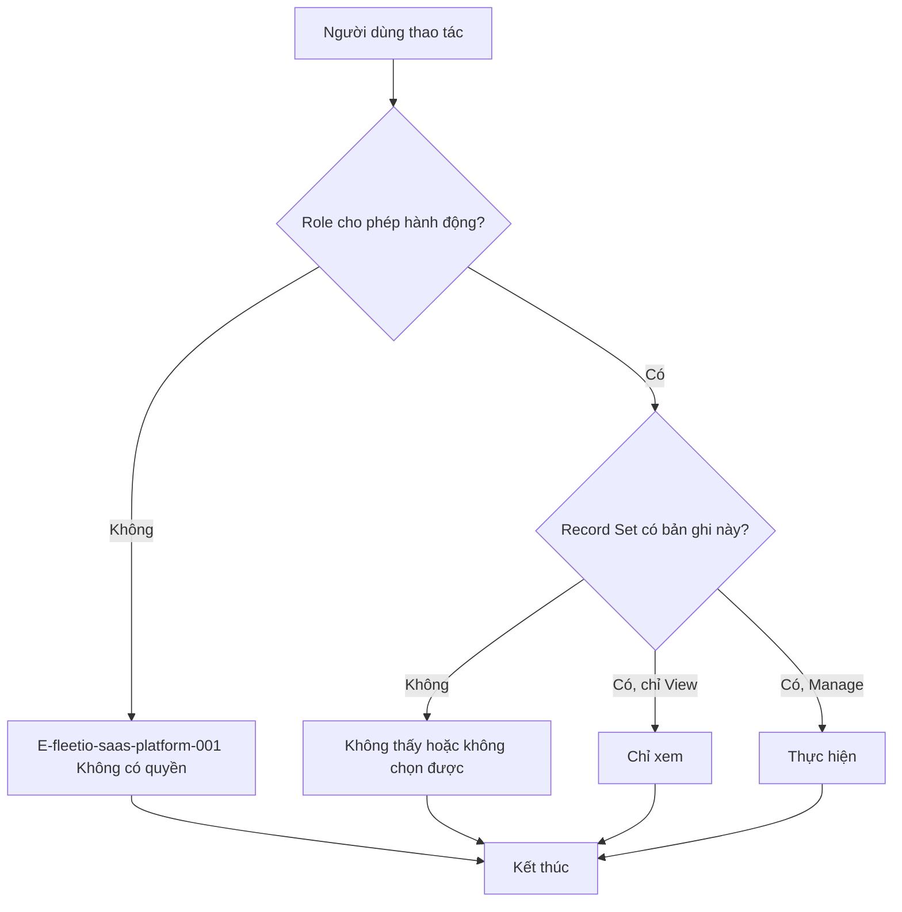

## Flow 2: Tự động hoá (`Chạy` Issue, Add Comment, Update Field, Create Record)

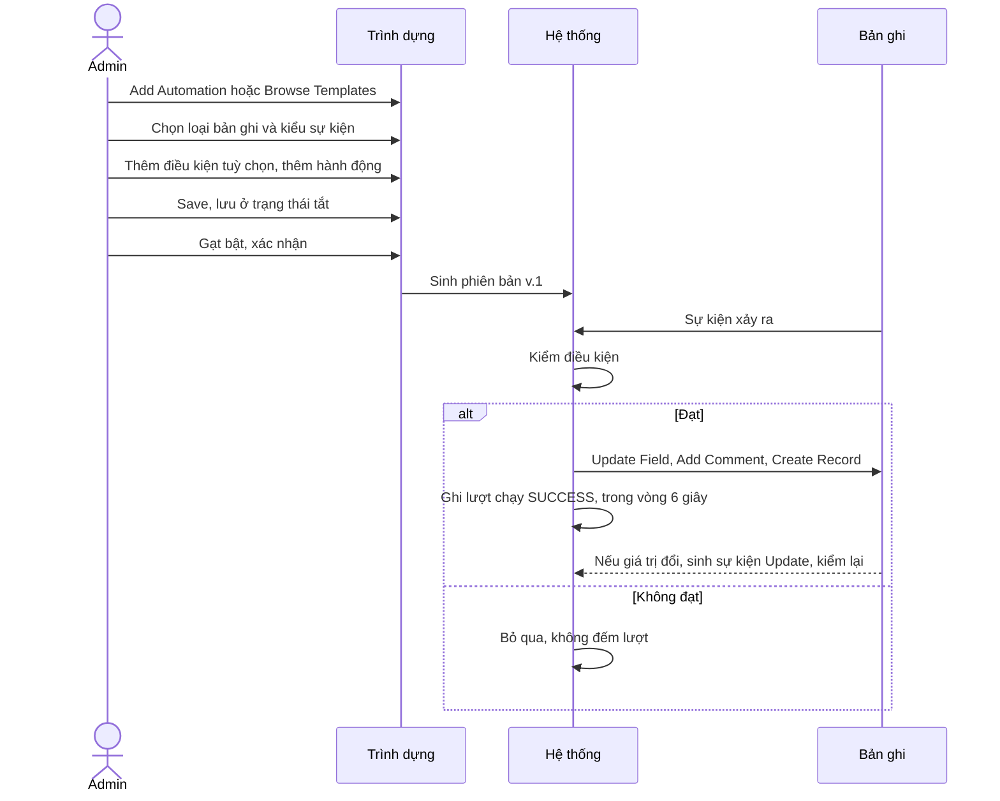

## Flow 3: Khách mới (`Chạy` một phần)

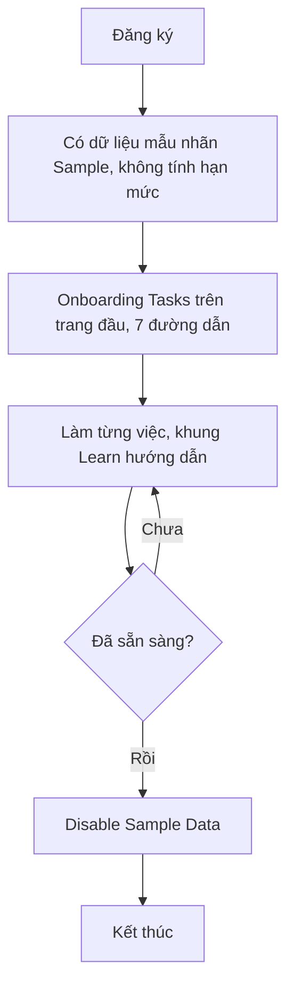

## Flow 4: Tạo và bật automation từ mẫu, có nhánh lỗi và đảo ngược (`Chạy`)

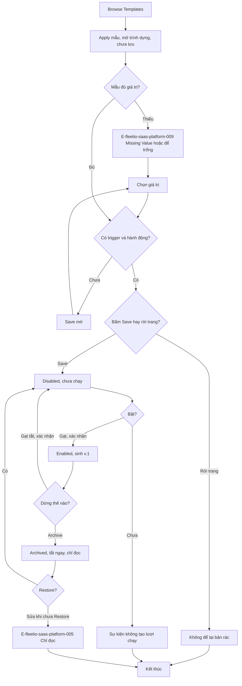

## Flow 5: Một sự kiện đi qua automation (`Chạy`)

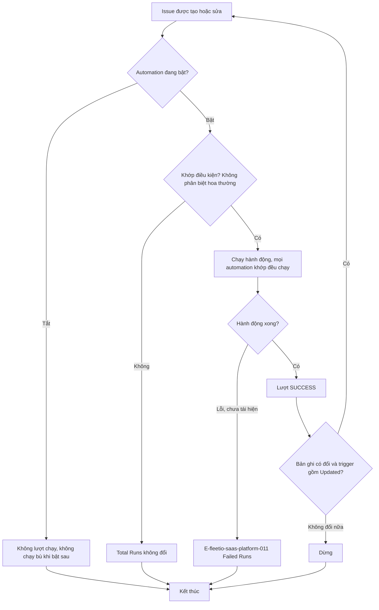

Vòng lặp giữa hai automation lật giá trị chưa chạy (OQ-5). Lượt do automation gây ra vẫn ghi "Triggered By" là người tạo Issue; lượt chỉ thêm comment ghi "Records: No records changed".

## Flow 6: Sự cố sinh lệnh sửa (`Chạy` đến khi WO Open)

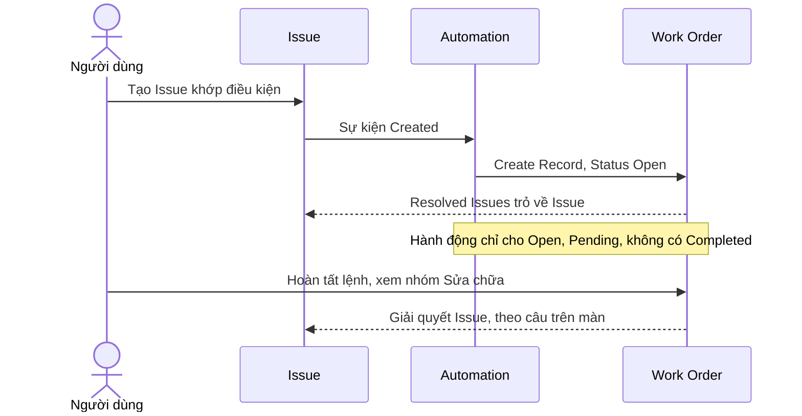

## Flow 7: Tạo xe khi có hạn mức (`Chạy` nhánh chặn)

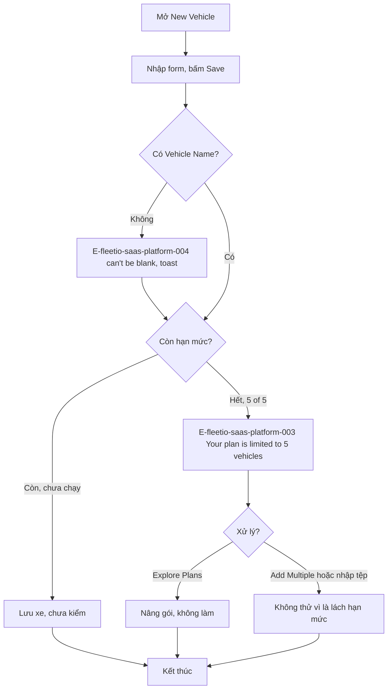

## Flow 8: Liên hệ thành người dùng (`Chạy` No Access, `Xem` Enable Access)

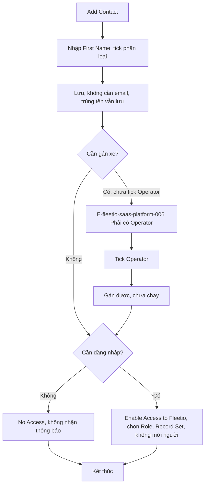

## Flow 9: Chia sẻ báo cáo (`Chạy`)

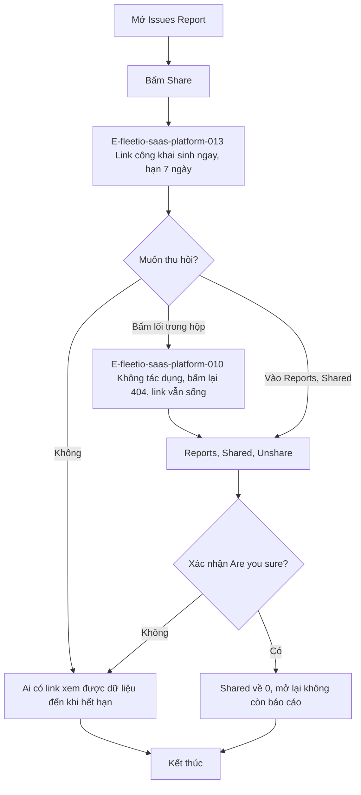

Đề xuất Invlogis: nhánh thay thế là mở hộp không có link, bấm tạo mới có, nói rõ phạm vi, ghi nhật ký (NFR-fleetio-saas-platform-010).

## Flow 10: Xuất và in báo cáo (`Xem` nút, chưa bấm)

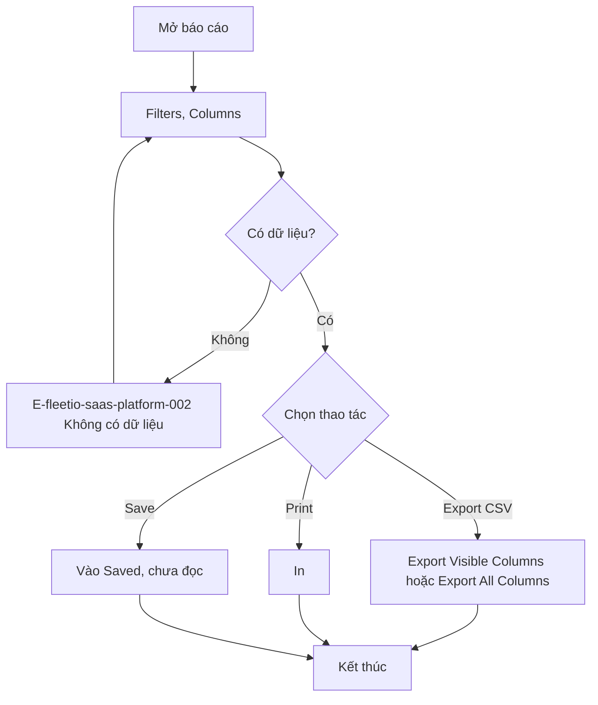

## Flow 11: Hỏi dữ liệu bằng lời (`Chạy` 2 câu)

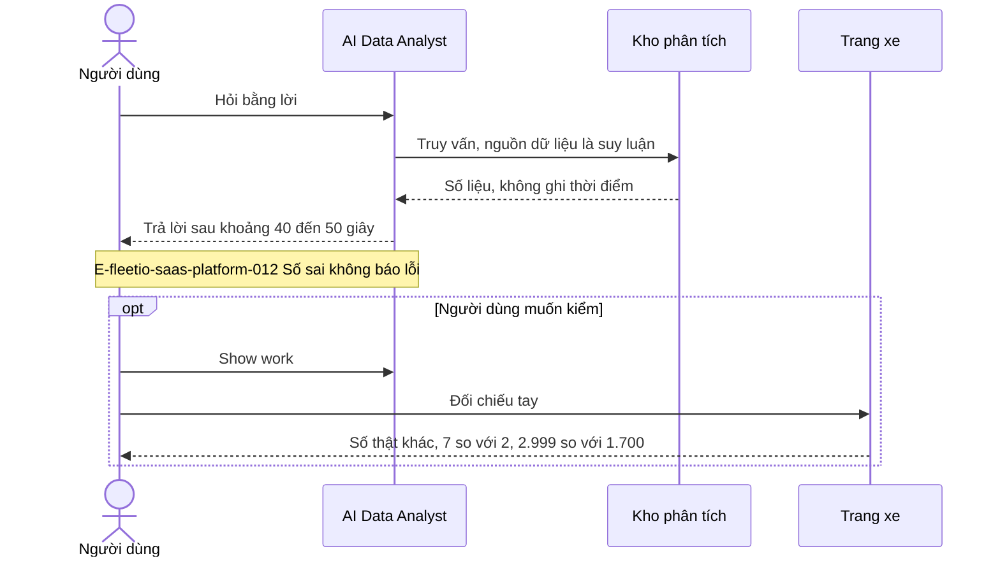

## Flow 12: Từ trang đầu tới việc cần xử lý (`Chạy`)

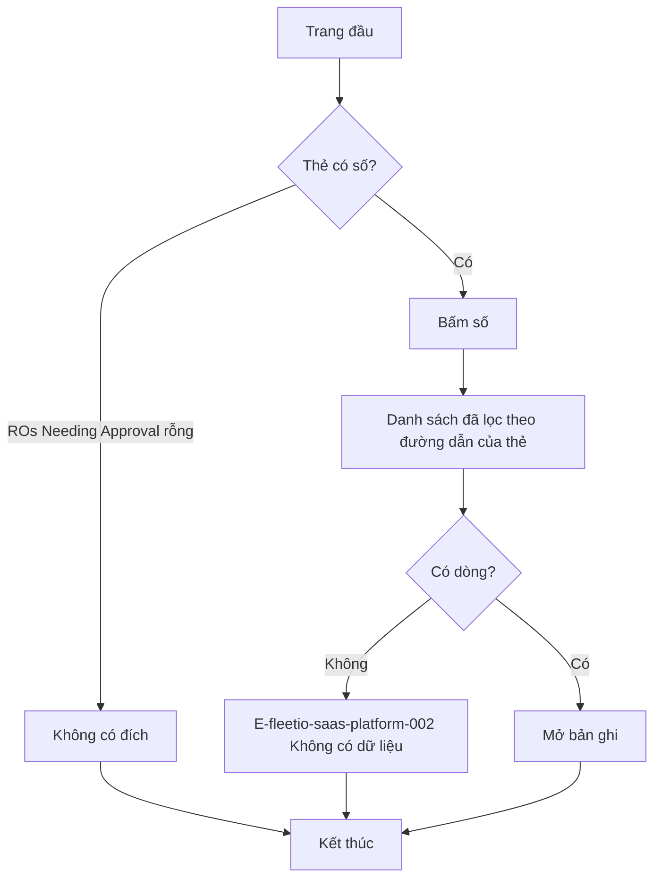

## Flow 13: Bật luật theo khách (`Xem`, không Save)

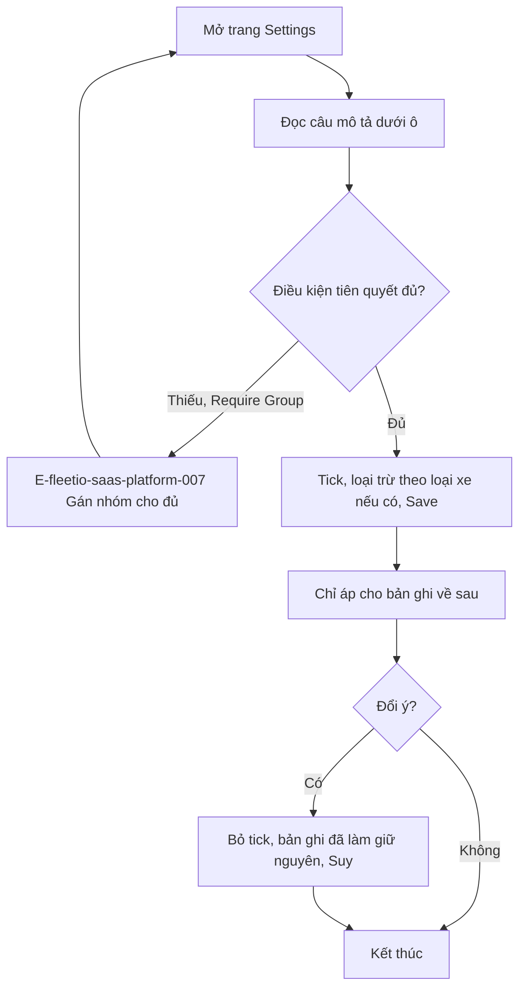
