# Nền tảng SaaS — Màn hình thật

Ảnh chụp từ tài khoản dùng thử ngày 02/11/2026 và 03/11/2026, dùng nội bộ để phân tích. Bảng các màn thêm ngày 03/11 viết theo ghi chú chạy; ô "Chưa ghi" là phần ghi chú không nêu. Màn 2.4 Hộp chia sẻ báo cáo và 2.5 Báo cáo đã chia sẻ không có ảnh, mô tả ở Mục 13.7 của spec. Màn lượt 3 không có ảnh: 2.8 Hộp lưu báo cáo, 2.9 Báo cáo đã lưu ở Mục 13.11; 2.10 Bộ lọc báo cáo (lượt 4) ở Mục 21.3; 4.4 Cài đặt thông báo cá nhân ở Mục 14; 5.9 Trang tệp ở Mục 13.14; 5.10 Form bật truy cập, 5.11 Form đặt xe ở Mục 13.21. Bảng các ảnh lượt 3 viết sau khi mở ảnh đối chiếu; phần ảnh không thấy được ghi rõ trong bảng.

## 1.1 Trang đầu

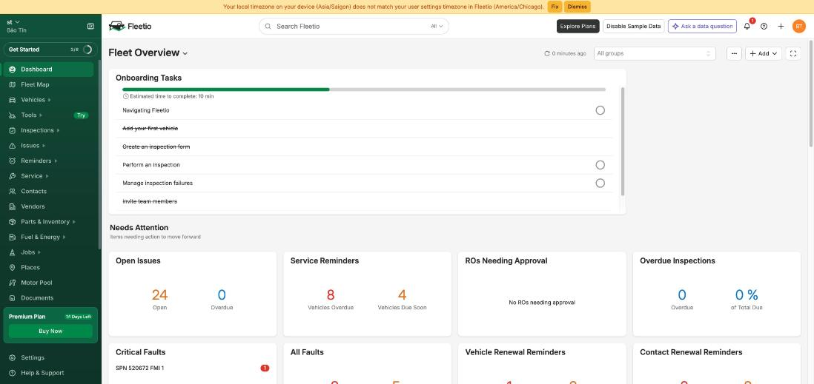

| # | Items | Control type | Data type | Description |
|---|---|---|---|---|
| 1 | Fleet Overview | Chọn | — | Đổi dashboard |
| 2 | Refresh, nhóm, More, Add, toàn màn | Nút | — | "0 minutes ago"; lọc All groups |
| 3 | Onboarding Tasks | Khối | Danh sách | Thanh tiến độ, thời gian ước tính, việc đã xong gạch ngang |
| 4 | Needs Attention | Lưới thẻ | Số | Open Issues, Service Reminders, ROs Needing Approval, Overdue Inspections, Critical Faults, All Faults, Renewals; số dẫn tới danh sách lọc |

## 2.1 Báo cáo chuẩn

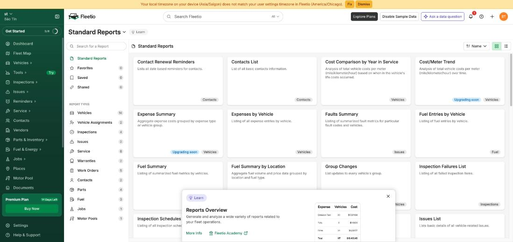

| # | Items | Control type | Data type | Description |
|---|---|---|---|---|
| 1 | Tìm báo cáo | Tìm | Chữ | — |
| 2 | Standard Reports, Favorites, Saved, Shared | Menu | Số | — |
| 3 | Report Types | Menu | Số | 13 nhóm kèm số lượng, tổng 49 báo cáo (bản 02/11 ghi 12 nhóm là sai) |
| 4 | Thẻ báo cáo | Thẻ | — | Tên, mô tả, nhóm, nhãn "Upgrading soon" |
| 5 | Sắp xếp, lưới, danh sách | Nút | — | — |

## 2.2 Báo cáo Sự cố

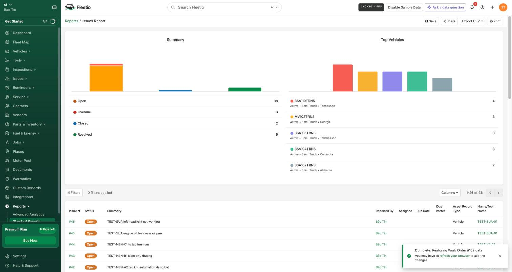

| # | Items | Control type | Data type | Description |
|---|---|---|---|---|
| 1 | Summary | Biểu đồ | Số | Đếm theo Open, Overdue, Closed, Resolved |
| 2 | Top Vehicles | Biểu đồ | Số | Xe có nhiều sự cố nhất |
| 3 | Filters, Columns | Nút | — | Lọc và chọn cột; có phân trang |
| 4 | Bảng sự cố | Bảng | Danh sách | Cột Issue, Status, Summary, Reported By, Assigned, Due Date, Due Meter, Asset Record Type, Name/Tool Name |
| 5 | Save | Nút | — | Lưu báo cáo; lượt 3 đã bấm, xem màn 2.8 |
| 6 | Share | Nút | — | Sinh ngay link công khai, không hỏi trước (E-fleetio-saas-platform-013) |
| 7 | Export CSV | Menu | — | Export Visible Columns, Export All Columns; chưa bấm |
| 8 | Print | Nút | — | Chưa bấm |

## 2.3 Hỏi dữ liệu

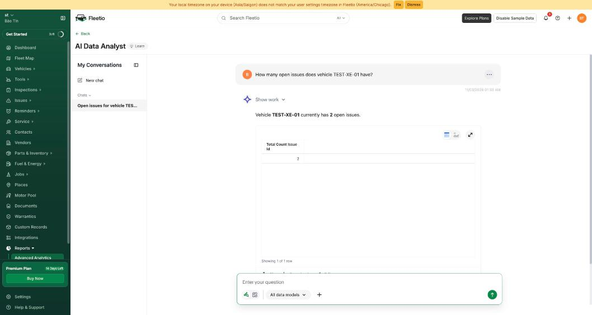

| # | Items | Control type | Data type | Description |
|---|---|---|---|---|
| 1 | AI Data Analyst | Khung nhúng | — | Nhúng từ ThoughtSpot, mở từ nút Ask a data question trên đầu trang |
| 2 | Ô hỏi | Chữ | Câu hỏi | Trả lời sau khoảng 40 đến 50 giây |
| 3 | Câu trả lời, bảng | Chữ, bảng | Số | "currently has 2 open issues", bảng Total Count Issue Id = 2; thật là 7 (E-fleetio-saas-platform-012) |
| 4 | Show work | Nút | — | Xem cách làm |
| 5 | All data models | Chọn | — | Chọn nguồn dữ liệu |
| 6 | My Conversations | Danh sách | — | Lưu hội thoại |

## 3.1 Trình dựng tự động hoá

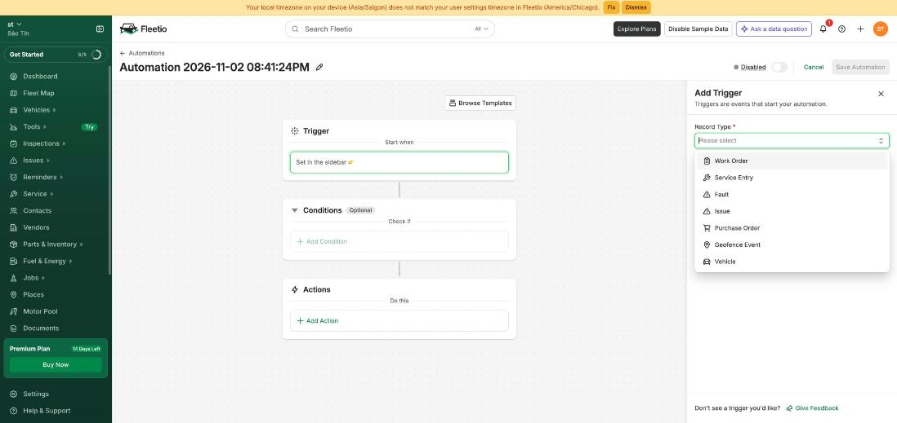

| # | Items | Control type | Data type | Description |
|---|---|---|---|---|
| 1 | Tên | Chữ | — | Mặc định theo thời điểm, sửa được |
| 2 | Disabled, Save | Bật tắt, nút | — | Save khoá đến khi đủ |
| 3 | Trigger, Conditions, Actions | Khối | — | "Start when", "Check if", "Do this" |
| 4 | Browse Templates | Nút | — | 18 mẫu |
| 5 | Record Type | Chọn | Bắt buộc | Work Order, Service Entry, Fault, Issue, Purchase Order, Geofence Event, Vehicle |
| 6 | Give Feedback | Liên kết | — | "Don't see a trigger you'd like?" |

## 3.2 Thư viện mẫu tự động hoá

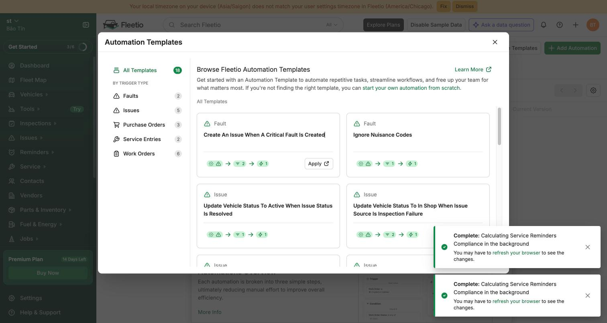

| # | Items | Control type | Data type | Description |
|---|---|---|---|---|
| 1 | Cột trái theo loại trigger | Menu | Số | Faults 2, Issues 5, Purchase Orders 3, Service Entries 2, Work Orders 6 |
| 2 | Thẻ mẫu | Thẻ | — | Tên, sơ đồ trigger, số điều kiện, số hành động |
| 3 | Apply | Nút | — | Hiện khi rê chuột; mở trình dựng theo mẫu, chưa lưu gì |

## 3.3 Danh sách tự động hoá

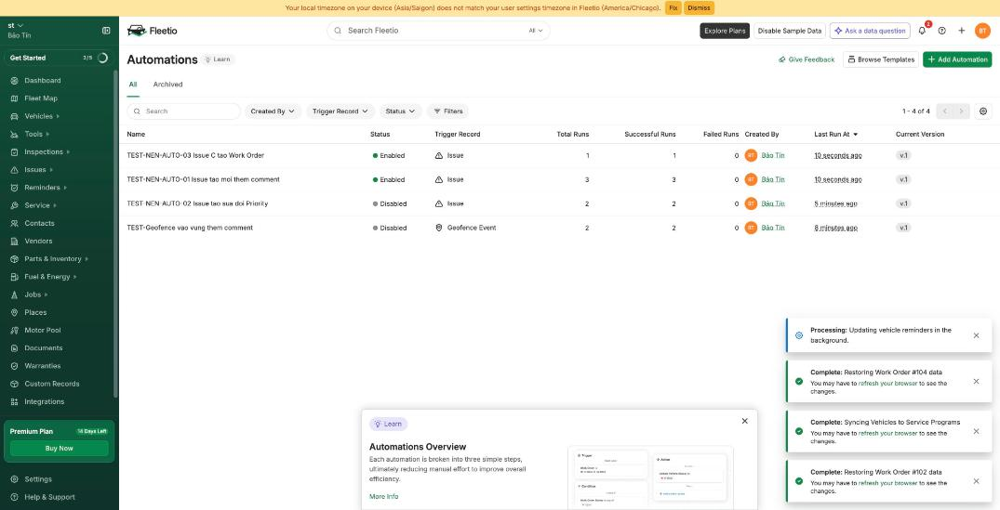

| # | Items | Control type | Data type | Description |
|---|---|---|---|---|
| 1 | All, Archived | Tab | — | Tách bản đã lưu trữ |
| 2 | Created By, Trigger Record, Status, Filters | Lọc | — | Lọc nhanh |
| 3 | Name, Status, Trigger Record | Cột | Chữ | Định danh và trạng thái |
| 4 | Total Runs, Successful Runs, Failed Runs | Cột | Số | Lượt không khớp không được tính; ảnh này Failed Runs 0, lượt 3 có lượt thất bại ở màn 3.11 |
| 5 | Created By, Last Run At, Current Version | Cột | Chữ, ngày | Truy vết người tạo, phiên bản |

## 3.4 Chi tiết tự động hoá

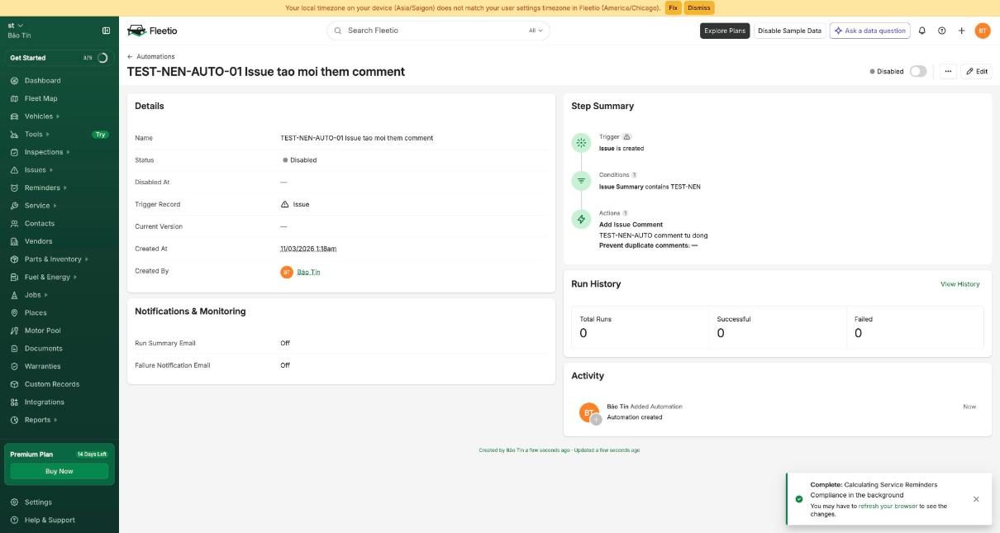

| # | Items | Control type | Data type | Description |
|---|---|---|---|---|
| 1 | Công tắc bật tắt | Bật tắt | — | Có hộp xác nhận cả hai chiều; bật sinh version v.1, ghi Enabled At |
| 2 | Archive | Nút | — | Không cần tắt trước; có hộp xác nhận |
| 3 | More Actions | Menu | — | Make a Copy, Archive, View Record History; lượt 3 đã chạy Make a Copy; Delete chỉ ở bản Archived |
| 4 | Failure Notification Email, Run Summary Email | Ô nhập | Chưa ghi | Không bật vì gửi email |
| 5 | Bố cục còn lại | Chưa ghi | Chưa ghi | Ghi chú chạy không mô tả từng khối |

## 3.5 Lịch sử lượt chạy

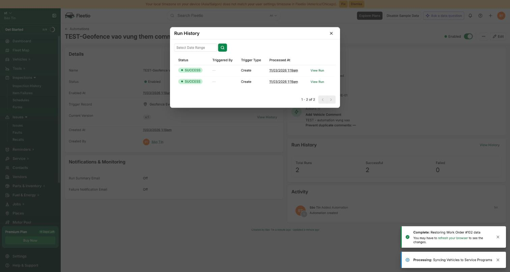

| # | Items | Control type | Data type | Description |
|---|---|---|---|---|
| 1 | Danh sách lượt | Bảng | Danh sách | Kết quả SUCCESS; lượt không khớp không hiện |
| 2 | Cột cụ thể | Chưa ghi | Chưa ghi | Ghi chú chạy không liệt kê tên cột; mở một dòng ra màn 3.6 |

## 3.6 Kết quả một lượt chạy

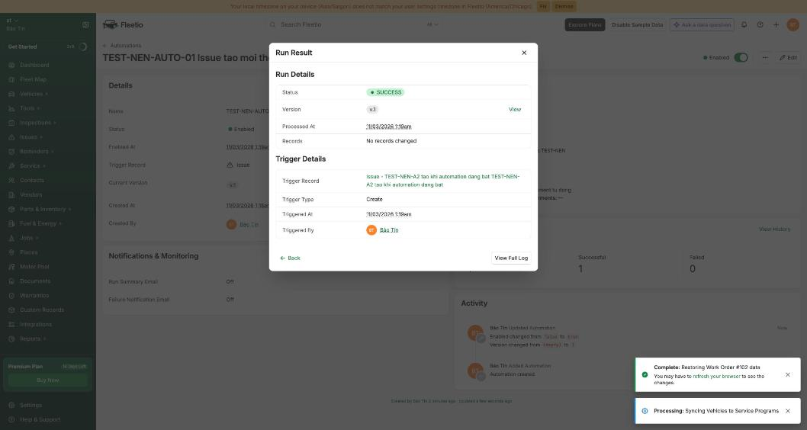

| # | Items | Control type | Data type | Description |
|---|---|---|---|---|
| 1 | Phiên bản | Chữ | — | Phiên bản automation đã chạy |
| 2 | Bản ghi kích hoạt | Liên kết | — | Bản ghi gây ra lượt chạy |
| 3 | Records | Chữ | — | "Records: No records changed" dù đã thêm comment, điểm yếu |
| 4 | Log | Khối | JSON | Đội hỗ trợ tra được vì sao chạy |

## 3.7 Lượt chạy tự kích hoạt

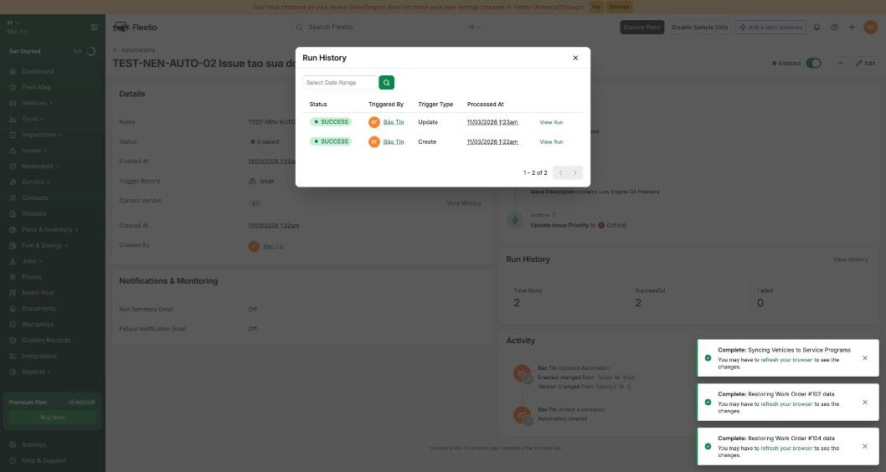

| # | Items | Control type | Data type | Description |
|---|---|---|---|---|
| 1 | Hai lượt liên tiếp | Bảng | Danh sách | Create rồi Update; sau đó dừng vì giá trị không đổi |
| 2 | Triggered By | Cột | Chữ | Vẫn ghi người tạo Issue, không ghi automation; điểm yếu |

## 3.8 Tự động hoá đã lưu trữ

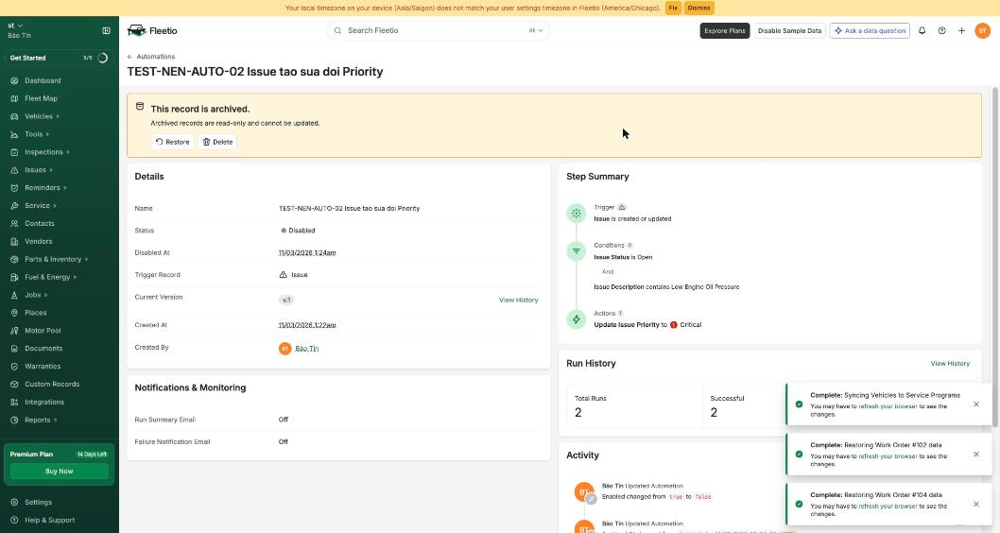

| # | Items | Control type | Data type | Description |
|---|---|---|---|---|
| 1 | Thông báo chỉ đọc | Chữ | — | "Archived records are read-only and cannot be updated." (E-fleetio-saas-platform-005) |
| 2 | Restore | Nút | — | Về Disabled, không tự bật; "Record successfully restored" |
| 3 | Delete | Nút | — | Không bấm theo ràng buộc; hành vi chưa biết |

## 3.9 Comment do tự động hoá tạo

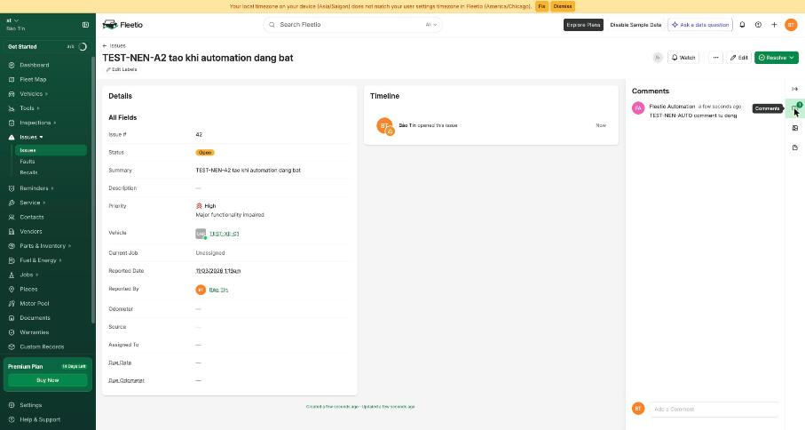

| # | Items | Control type | Data type | Description |
|---|---|---|---|---|
| 1 | Comment trên Issue | Khối | Chữ | Xuất hiện trong vòng 6 giây sau khi tạo Issue khớp điều kiện |
| 2 | Tác giả | Chữ | — | "Fleetio Automation" |

## 4.1 Maintenance Settings

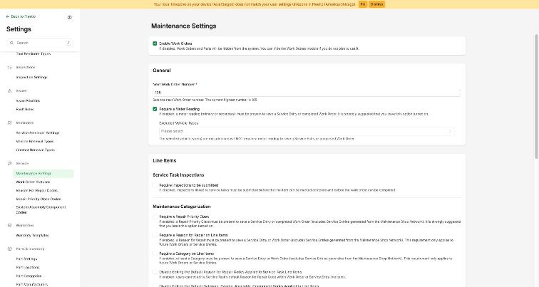

| # | Items | Control type | Data type | Description |
|---|---|---|---|---|
| 1 | Enable Work Orders | Tick | — | Tắt thì ẩn Work Orders, Parts |
| 2 | Next Work Order Number | Số | Bắt buộc | Hiện số cao nhất đã dùng |
| 3 | Require a Meter Reading | Tick | — | Có Excluded Vehicle Types |
| 4 | Service Task Inspections | Tick | — | Bắt nộp phiếu gắn việc |
| 5 | Maintenance Categorization | Tick | — | Bắt phân loại, lý do, nhóm; khoá sửa mã mặc định |
| 6 | Complaint, Cause, Correction; Markups | Tick, số | — | Xem thêm khi cuộn |
| 7 | Thanh trái Settings | Menu | — | Tìm được, chia nhóm |

## 4.2 Record Sets

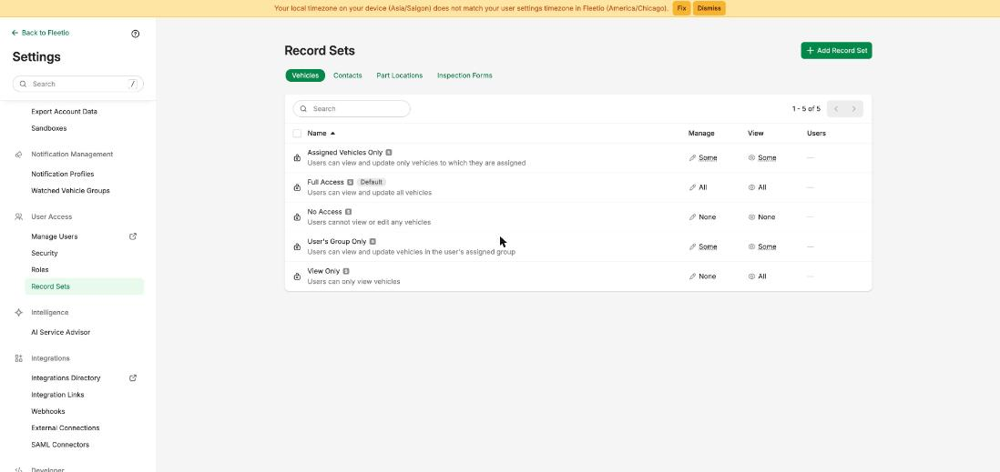

| # | Items | Control type | Data type | Description |
|---|---|---|---|---|
| 1 | Vehicles, Contacts, Part Locations, Inspection Forms | Tab | — | Đối tượng áp phạm vi |
| 2 | Name | Cột | Chữ | Assigned Vehicles Only, Full Access (mặc định), No Access, User's Group Only, View Only; biểu tượng hệ thống |
| 3 | Manage, View | Cột | All, Some, None | Tách quyền sửa và xem |
| 4 | Users | Cột | Số | Số người đang dùng |
| 5 | Add Record Set | Nút | — | Tạo tập theo điều kiện |

## 4.3 Điều kiện tập bản ghi

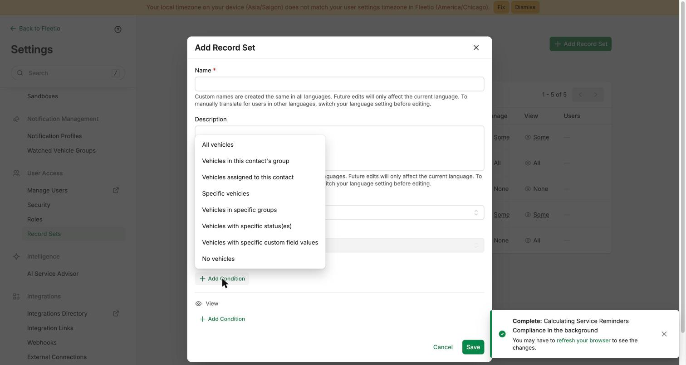

| # | Items | Control type | Data type | Description |
|---|---|---|---|---|
| 1 | Record Type | Chọn | — | "can't be changed after creation" (E-fleetio-saas-platform-008) |
| 2 | Manage, View | Khối | — | Khai riêng hai quyền |
| 3 | Điều kiện Vehicles | Chọn | — | All vehicles, Vehicles in this contact's group, Vehicles assigned to this contact, Specific vehicles, Vehicles in specific groups, Vehicles with specific status(es), Vehicles with specific custom field values, No vehicles; không có điều kiện theo thời gian |

## 5.1 Liên hệ không truy cập

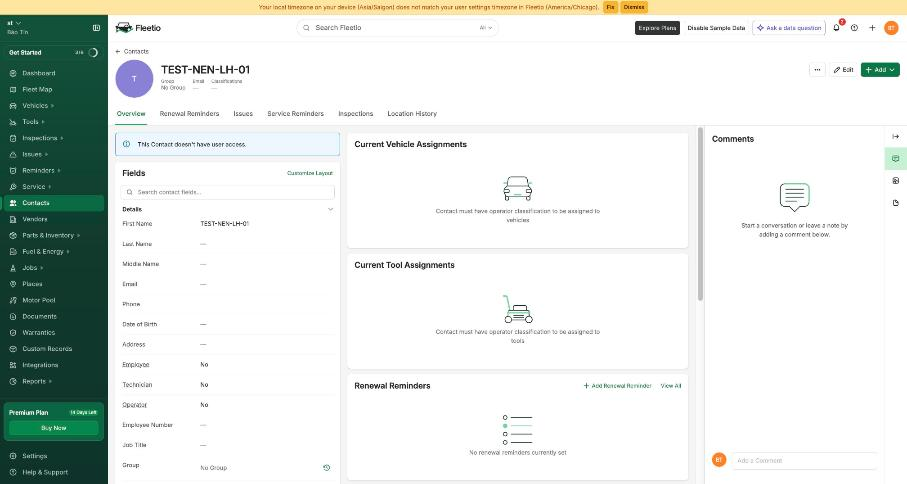

| # | Items | Control type | Data type | Description |
|---|---|---|---|---|
| 1 | Trạng thái truy cập | Chữ | — | "This Contact doesn't have user access." |
| 2 | Khối xe | Khối | — | "Contact must have operator classification to be assigned to vehicles" (E-fleetio-saas-platform-006) |
| 3 | Bố cục còn lại | Chưa ghi | Chưa ghi | Ghi chú chạy chỉ mô tả form tạo: Basic Details, Classifications, User Access, Contact Information |

## 5.2 Menu thao tác xe

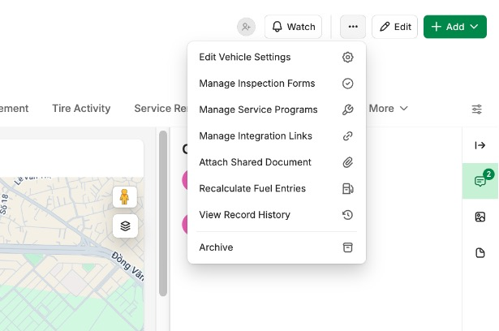

| # | Items | Control type | Data type | Description |
|---|---|---|---|---|
| 1 | Edit Vehicle Settings, Manage Inspection Forms, Manage Service Programs, Manage Integration Links | Mục menu | — | Không bấm |
| 2 | Attach Shared Document, Recalculate Fuel Entries, View Record History | Mục menu | — | Không bấm |
| 3 | Archive | Mục menu | — | Cần quyền `vehicles_archive_delete`, Operator không có; không bấm |

## 5.3 Danh sách thu hồi hãng

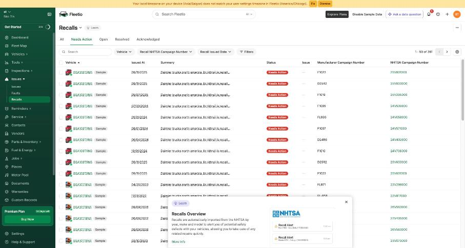

| # | Items | Control type | Data type | Description |
|---|---|---|---|---|
| 1 | All, Needs Action, Open, Resolved, Acknowledged | Tab | — | Ảnh ở tab Needs Action, "1 - 50 of 261" (chữ nhỏ), dòng Sample; chỉ đọc. Nhóm Sửa chữa đọc cùng tab về sau: 285 (OQ-21) |
| 2 | Issued At, Status, Issue | Cột | Ngày, chữ | Không đổi trạng thái |
| 3 | Manufacturer Campaign Number, NHTSA Campaign Number | Cột | Chữ | Khung Learn ghi nhập tự động theo năm, hãng, đời từ NHTSA |

## 5.4 Đặt xe dùng chung

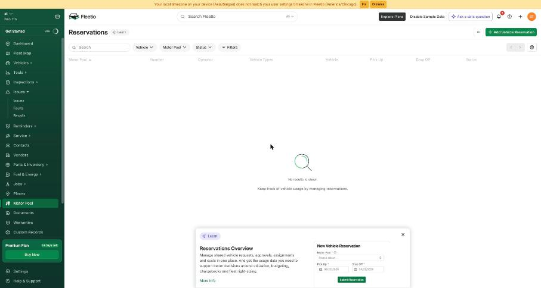

| # | Items | Control type | Data type | Description |
|---|---|---|---|---|
| 1 | Add Vehicle Reservation | Nút | — | Phải có Motor Pool trong Settings; lượt 5 đã mở, xem màn 5.13 |
| 2 | Motor Pool, Number, Operator, Vehicle Types, Vehicle, Pick Up, Drop Off, Status | Cột | Chữ, ngày | Danh sách rỗng |

## 5.5 Kho tài liệu

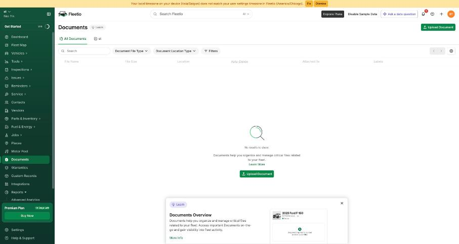

| # | Items | Control type | Data type | Description |
|---|---|---|---|---|
| 1 | All Documents, tab tên tài khoản | Tab | — | Đang rỗng |
| 2 | File Name, File Size, Location, Auto-Delete, Attached To, Labels | Cột | Chữ, số | Không tải tệp |
| 3 | Document File Type, Document Location Type | Lọc | — | Chưa thử |

## 2.6 Lỗi báo cáo

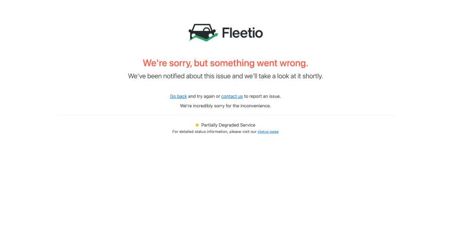

| # | Items | Control type | Data type | Description |
|---|---|---|---|---|
| 1 | Logo Fleetio | Hình | — | Trang lỗi riêng, không có menu trái, đầu trang |
| 2 | "We're sorry, but something went wrong." | Chữ | — | E-fleetio-saas-platform-014, mở `reports/expense_entries` 2 lần cùng lỗi; câu phụ "We've been notified about this issue and we'll take a look at it shortly." |
| 3 | Go back, contact us | Liên kết | — | "Go back and try again or contact us to report an issue." |
| 4 | Partially Degraded Service | Chữ, chấm vàng | — | Trạng thái dịch vụ lúc đọc; có thể sự cố tạm của hãng, chưa thử lại sau |
| 5 | Status page | Liên kết | — | "For detailed status information, please visit our status page"; chưa bấm |

## 2.7 Hỏi dữ liệu: xe không tồn tại

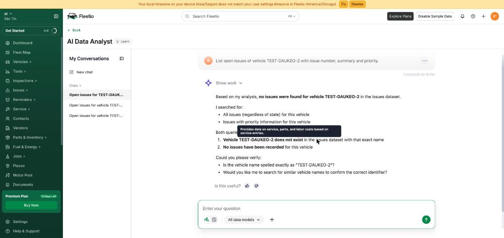

| # | Items | Control type | Data type | Description |
|---|---|---|---|---|
| 1 | My Conversations | Danh sách | — | New chat, nhóm Chats, 3 hội thoại; tên bị cắt |
| 2 | Câu hỏi | Chữ | — | "List open issues of vehicle TEST-DAUKEO-2 with issue number, summary and priority."; có giờ gửi, menu ba chấm |
| 3 | Show work | Nút mở | — | Chưa mở trong ảnh |
| 4 | Câu trả lời | Chữ | — | "no issues were found for vehicle TEST-DAUKEO-2"; hai truy vấn đã làm; "Vehicle TEST-DAUKEO-2 does not exist in the issues dataset with that exact name", "No issues have been recorded for this vehicle" (E-fleetio-saas-platform-015). Một dòng mở đầu danh sách bị khung gợi ý che, chỉ đọc được "Both queri..." |
| 5 | Khung gợi ý nổi | Tooltip | — | "Provides data on service, parts, and labor costs based on service entries."; do con trỏ rê đúng lúc chụp; chưa rõ gắn với mục nào |
| 6 | Câu hỏi lại người dùng | Chữ | — | Hỏi có gõ đúng tên không, có muốn tìm tên gần giống không |
| 7 | Is this useful? | Nút thích, không thích | — | Chưa bấm |
| 8 | Ô hỏi, All data models | Chữ, chọn | Câu hỏi | "Enter your question"; có thêm tệp, gửi |

## 3.10 Lịch sử phiên bản

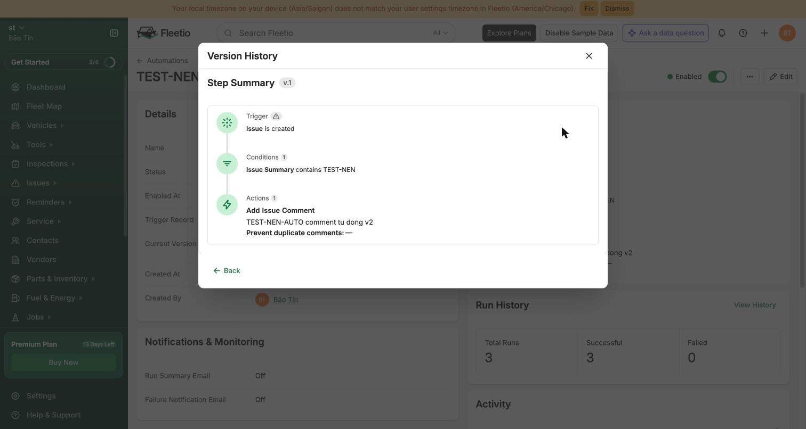

| # | Items | Control type | Data type | Description |
|---|---|---|---|---|
| 1 | Version History | Hộp | — | Mở trên trang chi tiết automation; đang ở bước xem một bản, chưa thấy danh sách phiên bản trong ảnh |
| 2 | Step Summary, nhãn v.1 | Chữ | — | Bản đang xem |
| 3 | Trigger | Khối | — | "Issue is created", có biểu tượng cảnh báo cạnh nhãn; chưa rõ cảnh báo gì |
| 4 | Conditions | Khối | Số | 1 điều kiện, "Issue Summary contains TEST-NEN" |
| 5 | Actions | Khối | Số | Add Issue Comment; nội dung "TEST-NEN-AUTO comment tu dong v2" dù đang xem v.1 (E-fleetio-saas-platform-018); Prevent duplicate comments: — |
| 6 | Back | Nút | — | Quay về danh sách phiên bản |
| 7 | Nền trang | Chữ | Số | Mờ một phần: Enabled, Total Runs 3, Successful 3, Failed 0, Run Summary Email Off, Failure Notification Email Off; khối bị hộp che không đọc được |

## 3.11 Lượt chạy thất bại

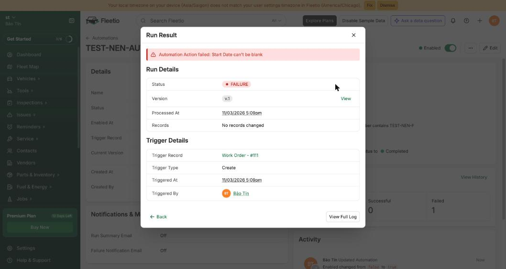

| # | Items | Control type | Data type | Description |
|---|---|---|---|---|
| 1 | Băng đỏ | Thông báo | — | "Automation Action failed: Start Date can't be blank" (E-fleetio-saas-platform-011) |
| 2 | Status | Nhãn | — | FAILURE đỏ |
| 3 | Version | Nhãn, liên kết | — | v.1, có View |
| 4 | Processed At | Ngày giờ | — | Thời điểm xử lý |
| 5 | Records | Chữ | — | "No records changed"; lần này đúng, WO #111 giữ nguyên |
| 6 | Trigger Record | Liên kết | — | Work Order - #111 |
| 7 | Trigger Type | Chữ | — | Create |
| 8 | Triggered At | Ngày giờ | — | Trùng phút với Processed At |
| 9 | Triggered By | Liên kết | — | Ghi người tạo WO |
| 10 | Back, View Full Log | Nút | — | Log JSON từng bước; nội dung log không có trong ảnh |
| 11 | Nền trang | Chữ | Số | Mờ một phần: Enabled, Successful 0, Failed 1, Run Summary Email Off, Failure Notification Email Off, Activity "Enabled changed from false to true" |

## 3.12 Luật đổi trạng thái xe

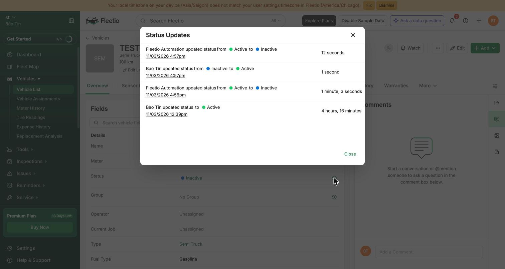

| # | Items | Control type | Data type | Description |
|---|---|---|---|---|
| 1 | Status Updates | Hộp | Danh sách | Mở từ biểu tượng lịch sử cạnh trường Status; mới nhất ở trên |
| 2 | Dòng do automation | Dòng | — | "Fleetio Automation updated status from Active to Inactive" (E-fleetio-saas-platform-017) |
| 3 | Dòng do người | Dòng | — | Tên người "updated status from Inactive to Active"; dòng tiếp theo cùng phút là automation đổi lại |
| 4 | Ngày giờ | Chữ gạch chân | — | Từng dòng; không có cột nguồn riêng, nguồn nằm trong câu |
| 5 | Thời lượng | Chữ | — | Thời gian ở trạng thái đó: 12 seconds, 1 second, 1 minute 3 seconds, 4 hours 16 minutes |
| 6 | Close | Nút | — | Đóng hộp |
| 7 | Nền trang | Chữ | — | Trang xe: Status Inactive, Group No Group, Operator Unassigned, Type Semi Truck; có biểu tượng lịch sử ở Status, Group; tên xe bị hộp che một phần |

## 5.6 Lịch sử bản ghi sự cố

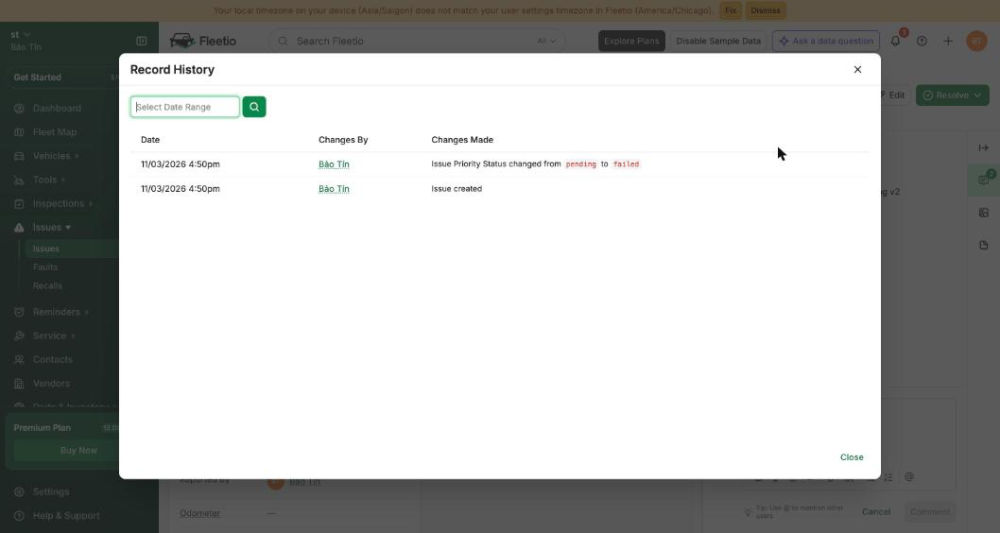

| # | Items | Control type | Data type | Description |
|---|---|---|---|---|
| 1 | Select Date Range, nút tìm | Chọn ngày | Ngày | Lọc lịch sử; chưa đổi trong ảnh |
| 2 | Date, Changes By, Changes Made | Cột | Ngày, chữ | 2 dòng cùng phút |
| 3 | "Issue created" | Dòng | — | Tạo Issue |
| 4 | "Issue Priority Status changed from pending to failed" | Dòng | — | Giá trị `pending`, `failed` tô đỏ; AI xếp mức thất bại, chỉ thấy ở đây (E-fleetio-saas-platform-016). Changes By ghi người tạo, không ghi máy |
| 5 | Close | Nút | — | Đóng hộp. Ảnh không có dòng Comment, Watch, đúng BR-fleetio-saas-platform-040; số Issue bị hộp che, theo ghi chú chạy là #55 |

## 5.7 Hộp thông báo

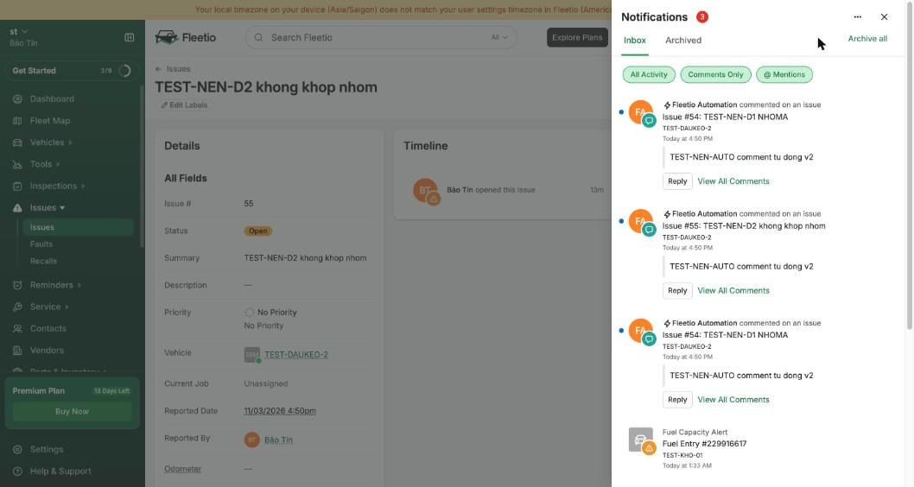

| # | Items | Control type | Data type | Description |
|---|---|---|---|---|
| 1 | Notifications, số 3 | Tiêu đề, nhãn đếm | Số | 3 chưa đọc; ngăn kéo bên phải đè lên trang Issue #55 |
| 2 | Inbox, Archived | Tab | — | Đang ở Inbox |
| 3 | All Activity, Comments Only, @ Mentions | Lọc | — | Đang thấy cả ba sáng |
| 4 | Archive all, ba chấm, đóng | Nút | — | Chưa bấm; menu ba chấm trong ảnh chưa mở, ghi chú chạy ghi có Notification Settings |
| 5 | Dòng comment của automation | Dòng | — | "Fleetio Automation commented on an issue"; Issue #54, #55, #54 trên TEST-DAUKEO-2, trích nội dung; 2 dòng #54 là 2 automation cùng chạy (C-155) |
| 6 | Reply, View All Comments | Nút, liên kết | — | Từng dòng; chưa bấm |
| 7 | Fuel Capacity Alert | Dòng | — | Fuel Entry trên TEST-KHO-01; có trong khi 0 hồ sơ thông báo (BR-fleetio-saas-platform-042). Ảnh bị cắt ở dòng này, dòng sau không đọc được |
| 8 | Nền trang Issue #55 | Chữ | — | Status Open, Priority "No Priority" (biểu tượng chờ), Timeline "opened this issue" |

## 5.8 Kho tài liệu có tệp

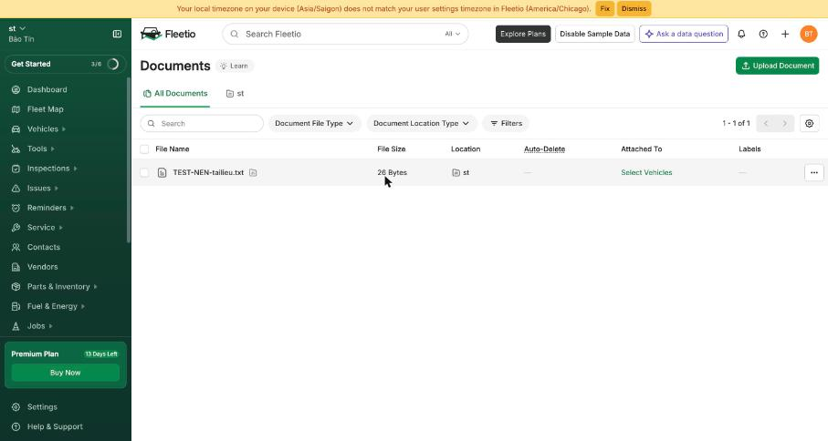

| # | Items | Control type | Data type | Description |
|---|---|---|---|---|
| 1 | Upload Document | Nút | — | Mở hộp Filestack (không có trong ảnh) |
| 2 | Learn | Nhãn | — | Khung hướng dẫn tại chỗ |
| 3 | All Documents, tab tên tài khoản | Tab | — | Đang ở All Documents |
| 4 | Search, Document File Type, Document Location Type, Filters | Lọc | — | Chưa thử; có phân trang "1 - 1 of 1", biểu tượng cài đặt xem |
| 5 | File Name | Cột | Chữ | TEST-NEN-tailieu.txt, biểu tượng tệp |
| 6 | File Size | Cột | Số | 26 Bytes |
| 7 | Location | Cột | Chữ | Tên tài khoản |
| 8 | Auto-Delete | Cột | Ngày | — , chưa đặt |
| 9 | Attached To | Cột, liên kết | — | "Select Vehicles": ảnh chụp trước khi gắn; trạng thái "Attached" không có trong ảnh, theo ghi chú chạy |
| 10 | Labels | Cột | — | — |
| 11 | Menu dòng | Nút ba chấm | — | Chưa mở trong ảnh; ghi chú chạy ghi View, Rename, Replace, Download, Delete |

## 5.12 Thêm nhóm xe dùng chung

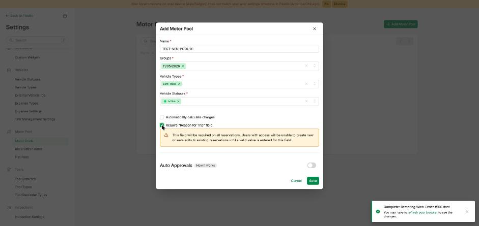

| # | Items | Control type | Data type | Description |
|---|---|---|---|---|
| 1 | Name * | Ô nhập | Chữ | Tên pool, `TEST-NEN-POOL-01` |
| 2 | Groups * | Chọn nhiều | Nhãn | Bắt buộc; ảnh chữ nhỏ, ghi chú chạy ghi một nhóm có sẵn tên giống ngày |
| 3 | Vehicle Types * | Chọn nhiều | Nhãn | Semi Truck; quyết định loại xe chọn được khi đặt (màn 5.13) |
| 4 | Vehicle Statuses * | Chọn nhiều | Nhãn | Active, mặc định theo ghi chú chạy |
| 5 | Automatically calculate charges | Tick | — | Không tick; tính phí chưa chạy |
| 6 | Require "Reason for Trip" field | Tick | — | Đang tick; hiện cảnh báo cam áp cho mọi đặt xe, cả sửa đặt xe cũ (BR-fleetio-saas-platform-059) |
| 7 | Auto Approvals, How it works | Bật tắt, nhãn | — | Đang tắt trong ảnh; các ô Time zone, Days, Start Time, End Time, Full day, Add Window theo ghi chú chạy, không có trong ảnh |
| 8 | Cancel, Save | Nút | — | Save báo "Motor Pool was successfully created" (không có trong ảnh) |
| 9 | Nền trang | Menu | — | Settings mờ, nhóm Motor Pool có Motor Pools, Reservation Rates, Flat Fees. Toast "Complete: Restoring Work Order #106 data" là việc ngoài luồng này, ghi chú chạy không nêu |

## 5.13 Lỗi form đặt xe

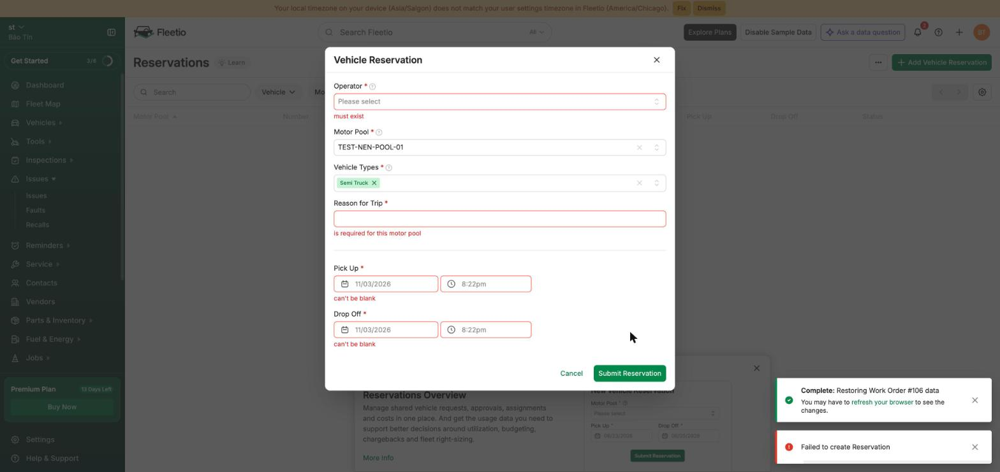

| # | Items | Control type | Data type | Description |
|---|---|---|---|---|
| 1 | Operator * | Chọn, có biểu tượng trợ giúp | Liên hệ | Viền đỏ, "must exist" (E-fleetio-saas-platform-029). Chỉ liệt kê liên hệ có đăng nhập và là Operator; "No options" (E-fleetio-saas-platform-028, không có trong ảnh) |
| 2 | Motor Pool * | Chọn, có trợ giúp | Pool | `TEST-NEN-POOL-01` |
| 3 | Vehicle Types * | Chọn nhiều, có trợ giúp | Nhãn | Semi Truck; chỉ hiện sau khi chọn pool. Không có ô chọn xe cụ thể |
| 4 | Reason for Trip * | Ô nhập | Chữ | Viền đỏ, "is required for this motor pool" vì pool bắt buộc |
| 5 | Pick Up *, Drop Off * | Ngày, giờ | Ngày giờ | Viền đỏ, "can't be blank" dù ô hiện chữ mờ ngày giờ hiện tại: đó là placeholder |
| 6 | Cancel, Submit Reservation | Nút | — | Submit không tạo bản ghi |
| 7 | Toast đỏ | Thông báo | — | "Failed to create Reservation". Toast xanh "Complete: Restoring Work Order #106 data" là việc ngoài luồng này, ghi chú chạy không nêu |
| 8 | Nền trang Reservations | Bảng | — | Cột Motor Pool, Number, Pick Up, Drop Off, Status; danh sách rỗng; khung Learn "Reservations Overview" bị hộp che một phần |

## 5.14 Đặt xe chờ duyệt

Toast "Restoring Work Order #106 data" có mặt ở cả 7 ảnh 5.14 đến 5.20, ngoài luồng đặt xe, ghi chú chạy không nêu.

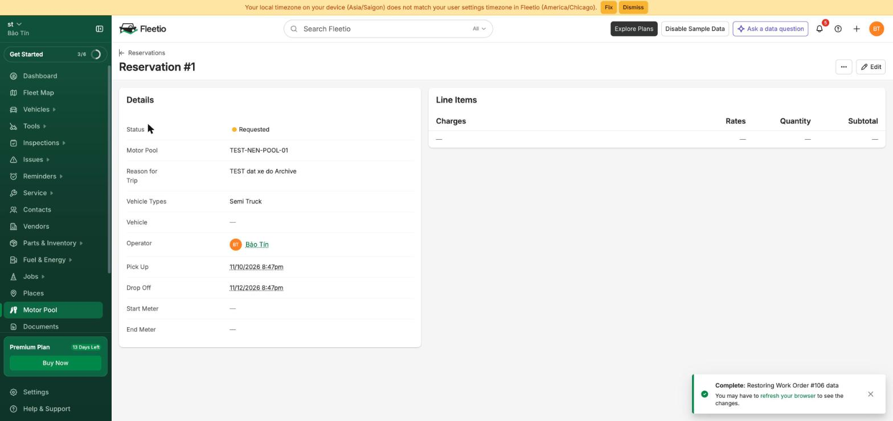

| # | Items | Control type | Data type | Description |
|---|---|---|---|---|
| 1 | Status | Nhãn | — | Requested, chấm vàng |
| 2 | Motor Pool, Reason for Trip, Vehicle Types | Chữ | — | Theo form đặt; Vehicle Types Semi Truck |
| 3 | Vehicle | Chữ | — | "—": chưa gán xe |
| 4 | Operator | Liên kết | Liên hệ | Người được đặt |
| 5 | Pick Up, Drop Off | Ngày giờ | — | Giờ hẹn |
| 6 | Start Meter, End Meter | Số | — | "—" |
| 7 | Line Items | Bảng | Charges, Rates, Quantity, Subtotal | Trống vì pool chưa bật tính phí |
| 8 | "...", Edit | Menu, nút | — | Menu có Approve, Deny, Cancel, View Record History (không có trong ảnh, theo ghi chú chạy) |

## 5.15 Hộp duyệt đặt xe

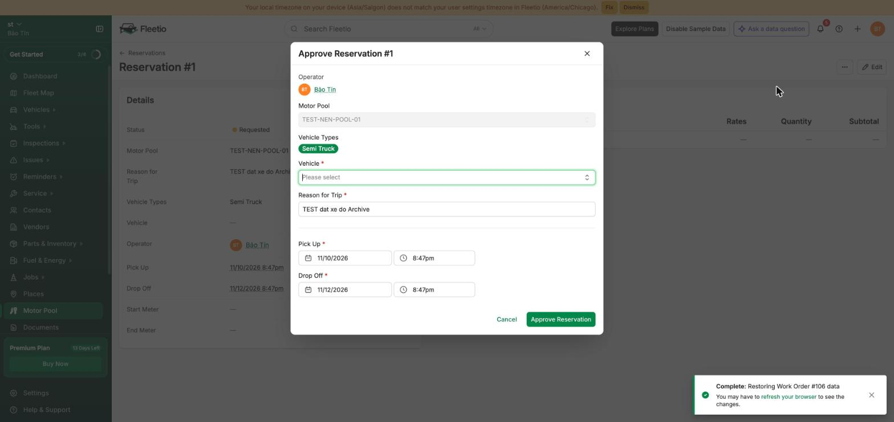

| # | Items | Control type | Data type | Description |
|---|---|---|---|---|
| 1 | Operator | Chữ, liên kết | — | Không sửa được |
| 2 | Motor Pool | Chọn, khoá | — | Xám |
| 3 | Vehicle Types | Nhãn | — | Chỉ đọc, Semi Truck |
| 4 | Vehicle * | Chọn | Xe | Bắt buộc, "Please select"; danh sách chưa mở trong ảnh; chỉ gồm xe đúng loại, đúng nhóm (BR-fleetio-saas-platform-062) |
| 5 | Reason for Trip * | Ô nhập | Chữ | Sửa được |
| 6 | Pick Up *, Drop Off * | Ngày, giờ | Ngày giờ | Sửa được, có giá trị thật, không phải chữ mờ |
| 7 | Cancel, Approve Reservation | Nút | — | Duyệt báo "Reservation was approved successfully" |

## 5.16 Đặt xe đã duyệt

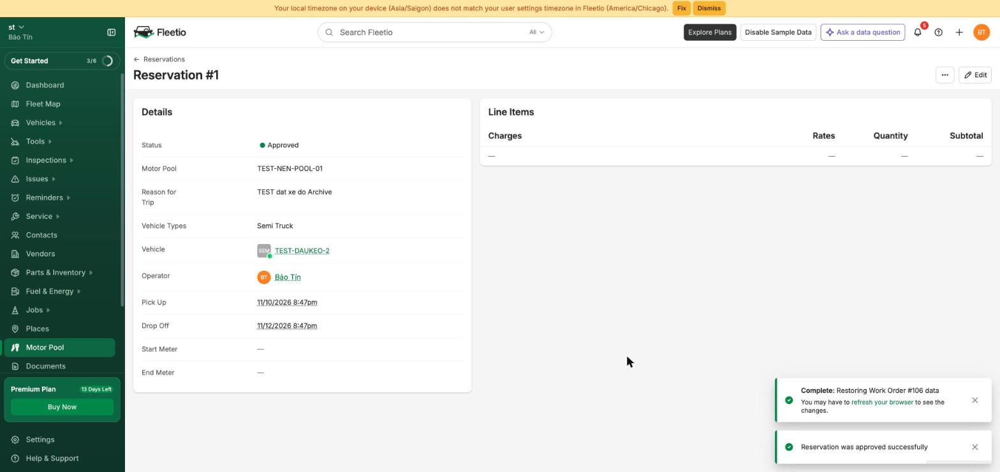

| # | Items | Control type | Data type | Description |
|---|---|---|---|---|
| 1 | Status | Nhãn | — | Approved, chấm xanh |
| 2 | Vehicle | Liên kết | Xe | TEST-DAUKEO-2, đã gán lúc duyệt |
| 3 | Start Meter, End Meter | Số | — | Vẫn "—" |
| 4 | Line Items | Bảng | — | Trống; bật tính phí sau đó cũng không tính lại (BR-fleetio-saas-platform-068) |
| 5 | "...", Edit | Menu, nút | — | Menu Check Out, Email Invoice, Print, Cancel, View Record History (không có trong ảnh, theo ghi chú chạy) |
| 6 | Toast | Thông báo | — | "Reservation was approved successfully". Ảnh không cho thấy phân công "Future", dòng đó ở trang liên hệ |

## 5.17 Đặt xe tự duyệt kèm phí

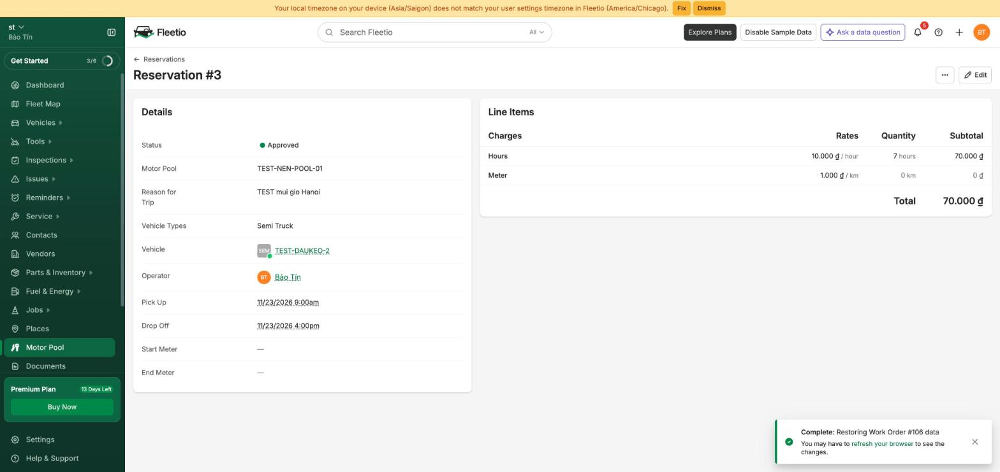

| # | Items | Control type | Data type | Description |
|---|---|---|---|---|
| 1 | Status | Nhãn | — | Approved do tự duyệt; trên trang không có dấu nào phân biệt với duyệt tay (E-fleetio-saas-platform-033 là nhánh ngược) |
| 2 | Vehicle | Liên kết | Xe | Tự gán TEST-DAUKEO-2 |
| 3 | Reason for Trip | Chữ | — | "TEST mui gio Hanoi" |
| 4 | Pick Up, Drop Off | Ngày giờ | — | 9:00am đến 4:00pm cùng ngày |
| 5 | Hours | Dòng phí | Tiền | 10.000 ₫ / hour × 7 hours = 70.000 ₫ |
| 6 | Meter | Dòng phí | Tiền | 1.000 ₫ / km × 0 km = 0 ₫ |
| 7 | Total | Tổng | Tiền | 70.000 ₫ |

## 5.18 Phí nhiều ngày, phí cố định

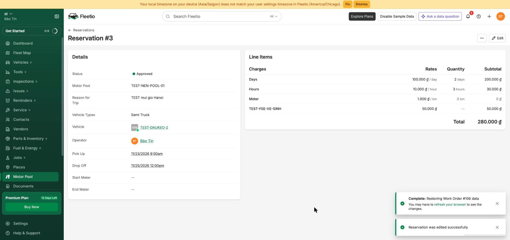

| # | Items | Control type | Data type | Description |
|---|---|---|---|---|
| 1 | Drop Off | Ngày giờ | — | Đã đổi sang 2 ngày 3 giờ sau Pick Up |
| 2 | Days | Dòng phí | Tiền | 100.000 ₫ / day × 2 days = 200.000 ₫: tính từ đơn vị lớn |
| 3 | Hours | Dòng phí | Tiền | 10.000 ₫ / hour × 3 hours = 30.000 ₫ |
| 4 | Meter | Dòng phí | Tiền | 0 km, 0 ₫ |
| 5 | TEST-FEE-VE-SINH | Dòng phí | Tiền | 50.000 ₫, Quantity "—" |
| 6 | Total | Tổng | Tiền | 280.000 ₫ |
| 7 | Toast | Thông báo | — | "Reservation was edited successfully". Câu "Charges have been recalculated..." ở form Edit, không có trong ảnh |

## 5.19 Xe trùng lịch khi duyệt

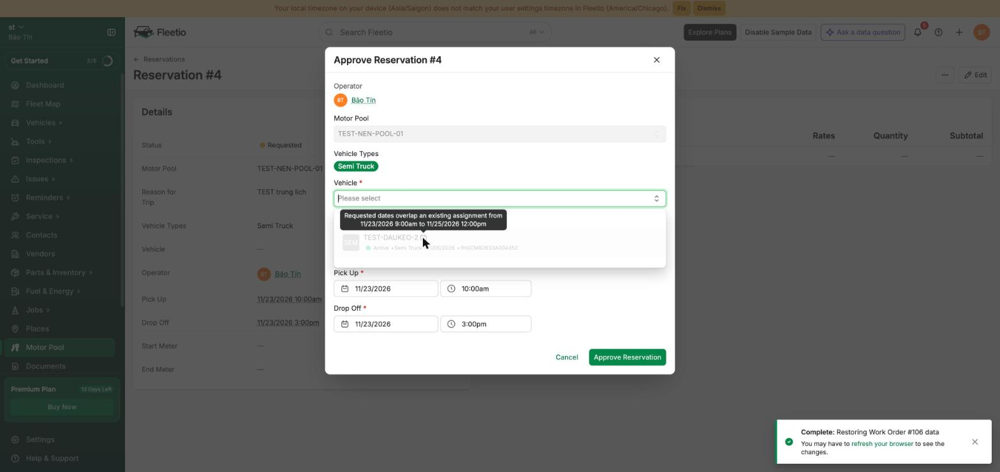

| # | Items | Control type | Data type | Description |
|---|---|---|---|---|
| 1 | Approve Reservation #4 | Hộp | — | Nền: Requested, Vehicle "—", Reason "TEST trung lich" |
| 2 | Vehicle * đang mở | Chọn | Xe | 1 dòng xe xám, không chọn được, có biểu tượng lịch; dòng phụ Active, Semi Truck, nhóm, số VIN/SN; tiêu đề danh sách bị tooltip che |
| 3 | Tooltip | Chú thích | — | "Requested dates overlap an existing assignment from 11/23/2026 9:00am to 11/25/2026 12:00pm" |
| 4 | Reason for Trip | Ô nhập | — | Bị danh sách che trong ảnh |
| 5 | Pick Up *, Drop Off * | Ngày, giờ | — | 10:00am đến 3:00pm, trùng #3 |
| 6 | Cancel, Approve Reservation | Nút | — | Nút vẫn sáng khi chưa chọn được xe; bấm thử không có trong ghi chú chạy |

## 5.20 Đặt xe hoàn tất

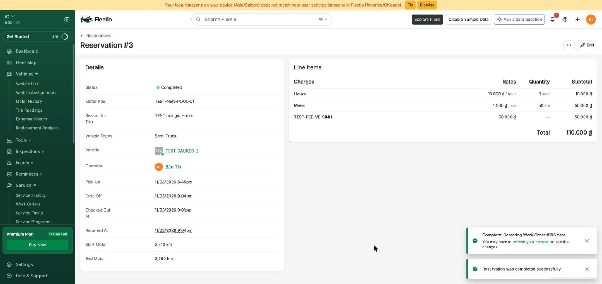

| # | Items | Control type | Data type | Description |
|---|---|---|---|---|
| 1 | Status | Nhãn | — | Completed |
| 2 | Pick Up, Drop Off | Ngày giờ | — | Drop Off tự đổi về giờ hoàn tất (BR-fleetio-saas-platform-072) |
| 3 | Checked Out At, Returned At | Ngày giờ | — | Chỉ xuất hiện sau khi giao, hoàn tất |
| 4 | Start Meter, End Meter | Số | km | 2,510 km, 2,560 km |
| 5 | Hours | Dòng phí | Tiền | 10.000 ₫ × 1 hour = 10.000 ₫ |
| 6 | Meter | Dòng phí | Tiền | 1.000 ₫ × 50 km = 50.000 ₫ |
| 7 | TEST-FEE-VE-SINH | Dòng phí | Tiền | 50.000 ₫, giữ từ trước |
| 8 | Total | Tổng | Tiền | 110.000 ₫ |
| 9 | Edit, "..." | Nút, menu | — | Completed vẫn còn Edit; menu chưa đọc |
