# Nền tảng SaaS — States

Mã lỗi viết tắt, đầy đủ có tiền tố `fleetio-saas-platform`. Trạng thái Work Order, Purchase Order, Issue xem nhóm Sửa chữa, Phụ tùng; ở đây chỉ ghi phần cấu hình tại Mục 14 của spec.

## Automation

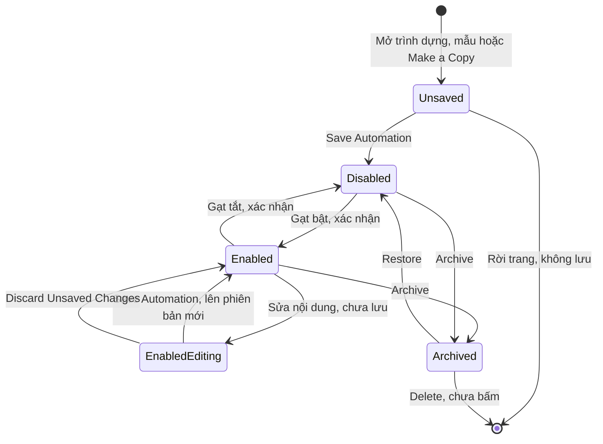

| Trạng thái | Hành động | Sang | Điều kiện | Hiệu ứng | Câu chữ | Mức |
|---|---|---|---|---|---|---|
| Chưa lưu | Save Automation | Disabled | Save mờ cho tới khi có trigger, hành động | Lưu ở trạng thái tắt | "Automation ... was successfully created" | `Chạy` |
| Chưa lưu | Rời trang | Không tồn tại | Không có | Không để lại bản rác | Không có | `Chạy` |
| Chưa lưu | Apply mẫu | Chưa lưu | Mẫu có thể thiếu giá trị (E-009) | Điền sẵn trình dựng, chưa lưu gì | "Missing Value" khi thiếu nhãn | `Chạy` |
| Chưa lưu | Gạt bật rồi Save | Chưa biết | Bản 02/11 vẽ sang Enabled, không có bằng chứng; đã bỏ khỏi sơ đồ | Chưa biết | Không có | Không chạy |
| Chưa lưu | Make a Copy từ bản đang bật | Chưa lưu | Đường dẫn `copy_from` | Tên thêm " (copy)", Disabled, chưa lưu gì; rời trang không để lại bản rác | Không có | `Chạy` |
| Chưa lưu | Save với hành động không hợp lệ | Chưa lưu | Service Entry, Update Field Repair Priority Class = Emergency (E-025) | Không tạo; nút "Fix Errors" | "Automation could not be created. Please resolve any errors try again." | `Chạy` |
| Chưa lưu | Save tự duyệt đơn mua thiếu điều kiện | Chưa lưu | Status Approved cần điều kiện Pending Approval (E-026) | Không tạo; nút "Resolve error" | "Purchase Order Status "Pending Approval" is required" | `Chạy` |
| Chưa lưu | Rời mẫu bằng Cancel | Không tồn tại | Mẫu đã mở | Tab kẹt (E-024), phải đóng tab | "Leave site?" | `Chạy` |
| Disabled | Gạt công tắc, xác nhận, lần đầu | Enabled | Hộp xác nhận | Sinh version v.1; ghi Enabled At; không chạy bù bản ghi cũ; trước đó Current Version là "—" | "When you enable this automation ... actions will run when you set the trigger and conditions are met." | `Chạy` |
| Disabled | Gạt bật lại, không sửa | Enabled | Đã có v.1 | Vẫn v.1, Enabled At đổi | Không có | `Chạy` |
| Disabled | Sự kiện xảy ra | Disabled | Không có | Không comment, không có lượt chạy | Không có | `Chạy` |
| Enabled | Lưu lại bản ghi không đổi gì | Enabled | Trigger Updated | Không sinh lượt | Không có | `Chạy` |
| Disabled | Archive | Archived | Có nút; trường hợp đang tắt chưa ghi riêng | Chưa ghi | "This will disable the automation and it will stop working immediately. It can be restored at any time." | `Suy` |
| Enabled | Gạt công tắc, xác nhận | Disabled | Hộp xác nhận | Dừng chạy | "When you disable this automation ... it will stop working and prevent any actions from running." | `Chạy` |
| Enabled | Archive | Archived | Không cần tắt trước | Tắt ngay, ghi Disabled At | "This will disable the automation and it will stop working immediately. It can be restored at any time." | `Chạy` |
| Enabled | Sự kiện khớp | Enabled | Điều kiện đúng | Sinh lượt chạy, thực hiện hành động trong vòng 6 giây | Tác giả comment "Fleetio Automation" | `Chạy` |
| Enabled | Sự kiện không khớp | Enabled | Điều kiện sai | Không đếm lượt | Không có | `Chạy` |
| Enabled | Sửa, chưa lưu | Enabled có thay đổi chưa lưu | Đổi nội dung vào form | Băng cảnh báo; nút Save thành menu Save Automation, Discard Unsaved Changes | "You have unsaved changes on this enabled automation" · "Save to update, or discard to keep the current settings." | `Chạy` |
| Enabled có thay đổi chưa lưu | Save Automation | Enabled | Không hỏi xác nhận lại | Lên v.2, hiệu lực ngay; lượt sau ghi Version v.2 | Không có | `Chạy` |
| Enabled có thay đổi chưa lưu | Discard Unsaved Changes | Enabled | Có trong menu | Giữ bản hiện tại theo câu trên màn | "discard to keep the current settings" | `Xem` |
| Enabled | Hành động lỗi | Enabled | Lượt FAILURE | KHÔNG tự tắt | Không có | `Chạy` |
| Archived | Restore | Disabled | Một cú bấm, không hộp xác nhận; không tự bật lại dù trước đó Enabled | Hết chỉ đọc; giữ v.1, Run History, Disabled At; có lại công tắc, Edit | "Record successfully restored!" | `Chạy` |
| Archived | Bản ghi khớp đổi | Archived | Không có | Total Runs không đổi, không có hành động | "This record is archived." | `Chạy` |
| Archived | Sửa | Archived | Bị chặn (E-005) | Chỉ đọc | "Archived records are read-only and cannot be updated." | `Chạy` |
| Archived | Delete | Không tồn tại | Không bấm theo ràng buộc | Chưa biết | Nút "Delete" | Không chạy |
| Đã lưu, chưa Archive | More Actions | Giữ nguyên | Không có | Make a Copy, Archive, View Record History; KHÔNG có Delete, Delete chỉ hiện ở bản Archived | Không có | `Chạy` |

## Phiên bản automation

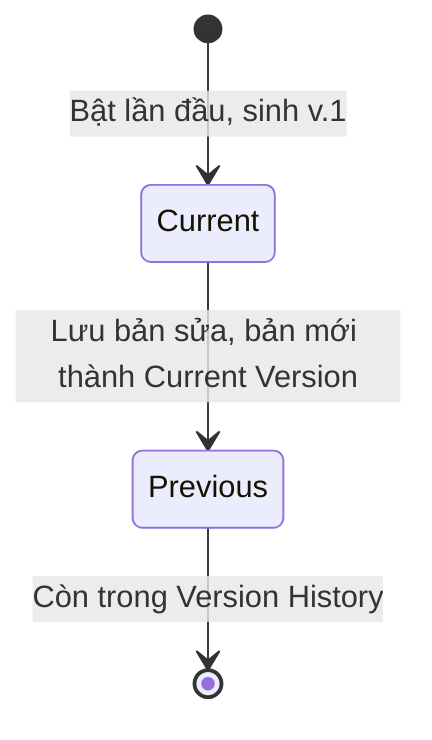

| Trạng thái | Hành động | Sang | Điều kiện | Hiệu ứng | Câu chữ | Mức |
|---|---|---|---|---|---|---|
| Chưa có | Bật lần đầu | Current | Bản đã lưu | Current Version từ "—" thành v.1 | Không có | `Chạy` |
| Current | Lưu bản sửa khi đang bật | Previous | Có thay đổi | Bản mới lên Current Version, kèm Created At, Created By | "Current Version" | `Chạy` |
| Current | Tắt, bật lại | Current | Không sửa | Không sinh phiên bản | Không có | `Chạy` |
| Previous | Mở trong Version History | Previous | Không có | Hiện nội dung bản mới thay vì bản cũ (E-018), thấy 1 lần trên sửa action, OQ-16 | "Step Summary" v.1 | `Chạy` |
| Disabled, sửa rồi lưu | Lưu khi đang tắt | Chưa biết | Chưa làm | Chưa biết có sinh phiên bản không | Không có | Không chạy |

## Lượt chạy automation

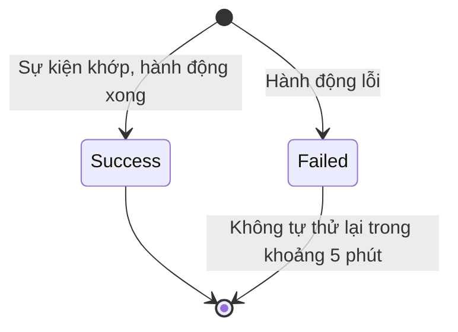

| Trạng thái | Hành động | Sang | Điều kiện | Hiệu ứng | Câu chữ | Mức |
|---|---|---|---|---|---|---|
| Success | Mở Run Result | Giữ nguyên | Không có | Xem phiên bản, bản ghi kích hoạt, log JSON; thêm comment hoặc đổi Status xe vẫn ghi không đổi bản ghi (E-021); chỉ lượt Failed câu này mới đúng | "Records: No records changed" | `Chạy` |
| Success | Lượt do automation gây ra, trên Issue | Lượt mới | Giá trị đổi; dừng khi không đổi | "Triggered By" ghi người tạo Issue | Không có | `Chạy` |
| Success | Lượt do automation gây ra, trên Vehicle | Không có lượt mới | Automation đổi xe | Total Runs chỉ đếm lần người sửa (OQ-17) | Không có | `Chạy` |
| Failed | Mở Run Result | Giữ nguyên | Hành động lỗi (E-011) | Status FAILURE, bản ghi không đổi, Records đúng; lúc này Failed 1, Successful 0 | "Automation Action failed: Start Date can't be blank" | `Chạy` |
| Failed | View Full Log | Giữ nguyên | Không có | Workflow, Trigger, ConditionSet state DNF, status FAILURE, cùng reason, có caused_by, thrown_by | Không có | `Chạy` |
| Failed | Chờ khoảng 5 phút | Giữ nguyên | Không có | Total Runs vẫn 1: không thấy thử lại | Không có | `Chạy` |
| Failed | Báo người dùng | Không có | Failure Notification Email tắt | Trang bản ghi, chuông không có gì; nội dung email chưa biết | "Send an email whenever this automation fails." | `Chạy`, email không bật |

## Link chia sẻ báo cáo

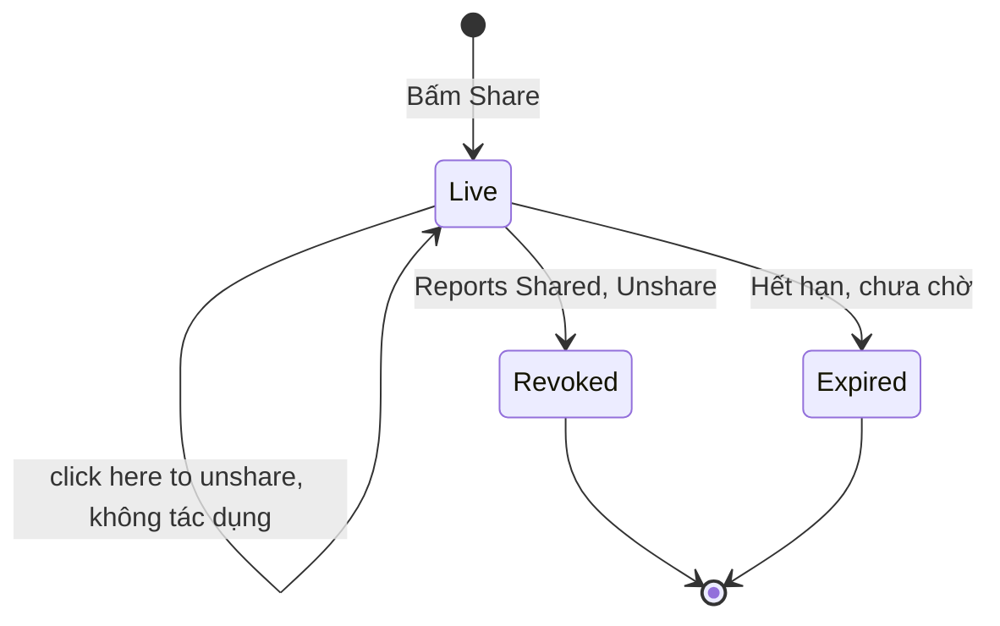

| Trạng thái | Hành động | Sang | Điều kiện | Hiệu ứng | Câu chữ | Mức |
|---|---|---|---|---|---|---|
| Chưa có | Bấm Share | Live | Không có bước xác nhận (E-013) | Link sinh ngay, ai có link xem được | "this link allows anyone with access to view all data" | `Chạy` |
| Live | Mở link | Live | Không cần đăng nhập | Xem được dữ liệu Issues | Không có | `Chạy` |
| Live | Bấm "click here to unshare" | Live | Lối trong hộp (E-010) | Không có tác dụng, bấm lại trả 404, link vẫn sống | "click here to unshare" | `Chạy` |
| Live | Reports › Shared › Unshare | Revoked | Hộp xác nhận | Shared về 0 | "Are you sure you want to unshare this report?" | `Chạy` |
| Live | Chờ hết hạn | Expired | Fleetio: 7 ngày | Chưa kiểm hành vi thật | "Link expires in 7 days" | `Xem` |
| Revoked | Mở lại link | Revoked | Không có | Không còn báo cáo | Không có | `Chạy` |

## Báo cáo đã lưu

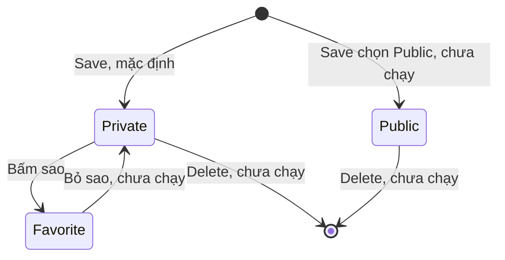

| Trạng thái | Hành động | Sang | Điều kiện | Hiệu ứng | Câu chữ | Mức |
|---|---|---|---|---|---|---|
| Chưa có | Save, Private | Private | Có Name | Vào Reports › Saved; mở lại giữ bộ lọc, đường dẫn thêm `saved_report_id` | "Private Saved Reports are visible only to you, but can be emailed to anyone with access to the source report." | `Chạy` |
| Chưa có | Save, Public | Public | Có Name | Chưa biết | Không có | Không chạy |
| Private | Bấm sao | Favorite | Không có | Favorites từ 0 lên 1 | Không có | `Chạy` |
| Private | Edit, Make a Copy, View Record History, View Source Report | Giữ nguyên | Menu dòng | Chưa bấm | Không có | `Xem` |
| Private | Tick Email Schedule | Giữ nguyên | Sẽ gửi email | Chưa biết | Không có | Không chạy |
| Private, Public | Delete | Không tồn tại | Menu dòng | Chưa biết | Không có | Không chạy |

## Mức ưu tiên tự động của Issue

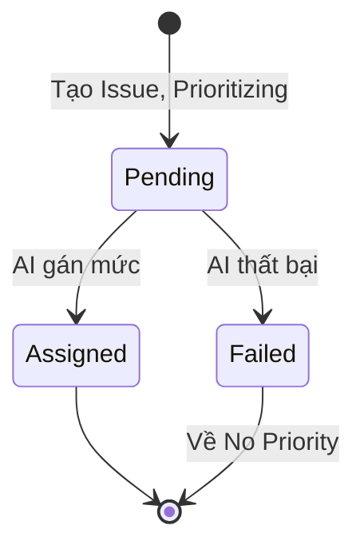

| Trạng thái | Hành động | Sang | Điều kiện | Hiệu ứng | Câu chữ | Mức |
|---|---|---|---|---|---|---|
| Pending | Tạo Issue không nhập mức | Pending | Priority "Auto-assign" | Chạy nền; #55 lúc mới tạo hiện "Prioritizing" | "Prioritizing" | `Chạy` |
| Pending | AI gán mức | Assigned | Chưa biết điều kiện; tên trạng thái chưa đọc | #40, #42 tự thành High; nguyên nhân là AI Issue Prioritization là `Suy` | Không có | `Chạy` phần thấy |
| Pending | AI thất bại | Failed | Chưa biết điều kiện (OQ-20) | Issue về "No Priority"; không báo ra đâu khác (E-016); Changes By ghi người tạo | "Issue Priority Status changed from pending to failed" | `Chạy` |

## Theo dõi bản ghi

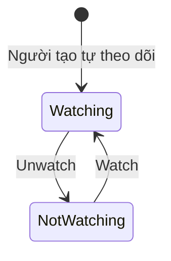

| Trạng thái | Hành động | Sang | Điều kiện | Hiệu ứng | Câu chữ | Mức |
|---|---|---|---|---|---|---|
| Watching | Unwatch | Không theo dõi | Không có | Avatar mất khỏi cụm người theo dõi; không vào Record History | Nút thành "Watch" | `Chạy` |
| Không theo dõi | Watch | Watching | Không có | Theo dõi lại; không vào Record History | Không có | `Chạy` |
| Watching | Automation bình luận | Watching | Không cần hồ sơ thông báo | Nhận thông báo in-app | "Fleetio Automation commented on an issue" | `Chạy` |

## Xe

Không thấy luật chuyển: 5 trạng thái đổi tự do, nên sơ đồ gộp thành một khối thay vì vẽ từng cặp. Tên trạng thái khách thêm được.

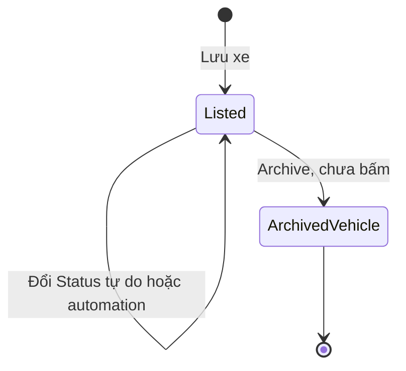

| Trạng thái | Hành động | Sang | Điều kiện | Hiệu ứng | Câu chữ | Mức |
|---|---|---|---|---|---|---|
| Active | Automation Update Vehicle Status | Inactive | Trigger Vehicle Updated, sửa cả trường không liên quan như Color | Đổi trong vài giây; Status Updates ghi nguồn và thời gian ở trạng thái | "Fleetio Automation updated status from Active to Inactive" | `Chạy` |
| Inactive | Người đổi về Active | Active rồi Inactive | Automation đang bật | Lưu được, không cảnh báo; 1 giây sau automation đổi lại (E-017) | Status Updates ghi tên người rồi "Fleetio Automation" | `Chạy` |
| Active (Default) | Đổi trường Status hoặc automation | In Shop, Inactive, Out of Service, Sold | Quyền `vehicles_update_status`, Operator có sẵn | Lịch sử trạng thái, báo cáo Status Changes, Status Summary | Đếm lúc đọc: 22 | `Xem` |
| In Shop | Như trên | Active, Inactive, Out of Service, Sold | Như trên | Như trên | Đếm lúc đọc: 2 | `Xem` |
| Inactive | Như trên | Active, In Shop, Out of Service, Sold | Như trên | Như trên | Đếm lúc đọc: 1 | `Xem` |
| Out of Service | Như trên | Active, In Shop, Inactive, Sold | Như trên | Như trên | Đếm lúc đọc: 0 | `Xem` |
| Sold | Như trên | Active, In Shop, Inactive, Out of Service | Như trên; không thấy chặn | Như trên | Đếm lúc đọc: 0 | `Xem` |
| Mọi trạng thái | Archive | Tab Archived | Quyền `vehicles_archive_delete`; Operator không có | Chưa chạy; có Restore hay không chưa kiểm (OQ-12) | Nút "Archive" | `Xem` |

Hai mẫu automation đổi Status: "Update Vehicle Status to Active when Work Orders are Completed" (điều kiện đếm lệnh còn mở nhỏ hơn 1), "Update Vehicle Status To In Shop When Issue Source Is Inspection Failure". Hai mẫu này chưa bật; chuyển Active, Inactive thật đo bằng `TEST-NEN-AUTO-05` trên `TEST-DAUKEO-2`, Status đã trả về Active.

## Liên hệ: quyền truy cập

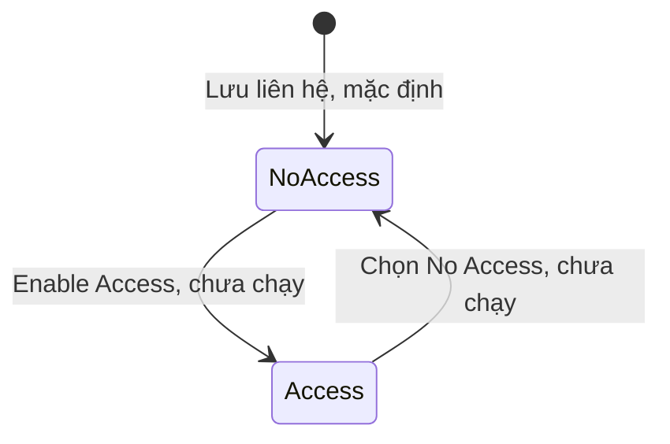

| Trạng thái | Hành động | Sang | Điều kiện | Hiệu ứng | Câu chữ | Mức |
|---|---|---|---|---|---|---|
| No Access | Lưu với chỉ First Name | No Access | Không cần email; trùng tên vẫn lưu | Có hồ sơ, không đăng nhập, không nhận thông báo | "This Contact will not have access to your Fleetio account and will not receive any notifications." · "This Contact doesn't have user access." | `Chạy` |
| No Access | Gán xe khi chưa là Operator | No Access | Bị chặn (E-006) | Không gán được | "Contact must have operator classification to be assigned to vehicles" | `Chạy` |
| No Access | Enable Access to Fleetio | Access | Không lưu, không mời người trong lượt chạy | Form hiện Email, Delay email invitation, Message; Role * mặc định Fleet Manager; Record Sets đều mặc định Full Access; thư mời gửi ngay theo câu trên màn | "This Contact will be enabled as a User..." · "An email invitation with instructions to create a password will be sent immediately." | `Xem` |
| Access | Chọn No Access | No Access | Không có bằng chứng thao tác | Chưa biết | Không có | `Suy` |

## Đặt xe (Reservation)

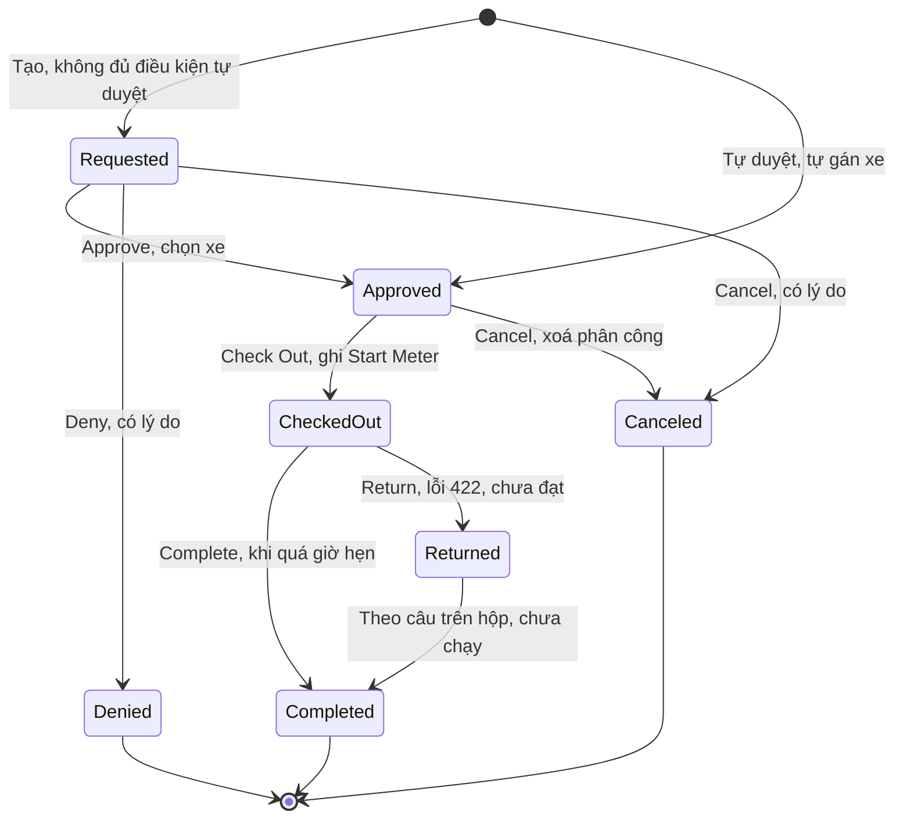

| Trạng thái | Hành động | Sang | Điều kiện | Hiệu ứng | Câu chữ | Mức |
|---|---|---|---|---|---|---|
| Chưa có | Submit, đủ dữ liệu | Requested | Operator có đăng nhập và là Operator | Vehicle trống; không phân công; không chặn Archive xe | "Reservation was created successfully" | `Chạy` |
| Chưa có | Submit, đủ 3 điều kiện tự duyệt | Approved | Giờ lấy, giờ trả trong cửa sổ, không trùng phân công | Tự gán xe, tính phí nếu pool bật | Toast vẫn "Reservation was created successfully" | `Chạy` |
| Chưa có | Submit thiếu dữ liệu | Không tạo | E-029 | Không tạo bản ghi | "Failed to create Reservation" | `Chạy` |
| Requested | Approve | Approved | Vehicle bắt buộc; xe trùng lịch xám | Sinh phân công "Future"; xe xám ở đặt khác trùng giờ; chặn Archive xe | "Reservation was approved successfully" | `Chạy` |
| Requested | Deny | Denied | "Denied Reason *" | Hiện Denied Reason, mất Edit; không hiệu ứng khác | Không có | `Chạy` |
| Requested | Cancel | Canceled | "Canceled Reason *" | Mất Edit | "Reservation was canceled successfully" | `Chạy` |
| Requested | Edit | Requested | Status chỉ đọc | Sửa Operator, Pool, Vehicle Types, Reason, ngày | Không có | `Chạy` |
| Approved | Edit | Approved | Không có | Thêm Vehicle, Start Meter, End Meter, Charges, Add Flat Fee; đổi ngày thì tính lại | "Charges have been recalculated based on updates to the reservation. Saving will replace the previously saved values." | `Chạy` |
| Approved | Check Out | Checked Out | Được trước ngày hẹn; nhập Start Meter | Ghi Checked Out At; Pick Up giữ nguyên; phân công vẫn "Future"; đồng hồ đề theo ngày hẹn (E-031) | "Reservation was checked out successfully" | `Chạy` |
| Approved | Cancel | Canceled | Có lý do | Xoá phân công | Không có | `Chạy` |
| Approved | Email Invoice, Print | Giữ nguyên | Trong menu | Chưa bấm | Không có | Không chạy |
| Checked Out | Return, ngày hẹn còn ở tương lai | Checked Out | 3 lần, có và không có End Meter | Lỗi 422 không lý do (E-030); nguyên nhân chưa xác nhận (OQ-22) | "Failed to return Reservation" | `Chạy` |
| Checked Out | Complete | Completed | Quá giờ hẹn: mục đầu menu đổi thành Complete | Drop Off tự đổi, ghi Returned At; phân công thành lịch sử; đồng hồ xe lên End Meter; hết chặn Archive xe; tính phí km | "Reservation was completed successfully" | `Chạy` |
| Checked Out | Edit, dời Pick Up trước số đồng hồ đã có | Checked Out | Bị chặn (E-032) | Không lưu | "must be less than 100 or marked as void" | `Chạy` |
| Checked Out | Cancel | Chưa biết | Có trong menu | Chưa thành (OQ-23) | Không có | Không chạy |
| Returned | Không đạt tới | Completed theo câu trên hộp | Chưa từng đạt | Chưa biết | "From Returned, the reservation can only be moved to Completed." | Không chạy |
| Completed | Edit, menu "..." | Chưa biết | Vẫn còn Edit; menu chưa đọc | Chưa biết | Không có | `Chạy` thấy nút |
| Denied | Menu "..." | Chưa biết | Mất Edit; menu chưa đọc | Không hiệu ứng | Không có | `Chạy` |
| Canceled | View Record History | Giữ nguyên | Chỉ còn mục này | Không có | Không có | `Chạy` |

## Webhook

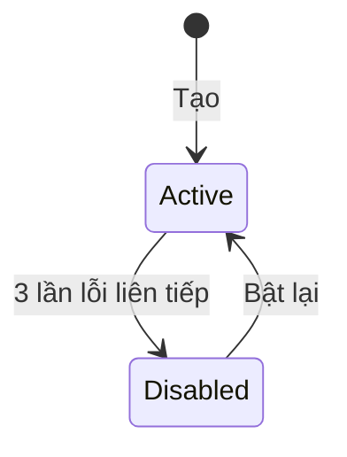

| Trạng thái | Hành động | Sang | Điều kiện | Hiệu ứng | Câu chữ | Mức |
|---|---|---|---|---|---|---|
| Active | Gửi lỗi liên tiếp | Disabled | Fleetio: 3 lần | Tắt webhook | Chưa thấy | `Docs` |
| Disabled | Bật lại | Active | Không có | Gửi tiếp | Chưa thấy | `Docs` |

`Docs`, chưa chạy; danh sách Webhooks của tài khoản rỗng.

## Đối tượng có danh sách trạng thái nhưng chưa thấy chuyển

Không vẽ sơ đồ vì chưa có bằng chứng về chuyển trạng thái; vẽ sẽ là đoán.

| Đối tượng | Giá trị đọc được | Vì sao chưa có chuyển | Mức |
|---|---|---|---|
| Recall | Tab All, Needs Action, Open, Resolved, Acknowledged; menu dòng Acknowledge, Create Issue, Check VIN | Toàn dòng Sample, không đổi; Needs Action đọc 261 rồi 285 (OQ-21) | `Xem` |
| API key | Status; "Once a key has been revoked it cannot be reactivated." | Không tạo khoá | `Xem` |
| Thông báo | Inbox, Archived; Archive all | Chưa bấm Archive | `Xem` |
| Tài liệu | Auto-Delete: xoá cuối ngày đã chọn | Không đặt | `Xem` |
| Require Group | Đang khoá, mở khi đủ nhóm | Không đổi Settings | `Xem` |
| Part Location | Active, Archived | Xem nhóm Phụ tùng | `Xem` |

## Đối tượng không có trạng thái thật

Role, Record Set, Saved View, Label, Group, Contact Classification, trang Settings là cấu hình: chỉ tạo, sửa, xoá, không có vòng trạng thái. Account Usage là số đếm: khi đạt hạn mức thì nút khoá (E-003), hết đạt thì mở (`Suy`), không phải trạng thái lưu của bản ghi. AI Conversation chỉ thấy lưu ở My Conversations, chưa thấy trạng thái. Saved View có đánh dấu "Save Changes" chấm cam khi có thay đổi chưa lưu trên tab, không phải trạng thái lưu của bản ghi; "Fleetio Standard View" luôn khoá.
