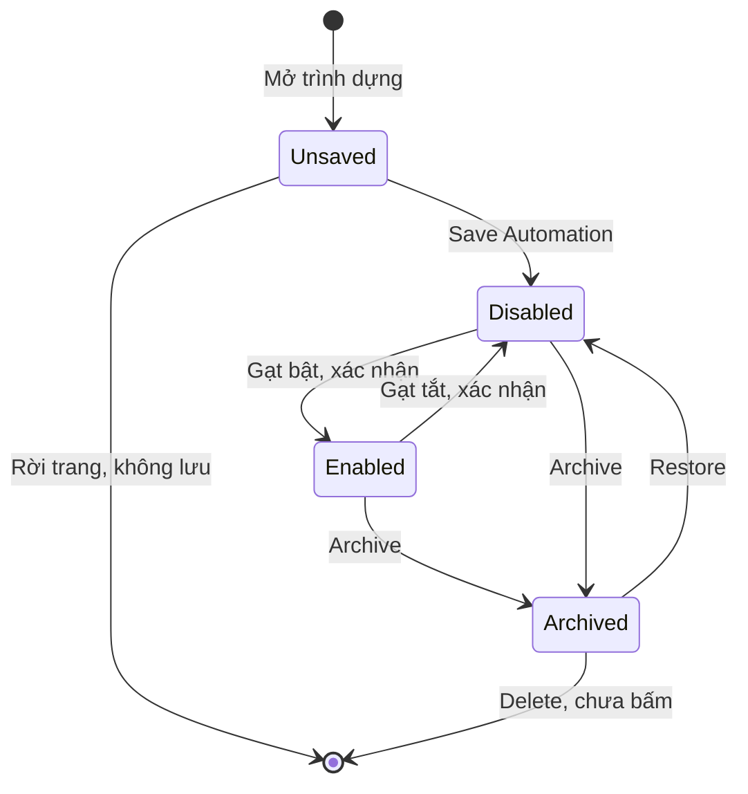
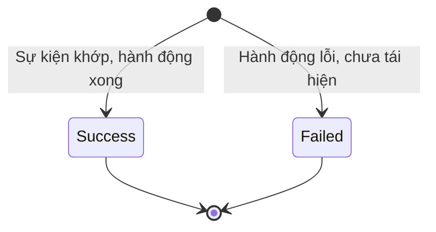
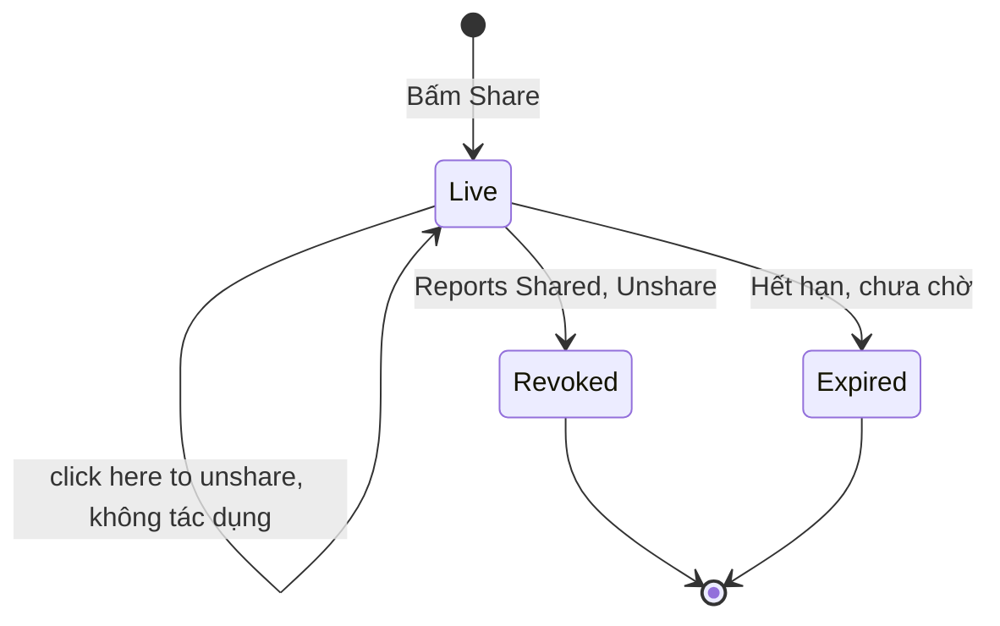
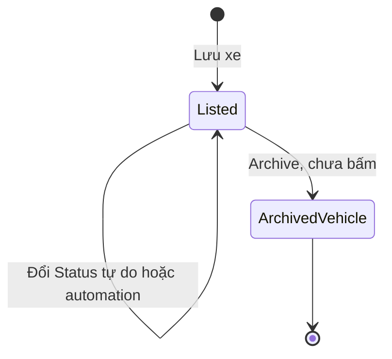
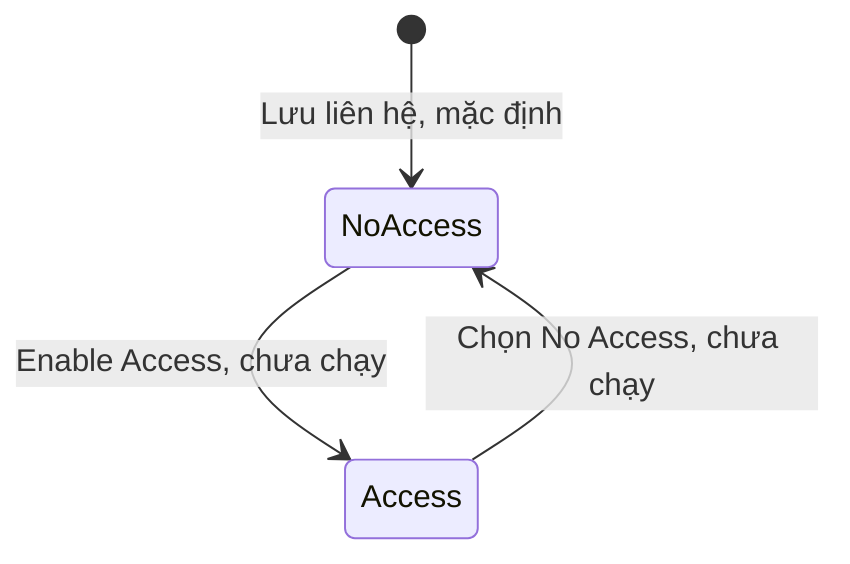
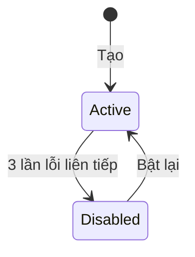

# Nền tảng SaaS — States

Mã lỗi viết tắt, đầy đủ có tiền tố `fleetio-saas-platform`. Trạng thái Work Order, Purchase Order, Issue xem nhóm Sửa chữa, Phụ tùng; ở đây chỉ ghi phần cấu hình tại Mục 14 của spec.

## Automation

| Trạng thái | Hành động | Sang | Điều kiện | Hiệu ứng | Câu chữ | Mức |
|---|---|---|---|---|---|---|
| Chưa lưu | Save Automation | Disabled | Save mờ cho tới khi có trigger, hành động | Lưu ở trạng thái tắt | "Automation ... was successfully created" | `Chạy` |
| Chưa lưu | Rời trang | Không tồn tại | Không có | Không để lại bản rác | Không có | `Chạy` |
| Chưa lưu | Apply mẫu | Chưa lưu | Mẫu có thể thiếu giá trị (E-009) | Điền sẵn trình dựng, chưa lưu gì | "Missing Value" khi thiếu nhãn | `Chạy` |
| Chưa lưu | Gạt bật rồi Save | Chưa biết | Bản 02/11 vẽ sang Enabled, không có bằng chứng; đã bỏ khỏi sơ đồ | Chưa biết | Không có | Không chạy |
| Disabled | Gạt công tắc, xác nhận | Enabled | Hộp xác nhận | Sinh version v.1; ghi Enabled At; không chạy bù bản ghi cũ | "When you enable this automation ... actions will run when you set the trigger and conditions are met." | `Chạy` |
| Disabled | Sự kiện xảy ra | Disabled | Không có | Không comment, không có lượt chạy | Không có | `Chạy` |
| Disabled | Archive | Archived | Có nút; trường hợp đang tắt chưa ghi riêng | Chưa ghi | "This will disable the automation and it will stop working immediately. It can be restored at any time." | `Suy` |
| Enabled | Gạt công tắc, xác nhận | Disabled | Hộp xác nhận | Dừng chạy | "When you disable this automation ... it will stop working and prevent any actions from running." | `Chạy` |
| Enabled | Archive | Archived | Không cần tắt trước | Tắt ngay, ghi Disabled At | "This will disable the automation and it will stop working immediately. It can be restored at any time." | `Chạy` |
| Enabled | Sự kiện khớp | Enabled | Điều kiện đúng | Sinh lượt chạy, thực hiện hành động trong vòng 6 giây | Tác giả comment "Fleetio Automation" | `Chạy` |
| Enabled | Sự kiện không khớp | Enabled | Điều kiện sai | Không đếm lượt | Không có | `Chạy` |
| Enabled | Sửa rồi lưu | Enabled | Chưa làm | Chưa biết có v.2 không (OQ-7) | Không có | Không chạy |
| Archived | Restore | Disabled | Không tự bật lại | Hết chỉ đọc | "Record successfully restored" | `Chạy` |
| Archived | Sửa | Archived | Bị chặn (E-005) | Chỉ đọc | "Archived records are read-only and cannot be updated." | `Chạy` |
| Archived | Delete | Không tồn tại | Không bấm theo ràng buộc | Chưa biết | Nút "Delete" | Không chạy |
| Mọi trạng thái đã lưu | Make a Copy, View Record History | Giữ nguyên | Menu More Actions | Chưa biết | Không có | `Xem` đọc nút |

## Lượt chạy automation

| Trạng thái | Hành động | Sang | Điều kiện | Hiệu ứng | Câu chữ | Mức |
|---|---|---|---|---|---|---|
| Success | Mở Run Result | Giữ nguyên | Không có | Xem phiên bản, bản ghi kích hoạt, log JSON; thêm comment vẫn ghi không đổi bản ghi | "Records: No records changed" | `Chạy` |
| Success | Lượt do automation gây ra | Lượt mới | Giá trị đổi; dừng khi không đổi | "Triggered By" ghi người tạo Issue | Không có | `Chạy` |
| Failed | Chưa thấy | Không có | Failed Runs luôn 0 (E-011) | Có cột Failed Runs, ô Failure Notification Email | Không có | `Xem` |

## Link chia sẻ báo cáo

| Trạng thái | Hành động | Sang | Điều kiện | Hiệu ứng | Câu chữ | Mức |
|---|---|---|---|---|---|---|
| Chưa có | Bấm Share | Live | Không có bước xác nhận (E-013) | Link sinh ngay, ai có link xem được | "this link allows anyone with access to view all data" | `Chạy` |
| Live | Mở link | Live | Không cần đăng nhập | Xem được dữ liệu Issues | Không có | `Chạy` |
| Live | Bấm "click here to unshare" | Live | Lối trong hộp (E-010) | Không có tác dụng, bấm lại trả 404, link vẫn sống | "click here to unshare" | `Chạy` |
| Live | Reports › Shared › Unshare | Revoked | Hộp xác nhận | Shared về 0 | "Are you sure you want to unshare this report?" | `Chạy` |
| Live | Chờ hết hạn | Expired | Fleetio: 7 ngày | Chưa kiểm hành vi thật | "Link expires in 7 days" | `Xem` |
| Revoked | Mở lại link | Revoked | Không có | Không còn báo cáo | Không có | `Chạy` |

## Xe

Không thấy luật chuyển: 5 trạng thái đổi tự do, nên sơ đồ gộp thành một khối thay vì vẽ từng cặp. Tên trạng thái khách thêm được.

| Trạng thái | Hành động | Sang | Điều kiện | Hiệu ứng | Câu chữ | Mức |
|---|---|---|---|---|---|---|
| Active (Default) | Đổi trường Status hoặc automation | In Shop, Inactive, Out of Service, Sold | Quyền `vehicles_update_status`, Operator có sẵn | Lịch sử trạng thái, báo cáo Status Changes, Status Summary | Đếm lúc đọc: 22 | `Xem` |
| In Shop | Như trên | Active, Inactive, Out of Service, Sold | Như trên | Như trên | Đếm lúc đọc: 2 | `Xem` |
| Inactive | Như trên | Active, In Shop, Out of Service, Sold | Như trên | Như trên | Đếm lúc đọc: 1 | `Xem` |
| Out of Service | Như trên | Active, In Shop, Inactive, Sold | Như trên | Như trên | Đếm lúc đọc: 0 | `Xem` |
| Sold | Như trên | Active, In Shop, Inactive, Out of Service | Như trên; không thấy chặn | Như trên | Đếm lúc đọc: 0 | `Xem` |
| Mọi trạng thái | Archive | Tab Archived | Quyền `vehicles_archive_delete`; Operator không có | Chưa chạy; có Restore hay không chưa kiểm (OQ-12) | Nút "Archive" | `Xem` |

Hai mẫu automation đổi Status: "Update Vehicle Status to Active when Work Orders are Completed" (điều kiện đếm lệnh còn mở nhỏ hơn 1), "Update Vehicle Status To In Shop When Issue Source Is Inspection Failure". Chưa bật trên xe thật.

## Liên hệ: quyền truy cập

| Trạng thái | Hành động | Sang | Điều kiện | Hiệu ứng | Câu chữ | Mức |
|---|---|---|---|---|---|---|
| No Access | Lưu với chỉ First Name | No Access | Không cần email; trùng tên vẫn lưu | Có hồ sơ, không đăng nhập, không nhận thông báo | "This Contact will not have access to your Fleetio account and will not receive any notifications." · "This Contact doesn't have user access." | `Chạy` |
| No Access | Gán xe khi chưa là Operator | No Access | Bị chặn (E-006) | Không gán được | "Contact must have operator classification to be assigned to vehicles" | `Chạy` |
| No Access | Enable Access to Fleetio | Access | Không mời người trong lượt chạy | Chưa biết | Nhãn "Enable Access to Fleetio" | `Xem` |
| Access | Chọn No Access | No Access | Không có bằng chứng thao tác | Chưa biết | Không có | `Suy` |

## Webhook

| Trạng thái | Hành động | Sang | Điều kiện | Hiệu ứng | Câu chữ | Mức |
|---|---|---|---|---|---|---|
| Active | Gửi lỗi liên tiếp | Disabled | Fleetio: 3 lần | Tắt webhook | Chưa thấy | `Docs` |
| Disabled | Bật lại | Active | Không có | Gửi tiếp | Chưa thấy | `Docs` |

`Docs`, chưa chạy; danh sách Webhooks của tài khoản rỗng.

## Đối tượng có danh sách trạng thái nhưng chưa thấy chuyển

Không vẽ sơ đồ vì chưa có bằng chứng về chuyển trạng thái; vẽ sẽ là đoán.

| Đối tượng | Giá trị đọc được | Vì sao chưa có chuyển | Mức |
|---|---|---|---|
| Recall | Tab All, Needs Action, Open, Resolved, Acknowledged | Toàn dòng Sample, không đổi | `Xem` |
| Đặt xe Motor Pool | Có cột Status, giá trị chưa thấy; quyền check_out, return, cancel | Danh sách rỗng, không chạy (OQ-12) | `Xem` |
| Require Group | Đang khoá, mở khi đủ nhóm | Không đổi Settings | `Xem` |
| Part Location | Active, Archived | Xem nhóm Phụ tùng | `Xem` |

## Đối tượng không có trạng thái thật

Role, Record Set, Saved View, Label, Group, Contact Classification, trang Settings là cấu hình: chỉ tạo, sửa, xoá, không có vòng trạng thái. Account Usage là số đếm: khi đạt hạn mức thì nút khoá (E-003), hết đạt thì mở (`Suy`), không phải trạng thái lưu của bản ghi. AI Conversation chỉ thấy lưu ở My Conversations, chưa thấy trạng thái.
