# Nền tảng SaaS — User flow

`stage` ghi theo lựa chọn của user: tự chốt, xem ở bản cuối (02/11/2026). Các màn số 2.2 trở đi và 3.2 trở đi thêm sau lượt chạy 03/11/2026, chưa qua duyệt. Các màn 2.6 đến 2.9, 3.10 đến 3.12, 4.4, 5.6 đến 5.11 thêm từ lượt 3; 2.10 từ lượt 4; 5.12, 5.13 từ lượt 5.

## 1. Sơ đồ tổng

```mermaid
flowchart TD
    s["Đăng nhập"]
    a["1.1 Trang đầu"]
    b["Danh sách đã lọc"]
    c["Chi tiết bản ghi"]
    e2["E-002 Không có kết quả để hiện"]
    d["2.1 Báo cáo"]
    d2["2.2 Báo cáo Sự cố"]
    d3["2.3 Hỏi dữ liệu"]
    d4["2.4 Hộp chia sẻ báo cáo"]
    d5["2.5 Báo cáo đã chia sẻ"]
    d6["2.6 Lỗi báo cáo"]
    d7["2.7 Hỏi dữ liệu: xe không tồn tại"]
    d8["2.8 Hộp lưu báo cáo"]
    d9["2.9 Báo cáo đã lưu"]
    d10["2.10 Bộ lọc báo cáo"]
    r10["3.10 Lịch sử phiên bản"]
    r11["3.11 Lượt chạy thất bại"]
    r12["3.12 Luật đổi trạng thái xe"]
    f4["4.4 Cài đặt thông báo cá nhân"]
    l6["5.6 Lịch sử bản ghi sự cố"]
    l7["5.7 Hộp thông báo"]
    l8["5.8 Kho tài liệu có tệp"]
    l9["5.9 Trang tệp"]
    l10["5.10 Form bật truy cập"]
    l11["5.11 Form đặt xe"]
    l12["5.12 Thêm nhóm xe dùng chung"]
    l13["5.13 Lỗi form đặt xe"]
    e10["E-010 Lối thu hồi trong hộp không tác dụng"]
    e12["E-012 Số sai không báo lỗi"]
    e13["E-013 Link công khai sinh ngay"]
    e["Cài đặt"]
    e1["E-001 Bạn không có quyền thực hiện thao tác này"]
    f["4.1 Cài đặt bảo dưỡng"]
    g["4.2 Tập bản ghi"]
    g3["4.3 Điều kiện tập bản ghi"]
    h["3.3 Danh sách tự động hoá"]
    i["3.1 Trình dựng tự động hoá"]
    t["3.2 Thư viện mẫu tự động hoá"]
    k["3.4 Chi tiết tự động hoá"]
    r["3.5 Lịch sử lượt chạy"]
    q["3.6 Kết quả một lượt chạy"]
    q2["3.7 Lượt chạy tự kích hoạt"]
    m["3.8 Tự động hoá đã lưu trữ"]
    n["3.9 Comment do tự động hoá tạo"]
    l1["5.1 Liên hệ không truy cập"]
    l2["5.2 Menu thao tác xe"]
    l3["5.3 Danh sách thu hồi hãng"]
    l4["5.4 Đặt xe dùng chung"]
    l5["5.5 Kho tài liệu"]
    e3["E-003 Hết hạn mức xe"]
    e6["E-006 Liên hệ chưa là Operator"]
    z["Xong"]
    s -->|"Đăng nhập"| a
    a -->|"Bấm số trên thẻ"| b
    b -->|"Mở dòng"| c
    b -->|"Không có dữ liệu"| e2
    e2 -.->|"Bỏ lọc"| b
    c -->|"Kết thúc"| z
    a -->|"Báo cáo"| d
    d -->|"Mở báo cáo"| d2
    d2 -->|"Chia sẻ"| e13
    e13 -->|"Hiện hộp"| d4
    d4 -->|"Bấm lối trong hộp"| e10
    e10 -->|"Vào đúng lối"| d5
    d4 -->|"Đóng"| z
    d5 -->|"Thu hồi"| z
    d2 -->|"Kết thúc"| z
    d -->|"Kết thúc"| z
    a -->|"Hỏi dữ liệu"| d3
    d3 -->|"Số lệch dữ liệu thật"| e12
    e12 -->|"Đối chiếu tay"| c
    d3 -->|"Kết thúc"| z
    a -->|"Cài đặt"| e
    e -->|"Cài đặt bảo dưỡng"| f
    e -->|"Tập bản ghi"| g
    g -->|"Thêm tập bản ghi"| g3
    g3 -.->|"Huỷ"| g
    e -->|"Tự động hoá"| h
    f -->|"Lưu"| z
    g -->|"Kết thúc"| z
    h -->|"Thêm tự động hoá"| i
    h -->|"Duyệt mẫu"| t
    t -->|"Áp dụng"| i
    i -.->|"Lưu"| k
    h -->|"Mở dòng"| k
    k -->|"Lịch sử lượt chạy"| r
    r -->|"Mở lượt"| q
    r -->|"Lượt do tự động hoá gây ra"| q2
    q -.->|"Quay lại"| r
    q2 -.->|"Quay lại"| r
    q -->|"Mở bản ghi"| n
    n -->|"Kết thúc"| z
    k -->|"Lưu trữ"| m
    m -.->|"Khôi phục"| k
    h -->|"Kết thúc"| z
    e -->|"Không đủ quyền"| e1
    e1 -->|"Xin quyền"| z
    a -->|"Liên hệ"| l1
    l1 -->|"Gán xe khi chưa là Operator"| e6
    e6 -.->|"Tick Operator"| l1
    l1 -->|"Kết thúc"| z
    a -->|"Xe"| l2
    l2 -->|"Thêm xe khi hết hạn mức"| e3
    e3 -->|"Dừng"| z
    l2 -->|"Kết thúc"| z
    a -->|"Thu hồi hãng"| l3
    l3 -->|"Kết thúc"| z
    a -->|"Đặt xe"| l4
    l4 -->|"Kết thúc"| z
    a -->|"Tài liệu"| l5
    l5 -->|"Kết thúc"| z
    d -->|"Mở báo cáo lỗi"| d6
    d6 -.->|"Quay lại"| d
    d2 -->|"Lưu"| d8
    d8 -->|"Lưu"| d9
    d8 -.->|"Huỷ"| d2
    d2 -->|"Mở bộ lọc"| d10
    d10 -.->|"Tìm"| d2
    d -->|"Đã lưu"| d9
    d9 -.->|"Mở báo cáo đã lưu"| d2
    d3 -->|"Hỏi xe mới tạo"| d7
    d7 -->|"Đối chiếu tay"| c
    k -->|"Lịch sử phiên bản"| r10
    r10 -.->|"Đóng"| k
    r -->|"Mở lượt lỗi"| r11
    r11 -.->|"Quay lại"| r
    h -->|"Luật trên xe"| r12
    r12 -->|"Mở lịch sử trạng thái"| l2
    e -->|"Cài đặt thông báo"| f4
    f4 -->|"Kết thúc"| z
    c -->|"Lịch sử bản ghi"| l6
    l6 -.->|"Đóng"| c
    a -->|"Chuông"| l7
    l7 -->|"Mở bản ghi"| c
    l5 -->|"Tải tệp"| l8
    l8 -->|"Mở tệp"| l9
    l9 -.->|"Quay lại"| l8
    l8 -->|"Kết thúc"| z
    l1 -->|"Bật truy cập"| l10
    l10 -.->|"Huỷ"| l1
    l4 -->|"Thêm đặt xe"| l11
    l11 -.->|"Huỷ"| l4
    e -->|"Nhóm xe dùng chung"| l12
    l12 -->|"Lưu"| z
    l11 -->|"Gửi khi thiếu dữ liệu"| l13
    l13 -.->|"Huỷ"| l4
```

Bản vẽ trên Figma: trang `Research · Fleetio`, frame `7214:221842`, chưa có các màn thêm sau 03/11/2026. Đường liền là luồng thường, nét đứt là quay lại. Màn 2.8, 2.9, 2.10, 4.4, 5.9, 5.10, 5.11 không có ảnh, mô tả ở Mục 13 của spec.

## 2. Màn hình

| # | Màn | Slug | Trạng thái | Ảnh |
|---|---|---|---|---|
| 1.1 | Trang đầu | dashboard | Có dữ liệu | Có |
| 2.1 | Báo cáo chuẩn | reports | Có dữ liệu | Có |
| 3.1 | Trình dựng tự động hoá | automation-builder | Mới | Có |
| 4.1 | Maintenance Settings | maintenance-settings | Mặc định | Có |
| 4.2 | Record Sets | record-sets | Mặc định | Có |
| 2.2 | Báo cáo Sự cố | report-issues | Có dữ liệu | Có |
| 2.3 | Hỏi dữ liệu | ai-analyst-issues | Có dữ liệu | Có |
| 2.4 | Hộp chia sẻ báo cáo | report-share-dialog | Có link | Không có ảnh |
| 2.5 | Báo cáo đã chia sẻ | reports-shared | Có dữ liệu, Empty | Không có ảnh |
| 3.2 | Thư viện mẫu tự động hoá | automation-templates | Có dữ liệu | Có |
| 3.3 | Danh sách tự động hoá | automation-list-data | Có dữ liệu | Có |
| 3.4 | Chi tiết tự động hoá | automation-detail | Có dữ liệu | Có |
| 3.5 | Lịch sử lượt chạy | automation-run-history | Có dữ liệu | Có |
| 3.6 | Kết quả một lượt chạy | automation-run-result | Có dữ liệu | Có |
| 3.7 | Lượt chạy tự kích hoạt | automation-self-trigger-runs | Có dữ liệu | Có |
| 3.8 | Tự động hoá đã lưu trữ | automation-archived | Chỉ đọc | Có |
| 3.9 | Comment do tự động hoá tạo | automation-comment-result | Có dữ liệu | Có |
| 4.3 | Điều kiện tập bản ghi | record-set-conditions | Mới | Có |
| 5.1 | Liên hệ không truy cập | contact-no-access | Có dữ liệu | Có |
| 5.2 | Menu thao tác xe | vehicle-more-actions | Mở menu | Có |
| 5.3 | Danh sách thu hồi hãng | recalls-list | Có dữ liệu | Có |
| 5.4 | Đặt xe dùng chung | motor-pool-reservations | Empty | Có |
| 5.5 | Kho tài liệu | documents-empty | Empty | Có |
| 2.6 | Lỗi báo cáo | report-expense-entries-500 | Load error | Có |
| 2.7 | Hỏi dữ liệu: xe không tồn tại | ai-analyst-vehicle-not-exist | Có dữ liệu | Có |
| 2.8 | Hộp lưu báo cáo | report-save-dialog | Mới | Không có ảnh |
| 2.9 | Báo cáo đã lưu | reports-saved | Có dữ liệu | Không có ảnh |
| 2.10 | Bộ lọc báo cáo | report-filters | Mở panel | Không có ảnh |
| 3.10 | Lịch sử phiên bản | automation-version-v1-lech | Mở hộp | Có |
| 3.11 | Lượt chạy thất bại | automation-run-failure | Load error | Có |
| 3.12 | Luật đổi trạng thái xe | automation-vehicle-status-flip | Mở hộp | Có |
| 4.4 | Cài đặt thông báo cá nhân | notification-settings | Mặc định | Không có ảnh |
| 5.6 | Lịch sử bản ghi sự cố | record-history-issue | Mở hộp | Có |
| 5.7 | Hộp thông báo | notifications-inbox | Có dữ liệu | Có |
| 5.8 | Kho tài liệu có tệp | documents-list-file | Có dữ liệu | Có |
| 5.9 | Trang tệp | document-detail | Có dữ liệu | Không có ảnh |
| 5.10 | Form bật truy cập | contact-enable-access | Mới | Không có ảnh |
| 5.11 | Form đặt xe | vehicle-reservation-form | Mới | Không có ảnh |
| 5.12 | Thêm nhóm xe dùng chung | motor-pool-add | Mới | Có |
| 5.13 | Lỗi form đặt xe | reservation-validation | Load error | Có |
