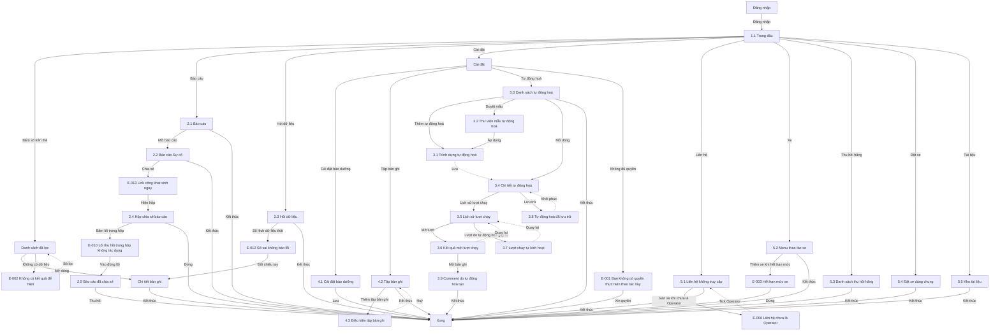

# Nền tảng SaaS — User flow

`stage` ghi theo lựa chọn của user: tự chốt, xem ở bản cuối (02/11/2026). Các màn số 2.2 trở đi và 3.2 trở đi thêm sau lượt chạy 03/11/2026, chưa qua duyệt.

## 1. Sơ đồ tổng

Bản vẽ trên Figma: trang `Research · Fleetio`, frame `7214:221842`, chưa có các màn thêm sau 03/11/2026. Đường liền là luồng thường, nét đứt là quay lại.

## 2. Màn hình

| # | Màn | Slug | Trạng thái | Ảnh |
|---|---|---|---|---|
| 1.1 | Trang đầu | dashboard | Có dữ liệu | Có |
| 2.1 | Báo cáo chuẩn | reports | Có dữ liệu | Có |
| 3.1 | Trình dựng tự động hoá | automation-builder | Mới | Có |
| 4.1 | Maintenance Settings | maintenance-settings | Mặc định | Có |
| 4.2 | Record Sets | record-sets | Mặc định | Có |
| 2.2 | Báo cáo Sự cố | report-issues | Có dữ liệu | Có |
| 2.3 | Hỏi dữ liệu | ai-analyst-issues | Có dữ liệu | Có |
| 2.4 | Hộp chia sẻ báo cáo | report-share-dialog | Có link | Không có ảnh |
| 2.5 | Báo cáo đã chia sẻ | reports-shared | Có dữ liệu, Empty | Không có ảnh |
| 3.2 | Thư viện mẫu tự động hoá | automation-templates | Có dữ liệu | Có |
| 3.3 | Danh sách tự động hoá | automation-list-data | Có dữ liệu | Có |
| 3.4 | Chi tiết tự động hoá | automation-detail | Có dữ liệu | Có |
| 3.5 | Lịch sử lượt chạy | automation-run-history | Có dữ liệu | Có |
| 3.6 | Kết quả một lượt chạy | automation-run-result | Có dữ liệu | Có |
| 3.7 | Lượt chạy tự kích hoạt | automation-self-trigger-runs | Có dữ liệu | Có |
| 3.8 | Tự động hoá đã lưu trữ | automation-archived | Chỉ đọc | Có |
| 3.9 | Comment do tự động hoá tạo | automation-comment-result | Có dữ liệu | Có |
| 4.3 | Điều kiện tập bản ghi | record-set-conditions | Mới | Có |
| 5.1 | Liên hệ không truy cập | contact-no-access | Có dữ liệu | Có |
| 5.2 | Menu thao tác xe | vehicle-more-actions | Mở menu | Có |
| 5.3 | Danh sách thu hồi hãng | recalls-list | Có dữ liệu | Có |
| 5.4 | Đặt xe dùng chung | motor-pool-reservations | Empty | Có |
| 5.5 | Kho tài liệu | documents-empty | Empty | Có |
