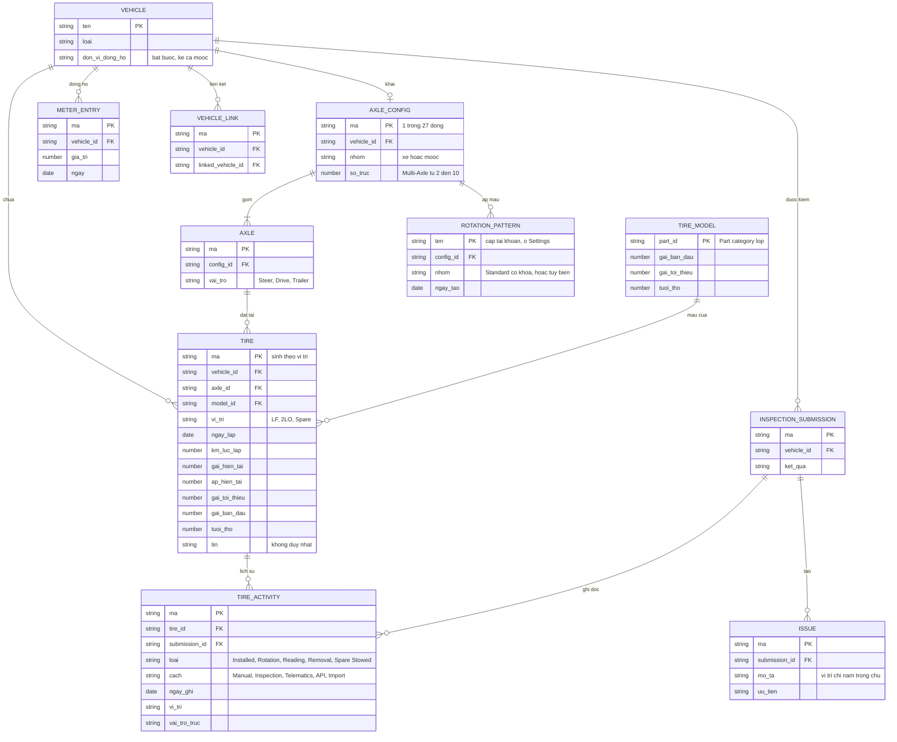
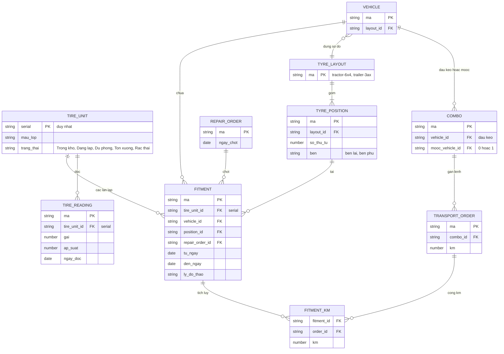

# Quản lý lốp — ERD nghiệp vụ

Suy ra từ form, tên trường và kết quả chạy thật, không phải sơ đồ cơ sở dữ liệu thật. Điểm chính: **TIRE là một vị trí trên một xe**, mã lốp (TIN) chỉ là một trường chữ không duy nhất.

Tire Readings là góc nhìn của TIRE ở lần đọc mới nhất, không phải bảng riêng (`Suy`). Lốp đã tháo mất khỏi Tire Readings, còn dòng TIRE_ACTIVITY (`Chạy`). Không thấy quan hệ TIRE với Work Order, kho hay chi phí (`Chạy`, với Work Order là `Chạy một phần`). `VEHICLE_LINK` là nhiều-nhiều: một mooc nối được nhiều xe, không có ngày hiệu lực (`Chạy`). `ROTATION_PATTERN` thuộc cấp tài khoản; một mẫu áp cho nhiều cấu hình, vd Standard 6x4 cho 6x2 / 6x4 / 6x6 (`Xem`), nên cột `config_id` đang vẽ là giản lược. Xe Archived giữ `AXLE_CONFIG` (`Chạy`).

## Đề xuất Invlogis: mô hình quả lốp

> Phần này **không phải Fleetio**, chưa chốt với Delta (DX-01 đến DX-05, DX-07, DX-08).

Container không có lốp nên không xuất hiện trong mô hình lốp, dù thuộc tổ hợp.
