# Quản lý lốp — Flows

## Flow 1: Khai cấu hình trục (`Chạy`)

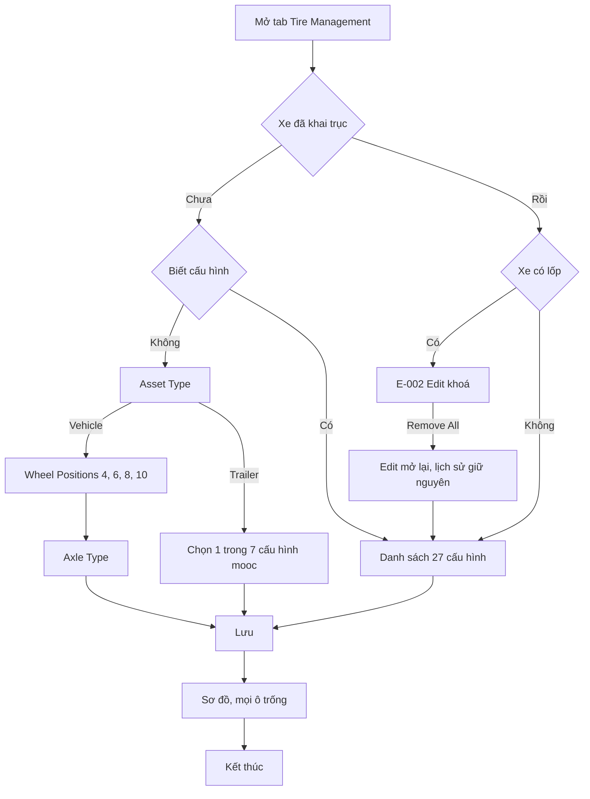

Đổi cấu hình làm vai trò trục đã đặt về mặc định. Đổi vai trò trục làm được cả khi khoá, không có dòng lịch sử.

## Flow 2: Lắp lốp (`Chạy`)

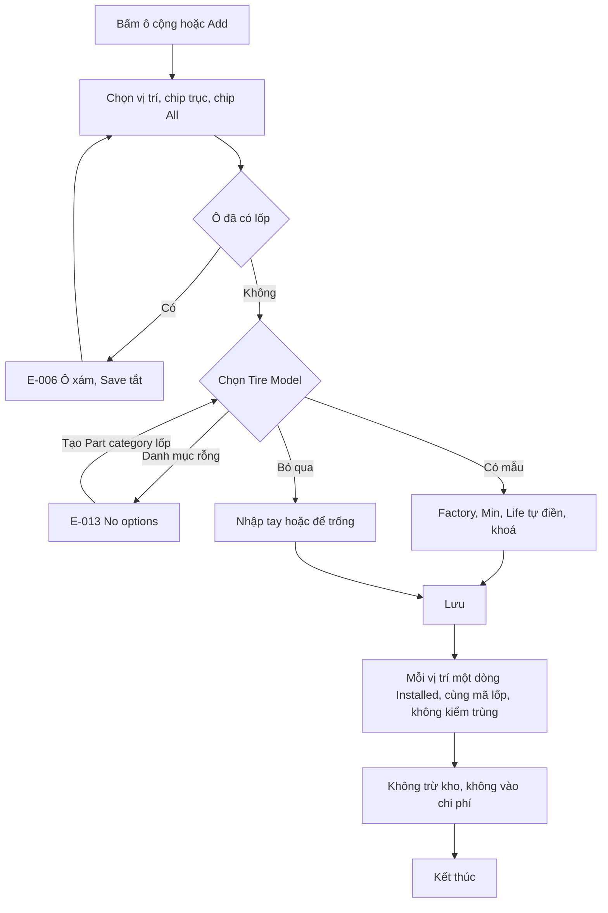

Đường đảo ngược: tháo (Flow 5). Lắp nhầm vị trí có thể sửa bằng đảo (Flow 4), `Suy`.

## Flow 3: Chép thông số (`Chạy`)

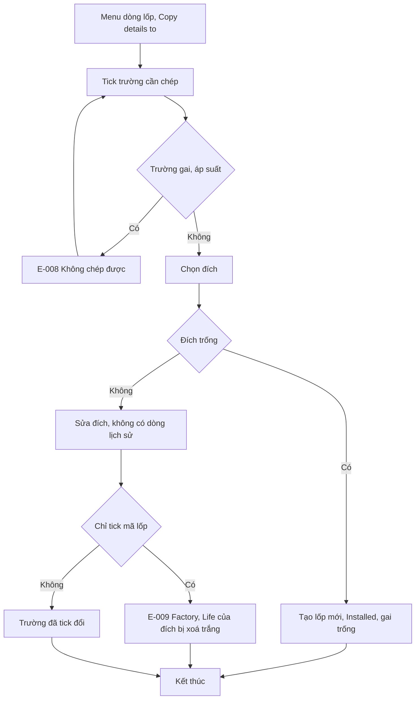

Không có đường hoàn tác.

## Flow 4: Đảo lốp (`Chạy`)

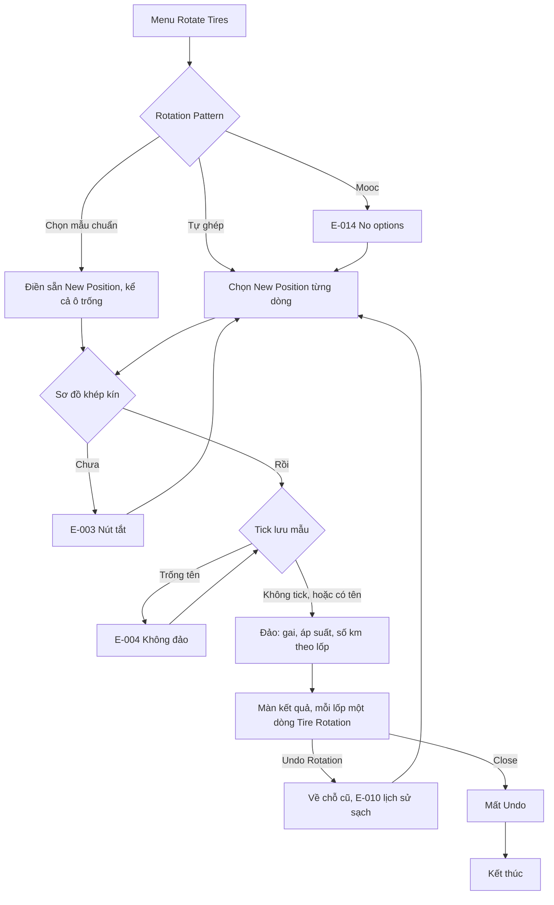

Spare không tham gia. New Position chỉ có vị trí của xe đó, không đảo được sang xe khác. Lưu mẫu thật: `Không chạy`; mẫu nằm ở Settings › Tire Management Settings, cấp tài khoản (`Xem`, FR-fleetio-tires-031).

## Flow 5: Tháo, thay lốp (`Chạy`)

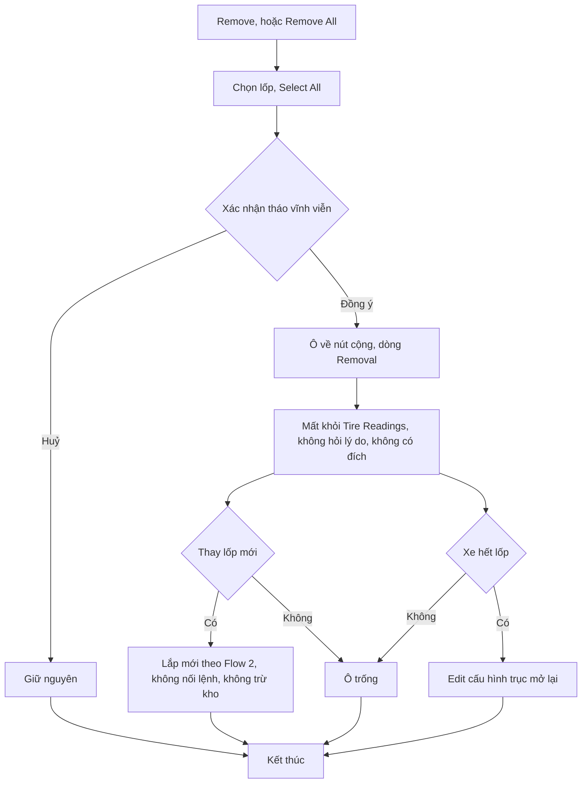

Không có đường đảo ngược: muốn dùng lại lốp đã tháo phải gõ lại mã, km về 0 nếu không nhập tay, lịch sử không nối. Nhánh huỷ ở hộp xác nhận là `Suy`, không thử và không ghi câu chữ nút.

## Flow 6: Đọc trực tiếp (`Chạy`)

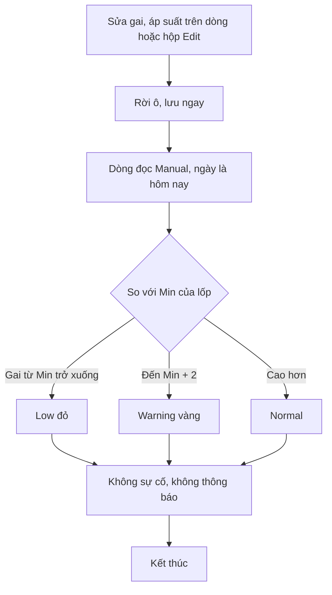

Áp suất không có mức theo lốp. Sửa nhầm thì sửa lại, số cũ còn ở lịch sử.

## Flow 7: Đọc qua phiếu kiểm (`Chạy`)

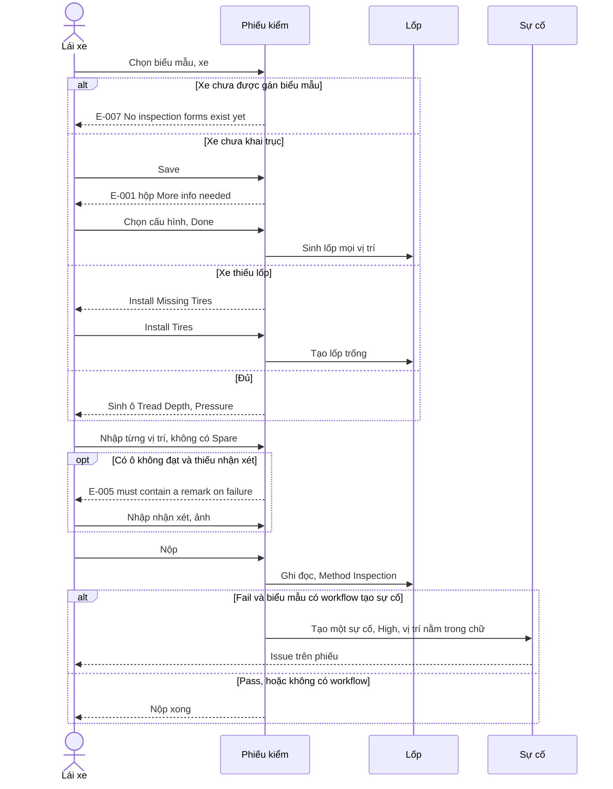

Cùng số đọc có thể Pass ở phiếu nhưng Low ở lốp vì hai mức tối thiểu tách rời. Mô tả sự cố có thể thiếu lỗi (E-011). Fail lần 2 gộp vào sự cố cũ: `Không chạy`.

## Flow 8: Số km lốp theo đồng hồ (`Chạy`, quy tắc `Suy`)

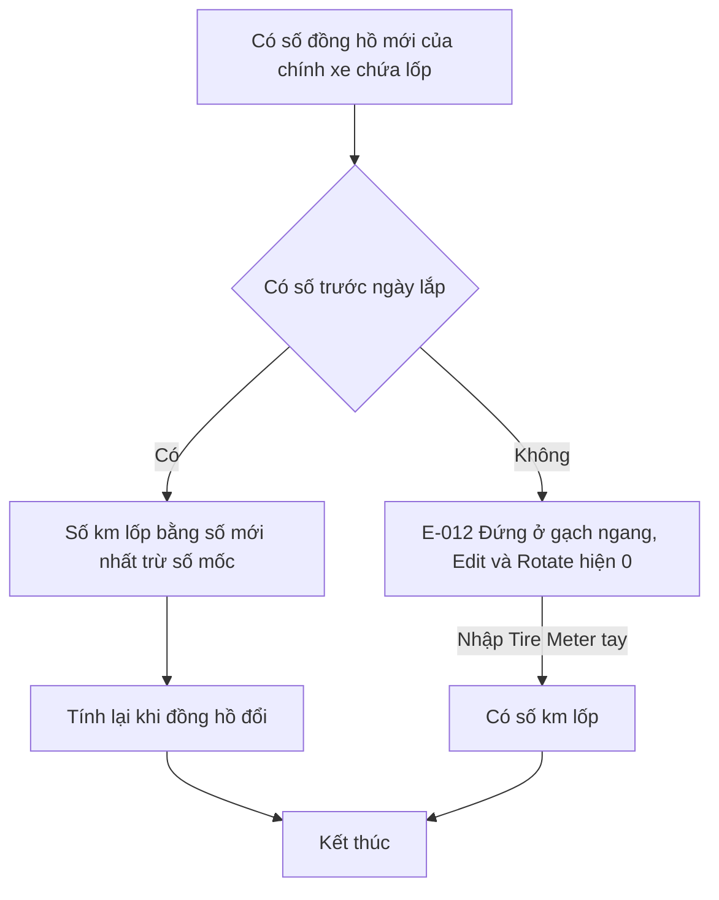

Ví dụ `Chạy`: lắp 03/11, có 1.000 ngày 25/10, 3.000 cùng ngày 03/11, nhập 3.500 thì số km lốp là 2.500. Đầu kéo tăng km thì mooc không đổi.

## Flow 9: Gắn lốp theo đầu kéo và theo mooc (`Chạy`)

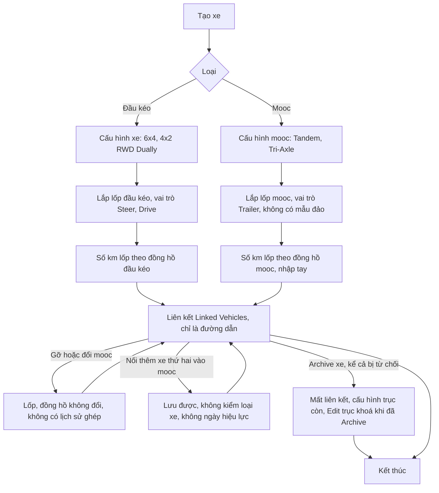

## Flow 10: Đổi lốp giữa hai xe (cơ chế `Chạy`, giữa hai xe `Suy`)

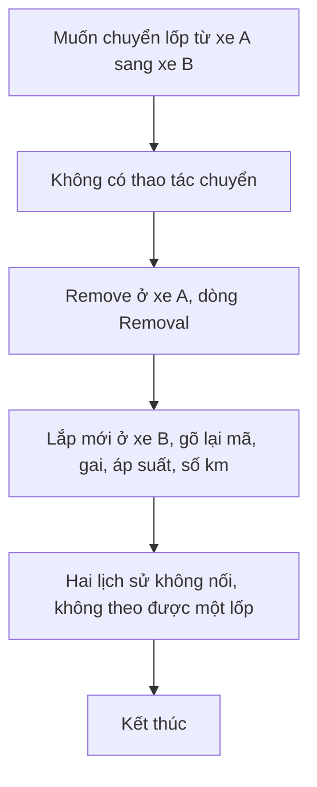

## Flow 11: Mẫu đảo, đọc tự động, Import ở cấp tài khoản (`Xem`, không bấm)

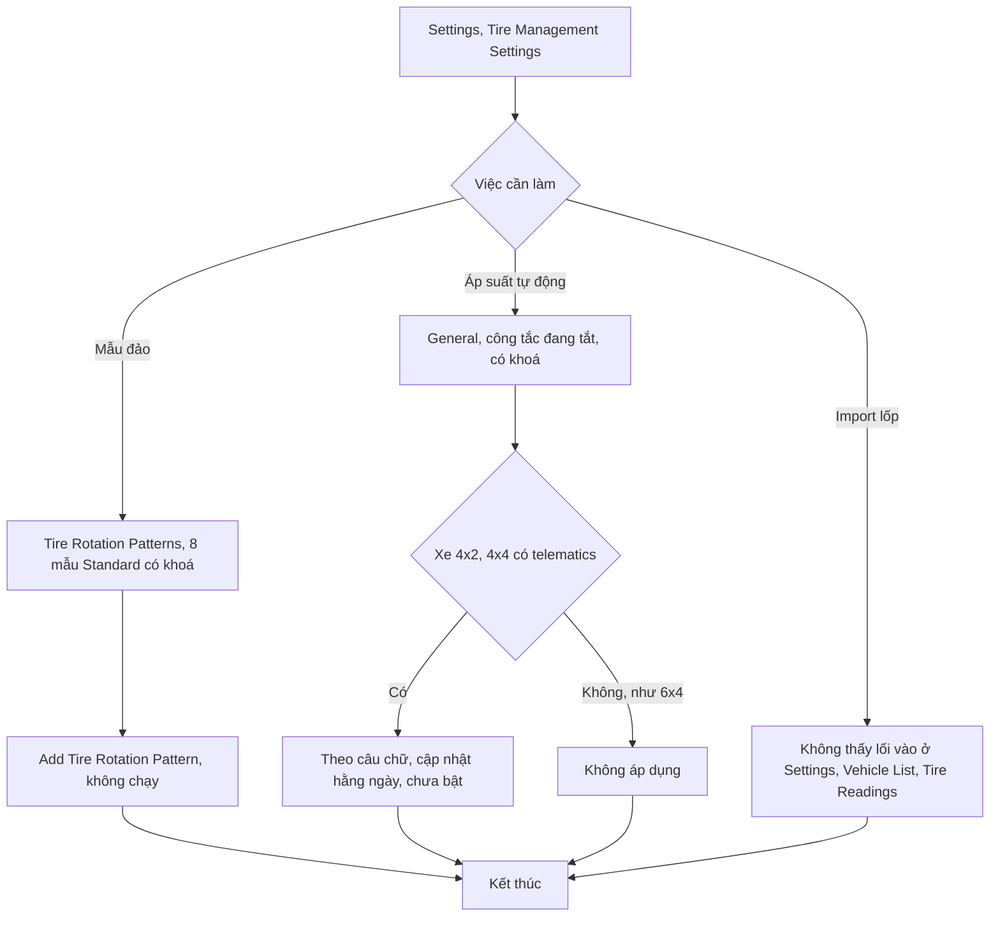

## Đề xuất Invlogis: đổi lốp và km theo tổ hợp

> Phần này **không phải Fleetio**, chưa chốt với Delta (DX-02, DX-03).

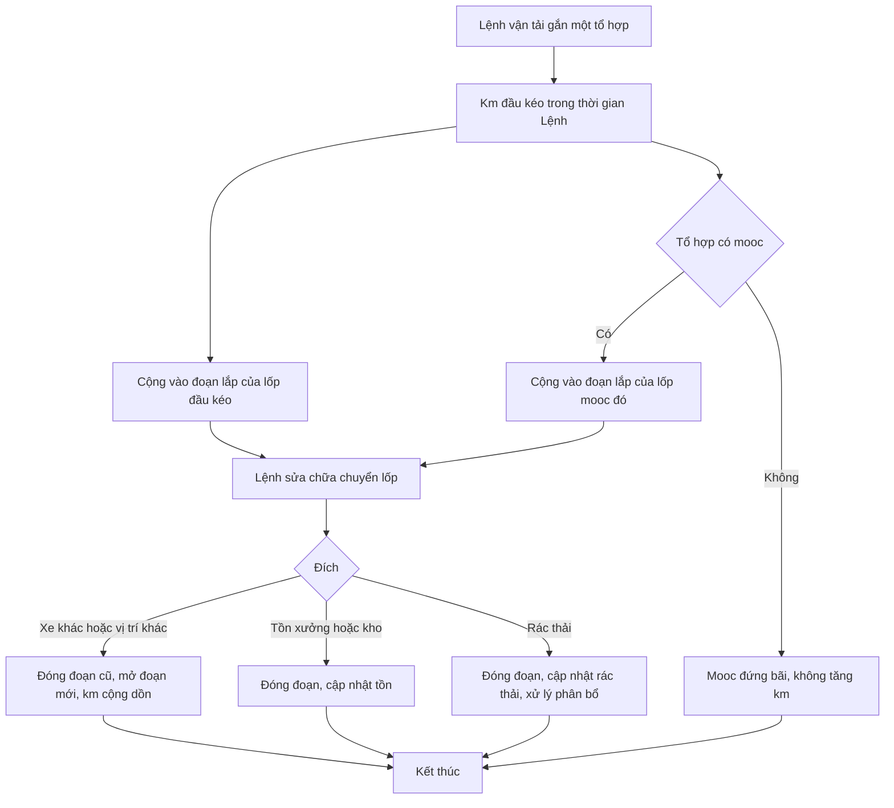
