# Quản lý lốp — Màn hình thật

Ảnh chụp từ tài khoản dùng thử ngày 02–03/11/2026, dùng nội bộ để phân tích. Mô tả theo ghi chú chạy thử; chỗ ghi chú không tả đủ có ghi rõ.

## 1.1 Lốp, chưa khai trục

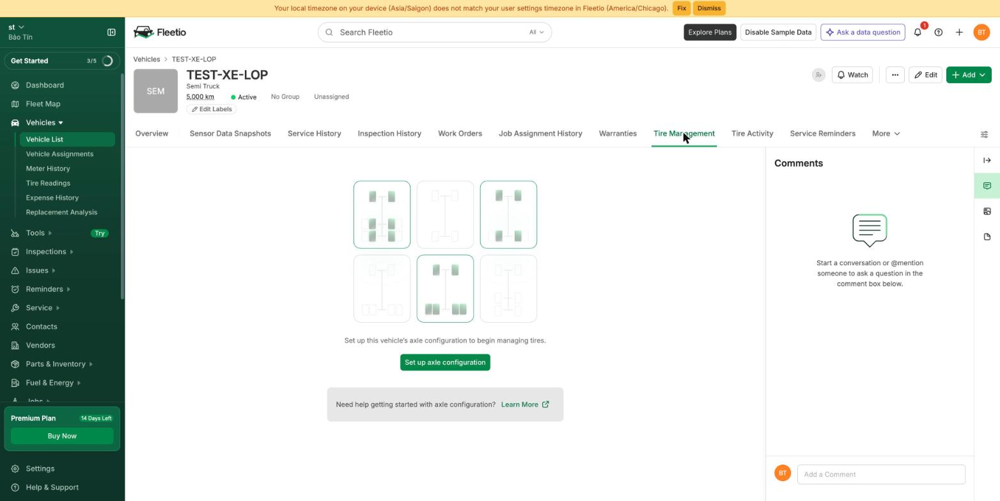

| # | Items | Control type | Data type | Description |
|---|---|---|---|---|
| 1 | Hình minh hoạ, câu dẫn | Chữ | — | "Set up this vehicle's axle configuration to begin managing tires." |
| 2 | Set up axle configuration | Nút | — | Mở trình hướng dẫn 1.2 |
| 3 | Learn More | Ô liên kết | — | Tài liệu hãng |

## 1.2 Trình hướng dẫn cấu hình trục

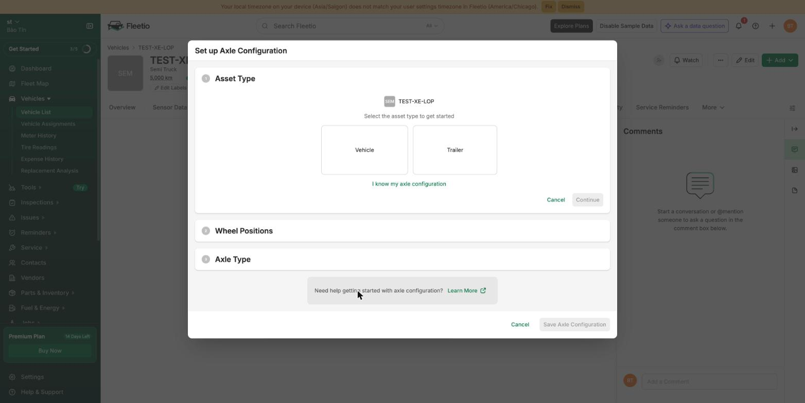

| # | Items | Control type | Data type | Description |
|---|---|---|---|---|
| 1 | Asset Type | Khối gập, chọn một | Vehicle, Trailer | Trailer nhảy thẳng sang ô cấu hình, chỉ còn 7 dòng |
| 2 | Wheel Positions | Khối gập, chọn một | 4, 6, 8, 10 | Không có 12 |
| 3 | Axle Type | Khối gập, chọn một | Theo số vị trí | Vd 6 có 6x2, 6x4, 6x6 |
| 4 | Cancel, Continue, Save Axle Configuration | Nút | — | Xong: "Vehicle's Axle Configuration successfully updated" |

## 1.3 Chọn Axle Type

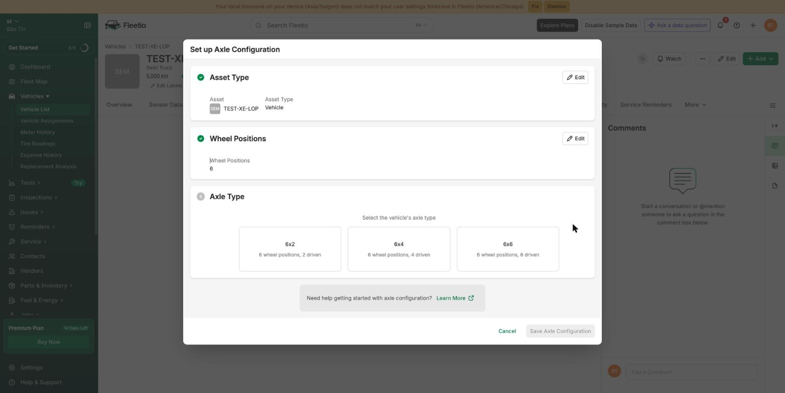

| # | Items | Control type | Data type | Description |
|---|---|---|---|---|
| 1 | Axle Type | Chọn một | 6x2, 6x4, 6x6 khi chọn 6 vị trí | Ghi chú chạy thử không tả thêm |

## 1.4 Đường đã biết cấu hình

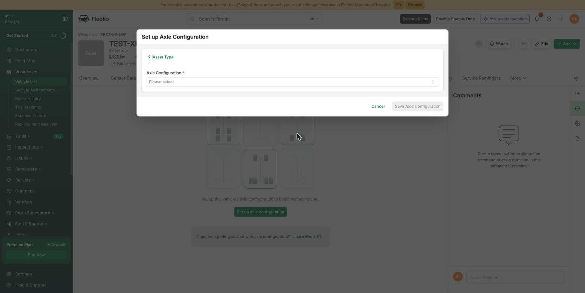

| # | Items | Control type | Data type | Description |
|---|---|---|---|---|
| 1 | I know my axle configuration | Lựa chọn | — | Bỏ qua trình hướng dẫn |
| 2 | Axle Configuration | Ô chọn | 27 dòng | Có nhóm "VEHICLE AXLES" |

## 1.5 Danh sách cấu hình trục

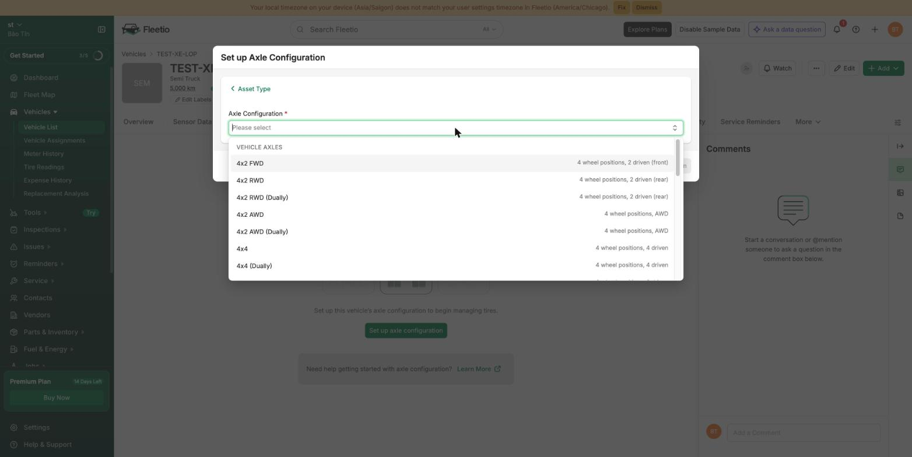

| # | Items | Control type | Data type | Description |
|---|---|---|---|---|
| 1 | Nhóm xe | Danh sách | 20 dòng | 4x2 FWD, 4x2 RWD, 4x2 RWD (Dually), 4x2 AWD, 4x2 AWD (Dually), 4x4, 4x4 (Dually), 6x2, 6x4, 6x6, 8x2, 8x4, 8x6, 8x8, 10x4, 10x6, 10x8, 10x10, 12x4, 12x6 |
| 2 | Nhóm mooc | Danh sách | 7 dòng | Single Axle; Tandem, Tri-Axle, Multi-Axle mỗi loại 2 hoặc 4 Tires per Axle |

## 1.6 Sơ đồ đầu kéo 6x4

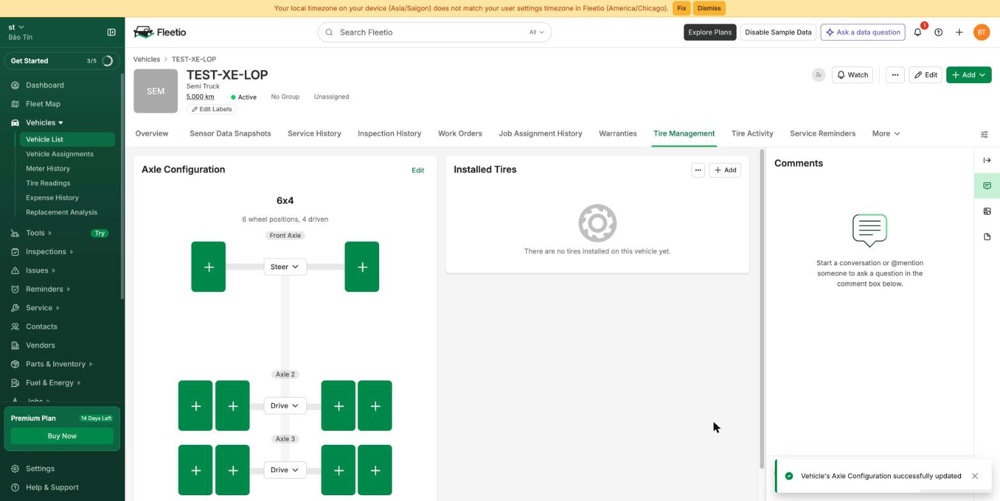

| # | Items | Control type | Data type | Description |
|---|---|---|---|---|
| 1 | Axle Configuration, Edit | Khối, nút | — | "6 wheel positions, 4 driven"; Edit khoá khi có lốp |
| 2 | Sơ đồ | Hình | — | Front Axle LF, RF; Axle 2, 3 mỗi bên 2 lốp đôi; ô trống có nút + |
| 3 | Vai trò trục | Menu | Steer, Drive, Dead, Lifted, Tag, Pusher, Other | Đổi được cả khi có lốp |
| 4 | Installed Tires | Danh sách | — | Menu … có Rotate Tires, Remove All; nút Add |

## 1.7 Sơ đồ mooc 3 trục

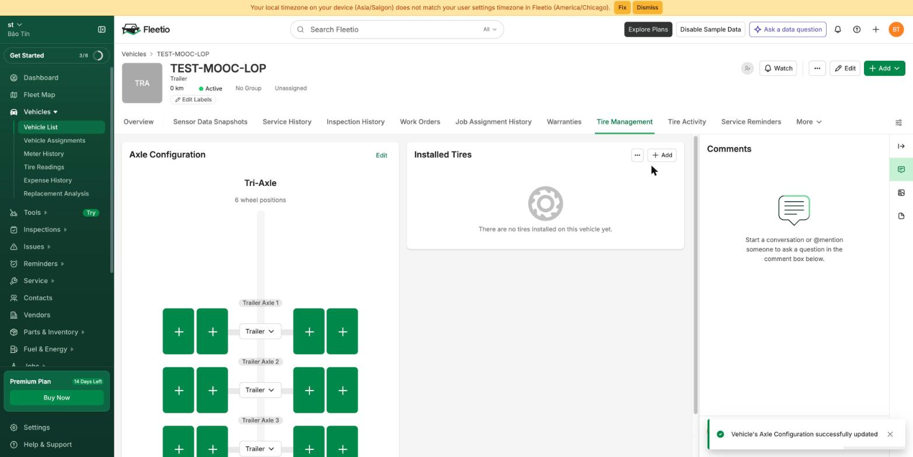

| # | Items | Control type | Data type | Description |
|---|---|---|---|---|
| 1 | Sơ đồ | Hình | — | Trailer Axle 1, 2, 3, mỗi trục 4 lốp, tiêu đề Tri-Axle "6 wheel positions" |
| 2 | Vai trò trục | Menu | Dead, Lifted, Trailer, Other | Mặc định Trailer |

## 2.1 Lắp lốp

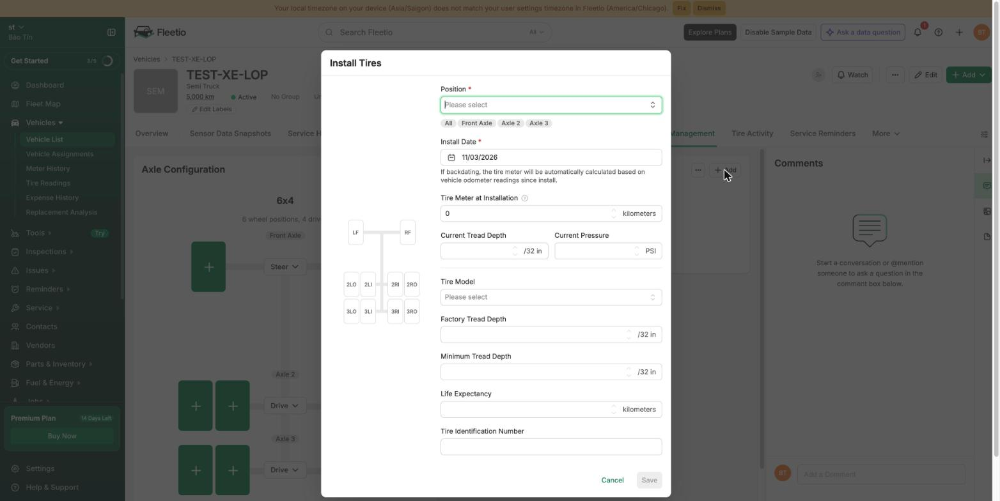

| # | Items | Control type | Data type | Description |
|---|---|---|---|---|
| 1 | Position | Chọn nhiều, chip | All, từng trục, Spare Tire | Ô có lốp xám, chip đầy biến mất; E-fleetio-tires-006 |
| 2 | Install Date | Ngày | Ngày | Cho lùi ngày. "If backdating, the tire meter will be automatically calculated based on vehicle odometer readings since install." |
| 3 | Tire Meter at Installation | Số | km | Tuỳ chọn |
| 4 | Current Tread Depth, Current Pressure | Số | /32 in, PSI | Tuỳ chọn, đơn vị cố định |
| 5 | Tire Model | Ô chọn | Part category lốp | Rỗng thì "No options"; chọn thì Factory, Min, Life tự điền, khoá |
| 6 | Factory Tread Depth, Minimum Tread Depth, Life Expectancy | Số | — | Tuỳ chọn |
| 7 | Tire Identification Number | Chữ | — | Không duy nhất, lắp nhiều lốp dùng chung |

## 2.2 Sơ đồ đã có lốp

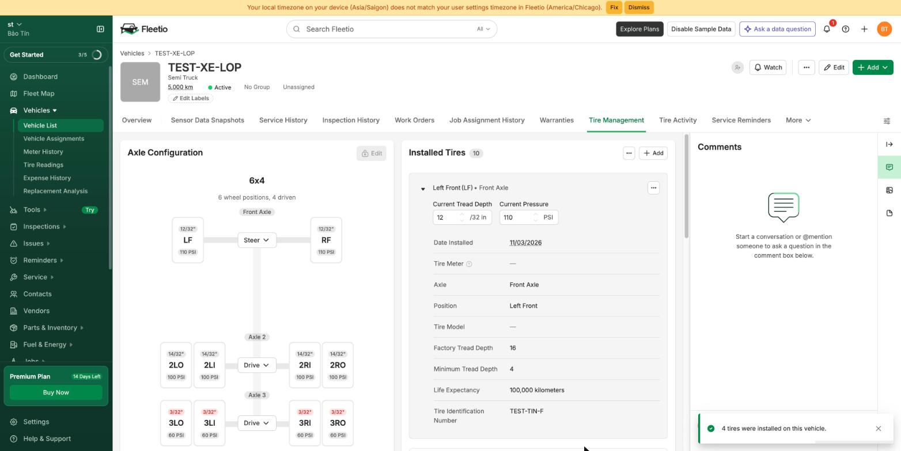

| # | Items | Control type | Data type | Description |
|---|---|---|---|---|
| 1 | Ô lốp | Nút | Gai, PSI | Bấm để sửa; gai dưới mức đỏ |
| 2 | Dòng lốp | Ô nhập | Gai, áp suất | Rời ô là lưu, không có nút Lưu |
| 3 | Menu dòng lốp | Menu | Edit, Copy details to..., Remove | Không có chuyển kho |

## 2.3 Sửa lốp

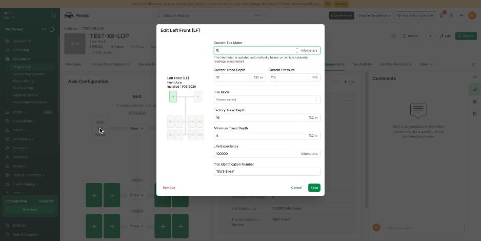

| # | Items | Control type | Data type | Description |
|---|---|---|---|---|
| 1 | Các trường của form lắp | Form | — | Thêm Current Tire Meter; tiêu đề kiểu "Edit Left Outer (1LO)" |
| 2 | Remove | Nút | — | Tháo lốp này |
| 3 | Lưu | Nút | — | "Tire updated successfully."; đổi gai tạo dòng đọc, đổi mã lốp, Min thì không |

## 2.4 Mooc đủ 12 lốp và Spare

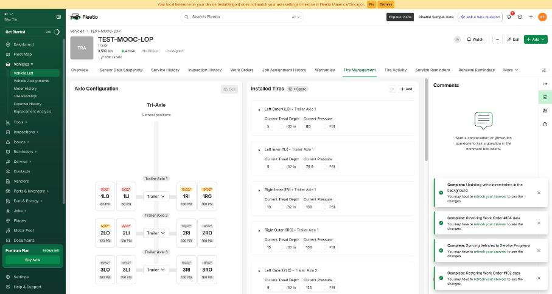

| # | Items | Control type | Data type | Description |
|---|---|---|---|---|
| 1 | Đầu trang xe | Chữ | km | TEST-MOOC-LOP, Trailer, số km riêng |
| 2 | Sơ đồ | Hình | — | 12 ô, đủ màu Low, Warning, Normal, mỗi ô có gai và PSI |
| 3 | Installed Tires "12 + Spare" | Danh sách | Gai, áp suất | Từng vị trí kèm trục, ô nhập ngay trên dòng |
| 4 | Edit cấu hình | Nút | — | Khoá |

## 3.1 Đảo lốp

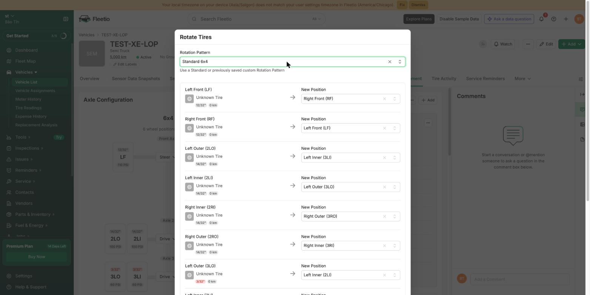

| # | Items | Control type | Data type | Description |
|---|---|---|---|---|
| 1 | Rotation Pattern | Ô chọn | Standard 6x4 | "Use a Standard or previously saved custom Rotation Pattern"; mooc "No options" |
| 2 | Dòng vị trí | Chữ | Mẫu lốp, gai, km | Vd "Left Front (LF)", "Unknown Tire", 12/32", 0 km |
| 3 | New Position | Ô chọn | Vị trí cùng xe | Mẫu chuẩn điền sẵn, sửa tay được |
| 4 | Save as a Custom Rotation Pattern | Ô tick | — | Hiện khi đã khép kín, bắt buộc tên; E-fleetio-tires-004 |
| 5 | Rotate Tires | Nút | — | Tắt khi chưa khép kín; E-fleetio-tires-003 |

## 3.2 Kết quả đảo

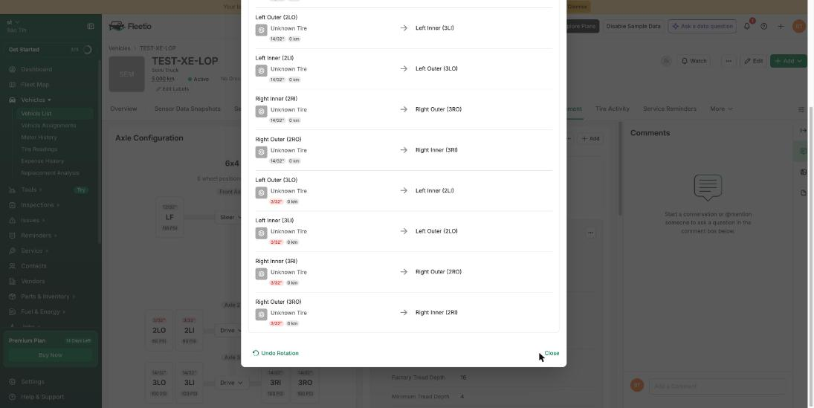

| # | Items | Control type | Data type | Description |
|---|---|---|---|---|
| 1 | Thông báo | Chữ | — | "Successfully Rotated 10 tires", đếm cả ô trống |
| 2 | Undo Rotation | Nút | — | Về chỗ cũ, quay lại form, mapping còn nguyên, lịch sử sạch |
| 3 | Close | Nút | — | Đóng thì mất Undo |

## 3.3 Đảo lốp, thiếu tên mẫu

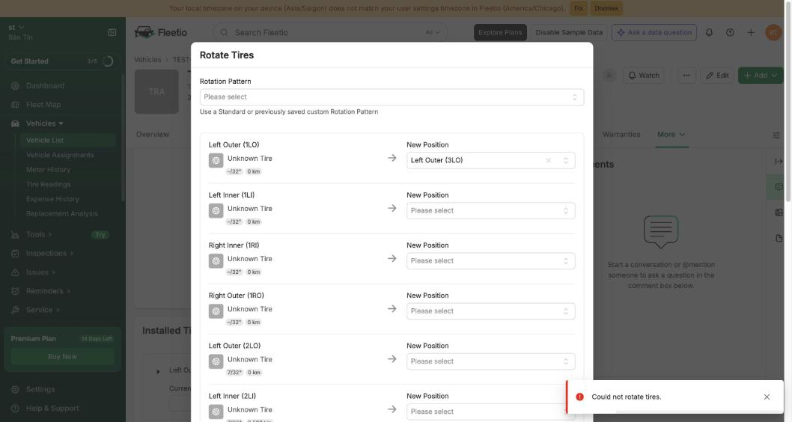

| # | Items | Control type | Data type | Description |
|---|---|---|---|---|
| 1 | Lỗi đầu form | Chữ | — | "Could not rotate tires." |
| 2 | Lỗi ô tên | Chữ | — | "can't be blank" nằm cuối form, ảnh chỉ có đầu form |

## 4.1 Tháo lốp

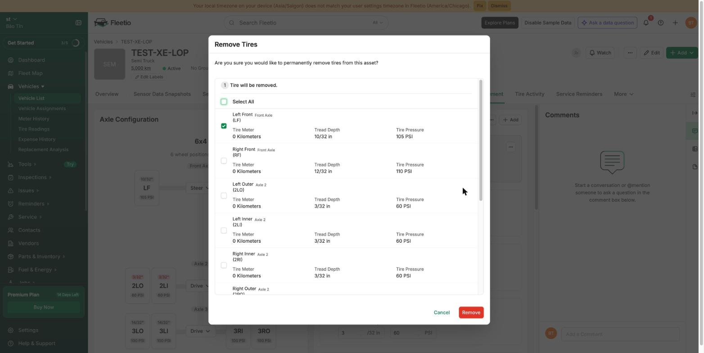

| # | Items | Control type | Data type | Description |
|---|---|---|---|---|
| 1 | Câu xác nhận | Chữ | — | "Are you sure you would like to permanently remove tires from this asset?" |
| 2 | Danh sách lốp, Select All | Ô tick | — | Chọn nhiều; không có lý do, không có đích |
| 3 | Xác nhận | Nút | — | "1 tire was removed from this asset."; nhãn nút chưa ghi trong ghi chú chạy thử |

## 5.1 Đọc lốp

| # | Items | Control type | Data type | Description |
|---|---|---|---|---|
| 1 | Lọc Vehicle, Tread Depth Health, Reading Method | Lọc | — | Low, Warning, Normal, Unknown; Manual, Inspection, Telematics, API, Import |
| 2 | Cột | Bảng | — | Vehicle, Last Reading Date, Reading Method, Recorded By, Tread Depth, Pressure, Position, Tire Model, Tire Meter, Install Date, Life Expectancy, Minimum, Factory, mã lốp |
| 3 | Trạng thái rỗng | Chữ | — | Hướng dẫn lắp lốp, ghi độ sâu và áp suất |

## 5.2 Đọc lốp có dữ liệu

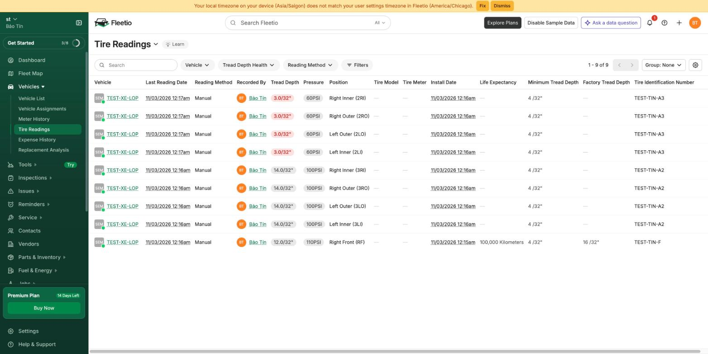

| # | Items | Control type | Data type | Description |
|---|---|---|---|---|
| 1 | Dòng đọc | Bảng | — | 1 dòng mỗi vị trí, lần đọc mới nhất; lốp đã tháo không còn |
| 2 | Tread Depth | Chữ màu | /32 in | Low đỏ, Warning vàng, Normal xám |
| 3 | Pressure | Chữ | PSI | Không có mức, 60 PSI vẫn xám |
| 4 | Group | Lọc | None | Ghi chú chạy thử không tả các giá trị khác |

## 5.3 Đọc lốp lọc Warning

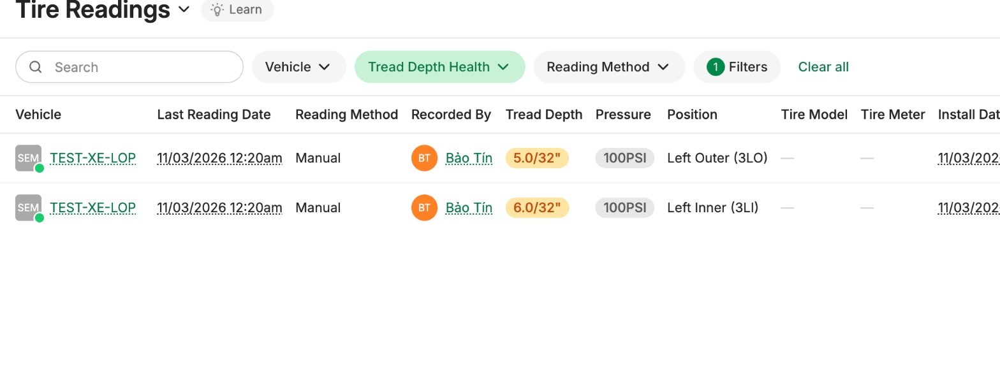

| # | Items | Control type | Data type | Description |
|---|---|---|---|---|
| 1 | Tread Depth Health = Warning | Lọc | — | Với Min 4/32: dòng 5/32 và 6/32 |

## 5.4 Đọc lốp, biên mức gai

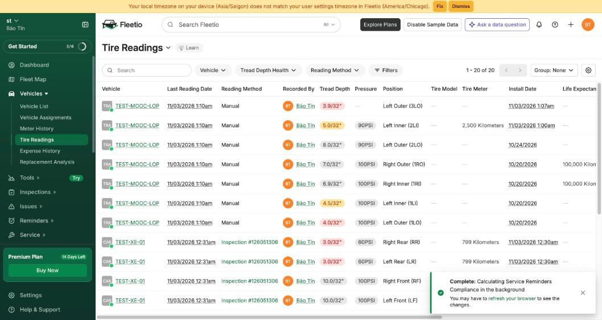

| # | Items | Control type | Data type | Description |
|---|---|---|---|---|
| 1 | Bảng đọc | Bảng | — | Các số 3.9, 4.0, 4.5, 5, 6.9, 7, 8 với Min 4; thể hiện biên Low, Warning, Normal |

## 5.5 Lịch sử lốp

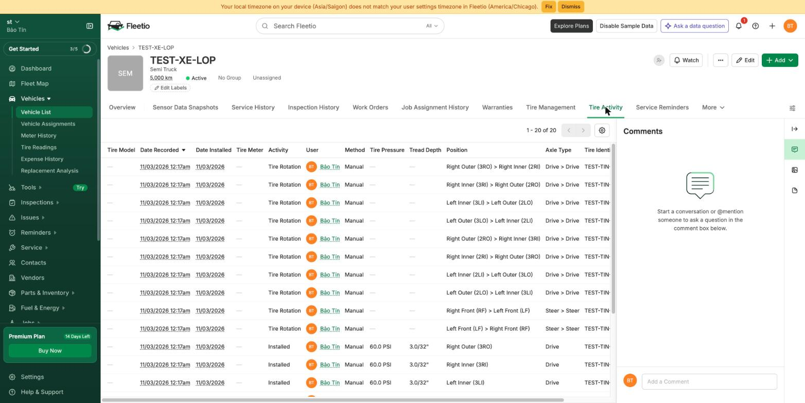

| # | Items | Control type | Data type | Description |
|---|---|---|---|---|
| 1 | Cột | Bảng | — | Tire Model, Date Recorded, Date Installed, Tire Meter, Activity, User, Method, Tire Pressure, Tread Depth, Position, Axle Type, mã lốp |
| 2 | Activity | Chữ | — | Installed, Tire Rotation, Tread Depth Reading, Pressure Reading, Removal, Spare Stowed |
| 3 | Dòng đảo | Chữ | — | "Left Front (LF) > Right Front (RF)", "Steer > Steer" |

## Màn liên quan, không đánh số

### Phiếu kiểm thiếu cấu hình trục

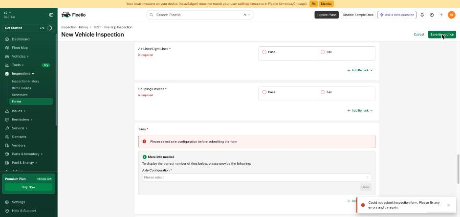

| # | Items | Control type | Data type | Description |
|---|---|---|---|---|
| 1 | Hộp lỗi đỏ | Chữ | — | E-fleetio-tires-001 |
| 2 | More info needed | Khối | — | "To display the correct number of tires below, please provide the following:", ô Axle Configuration, Done |

### Phiếu kiểm bắt nhận xét

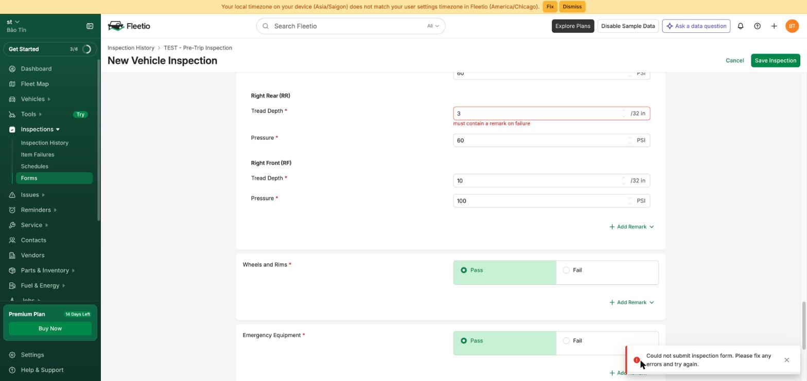

| # | Items | Control type | Data type | Description |
|---|---|---|---|---|
| 1 | Ô gai, áp từng vị trí | Số | /32 in, PSI | Bắt buộc theo biểu mẫu |
| 2 | Lỗi | Chữ | — | "must contain a remark on failure" |

### Kết quả phiếu kiểm

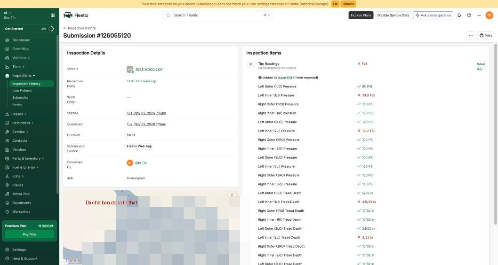

| # | Items | Control type | Data type | Description |
|---|---|---|---|---|
| 1 | Dòng Tire Readings | Chữ | — | Một chữ "Fail" |
| 2 | Issue #41 | Liên kết | — | Sự cố tự tạo |
| 3 | Mở rộng mục | Danh sách | — | Từng vị trí đạt, không đạt, dấu tích hoặc X |

### Phụ tùng nhóm lốp

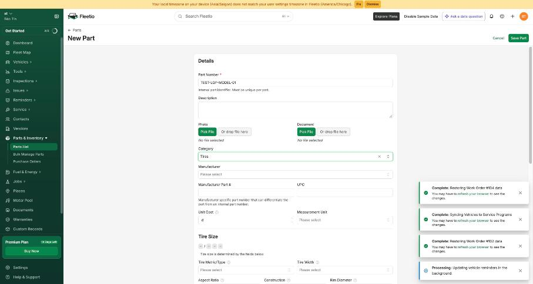

| # | Items | Control type | Data type | Description |
|---|---|---|---|---|
| 1 | Category | Ô chọn | Tires | Quyết định xuất hiện ở Tire Model |
| 2 | Khối Tire Size | Khối | — | Ghi chú chạy thử không tả từng trường |
