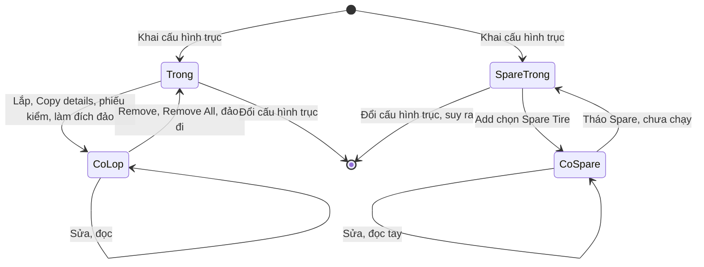
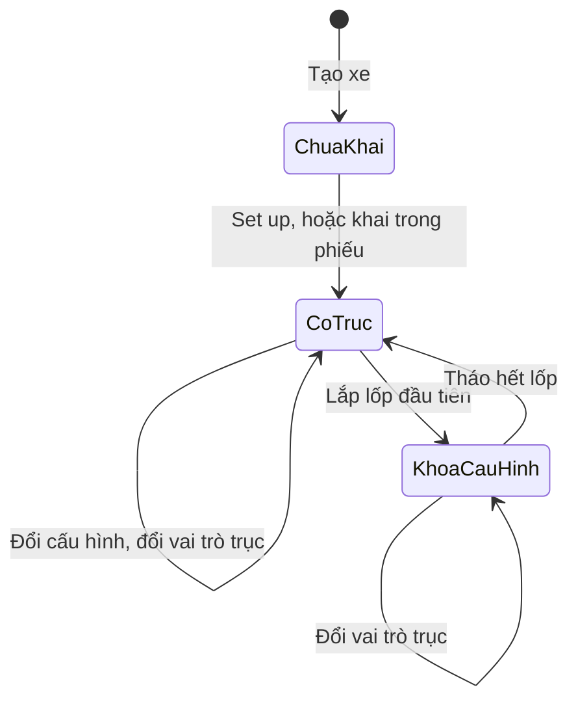
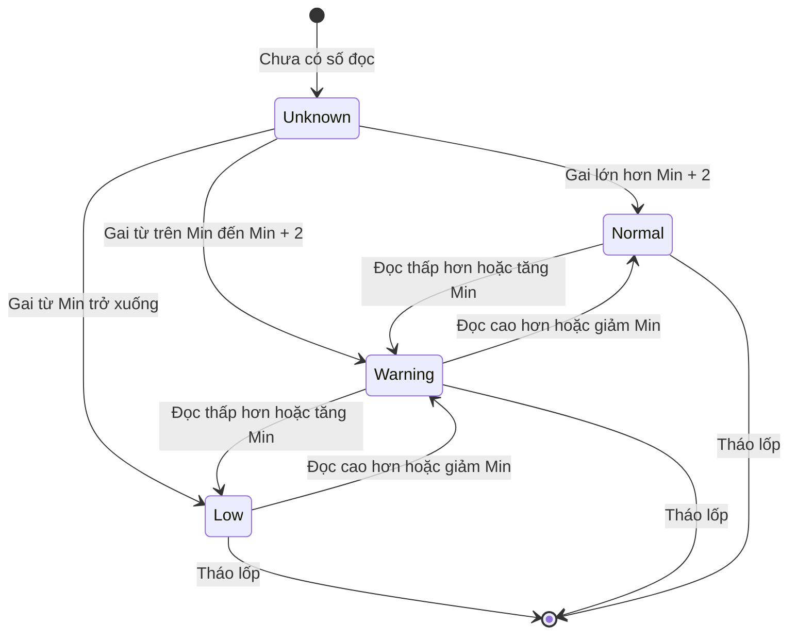
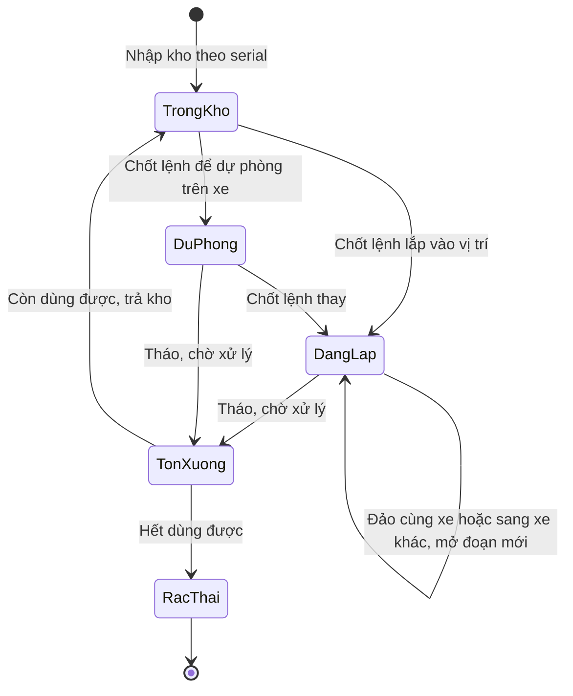

# Quản lý lốp — States

**Quả lốp không có trạng thái thật.** Fleetio không có đối tượng lốp độc lập: lốp là dữ liệu của một vị trí trên một xe, nên không có trong kho, chờ xử lý, đi đắp hay phế. Trạng thái dưới đây thuộc về **vị trí** và **cấu hình trục của xe**. "Đã tháo" chỉ còn là dòng lịch sử.

## 1. Vị trí lốp

### Ma trận trạng thái

| Trạng thái | Hành động | Sang | Điều kiện | Hiệu ứng | Câu chữ | Mức |
|---|---|---|---|---|---|---|
| Vị trí trống | Bấm ô +, Add, chip trục | Có lốp | Vị trí đang trống | Dòng Activity `Installed` | "4 tires were installed on this vehicle." | `Chạy` |
| Vị trí trống | Copy details to... | Có lốp | Chọn ô trống làm đích | **Tạo lốp mới**, `Installed`, ngày lắp hôm nay, gai trống | "Details copied to 2 tire positions." | `Chạy` |
| Vị trí trống | "Install Tires" trong phiếu kiểm | Có lốp | Xe thiếu lốp khi mở phiếu | Tạo lốp trống, không hỏi gì thêm | "This vehicle is missing 2 tires at these positions." | `Chạy` |
| Vị trí trống | Làm đích khi đảo | Có lốp | Ô trống cũng có dòng New Position | Lốp chuyển sang ô này | "Successfully Rotated 2 tires" | `Chạy` |
| Vị trí trống | Đổi cấu hình trục | Không còn ô | Mọi ô của xe đều trống | Ô theo cấu hình mới, Activity giữ nguyên | "Vehicle's Axle Configuration successfully updated" | `Chạy` |
| Có lốp | Sửa gai, áp suất trên dòng hoặc hộp Edit | Giữ nguyên | Không | Dòng đọc mới, Method Manual | "Tire updated successfully." | `Chạy` |
| Có lốp | Sửa Tire Meter, Model, Factory, Min, Life, mã lốp | Giữ nguyên | Không | Không có dòng Activity riêng cho mã lốp, Min | Hộp "Edit Left Outer (1LO)" | `Chạy` |
| Có lốp | Copy details từ lốp khác đến | Giữ nguyên | Có tick trường cần chép | Không có dòng Activity, xoá trắng Factory, Life của đích (E-fleetio-tires-009) | "Details copied to 2 tire positions." | `Chạy` |
| Có lốp | Đọc qua phiếu kiểm | Giữ nguyên | Xe được gán biểu mẫu có Tire Readings | Ghi về Tire Readings, Method `Inspection #...` | Không có câu riêng | `Chạy` |
| Có lốp | Đảo | Vị trí khác cùng xe | Sơ đồ đảo khép kín | Gai, áp suất, số km theo lốp; dòng `Tire Rotation` | "Rotate Tires" | `Chạy` |
| Có lốp | Undo Rotation | Vị trí cũ | Chỉ ở màn kết quả ngay sau đảo | Activity **không còn dấu vết** lần đảo | "Undo Rotation" | `Chạy` |
| Có lốp | Remove, Remove All | Trống | Không hỏi lý do, không chọn đích | Dòng `Removal`, mất dòng ở Tire Readings | "Are you sure you would like to permanently remove tires from this asset?" | `Chạy` |
| Có lốp | Lắp đè | Bị chặn | Ô xám trong Position, chip trục đầy biến mất | Save vẫn tắt | Không có câu báo | `Chạy` |
| Có lốp | Chuyển sang xe khác | **Không có** | New Position chỉ có vị trí của xe đó | Tháo rồi lắp mới | Không có câu báo | Cơ chế `Chạy`, giữa hai xe `Suy` |
| Spare trống | Add, chọn "Spare Tire" | Có Spare | Chưa có Spare | Activity `Spare Stowed`, Axle Type `N/A`, đầu mục "6 + Spare" | "1 spare tire was installed on this vehicle." | `Chạy` |
| Có Spare | Sửa, đọc tay | Giữ nguyên | Không | Không có ô trên sơ đồ, chỉ có dòng ở Installed Tires | "Tire updated successfully." | `Chạy` |
| Có Spare | Đảo | **Không làm được** | Không có dòng trong Rotate, không có trong New Position | Không có | Không có câu báo | `Chạy` |
| Có Spare | Vào phiếu kiểm | **Không có** | Phiếu 12 vị trí, không có Spare | Không có | Không có câu báo | `Chạy` |
| Có Spare | Tháo | Spare trống | Chưa thử | Chưa biết | Chưa biết | `Không chạy` |
| Đã tháo (dòng lịch sử) | Xem Tire Activity | Không đổi | Không còn dòng ở Tire Readings | Không có nút lắp lại, không có kho | Không có câu báo | `Chạy` |
| Đã tháo (dòng lịch sử) | Lắp lại | Là một lần lắp mới | Gõ lại mã lốp bằng tay | Không nối lịch sử cũ; km về 0 nếu không nhập tay | Không có câu báo | `Chạy` |

## 2. Cấu hình trục của xe

| Trạng thái | Hành động | Sang | Điều kiện | Hiệu ứng | Câu chữ | Mức |
|---|---|---|---|---|---|---|
| Chưa khai | Set up axle configuration | Có trục | Không | Sơ đồ, mọi ô trống | "Vehicle's Axle Configuration successfully updated" | `Chạy` |
| Chưa khai | Khai trong phiếu, Done | Khoá cấu hình | Xe chưa có trục, đang làm phiếu | Tự sinh lốp cho mọi vị trí, Date Installed là lúc khai | "To display the correct number of tires below, please provide the following:" | `Chạy` |
| Chưa khai | Nộp phiếu | Bị chặn | Phiếu có Tire Readings | Không nộp được | "Please select axle configuration before submitting the form" | `Chạy` |
| Có trục | Đổi cấu hình | Có trục | Chưa có lốp | Vai trò đã đặt mất, về mặc định | Không có câu riêng | `Chạy` |
| Có trục | Đổi vai trò | Có trục | Không | Còn sau khi tải lại | "Trailer Axle 1 updated successfully" | `Chạy` |
| Có trục | Lắp lốp | Khoá cấu hình | Không | Edit khoá | "4 tires were installed on this vehicle." | `Chạy` |
| Khoá cấu hình | Sửa cấu hình | Bị chặn | Còn lốp | Tooltip | "Axle Configuration cannot be edited for this Vehicle because it has installed Tires" | `Chạy` |
| Khoá cấu hình | Đổi vai trò | Khoá cấu hình | Không | Không có dòng Activity, ghi vào Axle Type các dòng sau | Không có câu riêng | `Chạy` |
| Khoá cấu hình | Remove All | Có trục | Tháo hết | Edit mở lại, Activity giữ nguyên | "1 tire was removed from this asset." | `Chạy` |

Xe không có lốp như container, máy phát: để ở trạng thái chưa khai, không có loại riêng (`Suy`).

## 3. Mức sức khoẻ gai

Không phải trạng thái lưu, tính lại mỗi lần đọc hoặc đổi Min. Công thức là `Suy` từ hai mức Min. Không có Min thì 3/32" vẫn Low, 10/32" Normal, ngưỡng mặc định chưa xác định.

| Trạng thái | Hành động | Sang | Điều kiện | Hiệu ứng | Câu chữ | Mức |
|---|---|---|---|---|---|---|
| Unknown | Đọc lần đầu | Theo số đọc | Có gai | Có màu trên sơ đồ | "–/32"" trước khi đọc | `Chạy` |
| Bất kỳ | Đọc gai 3.9 hoặc 4.0, Min 4 | Low | Gai ≤ Min | Đỏ, **không** sự cố, **không** thông báo | Không có câu báo | `Chạy` |
| Bất kỳ | Đọc gai 4.5, 5, 6.0, Min 4 | Warning | Min < gai ≤ Min + 2 | Vàng | Không có câu báo | `Chạy` |
| Bất kỳ | Đọc gai 6.1, 6.9, 7, 8, Min 4 | Normal | Còn lại | Xám | Không có câu báo | `Chạy` |
| Warning | Đổi Min từ 4 sang 8 với gai 5 | Low | Tính lại theo Min mới | Đổi màu | Không có câu báo | `Chạy` |
| Low, Warning, Normal | Remove | Mất dòng | Không | Không còn ở Tire Readings | Không có câu báo | `Chạy` |

## 4. Mục Tire Readings trong phiếu

Pass hoặc Fail là kết quả của một lần nộp, không có chuyển đổi. Bảng biên và sự cố: [[docs/_research/fleetio/srs/fleetio-tires-spec.md|Spec]] Mục 13.9.

## 5. Đề xuất Invlogis: vòng đời quả lốp

> Phần này **không phải Fleetio**, là đề xuất để cân nhắc (DX-02, DX-05). Tên trạng thái lấy từ nguồn Delta: tồn kho, tồn xưởng, rác thải. Đi đắp chờ OQ-11. Chưa chốt với Delta.

| Trạng thái đề xuất | Hành động | Sang | Điều kiện | Hiệu ứng |
|---|---|---|---|---|
| Trong kho | Chốt lệnh sửa chữa lắp vào vị trí | Đang lắp | Vị trí trống, serial chưa dùng | Trừ tồn kho, mở đoạn lắp, ngày lắp theo ngày chốt, thẻ phân bổ |
| Trong kho | Chốt lệnh để dự phòng | Dự phòng | Xe chưa có dự phòng | Trừ tồn kho |
| Đang lắp | Đảo cùng xe, sang xe khác, đầu kéo sang mooc | Đang lắp | Sơ đồ khép kín hoặc phiếu chuyển | Đóng đoạn cũ, mở đoạn mới, km cộng dồn |
| Đang lắp | Tháo | Tồn xưởng | Bắt buộc lý do, đích | Đóng đoạn, cập nhật tồn xưởng |
| Tồn xưởng | Trả kho | Trong kho | Còn dùng được | Giữ km đã chạy |
| Tồn xưởng | Thải | Rác thải | Hết dùng được | Cập nhật rác thải, xử lý phần phân bổ còn lại |
