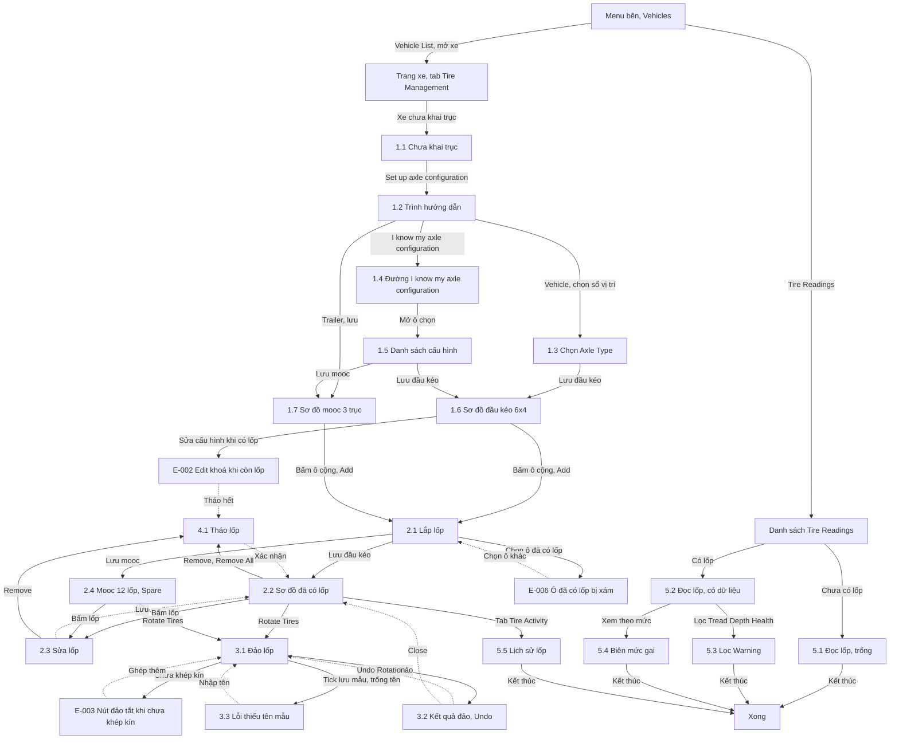

# Quản lý lốp — User flow

`stage` ghi theo lựa chọn của user: tự chốt, xem ở bản cuối (03/11/2026).

## 1. Sơ đồ tổng

Trên Figma: frame `Userflow · Fleetio · Quản lý lốp`. Đường liền là luồng thường, nét đứt là quay lại. Đọc lốp qua phiếu kiểm đi qua nhóm Nhắc, kiểm tra, xem Mục "Màn liên quan".

## 2. Màn

| # | Màn | Slug | Trạng thái | Ảnh |
|---|---|---|---|---|
| 1.1 | Lốp, chưa khai trục | tire-management-empty | Trống | Có |
| 1.2 | Trình hướng dẫn cấu hình trục | axle-setup-step1 | 3 khối gập | Có |
| 1.3 | Chọn Axle Type | axle-setup-axle-type | Đang chọn | Có |
| 1.4 | Đường đã biết cấu hình | axle-setup-known | Đang chọn | Có |
| 1.5 | Danh sách cấu hình trục | axle-config-options | Ô chọn mở | Có |
| 1.6 | Sơ đồ đầu kéo 6x4 | tire-management-6x4 | Ô trống | Có |
| 1.7 | Sơ đồ mooc 3 trục | tire-management-trailer | Ô trống | Có |
| 2.1 | Lắp lốp | tire-install | Form | Có |
| 2.2 | Sơ đồ đã có lốp | tire-management-installed | Có dữ liệu | Có |
| 2.3 | Sửa lốp | tire-edit | Form | Có |
| 2.4 | Mooc đủ 12 lốp và Spare | tire-management-trailer-12-spare | Có dữ liệu, đủ 3 mức | Có |
| 3.1 | Đảo lốp | tire-rotate | Mẫu Standard 6x4 | Có |
| 3.2 | Kết quả đảo | tire-rotate-result-undo | Thành công, có Undo | Có |
| 3.3 | Đảo lốp, thiếu tên mẫu | tire-rotate-name-required | Lỗi | Có |
| 4.1 | Tháo lốp | tire-remove | Hộp xác nhận | Có |
| 5.1 | Đọc lốp | tire-readings | Trống | Có |
| 5.2 | Đọc lốp có dữ liệu | tire-readings-data | Có dữ liệu | Có |
| 5.3 | Đọc lốp lọc Warning | tire-readings-filter-warning | Đã lọc | Có |
| 5.4 | Đọc lốp, biên mức gai | tire-readings-boundary | Có dữ liệu | Có |
| 5.5 | Lịch sử lốp | tire-activity | Có dữ liệu | Có |

## Màn liên quan

Có ảnh, không đánh số trong nhóm này vì không mang tiền tố `tire-`, `axle-`: `inspection-tire-axle-error`, `inspection-tire-remark-required`, `inspection-tire-fail-summary`, `inspection-tire-fail-detail`, `part-tire-category-fields`. Mô tả ở [[docs/_research/fleetio/srs/fleetio-tires-screens.md|Màn hình]].

Lượt 3 không có ảnh mới của nhóm Lốp, nên Mục 1, 2 không thêm màn. Settings › Tire Management Settings chỉ đọc, chưa chụp. Mooc nối hai xe có ảnh ở màn 1.7 nhóm Phương tiện: `trailer-linked-two-vehicles`.
