# Phương tiện — ERD nghiệp vụ

Suy ra từ form, kết quả chạy và tài liệu hãng, không phải sơ đồ cơ sở dữ liệu thật. Lốp theo vị trí trên xe: xem [[docs/_research/fleetio/srs/fleetio-tires-erd.md|ERD Lốp]].

```mermaid
erDiagram
    VEHICLE ||--o{ ASSIGNMENT : "duoc gan"
    CONTACT ||--o{ ASSIGNMENT : "nhan xe"
    VEHICLE ||--o{ METER_ENTRY : "ghi so"
    VEHICLE ||--o{ TIRE_READING : "doc lop"
    VEHICLE ||--o{ EXPENSE_ENTRY : "phat sinh"
    VEHICLE }o--o{ VEHICLE : "lien ket hai chieu"
    METER_ENTRY }o--o| METER_ENTRY : "xung dot voi"
    VEHICLE_STATUS ||--o{ VEHICLE : "phan loai"
    VEHICLE_TYPE ||--o{ VEHICLE : "phan loai"
    VEHICLE_GROUP ||--o{ VEHICLE : "chua"
    VEHICLE_GROUP |o--o{ VEHICLE_GROUP : "cap con"
    VEHICLE ||--o{ WARRANTY : "duoc bao hanh"
    WARRANTY ||--o{ WARRANTY_CODE : "gan ma"
    VEHICLE ||--o{ RECALL : "co recall"
    VEHICLE }o--o{ MOTOR_POOL_RESERVATION : "dat chung"
    VEHICLE ||--o{ STATUS_UPDATE : "lich su trang thai"
    VEHICLE_STATUS ||--o{ STATUS_UPDATE : "sang trang thai"
    VEHICLE ||--o{ RECORD_HISTORY : "lich su truong"
    CONTACT ||--o{ OVERVIEW_LAYOUT : "the ca nhan"
    VEHICLE }o--o{ SHARED_DOCUMENT : "dinh tai lieu"
    WARRANTY_TEMPLATE |o--o{ WARRANTY : "sinh ra, van lien ket"
    MOTOR_POOL ||--o{ MOTOR_POOL_RESERVATION : "nhan dat"
    VEHICLE_GROUP }o--o{ MOTOR_POOL : "thuoc pool"
    VEHICLE }o--o{ SERVICE_PROGRAM : "theo bo lich"

    VEHICLE {
        string ten "khong trung, tru xe da Archive"
        string so_khung "khong trung, xet ca xe Sample"
        date luu_tru_luc "Archived At, khong doi trang thai"
        string bien_so
        string loai
        string trang_thai
        string nhom
        string so_huu
        string don_vi_dong_ho
        number so_km_hien_tai
        number dong_ho_phu
        number dung_tich_binh
        number tuoi_tho_thang
        number tuoi_tho_km
        money gia_tri_ban_lai
        money gia_mua
        date ngay_ngung
        number so_km_ngung
    }
    VEHICLE_STATUS {
        string ten
        boolean mac_dinh
    }
    VEHICLE_TYPE {
        string ten
        boolean mac_dinh
    }
    VEHICLE_GROUP {
        string ten
        boolean bat_buoc
        boolean la_sample "xe that khong dung duoc"
    }
    STATUS_UPDATE {
        string nguoi_doi "nguoi hoac Fleetio Automation"
        string tu_trang_thai
        datetime luc_doi
        string thoi_luong
    }
    RECORD_HISTORY {
        string truong
        string gia_tri_cu
        string gia_tri_moi
        datetime luc_doi
    }
    OVERVIEW_LAYOUT {
        string the
        string cot "trai hoac phai"
        boolean hien
    }
    SHARED_DOCUMENT {
        string ten
        string loai
        datetime sua_luc
    }
    SERVICE_PROGRAM {
        string ten
    }
    WARRANTY_TEMPLATE {
        string ten
        string don_vi_dong_ho
        string nguon "OEM hoac mau rieng"
    }
    MOTOR_POOL {
        string ten
        string loai_xe
        string trang_thai_xe
        boolean bat_buoc_ly_do
        boolean tu_tinh_phi
        boolean tu_duyet
    }
    CONTACT {
        string ten
        string email
        boolean operator
        boolean technician
        boolean employee
        boolean co_truy_cap
        string nhom
    }
    ASSIGNMENT {
        datetime bat_dau
        datetime ket_thuc
        number so_km_dau
        number so_km_cuoi
        number quang_duong
        string ghi_chu
    }
    METER_ENTRY {
        date ngay
        number gia_tri
        string loai "Primary hoac Secondary, chuoi rieng"
        boolean huy
        string void_status
        string ly_do_tu_huy "giu lai sau Unvoid, Void lai ve Auto-Voided"
        string nguon
    }
    TIRE_READING {
        date ngay
        string cach_doc
        number do_sau_gai
        number ap_suat
        string vi_tri
        number so_km_lop
        string ma_lop
    }
    EXPENSE_ENTRY {
        date ngay
        string loai
        money so_tien
        string tan_suat
        date bat_dau
        date ket_thuc
        string nha_cung_cap
        string nguon
    }
    WARRANTY {
        string ten
        string loai_coverage
        string nha_san_xuat
        string ma_hop_dong
        date ngay_bat_dau
        date ngay_het_han
        number km_bat_dau
        number km_het_han
        string trang_thai
    }
    WARRANTY_CODE {
        string ma_he_thong
        string ma_nhom
    }
    RECALL {
        date ngay_phat_hanh
        string trang_thai
        string so_chien_dich_hang
        string so_chien_dich_nhtsa
    }
    MOTOR_POOL_RESERVATION {
        string so
        string nguoi_lai
        string loai_xe
        datetime nhan_xe
        datetime tra_xe
        string trang_thai
    }
```

**Điều ERD cố ý không có:** tổ hợp đầu kéo và mooc (`Chạy`: không tồn tại), lịch sử ghép mooc, ngày hiệu lực của liên kết (`Chạy`: một mooc nối nhiều xe, không có ngày), lịch sử đổi người trên phân công (không thấy trên trang), lý do Void, lý do Unvoid, lý do đổi trạng thái, khai báo thay đồng hồ (`Chạy`: không có).

**Archive không phải trạng thái:** `luu_tru_luc` độc lập với `VEHICLE_STATUS`; phân công tương lai bị xoá thật, liên kết bị xoá thật, không có bảng lưu lại để Restore trả về (`Chạy` kết quả, cấu trúc là `Suy`).

**Lịch sử không phủ hết:** `RECORD_HISTORY` không ghi việc ngắt liên kết, đổi đồng hồ; `STATUS_UPDATE` ghi đủ từng lần đổi (`Chạy`).

**Thời lượng trong `STATUS_UPDATE`:** ảnh khớp thời gian ở trạng thái đích, run-notes ghi trạng thái trước, xem OQ-21.

**`SHARED_DOCUMENT`, `SERVICE_PROGRAM`:** tài liệu dùng chung đính vào nhiều xe theo câu chữ hộp đính, đã chạy với 1 xe (`Chạy`). Quan hệ xe với bộ lịch là `Suy` từ câu "for multiple vehicles", chưa tạo bộ lịch.

**`OVERVIEW_LAYOUT`:** gắn theo người dùng là `Suy` từ câu "visible for you"; layout form cấp tài khoản nằm ở Settings, không vẽ vì chỉ đọc. Warranty Opportunity không phải bản ghi riêng theo những gì thấy: nó hiện ra từ việc so mã Service Task trên lệnh với `WARRANTY_CODE` (`Suy`).

**Bảo hành với lệnh:** nối qua mã bảo dưỡng của Service Task, không nối trực tiếp; Service Task thuộc nhóm [[docs/_research/fleetio/srs/fleetio-repair-erd.md|Sửa chữa]].

**Mẫu số chi phí trên km:** lấy từ `METER_ENTRY`, tức dòng Void không tính, nhưng dòng đã Unvoid có tính (`Chạy`, đồng hồ 5.000 lên 20.000).

**Quan hệ Vehicle với Recall và Motor Pool:** đọc từ cột danh sách (`Xem`), chưa tạo bản ghi nên bản số chỉ là suy luận. Lượt 5 đã tạo `MOTOR_POOL` (`Chạy`); chưa tạo được đặt xe. Người đặt chọn loại xe, xe cụ thể gán sau là `Suy`.

**`WARRANTY_TEMPLATE`:** bảo hành sinh từ mẫu đổi theo khi áp về quá khứ, nên có liên kết (`Chạy`); cột là `Suy` từ form.
