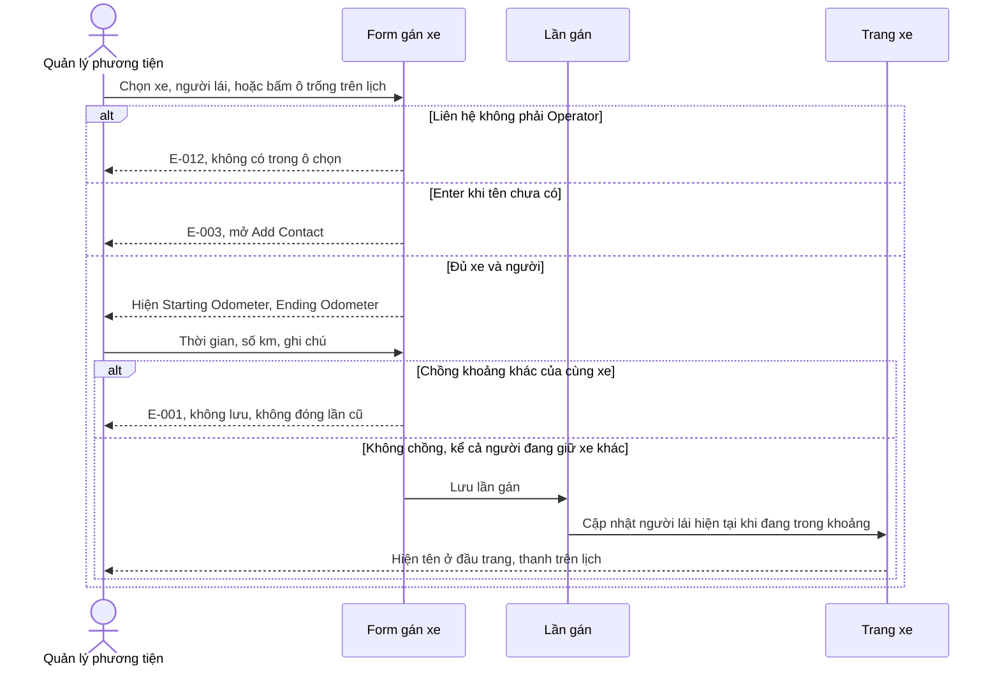
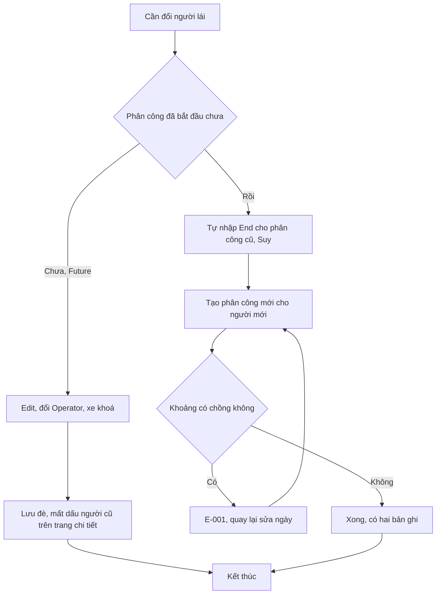
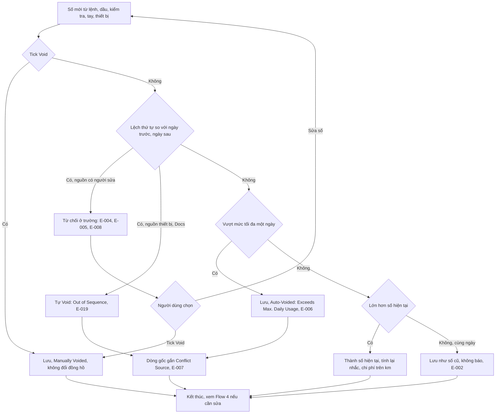
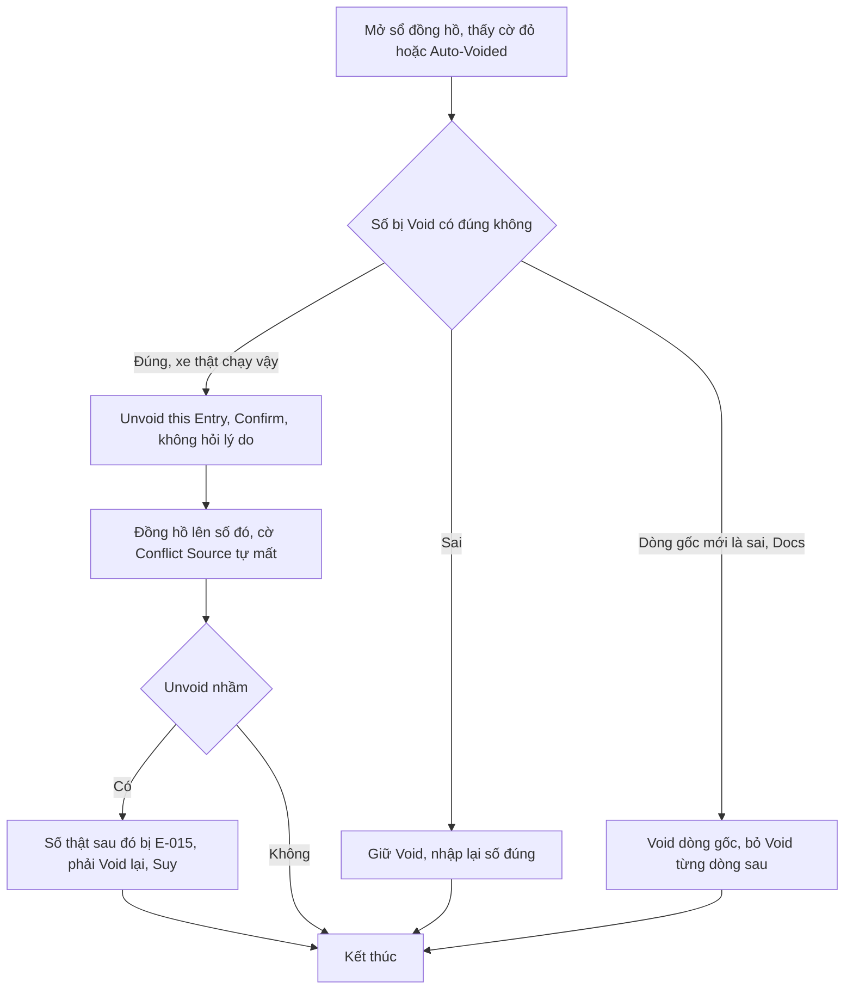
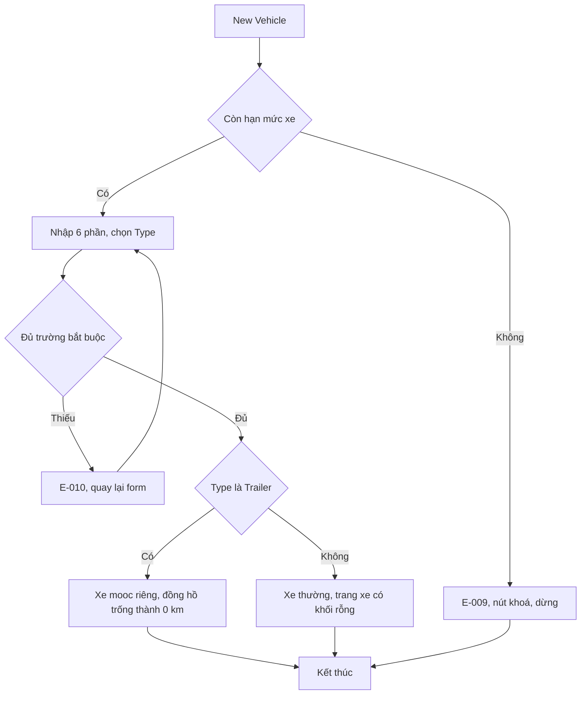
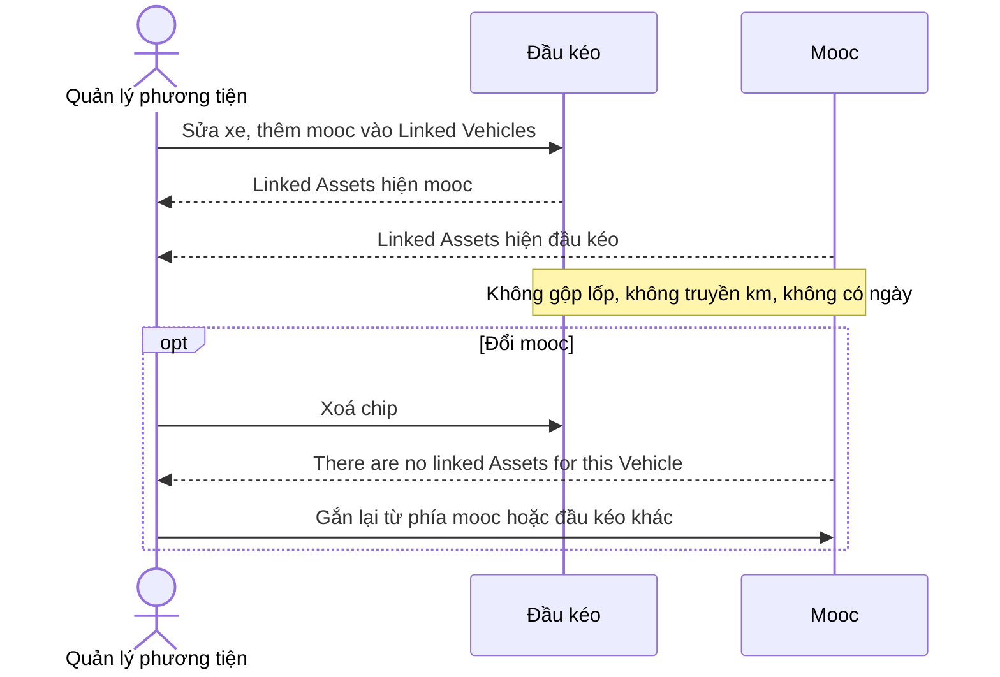
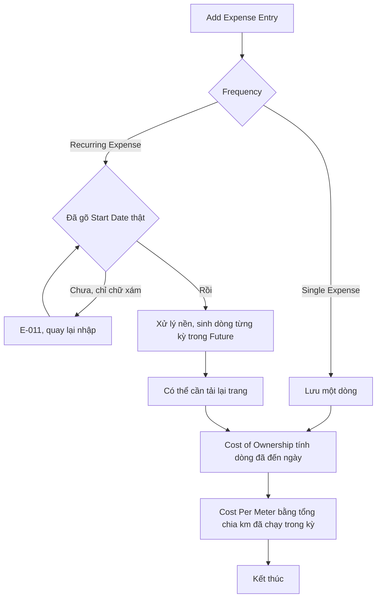
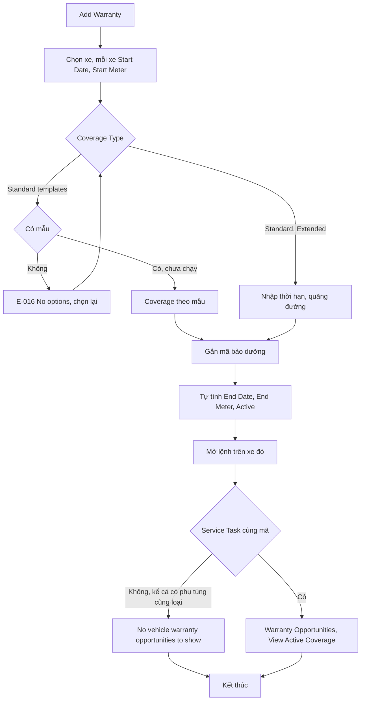
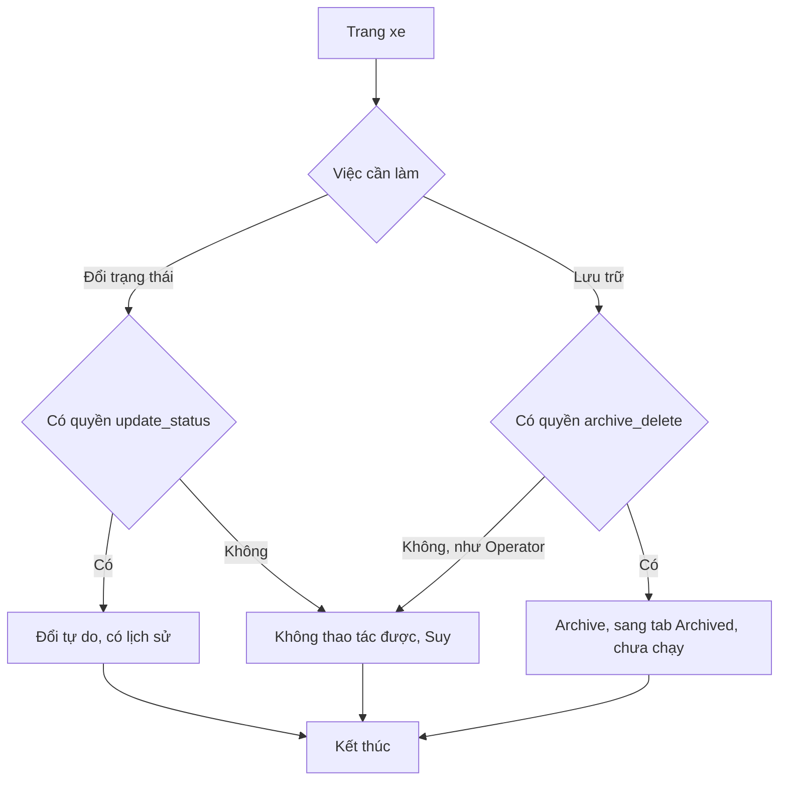
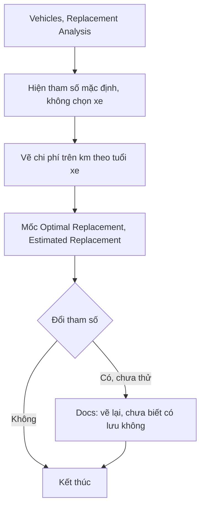

# Phương tiện — Flows

Mã lỗi viết tắt `E-0NN` là `E-fleetio-vehicle-0NN`. Mức ghi ở tiêu đề từng luồng. Luồng lốp: [[docs/_research/fleetio/srs/fleetio-tires-flows.md|Flows Lốp]].

## Flow 1: Gán xe (`Chạy`)

Nhánh đảo ngược: Delete trên menu thanh (`Xem`, chưa bấm). Múi giờ: E-017.

## Flow 2: Đổi người lái giữa chừng (`Chạy`)

Fleetio không có hành động riêng. Có hai đường.

Sửa phân công đã qua chưa thử.

## Flow 3: Ghi số đồng hồ (`Chạy`; Out of Sequence là `Docs`)

## Flow 4: Sửa số sai, nhánh đảo ngược (`Chạy` phần Unvoid; `Docs` phần Void gốc)

Thay đồng hồ: Bulk Meter Management Void toàn bộ số của xe (`Docs`, chưa chạy).

## Flow 5: Tạo xe và mooc (`Chạy`)

## Flow 6: Liên kết đầu kéo và mooc (`Chạy`)

Một mooc gắn nhiều đầu kéo: không chạy (OQ-16).

## Flow 7: Chi phí và chi phí trên km (`Chạy`)

Xoá, sửa dòng định kỳ: chưa thử.

## Flow 8: Bảo hành và cơ hội trên lệnh (`Chạy`; claim chưa thử)

E-014: Start Meter nhập 1000 hiện 1 km.

## Flow 9: Đổi trạng thái, Archive (`Xem`)

Automation đổi trạng thái theo sự cố, lệnh: `Xem` mẫu, xem nhóm Nền tảng.

## Flow 10: Phân tích thay xe (`Chạy` đọc)

