# Phương tiện — Màn hình thật

Ảnh chụp từ tài khoản dùng thử ngày 02/11/2026 và 03/11/2026, dùng nội bộ để phân tích. Màn lốp có dữ liệu ở [[docs/_research/fleetio/srs/fleetio-tires-screens.md|Màn hình Lốp]]. Bảng các màn 03/11 viết theo ghi chú chạy thử; trường ghi chú không nêu thì để "chưa ghi nhận". Các màn lượt 3, lượt 4 (1.4–1.11, 3.5, 3.6) nằm cuối file, đã mở ảnh đối chiếu.

## 1.1 Trang xe

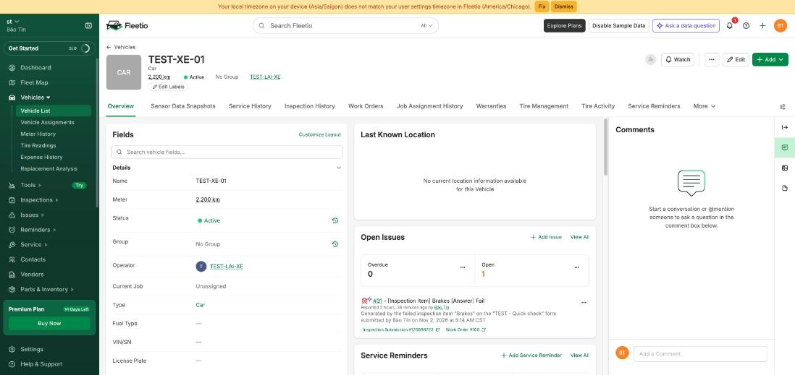

| # | Items | Control type | Data type | Description |
|---|---|---|---|---|
| 1 | Đầu trang | Chữ | — | Ảnh, tên, loại, số km, trạng thái, nhóm, người lái, nhãn |
| 2 | Tab | Tab | — | Overview, Sensor Data Snapshots, Service History, Inspection History, Work Orders, Job Assignment History, Warranties, Tire Management, Tire Activity, Service Reminders |
| 3 | More | Menu | — | Renewal Reminders, Issues, Meter History, Fuel History, Assignment History, Expense History, Recalls, Faults, Location History, Parts History |
| 4 | Add | Menu | — | 13 loại bản ghi, có Charging Entry |
| 5 | Fields | Khối | — | Tìm trường, Customize Layout, lịch sử đổi |
| 6 | Last Known Location | Khối | Bản đồ | "No current location information available for this Vehicle" |
| 7 | Open Issues | Khối | — | Overdue, Open và từng sự cố kèm liên kết phiếu, lệnh |
| 8 | Service Reminders | Khối | — | Overdue, Due Soon, Snoozed và từng nhắc |
| 9 | Cột phải | Thanh | — | Comments, Photos, Documents |

## 2.1 Lịch gán xe

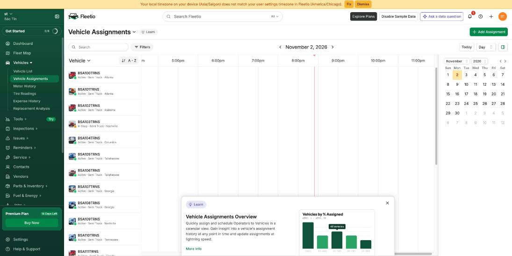

| # | Items | Control type | Data type | Description |
|---|---|---|---|---|
| 1 | Vehicle, A-Z | Chọn, sắp | — | Gom theo xe, sắp xếp |
| 2 | Trục giờ | Lưới | Giờ | Vạch đỏ là hiện tại |
| 3 | Ngày, Today, Day | Điều hướng | — | Đổi ngày, tuần, tháng |
| 4 | Lịch tháng | Lịch | — | Bên phải, thu gọn được |
| 5 | Add Assignment | Nút | — | Hộp gồm xe, người, thời gian, số km, ghi chú |

## 3.1 Lịch sử số đồng hồ

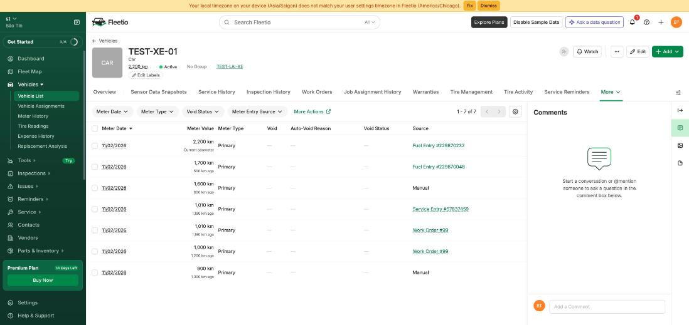

| # | Items | Control type | Data type | Description |
|---|---|---|---|---|
| 1 | Lọc Meter Date, Type, Void Status, Source | Lọc | — | More Actions mở thao tác hàng loạt |
| 2 | Meter Date, Meter Value | Cột | Ngày, số | Dưới số: "Current odometer", "500 km ago" |
| 3 | Meter Type | Cột | Chữ | Primary |
| 4 | Void, Auto-Void Reason, Void Status | Cột | — | Trống ở dữ liệu thử |
| 5 | Source | Cột | Liên kết | Fuel Entry, Service Entry, Work Order, Manual |

Lưu ý: số 900 km xếp cuối, không bị Void vì cùng ngày; hai dòng 1.010 km trùng. Bản 02/11 chưa có dòng Void; xem 3.4.

## 4.1 Đọc lốp

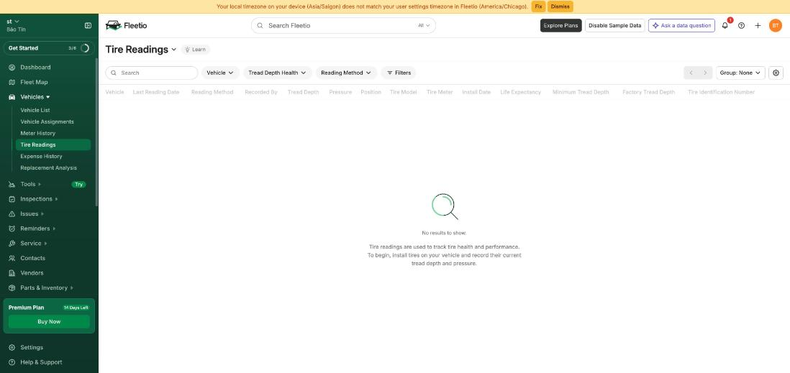

| # | Items | Control type | Data type | Description |
|---|---|---|---|---|
| 1 | Lọc Vehicle, Tread Depth Health, Reading Method | Lọc | — | — |
| 2 | Cột | Bảng | — | Last Reading, Method, Recorded By, Tread Depth, Pressure, Position, Tire Model, Tire Meter, Install Date, Life Expectancy, Minimum, Factory, mã lốp |
| 3 | Trạng thái rỗng | Chữ | — | Hướng dẫn lắp lốp, ghi độ sâu và áp suất. Màn có dữ liệu: nhóm Lốp |

## 5.1 Form chi phí

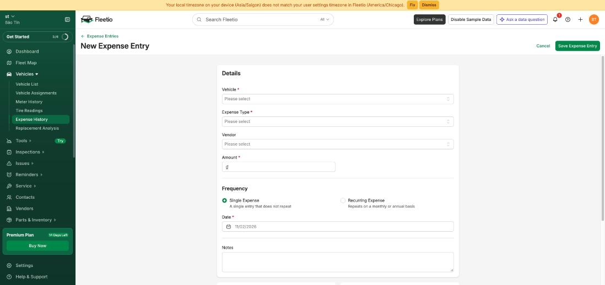

| # | Items | Control type | Data type | Description |
|---|---|---|---|---|
| 1 | Vehicle, Expense Type | Chọn | Bắt buộc | — |
| 2 | Vendor | Chọn | — | — |
| 3 | Amount | Số | Tiền, bắt buộc | — |
| 4 | Frequency | Chọn một | — | Single Expense; Recurring "Repeats on a monthly or annual basis" |
| 5 | Date, Notes | Ngày, chữ | Bắt buộc ngày | Bên dưới có ảnh, tài liệu. Định kỳ: xem 5.2 |

## 6.1 Phân tích thay xe

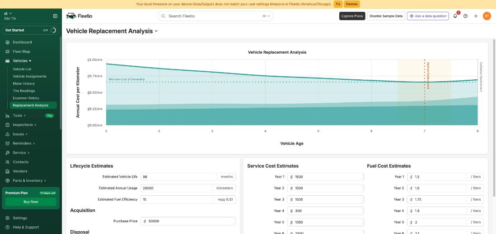

| # | Items | Control type | Data type | Description |
|---|---|---|---|---|
| 1 | Biểu đồ | Vùng | Tiền/km theo năm | Minimum Cost of Ownership, Optimal Replacement, Estimated Replacement |
| 2 | Lifecycle Estimates | Số | — | Tuổi thọ, số km năm, tiêu hao |
| 3 | Acquisition, Disposal | Số | Tiền | Giá mua, giá trị thanh lý |
| 4 | Service, Fuel Cost Estimates | Số | Tiền | Từng năm. Không có ô chọn xe; toàn bộ ô ở 6.2 |

## 1.2 Menu thao tác xe

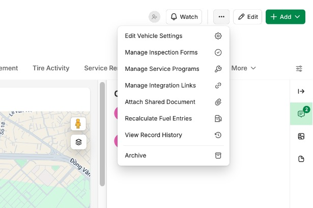

| # | Items | Control type | Data type | Description |
|---|---|---|---|---|
| 1 | Edit Vehicle Settings | Mục menu | — | Không bấm |
| 2 | Manage Inspection Forms, Manage Service Programs | Mục menu | — | Gắn biểu mẫu, chương trình vào xe. Không bấm |
| 3 | Manage Integration Links, Attach Shared Document | Mục menu | — | Không bấm |
| 4 | Recalculate Fuel Entries | Mục menu | — | Không bấm |
| 5 | View Record History | Mục menu | — | Không bấm |
| 6 | Archive | Mục menu | — | Quyền `vehicles_archive_delete`; không bấm |

## 1.3 Chi phí sở hữu, xe liên kết

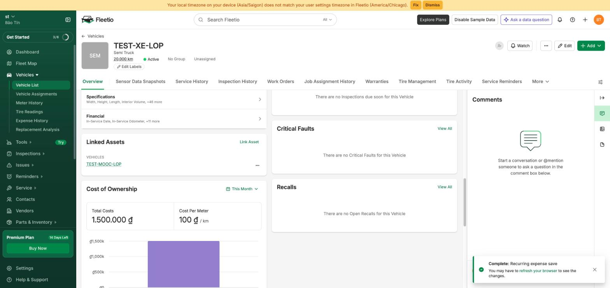

| # | Items | Control type | Data type | Description |
|---|---|---|---|---|
| 1 | Mốc thời gian | Chọn | — | This Month, Last Month, This Year, Last 12 Months, Last Year, All Time |
| 2 | Total Costs | Số | Tiền | This Month 1.500.000 ₫; All Time 3.500.000 ₫ |
| 3 | Cost Per Meter | Số | Tiền/km | 100 ₫/km; 233 ₫/km. Mẫu số là km đã chạy trong kỳ |
| 4 | Fuel & Energy, Service, Other Costs | Số | Tiền | 0, 0, 1.500.000 ₫ ở This Month |
| 5 | Linked Assets | Khối | Liên kết | "Link Asset", nhóm "VEHICLES", dòng `TEST-MOOC-LOP`. Chỉ là đường dẫn |

## 2.2 Hộp thêm gán xe

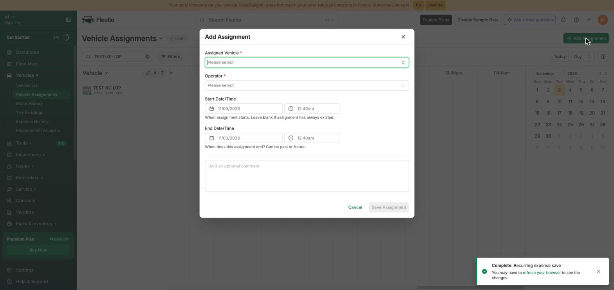

| # | Items | Control type | Data type | Description |
|---|---|---|---|---|
| 1 | Assigned Vehicle | Chọn | Bắt buộc | Khoá khi mở từ ô lịch |
| 2 | Operator | Chọn | Bắt buộc | Chỉ liên hệ phân loại Operator; Enter khi tên chưa có mở Add Contact (E-003) |
| 3 | Start Date/Time | Ngày giờ | Tuỳ chọn | "When assignment starts. Leave blank if assignment has always existed." |
| 4 | End Date/Time | Ngày giờ | Tuỳ chọn | "When does this assignment end? Can be past or future." |
| 5 | Starting, Ending Odometer | Số | Km | Hiện khi chọn đủ xe và người |
| 6 | Comment | Chữ | — | Chưa ghi nhận giới hạn |

## 2.3 Lịch gán theo tuần

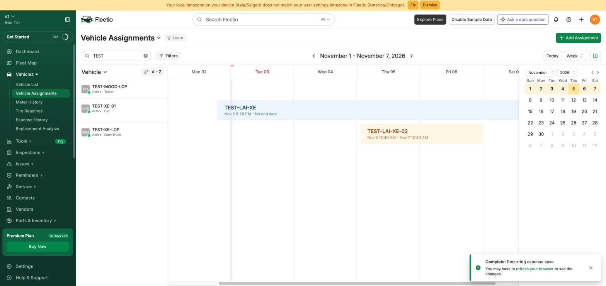

| # | Items | Control type | Data type | Description |
|---|---|---|---|---|
| 1 | Trục Vehicle | Lưới | — | Mỗi xe một hàng |
| 2 | Day, Week | Điều hướng | — | Đổi chế độ xem |
| 3 | Thanh phân công | Thanh | — | Cam: tương lai; xanh: đang chạy. Menu View, Edit, Delete |
| 4 | Ô trống | Ô bấm | — | Mở "Add Vehicle Assignment For {xe}", xe khoá, ngày theo ô |
| 5 | Lịch tháng | Lịch | — | Bên phải |

## 2.4 Lỗi trùng lần gán

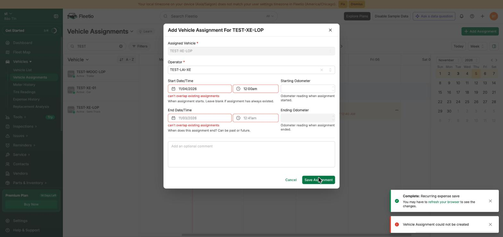

| # | Items | Control type | Data type | Description |
|---|---|---|---|---|
| 1 | Start, End | Ngày giờ | — | Cả hai báo "can't overlap existing assignments" (E-001) |
| 2 | Toast | Thông báo | — | "Vehicle Assignment could not be created" |

## 2.5 Hộp sửa gán xe

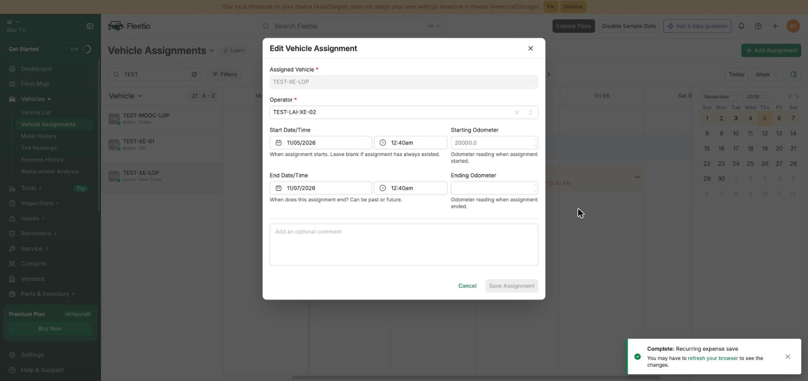

| # | Items | Control type | Data type | Description |
|---|---|---|---|---|
| 1 | Assigned Vehicle | Chọn | Khoá | Không đổi được xe |
| 2 | Operator | Chọn | — | Đổi đè; đây là cách duy nhất thay người trên một phân công |
| 3 | Starting Odometer | Số | Km | Gợi ý 20000.0 theo đồng hồ hiện tại |
| 4 | Lưu | Nút | — | "Vehicle Assignment was successfully updated" |

## 2.6 Chi tiết phân công

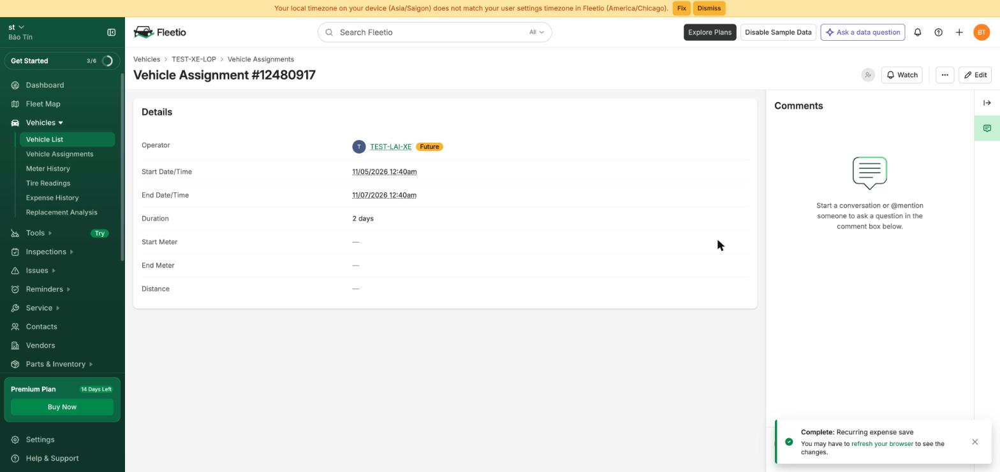

| # | Items | Control type | Data type | Description |
|---|---|---|---|---|
| 1 | Tiêu đề | Chữ | — | "Vehicle Assignment #…" |
| 2 | Operator | Chữ | — | Người mới, nhãn "Future". Không còn người cũ |
| 3 | Start, End, Duration | Chữ | Ngày, thời lượng | Duration 2 days ở phép thử |
| 4 | Start Meter, End Meter, Distance | Chữ | Km | Không thấy lịch sử đổi trên trang |

## 3.2 Từ chối số lùi ngày

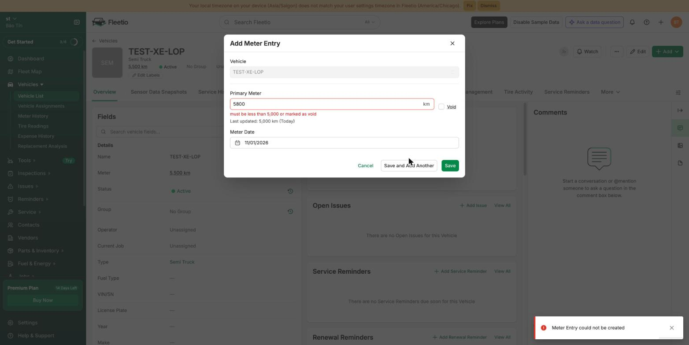

| # | Items | Control type | Data type | Description |
|---|---|---|---|---|
| 1 | Giá trị | Số | Km | "must be less than 5,000 or marked as void" (E-004). Số 5,000 là dòng đầu ngày sau |
| 2 | Ô Void | Tick | — | Tick thì lưu được, thành Manually Voided |
| 3 | Dòng Last updated | Chữ | — | "Last updated: 5,000 km (Today)" dù xe đã 5.500 (E-013) |
| 4 | Toast | Thông báo | — | "Meter Entry could not be created" |

## 3.3 Từ chối số thấp hơn ngày trước

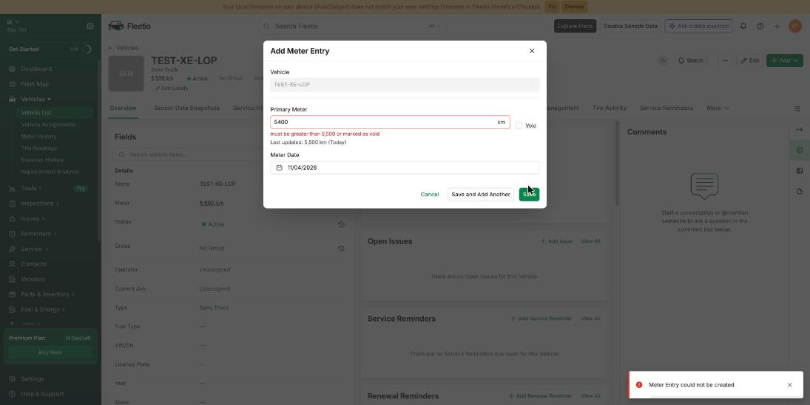

| # | Items | Control type | Data type | Description |
|---|---|---|---|---|
| 1 | Giá trị | Số | Km | "must be greater than 5,500 or marked as void" (E-005) khi nhập 5.400 ngày 04/11 |
| 2 | Ô Void | Tick | — | Như 3.2 |

## 3.4 Sổ đồng hồ có cờ xung đột

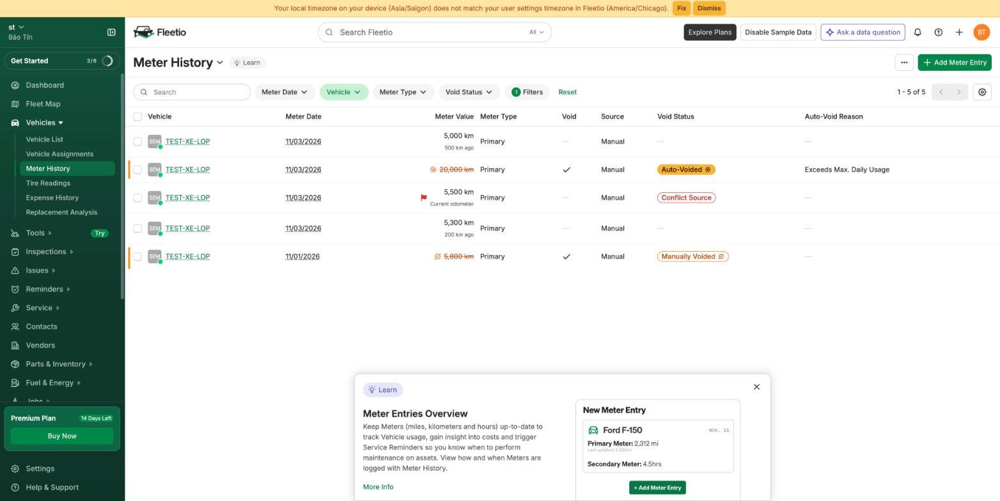

| # | Items | Control type | Data type | Description |
|---|---|---|---|---|
| 1 | Void Status | Cột | Chữ | Manually Voided, Auto-Voided, Conflict Source. Lọc: All Voided, Manually Voided, Auto Voided, Not Voided |
| 2 | Auto-Void Reason | Cột | Chữ | "Exceeds Max. Daily Usage"; popup Last Meter Entry, Daily Usage, Max Daily Usage, Exceeds By, nút "Unvoid this Entry" |
| 3 | Cờ đỏ | Biểu tượng | — | Dòng gốc; popup "Conflicting Meter Entry", Conflicts With 1 Entry, Difference 14,500 kilometers over 0 days |
| 4 | Unvoid | Hộp | — | "This operation will attempt to unvoid the selected Meter Entry.", Confirm, không hỏi lý do |

## 5.2 Chi phí định kỳ

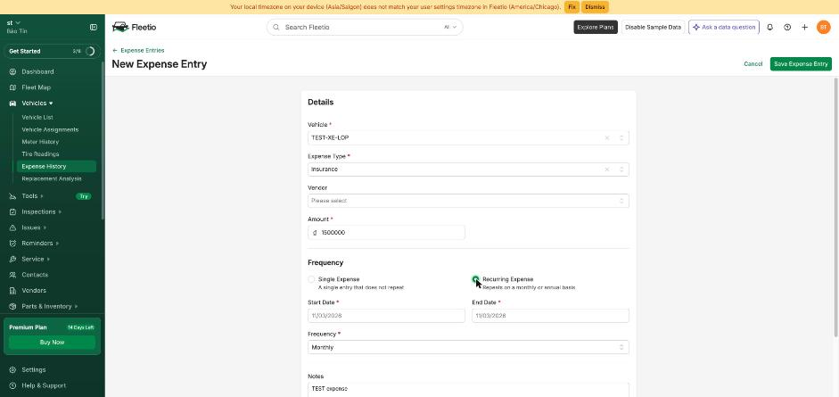

| # | Items | Control type | Data type | Description |
|---|---|---|---|---|
| 1 | Frequency | Chọn một | — | "Recurring Expense", "Repeats on a monthly or annual basis" |
| 2 | Start Date | Ngày | Bắt buộc | Chữ xám chỉ là placeholder, lưu báo "can't be blank" (E-011) |
| 3 | End Date, Frequency | Ngày, chọn | — | Hàng tháng ở phép thử |
| 4 | Thông báo nền | Thông báo | — | "Processing: Recurring expense save", "Complete: Recurring expense save", "You may have to refresh your browser to see the changes." |

## 5.3 Tab chi phí Past, Future

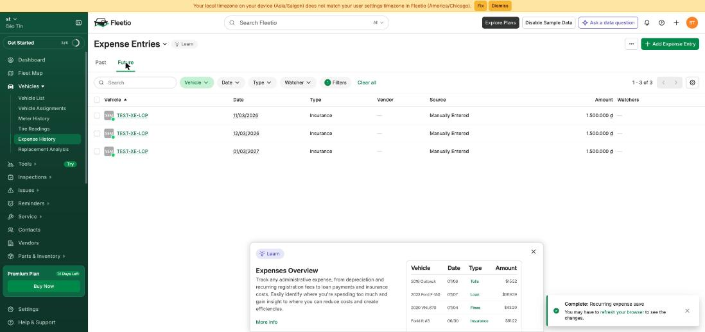

| # | Items | Control type | Data type | Description |
|---|---|---|---|---|
| 1 | Past, Future | Tab | — | Past trống ngay sau khi lưu, kể cả dòng đúng hôm nay (E-018) |
| 2 | Dòng định kỳ | Bảng | Ngày, tiền | 03/11, 03/12, 03/01; 1.500.000 ₫ |

## 6.2 Tham số phân tích thay xe

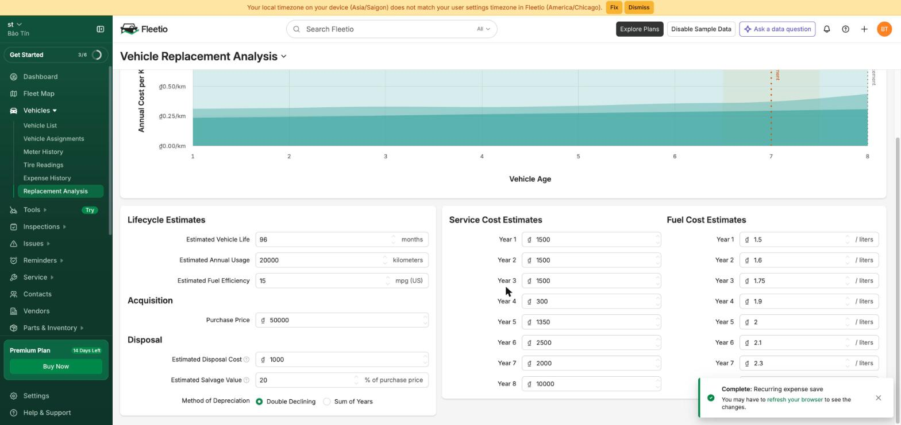

| # | Items | Control type | Data type | Description |
|---|---|---|---|---|
| 1 | Lifecycle Estimates | Số | — | Estimated Vehicle Life 96 months, Estimated Annual Usage 20000 kilometers, Estimated Fuel Efficiency 15 mpg (US) |
| 2 | Acquisition | Số | Tiền | Purchase Price 50000 |
| 3 | Disposal | Số, chọn | Tiền, % | Estimated Disposal Cost 1000, Estimated Salvage Value 20 %, Method of Depreciation: Double Declining, Sum of Years |
| 4 | Service Cost Estimates | Số | Tiền | Year 1 đến 8: 1500, 1500, 1500, 300, 1350, 2500, 2000, 10000 |
| 5 | Fuel Cost Estimates | Số | Tiền/lít | Year 1 đến 8: 1.5, 1.6, 1.75, 1.9, 2, 2.1, 2.3, 2.5 |
| 6 | Lưu | — | — | Không có nút Lưu; chưa đổi số nên chưa biết có tự lưu |

## 7.1 Bảo hành, chọn xe

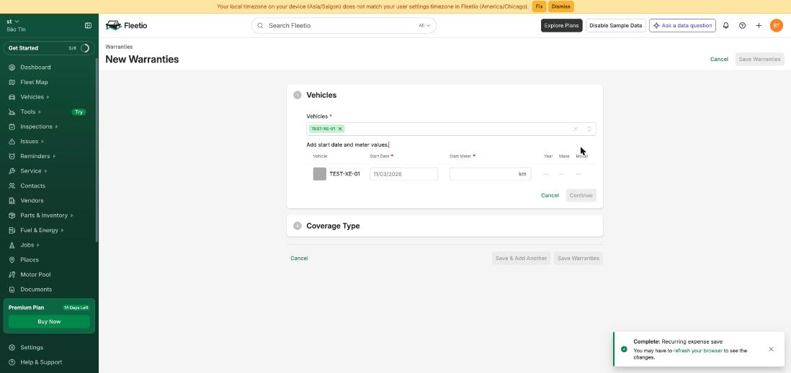

| # | Items | Control type | Data type | Description |
|---|---|---|---|---|
| 1 | Vehicles | Chọn nhiều | — | Hiện Year, Make, Model |
| 2 | Start Date | Ngày | Bắt buộc | Mỗi xe một ô. Chữ xám là placeholder (E-011) |
| 3 | Start Meter | Số | Km | Mỗi xe một ô. Nhập 1000 hiện 1 km (E-014) |

## 7.2 Bảo hành, chọn mẫu

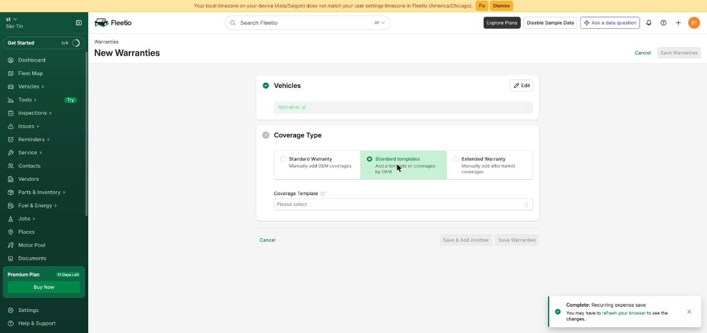

| # | Items | Control type | Data type | Description |
|---|---|---|---|---|
| 1 | Coverage Type | Chọn một | — | "Standard templates": "Add a template of coverages by OEM" |
| 2 | Coverage Template | Chọn | — | "Coverage templates contain a collection of coverages based on manufacturer guidelines". Báo "No options" (E-016) |

## 7.3 Bảo hành, nhập tay

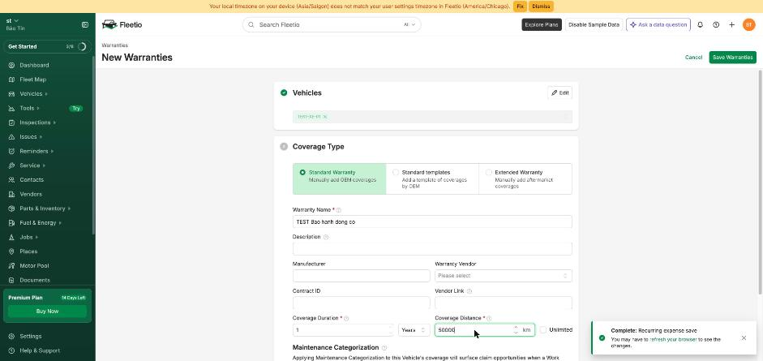

| # | Items | Control type | Data type | Description |
|---|---|---|---|---|
| 1 | Coverage Type | Chọn một | — | "Standard Warranty": "Manually add OEM coverages"; "Extended Warranty": "Manually add aftermarket coverages" |
| 2 | Warranty Name, Description | Chữ | — | Chưa ghi nhận ràng buộc |
| 3 | Manufacturer, Warranty Vendor, Contract ID, Vendor Link | Chữ, chọn | — | Chưa ghi nhận ràng buộc |
| 4 | Coverage Duration | Số, đơn vị | — | 1 Years ở phép thử; tự tính End Date |
| 5 | Coverage Distance | Số, Unlimited | Km | 50000 ở phép thử; tự tính End Meter |

## 7.4 Gắn mã bảo dưỡng

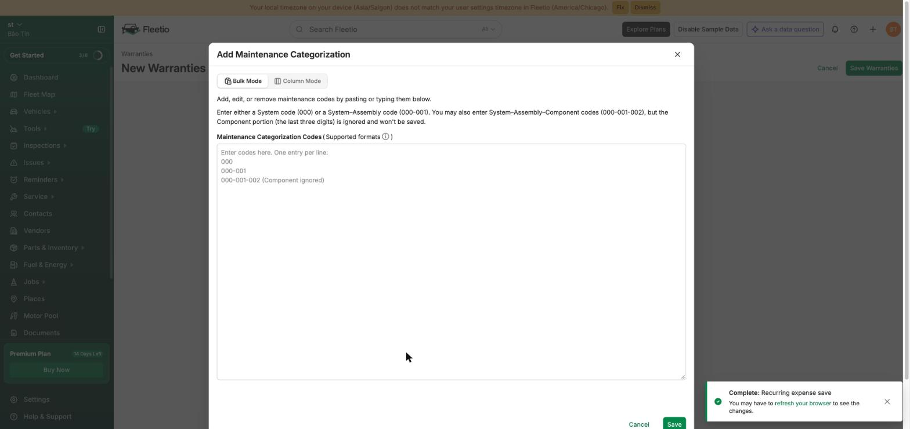

| # | Items | Control type | Data type | Description |
|---|---|---|---|---|
| 1 | Maintenance Categorization | Khối | — | "…will surface claim opportunities when a Work Order form includes a Service Task with the same code" |
| 2 | Ô mã | Tìm | Mã | Nhập 000, 000-001, 013; 013 hiện "1 - Chassis" › "013 - Brakes" |
| 3 | Bulk Mode, Column Mode | Chuyển chế độ | — | Không dùng thử |

## 7.5 Danh sách bảo hành

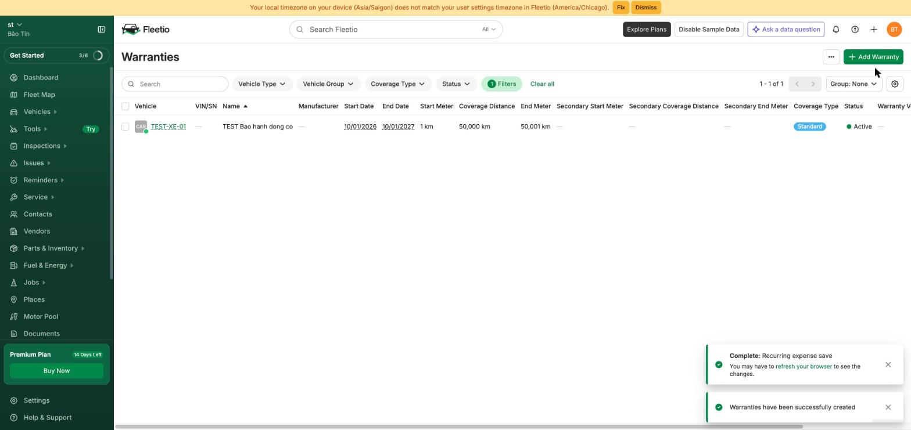

| # | Items | Control type | Data type | Description |
|---|---|---|---|---|
| 1 | Status | Cột | — | "Active" |
| 2 | Start, End Date | Cột | Ngày | End Date tự tính, 10/01/2027 |
| 3 | Start, End Meter, Coverage | Cột | Km | 1 km, 50,001 km, 50,000 km |
| 4 | Cột khác | Bảng | — | Chưa ghi nhận đủ |

## 7.6 Lệnh, chưa có cơ hội bảo hành

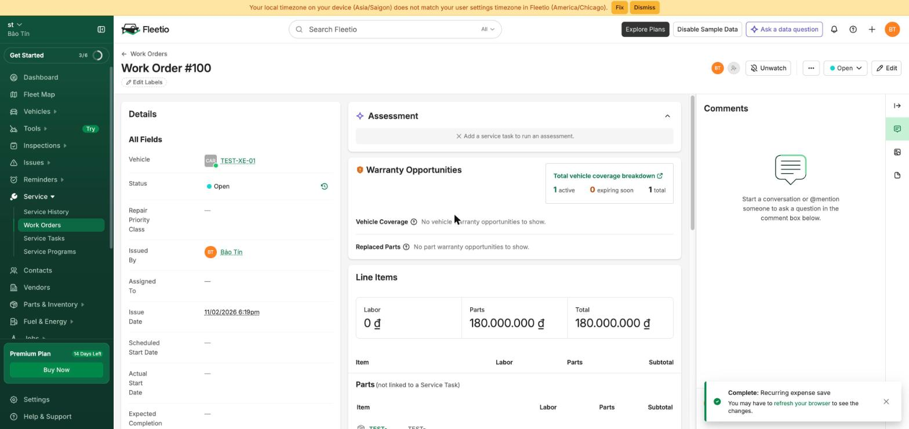

| # | Items | Control type | Data type | Description |
|---|---|---|---|---|
| 1 | Warranty Opportunities | Khối | — | Luôn hiện; "Total vehicle coverage breakdown": 1 active, 0 expiring soon, 1 total |
| 2 | Vehicle Coverage | Khối | — | "No vehicle warranty opportunities to show." dù lệnh có phụ tùng má phanh |
| 3 | Replaced Parts | Khối | — | "No part warranty opportunities to show." |

## 7.7 Lệnh, có cơ hội bảo hành

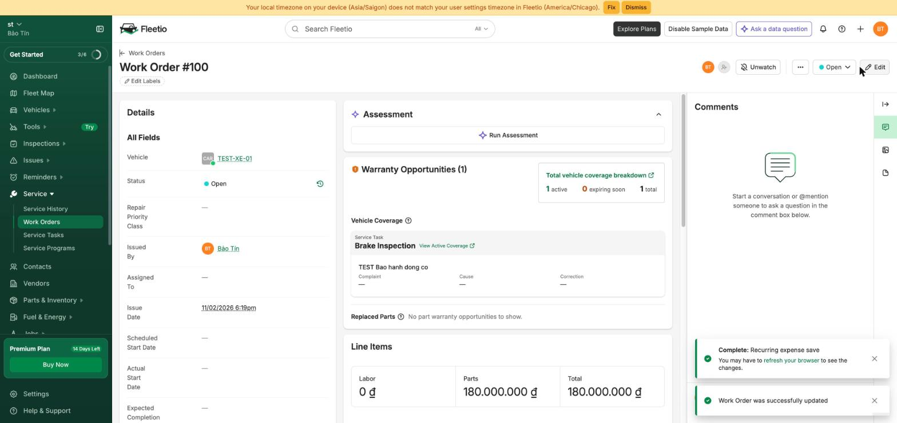

| # | Items | Control type | Data type | Description |
|---|---|---|---|---|
| 1 | Warranty Opportunities (1) | Khối | — | Sau khi thêm Service Task "Brake Inspection" mang mã 013 - Brakes |
| 2 | Vehicle Coverage | Dòng | — | Service Task "Brake Inspection" › "View Active Coverage" › tên bảo hành |
| 3 | Complaint, Cause, Correction | Chữ | — | Trống ở phép thử |
| 4 | Nút claim | Nút | — | Chưa thử |

## 1.4 Giải mã VIN, so sánh thuộc tính

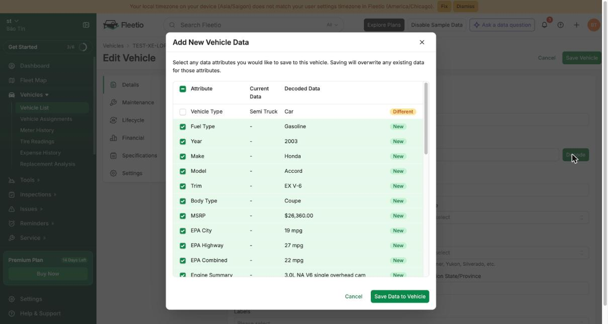

Đã mở ảnh đối chiếu. Hộp che nền form; bảng còn cuộn tiếp, ảnh chỉ thấy tới Engine Summary. Giá trị VIN không thấy trên ảnh.

| # | Items | Control type | Data type | Description |
|---|---|---|---|---|
| 1 | Add New Vehicle Data | Hộp | — | "Select any data attributes you would like to save to this vehicle. Saving will overwrite any existing data for those attributes." |
| 2 | Ô tick tiêu đề | Ô tick | — | Hiện trạng thái chọn một phần vì có dòng không tick |
| 3 | Attribute, Current Data, Decoded Data | Bảng | Chữ, số | Thấy Vehicle Type, Fuel Type, Year, Make, Model, Trim, Body Type, MSRP, EPA City, EPA Highway, EPA Combined, Engine Summary. Các thuộc tính sau đó ảnh không thấy, ghi chú chạy thử nêu thêm hộp số, bánh |
| 4 | Dòng Vehicle Type | Dòng | — | Semi Truck với Car, nhãn "Different", KHÔNG tick; BR-fleetio-vehicle-034 |
| 5 | Dòng New | Dòng | — | Nền xanh, nhãn "New", tick sẵn; Current Data "-" |
| 6 | Đơn vị giải mã | Chữ | — | EPA hiện mpg, MSRP hiện $, dù tài khoản dùng ₫ |
| 7 | Save Data to Vehicle | Nút | — | Chỉ điền vào form, xe chưa đổi cho tới khi Save Vehicle |
| 8 | Cancel, X | Nút | — | Đóng hộp |

## 1.5 Lịch sử trạng thái xe

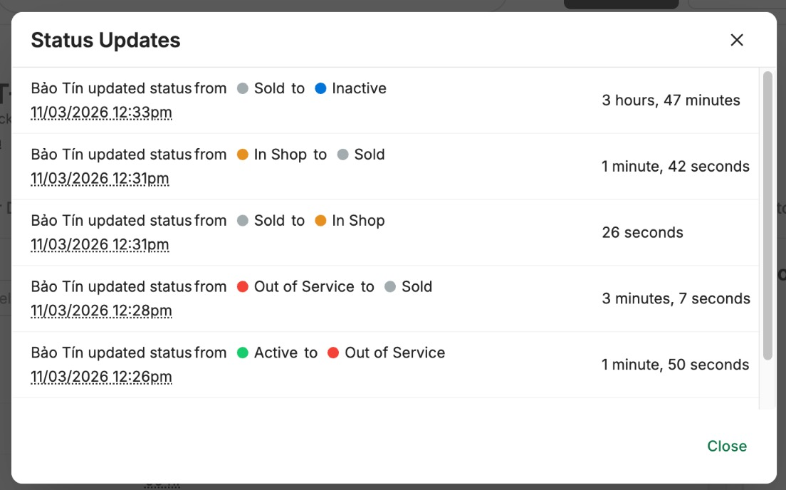

Đã mở ảnh đối chiếu. Ảnh chỉ chụp phần hộp, thấy 5 dòng, còn thanh cuộn.

| # | Items | Control type | Data type | Description |
|---|---|---|---|---|
| 1 | Status Updates | Hộp | — | Mở từ trường Status trên trang xe |
| 2 | Dòng lịch sử | Dòng | Chữ, ngày giờ | Dạng "{người dùng} updated status from Sold to Inactive", chấm màu theo trạng thái, ngày giờ gạch chấm. Thấy các cặp: Active sang Out of Service, Out of Service sang Sold, Sold sang In Shop, In Shop sang Sold, Sold sang Inactive |
| 3 | Thời lượng | Chữ | Khoảng thời gian | Cột phải, vd "1 minute, 50 seconds", "3 hours, 47 minutes". Ghi chú chạy thử ghi là thời gian ở trạng thái trước; đối chiếu giờ các dòng thì khớp thời gian ở trạng thái đích (`Suy`, OQ-21) |
| 4 | Close | Nút | — | Đóng hộp |

## 1.6 Xác nhận lưu trữ xe

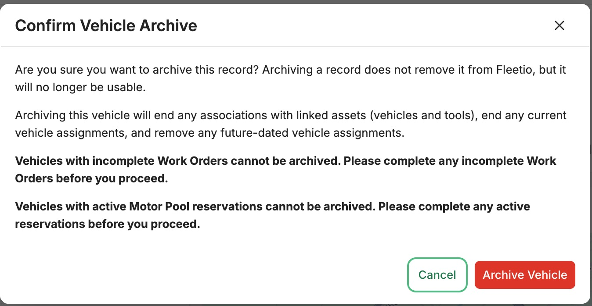

Đã mở ảnh đối chiếu. Ảnh chỉ chụp phần hộp.

| # | Items | Control type | Data type | Description |
|---|---|---|---|---|
| 1 | Confirm Vehicle Archive | Hộp | — | "Are you sure you want to archive this record? Archiving a record does not remove it from Fleetio, but it will no longer be usable." |
| 2 | Câu hiệu ứng | Chữ | — | "Archiving this vehicle will end any associations with linked assets (vehicles and tools), end any current vehicle assignments, and remove any future-dated vehicle assignments." |
| 3 | Câu chặn Lệnh | Chữ đậm | — | "Vehicles with incomplete Work Orders cannot be archived. Please complete any incomplete Work Orders before you proceed." Có Lệnh mở thì E-fleetio-vehicle-021, E-fleetio-vehicle-022 |
| 4 | Câu chặn Motor Pool | Chữ đậm | — | "Vehicles with active Motor Pool reservations cannot be archived. Please complete any active reservations before you proceed." Chưa thử thật |
| 5 | Cancel | Nút | — | Đóng hộp, viền xanh là tiêu điểm mặc định |
| 6 | Archive Vehicle | Nút đỏ | — | Chạy Archive, kết quả xem BR-fleetio-vehicle-029, 030 |

## 1.7 Mooc liên kết hai xe

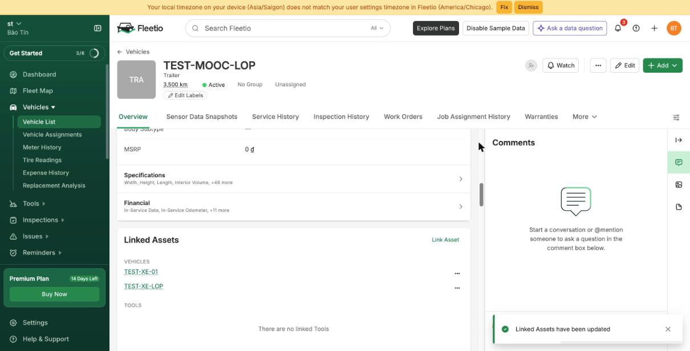

Đã mở ảnh đối chiếu. Trang xe `TEST-MOOC-LOP`, đã cuộn xuống khối Linked Assets.

| # | Items | Control type | Data type | Description |
|---|---|---|---|---|
| 1 | Đầu trang | Chữ | — | Trailer, 3,500 km, Active, No Group, Unassigned |
| 2 | Linked Assets | Khối | — | Nút "Link Asset" |
| 3 | VEHICLES | Danh sách | Liên kết | `TEST-XE-01`, `TEST-XE-LOP`, mỗi dòng menu "…"; không có ngày, không có nhãn đang kéo; BR-fleetio-vehicle-035 |
| 4 | TOOLS | Danh sách | — | "There are no linked Tools" |
| 5 | Toast | Thông báo | — | "Linked Assets have been updated" |

## 1.8 Thêm nhiều xe, bước 1

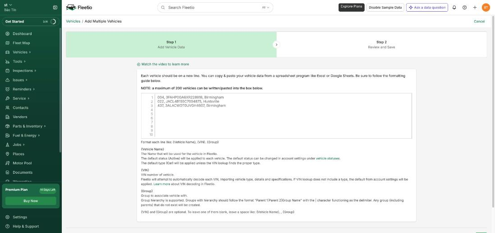

Đã mở ảnh đối chiếu. Ảnh nhỏ, chữ hướng dẫn đọc được nhưng khó; dòng chữ mẫu trong ô dán đọc không chắc từng ký tự nên không chép.

| # | Items | Control type | Data type | Description |
|---|---|---|---|---|
| 1 | Thanh bước | Bước | — | Step 1 Add Vehicle Data, Step 2 Review and Save |
| 2 | Câu dẫn | Chữ | — | Mỗi xe một dòng, chép từ bảng tính; "NOTE: a maximum of 200 vehicles can be written/pasted into the box below." |
| 3 | Ô dán | Vùng nhập có số dòng | Chữ | Chữ mẫu của Fleetio, dạng {Vehicle Name}, {VIN}, {Group} |
| 4 | {Vehicle Name} | Chữ hướng dẫn | — | Trạng thái mặc định Active, đổi được ở Vehicle Statuses; loại mặc định Car trừ khi tra VIN ra loại đúng |
| 5 | {VIN} | Chữ hướng dẫn | — | Fleetio thử tự giải mã từng VIN, nhập loại, chi tiết, thông số |
| 6 | {Group} | Chữ hướng dẫn | — | Hỗ trợ cấp bậc "Parent 1\|Parent 2\|Group Name"; "Any group (including parents) that do not exist will be created." |
| 7 | Dòng cuối | Chữ hướng dẫn | — | {VIN}, {Group} tuỳ chọn, bỏ trống thì để dấu cách giữa hai dấu phẩy |
| 8 | Cancel | Nút | — | Góc trên phải. Nút sang bước 2 bị cắt ở mép dưới ảnh |
| 9 | Kết quả sau lưu | — | — | Không có trên ảnh; lỗi ở E-fleetio-vehicle-025 |

## 1.9 Tuỳ biến thẻ trang xe

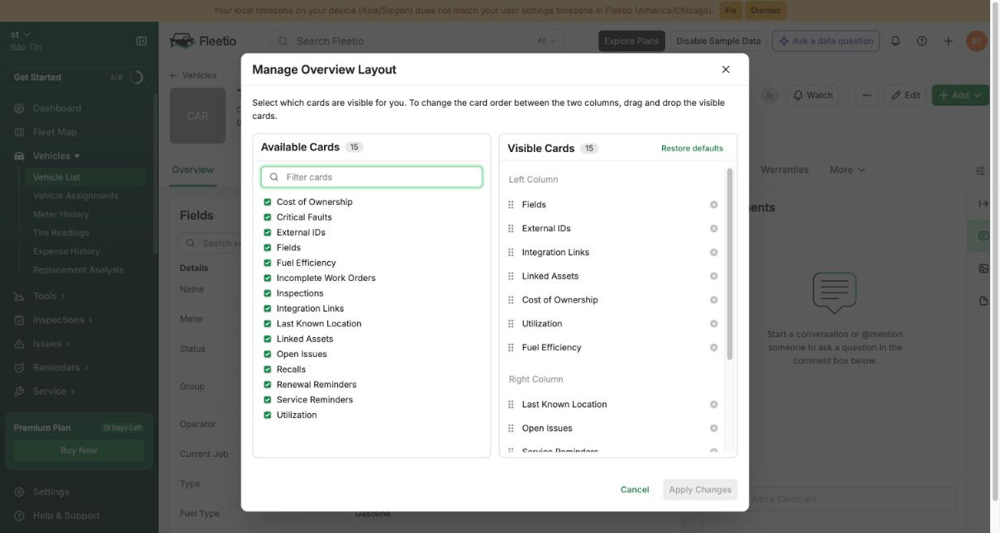

Đã mở ảnh đối chiếu. Hộp che nền; thẻ vị trí chỉ hiện tên, không có bản đồ. Cột phải bị cắt từ thẻ thứ ba.

| # | Items | Control type | Data type | Description |
|---|---|---|---|---|
| 1 | Manage Overview Layout | Hộp | — | "Select which cards are visible for you. To change the card order between the two columns, drag and drop the visible cards." |
| 2 | Available Cards 15 | Danh sách tick | — | Cost of Ownership, Critical Faults, External IDs, Fields, Fuel Efficiency, Incomplete Work Orders, Inspections, Integration Links, Last Known Location, Linked Assets, Open Issues, Recalls, Renewal Reminders, Service Reminders, Utilization |
| 3 | Filter cards | Ô tìm | Chữ | Lọc danh sách thẻ |
| 4 | Visible Cards 15 | Danh sách kéo | — | Left Column: Fields, External IDs, Integration Links, Linked Assets, Cost of Ownership, Utilization, Fuel Efficiency. Right Column: Last Known Location, Open Issues, Service Reminders, phần sau ảnh không thấy. Mỗi dòng có nắm kéo, nút bỏ |
| 5 | Restore defaults | Liên kết | — | Sau Apply thì thẻ đã bỏ hiện lại (`Chạy`) |
| 6 | Apply Changes | Nút | — | Khoá khi chưa đổi gì |
| 7 | Cancel, X | Nút | — | Đóng hộp |

## 3.5 Popup số tự huỷ do lệch thứ tự

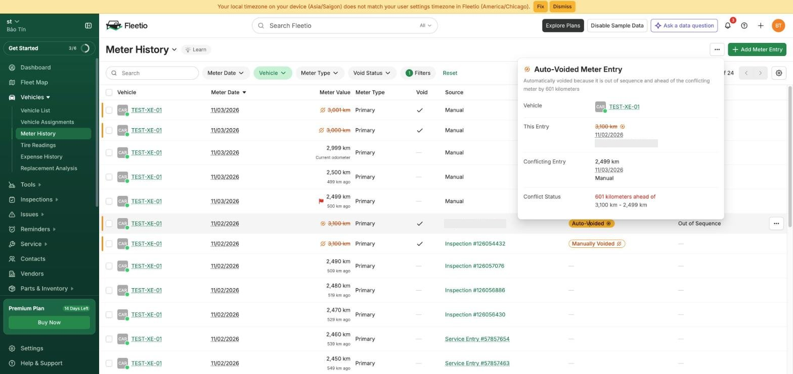

Đã mở ảnh đối chiếu. Ô nguồn của dòng này và mã trong popup đã che; các dòng khác còn số phiếu.

| # | Items | Control type | Data type | Description |
|---|---|---|---|---|
| 1 | Auto-Voided Meter Entry | Popup | — | "Automatically voided because it is out of sequence and ahead of the conflicting meter by 601 kilometers" |
| 2 | Vehicle | Liên kết | — | Xe của dòng |
| 3 | This Entry | Chữ | Số, ngày | 3,100 km gạch ngang, 11/02/2026; dòng nguồn đã che |
| 4 | Conflicting Entry | Chữ | Số, ngày | 2,499 km, 11/03/2026, Manual |
| 5 | Conflict Status | Chữ đỏ | — | "601 kilometers ahead of", 3,100 km - 2,499 km |
| 6 | Dòng trên bảng | Dòng | — | Void đánh dấu, Void Status "Auto-Voided", Auto-Void Reason "Out of Sequence"; menu dòng có Edit, Unvoid, View Record History, Delete (ảnh không mở menu, theo ghi chú) |
| 7 | Dòng 2,499 km | Dòng | — | Cờ đỏ cạnh số; nhãn "Conflict Source" và popup riêng theo ghi chú, popup che mất cột này |
| 8 | Dòng 2,999 km | Dòng | — | Nhãn "Current odometer": số hiện tại của xe; các dòng 3,000, 3,001 cũng đã Void |
| 9 | Dải múi giờ | Thông báo | — | "Your local timezone on your device (Asia/Saigon) does not match your user settings timezone in Fleetio (America/Chicago)." nút Fix, Dismiss |

## 3.6 Sổ sau khi huỷ hàng loạt, có đồng hồ phụ

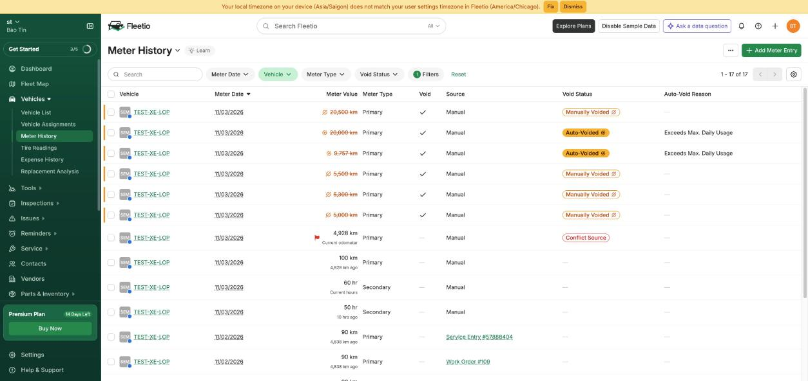

Đã mở ảnh đối chiếu. Danh sách 17 dòng, ảnh thấy 12 dòng đầu. Không chụp hộp "Void Meter Entries"; câu chữ hộp theo ghi chú.

| # | Items | Control type | Data type | Description |
|---|---|---|---|---|
| 1 | Bộ lọc | Thanh | — | Search, Meter Date, Vehicle, Meter Type, Void Status, Filters, Reset; "1 - 17 of 17" |
| 2 | Ô tick đầu dòng, Actions | Ô tick | — | Chọn nhiều dòng thì có Actions: Void, Unvoid, Delete; chọn lẫn thì khoá (E-fleetio-vehicle-020). Ảnh chụp lúc không chọn dòng nào |
| 3 | Dòng Manually Voided | Dòng | — | 20,500, 5,500, 5,300, 5,000 km; số gạch ngang, viền cam, tick Void |
| 4 | Dòng Auto-Voided | Dòng | — | 20,000, 9,757 km; Auto-Void Reason "Exceeds Max. Daily Usage". 20,000 từng Unvoid, Void lại thì về đây; BR-fleetio-vehicle-026 |
| 5 | Dòng 4,928 km | Dòng | — | "Current odometer", cờ đỏ, "Conflict Source" |
| 6 | Dòng 100 km | Dòng | — | "4,828 km ago": số đầu sau Void toàn bộ, không bị báo nhỏ hơn số cũ |
| 7 | Dòng Secondary | Dòng | — | 60 hr "Current hours", 50 hr "10 hrs ago"; Meter Type "Secondary", chuỗi riêng |
| 8 | Dòng 90 km | Dòng | — | Ngày 11/02/2026, nguồn Service Entry, Work Order: từ lần đóng Lệnh (E-fleetio-vehicle-029) |
| 9 | Add Meter Entry | Nút | — | Không có trên ảnh phần 2 ô; theo ghi chú có 2 ô, Void riêng |

## 1.10 Bộ lịch bảo dưỡng của xe, trống

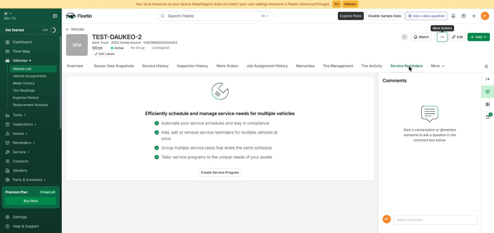

Đã mở ảnh đối chiếu. Thanh tab tô đậm Service Reminders dù vào từ Manage Service Programs; ghi chú nêu đường dẫn `vehicles/{id}/service_programs`.

| # | Items | Control type | Data type | Description |
|---|---|---|---|---|
| 1 | Đầu trang xe | Chữ | — | Loại, năm, hãng, đời, VIN, số km, trạng thái, nhóm, người lái; More Actions đang có tiêu điểm |
| 2 | Khối giới thiệu | Trạng thái rỗng | — | "Efficiently schedule and manage service needs for multiple vehicles" |
| 3 | 4 gạch đầu dòng | Chữ | — | "Automate your service schedules and stay in compliance"; "Add, edit or remove service reminders for multiple vehicles at once"; "Group multiple service tasks that share the same schedule"; "Tailor service programs to the unique needs of your assets" |
| 4 | Create Service Program | Nút | — | Chưa bấm. KHÔNG có nút gán bộ lịch sẵn có |
| 5 | Cột phải | Thanh | — | Comments; icon Documents có huy hiệu 1, chưa rõ đếm gì (OQ-22) |

## 1.11 Đính tài liệu dùng chung

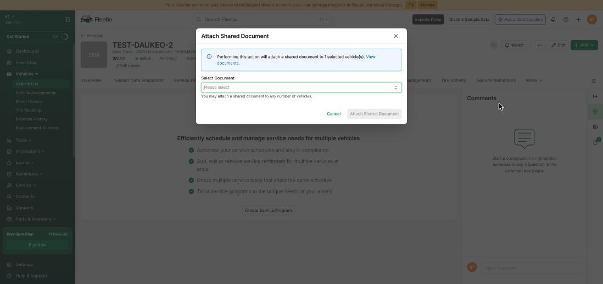

Đã mở ảnh đối chiếu. Ô chọn chưa mở, danh sách tài liệu và toast theo ghi chú.

| # | Items | Control type | Data type | Description |
|---|---|---|---|---|
| 1 | Attach Shared Document | Hộp | — | Mở từ More Actions |
| 2 | Khung thông tin | Chữ | — | "Performing this action will attach a shared document to 1 selected vehicle(s). View documents." |
| 3 | Select Document | Ô chọn | Tài liệu | Chỉ liệt kê tài liệu dùng chung (tên, loại, thời điểm sửa); "You may attach a shared document to any number of vehicles." |
| 4 | Cancel | Nút | — | Đóng hộp |
| 5 | Attach Shared Document | Nút | — | Khoá tới khi chọn; xong: "Successfully attached shared document to vehicle.", panel Documents có thẻ "Shared" |
