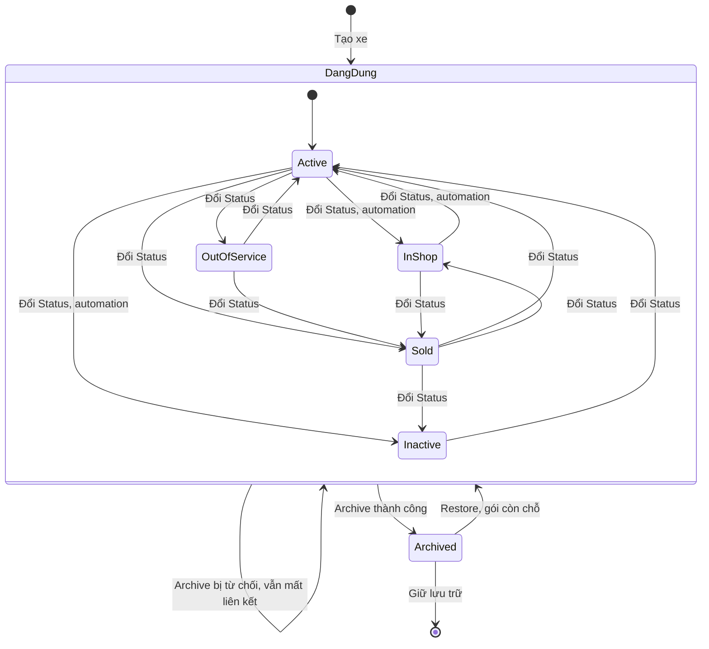
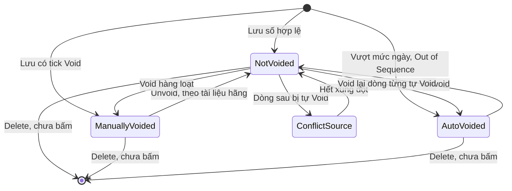
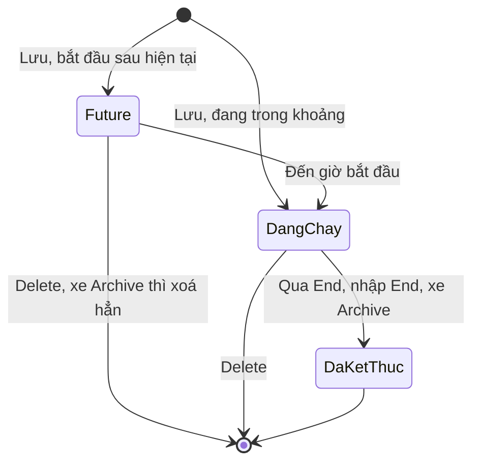

# Phương tiện — States

Lốp có ma trận riêng ở [[docs/_research/fleetio/srs/fleetio-tires-states.md|States Lốp]].

## 1. Trạng thái xe

Danh mục khách sửa được ("Add Vehicle Status"). Mặc định: Active (Default), In Shop, Inactive, Out of Service, Sold. **Chuyển tự do giữa mọi cặp đã thử** (`Chạy` lượt 3 trên `TEST-XE-LOP`), không có luật chuyển, không hỏi lý do; sơ đồ chỉ vẽ các cặp đã thử và các cặp qua Active. Trạng thái không ràng buộc nghiệp vụ nào: xe Sold, Out of Service vẫn gán tài xế, mở lệnh, nhập đồng hồ. Mở hoặc đóng lệnh không tự đổi trạng thái xe; muốn tự đổi phải bật automation. Sold không phải điểm cuối.

**Archived không phải một giá trị Status:** là lớp phủ riêng, xe Archived vẫn hiện Active hoặc Inactive, Restore trả về đúng trạng thái đó. Hiệu ứng lên liên kết, phân công xem Mục 3 và Mục 6.1.

| Trạng thái | Hành động | Sang | Điều kiện | Hiệu ứng | Câu chữ | Mức |
|---|---|---|---|---|---|---|
| Chưa có | Save, đủ trường, còn hạn mức | Active (mặc định) hoặc trạng thái chọn | Tên, loại, sở hữu, đồng hồ chính, đơn vị | Mở trang xe | "Vehicle was successfully created" | `Chạy` |
| Chưa có | Save, trống tên | Không tạo | — | Lỗi ở trường | "can't be blank", "Vehicle could not be created" | `Chạy` |
| Chưa có | Save, hết hạn mức | Không tạo | "5 of 5" | Nút Add Vehicle có khoá | "Your plan is limited to 5 vehicles" | `Chạy` |
| Chưa có | Save, trùng tên hoặc VIN | Không tạo | Trùng VIN xét cả xe Sample; tên xe đã Archive không tính | Lỗi ở trường | "has already been taken", "Vehicle could not be created" | `Chạy` |
| Chưa có | Add Multiple, dòng hợp lệ | Active | Còn hạn mức | Chạy nền, tự giải mã VIN | "Complete: Add Multiple Vehicles" | `Chạy` |
| Chưa có | Add Multiple, dòng trùng | Không tạo | — | Không nêu lý do trên màn | "Process warning: Add Multiple Vehicles" | `Chạy` |
| Chưa có | Add Multiple, gói đầy | Không tạo | 5 of 5 | Mục menu xám có khoá, bấm không mở form | Tooltip cuối câu "...to add more Vehicles." | `Chạy` |
| Active | Đổi trường Status | In Shop, Inactive, Out of Service, Sold | Quyền `vehicles_update_status`, Operator có sẵn | Một dòng Status Updates, báo cáo Status Changes, Status Summary; không hỏi lý do | "Vehicle was successfully updated" | `Chạy`, báo cáo `Xem` |
| Active | Automation theo Vehicle Updated | Trạng thái chọn | `TEST-NEN-AUTO-05`, sửa trường bất kỳ cũng kích hoạt | Đổi trong vài giây; người đổi ngược bị lật lại khoảng 1 giây sau, màn không báo | "Fleetio Automation updated status from Active to Inactive" | `Chạy` |
| Active | Automation "In Shop khi sự cố từ kiểm tra" | In Shop | Sự cố Open, Source Inspection Failure, mẫu đã bật | Đổi trạng thái | Tên mẫu "Update Vehicle Status To In Shop When Issue Source Is Inspection Failure" | `Xem` |
| Active | Automation khi tạo lệnh | Trạng thái chọn | Status Type Incomplete, mẫu đã bật | Đổi trạng thái | "Update Vehicle Status when a Work Order is Created" | `Xem` |
| In Shop | Đổi trường Status | Bất kỳ, đã thử Sold | Như trên | Như trên; vào In Shop KHÔNG tự sinh lệnh, liên kết còn | "Vehicle was successfully updated" | `Chạy` |
| In Shop | Automation khi lệnh xong | Active | Status Type Completed, Vehicle Incomplete Work Orders Count < 1, mẫu đã bật | Đổi trạng thái | "Update Vehicle Status to Active when Work Orders are Completed" | `Xem` |
| In Shop | Automation khi sự cố Resolved | Active | Status Resolved, mẫu đã bật | Đổi trạng thái | "Update Vehicle Status To Active When Issue Status Is Resolved" | `Xem` |
| Mọi trạng thái | Mở, đóng lệnh, không có automation | Không đổi | — | KHÔNG tự đổi; xe Sold vẫn Sold | — | `Chạy` |
| Inactive | Đổi trường Status | Bất kỳ | Như trên | Vẫn thêm đồng hồ phụ, tạo phân công | Không ghi nhận | `Chạy` thao tác, đổi đi `Xem` |
| Out of Service | Đổi trường Status | Bất kỳ, đã thử Sold | Như trên | Một dòng Status Updates | "Vehicle was successfully updated" | `Chạy` |
| Out of Service | Add Vehicle Assignment, nhập đồng hồ | Không đổi | — | Lưu được, KHÔNG cảnh báo; menu Add đủ mục | — | `Chạy` |
| Mọi trạng thái | Nhập Out-of-Service Date, Odometer | Không đổi | Tab Lifecycle | KHÔNG đổi Status, KHÔNG tạo dòng đồng hồ; có Record History | "Out Of Service Date changed from (empty) to …" | `Chạy` |
| Sold | Đổi trường Status | Bất kỳ, đã thử In Shop, Inactive | Như trên | Không có luồng thanh lý | "Vehicle was successfully updated" | `Chạy` |
| Sold | Tạo lệnh, nhập đồng hồ | Không đổi | — | Lưu được, KHÔNG cảnh báo; liên kết mooc còn | — | `Chạy` |
| Mọi trạng thái | Lưu form kèm nhóm Sample | Không đổi | Lỗi một trường | Cả form bị từ chối | "Vehicle could not be updated" | `Chạy` |
| Mọi trạng thái | Archive, không có Lệnh chưa xong | Archived, Status giữ nguyên | Quyền `vehicles_archive_delete`; Operator không có | Ngắt liên kết, đóng phân công đang chạy, xoá phân công tương lai, rời lịch phân công | Hộp "Confirm Vehicle Archive" | `Chạy`, quyền `Xem` |
| Mọi trạng thái | Archive, còn Lệnh mở | Không đổi | Lệnh Open | Bị từ chối nhưng VẪN ngắt liên kết hai phía (2/2 lần); phân công tương lai còn; không có lịch sử | "Vehicle could not be archived." | `Chạy` |
| Mọi trạng thái | Archive, còn đặt xe Approved | Không đổi | Có đối chứng | Phân công Future, đặt xe không đổi; liên kết chưa đo vì xe không có liên kết | "Vehicle could not be archived." | `Chạy` |
| Mọi trạng thái | Archive, chỉ còn đặt xe Requested, có sự cố Open | Archived, Status giữ nguyên | Không bị chặn | Đặt xe vẫn Requested, không duyệt được, không báo | "Successfully archived …", "This record is archived." | `Chạy` |
| Mọi trạng thái | Archive, có đặt xe Checked Out | Chưa tách riêng | Lúc thử còn đặt xe Approved | — | — | Chưa chạy |
| Archived | Restore, gói còn chỗ | Trạng thái cũ | Bấm là chạy, không hỏi | Giữ trạng thái, đồng hồ, cấu hình trục; KHÔNG trả lại liên kết, phân công | "Record successfully restored!" | `Chạy` |
| Archived | Restore, gói đầy | Không đổi | 5 of 5 | Nút khoá, bấm không có gì | Không có câu giải thích | `Chạy` |
| Archived | Xem đồng hồ, cấu hình trục | Không đổi | — | Xem được, Edit trục khoá | — | `Chạy` |

## 2. Số đồng hồ

Không có trường trạng thái riêng; Void Status lọc được: Not Voided, Manually Voided, Auto Voided, cờ Conflict Source gắn thêm vào dòng Not Voided. "Current odometer" là nhãn của dòng lớn nhất, không phải trạng thái. Đồng hồ phụ là chuỗi riêng, cùng ma trận này. Dòng từng Auto-Voided nhớ lý do: Unvoid rồi Void lại thì về Auto-Voided, không thành Manually Voided (`Chạy`). Void hết mọi dòng thì xe hiện "0 km", không có số hiện tại, nhận số bất kỳ.

| Trạng thái | Hành động | Sang | Điều kiện | Hiệu ứng | Câu chữ | Mức |
|---|---|---|---|---|---|---|
| Chưa có | Lưu số tăng, cùng thứ tự | Not Voided, nhãn "Current odometer" | Đúng thứ tự ngày, không vượt mức | Đồng hồ xe tăng, nhắc tính lại | "Meter Entry was successfully created" | `Chạy` |
| Chưa có | Lưu số nhỏ hơn, cùng ngày | Not Voided, không hiện tại | Cùng ngày với số lớn hơn | Đồng hồ giữ nguyên, "200 km ago", KHÔNG báo | Không có | `Chạy` |
| Chưa có | Lưu số lớn hơn số ngày sau | Không tạo | Lùi ngày, không tick Void | Lỗi ở trường | "must be less than 5,000 or marked as void", "Meter Entry could not be created" | `Chạy` |
| Chưa có | Lưu số nhỏ hơn số ngày trước | Không tạo | Ngày sau, không tick Void | Lỗi ở trường | "must be greater than 5,500 or marked as void" | `Chạy` |
| Chưa có | Lưu có tick Void | Manually Voided | Có giá trị | Không phải số hiện tại, không kích hoạt nhắc | "A voided meter entry is never considered a vehicle's "current meter" even if it's the most recent." | `Chạy` |
| Chưa có | Lưu số vượt mức một ngày | Auto-Voided, lý do Exceeds Max. Daily Usage | Fleetio: 4.828 km một ngày | Không đổi đồng hồ; dòng gốc thành Conflict Source | "However, it was automatically voided because it exceeds maximum possible for day" | `Chạy` |
| Chưa có | Lưu đúng bằng mức một ngày | Not Voided, thành số hiện tại | Fleetio: +4.828 km | Lưu bình thường | "Meter Entry was successfully created" | `Chạy` |
| Chưa có | Phiếu Fleetio Go lệch thứ tự | Auto-Voided, lý do Out of Sequence | Một ca; nhập tay web cùng tình huống bị từ chối | Không đổi đồng hồ; dòng còn lại thành Conflict Source | "Automatically voided because it is out of sequence and ahead of the conflicting meter by 601 kilometers" | `Chạy` |
| Chưa có | Nguồn telematics, API lệch thứ tự | Auto-Voided, lý do Out of Sequence | Theo tài liệu hãng | Chưa thử | "Out of Sequence" | `Docs` |
| Chưa có | Nhập số sau Void toàn bộ | Not Voided, thành số hiện tại | Xe "0 km", "No meter history" | Nhận số bất kỳ, không so với số cũ | "Meter Entry was successfully created" | `Chạy` |
| Not Voided | Có dòng sau bị tự Void | Not Voided + Conflict Source | Dòng này gây xung đột | Cờ đỏ, popup | "This entry was flagged because it has caused one or more successive entries to be auto-voided" | `Chạy` |
| Not Voided | Void hàng loạt | Manually Voided | Chỉ chọn dòng chưa Void, gõ VOID | Hết dòng thì xe 0 km; còn dòng thì về số lớn nhất còn lại | "Successfully voided Meter Entries" | `Chạy`, phần còn dòng `Suy` |
| Not Voided, từng Auto-Voided | Void hàng loạt | Auto-Voided, lý do cũ | Dòng đã từng tự Void rồi Unvoid | Không thành Manually Voided | "Exceeds Max. Daily Usage" | `Chạy` |
| Not Voided | Void từ menu dòng | Manually Voided | Theo tài liệu hãng | Chưa chạy trên một dòng | — | `Docs` |
| Đang chọn lẫn | Mở Actions | Không đổi | Có cả dòng đã Void và chưa Void | Void, Unvoid đều khoá | Không có câu giải thích | `Chạy` |
| Mọi Void Status | Delete, Edit, View Record History | Chưa kiểm | Menu dòng, Actions | Không bấm | — | `Xem` |
| Conflict Source | Unvoid dòng con | Not Voided | Không còn xung đột | Cờ tự mất | Không có | `Chạy` |
| Conflict Source | Void dòng gốc | Manually Voided | Theo tài liệu hãng, sau đó bỏ Void từng dòng, không tự động | Chưa chạy | — | `Docs` |
| Auto-Voided | Unvoid | Not Voided, thành số hiện tại nếu lớn nhất | Confirm, KHÔNG hỏi lý do, KHÔNG kiểm lại ngưỡng | Đồng hồ 5.500 lên 20.000; số thật sau đó sẽ bị "must be greater than" (`Suy`) | "This operation will attempt to unvoid the selected Meter Entry.", "Successfully unvoided Meter Entry" | `Chạy` |
| Manually Voided | Unvoid | Not Voided | Theo tài liệu hãng | Chưa chạy | — | `Docs` |

## 3. Phân công xe

Không có trường trạng thái lưu; nhãn Future và màu trên lịch suy từ ngày so với hiện tại (`Suy`). Thanh màu cam là tương lai, xanh là đang chạy.

| Trạng thái | Hành động | Sang | Điều kiện | Hiệu ứng | Câu chữ | Mức |
|---|---|---|---|---|---|---|
| Chưa có | Lưu | Future hoặc đang chạy | Không chồng phân công khác của xe; Operator | Thanh trên lịch; đầu trang xe hiện người khi đang chạy | "Vehicle Assignment was successfully created" | `Chạy` |
| Chưa có | Lưu chồng khoảng cũ | Không tạo | Cùng xe | KHÔNG tự đóng phân công cũ | "can't overlap existing assignments", "Vehicle Assignment could not be created" | `Chạy` |
| Chưa có | Lưu với người đang giữ xe khác | Future hoặc đang chạy | Không xét theo người | Một người giữ hai xe | "successfully created" | `Chạy` |
| Future | Edit đổi Operator | Future | Xe khoá | Trang chi tiết chỉ hiện người mới, không còn người cũ | "Vehicle Assignment was successfully updated" | `Chạy` |
| Future | Đến giờ bắt đầu | Đang chạy | — | Đổi màu lịch | Không có | `Suy` |
| Future | Delete | Xoá | Menu thanh | Không bấm | Không ghi nhận | `Xem` |
| Đang chạy, "No end date" | Edit nhập End | Đã kết thúc | Thu hồi | Hết hiện người lái | Không ghi nhận | `Suy` |
| Đang chạy | Gán người khác cùng lúc | Không tạo | Trùng xe | Phải tự đóng trước | "can't overlap existing assignments" | `Chạy` |
| Đang chạy | Archive xe thành công | Đã kết thúc | Hộp đã báo trước | End đổi thành lúc Archive, Duration 1m; liên hệ thấy nhãn "Archived"; xe rời lịch | "end any current vehicle assignments" | `Chạy` |
| Future | Archive xe thành công | Bị xoá | Hộp đã báo trước | Không còn dòng nào, kể cả ở lịch sử liên hệ | "remove any future-dated vehicle assignments" | `Chạy` |
| Future | Archive xe bị từ chối | Không đổi | Còn Lệnh mở | Phân công còn nguyên | "Vehicle could not be archived." | `Chạy` |
| Đã kết thúc, bị xoá | Restore xe | Không đổi | — | Phân công đã mất KHÔNG quay lại | "Record successfully restored!" | `Chạy` |
| Chưa có | Duyệt đặt xe | Future | Đặt xe Approved | Phân công thật, nhãn "Future" trên liên hệ | "Reservation was approved successfully" | `Chạy` |
| Future | Huỷ đặt xe Approved | Bị xoá | Sinh từ đặt xe | Không còn dòng | "Reservation was canceled successfully" | `Chạy` |
| Chưa có | Lưu trên xe Out of Service, Inactive | Future hoặc đang chạy | Không xét trạng thái xe | KHÔNG cảnh báo | "successfully created" | `Chạy` |
| Đã kết thúc | Sửa | Chưa thử | — | — | — | Chưa chạy |

## 4. Chi phí

Không có trạng thái thật. Hai tab Past, Future suy từ ngày, nhưng dòng đúng hôm nay vẫn ở Future trong khi Cost of Ownership đã tính (E-fleetio-vehicle-018). Xử lý nền có hai thông báo Processing, Complete của việc lưu, không phải của dòng chi phí.

| Trạng thái | Hành động | Sang | Điều kiện | Hiệu ứng | Câu chữ | Mức |
|---|---|---|---|---|---|---|
| Chưa có | Save, định kỳ | Các dòng Future | Có Start Date | Xử lý nền | "Processing: Recurring expense save", "Complete: Recurring expense save" | `Chạy` |
| Chưa có | Save, đơn lẻ, ngày qua | Past | — | Tính vào All Time | Không ghi nhận | `Chạy` |
| Chưa có | Save, Start Date giả | Không tạo | Ô chữ xám | Lỗi ở trường | "can't be blank" | `Chạy` |
| Future | Đến ngày | Tính vào Cost of Ownership; sang Past chưa quan sát | — | — | — | `Suy` |

## 5. Bảo hành

Chỉ thấy Status "Active" và số đếm active, expiring soon, total. Không đủ dữ liệu vẽ sơ đồ; chưa thấy Expired, Claim.

| Trạng thái | Hành động | Sang | Điều kiện | Hiệu ứng | Câu chữ | Mức |
|---|---|---|---|---|---|---|
| Chưa có | Save | Active | Start Date, duration, distance | Tự tính End Date, End Meter | "Warranties have been successfully created" | `Chạy` |
| Active | Gần hết hạn | Expiring soon | Ngưỡng chưa rõ | Đếm trên lệnh | "expiring soon" | `Xem` |
| Active | Lệnh có Service Task cùng mã | Active | — | "Warranty Opportunities (1)" | "View Active Coverage" | `Chạy` |
| Active | Claim | Chưa thử | — | — | — | Chưa chạy |
| Active, sinh từ mẫu | Sửa mẫu, chọn áp về quá khứ | Active | Hộp "Template Change", lựa chọn 2 | End Date đổi theo mẫu; phần sửa riêng bị ghi đè theo câu cảnh báo | "1 asset with coverage … applied will be updated." | `Chạy`, ghi đè `Xem` |
| Chưa có | Áp mẫu | Active, mỗi coverage một bảo hành | Có mẫu đúng điều kiện | Sinh nhiều bảo hành riêng | "Warranties have been successfully created" | `Chạy` |

## 6. Đối tượng không có trạng thái thật

| Đối tượng | Vì sao | Mức |
|---|---|---|
| Liên kết xe | Có hoặc không; gỡ là mất, không có ngày, không lịch sử; bảng hiệu ứng ở Mục 6.1 | `Chạy` |
| Mooc | Là Vehicle, dùng chung trạng thái xe; không có trạng thái ghép, tách | `Chạy` |
| Replacement Analysis | Máy tính, không lưu bản ghi theo xe | `Chạy` |
| Liên hệ Operator | Là phân loại tick, không phải trạng thái | `Chạy` |
| Recall | Có tab All, Needs Action, Open, Resolved, Acknowledged; chưa đổi thử trên Sample nên chưa biết luật chuyển | `Xem` |
| Đặt xe Motor Pool | Có trạng thái thật: Requested, Approved, Checked Out, Returned, Completed, Denied, Canceled; ma trận ở `run-notes/platform.md` và nhóm Nền tảng. Tác động lên xe: Approved chặn Archive và sinh phân công, Requested thì không | `Chạy` |
| Lốp | Vị trí trên xe, không phải đối tượng riêng; xem `fleetio-tires` | `Chạy` |
| Tài liệu đính vào xe | Có hoặc không, nhãn "Shared" chỉ loại tài liệu; gỡ đính chưa thử | `Chạy` |
| Bộ lịch bảo dưỡng trên xe | Chỉ thấy trang rỗng khi xe chưa có bộ lịch; chưa gán để xem trạng thái | `Chạy` |

### 6.1 Liên kết xe: điều gì làm mất, điều gì không

Chỉ có hai trạng thái nên không vẽ sơ đồ.

| Trạng thái | Hành động | Sang | Điều kiện | Hiệu ứng | Câu chữ | Mức |
|---|---|---|---|---|---|---|
| Chưa nối | Thêm ở Linked Vehicles, Link Asset | Đã nối | Không kiểm loại xe, không giới hạn số xe | Hiện ở cả hai phía; xe đã nối không còn trong ô chọn | "Linked Assets have been updated" | `Chạy` |
| Đã nối | Gỡ từ một trong hai phía | Chưa nối | — | Đồng hồ, lốp không đổi; không có dòng lịch sử | "There are no linked Assets for this Vehicle" | `Chạy` |
| Đã nối | Đổi trạng thái xe | Đã nối | Sold, In Shop | Liên kết còn | — | `Chạy` |
| Đã nối | Archive thành công | Chưa nối | — | Mất ở cả hai phía; mooc nối 2 xe thì còn xe kia | "end any associations with linked assets" | `Chạy` |
| Đã nối | Archive bị từ chối | Chưa nối | Còn Lệnh mở | Lỗi: vẫn mất dù xe không Archive, 2/2 lần, không báo, không có lịch sử | "Vehicle could not be archived." | `Chạy` |
| Chưa nối | Restore xe | Chưa nối | — | Liên kết đã mất KHÔNG quay lại, phải nối tay | "Record successfully restored!" | `Chạy` |
