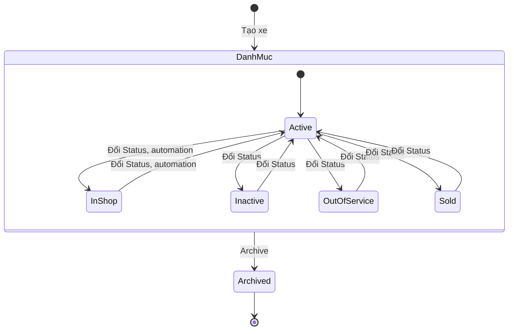
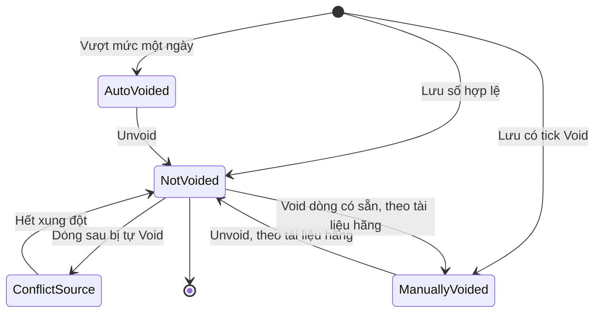
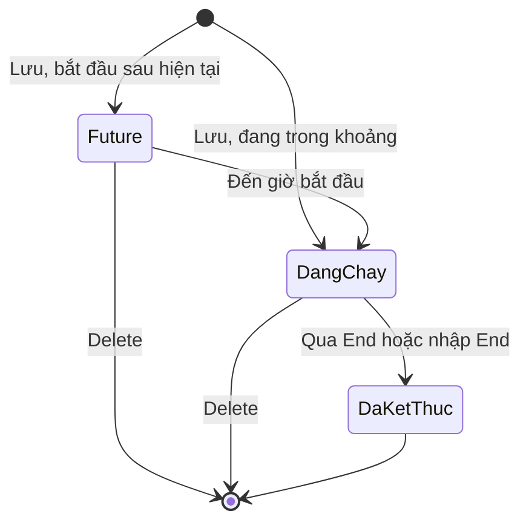

# Phương tiện — States

Lốp có ma trận riêng ở [[docs/_research/fleetio/srs/fleetio-tires-states.md|States Lốp]].

## 1. Trạng thái xe

Danh mục khách sửa được ("Add Vehicle Status"). Mặc định: Active (Default), In Shop, Inactive, Out of Service, Sold. **Chuyển tự do giữa mọi cặp**, không thấy luật chuyển; sơ đồ chỉ vẽ qua Active cho dễ đọc. Đóng lệnh không tự đổi trạng thái xe; muốn tự đổi phải bật automation. Sold không phải điểm cuối: không thấy gì chặn đổi lại. Trạng thái thật chưa đổi thử ở lượt 03/11 vì xe thuộc nhóm khác.

| Trạng thái | Hành động | Sang | Điều kiện | Hiệu ứng | Câu chữ | Mức |
|---|---|---|---|---|---|---|
| Chưa có | Save, đủ trường, còn hạn mức | Active (mặc định) hoặc trạng thái chọn | Tên, loại, sở hữu, đồng hồ chính, đơn vị | Mở trang xe | "Vehicle was successfully created" | `Chạy` |
| Chưa có | Save, trống tên | Không tạo | — | Lỗi ở trường | "can't be blank", "Vehicle could not be created" | `Chạy` |
| Chưa có | Save, hết hạn mức | Không tạo | "5 of 5" | Nút Add Vehicle có khoá | "Your plan is limited to 5 vehicles" | `Chạy` |
| Active | Đổi trường Status | In Shop, Inactive, Out of Service, Sold | Quyền `vehicles_update_status`, Operator có sẵn | Lịch sử trạng thái, báo cáo Status Changes, Status Summary | Không ghi nhận câu chữ | `Xem` |
| Active | Automation "In Shop khi sự cố từ kiểm tra" | In Shop | Sự cố Open, Source Inspection Failure, mẫu đã bật | Đổi trạng thái | Tên mẫu "Update Vehicle Status To In Shop When Issue Source Is Inspection Failure" | `Xem` |
| Active | Automation khi tạo lệnh | Trạng thái chọn | Status Type Incomplete, mẫu đã bật | Đổi trạng thái | "Update Vehicle Status when a Work Order is Created" | `Xem` |
| In Shop | Đổi trường Status | Bất kỳ | Như trên | Như trên | Không ghi nhận | `Xem` |
| In Shop | Automation khi lệnh xong | Active | Status Type Completed, Vehicle Incomplete Work Orders Count < 1, mẫu đã bật | Đổi trạng thái | "Update Vehicle Status to Active when Work Orders are Completed" | `Xem` |
| In Shop | Automation khi sự cố Resolved | Active | Status Resolved, mẫu đã bật | Đổi trạng thái | "Update Vehicle Status To Active When Issue Status Is Resolved" | `Xem` |
| In Shop | Đóng lệnh, không có automation | Không đổi | — | KHÔNG tự về Active | — | `Xem` |
| Inactive | Đổi trường Status | Bất kỳ | Như trên | Như trên | Không ghi nhận | `Xem` |
| Out of Service | Đổi trường Status | Bất kỳ | Như trên | Như trên | Không ghi nhận | `Xem` |
| Out of Service | Nhập Out-of-Service Date, Odometer | Chưa kiểm có đổi Status không | Tab Lifecycle | Chỉ thấy là trường dữ liệu | — | `Xem` |
| Sold | Đổi trường Status | Bất kỳ, không thấy chặn | Như trên | Không có luồng thanh lý | Không ghi nhận | `Xem` |
| Mọi trạng thái | Archive | Tab Archived của xe | Quyền `vehicles_archive_delete`; Operator không có | Chưa chạy | Nút "Archive" | `Xem` |
| Archived | Restore | Chưa kiểm | — | Chưa kiểm trên xe. Automation có Restore, xe chưa biết | — | Chưa chạy |

## 2. Số đồng hồ

Không có trường trạng thái riêng; Void Status lọc được: Not Voided, Manually Voided, Auto Voided, cờ Conflict Source gắn thêm vào dòng Not Voided. "Current odometer" là nhãn của dòng lớn nhất, không phải trạng thái.

| Trạng thái | Hành động | Sang | Điều kiện | Hiệu ứng | Câu chữ | Mức |
|---|---|---|---|---|---|---|
| Chưa có | Lưu số tăng, cùng thứ tự | Not Voided, nhãn "Current odometer" | Đúng thứ tự ngày, không vượt mức | Đồng hồ xe tăng, nhắc tính lại | "Meter Entry was successfully created" | `Chạy` |
| Chưa có | Lưu số nhỏ hơn, cùng ngày | Not Voided, không hiện tại | Cùng ngày với số lớn hơn | Đồng hồ giữ nguyên, "200 km ago", KHÔNG báo | Không có | `Chạy` |
| Chưa có | Lưu số lớn hơn số ngày sau | Không tạo | Lùi ngày, không tick Void | Lỗi ở trường | "must be less than 5,000 or marked as void", "Meter Entry could not be created" | `Chạy` |
| Chưa có | Lưu số nhỏ hơn số ngày trước | Không tạo | Ngày sau, không tick Void | Lỗi ở trường | "must be greater than 5,500 or marked as void" | `Chạy` |
| Chưa có | Lưu có tick Void | Manually Voided | Có giá trị | Không phải số hiện tại, không kích hoạt nhắc | "A voided meter entry is never considered a vehicle's "current meter" even if it's the most recent." | `Chạy` |
| Chưa có | Lưu số vượt mức một ngày | Auto-Voided, lý do Exceeds Max. Daily Usage | Fleetio: 4.828 km một ngày | Không đổi đồng hồ; dòng gốc thành Conflict Source | "However, it was automatically voided because it exceeds maximum possible for day" | `Chạy` |
| Chưa có | Nguồn telematics, API lệch thứ tự | Auto-Voided, lý do Out of Sequence | Theo tài liệu hãng | Không tái hiện được trên web | "Out of Sequence" | `Docs` |
| Not Voided | Có dòng sau bị tự Void | Not Voided + Conflict Source | Dòng này gây xung đột | Cờ đỏ, popup | "This entry was flagged because it has caused one or more successive entries to be auto-voided" | `Chạy` |
| Not Voided | Void từ dòng có sẵn | Manually Voided | Theo tài liệu hãng | Chưa chạy | — | `Docs` |
| Not Voided | Bulk Meter Management | Voided toàn bộ | Khi thay đồng hồ | Chưa chạy; trường hợp xe không còn số hiện tại chưa kiểm | — | `Docs` |
| Conflict Source | Unvoid dòng con | Not Voided | Không còn xung đột | Cờ tự mất | Không có | `Chạy` |
| Conflict Source | Void dòng gốc | Manually Voided | Theo tài liệu hãng, sau đó bỏ Void từng dòng, không tự động | Chưa chạy | — | `Docs` |
| Auto-Voided | Unvoid | Not Voided, thành số hiện tại nếu lớn nhất | Confirm, KHÔNG hỏi lý do, KHÔNG kiểm lại ngưỡng | Đồng hồ 5.500 lên 20.000; số thật sau đó sẽ bị "must be greater than" (`Suy`) | "This operation will attempt to unvoid the selected Meter Entry.", "Successfully unvoided Meter Entry" | `Chạy` |
| Manually Voided | Unvoid | Not Voided | Theo tài liệu hãng | Chưa chạy | — | `Docs` |

## 3. Phân công xe

Không có trường trạng thái lưu; nhãn Future và màu trên lịch suy từ ngày so với hiện tại (`Suy`). Thanh màu cam là tương lai, xanh là đang chạy.

| Trạng thái | Hành động | Sang | Điều kiện | Hiệu ứng | Câu chữ | Mức |
|---|---|---|---|---|---|---|
| Chưa có | Lưu | Future hoặc đang chạy | Không chồng phân công khác của xe; Operator | Thanh trên lịch; đầu trang xe hiện người khi đang chạy | "Vehicle Assignment was successfully created" | `Chạy` |
| Chưa có | Lưu chồng khoảng cũ | Không tạo | Cùng xe | KHÔNG tự đóng phân công cũ | "can't overlap existing assignments", "Vehicle Assignment could not be created" | `Chạy` |
| Chưa có | Lưu với người đang giữ xe khác | Future hoặc đang chạy | Không xét theo người | Một người giữ hai xe | "successfully created" | `Chạy` |
| Future | Edit đổi Operator | Future | Xe khoá | Trang chi tiết chỉ hiện người mới, không còn người cũ | "Vehicle Assignment was successfully updated" | `Chạy` |
| Future | Đến giờ bắt đầu | Đang chạy | — | Đổi màu lịch | Không có | `Suy` |
| Future | Delete | Xoá | Menu thanh | Không bấm | Không ghi nhận | `Xem` |
| Đang chạy, "No end date" | Edit nhập End | Đã kết thúc | Thu hồi | Hết hiện người lái | Không ghi nhận | `Suy` |
| Đang chạy | Gán người khác cùng lúc | Không tạo | Trùng xe | Phải tự đóng trước | "can't overlap existing assignments" | `Chạy` |
| Đã kết thúc | Sửa | Chưa thử | — | — | — | Chưa chạy |

## 4. Chi phí

Không có trạng thái thật. Hai tab Past, Future suy từ ngày, nhưng dòng đúng hôm nay vẫn ở Future trong khi Cost of Ownership đã tính (E-fleetio-vehicle-018). Xử lý nền có hai thông báo Processing, Complete của việc lưu, không phải của dòng chi phí.

| Trạng thái | Hành động | Sang | Điều kiện | Hiệu ứng | Câu chữ | Mức |
|---|---|---|---|---|---|---|
| Chưa có | Save, định kỳ | Các dòng Future | Có Start Date | Xử lý nền | "Processing: Recurring expense save", "Complete: Recurring expense save" | `Chạy` |
| Chưa có | Save, đơn lẻ, ngày qua | Past | — | Tính vào All Time | Không ghi nhận | `Chạy` |
| Chưa có | Save, Start Date giả | Không tạo | Ô chữ xám | Lỗi ở trường | "can't be blank" | `Chạy` |
| Future | Đến ngày | Tính vào Cost of Ownership; sang Past chưa quan sát | — | — | — | `Suy` |

## 5. Bảo hành

Chỉ thấy Status "Active" và số đếm active, expiring soon, total. Không đủ dữ liệu vẽ sơ đồ; chưa thấy Expired, Claim.

| Trạng thái | Hành động | Sang | Điều kiện | Hiệu ứng | Câu chữ | Mức |
|---|---|---|---|---|---|---|
| Chưa có | Save | Active | Start Date, duration, distance | Tự tính End Date, End Meter | "Warranties have been successfully created" | `Chạy` |
| Active | Gần hết hạn | Expiring soon | Ngưỡng chưa rõ | Đếm trên lệnh | "expiring soon" | `Xem` |
| Active | Lệnh có Service Task cùng mã | Active | — | "Warranty Opportunities (1)" | "View Active Coverage" | `Chạy` |
| Active | Claim | Chưa thử | — | — | — | Chưa chạy |

## 6. Đối tượng không có trạng thái thật

| Đối tượng | Vì sao | Mức |
|---|---|---|
| Liên kết xe | Có hoặc không; gỡ là mất, không có ngày, không lịch sử | `Chạy` |
| Mooc | Là Vehicle, dùng chung trạng thái xe; không có trạng thái ghép, tách | `Chạy` |
| Replacement Analysis | Máy tính, không lưu bản ghi theo xe | `Chạy` |
| Liên hệ Operator | Là phân loại tick, không phải trạng thái | `Chạy` |
| Recall | Có tab All, Needs Action, Open, Resolved, Acknowledged; chưa đổi thử trên Sample nên chưa biết luật chuyển | `Xem` |
| Đặt xe Motor Pool | Có cột Status; danh sách rỗng, chưa chạy | `Xem` |
| Lốp | Vị trí trên xe, không phải đối tượng riêng; xem `fleetio-tires` | `Chạy` |
