# Phương tiện — User flow

`stage` ghi theo lựa chọn của user: tự chốt, xem ở bản cuối (02/11/2026, cập nhật màn mới 03/11/2026).

## 1. Sơ đồ tổng

```mermaid
flowchart TD
    menu["Menu bên"]
    a["Danh sách xe, chưa chụp"]
    b["Form thêm xe, 6 phần"]
    e9["E-009 Hết hạn mức xe"]
    e10["E-010 Tên trống"]
    e3["E-003 Enter mở Thêm liên hệ ngoài ý muốn"]
    c["1.1 Xe"]
    c2["1.2 Menu thao tác xe"]
    c3["1.3 Chi phí sở hữu, xe liên kết"]
    d["Form bản ghi theo loại"]
    e["3.1 Lịch sử số đồng hồ"]
    e2["E-002 Số nhỏ hơn cùng ngày không báo"]
    m2["3.2 Từ chối số lùi ngày, E-004"]
    m3["3.3 Từ chối số thấp hơn ngày trước, E-005"]
    m4["3.4 Sổ có cờ xung đột, E-006, E-007"]
    f["2.1 Gán xe"]
    f3["2.3 Lịch tuần"]
    g["2.2 Hộp thêm gán xe"]
    e1["2.4 Trùng lần gán, E-001"]
    f5["2.5 Hộp sửa gán xe"]
    f6["2.6 Chi tiết phân công"]
    h["4.1 Đọc lốp, chi tiết ở nhóm Lốp"]
    i["5.1 Thêm chi phí"]
    i2["5.2 Chi phí định kỳ"]
    i3["5.3 Tab Past, Future"]
    j["6.1 Phân tích thay xe"]
    j2["6.2 Tham số thay xe"]
    w1["7.1 Bảo hành, chọn xe"]
    w2["7.2 Bảo hành, chọn mẫu"]
    w3["7.3 Bảo hành, nhập tay"]
    w4["7.4 Gắn mã bảo dưỡng"]
    w5["7.5 Danh sách bảo hành"]
    w6["7.6 Lệnh, chưa có cơ hội"]
    w7["7.7 Lệnh, có cơ hội bảo hành"]
    z["Xong"]
    menu -->|"Xe"| a
    menu -->|"Gán xe"| f
    menu -->|"Đọc lốp"| h
    menu -->|"Chi phí"| i
    menu -->|"Phân tích thay xe"| j
    menu -->|"Bảo hành"| w5
    a -->|"Thêm xe"| b
    a -->|"Mở dòng"| c
    b -->|"Lưu"| c
    b -->|"Hết hạn mức"| e9
    e9 -->|"Kết thúc"| z
    b -->|"Trống tên"| e10
    e10 -.->|"Sửa"| b
    b -->|"Enter khi tên chưa có"| e3
    e3 -.->|"Huỷ"| b
    c -->|"Thêm"| d
    d -.->|"Lưu"| c
    c -->|"More Actions"| c2
    c2 -.->|"Đóng"| c
    c -->|"Overview"| c3
    c3 -.->|"Quay lại"| c
    c -->|"Thêm, Lịch sử số đồng hồ"| e
    e -->|"Nhập số nhỏ hơn cùng ngày"| e2
    e2 -->|"Kết thúc"| z
    e -->|"Nhập số lùi ngày"| m2
    m2 -.->|"Sửa hoặc tick Void"| e
    e -->|"Nhập số thấp hơn ngày trước"| m3
    m3 -.->|"Sửa hoặc tick Void"| e
    e -->|"Nhập số vượt mức"| m4
    m4 -.->|"Unvoid"| e
    e -->|"Kết thúc"| z
    f -->|"Thêm gán xe"| g
    f -->|"Xem tuần"| f3
    f3 -->|"Bấm ô trống"| g
    f3 -->|"Sửa thanh"| f5
    f3 -->|"Xem thanh"| f6
    f5 -.->|"Lưu"| f6
    f6 -->|"Kết thúc"| z
    g -.->|"Lưu"| f
    g -->|"Trùng thời gian"| e1
    e1 -.->|"Đổi thời gian"| g
    f -->|"Kết thúc"| z
    h -->|"Kết thúc"| z
    i -->|"Lưu"| z
    i -->|"Chọn định kỳ"| i2
    i2 -->|"Lưu"| i3
    i3 -->|"Xem chi phí trên km"| c3
    j -->|"Xem tham số"| j2
    j2 -->|"Kết thúc"| z
    j -->|"Kết thúc"| z
    w5 -->|"Thêm bảo hành"| w1
    w1 -->|"Chọn mẫu"| w2
    w1 -->|"Nhập tay"| w3
    w2 -.->|"Không có mẫu, quay lại"| w1
    w3 -->|"Gắn mã"| w4
    w4 -.->|"Lưu"| w5
    w5 -->|"Mở lệnh của xe"| w6
    w6 -->|"Thêm Service Task cùng mã"| w7
    w7 -->|"Kết thúc"| z
```

Bản vẽ trên Figma: trang `Research · Fleetio`, frame `7214:221727`, chưa có các màn thêm ngày 03/11/2026. Đường liền là luồng thường, nét đứt là quay lại.

## 2. Màn hình

| # | Màn | Slug | Trạng thái | Ảnh |
|---|---|---|---|---|
| 1.1 | Trang xe | vehicle-detail | Có dữ liệu | Có |
| 2.1 | Lịch gán xe | assignments | Có xe, chưa có lần gán hôm nay trong khung | Có |
| 3.1 | Lịch sử số đồng hồ | meter-history | 7 dòng | Có |
| 4.1 | Đọc lốp | tire-readings | Trống; màn có dữ liệu ở nhóm Lốp | Có |
| 5.1 | Form chi phí | expense-new | Trống | Có |
| 6.1 | Phân tích thay xe | replacement | Mẫu | Có |
| 1.2 | Menu thao tác xe | vehicle-more-actions | Mở menu | Có |
| 1.3 | Chi phí sở hữu, xe liên kết | vehicle-cost-of-ownership | Có dữ liệu | Có |
| 2.2 | Hộp thêm gán xe | assignment-add | Đủ xe và người | Có |
| 2.3 | Lịch gán theo tuần | assignment-week | Có thanh tương lai, đang chạy | Có |
| 2.4 | Lỗi trùng lần gán | assignment-overlap | Lỗi | Có |
| 2.5 | Hộp sửa gán xe | assignment-edit | Xe khoá | Có |
| 2.6 | Chi tiết phân công | assignment-detail | Tương lai | Có |
| 3.2 | Từ chối số lùi ngày | meter-reject-backdate | Lỗi | Có |
| 3.3 | Từ chối số thấp hơn ngày trước | meter-reject-forward | Lỗi | Có |
| 3.4 | Sổ đồng hồ có cờ xung đột | meter-history-conflict | Auto-Voided, Conflict Source | Có |
| 5.2 | Chi phí định kỳ | expense-recurring | Đang nhập, xử lý nền | Có |
| 5.3 | Tab chi phí Past, Future | expense-future | 3 dòng Future | Có |
| 6.2 | Tham số phân tích thay xe | replacement-params | Mặc định | Có |
| 7.1 | Bảo hành, chọn xe | warranty-new-vehicles | Bước 1 | Có |
| 7.2 | Bảo hành, chọn mẫu | warranty-new-template | No options | Có |
| 7.3 | Bảo hành, nhập tay | warranty-new-standard | Bước 2 | Có |
| 7.4 | Gắn mã bảo dưỡng | warranty-maintenance-codes | Đã nhập mã | Có |
| 7.5 | Danh sách bảo hành | warranty-list | 1 dòng Active | Có |
| 7.6 | Lệnh, chưa có cơ hội bảo hành | wo-warranty-before | Trống | Có |
| 7.7 | Lệnh, có cơ hội bảo hành | wo-warranty-opportunity | 1 cơ hội | Có |
