# Đăng nhập và tài khoản cá nhân (`account-access`) — ERD tái lập (reverse)

```mermaid
erDiagram
    TAI_KHOAN ||--|| HO_SO_NHAN_VIEN : "gắn với"
    TAI_KHOAN ||--o{ PHIEN_DANG_NHAP : "có"
    TAI_KHOAN ||--o{ QUYEN_TRUY_CAP_TO_CHUC : "được phân"
    TO_CHUC ||--o{ CHI_NHANH : "gồm"
    TO_CHUC ||--o{ QUYEN_TRUY_CAP_TO_CHUC : "áp dụng cho"
    CHI_NHANH ||--o{ QUYEN_TRUY_CAP_TO_CHUC : "áp dụng cho"
    TAI_KHOAN ||--o{ YEU_CAU_RESET_MAT_KHAU : "gửi"
    TAI_KHOAN ||--o{ MA_OTP : "nhận"
    TAI_KHOAN ||--o{ LICH_SU_HOAT_DONG : "có"
    TAI_KHOAN_CAY_DAU ||--|| NHA_CUNG_CAP_HHDV : "thuộc"
    TAI_KHOAN_CAY_DAU ||--|| NGUOI_DAI_DIEN : "có"
    TAI_KHOAN_CAY_DAU ||--o{ HAN_MUC_THANG : "có"
    TAI_KHOAN_CAY_DAU ||--|| HOP_DONG_CAY_DAU : "ký"

    TAI_KHOAN {
        chuoi ten_tai_khoan "Tên đăng nhập, Web cho phép dùng email"
        chuoi trang_thai "Đang hoạt động, Cấp mới, bị khoá, vô hiệu hoá"
        boolean dung_mat_khau_mac_dinh "Đang dùng mật khẩu mặc định hay không"
        so so_lan_nhap_sai "Số lần nhập sai mật khẩu để khoá"
    }
    HO_SO_NHAN_VIEN {
        chuoi ho_va_ten "Họ và tên"
        chuoi id_nhan_vien "ID nhân viên"
        chuoi chuc_vu "Chức vụ, trống nếu không có"
        chuoi phong_ban "Phòng ban, trống nếu không có"
        chuoi xuong "Xưởng, trống nếu không có"
        ngay ngay_sinh "Ngày sinh"
        chuoi gioi_tinh "Giới tính"
        chuoi email "Email"
        chuoi so_dien_thoai "Số điện thoại"
        chuoi ma_so_thue "Mã số thuế"
        chuoi dia_chi "Địa chỉ"
        chuoi ghi_chu "Ghi chú"
    }
    TO_CHUC {
        chuoi ten_to_chuc "Tên tổ chức (công ty mẹ)"
        so so_chi_nhanh "Số chi nhánh hiển thị"
    }
    CHI_NHANH {
        chuoi ten_chi_nhanh "Tên chi nhánh"
        chuoi tinh_thanh "Tỉnh thành trực thuộc"
    }
    QUYEN_TRUY_CAP_TO_CHUC {
        chuoi pham_vi "Toàn bộ tổ chức hoặc từng chi nhánh"
    }
    PHIEN_DANG_NHAP {
        boolean ghi_nho_dang_nhap "Chọn Ghi nhớ đăng nhập"
        chuoi to_chuc_da_chon "Tổ chức/chi nhánh đã chọn (Mobile lưu)"
    }
    YEU_CAU_RESET_MAT_KHAU {
        chuoi hinh_thuc "Liên hệ IT hoặc Reset bằng email"
        thoigian thoi_gian_yeu_cau "Thời gian gửi yêu cầu"
    }
    MA_OTP {
        chuoi ma "6 ký tự sinh ngẫu nhiên"
        thoigian han_dung "5 phút"
        so so_lan_nhap_sai "Tối đa 5 lần"
    }
    LICH_SU_HOAT_DONG {
        chuoi nguoi_thuc_hien "Người thực hiện (hình mẫu Mobile)"
        ngay ngay "Ngày"
        chuoi mo_ta_hanh_dong "Mô tả hành động"
    }
    TAI_KHOAN_CAY_DAU {
        chuoi ten_cay_dau "Tên cây dầu"
        chuoi ma_doi_tac "Mã đối tác"
        chuoi dia_chi "Địa chỉ"
        chuoi ghi_chu "Ghi chú, ẩn nếu không có"
    }
    NHA_CUNG_CAP_HHDV {
        chuoi ten_ncc "Tên nhà cung cấp"
        chuoi ma_ncc "Mã nhà cung cấp"
        chuoi mo_ta "Mô tả ngắn"
    }
    NGUOI_DAI_DIEN {
        chuoi ten "Tên người đại diện"
        chuoi ma_nv "Mã nhân viên"
        chuoi chuc_vu "Chức vụ"
    }
    HAN_MUC_THANG {
        so da_cap "Số lít đã cấp trong tháng"
        so con_lai "Số lít còn lại"
    }
    HOP_DONG_CAY_DAU {
        chuoi loai_hop_dong "Đặt cọc hoặc Tín chấp"
        so so_tien_dat_coc "Chỉ khi Đặt cọc"
    }
```

## Entity Reference

| Entity | Mô tả nghiệp vụ | Thuộc tính chính | Nguồn | Nhãn |
|---|---|---|---|---|
| TAI_KHOAN | Tài khoản đăng nhập của nhân viên nội bộ | Tên tài khoản (Web: hoặc email), trạng thái, cờ mật khẩu mặc định, bộ đếm sai | SRS Web tr.248 — UC01.01 Đăng nhập; SRS Web tr.251 — UC01.01 Đăng nhập; SRS Web tr.260 — UC01.02 Quên mật khẩu | 🔵 |
| HO_SO_NHAN_VIEN | Thông tin cá nhân hiển thị chỉ đọc | Họ tên, ID nhân viên, chức vụ, phòng ban, xưởng, ngày sinh, giới tính, email, SĐT, MST, địa chỉ, ghi chú | SRS Web tr.279 — UC01.06 Xem thông tin cá nhân; SRS Web tr.280 — UC01.06 Xem thông tin cá nhân; SRS Mobile tr.72 — UC01.01.06 Xem thông tin cá nhân - Tài khoản nội bộ; SRS Mobile tr.73 — UC01.01.06 Xem thông tin cá nhân - Tài khoản nội bộ | ✅ |
| TO_CHUC | Tổ chức (công ty mẹ) có nhiều chi nhánh | Tên tổ chức, số chi nhánh | SRS Web tr.255 — UC01.01 Đăng nhập; SRS Mobile tr.50 — UC01.01.01 Đăng nhập | ✅ |
| CHI_NHANH | Chi nhánh thuộc 1 tỉnh thành, được chọn khi đăng nhập | Tên chi nhánh, tỉnh thành | SRS Web tr.256 — UC01.01 Đăng nhập; SRS Mobile tr.50 — UC01.01.01 Đăng nhập | ✅ |
| QUYEN_TRUY_CAP_TO_CHUC | Quyền của tài khoản trên tổ chức/chi nhánh; quyết định vào thẳng, chọn hay bị từ chối | Phạm vi: toàn bộ tổ chức hoặc từng chi nhánh | SRS Web tr.248 — UC01.01 Đăng nhập; SRS Web tr.255 — UC01.01 Đăng nhập; SRS Web tr.257 — UC01.01 Đăng nhập | 🔵 |
| PHIEN_DANG_NHAP | Phiên làm việc | Ghi nhớ đăng nhập; tổ chức/chi nhánh đã chọn (Mobile) | SRS Web tr.251 — UC01.01 Đăng nhập; SRS Mobile tr.47 — UC01.01.01 Đăng nhập; SRS Mobile tr.51 — UC01.01.01 Đăng nhập | 🔵 |
| YEU_CAU_RESET_MAT_KHAU | Yêu cầu lấy lại mật khẩu (Liên hệ IT hoặc email) | Hình thức, thời gian yêu cầu; email IT gồm tên tài khoản, tên người dùng | SRS Web tr.263 — UC01.02 Quên mật khẩu | 🟡 |
| MA_OTP | Mã OTP reset mật khẩu (Mobile) | Mã 6 ký tự, hạn 5 phút, tối đa 5 lần sai | SRS Mobile tr.57 — UC01.01.02 Quên mật khẩu; SRS Mobile tr.58 — UC01.01.02 Quên mật khẩu | ✅ |
| LICH_SU_HOAT_DONG | Lịch sử hoạt động của nhân viên | Người thực hiện, ngày, mô tả hành động (theo hình mẫu Mobile); phạm vi và lọc nguồn không nói | SRS Web tr.280 — UC01.06 Xem thông tin cá nhân; SRS Mobile tr.74 — hình màn Lịch sử hoạt động UC01.01.06 Xem thông tin cá nhân - Tài khoản nội bộ | 🟡 |
| TAI_KHOAN_CAY_DAU | Tài khoản đối tác loại Cây dầu | Tên, mã đối tác, địa chỉ, ghi chú, avatar | SRS Mobile tr.76 — UC01.01.07 Xem thông tin tài khoản cây dầu; SRS Mobile tr.77 — UC01.01.07 Xem thông tin tài khoản cây dầu | ✅ |
| NHA_CUNG_CAP_HHDV | Nhà cung cấp hàng hoá dịch vụ mà cây dầu trực thuộc | Tên, mã, mô tả ngắn | SRS Mobile tr.77 — UC01.01.07 Xem thông tin tài khoản cây dầu | ✅ |
| NGUOI_DAI_DIEN | Người đại diện của cây dầu | Tên, mã NV, chức vụ | SRS Mobile tr.77 — UC01.01.07 Xem thông tin tài khoản cây dầu | ✅ |
| HAN_MUC_THANG | Hạn mức theo tháng hiện tại (reset đầu tháng) | Đã cấp, còn lại (L), % | SRS Mobile tr.78 — UC01.01.07 Xem thông tin tài khoản cây dầu | ✅ |
| HOP_DONG_CAY_DAU | Thông tin hợp đồng của cây dầu | Loại hợp đồng, số tiền đặt cọc | SRS Mobile tr.78 — UC01.01.07 Xem thông tin tài khoản cây dầu | 🟡 |

## Quan hệ

| Từ | Đến | Bản số | Ý nghĩa | Nguồn | Nhãn |
|---|---|---|---|---|---|
| TAI_KHOAN | HO_SO_NHAN_VIEN | 1 – 1 | Tài khoản hiển thị thông tin hồ sơ nhân viên | SRS Web tr.279 — UC01.06 Xem thông tin cá nhân | 🔵 |
| TAI_KHOAN | PHIEN_DANG_NHAP | 1 – nhiều | Một tài khoản có thể có nhiều phiên (Web và Mobile) | SRS Web tr.251 — UC01.01 Đăng nhập; SRS Mobile tr.47 — UC01.01.01 Đăng nhập | 🟡 |
| TAI_KHOAN | QUYEN_TRUY_CAP_TO_CHUC | 1 – nhiều | Tài khoản có quyền trên 1 hoặc nhiều chi nhánh / tổ chức | SRS Web tr.248 — UC01.01 Đăng nhập | 🔵 |
| TO_CHUC | CHI_NHANH | 1 – nhiều | Công ty mẹ gồm "[X] chi nhánh" | SRS Web tr.255 — UC01.01 Đăng nhập | ✅ |
| TAI_KHOAN | YEU_CAU_RESET_MAT_KHAU | 1 – nhiều | Người dùng gửi yêu cầu reset (giới hạn 1 lần/phút) | SRS Web tr.263 — UC01.02 Quên mật khẩu | 🔵 |
| TAI_KHOAN | MA_OTP | 1 – nhiều | Mỗi lần reset bằng email (Mobile) sinh OTP mới, gửi lại sinh mã mới | SRS Mobile tr.58 — UC01.01.02 Quên mật khẩu; SRS Mobile tr.59 — UC01.01.02 Quên mật khẩu | 🔵 |
| TAI_KHOAN | LICH_SU_HOAT_DONG | 1 – nhiều | Xem lịch sử hoạt động của nhân viên | SRS Web tr.280 — UC01.06 Xem thông tin cá nhân | 🟡 |
| TAI_KHOAN_CAY_DAU | NHA_CUNG_CAP_HHDV | nhiều – 1 | Cây dầu "Thuộc nhà cung cấp HHDV" | SRS Mobile tr.77 — UC01.01.07 Xem thông tin tài khoản cây dầu | ✅ |
| TAI_KHOAN_CAY_DAU | NGUOI_DAI_DIEN | 1 – 1 | Mỗi cây dầu có 1 người đại diện | SRS Mobile tr.77 — UC01.01.07 Xem thông tin tài khoản cây dầu | 🔵 |
| TAI_KHOAN_CAY_DAU | HAN_MUC_THANG | 1 – nhiều | Hạn mức theo từng tháng, hiển thị tháng hiện tại | SRS Mobile tr.78 — UC01.01.07 Xem thông tin tài khoản cây dầu | 🔵 |
| TAI_KHOAN_CAY_DAU | HOP_DONG_CAY_DAU | 1 – 1 | Loại hợp đồng và số tiền đặt cọc của cây dầu | SRS Mobile tr.78 — UC01.01.07 Xem thông tin tài khoản cây dầu | 🟡 |

## Notes

- Không mô hình: bản ghi nội dung email gửi đi, lưu mật khẩu (nguồn không tả), mật khẩu mặc định (nguồn chỉ nhắc có tồn tại).
- Quan hệ tài khoản nội bộ với cây dầu: nguồn không nói tài khoản đối tác là bản ghi riêng hay cùng bảng tài khoản (🟡).
- Thuộc tính `so_lan_nhap_sai` của TAI_KHOAN suy từ yêu cầu đếm lượt thử, nguồn không nói lưu ở đâu hoặc khi nào reset (OQ-8).
- Chỉ thuộc tính nghiệp vụ nhìn thấy ở màn hình hoặc thông báo; không tên cột DB thật.
