# Đăng nhập và tài khoản cá nhân (`account-access`) — Flows tái lập (reverse)

## Flow: Đăng nhập

> Nguồn: SRS Web tr.248 — UC01.01 Đăng nhập (lưu đồ bằng chữ); SRS Web tr.253 — UC01.01 Đăng nhập; SRS Web tr.257 — UC01.01 Đăng nhập; SRS Mobile tr.43 — UC01.01.01 Đăng nhập; SRS Mobile tr.44 — UC01.01.01 Đăng nhập. Ngưỡng khoá khác nhau giữa Web (5) và Mobile (10) (xem Conflict); sơ đồ ghi "ngưỡng" chung. Phần chọn tổ chức xem flow riêng.

### Sequence — Đăng nhập
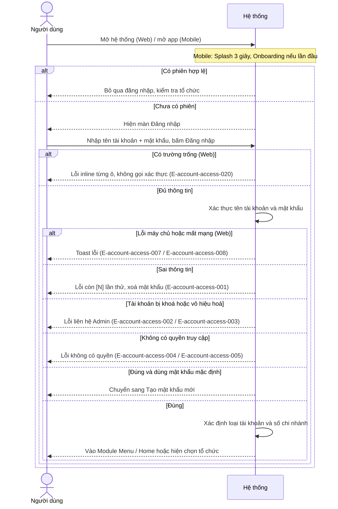

### Activity — Đăng nhập
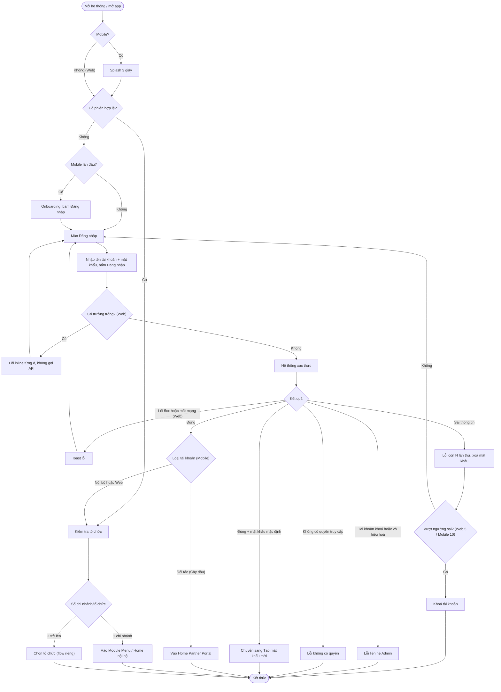

## Flow: Chọn tổ chức/chi nhánh sau đăng nhập

> Nguồn: SRS Web tr.254 — UC01.01 Đăng nhập (Modal Chọn tổ chức); SRS Web tr.255 — UC01.01 Đăng nhập; SRS Web tr.256 — UC01.01 Đăng nhập; SRS Web tr.257 — UC01.01 Đăng nhập; SRS Mobile tr.49 — UC01.01.01 Đăng nhập; SRS Mobile tr.50 — UC01.01.01 Đăng nhập; SRS Mobile tr.51 — UC01.01.01 Đăng nhập. Chỉ tài khoản nội bộ.

### Sequence — Chọn tổ chức/chi nhánh
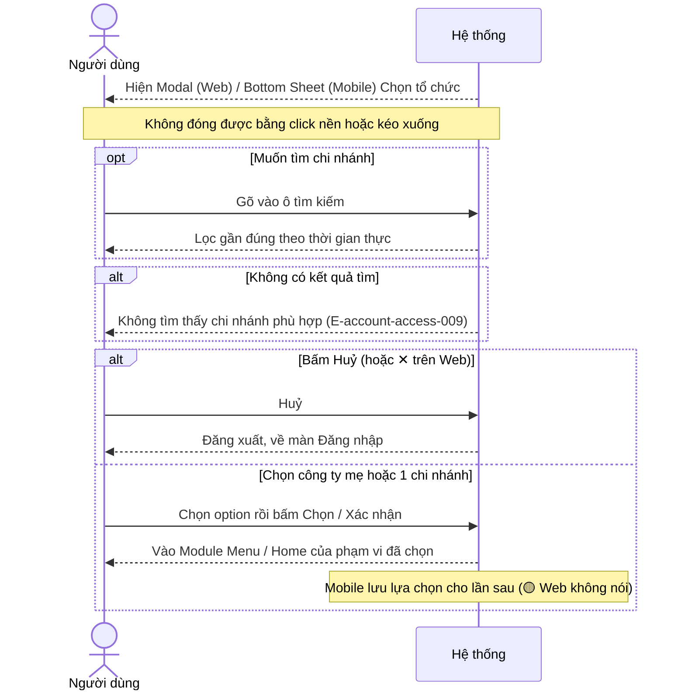

### Activity — Chọn tổ chức/chi nhánh
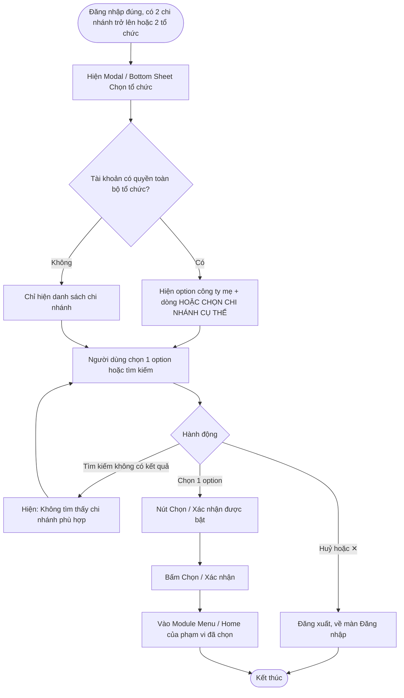

## Flow: Quên mật khẩu — Liên hệ IT

> Nguồn: SRS Web tr.259 — hình lưu đồ UC01.02 Quên mật khẩu; SRS Web tr.260 — UC01.02 Quên mật khẩu; SRS Web tr.263 — UC01.02 Quên mật khẩu; SRS Mobile tr.53 — UC01.01.02 Quên mật khẩu; SRS Mobile tr.55 — UC01.01.02 Quên mật khẩu. Bước "IT reset" suy từ câu "ERP call API cho PMX để update mật khẩu mới mà IT đã reset" (🟡).

### Sequence — Quên mật khẩu, Liên hệ IT
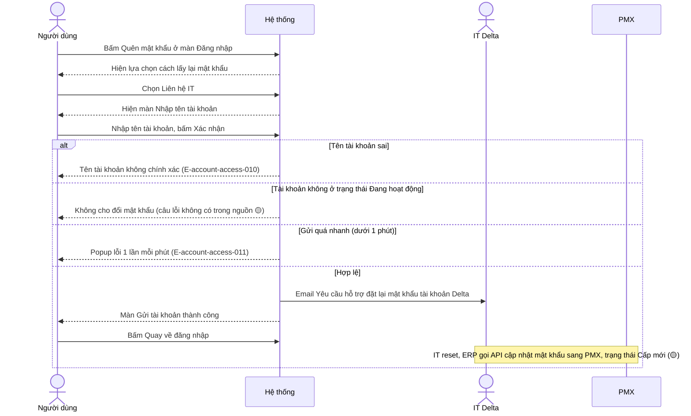

### Activity — Quên mật khẩu, Liên hệ IT
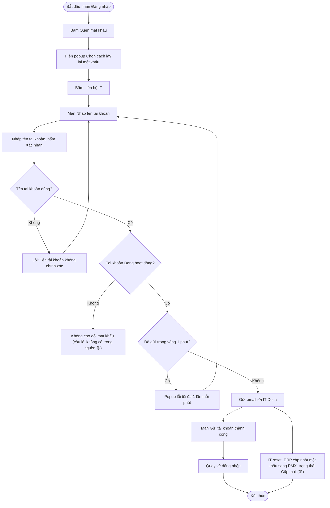

## Flow: Quên mật khẩu — Reset bằng email (Web, gửi link)

> Nguồn: SRS Web tr.259 — hình lưu đồ UC01.02 Quên mật khẩu; SRS Web tr.263 — UC01.02 Quên mật khẩu; SRS Web tr.264 — UC01.02 Quên mật khẩu; SRS Web tr.265 — UC01.02 Quên mật khẩu. Bước người dùng bấm link rồi vào Tạo mật khẩu mới suy từ UC01.05 TH3 (🔵).

### Sequence — Reset bằng email (link)
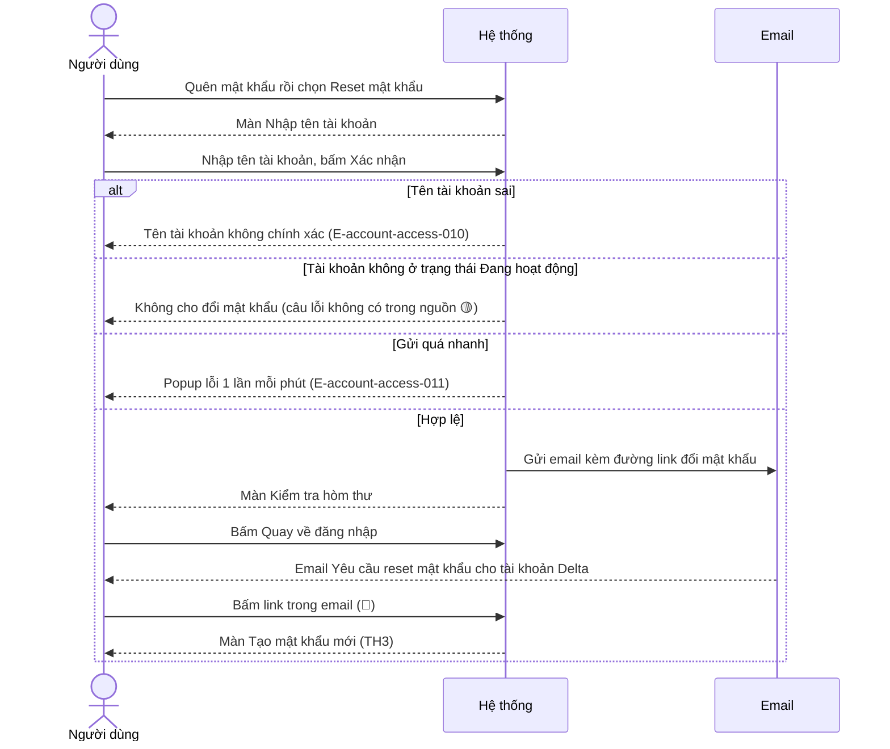

### Activity — Reset bằng email (link)
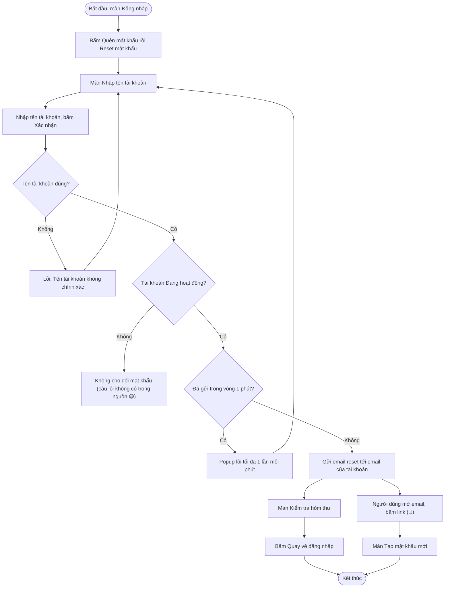

## Flow: Quên mật khẩu — Reset bằng email (Mobile, mã OTP)

> Nguồn: SRS Mobile tr.52 — UC01.01.02 Quên mật khẩu; SRS Mobile tr.55 — UC01.01.02 Quên mật khẩu; SRS Mobile tr.56 — UC01.01.02 Quên mật khẩu; SRS Mobile tr.57 — UC01.01.02 Quên mật khẩu; SRS Mobile tr.58 — UC01.01.02 Quên mật khẩu; SRS Mobile tr.59 — UC01.01.02 Quên mật khẩu. Mục "Lưu đồ hoạt động" của UC này không có hình trong bản nguồn nên flow dựng từ bảng mô tả màn (🔵).

### Sequence — Reset bằng email (OTP)
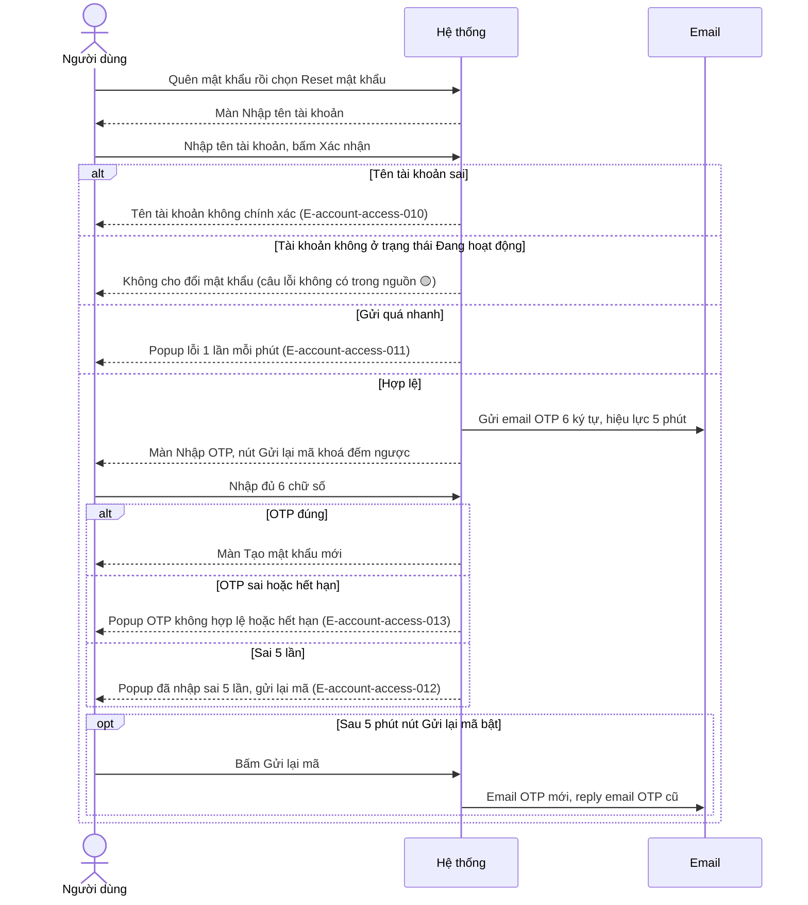

### Activity — Reset bằng email (OTP)
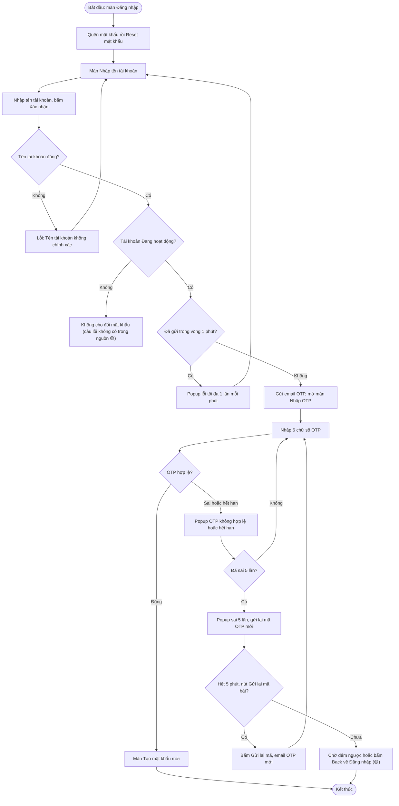

## Flow: Đăng xuất

> Nguồn: SRS Web tr.267 — hình lưu đồ UC01.03 Đăng xuất; SRS Web tr.268 — UC01.03 Đăng xuất; SRS Mobile tr.60 — hình lưu đồ UC01.01.03 Đăng xuất; SRS Mobile tr.61 — UC01.01.03 Đăng xuất; SRS Mobile tr.75 — UC01.01.07 Xem thông tin tài khoản cây dầu (đường vào riêng của tài khoản cây dầu: tab Tài khoản, không qua dropdown Avatar).

### Sequence — Đăng xuất
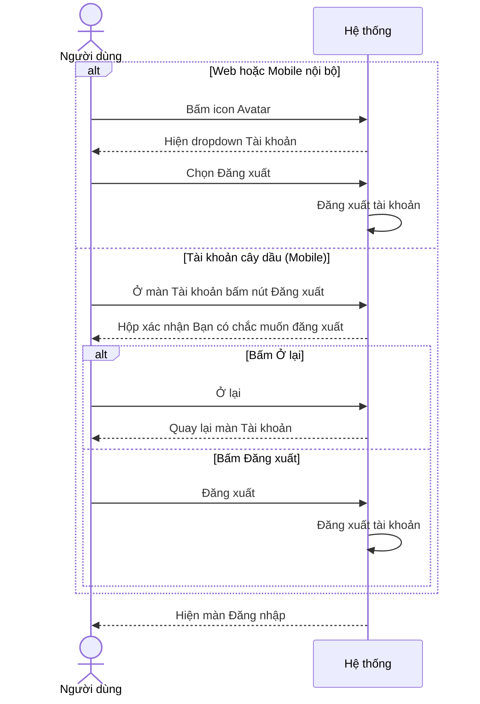

### Activity — Đăng xuất
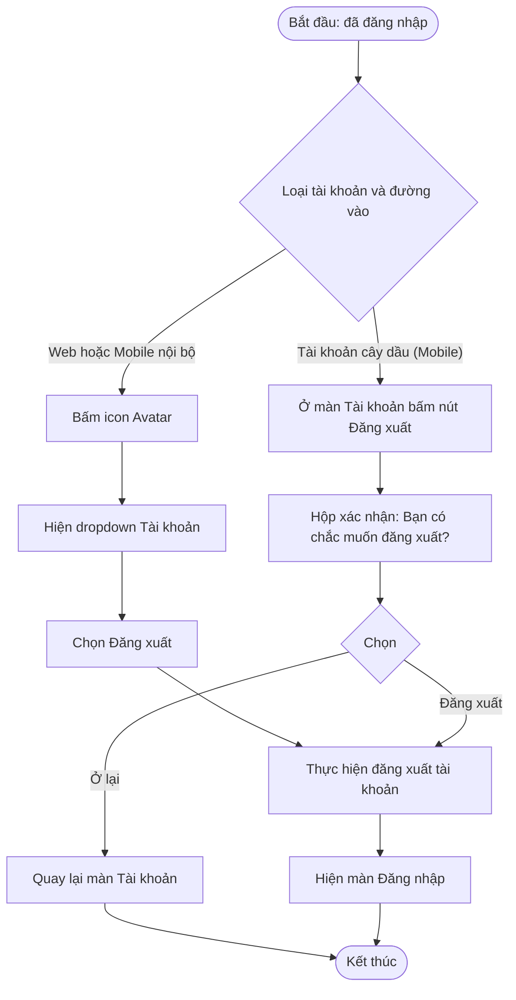

## Flow: Đổi mật khẩu

> Nguồn: SRS Web tr.269 — hình lưu đồ UC01.04 Đổi mật khẩu; SRS Web tr.270 — UC01.04 Đổi mật khẩu; SRS Web tr.271 — UC01.04 Đổi mật khẩu; SRS Web tr.272 — UC01.04 Đổi mật khẩu; SRS Mobile tr.62 — hình lưu đồ UC01.01.04 Đổi mật khẩu; SRS Mobile tr.63 — UC01.01.04 Đổi mật khẩu; SRS Mobile tr.64 — UC01.01.04 Đổi mật khẩu; SRS Mobile tr.65 — UC01.01.04 Đổi mật khẩu.

### Sequence — Đổi mật khẩu
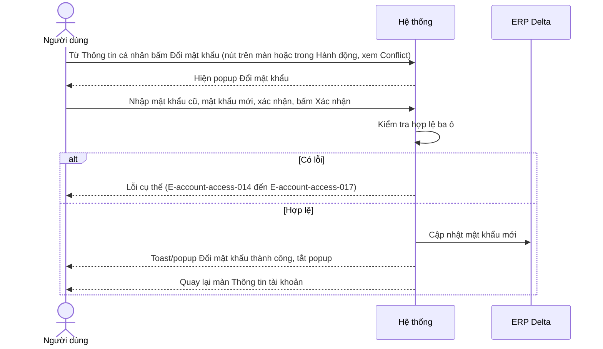

### Activity — Đổi mật khẩu
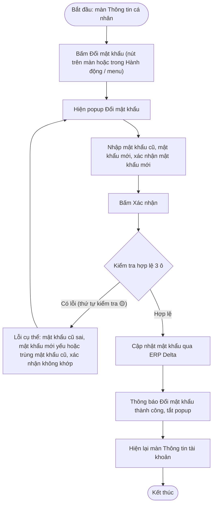

## Flow: Tạo mật khẩu mới

> Nguồn: SRS Web tr.273 — UC01.05 Tạo mật khẩu mới; SRS Web tr.274 — hình lưu đồ UC01.05 Tạo mật khẩu mới; SRS Web tr.275 — UC01.05 Tạo mật khẩu mới; SRS Web tr.276 — UC01.05 Tạo mật khẩu mới; SRS Web tr.277 — UC01.05 Tạo mật khẩu mới; SRS Mobile tr.66 — UC01.01.05 Tạo mật khẩu mới; SRS Mobile tr.67 — hình lưu đồ UC01.01.05 Tạo mật khẩu mới; SRS Mobile tr.68-70 — UC01.01.05 Tạo mật khẩu mới. Kết thúc: lưu đồ và điều kiện sau nói về màn Đăng nhập (✅), nút "Đổi mật khẩu" nói tự đăng nhập (🟡, xem Conflict).

### Sequence — Tạo mật khẩu mới
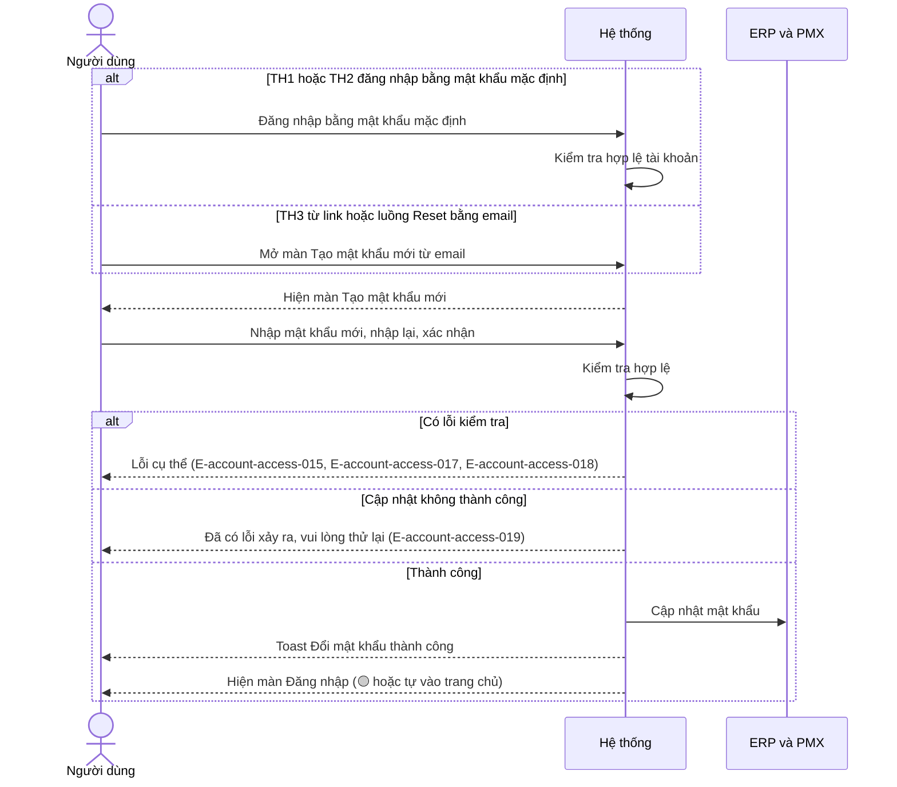

### Activity — Tạo mật khẩu mới
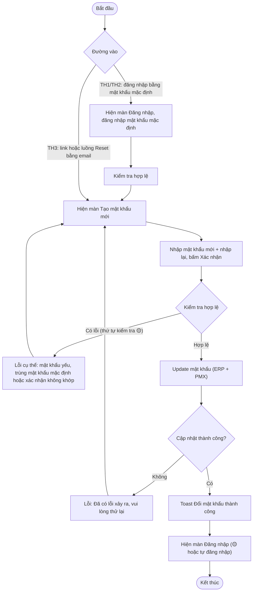

## Flow: Xem thông tin cá nhân

> Nguồn: SRS Web tr.278 — hình lưu đồ UC01.06 Xem thông tin cá nhân; SRS Web tr.279 — UC01.06 Xem thông tin cá nhân; SRS Web tr.280 — UC01.06 Xem thông tin cá nhân; SRS Web tr.281 — UC01.06 Xem thông tin cá nhân; SRS Mobile tr.71 — hình lưu đồ UC01.01.06 Xem thông tin cá nhân - Tài khoản nội bộ; SRS Mobile tr.72-74 — UC01.01.06 Xem thông tin cá nhân - Tài khoản nội bộ. Nhánh menu Mobile đọc từ ảnh màn Thông tin tài khoản (SRS Mobile tr.72 — hình UC01.01.06 Xem thông tin cá nhân - Tài khoản nội bộ).

### Sequence — Xem thông tin cá nhân
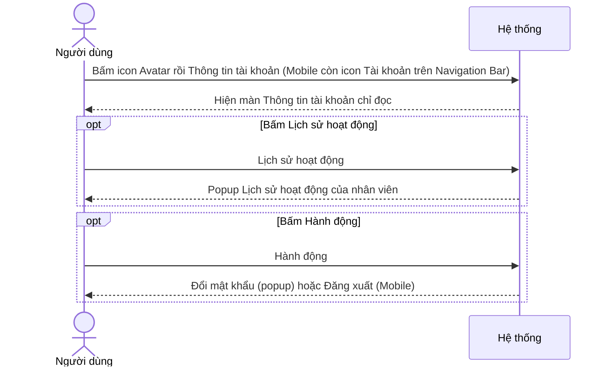

### Activity — Xem thông tin cá nhân
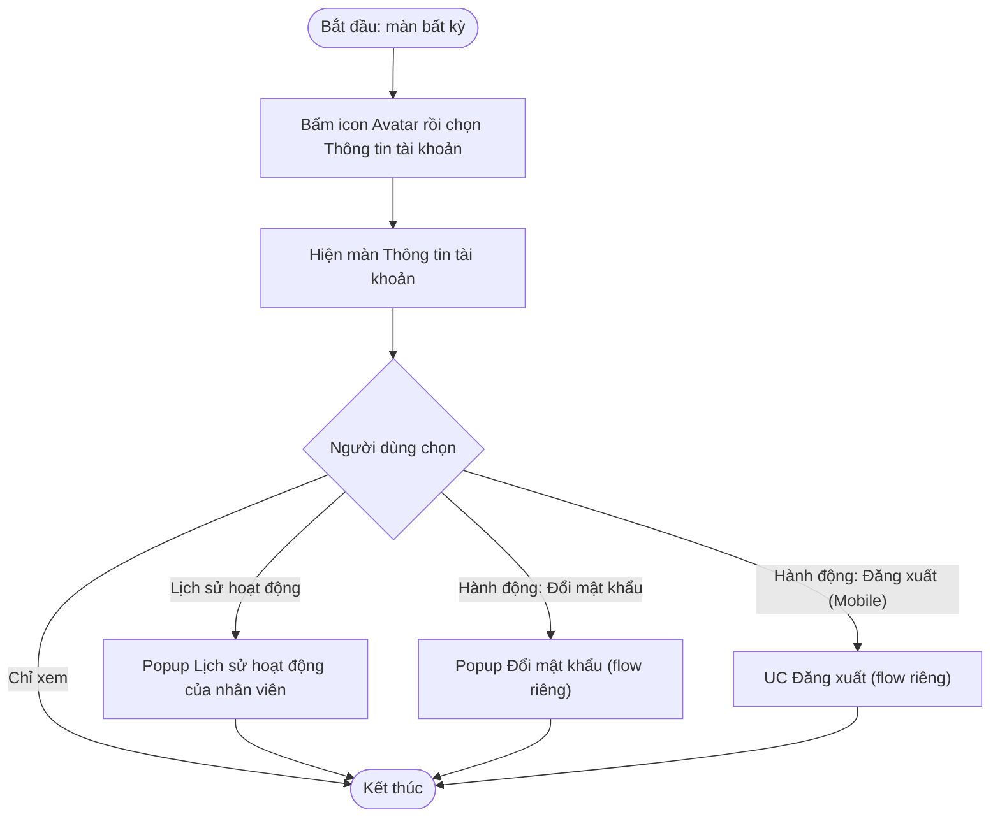

## Flow: Xem thông tin tài khoản cây dầu (Mobile)

> Nguồn: SRS Mobile tr.75 — UC01.01.07 Xem thông tin tài khoản cây dầu (lưu đồ bằng chữ); SRS Mobile tr.76-79 — UC01.01.07 Xem thông tin tài khoản cây dầu.

### Sequence — Xem thông tin tài khoản cây dầu
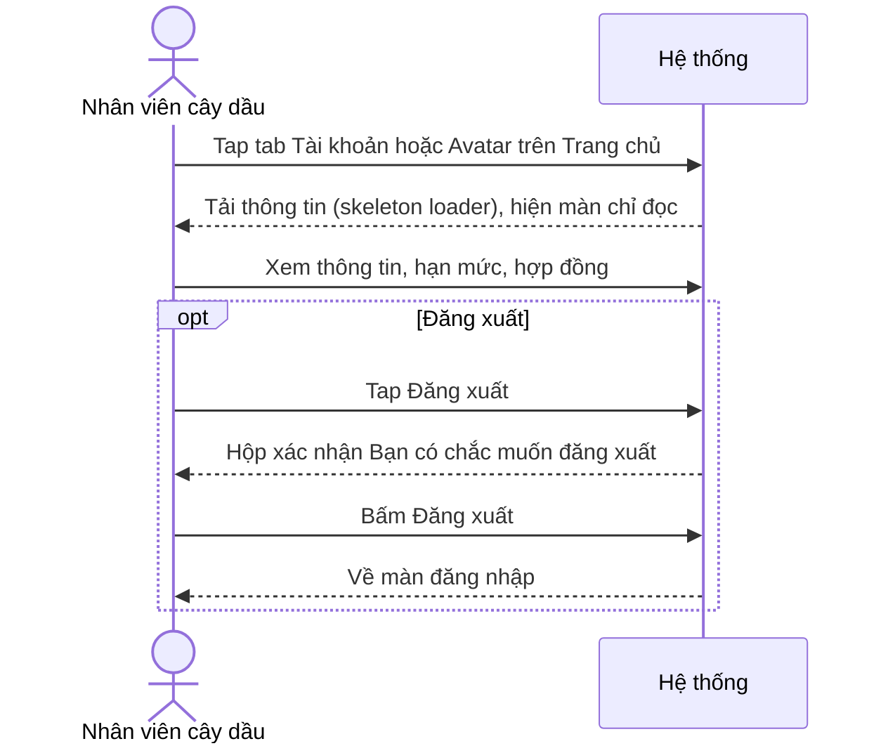

### Activity — Xem thông tin tài khoản cây dầu
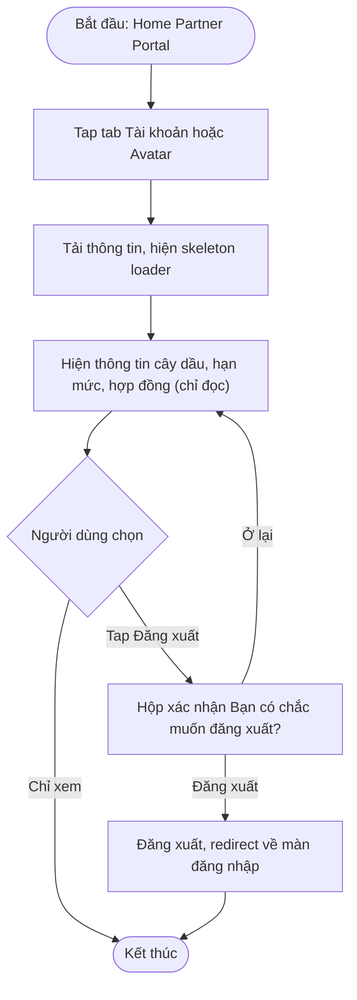

## Flow: Đổi ngôn ngữ (Web)

> Nguồn: SRS Web tr.160 — hình lưu đồ UC02.03.01 Thay đổi ngôn ngữ; SRS Web tr.161 — UC02.03.01 Thay đổi ngôn ngữ; SRS Web tr.162 — UC02.03.01 Thay đổi ngôn ngữ.

### Sequence — Đổi ngôn ngữ
```mermaid
sequenceDiagram
    actor ND as Người dùng
    participant HT as Hệ thống
    ND->>HT: Bấm icon Avatar
    HT-->>ND: Dropdown Tài khoản
    ND->>HT: Chọn Ngôn ngữ
    HT-->>ND: Danh sách Tiếng Anh, Tiếng Việt, Tiếng Nhật
    ND->>HT: Chọn 1 ngôn ngữ
    HT-->>ND: Tải lại giao diện theo ngôn ngữ mới + toast thành công
```

### Activity — Đổi ngôn ngữ
```mermaid
flowchart TD
    A(["Bắt đầu: màn bất kỳ"]) --> B["Bấm icon Avatar"]
    B --> C["Hiện dropdown Tài khoản"]
    C --> D["Chọn Ngôn ngữ"]
    D --> E["Chọn 1 ngôn ngữ: Anh, Việt hoặc Nhật"]
    E --> F["Hiển thị giao diện với ngôn ngữ được chọn, toast thành công"]
    F --> KetThuc(["Kết thúc"])
```
