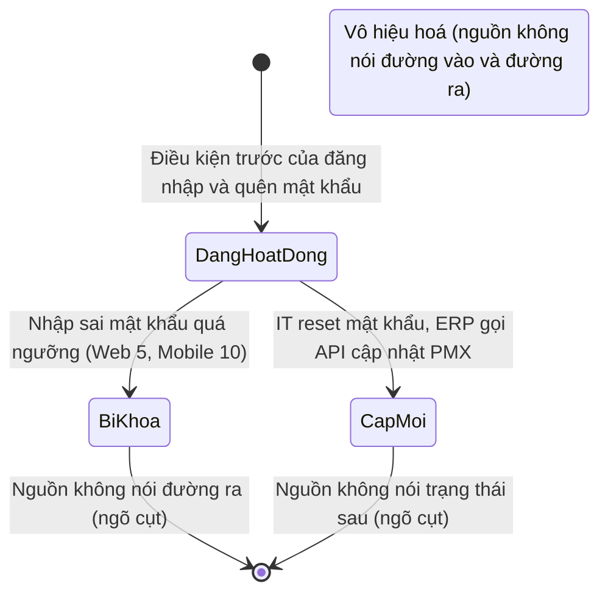
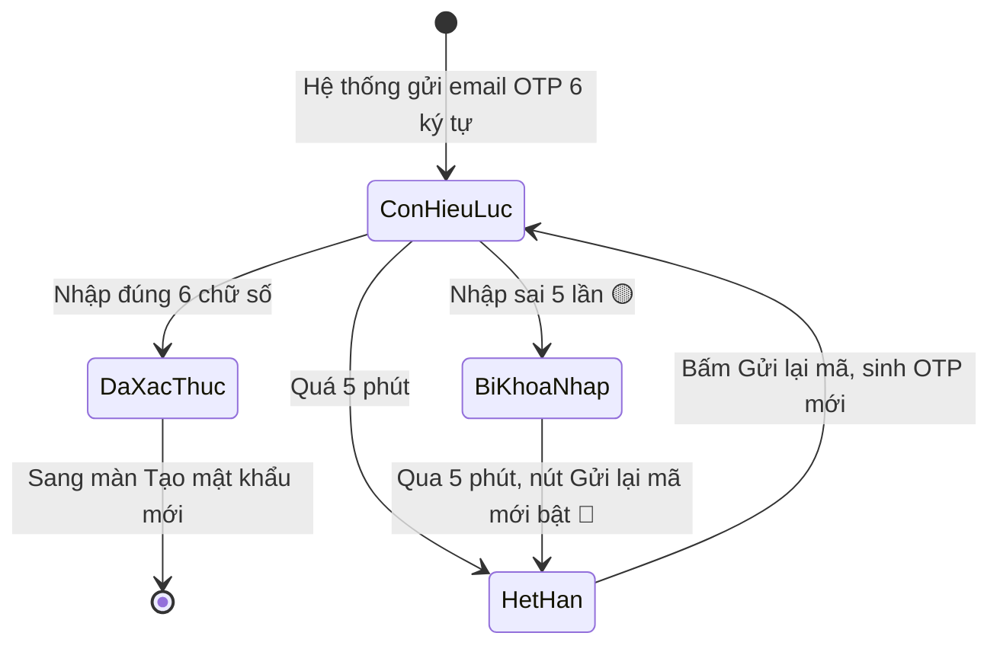
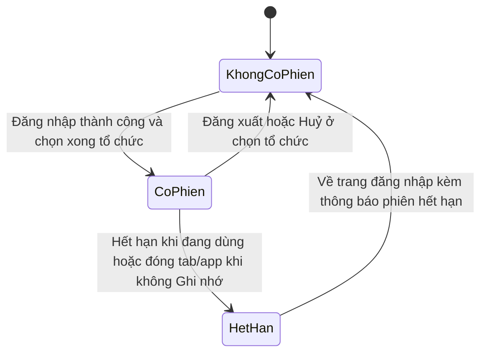

# Đăng nhập và tài khoản cá nhân (`account-access`) — States tái lập (reverse)

## State: Tài khoản người dùng

> Nguồn: nguồn không có lưu đồ trạng thái cho tài khoản. Trạng thái ghép từ: điều kiện trước "Đang hoạt động" (SRS Web tr.248 — UC01.01 Đăng nhập; SRS Mobile tr.43 — UC01.01.01 Đăng nhập); "trạng thái tài khoản chuyển sang: Cấp mới" (SRS Web tr.260 — UC01.02 Quên mật khẩu); khoá khi sai quá ngưỡng (SRS Web tr.251 — UC01.01 Đăng nhập; SRS Mobile tr.47 — UC01.01.01 Đăng nhập); "Tài khoản bị khoá / vô hiệu hoá" (SRS Web tr.257 — UC01.01 Đăng nhập); mật khẩu mặc định (SRS Web tr.273 — UC01.05 Tạo mật khẩu mới). Chỉ các chuyển trạng thái có nguồn được vẽ; phần còn thiếu ghi ở bảng ngõ cụt (OQ-6).

Sơ đồ chỉ vẽ các chuyển trạng thái có nguồn. Không vẽ vì nguồn không nói: đường vào ban đầu (cấp tài khoản), Cấp mới sang Đang hoạt động, mở khoá Bị khoá, đường vào và đường ra của Vô hiệu hoá. Các điểm này nằm ở bảng ngõ cụt bên dưới và `gaps.md` Mục 2.

**Ghi chú trạng thái:**

| Trạng thái | Ý nghĩa | Vào bằng | Ra bằng | Nguồn | Nhãn |
|---|---|---|---|---|---|
| Cấp mới | Tài khoản vừa cấp hoặc vừa được IT reset, đang dùng mật khẩu mặc định; phải Tạo mật khẩu mới khi đăng nhập | IT reset mật khẩu (nguồn ghi rõ); cấp tài khoản mới (suy từ TH1 "đăng nhập lần đầu tiên") | Nguồn không nói (người dùng tạo mật khẩu mới nhưng nguồn không nói trạng thái sau đó) | SRS Web tr.260 — UC01.02 Quên mật khẩu; SRS Web tr.273 — UC01.05 Tạo mật khẩu mới | 🟡 |
| Đang hoạt động (Mobile: "Hoạt động") | Tài khoản đăng nhập được, đổi/lấy lại được mật khẩu | Điều kiện trước của đăng nhập, quên mật khẩu | Bị khoá khi sai quá ngưỡng; IT reset (về Cấp mới) | SRS Web tr.248 — UC01.01 Đăng nhập; SRS Web tr.258 — UC01.02 Quên mật khẩu; SRS Mobile tr.43 — UC01.01.01 Đăng nhập | ✅ |
| Bị khoá | Tài khoản không đăng nhập tiếp được, hiện lỗi liên hệ Admin | Nhập sai mật khẩu quá ngưỡng | Nguồn không nói | SRS Web tr.251 — UC01.01 Đăng nhập; SRS Web tr.257 — UC01.01 Đăng nhập; SRS Mobile tr.44 — UC01.01.01 Đăng nhập | ✅ (vào); 🟡 (ra) |
| Vô hiệu hoá | Tài khoản không dùng được; cùng thông báo với khoá | Nguồn không nói | Nguồn không nói | SRS Web tr.257 — UC01.01 Đăng nhập | 🟡 |

| Trạng thái | Là kết thúc? | Đường ra (huỷ / đóng / sửa) | Chứng từ đã sinh phía sau xử lý thế nào khi huỷ | Sửa được sau khi chốt? | Nguồn | Nhãn |
|---|---|---|---|---|---|---|
| Cấp mới | Không rõ — nguồn không nói trạng thái sau khi tạo mật khẩu mới (ngõ cụt) | Không có trong nguồn (người dùng tạo mật khẩu mới nhưng nguồn không nói trạng thái đổi) | Không áp dụng (không có chứng từ) | Có — đổi mật khẩu | SRS Web tr.273 — UC01.05 Tạo mật khẩu mới | 🟡 |
| Đang hoạt động | Không | Bị khoá; IT reset | Không áp dụng | Có — đổi mật khẩu (FR-account-access-031); không sửa hồ sơ ở phần này | SRS Web tr.269 — UC01.04 Đổi mật khẩu; SRS Web tr.279 — UC01.06 Xem thông tin cá nhân | ✅ |
| Bị khoá | Không rõ — nguồn không nói đường ra (ngõ cụt) | Không có trong nguồn ngoài "liên hệ Admin" | Không áp dụng | Không có trong nguồn | SRS Web tr.257 — UC01.01 Đăng nhập | 🟡 |
| Vô hiệu hoá | Không rõ — nguồn không nói (ngõ cụt) | Không có trong nguồn | Không áp dụng | Không có trong nguồn | SRS Web tr.257 — UC01.01 Đăng nhập | 🟡 |

## State: Mã OTP quên mật khẩu (Mobile)

> Nguồn: SRS Mobile tr.56 — UC01.01.02 Quên mật khẩu; SRS Mobile tr.57 — UC01.01.02 Quên mật khẩu; SRS Mobile tr.58 — UC01.01.02 Quên mật khẩu; SRS Mobile tr.59 — UC01.01.02 Quên mật khẩu. Nguồn không có lưu đồ trạng thái cho OTP, trạng thái ghép từ quy định hiệu lực, số lần sai và gửi lại.

**Ghi chú trạng thái:**

| Trạng thái | Ý nghĩa | Vào bằng | Ra bằng | Nguồn | Nhãn |
|---|---|---|---|---|---|
| Còn hiệu lực | OTP vừa gửi, dùng được trong 5 phút | Hệ thống gửi email OTP (lần đầu hoặc gửi lại) | Nhập đúng; hết 5 phút; sai 5 lần | SRS Mobile tr.57 — UC01.01.02 Quên mật khẩu; SRS Mobile tr.58 — UC01.01.02 Quên mật khẩu | ✅ |
| Đã xác thực | Nhập đúng, được sang Tạo mật khẩu mới | Nhập đúng 6 chữ số | Sang màn Tạo mật khẩu mới | SRS Mobile tr.58 — UC01.01.02 Quên mật khẩu | ✅ |
| Hết hạn | Quá 5 phút, nút Gửi lại mã được bật | Hết 5 phút | Bấm Gửi lại mã (OTP mới) | SRS Mobile tr.58 — UC01.01.02 Quên mật khẩu; SRS Mobile tr.59 — UC01.01.02 Quên mật khẩu | ✅ |
| Bị khoá nhập (sai 5 lần) | Không nhập tiếp, được nhắc gửi lại mã mới | Nhập sai đến lần 5 | Gửi lại mã (nút gửi lại chỉ bật sau 5 phút) | SRS Mobile tr.58 — UC01.01.02 Quên mật khẩu | 🟡 |

| Trạng thái | Là kết thúc? | Đường ra (huỷ / đóng / sửa) | Chứng từ đã sinh phía sau xử lý thế nào khi huỷ | Sửa được sau khi chốt? | Nguồn | Nhãn |
|---|---|---|---|---|---|---|
| Còn hiệu lực | Không | Nhập đúng, hết hạn hoặc nút Back về đăng nhập | Không áp dụng | Không áp dụng | SRS Mobile tr.59 — UC01.01.02 Quên mật khẩu | ✅ |
| Đã xác thực | Có (OTP hết nhiệm vụ) | Sang Tạo mật khẩu mới | Không áp dụng | Không áp dụng | SRS Mobile tr.58 — UC01.01.02 Quên mật khẩu | 🔵 |
| Hết hạn | Không | Gửi lại mã | Không áp dụng | Không áp dụng | SRS Mobile tr.59 — UC01.01.02 Quên mật khẩu | ✅ |
| Bị khoá nhập (sai 5 lần) | Không rõ — nút gửi lại chỉ bật sau 5 phút, nguồn không nói chờ thế nào (ngõ cụt) | Gửi lại mã | Không áp dụng | Không áp dụng | SRS Mobile tr.58 — UC01.01.02 Quên mật khẩu; SRS Mobile tr.59 — UC01.01.02 Quên mật khẩu | 🟡 |

## State: Phiên đăng nhập

> Nguồn: SRS Web tr.251 — UC01.01 Đăng nhập (Ghi nhớ đăng nhập); SRS Web tr.257 — UC01.01 Đăng nhập (phiên hết hạn, đã có phiên); SRS Mobile tr.43 — UC01.01.01 Đăng nhập; SRS Mobile tr.47 — UC01.01.01 Đăng nhập; SRS Mobile tr.51 — UC01.01.01 Đăng nhập. Nguồn không có lưu đồ trạng thái cho phiên, trạng thái ghép từ các điều kiện nêu trên (🔵).

**Ghi chú trạng thái:**

| Trạng thái | Ý nghĩa | Vào bằng | Ra bằng | Nguồn | Nhãn |
|---|---|---|---|---|---|
| Không có phiên | Phải đăng nhập; Web tự về trang đăng nhập | Khởi tạo; đăng xuất; hết hạn | Đăng nhập thành công | SRS Web tr.248 — UC01.01 Đăng nhập; SRS Mobile tr.43 — UC01.01.01 Đăng nhập | ✅ |
| Có phiên | Được vào thẳng Module Menu / bỏ qua đăng nhập; Mobile còn lưu lựa chọn tổ chức | Đăng nhập thành công (kèm chọn tổ chức nếu có) | Đăng xuất; hết hạn; đóng tab/app khi không Ghi nhớ | SRS Web tr.257 — UC01.01 Đăng nhập; SRS Mobile tr.51 — UC01.01.01 Đăng nhập | ✅ |
| Hết hạn | Redirect về trang đăng nhập kèm banner | Phiên hết hạn khi đang dùng (Web) | Đăng nhập lại | SRS Web tr.257 — UC01.01 Đăng nhập | ✅ |

| Trạng thái | Là kết thúc? | Đường ra (huỷ / đóng / sửa) | Chứng từ đã sinh phía sau xử lý thế nào khi huỷ | Sửa được sau khi chốt? | Nguồn | Nhãn |
|---|---|---|---|---|---|---|
| Không có phiên | Không | Đăng nhập | Không áp dụng | Không áp dụng | SRS Web tr.248 — UC01.01 Đăng nhập | ✅ |
| Có phiên | Không | Đăng xuất / hết hạn | Không áp dụng | Không áp dụng | SRS Web tr.267 — UC01.03 Đăng xuất | ✅ |
| Hết hạn | Không | Đăng nhập lại | Không áp dụng | Không áp dụng | SRS Web tr.257 — UC01.01 Đăng nhập | ✅ |
