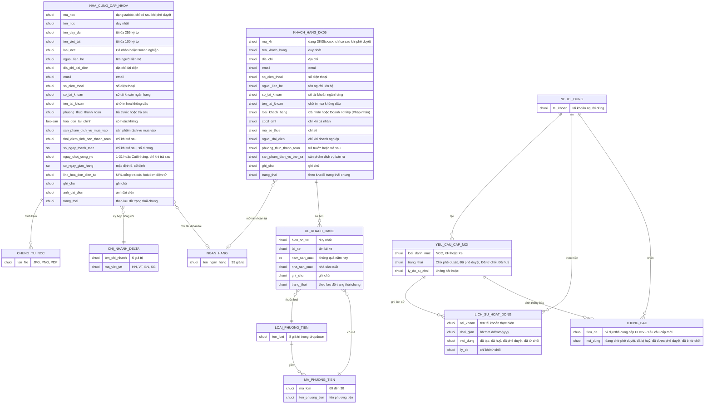

# Đối tác: nhà cung cấp, khách hàng, xe của khách (`business-partners`) — ERD tái lập (reverse)

## Entity Reference

| Entity | Mô tả nghiệp vụ | Thuộc tính chính | Nguồn | Nhãn |
|---|---|---|---|---|
| NHA_CUNG_CAP_HHDV | Nhà cung cấp hàng hoá dịch vụ; Danh mục | Mã NCC (aabbb, sau phê duyệt), tên (duy nhất), tên đầy đủ, tên viết tắt, loại, liên hệ, ngân hàng, phương thức thanh toán, hoá đơn tài chính, 3 trường trả sau, số ngày giao hàng, link HĐĐT, trạng thái | SRS Web tr.468 — UC03.07.02 Xem thông tin nhà cung cấp HHDV; SRS Web tr.475 — UC03.07.03 Tạo đề xuất tạo mới nhà cung cấp HHDV | ✅ |
| KHACH_HANG_DK05 | Khách hàng; Danh mục | Mã DK05xxxxx (sau phê duyệt), tên (duy nhất), loại, MST, CCCD/CMT (cá nhân), người đại diện (doanh nghiệp), ngân hàng, phương thức thanh toán, sản phẩm bán ra, trạng thái | SRS Web tr.512 — UC03.08.02; SRS Web tr.518 — UC03.08.03 | ✅ |
| XE_KHACH_HANG | Xe thuộc khách hàng; Danh mục | Biển số (duy nhất), lái xe, loại và mã phương tiện, năm sản xuất, nhà sản xuất, trạng thái | SRS Web tr.550 — UC03.09.02 Xem thông tin xe của khách hàng; SRS Web tr.556 — UC03.09.03 | ✅ |
| YEU_CAU_CAP_MOI | Yêu cầu thay đổi (ChangeRequest): đề xuất tạo mới bản ghi danh mục; có thể trùng với chính bản ghi danh mục (OQ-1) | Loại danh mục, trạng thái, lý do từ chối | SRS Web tr.284 — Lưu đồ trạng thái chung cho danh mục; SRS Web tr.495 — UC03.07.05 | 🟡 |
| LICH_SU_HOAT_DONG | Nhật ký thao tác; Khác | Tài khoản, thời gian, nội dung, lý do | SRS Web tr.460 — 03.07 Thông báo & Lịch sử hoạt động | ✅ |
| THONG_BAO | Thông báo trong ứng dụng; Khác | Tiêu đề, nội dung, đích điều hướng | SRS Web tr.460 — 03.07 Thông báo & Lịch sử hoạt động | ✅ |
| CHUNG_TU_NCC | Tệp chứng từ của nhà cung cấp; Khác | Tên file, tải xuống, xoá | SRS Web tr.481 — UC03.07.03 | ✅ |
| LOAI_PHUONG_TIEN, MA_PHUONG_TIEN | Danh mục loại và mã/tên phương tiện | 8 loại; 39 dòng mã 00 đến 38 | SRS Web tr.556 — UC03.09.03; SRS Web tr.560 — UC03.09.03 | ✅ |
| CHI_NHANH_DELTA | Danh sách chi nhánh Delta ký hợp đồng; mã viết tắt cho 4 chi nhánh | Tên chi nhánh, HN/VT/BN/SG | SRS Web tr.480 — UC03.07.03; SRS Web tr.499 — UC03.07.05 | 🟡 |
| NGAN_HANG | Danh sách ngân hàng chọn | 33 ngân hàng | SRS Web tr.478 — UC03.07.03 | ✅ |
| NGUOI_DUNG | Người thực hiện hành động, người tạo yêu cầu, người nhận thông báo | Tài khoản | SRS Web tr.460 — 03.07 Thông báo & Lịch sử hoạt động | 🔵 |

## Quan hệ

| Từ | Đến | Bản số | Ý nghĩa | Nguồn | Nhãn |
|---|---|---|---|---|---|
| KHACH_HANG_DK05 | XE_KHACH_HANG | 1-n | Khách hàng sở hữu nhiều xe; mỗi xe có một khách hàng sở hữu (bắt buộc) | SRS Web tr.512 — UC03.08.02; SRS Web tr.555 — UC03.09.03 | ✅ |
| NHA_CUNG_CAP_HHDV | CHI_NHANH_DELTA | n-1 | NCC ký hợp đồng với một chi nhánh Delta (bắt buộc) | SRS Web tr.480 — UC03.07.03 | ✅ |
| NHA_CUNG_CAP_HHDV | CHUNG_TU_NCC | 1-n | NCC đính kèm chứng từ (bắt buộc ít nhất một, số lượng tối đa nguồn không nói) | SRS Web tr.481 — UC03.07.03 | 🟡 |
| NHA_CUNG_CAP_HHDV, KHACH_HANG_DK05 | NGAN_HANG | n-0..1 | Chọn một ngân hàng trong danh sách (không bắt buộc) | SRS Web tr.478 — UC03.07.03; SRS Web tr.520 — UC03.08.03 | ✅ |
| XE_KHACH_HANG | LOAI_PHUONG_TIEN, MA_PHUONG_TIEN | n-1 | Mỗi xe chọn một loại và một mã/tên thuộc loại đó | SRS Web tr.556 — UC03.09.03 | ✅ |
| LOAI_PHUONG_TIEN | MA_PHUONG_TIEN | 1-n | Mã phương tiện lọc theo loại | SRS Web tr.556 — UC03.09.03; SRS Web tr.560 — UC03.09.03 | ✅ |
| YEU_CAU_CAP_MOI | LICH_SU_HOAT_DONG | 1-n | Mỗi hành động tạo/huỷ/phê duyệt/từ chối ghi một dòng | SRS Web tr.460 — 03.07 Thông báo & Lịch sử hoạt động | ✅ |
| YEU_CAU_CAP_MOI | THONG_BAO | 1-n | Mỗi hành động sinh thông báo tới nhóm người dùng tương ứng | SRS Web tr.460 — 03.07 Thông báo & Lịch sử hoạt động | ✅ |
| NGUOI_DUNG | YEU_CAU_CAP_MOI | 1-n | Người tạo yêu cầu; nhận thông báo khi phê duyệt/từ chối | SRS Web tr.460 — 03.07 Thông báo & Lịch sử hoạt động | ✅ |

## Notes

- Nguồn không ghi bảng nào đối chiếu giữa yêu cầu cấp mới và bản ghi danh mục (OQ-1); ERD vẽ YEU_CAU_CAP_MOI riêng để thể hiện vòng đời đề xuất, trạng thái cũng được gắn trên từng danh mục vì nguồn ghi "bản ghi" có trạng thái.
- Các danh sách chọn (ngân hàng, chi nhánh, loại, phương thức thanh toán) nguồn không nói được quản lý ở đâu nên mô hình hoá là danh sách cố định; phương thức thanh toán, loại NCC/KH, thời điểm tính hạn chỉ là giá trị trong bảng thuộc tính.
- Không đưa ra tên cột kỹ thuật thật; mọi thuộc tính lấy từ tên trường nghiệp vụ trên màn hình.
