# Đối tác: nhà cung cấp, khách hàng, xe của khách (`business-partners`) — Flows tái lập (reverse)

## Flow: Xem danh sách danh mục đối tác

> Nguồn: SRS Web tr.461 — hình lưu đồ UC03.07.01 Xem danh mục nhà cung cấp HHDV; SRS Web tr.505 — hình lưu đồ UC03.08.01 Xem danh mục khách hàng DK05. Dùng chung cho Nhà cung cấp HHDV và Khách hàng DK05; Xe có thêm đường vào (xem flow riêng). Các thao tác tìm, nhóm, lọc, Export, Import, Tuỳ chỉnh, phân trang (🟡) chỉ có trong bảng mô tả màn hình, không có trong lưu đồ.

### Sequence — Xem danh sách danh mục đối tác
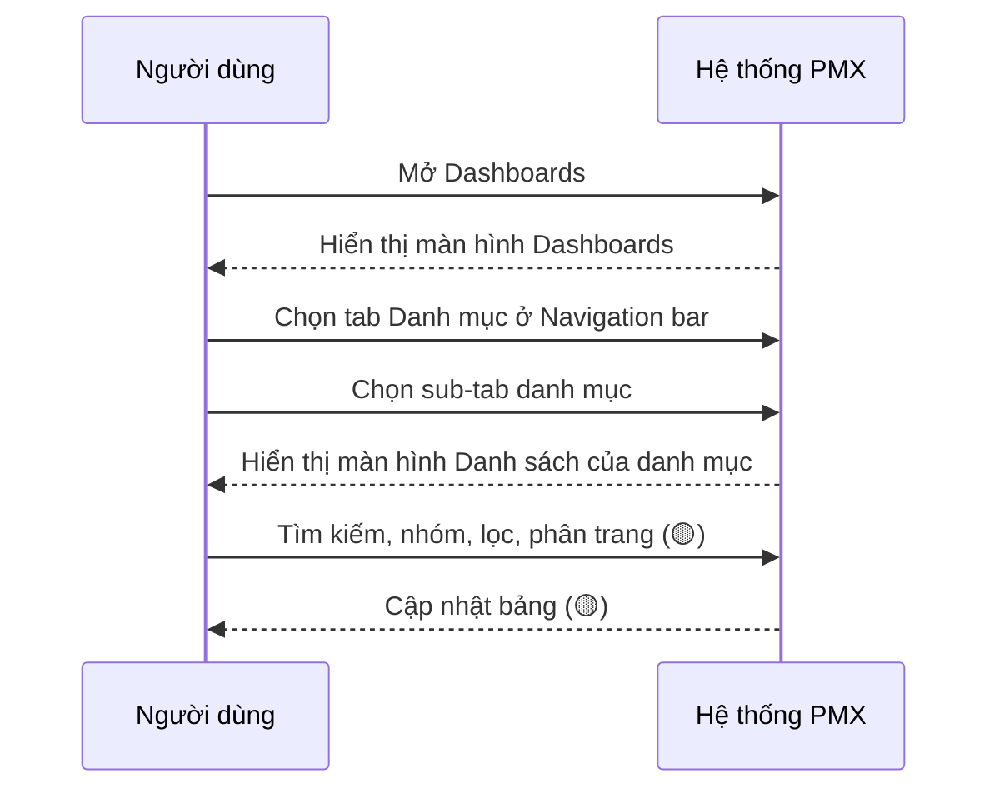

### Activity — Xem danh sách danh mục đối tác
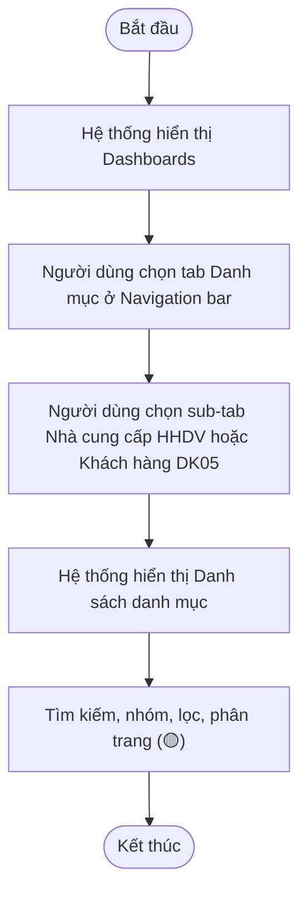

## Flow: Xem danh sách xe của khách hàng

> Nguồn: SRS Web tr.545 — hình lưu đồ UC03.09.01 Xem danh mục xe của khách hàng; SRS Web tr.549 — hình lưu đồ UC03.09.02 Xem thông tin xe của khách hàng. Lưu đồ có một cổng "?" chia hai đường vào, không ghi điều kiện của cổng; nhãn điều kiện dưới đây suy từ phần "Đường dẫn" của bảng thông tin chung (🔵).

### Sequence — Xem danh sách xe của khách hàng
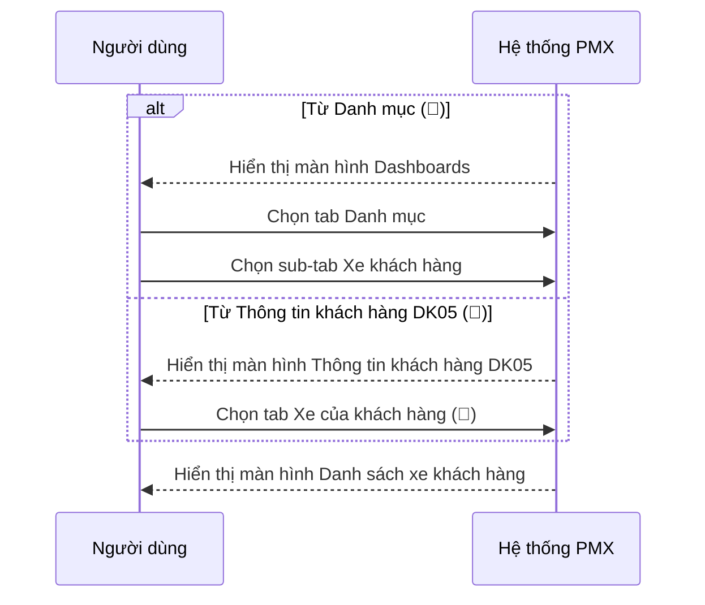

### Activity — Xem danh sách xe của khách hàng
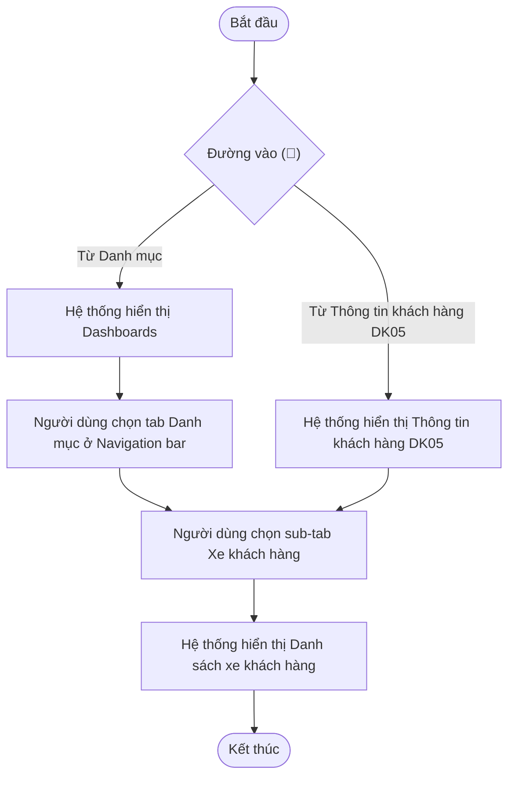

## Flow: Xem chi tiết bản ghi danh mục

> Nguồn: SRS Web tr.467 — hình lưu đồ UC03.07.02 Xem thông tin nhà cung cấp HHDV; SRS Web tr.510 — hình lưu đồ UC03.08.02 Xem thông tin khách hàng DK05; SRS Web tr.549 — hình lưu đồ UC03.09.02 Xem thông tin xe của khách hàng. Dùng chung ba danh mục; Xe có cổng "?" hai đường vào (SRS Web tr.549 — hình lưu đồ UC03.09.02). Các nút hành động trên màn chi tiết (🟡 theo mô tả bảng) chỉ có trong bảng, không có trong lưu đồ.

### Sequence — Xem chi tiết bản ghi danh mục
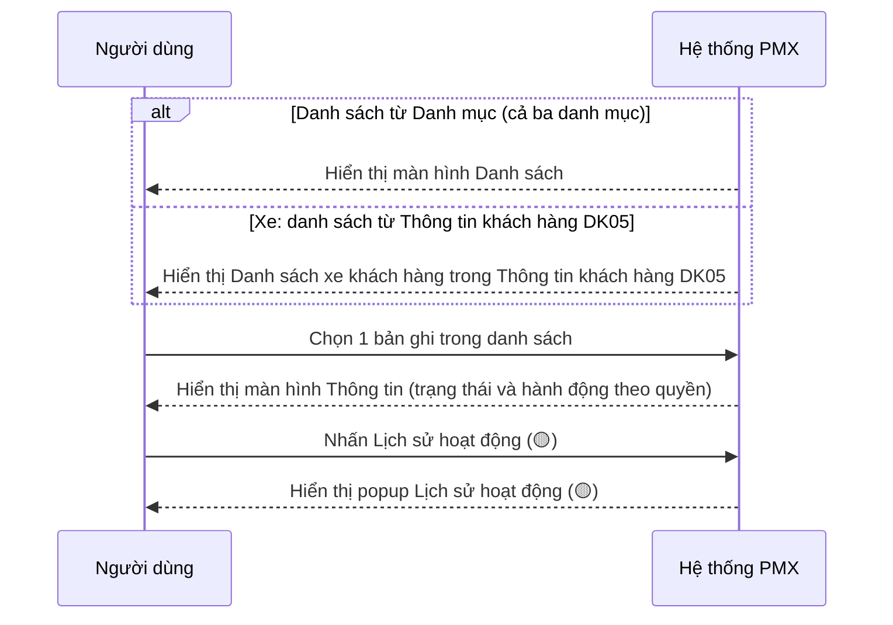

### Activity — Xem chi tiết bản ghi danh mục
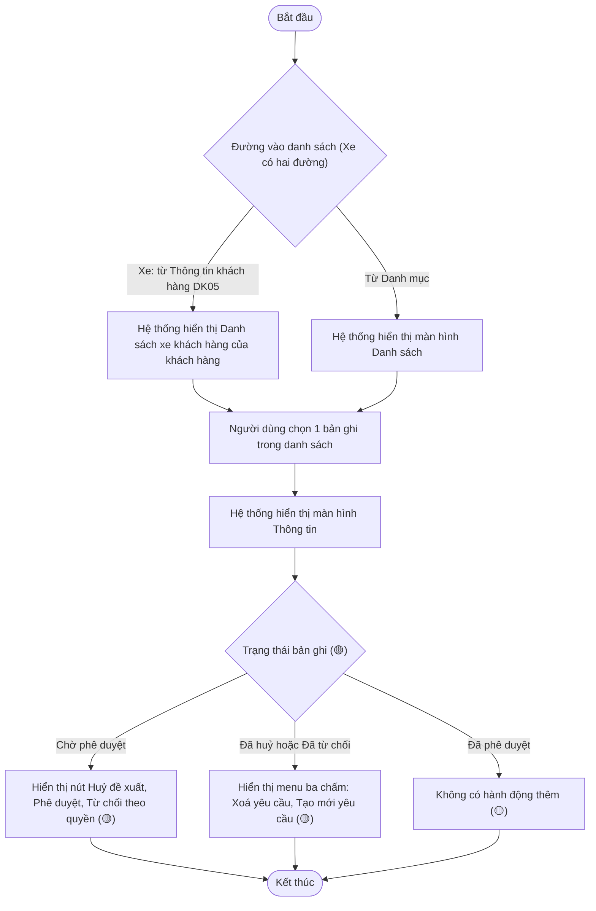

## Flow: Tạo đề xuất tạo mới

> Nguồn: SRS Web tr.474 — hình lưu đồ UC03.07.03 Tạo đề xuất tạo mới nhà cung cấp HHDV; SRS Web tr.517 — hình lưu đồ UC03.08.03 Tạo đề xuất tạo mới khách hàng DK05; SRS Web tr.554 — hình lưu đồ UC03.09.03 Tạo đề xuất tạo mới xe của khách hàng. Lưu đồ chỉ có nhánh hợp lệ; nhánh không hợp lệ và nhánh Huỷ lấy từ bảng mô tả màn hình (🟡 cho nhãn nhánh suy ra). Popup xác nhận Huỷ tạo mới: SRS Web tr.485 — hình mockup UC03.07.03.

### Sequence — Tạo đề xuất tạo mới
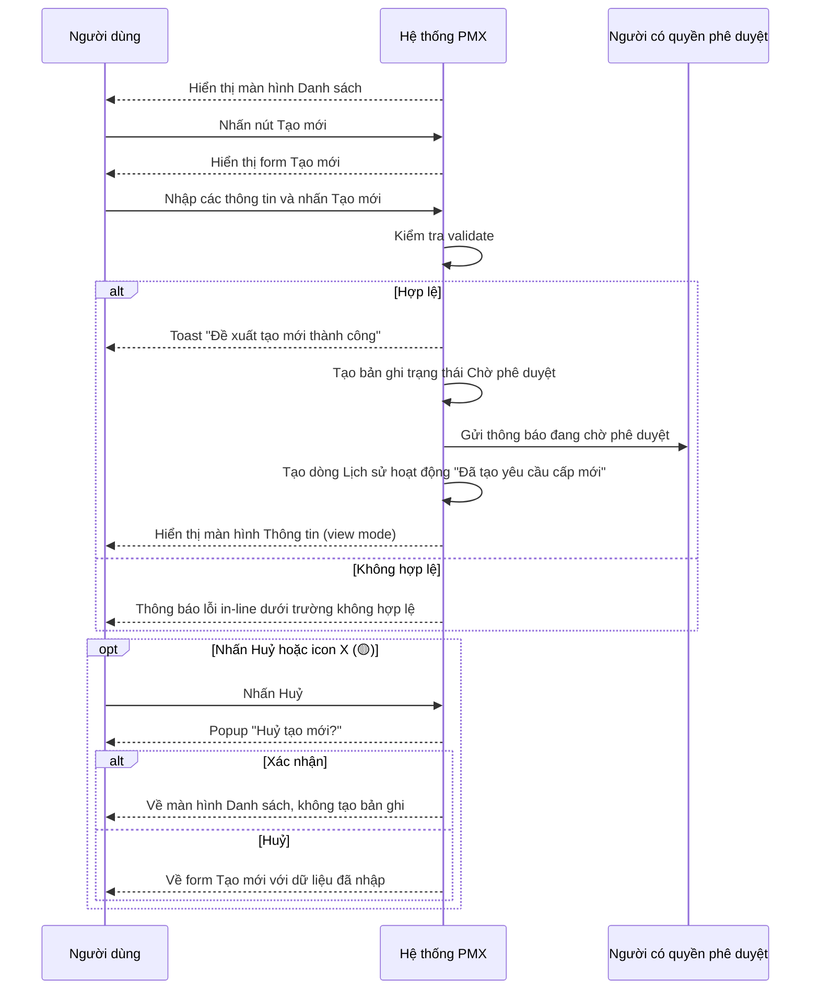

### Activity — Tạo đề xuất tạo mới
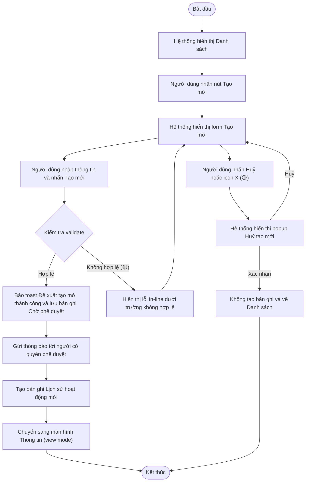

## Flow: Huỷ đề xuất tạo mới

> Nguồn: SRS Web tr.489 — hình lưu đồ UC03.07.04 Huỷ đề xuất cấp mới nhà cung cấp HHDV; SRS Web tr.528 — hình lưu đồ UC03.08.04 Huỷ đề xuất cấp mới khách hàng DK05; SRS Web tr.565 — hình lưu đồ UC03.09.04 Huỷ đề xuất cấp mới xe của khách hàng. Cổng "?" đầu lưu đồ chia hai đường vào (màn Thông tin hoặc màn Danh sách). Nhánh Huỷ bỏ lấy từ bảng mô tả (🟡).

### Sequence — Huỷ đề xuất tạo mới
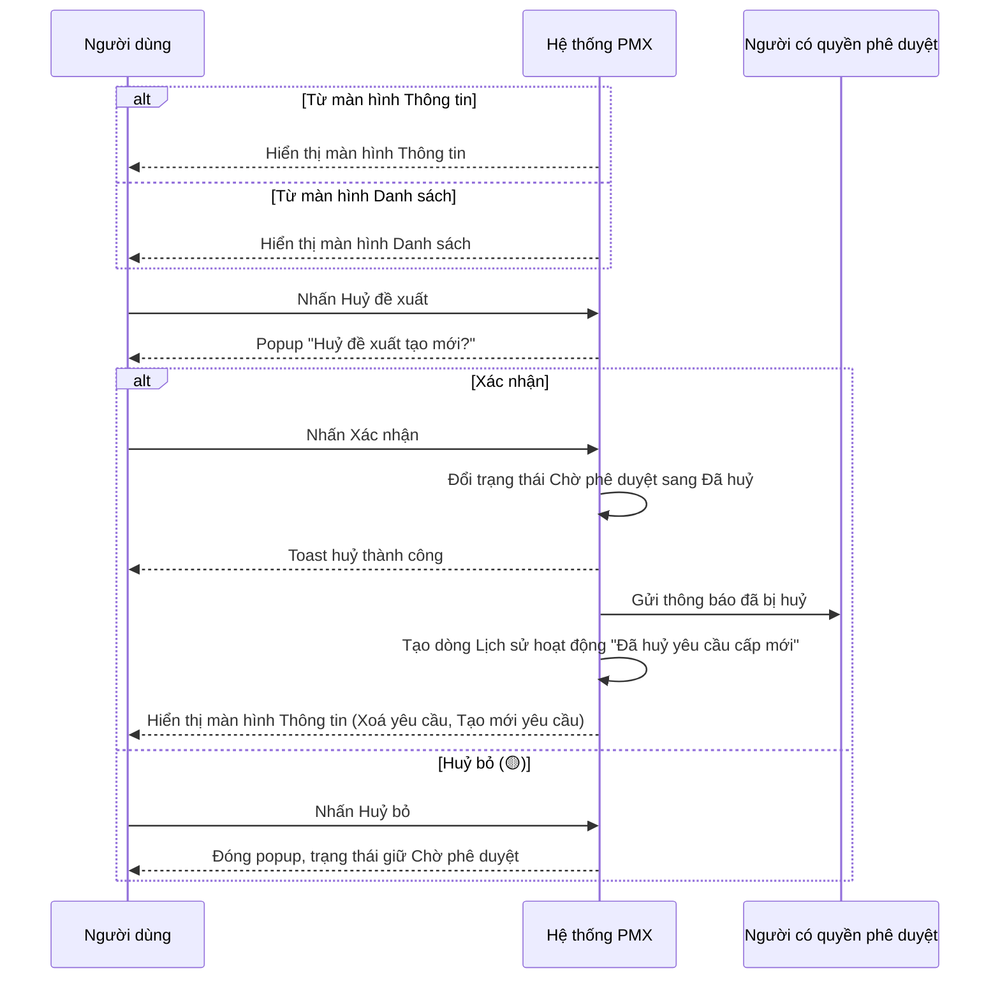

### Activity — Huỷ đề xuất tạo mới
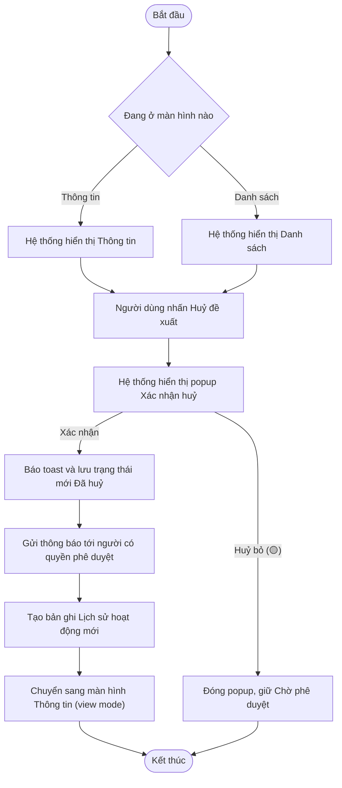

## Flow: Phê duyệt hoặc Từ chối đề xuất

> Nguồn: SRS Web tr.494 — hình lưu đồ UC03.07.05 Phê duyệt/Từ chối đề xuất cấp mới nhà cung cấp HHDV; SRS Web tr.534 — hình lưu đồ UC03.08.05 Phê duyệt/Từ chối đề xuất cấp mới khách hàng DK05; SRS Web tr.571 — hình lưu đồ UC03.09.05 Phê duyệt/Từ chối đề xuất cấp mới xe của khách hàng. Sinh mã (NCC aabbb, KH DK05xxxxx) lấy từ bảng mô tả (🟡 vị trí bước trong dòng thời gian). Nhánh xung đột và Huỷ bỏ lấy từ bảng mô tả (🟡).

### Sequence — Phê duyệt hoặc Từ chối đề xuất
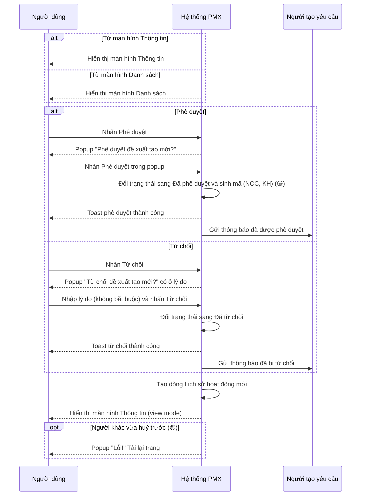

### Activity — Phê duyệt hoặc Từ chối đề xuất
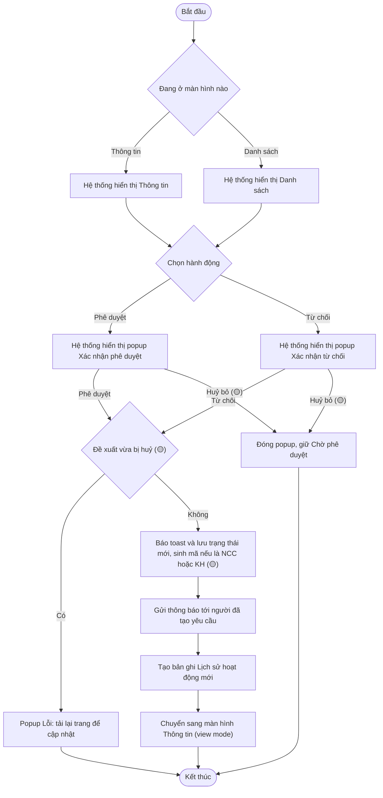

## Flow: Xoá yêu cầu hoặc Tạo mới yêu cầu từ yêu cầu đã huỷ hoặc đã từ chối

> Nguồn: SRS Web tr.472 — UC03.07.02 Xem thông tin nhà cung cấp HHDV (mục "…"); SRS Web tr.492 — UC03.07.04 Huỷ đề xuất cấp mới nhà cung cấp HHDV; SRS Web tr.497 — UC03.07.05; SRS Web tr.284 — Lưu đồ trạng thái chung cho danh mục. Không có lưu đồ riêng; vẽ từ mô tả bảng (🔵). Xe: Tạo mới yêu cầu cập nhật cùng bản ghi (SRS Web tr.569 — UC03.09.04 Huỷ đề xuất cấp mới xe của khách hàng); NCC, KH nguồn không nói (🟡).

### Sequence — Xoá yêu cầu hoặc Tạo mới yêu cầu
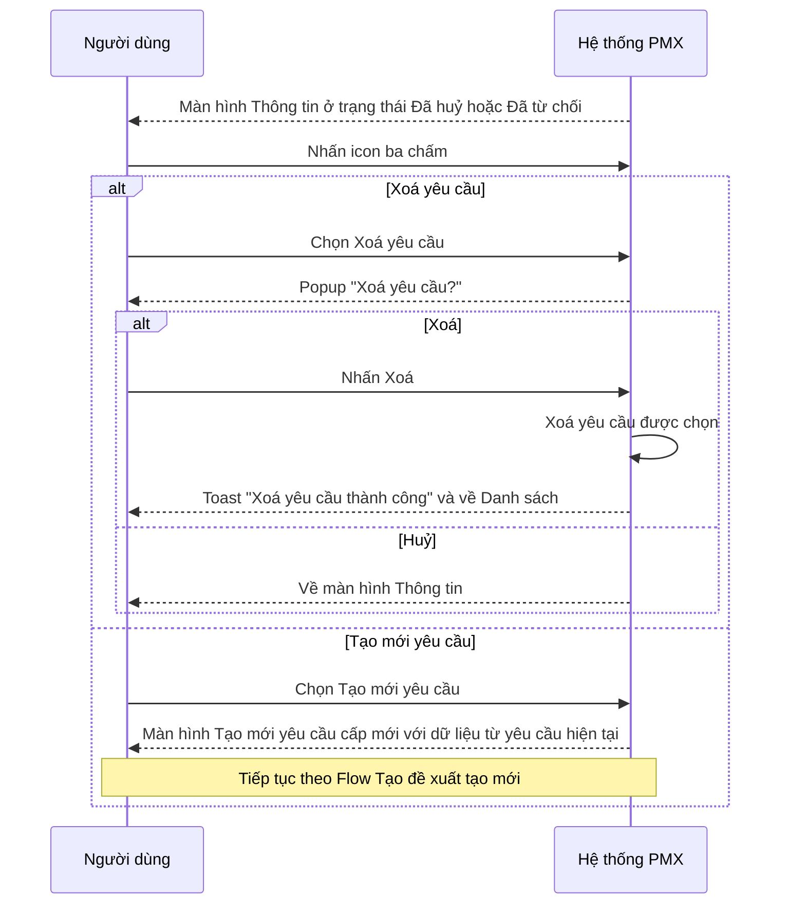

### Activity — Xoá yêu cầu hoặc Tạo mới yêu cầu
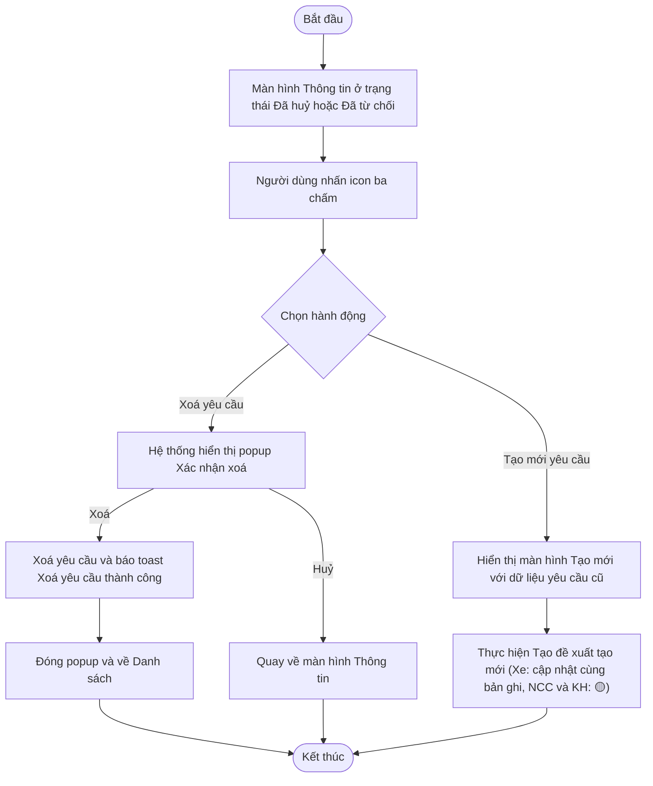
