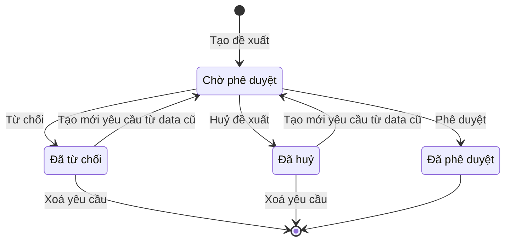

# Đối tác: nhà cung cấp, khách hàng, xe của khách (`business-partners`) — States tái lập (reverse)

## State: Yêu cầu cấp mới của danh mục (Nhà cung cấp HHDV, Khách hàng DK05, Xe của khách hàng)

> Nguồn: SRS Web tr.284 — hình và bảng Lưu đồ trạng thái chung cho danh mục ("Lưu đồ chung cho tất cả các danh mục"); SRS Web tr.488 — UC03.07.04 Huỷ đề xuất cấp mới nhà cung cấp HHDV; SRS Web tr.493 — UC03.07.05 Phê duyệt/Từ chối đề xuất cấp mới nhà cung cấp HHDV. Lưu đồ dùng chung cho ba danh mục; các UC của khách hàng DK05 và xe của khách hàng nêu cùng chuyển trạng thái (SRS Web tr.528 — UC03.08.04; SRS Web tr.565 — UC03.09.04).

| Trạng thái | Ý nghĩa | Vào bằng | Ra bằng | Nguồn | Nhãn |
|---|---|---|---|---|---|
| Chờ phê duyệt | Đề xuất vừa tạo, chờ người có quyền xử lý | Tạo đề xuất; Tạo mới yêu cầu từ yêu cầu Đã huỷ/Đã từ chối (lưu đồ "tạo lại 1 yêu cầu mới từ data cũ"; Xe: cập nhật cùng bản ghi) | Phê duyệt yêu cầu tạo mới; Từ chối yêu cầu tạo mới; Huỷ yêu cầu tạo mới | SRS Web tr.284 — Lưu đồ trạng thái chung cho danh mục | ✅ |
| Đã phê duyệt | Đề xuất được chấp nhận; bản ghi vào danh mục; sinh mã (NCC, KH) | Phê duyệt (từ Chờ phê duyệt) | Không có (nối thẳng tới "Kết thúc" trên lưu đồ); không có hành động ở màn Thông tin | SRS Web tr.284 — Lưu đồ trạng thái chung cho danh mục; SRS Web tr.501 — UC03.07.05 | ✅ |
| Đã từ chối | Người có quyền từ chối đề xuất (có thể kèm lý do) | Từ chối (từ Chờ phê duyệt) | Xoá yêu cầu; Tạo mới yêu cầu | SRS Web tr.284 — Lưu đồ trạng thái chung cho danh mục; SRS Web tr.497 — UC03.07.05 | ✅ |
| Đã huỷ | Người dùng huỷ đề xuất | Huỷ đề xuất (từ Chờ phê duyệt) | Xoá yêu cầu; Tạo mới yêu cầu | SRS Web tr.284 — Lưu đồ trạng thái chung cho danh mục; SRS Web tr.491 — UC03.07.04 | ✅ |

Lưu đồ gốc còn có cổng "?" sau Đã từ chối/Đã huỷ với hai nhánh: "Không tạo YC mới" tới Kết thúc, "Tạo lại 1 yêu cầu mới (từ data cũ)" quay về Tạo đề xuất. Nhánh "Không tạo YC mới" tương ứng với việc người dùng không làm gì thêm hoặc Xoá yêu cầu (🔵). ✅ [SRS Web tr.284 — hình lưu đồ trạng thái]

**Kết thúc và ngõ cụt**

| Trạng thái | Là kết thúc? | Đường ra (huỷ / đóng / sửa) | Chứng từ đã sinh phía sau xử lý thế nào khi huỷ | Sửa được sau khi chốt? | Nguồn | Nhãn |
|---|---|---|---|---|---|---|
| Chờ phê duyệt | Không | Phê duyệt; Từ chối; Huỷ đề xuất. Không có "sửa đề xuất" | Chưa có chứng từ phía sau (chưa có mã) | Không sửa được nội dung khi chờ (chỉ huỷ rồi tạo lại) | SRS Web tr.284 — Lưu đồ trạng thái chung cho danh mục | ✅ |
| Đã phê duyệt | Có (nối thẳng tới Kết thúc) | Không có sửa, ngừng dùng, xoá | Nguồn không nói bản ghi đã được dùng ở chứng từ khác xử lý thế nào khi cần đổi | Không (nguồn không có use case) | SRS Web tr.284 — Lưu đồ trạng thái chung cho danh mục; SRS Web tr.501 — UC03.07.05 | 🟡 |
| Đã từ chối | Không hoàn toàn (có thể tạo lại) | Xoá yêu cầu; Tạo mới yêu cầu | Chưa có chứng từ phía sau; nguồn không nói lưu vết sau khi xoá | Sửa gián tiếp: Tạo mới yêu cầu lấy dữ liệu cũ rồi chỉnh | SRS Web tr.284 — Lưu đồ trạng thái chung cho danh mục; SRS Web tr.497 — UC03.07.05 | ✅ |
| Đã huỷ | Không hoàn toàn (có thể tạo lại) | Xoá yêu cầu; Tạo mới yêu cầu | Chưa có chứng từ phía sau; nguồn không nói lưu vết sau khi xoá | Sửa gián tiếp: Tạo mới yêu cầu lấy dữ liệu cũ rồi chỉnh | SRS Web tr.284 — Lưu đồ trạng thái chung cho danh mục; SRS Web tr.491 — UC03.07.04 | ✅ |

Gap ngõ cụt tương ứng đã ghi ở `gaps.md` Mục 2.
