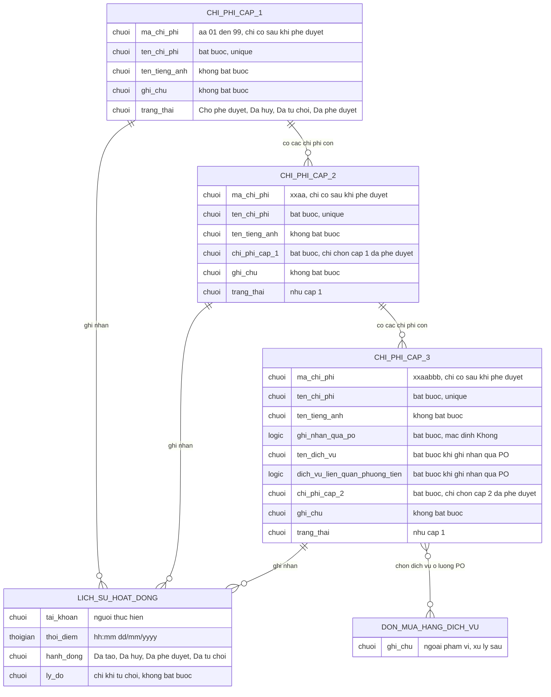

# Khoản mục chi phí cấp 1–3 (`cost-catalog`) — ERD tái lập (reverse)

## Entity Reference

| Entity | Mô tả nghiệp vụ | Thuộc tính chính | Nguồn | Nhãn |
|---|---|---|---|---|
| CHI_PHI_CAP_1 | Khoản mục chi phí gốc (khai báo, gồm cả đề xuất đang chờ) | mã (aa), tên, tên tiếng Anh, ghi chú, trạng thái | SRS Web tr.587, 592–593, 609 — UC03.10.02, UC03.10.03, UC03.10.05 | ✅ |
| CHI_PHI_CAP_2 | Khoản mục con của cấp 1 | mã (xxaa), tên, tên tiếng Anh, cấp 1 cha, ghi chú, trạng thái | SRS Web tr.620, 626–627, 643 — UC03.11.02, UC03.11.03, UC03.11.05 | ✅ |
| CHI_PHI_CAP_3 | Khoản mục con của cấp 2 | mã (xxaabbb), tên, tên tiếng Anh, ghi nhận qua PO, tên dịch vụ, liên quan phương tiện, cấp 2 cha, ghi chú, trạng thái | SRS Web tr.653–654, 658–661, 677 — UC03.12.02, UC03.12.03, UC03.12.05 | ✅ |
| LICH_SU_HOAT_DONG | Dòng nhật ký thao tác của khoản mục | tài khoản, thời điểm, hành động, lý do | SRS Web tr.580 — Thông báo & Lịch sử hoạt động Chi phí cấp 1 | ✅ |
| DON_MUA_HANG_DICH_VU | Chứng từ PO ngoài phần này, nơi chọn dịch vụ cấp 3 | không mô hình thuộc tính | SRS Web tr.659–660 — UC03.12.03 | 🟡 |

## Quan hệ

| Từ | Đến | Bản số | Ý nghĩa | Nguồn | Nhãn |
|---|---|---|---|---|---|
| CHI_PHI_CAP_1 | CHI_PHI_CAP_2 | 1 - 0..n | Mỗi cấp 2 thuộc đúng 1 cấp 1 (đã phê duyệt) | SRS Web tr.627 — UC03.11.03 | ✅ |
| CHI_PHI_CAP_2 | CHI_PHI_CAP_3 | 1 - 0..n | Mỗi cấp 3 thuộc đúng 1 cấp 2 (đã phê duyệt) | SRS Web tr.660 — UC03.12.03 | ✅ |
| CHI_PHI_CAP_1/2/3 | LICH_SU_HOAT_DONG | 1 - 0..n | Mỗi hành động tạo/huỷ/duyệt/từ chối ghi 1 dòng lịch sử | SRS Web tr.580 — Thông báo & Lịch sử hoạt động | ✅ |
| CHI_PHI_CAP_3 | DON_MUA_HANG_DICH_VU | n - n | Cấp 3 ghi nhận qua PO được chọn ở luồng tạo PO (xử lý sau) | SRS Web tr.659 — UC03.12.03 | 🟡 |

## Notes

- Không mô hình bản ghi "đề xuất" riêng: nguồn cho thấy bản ghi khoản mục tự mang trạng thái đề xuất (UC03.10.03 Điều kiện sau; tr.602, 608 không sinh bản ghi mới khi tạo lại).
- Không mô hình thông báo (4 mẫu nội dung cố định, không có thuộc tính lưu trữ riêng trong nguồn).
- Bảng "loại phí × địa điểm → cách hạch toán, định mức" của CHG-20 và entity Địa điểm chưa nằm trong SRS cũ nên không đưa vào sơ đồ (xem spec Mục 0.3).
- Thuộc tính kiểu "chuoi" dùng chung cho văn bản và lựa chọn trạng thái; kiểu thật không có trong nguồn.
