# Khoản mục chi phí cấp 1–3 (`cost-catalog`) — Flows tái lập (reverse)

## Flow: Xem danh sách khoản mục chi phí (cấp 1, 2, 3)

> Nguồn: SRS Web tr.581, 614, 648 — hình lưu đồ UC03.10.01, UC03.11.01, UC03.12.01 Xem danh mục chi phí cấp 1, 2, 3. Cả ba cấp cùng một lưu đồ, chỉ khác tên sub-tab.

### Sequence — Xem danh sách khoản mục chi phí

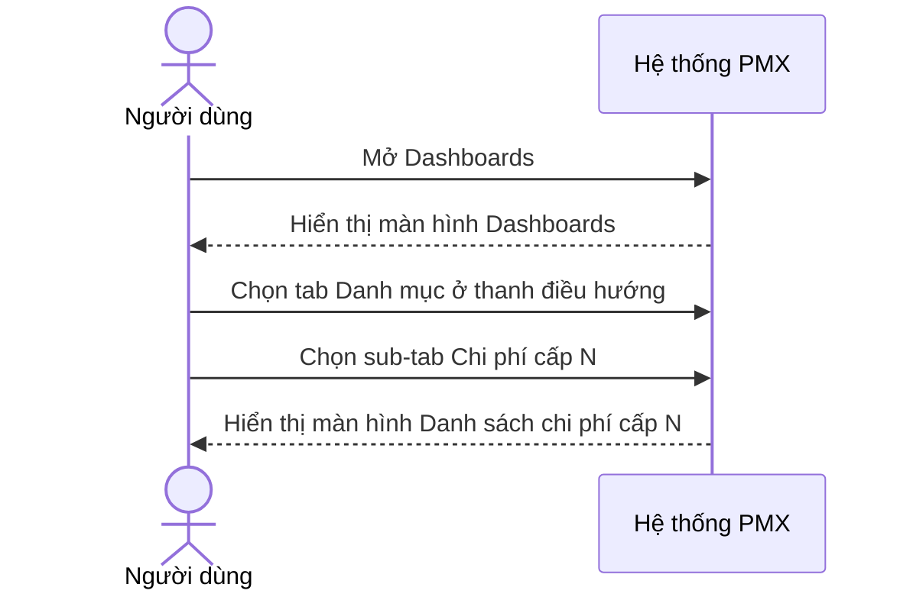

### Activity — Xem danh sách khoản mục chi phí

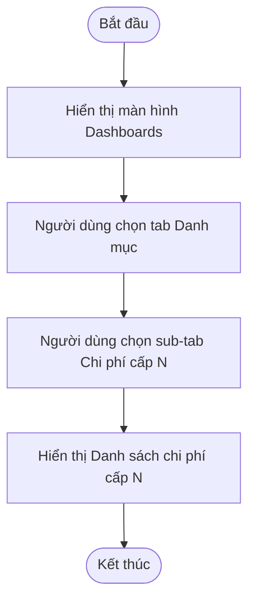

## Flow: Xem thông tin khoản mục chi phí

> Nguồn: SRS Web tr.585, 618, 652 — hình lưu đồ UC03.10.02, UC03.11.02, UC03.12.02 Xem thông tin chi phí cấp 1, 2, 3. Cấp 2 và cấp 3 còn vào được từ tab cấp con trong chi tiết cấp cha.

### Sequence — Xem thông tin khoản mục chi phí

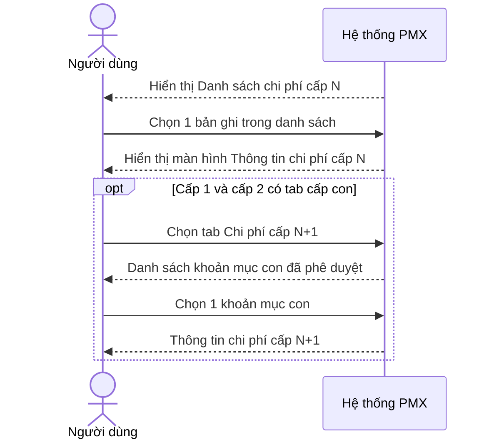

### Activity — Xem thông tin khoản mục chi phí

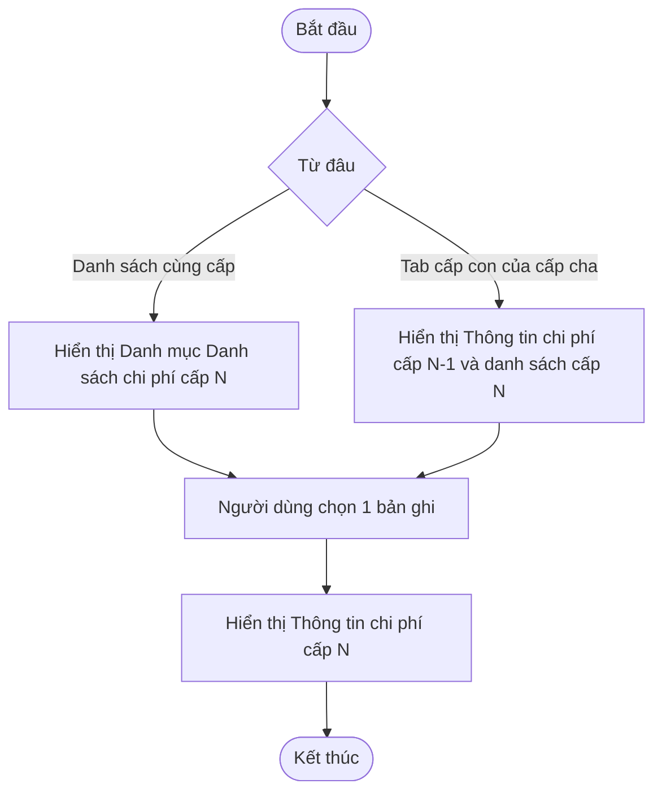

## Flow: Tạo đề xuất tạo mới khoản mục chi phí

> Nguồn: SRS Web tr.591–597, 625–631, 657–665 — UC03.10.03, UC03.11.03, UC03.12.03 Tạo đề xuất tạo mới chi phí cấp 1, 2, 3; hình lưu đồ tr.591, 625, 657. Nhánh dữ liệu không hợp lệ lấy từ mô tả chữ (lưu đồ chỉ vẽ nhánh hợp lệ).

### Sequence — Tạo đề xuất tạo mới khoản mục chi phí

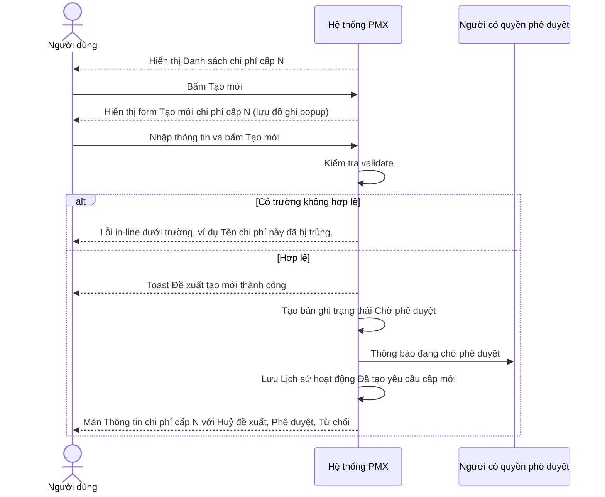

### Activity — Tạo đề xuất tạo mới khoản mục chi phí

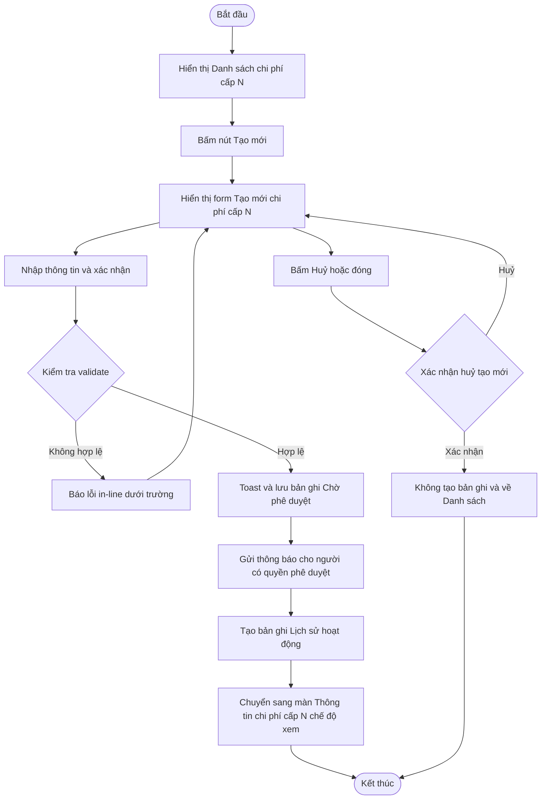

## Flow: Huỷ đề xuất tạo mới

> Nguồn: SRS Web tr.598–602, 632–636, 666–670 — UC03.10.04, UC03.11.04, UC03.12.04 Huỷ đề xuất cấp mới chi phí cấp 1, 2, 3; hình lưu đồ tr.598, 632, 666.

### Sequence — Huỷ đề xuất tạo mới

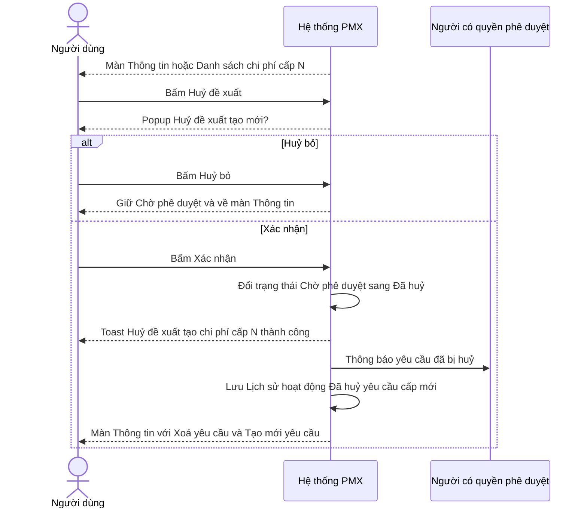

### Activity — Huỷ đề xuất tạo mới

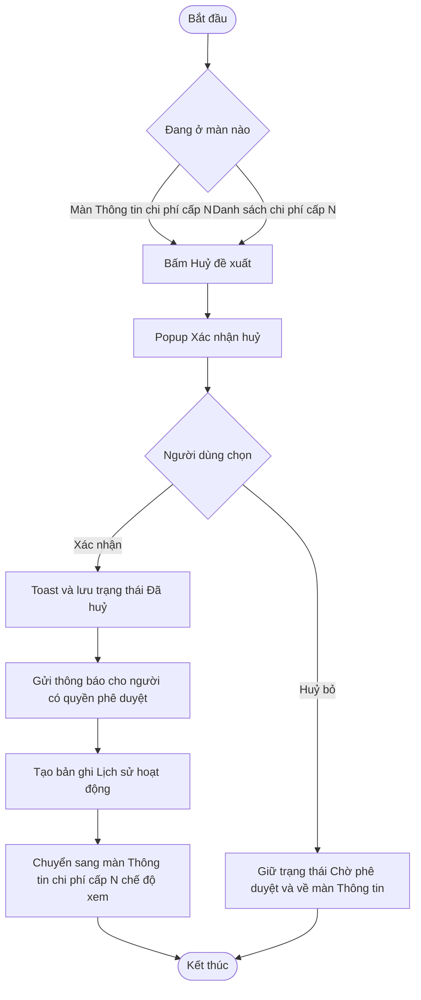

## Flow: Phê duyệt hoặc từ chối đề xuất tạo mới

> Nguồn: SRS Web tr.603–610, 637–644, 671–679 — UC03.10.05, UC03.11.05, UC03.12.05 Phê duyệt/Từ chối đề xuất cấp mới chi phí cấp 1, 2, 3; hình lưu đồ tr.604, 638, 672. Bước sinh mã, thông báo và xử lý xung đột lấy từ mô tả chữ và ảnh popup lỗi (lưu đồ ảnh không vẽ).

### Sequence — Phê duyệt hoặc từ chối đề xuất tạo mới

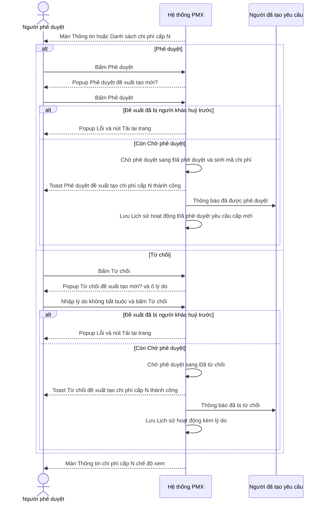

### Activity — Phê duyệt hoặc từ chối đề xuất tạo mới

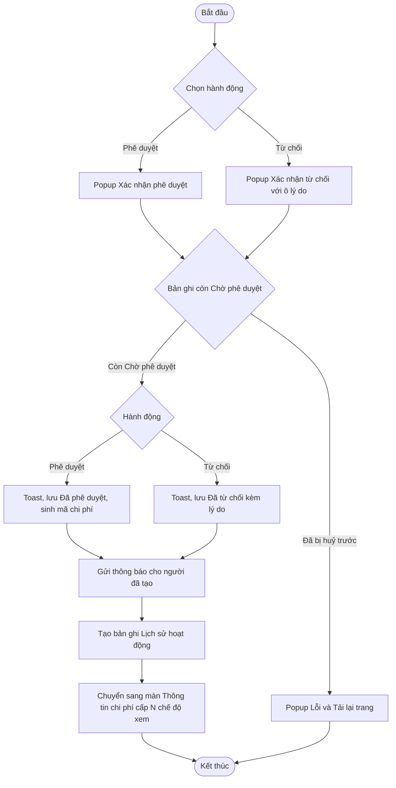

## Flow: Xoá yêu cầu và tạo lại yêu cầu từ bản đã huỷ hoặc đã từ chối

> Nguồn: SRS Web tr.589–590, 601–602, 607–608, 623–624, 635–636, 641–642, 655–656, 669–670, 675–676 — UC03.10.02, UC03.10.04, UC03.10.05 (và cấp 2, 3). Không có lưu đồ riêng; theo mô tả chữ và ảnh popup Xoá yêu cầu. Bước tạo lại cập nhật cùng bản ghi theo mô tả chữ.

### Sequence — Xoá yêu cầu và tạo lại yêu cầu

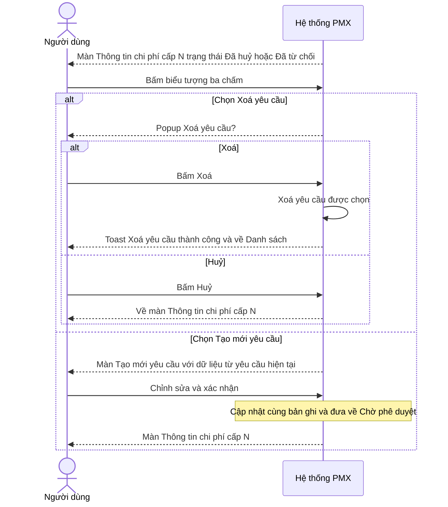

### Activity — Xoá yêu cầu và tạo lại yêu cầu

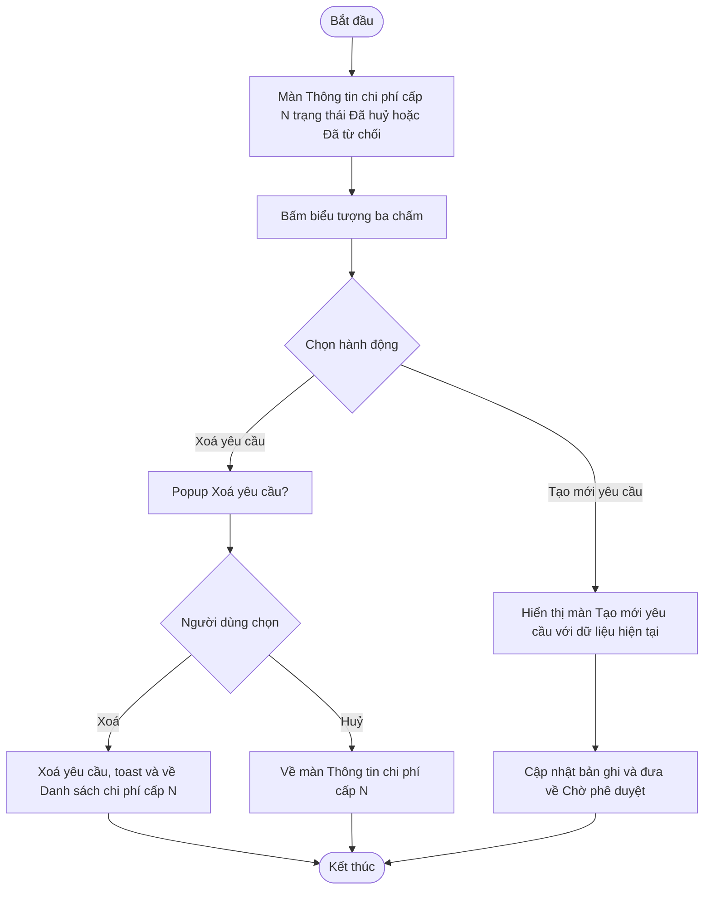
