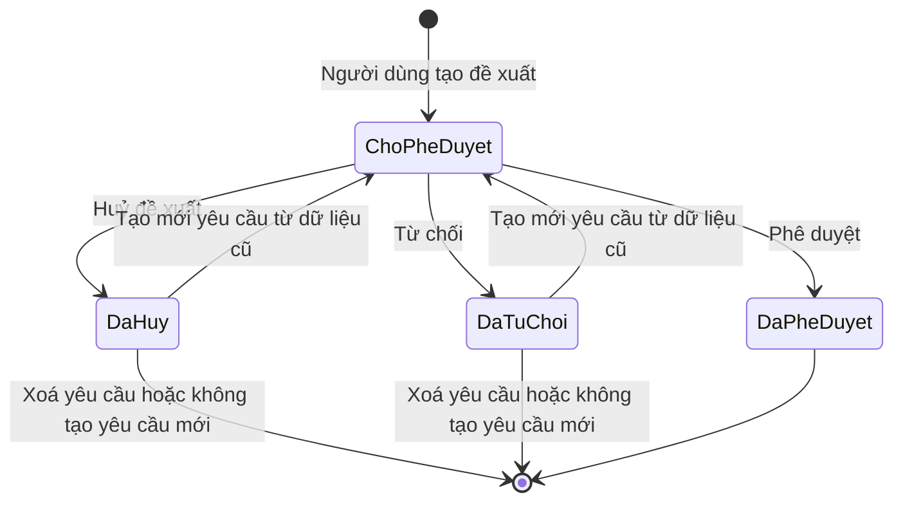

# Khoản mục chi phí cấp 1–3 (`cost-catalog`) — States tái lập (reverse)

## State: Khoản mục chi phí (đề xuất tạo mới) — chung cho cấp 1, 2, 3

> Nguồn: ✅ [SRS Web tr.284 — Lưu đồ trạng thái chung cho danh mục (hình và bảng Trạng thái / Thời điểm / Hành động)]. Bảng nguồn viết "Lưu đồ chung cho tất cả các danh mục"; hình có nhánh "Tạo lại 1 yêu cầu mới (từ data cũ)" quay về Tạo đề xuất và nhánh "Không tạo YC mới" tới Kết thúc. Bước Xoá yêu cầu chỉ có trong bảng hành động và mô tả UC, không vẽ trong hình.

Chú thích: ChoPheDuyet = Chờ phê duyệt; DaPheDuyet = Đã phê duyệt; DaTuChoi = Đã từ chối; DaHuy = Đã huỷ.

**Ghi chú trạng thái:**

| Trạng thái | Ý nghĩa | Vào bằng | Ra bằng | Nguồn | Nhãn |
|---|---|---|---|---|---|
| Chờ phê duyệt | Đề xuất mới tạo, chưa có hiệu lực, chưa có mã | Người dùng tạo yêu cầu cấp mới (hoặc Tạo mới yêu cầu từ bản đã huỷ/từ chối) | Phê duyệt yêu cầu tạo mới; Từ chối yêu cầu tạo mới; Huỷ yêu cầu tạo mới | SRS Web tr.284 — Lưu đồ trạng thái chung cho danh mục | ✅ |
| Đã huỷ | Đề xuất bị huỷ | Huỷ đề xuất từ Chờ phê duyệt | Xoá yêu cầu; Tạo mới yêu cầu (về Chờ phê duyệt) | SRS Web tr.284 — Lưu đồ trạng thái chung cho danh mục; tr.598–602 — UC03.10.04 Huỷ đề xuất cấp mới chi phí cấp 1 | ✅ |
| Đã từ chối | Đề xuất bị từ chối, có thể kèm lý do | Từ chối từ Chờ phê duyệt | Xoá yêu cầu; Tạo mới yêu cầu (về Chờ phê duyệt) | SRS Web tr.284 — Lưu đồ trạng thái chung cho danh mục; tr.603–610 — UC03.10.05 | ✅ |
| Đã phê duyệt | Khoản mục có hiệu lực, có mã, dùng được làm cấp cha | Phê duyệt từ Chờ phê duyệt (sinh mã) | Không có hành động | SRS Web tr.284 — Lưu đồ trạng thái chung cho danh mục; tr.610, 644, 678 — UC03.10.05, UC03.11.05, UC03.12.05 mục 3.4 | ✅ |

**Kết thúc và ngõ cụt:**

| Trạng thái | Là kết thúc? | Đường ra (huỷ / đóng / sửa) | Chứng từ đã sinh phía sau xử lý thế nào khi huỷ | Sửa được sau khi chốt? | Nguồn | Nhãn |
|---|---|---|---|---|---|---|
| Chờ phê duyệt | Không | Phê duyệt, Từ chối, Huỷ; không có sửa đề xuất | Nguồn không nói. Khoản mục chưa có con nên không có chứng từ phía sau | Không có sửa (chỉ huỷ rồi tạo lại) | SRS Web tr.284 — Lưu đồ trạng thái chung cho danh mục | ✅ |
| Đã huỷ | Gần như kết thúc (hình: "Không tạo YC mới" tới Kết thúc) | Xoá yêu cầu hoặc Tạo mới yêu cầu | Nguồn không nói bản ghi/lịch sử xử lý thế nào khi Xoá yêu cầu | Tạo lại cập nhật cùng bản ghi | SRS Web tr.284, 602 — Lưu đồ trạng thái chung; UC03.10.04 mục 3.2 | 🔵 |
| Đã từ chối | Gần như kết thúc | Xoá yêu cầu hoặc Tạo mới yêu cầu | Như trên | Như trên | SRS Web tr.284, 608 — Lưu đồ trạng thái chung; UC03.10.05 mục 3.2 | 🔵 |
| Đã phê duyệt | Có (hình: tới Kết thúc) | Không có huỷ, sửa, ngừng dùng, xoá | Khoản mục con (cấp 2 hoặc 3) và PO dùng khoản mục này (xử lý sau) không được nhắc | Không có sửa trong nguồn | SRS Web tr.284, 610 — Lưu đồ trạng thái chung; UC03.10.05 mục 3.4 | ✅ |
