# Danh mục hàng hoá và dịch vụ kỹ thuật (`product-catalog`) — ERD tái lập (reverse)

```mermaid
erDiagram
    LOAI_PHUONG_TIEN ||--o{ PHUONG_TIEN : "gom"
    PHUONG_TIEN ||--o{ DICH_VU_KY_THUAT : "ap dung cho"
    PHUONG_TIEN ||--o{ PHU_TUNG_VAT_TU : "ap dung cho"
    PHUONG_TIEN ||--o{ LOP : "gan cho"
    PHUONG_TIEN ||--o{ AC_QUY : "gan cho"
    HE_THONG_TONG_THANH_XE ||--o{ DICH_VU_KY_THUAT : "thuoc"
    HE_THONG_TONG_THANH_XE ||--o{ PHU_TUNG_VAT_TU : "thuoc"
    HE_THONG_TONG_THANH_XE ||--o{ LOP : "thuoc"
    HE_THONG_TONG_THANH_XE ||--o{ AC_QUY : "thuoc"
    DON_VI_TINH ||--o{ DICH_VU_KY_THUAT : "tinh theo"
    DON_VI_TINH ||--o{ PHU_TUNG_VAT_TU : "tinh theo"
    DON_VI_TINH ||--o{ CONG_CU_DUNG_CU : "tinh theo"
    DON_VI_TINH ||--o{ LOP : "tinh theo"
    DON_VI_TINH ||--o{ AC_QUY : "tinh theo"
    LOAI_CCDC ||--o{ CONG_CU_DUNG_CU : "phan loai"
    NHOM_GIA_DVKT ||--o{ DICH_VU_KY_THUAT : "xac dinh ma"
    NGUOI_DUNG ||--o{ YEU_CAU_CAP_MOI : "tao"
    YEU_CAU_CAP_MOI ||--|| DICH_VU_KY_THUAT : "la cung ban ghi"
    YEU_CAU_CAP_MOI ||--|| PHU_TUNG_VAT_TU : "la cung ban ghi"
    YEU_CAU_CAP_MOI ||--|| CONG_CU_DUNG_CU : "la cung ban ghi"
    YEU_CAU_CAP_MOI ||--|| LOP : "la cung ban ghi"
    YEU_CAU_CAP_MOI ||--|| AC_QUY : "la cung ban ghi"
    YEU_CAU_CAP_MOI ||--o{ LICH_SU_HOAT_DONG : "co"
    YEU_CAU_CAP_MOI ||--o{ THONG_BAO : "phat sinh"
    NGUOI_DUNG ||--o{ LICH_SU_HOAT_DONG : "thuc hien"
    NGUOI_DUNG ||--o{ THONG_BAO : "nhan"

    DICH_VU_KY_THUAT {
        chuoi ma_dvkt "Ma DVKT - chi co khi da phe duyet"
        chuoi ten_dich_vu_ky_thuat "Ten DVKT - bat buoc va duy nhat"
        chuoi trang_thai "Cho phe duyet, Da huy, Da tu choi, Da phe duyet"
        chuoi ghi_chu "Ghi chu - khong bat buoc"
    }
    PHU_TUNG_VAT_TU {
        chuoi ma_ptvt "Ma PTVT - chi co khi da phe duyet"
        chuoi ten_phu_tung_vat_tu "Ten PTVT - bat buoc va duy nhat"
        chuoi quan_ly_serial "Co hoac Khong, mac dinh Khong"
        chuoi trang_thai "Trang thai theo luu do chung"
        chuoi ghi_chu "Ghi chu - khong bat buoc"
    }
    CONG_CU_DUNG_CU {
        chuoi ma_ccdc "Ma CCDC - chi co khi da phe duyet"
        chuoi ten_cong_cu_dung_cu "Ten CCDC - bat buoc va duy nhat"
        chuoi loai_ccdc "Cam tay hoac lon"
        chuoi quan_ly_serial "Quan ly serial nha san xuat"
        chuoi trang_thai "Trang thai theo luu do chung"
        chuoi ghi_chu "Ghi chu - khong bat buoc"
    }
    LOP {
        chuoi ma_lop "Ma lop"
        chuoi ten_lop "Ten lop - bat buoc va duy nhat"
        chuoi nha_san_xuat "Nha san xuat - khong bat buoc"
        chuoi sam "Co hoac khong co sam - bat buoc"
        so duong_kinh_mm "Duong kinh lop - khong bat buoc"
        so do_rong_be_mat_mm "Do rong be mat - khong bat buoc"
        chuoi quan_ly_serial "Luon Co"
        chuoi trang_thai "Trang thai theo luu do chung"
        chuoi ghi_chu "Ghi chu - khong bat buoc"
    }
    AC_QUY {
        chuoi ma_ac_quy "Ma ac quy"
        chuoi ten_ac_quy "Ten ac quy - bat buoc va duy nhat"
        chuoi nha_san_xuat "Nha san xuat - khong bat buoc"
        so dung_tich_ah "Dung tich Ah - so duong"
        so dien_the_v "Dien the V - so duong"
        chuoi quan_ly_serial "Luon Co"
        chuoi trang_thai "Trang thai theo luu do chung"
        chuoi ghi_chu "Ghi chu - khong bat buoc"
    }
    YEU_CAU_CAP_MOI {
        chuoi trang_thai "Cho phe duyet, Da huy, Da tu choi, Da phe duyet"
        chuoi ly_do_tu_choi "Ly do tu choi - khong bat buoc"
        chuoi nguoi_tao "Nguoi tao yeu cau"
    }
    LOAI_PHUONG_TIEN {
        chuoi ten_loai "9 loai: So mi-Ro mooc ... Tram bom dau"
    }
    PHUONG_TIEN {
        chuoi ma_phuong_tien "00 den 38"
        chuoi ten_phuong_tien "Vi du Mooc 20ft, Dau keo Maz"
    }
    HE_THONG_TONG_THANH_XE {
        chuoi ma_he_thong "0 den 6"
        chuoi ten_he_thong "Dong co - lam mat, Truyen luc, Gam, Dien, Nhien lieu - khi nap, Phu va cabin"
    }
    DON_VI_TINH {
        chuoi ten_don_vi "lan, cai, bo, hop, tam, lit, met, cuon, chiec"
    }
    LOAI_CCDC {
        chuoi ma_loai "01 cam tay, 02 lon"
        chuoi ten_loai "Cong cu dung cu cam tay hoac lon"
    }
    NHOM_GIA_DVKT {
        chuoi ma_nhom "00 den 04"
        chuoi ten_nhom "Khac, tai trong 1-5 tan, tren 5-13 tan, dau keo container, so mi-ro mooc"
    }
    THONG_BAO {
        chuoi tieu_de "Danh muc - Yeu cau cap moi"
        chuoi noi_dung "Yeu cau cap moi ... dang cho phe duyet, da bi huy, da duoc phe duyet, da bi tu choi"
    }
    LICH_SU_HOAT_DONG {
        chuoi tai_khoan "Ten tai khoan thuc hien hanh dong"
        chuoi thoi_diem "hh:mm dd/mm/yyyy"
        chuoi hanh_dong "Da tao, Da huy, Da phe duyet, Da tu choi yeu cau cap moi"
    }
    NGUOI_DUNG {
        chuoi tai_khoan "Tai khoan nguoi dung phan mem xuong"
    }
```

## Entity Reference

| Entity | Mô tả nghiệp vụ | Thuộc tính chính | Nguồn | Nhãn |
|--------|-----------------|------------------|-------|------|
| DICH_VU_KY_THUAT | Danh mục dịch vụ kỹ thuật theo phương tiện và hệ thống tổng thành xe | Mã DVKT, Tên, Đơn vị tính, Loại phương tiện, Tên phương tiện, Hệ thống tổng thành xe, Trạng thái, Ghi chú | SRS Web tr.294–295 — UC03.01.02 Xem thông tin Dịch vụ kỹ thuật | ✅ |
| PHU_TUNG_VAT_TU | Danh mục phụ tùng vật tư | Mã PTVT, Tên, Quản lý serial, Đơn vị tính, Loại / Tên phương tiện, Hệ thống tổng thành xe, Trạng thái, Ghi chú | SRS Web tr.330–331 — UC03.03.02 Xem thông tin phụ tùng vật tư | ✅ |
| CONG_CU_DUNG_CU | Danh mục công cụ dụng cụ (không gắn phương tiện) | Mã CCDC, Tên, Đơn vị tính, Phân loại, Quản lý serial, Trạng thái, Ghi chú; "Đơn giá (VND)" chỉ có ở danh sách Tuỳ chỉnh (OQ-11) | SRS Web tr.366–367 — UC03.04.02; SRS Web tr.363 — UC03.04.01 | ✅ |
| LOP | Danh mục lốp | Mã lốp, Tên, Nhà sản xuất, Loại / Mã - Tên phương tiện, Hệ thống, Đơn vị tính, Săm, Đường kính (mm), Độ rộng bề mặt (mm), Quản lý serial NSX, Trạng thái, Ghi chú | SRS Web tr.400–401 — UC03.05.02 Xem thông tin lốp | ✅ |
| AC_QUY | Danh mục ắc quy | Mã ắc quy, Tên, Nhà sản xuất, Loại / Mã - Tên phương tiện, Hệ thống, Đơn vị tính, Dung tích (Ah), Điện thế (V), Quản lý serial NSX, Trạng thái, Ghi chú | SRS Web tr.433–434 — UC03.06.02 Xem thông tin ắc quy | ✅ |
| YEU_CAU_CAP_MOI | Yêu cầu cấp mới (đề xuất tạo mới): khái niệm trạng thái phê duyệt của bản ghi danh mục; nguồn không tách thành bảng riêng | Trạng thái, Lý do từ chối, Người tạo | SRS Web tr.284 — Lưu đồ trạng thái chung; SRS Web tr.312 — UC03.01.04 Huỷ đề xuất cấp mới Dịch vụ kỹ thuật | 🔵 |
| LOAI_PHUONG_TIEN | 9 loại phương tiện chọn được | Tên loại | SRS Web tr.300 — UC03.01.03 Tạo đề xuất tạo mới Dịch vụ kỹ thuật | ✅ |
| PHUONG_TIEN | Bảng mã - tên phương tiện (39 dòng) | Mã phương tiện, Tên phương tiện, Loại | SRS Web tr.304–307 — UC03.01.03 | ✅ |
| HE_THONG_TONG_THANH_XE | 7 hệ thống tổng thành xe | Mã 0 đến 6, Tên | SRS Web tr.301 — UC03.01.03 | ✅ |
| DON_VI_TINH | Đơn vị tính theo từng danh mục | Tên đơn vị | SRS Web tr.301, 337, 372, 408, 440 — UC Tạo đề xuất (5 danh mục) | ✅ |
| LOAI_CCDC | 2 loại công cụ dụng cụ, mã 01 / 02 dùng sinh mã | Mã, Tên | SRS Web tr.372 — UC03.04.03; SRS Web tr.388 — UC03.04.05 | 🔵 |
| NHOM_GIA_DVKT | 5 nhóm giá dịch vụ kỹ thuật, dùng sinh mã DVKT | Mã 00 đến 04, Tên | SRS Web tr.319–320 — UC03.01.05 | 🔵 |
| THONG_BAO | Thông báo yêu cầu cấp mới | Tiêu đề, Nội dung, Màn điều hướng | SRS Web tr.287 — 03.01 Thông báo & Lịch sử hoạt động | ✅ |
| LICH_SU_HOAT_DONG | Nhật ký hành động trên bản ghi | Tài khoản, Thời điểm, Hành động, Lý do | SRS Web tr.287 — 03.01 Thông báo & Lịch sử hoạt động | ✅ |
| NGUOI_DUNG | Người dùng phần mềm xưởng | Tài khoản | SRS Web tr.288 — UC03.01.01 Xem danh mục Dịch vụ kỹ thuật | ✅ |

## Quan hệ

| Từ | Đến | Bản số | Ý nghĩa | Nguồn | Nhãn |
|----|-----|--------|---------|-------|------|
| LOAI_PHUONG_TIEN | PHUONG_TIEN | 1-nhiều | Mỗi loại gồm nhiều phương tiện (mã 00 N/A không thuộc loại nào) | SRS Web tr.304–307 — UC03.01.03 | ✅ |
| PHUONG_TIEN | DICH_VU_KY_THUAT, PHU_TUNG_VAT_TU, LOP, AC_QUY | 1-nhiều | Bản ghi gắn với 1 loại và 1 mã - tên phương tiện (chỉ chọn 1) | SRS Web tr.300 — UC03.01.03; SRS Web tr.336 — UC03.03.03; SRS Web tr.407 — UC03.05.03; SRS Web tr.439 — UC03.06.03 | ✅ |
| HE_THONG_TONG_THANH_XE | DICH_VU_KY_THUAT, PHU_TUNG_VAT_TU, LOP, AC_QUY | 1-nhiều | Bản ghi gắn với 1 hệ thống tổng thành xe | SRS Web tr.301 — UC03.01.03; SRS Web tr.337 — UC03.03.03; SRS Web tr.408 — UC03.05.03; SRS Web tr.440 — UC03.06.03 | ✅ |
| DON_VI_TINH | 5 danh mục | 1-nhiều | Mỗi bản ghi có 1 đơn vị tính | SRS Web tr.301, 337, 372, 408, 440 — UC Tạo đề xuất (5 danh mục) | ✅ |
| YEU_CAU_CAP_MOI | 5 danh mục | 1-1 | Cùng một bản ghi (không có bảng riêng) | SRS Web tr.312 — UC03.01.04 Huỷ đề xuất cấp mới Dịch vụ kỹ thuật | 🔵 |
| LOAI_CCDC | CONG_CU_DUNG_CU | 1-nhiều | Mỗi CCDC thuộc 1 loại | SRS Web tr.372 — UC03.04.03 | ✅ |
| NHOM_GIA_DVKT | DICH_VU_KY_THUAT | 1-nhiều | Nhóm giá xác định theo phương tiện, nằm trong mã DVKT | SRS Web tr.319–320 — UC03.01.05 | 🔵 |
| NGUOI_DUNG | YEU_CAU_CAP_MOI | 1-nhiều | Người dùng tạo yêu cầu và là người nhận thông báo duyệt / từ chối | SRS Web tr.287 — 03.01 Thông báo & Lịch sử hoạt động | ✅ |
| YEU_CAU_CAP_MOI | LICH_SU_HOAT_DONG | 1-nhiều | Mỗi hành động ghi 1 bản ghi lịch sử | SRS Web tr.287 — 03.01 Thông báo & Lịch sử hoạt động | ✅ |
| YEU_CAU_CAP_MOI | THONG_BAO | 1-nhiều | Mỗi sự kiện phát sinh thông báo | SRS Web tr.287 — 03.01 Thông báo & Lịch sử hoạt động | ✅ |
| NGUOI_DUNG | LICH_SU_HOAT_DONG, THONG_BAO | 1-nhiều | Người thực hiện hành động; người nhận thông báo | SRS Web tr.287 — 03.01 Thông báo & Lịch sử hoạt động | ✅ |

## Notes

- Bản ghi danh mục và yêu cầu cấp mới được mô hình tách để phân loại (Danh mục / ChangeRequest) nhưng nguồn coi là cùng một bản ghi; xem Assumption ở spec.md Mục 11.
- Tên entity viết không dấu theo brief; thuộc tính cuối của mỗi entity mô tả bằng tiếng Việt không dấu.
- Không đưa vào: thuộc tính kỹ thuật cơ sở dữ liệu, mã sinh theo định dạng (ghi ở spec.md BR-product-catalog-022 đến BR-product-catalog-026), phân quyền (nguồn chưa tính phân quyền).
- Cột "Mã loại phương tiện" của bảng tham chiếu nguồn thực chất chứa mã từng phương tiện (00 đến 38) nên mô hình đặt mã ở PHUONG_TIEN.
