# Danh mục hàng hoá và dịch vụ kỹ thuật (`product-catalog`) — Flows tái lập (reverse)

## Flow: Xem danh sách danh mục

> Nguồn: SRS Web tr.288 — hình lưu đồ UC03.01.01 Xem danh mục Dịch vụ kỹ thuật; cùng khuôn ở SRS Web tr.325 — hình lưu đồ UC03.03.01; SRS Web tr.361 — hình lưu đồ UC03.04.01; SRS Web tr.394 — hình lưu đồ UC03.05.01; SRS Web tr.427 — hình lưu đồ UC03.06.01. Áp cho cả 5 danh mục (Dịch vụ kỹ thuật, Phụ tùng vật tư, Công cụ dụng cụ, Lốp, Ắc quy), chỉ khác tên sub-tab. ✅

### Sequence — Xem danh sách danh mục
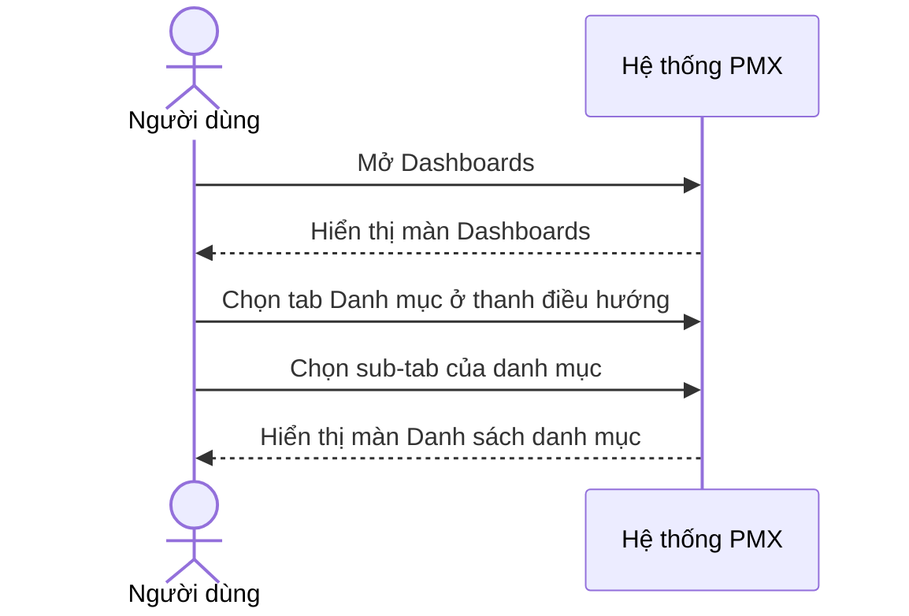

### Activity — Xem danh sách danh mục
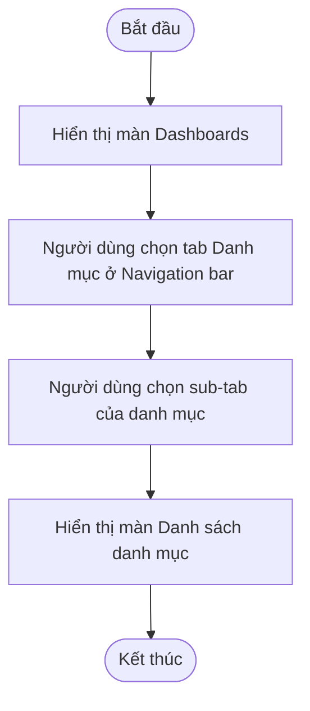

## Flow: Xem thông tin danh mục

> Nguồn: SRS Web tr.293 — hình lưu đồ UC03.01.02 Xem thông tin Dịch vụ kỹ thuật; cùng khuôn ở SRS Web tr.329 — hình lưu đồ UC03.03.02; SRS Web tr.365 — hình lưu đồ UC03.04.02; SRS Web tr.399 — hình lưu đồ UC03.05.02; SRS Web tr.432 — hình lưu đồ UC03.06.02. ✅

### Sequence — Xem thông tin danh mục
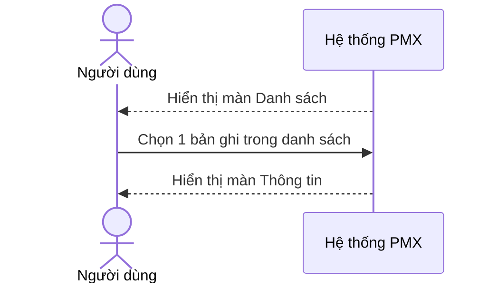

### Activity — Xem thông tin danh mục
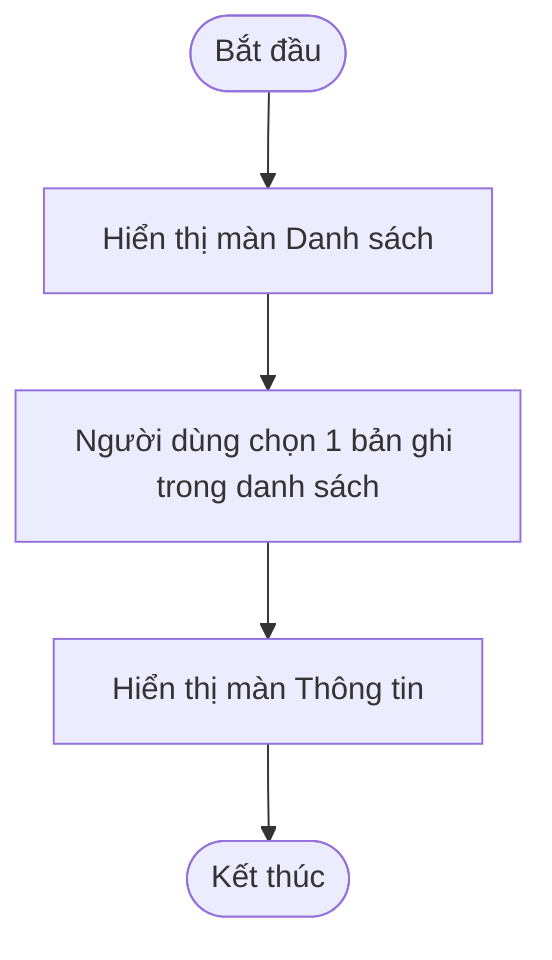

## Flow: Tạo đề xuất tạo mới

> Nguồn: SRS Web tr.298 — hình lưu đồ UC03.01.03 Tạo đề xuất tạo mới Dịch vụ kỹ thuật; cùng khuôn ở SRS Web tr.334 — hình lưu đồ UC03.03.03; SRS Web tr.370 — hình lưu đồ UC03.04.03; SRS Web tr.405 — hình lưu đồ UC03.05.03; SRS Web tr.437 — hình lưu đồ UC03.06.03. Lưu đồ ghi bước "Hiển thị popup Tạo mới", mô tả chữ ghi "màn hình Tạo mới", ảnh cho thấy panel trượt bên phải (SRS Web tr.299 — ảnh UC03.01.03). Lưu đồ chỉ vẽ nhánh hợp lệ; nhánh lỗi in-line và gửi thông báo lấy từ mô tả chữ (SRS Web tr.302–303 — UC03.01.03). ✅ cho bước trong lưu đồ, 🔵 cho vị trí bước thông báo.

### Sequence — Tạo đề xuất tạo mới
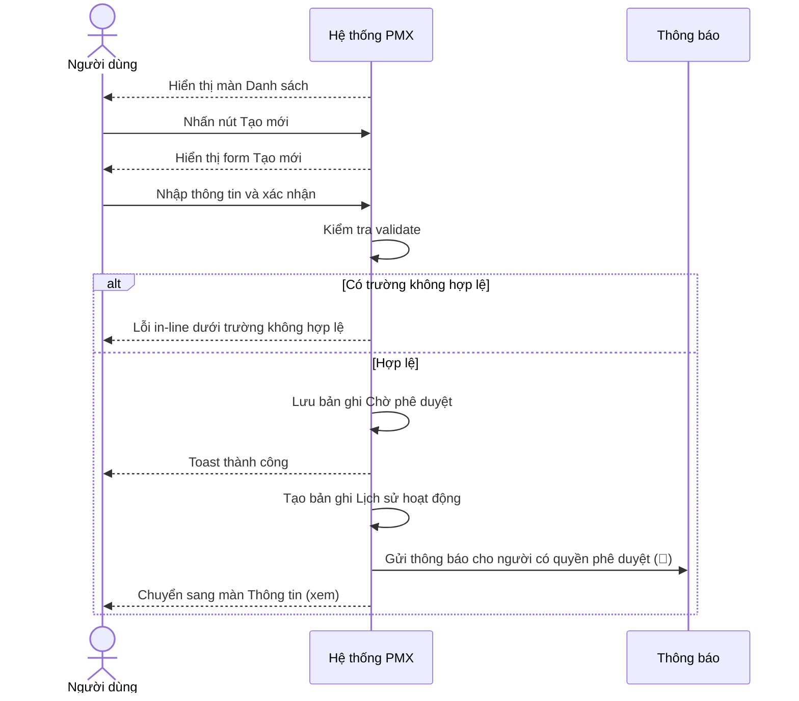

### Activity — Tạo đề xuất tạo mới
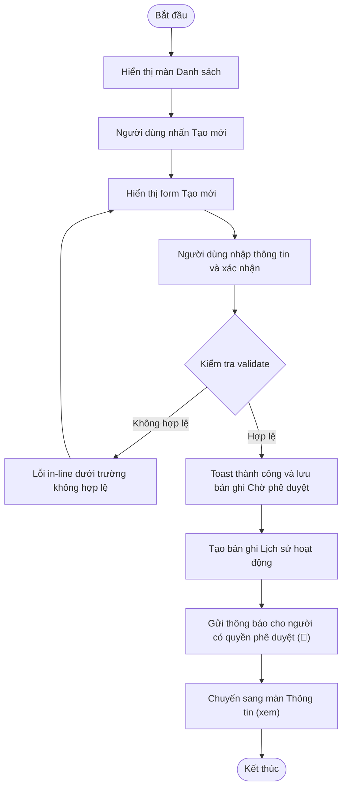

## Flow: Huỷ bỏ khi đang tạo đề xuất

> Nguồn: SRS Web tr.303–304 — UC03.01.03 Tạo đề xuất tạo mới Dịch vụ kỹ thuật (nút Huỷ và icon đóng; mô tả chữ, không có hình lưu đồ riêng); cùng khuôn ở SRS Web tr.339–340 — UC03.03.03; SRS Web tr.374–375 — UC03.04.03; SRS Web tr.410 — UC03.05.03; SRS Web tr.442 — UC03.06.03. ✅

### Sequence — Huỷ bỏ khi đang tạo đề xuất
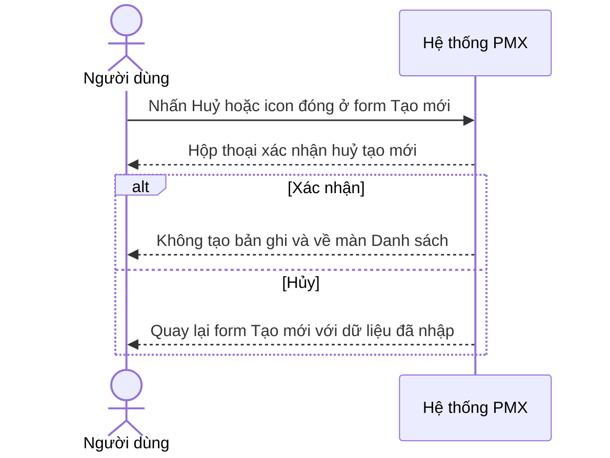

### Activity — Huỷ bỏ khi đang tạo đề xuất
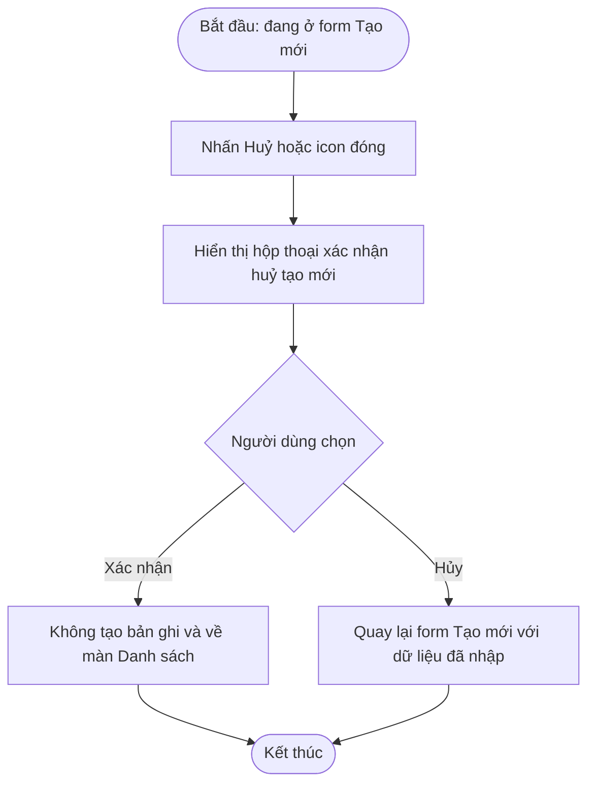

## Flow: Huỷ đề xuất cấp mới

> Nguồn: SRS Web tr.308 — hình lưu đồ UC03.01.04 Huỷ đề xuất cấp mới Dịch vụ kỹ thuật; cùng khuôn ở SRS Web tr.344 — hình lưu đồ UC03.03.04; SRS Web tr.378 — hình lưu đồ UC03.04.04; SRS Web tr.413 — hình lưu đồ UC03.05.04; SRS Web tr.444 — hình lưu đồ UC03.06.04. Lưu đồ không vẽ nhánh Huỷ bỏ và bước gửi thông báo; hai bước này lấy từ mô tả chữ (SRS Web tr.310–311 — UC03.01.04). ✅ cho bước trong lưu đồ, 🔵 cho vị trí bước thông báo.

### Sequence — Huỷ đề xuất cấp mới
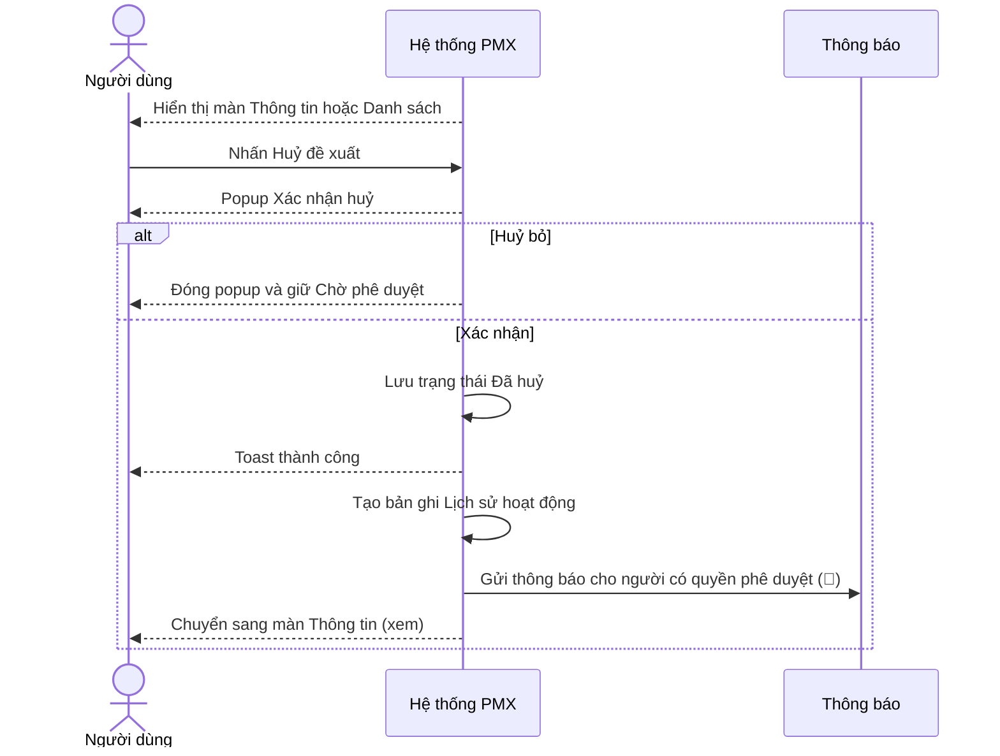

### Activity — Huỷ đề xuất cấp mới
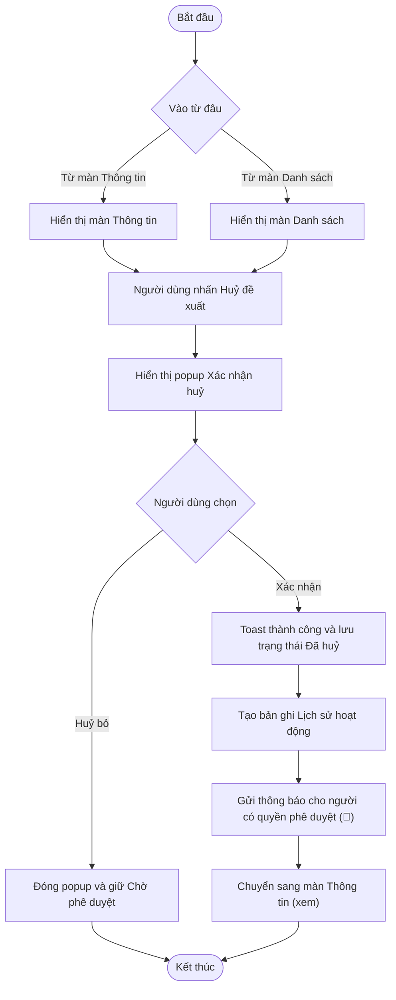

## Flow: Phê duyệt / Từ chối đề xuất cấp mới

> Nguồn: SRS Web tr.314 — hình lưu đồ UC03.01.05 Phê duyệt/Từ chối đề xuất cấp mới Dịch vụ kỹ thuật; cùng khuôn ở SRS Web tr.350 — hình lưu đồ UC03.03.05; SRS Web tr.383 — hình lưu đồ UC03.04.05; SRS Web tr.418 — hình lưu đồ UC03.05.05; SRS Web tr.450 — hình lưu đồ UC03.06.05. Lưu đồ không vẽ nhánh bỏ xác nhận (nút Huỷ bỏ hoặc Huỷ), nhánh xung đột đồng thời, nhập lý do, sinh mã, gửi thông báo; các bước này lấy từ mô tả chữ (SRS Web tr.316–320 — UC03.01.05). ✅ cho bước trong lưu đồ, 🔵 cho vị trí bước thông báo và sinh mã.

### Sequence — Phê duyệt / Từ chối đề xuất cấp mới
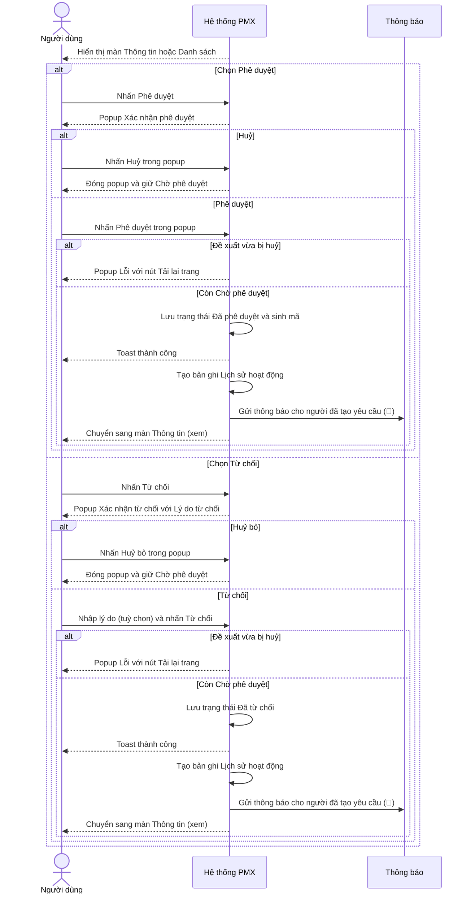

### Activity — Phê duyệt / Từ chối đề xuất cấp mới
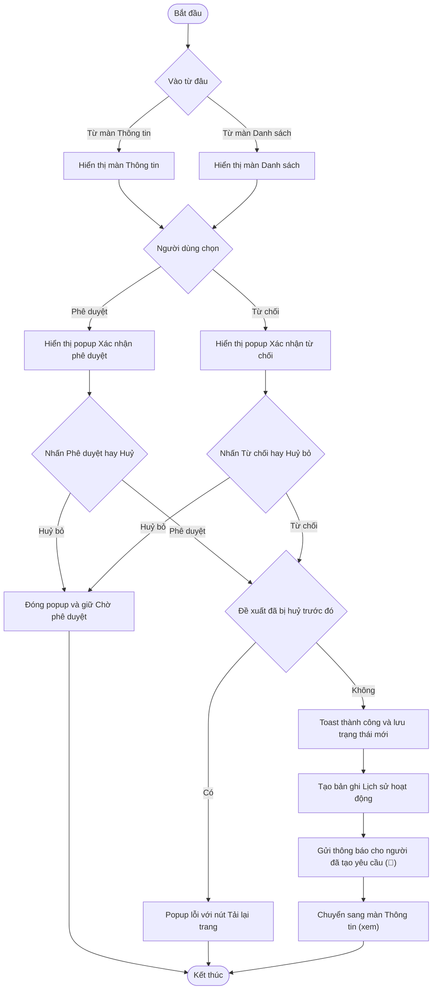

## Flow: Xoá yêu cầu và Tạo mới yêu cầu từ bản đã huỷ hoặc đã từ chối

> Nguồn: SRS Web tr.296–297 — UC03.01.02 Xem thông tin Dịch vụ kỹ thuật; SRS Web tr.311–312 — UC03.01.04 Huỷ đề xuất cấp mới Dịch vụ kỹ thuật; SRS Web tr.317–318 — UC03.01.05 Phê duyệt/Từ chối đề xuất cấp mới Dịch vụ kỹ thuật; cùng khuôn ở 4 danh mục còn lại (PTVT tr.332, 347–348, 353–354; CCDC tr.368, 380–381, 386–387; Lốp tr.402, 415–416, 420–421; Ắc quy tr.435, 447–448, 453–454). Nguồn mô tả bằng chữ, không có hình lưu đồ riêng. ✅ cho bước Xoá; 🔵 cho kết quả "Tạo mới yêu cầu" ở trạng thái Đã từ chối (OQ-3).

### Sequence — Xoá yêu cầu và Tạo mới yêu cầu
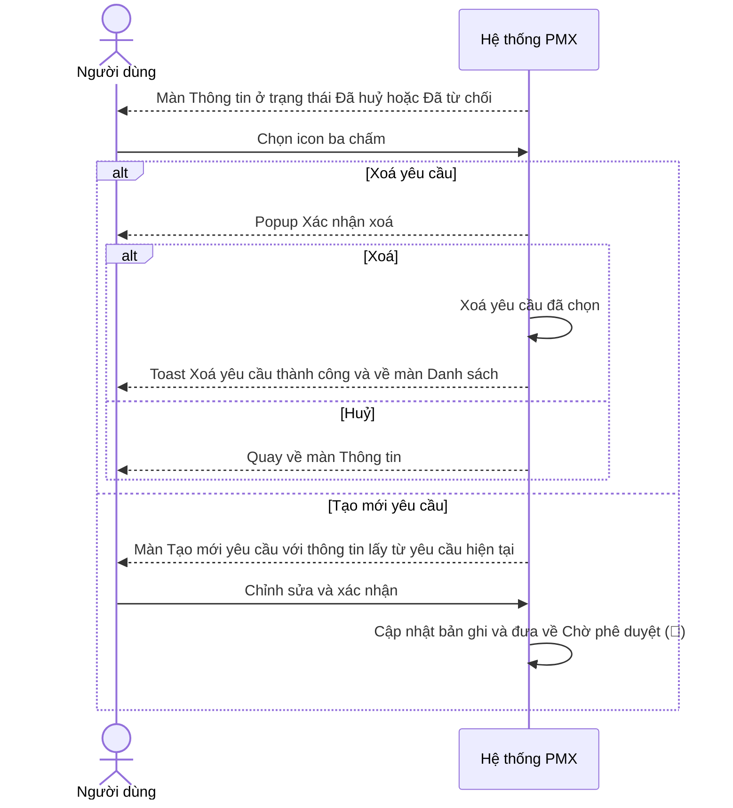

### Activity — Xoá yêu cầu và Tạo mới yêu cầu
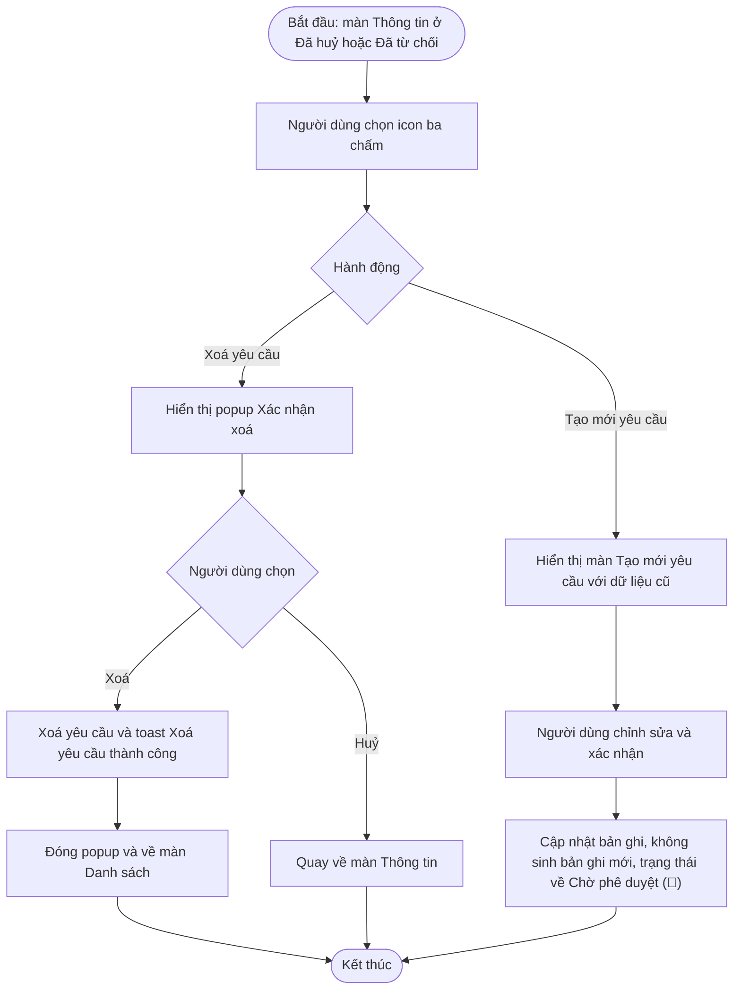
