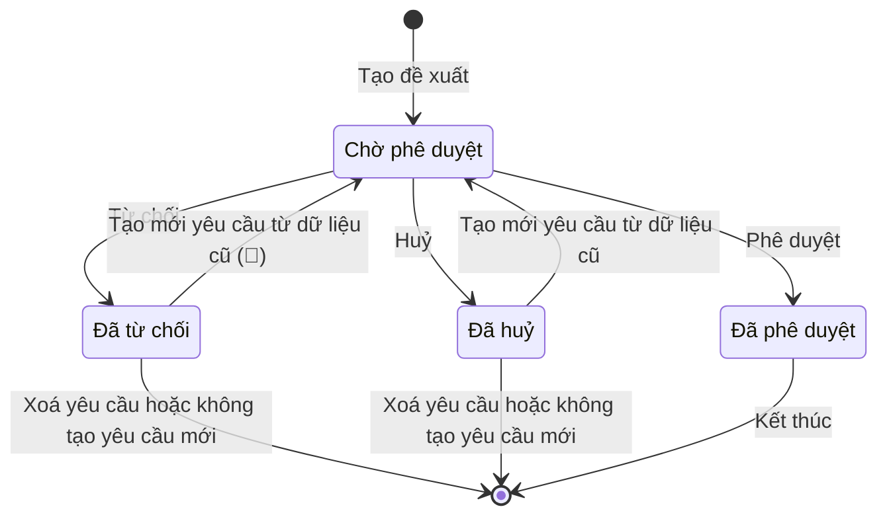

# Danh mục hàng hoá và dịch vụ kỹ thuật (`product-catalog`) — States tái lập (reverse)

## State: Bản ghi danh mục / Yêu cầu cấp mới (chung cho 5 danh mục)

> Nguồn: SRS Web tr.284 — Lưu đồ trạng thái chung cho danh mục (hình lưu đồ trạng thái và bảng Trạng thái / Thời điểm / Hành động, ghi "Lưu đồ chung cho tất cả các danh mục"); Dịch vụ kỹ thuật, Phụ tùng vật tư, Công cụ dụng cụ, Lốp, Ắc quy đều dùng chung và đều trỏ về lưu đồ này ("xem thêm ở Lưu đồ trạng thái") ✅ [SRS Web tr.291 — UC03.01.01 Xem danh mục Dịch vụ kỹ thuật; SRS Web tr.328 — UC03.03.01; SRS Web tr.364 — UC03.04.01; SRS Web tr.397 — UC03.05.01; SRS Web tr.430 — UC03.06.01]. Trong nguồn, yêu cầu cấp mới và bản ghi danh mục là cùng một bản ghi mang trạng thái (🔵). Hình lưu đồ có 2 cổng "?" sau Đã huỷ / Đã từ chối: "Không tạo YC mới" đi tới Kết thúc, "Tạo lại 1 yêu cầu mới (từ data cũ)" quay về bước Tạo đề xuất.

**Ghi chú trạng thái:**

| Trạng thái | Ý nghĩa | Vào bằng | Ra bằng | Nguồn | Nhãn |
|-----------|---------|----------|---------|-------|------|
| Chờ phê duyệt | Yêu cầu cấp mới đã tạo, chưa ai duyệt | Sau khi người dùng tạo yêu cầu cấp mới (hoặc tạo lại từ yêu cầu Đã huỷ / Đã từ chối) | Phê duyệt, Từ chối, Huỷ | SRS Web tr.284 — Lưu đồ trạng thái chung cho danh mục | ✅ |
| Đã huỷ | Yêu cầu bị huỷ trước khi duyệt | Sau khi người dùng huỷ yêu cầu cấp mới | Xoá yêu cầu; Tạo mới yêu cầu; hoặc kết thúc khi không tạo yêu cầu mới | SRS Web tr.284 — Lưu đồ trạng thái chung cho danh mục | ✅ |
| Đã từ chối | Yêu cầu bị người duyệt từ chối | Sau khi người dùng từ chối yêu cầu cấp mới | Xoá yêu cầu; Tạo mới yêu cầu; hoặc kết thúc khi không tạo yêu cầu mới | SRS Web tr.284 — Lưu đồ trạng thái chung cho danh mục | ✅ |
| Đã phê duyệt | Bản ghi danh mục có hiệu lực, đã có mã | Sau khi người dùng phê duyệt yêu cầu cấp mới | Không có hành động (kết thúc) | SRS Web tr.284 — Lưu đồ trạng thái chung cho danh mục; SRS Web tr.321 — UC03.01.05 Phê duyệt/Từ chối đề xuất cấp mới Dịch vụ kỹ thuật | ✅ |

**Kết thúc và ngõ cụt:**

| Trạng thái | Là kết thúc? | Đường ra (huỷ / đóng / sửa) | Chứng từ đã sinh phía sau xử lý thế nào khi huỷ | Sửa được sau khi chốt? | Nguồn | Nhãn |
|-----------|--------------|------------------------------|--------------------------------------------------|------------------------|-------|------|
| Chờ phê duyệt | Không | Huỷ (→ Đã huỷ), Từ chối (→ Đã từ chối), Phê duyệt (→ Đã phê duyệt); không có hành động sửa nội dung | Chưa có mã; nguồn không nói thông báo đã gửi cho người duyệt có bị thu hồi khi huỷ | Không có trong nguồn (phải huỷ rồi tạo lại) | SRS Web tr.284 — Lưu đồ trạng thái chung cho danh mục; SRS Web tr.308 — UC03.01.04 Huỷ đề xuất cấp mới Dịch vụ kỹ thuật | ✅ |
| Đã huỷ | Có thể kết thúc (cổng "không tạo YC mới") hoặc tạo lại | Xoá yêu cầu; Tạo mới yêu cầu (về Chờ phê duyệt); hoặc kết thúc | Không phát sinh chứng từ nào phía sau (chưa có mã) 🔵; nguồn không nói thông báo / lịch sử cũ khi xoá | Có — "Tạo mới yêu cầu" chỉnh sửa thông tin và nộp lại | SRS Web tr.284 — Lưu đồ trạng thái chung; SRS Web tr.311–312 — UC03.01.04 | ✅ |
| Đã từ chối | Có thể kết thúc (cổng "không tạo YC mới") hoặc tạo lại | Xoá yêu cầu; Tạo mới yêu cầu; hoặc kết thúc | Như Đã huỷ | Có — như Đã huỷ (câu trạng thái ghi "từ Đã huỷ về", OQ-3) | SRS Web tr.284 — Lưu đồ trạng thái chung; SRS Web tr.317–318 — UC03.01.05 | 🔵 |
| Đã phê duyệt | Có (điểm kết thúc của lưu đồ) | Không có huỷ, đóng, ngừng dùng, xoá | Nguồn không nói khi bản ghi đã phê duyệt đã được dùng ở nơi khác | Không có trong nguồn — "không có thêm hành động nào khác ở trạng thái Đã phê duyệt" | SRS Web tr.284 — Lưu đồ trạng thái chung; SRS Web tr.321 — UC03.01.05 | ✅ |
