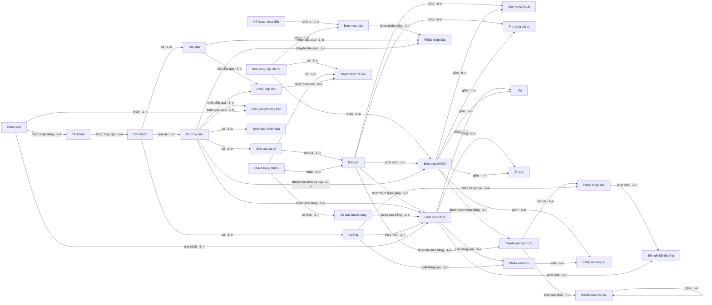

# Bản đồ đối tượng

## 0. Sơ đồ tổng quan

<!-- object-map:diagram:begin -->

<!-- object-map:diagram:end -->

## Vai trò nghiệp vụ

| Vai trò | Thuộc actor | Nguồn |
|---|---|---|
| Lái xe | Lái xe | lg-srs-export.md:3058 |
| Giám đốc xưởng | Nhân viên nội bộ Delta | lg-srs-export.md:3059 |
| Cố vấn dịch vụ | Nhân viên nội bộ Delta | lg-srs-export.md:3060 |
| Kế toán tổng hợp | Nhân viên nội bộ Delta | lg-srs-export.md:3061 |
| IT | Nhân viên nội bộ Delta | lg-srs-export.md:3068 |
| Nhân viên đối tác cây dầu | Nhân viên đối tác cây dầu | system-overview.md:18 |

## 1. Đối tượng

| Mã | Tên | Định nghĩa | Subsystem | Nguồn |
|---|---|---|---|---|
| OBJ-chi-nhanh | Chi nhánh | [[docs/_shared/definitions.md#Chi nhánh\|xem]] | Dùng chung | definitions.md:17 |
| OBJ-xuong | Xưởng | [[docs/_shared/definitions.md#Xưởng\|xem]] | Danh mục | lg-srs-export.md:385 |
| OBJ-cay-dau | Cây dầu | [[docs/_shared/definitions.md#Cây dầu\|xem]] | Cây dầu | lg-srs-export.md:305 |
| OBJ-phuong-tien | Phương tiện | [[docs/_shared/definitions.md#Phương tiện\|xem]] | Danh mục | lg-srs-export.md:338 |
| OBJ-xe-khach-hang | Xe của khách hàng | [[docs/_shared/definitions.md#Xe của khách hàng\|xem]] | Xưởng | lg-srs-export.md:90 |
| OBJ-nhan-vien | Nhân viên | [[docs/_shared/definitions.md#Nhân viên\|xem]] | Nhân sự | lg-srs-export.md:324 |
| OBJ-tai-khoan | Tài khoản | [[docs/_shared/definitions.md#Tài khoản\|xem]] | Administration | lg-srs-export.md:312 |
| OBJ-nha-cung-cap | Nhà cung cấp HHDV | [[docs/_shared/definitions.md#Nhà cung cấp HHDV\|xem]] | Xưởng | lg-srs-export.md:76 |
| OBJ-khach-hang | Khách hàng DK05 | [[docs/_shared/definitions.md#Khách hàng DK05\|xem]] | Xưởng | lg-srs-export.md:83 |
| OBJ-dich-vu-ky-thuat | Dịch vụ kỹ thuật | [[docs/_shared/definitions.md#DVKT (Dịch vụ kỹ thuật)\|xem]] | Xưởng | lg-srs-export.md:38 |
| OBJ-phu-tung-vat-tu | Phụ tùng vật tư | [[docs/_shared/definitions.md#PTVT (Phụ tùng vật tư)\|xem]] | Xưởng | lg-srs-export.md:45 |
| OBJ-cong-cu-dung-cu | Công cụ dụng cụ | [[docs/_shared/definitions.md#CCDC (Công cụ dụng cụ)\|xem]] | Xưởng | lg-srs-export.md:55 |
| OBJ-lop | Lốp | Danh mục lốp, tách riêng khỏi PTVT | Xưởng | lg-srs-export.md:62 |
| OBJ-ac-quy | Ắc quy | Danh mục ắc quy, tách riêng khỏi PTVT | Xưởng | lg-srs-export.md:69 |
| OBJ-khoan-muc-chi-phi | Khoản mục chi phí | [[docs/_shared/definitions.md#Chi phí cấp 1 / Chi phí cấp 2\|xem]] | Xưởng | lg-srs-export.md:97 |
| OBJ-bao-cao-su-co | Báo cáo sự cố | [[docs/_shared/definitions.md#Báo cáo sự cố\|xem]] | Xưởng | lg-srs-export.md:213 |
| OBJ-bao-gia | Báo giá | [[docs/_shared/definitions.md#Báo giá\|xem]] | Xưởng | lg-srs-export.md:174 |
| OBJ-lenh-sua-chua | Lệnh sửa chữa | [[docs/_shared/definitions.md#Lệnh sửa chữa\|xem]] | Xưởng | lg-srs-export.md:205 |
| OBJ-don-mua-hhdv | Đơn mua HHDV | [[docs/_shared/definitions.md#Đơn mua HHDV\|xem]] | Xưởng | lg-srs-export.md:165 |
| OBJ-phieu-nhap-kho | Phiếu nhập kho | [[docs/_shared/definitions.md#Phiếu nhập kho\|xem]] | Xưởng | lg-srs-export.md:184 |
| OBJ-phieu-xuat-kho | Phiếu xuất kho | [[docs/_shared/definitions.md#Phiếu xuất kho\|xem]] | Xưởng | lg-srs-export.md:192 |
| OBJ-thanh-toan-tra-truoc | Thanh toán trả trước | [[docs/_shared/definitions.md#Thanh toán trả trước / trả sau\|xem]] | Xưởng | lg-srs-export.md:221 |
| OBJ-thanh-toan-tra-sau | Thanh toán trả sau | [[docs/_shared/definitions.md#Thanh toán trả trước / trả sau\|xem]] | Xưởng · Cây dầu | lg-srs-export.md:231 |
| OBJ-de-nghi-boi-thuong | Đề nghị bồi thường | [[docs/_shared/definitions.md#Bồi thường thiệt hại\|xem]] | Xưởng | lg-srs-export.md:239 |
| OBJ-ke-hoach-mua-dau | Kế hoạch mua dầu | [[docs/_shared/definitions.md#Kế hoạch mua dầu / Phiếu nhập dầu / Phiếu cấp dầu\|xem]] | Cây dầu | lg-srs-export.md:276 |
| OBJ-don-mua-dau | Đơn mua dầu | [[docs/_shared/definitions.md#Đơn mua dầu\|xem]] | Cây dầu | lg-srs-export.md:276 |
| OBJ-phieu-nhap-dau | Phiếu nhập dầu | [[docs/_shared/definitions.md#Kế hoạch mua dầu / Phiếu nhập dầu / Phiếu cấp dầu\|xem]] | Cây dầu | lg-srs-export.md:285 |
| OBJ-phieu-cap-dau | Phiếu cấp dầu | [[docs/_shared/definitions.md#Kế hoạch mua dầu / Phiếu nhập dầu / Phiếu cấp dầu\|xem]] | Cây dầu | lg-srs-export.md:291 |
| OBJ-ban-giao-phuong-tien | Bàn giao phương tiện | [[docs/_shared/definitions.md#Bàn giao phương tiện\|xem]] | Danh mục | lg-srs-export.md:355 |
| OBJ-dinh-muc-nhien-lieu | Định mức nhiên liệu | [[docs/_shared/definitions.md#Định mức nhiên liệu\|xem]] | Danh mục | definitions.md:117 |

## 2. Quan hệ

| Từ | Quan hệ | Tới | Bản số | Đi được từ màn chi tiết | Nguồn |
|---|---|---|---|---|---|
| Chi nhánh | có | Xưởng | 1–n | Xưởng → Chi nhánh | definitions.md:22 |
| Chi nhánh | có | Cây dầu | 1–n | Cây dầu → Chi nhánh | definitions.md:22 |
| Chi nhánh | quản lý | Phương tiện | 1–n | Phương tiện → Chi nhánh | lg-srs-export.md:3716 |
| Tài khoản | được truy cập | Chi nhánh | n–n | Tài khoản → Chi nhánh | lg-srs-export.md:26324 |
| Nhân viên | đăng nhập bằng | Tài khoản | 1–1 | 2 chiều | 🟡 Suy luận · OQ-6 |
| Khách hàng DK05 | sở hữu | Xe của khách hàng | 1–n | 2 chiều | system-overview.md:32 |
| Khoản mục chi phí | gồm | Khoản mục chi phí | 1–n | 2 chiều | definitions.md:68 |
| Phương tiện | có | Báo cáo sự cố | 1–n | 2 chiều | definitions.md:98 |
| Báo cáo sự cố | sinh ra | Báo giá | 1–1 | 2 chiều | lg-srs-export.md:18665 |
| Báo giá | được thực hiện bằng | Lệnh sửa chữa | 1–n | 2 chiều | lg-srs-export.md:14243 |
| Khách hàng DK05 | nhận | Báo giá | 1–n | 2 chiều | lg-srs-export.md:3727 |
| Báo giá | dùng | Dịch vụ kỹ thuật | n–n | Báo giá → Dịch vụ kỹ thuật | definitions.md:63 |
| Báo giá | dùng | Phụ tùng vật tư | n–n | Báo giá → Phụ tùng vật tư | definitions.md:53 |
| Phương tiện | được sửa bằng | Lệnh sửa chữa | 1–n | 2 chiều | definitions.md:88 |
| Xe của khách hàng | được sửa bằng | Lệnh sửa chữa | 1–n | 2 chiều | definitions.md:88 |
| Xưởng | thực hiện | Lệnh sửa chữa | 1–n | Lệnh sửa chữa → Xưởng | lg-srs-export.md:3738 |
| Nhân viên | phụ trách | Lệnh sửa chữa | 1–n | Lệnh sửa chữa → Nhân viên | lg-srs-export.md:2068 |
| Lệnh sửa chữa | dùng | Lốp | n–n | Lệnh sửa chữa → Lốp | definitions.md:108 |
| Lệnh sửa chữa | dùng | Ắc quy | n–n | Lệnh sửa chữa → Ắc quy | definitions.md:108 |
| Lệnh sửa chữa | xuất hàng qua | Phiếu xuất kho | 1–n | 2 chiều | 🟡 Suy luận · OQ-3 |
| Nhà cung cấp HHDV | nhận | Đơn mua HHDV | 1–n | 2 chiều | lg-srs-export.md:3728 |
| Báo giá | phát sinh | Đơn mua HHDV | 1–n | 2 chiều | 🟡 Suy luận · OQ-4 |
| Đơn mua HHDV | gồm | Phụ tùng vật tư | n–n | Đơn mua HHDV → Phụ tùng vật tư | lg-srs-export.md:13460 |
| Đơn mua HHDV | gồm | Lốp | n–n | Đơn mua HHDV → Lốp | lg-srs-export.md:13460 |
| Đơn mua HHDV | gồm | Ắc quy | n–n | Đơn mua HHDV → Ắc quy | lg-srs-export.md:13460 |
| Đơn mua HHDV | gồm | Công cụ dụng cụ | n–n | Đơn mua HHDV → Công cụ dụng cụ | lg-srs-export.md:13460 |
| Đơn mua HHDV | gồm | Dịch vụ kỹ thuật | n–n | Đơn mua HHDV → Dịch vụ kỹ thuật | lg-srs-export.md:13472 |
| Phương tiện | được mua dịch vụ qua | Đơn mua HHDV | 1–n | 2 chiều | lg-srs-export.md:13626 |
| Đơn mua HHDV | được thanh toán bằng | Thanh toán trả trước | 1–n | 2 chiều | definitions.md:133 |
| Thanh toán trả trước | dẫn tới | Phiếu nhập kho | 1–n | 2 chiều | lg-srs-export.md:19024 |
| Xưởng | nhập hàng qua | Phiếu nhập kho | 1–n | Phiếu nhập kho → Xưởng | lg-srs-export.md:3736 |
| Xưởng | xuất hàng qua | Phiếu xuất kho | 1–n | Phiếu xuất kho → Xưởng | lg-srs-export.md:3737 |
| Phiếu xuất kho | xuất | Công cụ dụng cụ | n–n | Phiếu xuất kho → Công cụ dụng cụ | definitions.md:58 |
| Phiếu nhập kho | phát sinh | Đề nghị bồi thường | 1–n | 2 chiều | lg-srs-export.md:15484 |
| Lệnh sửa chữa | phát sinh | Đề nghị bồi thường | 1–n | 2 chiều | definitions.md:143 |
| Nhà cung cấp HHDV | có | Thanh toán trả sau | 1–n | 2 chiều | definitions.md:133 |
| Khách hàng DK05 | có | Thanh toán trả sau | 1–n | 2 chiều | lg-srs-export.md:22142 |
| Báo giá | được thu tiền bằng | Thanh toán trả trước | 1–1 | 2 chiều | lg-srs-export.md:14243 |
| Thanh toán trả trước | phân loại theo | Khoản mục chi phí | n–1 | Thanh toán trả trước → Khoản mục chi phí | definitions.md:68 |
| Kế hoạch mua dầu | sinh ra | Đơn mua dầu | 1–n | 2 chiều | lg-srs-export.md:3713 |
| Nhà cung cấp HHDV | nhận | Đơn mua dầu | 1–n | 2 chiều | 🟡 Suy luận · OQ-5 |
| Đơn mua dầu | được nhận bằng | Phiếu nhập dầu | 1–n | 2 chiều | definitions.md:128 |
| Cây dầu | nhận dầu qua | Phiếu nhập dầu | 1–n | Phiếu nhập dầu → Cây dầu | lg-srs-export.md:3705 |
| Phương tiện | chuyển dầu qua | Phiếu nhập dầu | 1–n | Phiếu nhập dầu → Phương tiện | lg-srs-export.md:289 |
| Cây dầu | cấp dầu qua | Phiếu cấp dầu | 1–n | Phiếu cấp dầu → Cây dầu | lg-srs-export.md:3704 |
| Phương tiện | nhận dầu qua | Phiếu cấp dầu | 1–n | 2 chiều | definitions.md:128 |
| Phiếu cấp dầu | được gom vào | Thanh toán trả sau | n–1 | 2 chiều | definitions.md:129 |
| Phương tiện | được giao qua | Bàn giao phương tiện | 1–n | 2 chiều | lg-srs-export.md:29893 |
| Nhân viên | nhận | Bàn giao phương tiện | 1–n | 2 chiều | lg-srs-export.md:29893 |
| Phương tiện | có | Định mức nhiên liệu | 1–n | 2 chiều | definitions.md:118 |

## 3. Hành động theo vai trò

| Đối tượng | Hành động | Vai trò | Kênh | Đổi trạng thái | Nguồn |
|---|---|---|---|---|---|
| Xưởng | Đề xuất cấp mới | Cố vấn dịch vụ | Website | — → Chờ phê duyệt | lg-srs-export.md:5271 |
| Xưởng | Thu hồi | Cố vấn dịch vụ | Website | Chờ phê duyệt → Đã huỷ | lg-srs-export.md:5271 |
| Xưởng | Phê duyệt / Từ chối | 🟡 chưa rõ | Website | Chờ phê duyệt → Đã phê duyệt / Đã từ chối | 🟡 Suy luận · OQ-1 |
| Cây dầu | Tạo mới | Cố vấn dịch vụ | Website | Bản nháp → Chờ phê duyệt | lg-srs-export.md:33726 |
| Cây dầu | Thu hồi | Cố vấn dịch vụ | Website | Chờ phê duyệt → Đã thu hồi | lg-srs-export.md:33726 |
| Cây dầu | Phê duyệt / Từ chối | Giám đốc xưởng | Website | Chờ phê duyệt → Đã phê duyệt / Đã từ chối | lg-srs-export.md:3059 |
| Phương tiện | Cập nhật thông tin | Cố vấn dịch vụ | Website | — | lg-srs-export.md:3060 |
| Phương tiện | Phê duyệt cập nhật | Giám đốc xưởng | Website | — | lg-srs-export.md:3059 |
| Xe của khách hàng | Đề xuất cấp mới | Cố vấn dịch vụ | Website | — → Chờ phê duyệt | lg-srs-export.md:5271 |
| Xe của khách hàng | Thu hồi | Cố vấn dịch vụ | Website | Chờ phê duyệt → Đã huỷ | lg-srs-export.md:5271 |
| Xe của khách hàng | Phê duyệt / Từ chối | 🟡 chưa rõ | Website | Chờ phê duyệt → Đã phê duyệt / Đã từ chối | 🟡 Suy luận · OQ-1 |
| Nhân viên | Đề xuất cấp mới | Cố vấn dịch vụ | Website | — → Yêu cầu cấp mới | lg-srs-export.md:27244 |
| Nhân viên | Thu hồi | Cố vấn dịch vụ | Website | Yêu cầu cấp mới → Đã huỷ cấp mới | lg-srs-export.md:27244 |
| Nhân viên | Phê duyệt / Từ chối cấp mới | 🟡 chưa rõ | Website | Yêu cầu cấp mới → Đang hoạt động / Từ chối cấp mới | 🟡 Suy luận · OQ-1 |
| Nhân viên | Tạo yêu cầu xin nghỉ | Cố vấn dịch vụ | Website | Đang hoạt động → Yêu cầu xin nghỉ | lg-srs-export.md:27244 |
| Tài khoản | Tạo tài khoản | IT | Website | — → Chờ kích hoạt | lg-srs-export.md:26324 |
| Tài khoản | Vô hiệu hoá | IT | Website | Hoạt động → Vô hiệu hoá | lg-srs-export.md:26324 |
| Tài khoản | Kích hoạt lại | IT | Website | Vô hiệu hoá → Hoạt động | lg-srs-export.md:26324 |
| Tài khoản | Chỉnh sửa nhóm quyền / chi nhánh | IT | Website | — | lg-srs-export.md:26324 |
| Nhà cung cấp HHDV | Đề xuất cấp mới | Cố vấn dịch vụ | Website | — → Chờ phê duyệt | lg-srs-export.md:5271 |
| Nhà cung cấp HHDV | Thu hồi | Cố vấn dịch vụ | Website | Chờ phê duyệt → Đã huỷ | lg-srs-export.md:5271 |
| Nhà cung cấp HHDV | Phê duyệt / Từ chối | 🟡 chưa rõ | Website | Chờ phê duyệt → Đã phê duyệt / Đã từ chối | 🟡 Suy luận · OQ-1 |
| Khách hàng DK05 | Đề xuất cấp mới | Cố vấn dịch vụ | Website | — → Chờ phê duyệt | lg-srs-export.md:5271 |
| Khách hàng DK05 | Thu hồi | Cố vấn dịch vụ | Website | Chờ phê duyệt → Đã huỷ | lg-srs-export.md:5271 |
| Khách hàng DK05 | Phê duyệt / Từ chối | 🟡 chưa rõ | Website | Chờ phê duyệt → Đã phê duyệt / Đã từ chối | 🟡 Suy luận · OQ-1 |
| Dịch vụ kỹ thuật | Đề xuất cấp mới | Cố vấn dịch vụ | Website | — → Chờ phê duyệt | lg-srs-export.md:5271 |
| Dịch vụ kỹ thuật | Thu hồi | Cố vấn dịch vụ | Website | Chờ phê duyệt → Đã huỷ | lg-srs-export.md:5271 |
| Dịch vụ kỹ thuật | Phê duyệt / Từ chối | 🟡 chưa rõ | Website | Chờ phê duyệt → Đã phê duyệt / Đã từ chối | 🟡 Suy luận · OQ-1 |
| Phụ tùng vật tư | Đề xuất cấp mới | Cố vấn dịch vụ | Website | — → Chờ phê duyệt | lg-srs-export.md:5271 |
| Phụ tùng vật tư | Thu hồi | Cố vấn dịch vụ | Website | Chờ phê duyệt → Đã huỷ | lg-srs-export.md:5271 |
| Phụ tùng vật tư | Phê duyệt / Từ chối | 🟡 chưa rõ | Website | Chờ phê duyệt → Đã phê duyệt / Đã từ chối | 🟡 Suy luận · OQ-1 |
| Công cụ dụng cụ | Đề xuất cấp mới | Cố vấn dịch vụ | Website | — → Chờ phê duyệt | lg-srs-export.md:5271 |
| Công cụ dụng cụ | Thu hồi | Cố vấn dịch vụ | Website | Chờ phê duyệt → Đã huỷ | lg-srs-export.md:5271 |
| Công cụ dụng cụ | Phê duyệt / Từ chối | 🟡 chưa rõ | Website | Chờ phê duyệt → Đã phê duyệt / Đã từ chối | 🟡 Suy luận · OQ-1 |
| Lốp | Đề xuất cấp mới | Cố vấn dịch vụ | Website | — → Chờ phê duyệt | lg-srs-export.md:5271 |
| Lốp | Thu hồi | Cố vấn dịch vụ | Website | Chờ phê duyệt → Đã huỷ | lg-srs-export.md:5271 |
| Lốp | Phê duyệt / Từ chối | 🟡 chưa rõ | Website | Chờ phê duyệt → Đã phê duyệt / Đã từ chối | 🟡 Suy luận · OQ-1 |
| Ắc quy | Đề xuất cấp mới | Cố vấn dịch vụ | Website | — → Chờ phê duyệt | lg-srs-export.md:5271 |
| Ắc quy | Thu hồi | Cố vấn dịch vụ | Website | Chờ phê duyệt → Đã huỷ | lg-srs-export.md:5271 |
| Ắc quy | Phê duyệt / Từ chối | 🟡 chưa rõ | Website | Chờ phê duyệt → Đã phê duyệt / Đã từ chối | 🟡 Suy luận · OQ-1 |
| Khoản mục chi phí | Đề xuất cấp mới | Cố vấn dịch vụ | Website | — → Chờ phê duyệt | lg-srs-export.md:5271 |
| Khoản mục chi phí | Thu hồi | Cố vấn dịch vụ | Website | Chờ phê duyệt → Đã huỷ | lg-srs-export.md:5271 |
| Khoản mục chi phí | Phê duyệt / Từ chối | 🟡 chưa rõ | Website | Chờ phê duyệt → Đã phê duyệt / Đã từ chối | 🟡 Suy luận · OQ-1 |
| Báo cáo sự cố | Gửi | Lái xe | App Lái xe | — → Đang chờ xử lý | definitions.md:98 |
| Báo cáo sự cố | Thu hồi | Lái xe | App Lái xe | Đang chờ xử lý → Đã thu hồi | lg-srs-export.md:18665 |
| Báo cáo sự cố | Xác nhận / Từ chối | Cố vấn dịch vụ | Website | Đang chờ xử lý → Đã xác nhận / Đã từ chối | lg-srs-export.md:218 |
| Báo giá | Tạo mới | Cố vấn dịch vụ | Website | — → Chờ phê duyệt | lg-srs-export.md:14243 |
| Báo giá | Thu hồi | Cố vấn dịch vụ | Website | Chờ phê duyệt → Đã huỷ | lg-srs-export.md:14243 |
| Báo giá | Phê duyệt / Từ chối | Giám đốc xưởng | Website | Chờ phê duyệt → Đã phê duyệt / Đã từ chối | lg-srs-export.md:3059 |
| Báo giá | Xác nhận / Từ chối xác nhận | 🟡 chưa rõ | Website | Chờ xác nhận → Đã xác nhận | 🟡 Suy luận · OQ-7 |
| Lệnh sửa chữa | Tạo mới | Cố vấn dịch vụ | Website | — → Đang sửa chữa | lg-srs-export.md:16975 |
| Lệnh sửa chữa | Chốt lệnh | Cố vấn dịch vụ | Website | Đang sửa chữa → Đã chốt lệnh | lg-srs-export.md:3060 |
| Lệnh sửa chữa | Nghiệm thu / Từ chối nghiệm thu | Lái xe | App Lái xe | Đã chốt lệnh → Đã nghiệm thu / Từ chối nghiệm thu | lg-srs-export.md:16975 |
| Đơn mua HHDV | Tạo mới | Cố vấn dịch vụ | Website | — → Chờ phê duyệt | lg-srs-export.md:13171 |
| Đơn mua HHDV | Tạo mới | Lái xe | App Lái xe | — → Chờ phê duyệt | lg-srs-export.md:3058 |
| Đơn mua HHDV | Thu hồi | Cố vấn dịch vụ | Website | Chờ phê duyệt → Đã huỷ | lg-srs-export.md:13171 |
| Đơn mua HHDV | Phê duyệt / Từ chối lần 1 | Giám đốc xưởng | Website | Chờ phê duyệt → Đã phê duyệt - lần 1 / Đã từ chối | lg-srs-export.md:13171 |
| Đơn mua HHDV | Phê duyệt / Từ chối lần 2 | Giám đốc xưởng | Website | Đã phê duyệt - lần 1 → Đã phê duyệt - lần 2 / Chờ nghiệm thu / Đã từ chối | lg-srs-export.md:13171 |
| Đơn mua HHDV | Nghiệm thu / Từ chối nghiệm thu | Lái xe | App Lái xe | Chờ nghiệm thu → Đã nghiệm thu / Từ chối nghiệm thu | lg-srs-export.md:3058 |
| Phiếu nhập kho | Tạo yêu cầu | Cố vấn dịch vụ | Website | — → Chờ phê duyệt | lg-srs-export.md:15484 |
| Phiếu nhập kho | Thu hồi | Cố vấn dịch vụ | Website | Chờ phê duyệt → Đã huỷ | lg-srs-export.md:15484 |
| Phiếu nhập kho | Phê duyệt / Từ chối | Giám đốc xưởng | Website | Chờ phê duyệt → Đã phê duyệt / Đã từ chối | lg-srs-export.md:15484 |
| Phiếu xuất kho | Tạo mới | Cố vấn dịch vụ | Website | — → Chờ phê duyệt | lg-srs-export.md:16177 |
| Phiếu xuất kho | Thu hồi | Cố vấn dịch vụ | Website | Chờ phê duyệt → Đã thu hồi | lg-srs-export.md:16177 |
| Phiếu xuất kho | Phê duyệt / Từ chối lần 1 và 2 | Giám đốc xưởng | Website | Chờ phê duyệt → Đã phê duyệt - lần 1 / Đã từ chối | lg-srs-export.md:16177 |
| Thanh toán trả trước | Tạo đề nghị | Cố vấn dịch vụ | Website | — → Chờ phê duyệt | lg-srs-export.md:19024 |
| Thanh toán trả trước | Thu hồi | Cố vấn dịch vụ | Website | Chờ phê duyệt → Đã huỷ | lg-srs-export.md:19024 |
| Thanh toán trả trước | Phê duyệt / Từ chối đề nghị | Giám đốc xưởng | Website | Chờ phê duyệt → Chờ duyệt chi / Đã từ chối | lg-srs-export.md:19024 |
| Thanh toán trả trước | Duyệt chi / Từ chối chi | Giám đốc xưởng | Website | Chờ duyệt chi → Đã duyệt chi / Từ chối chi | lg-srs-export.md:19024 |
| Thanh toán trả trước | Ghi nhận thanh toán | Cố vấn dịch vụ | Website | Đã duyệt chi → Đã thanh toán | lg-srs-export.md:3060 |
| Thanh toán trả sau | Chốt công nợ | Cố vấn dịch vụ | Website | Chưa chốt công nợ → Đã chốt CN - lần X | lg-srs-export.md:19943 |
| Thanh toán trả sau | Ghi nhận thanh toán | Cố vấn dịch vụ | Website | Chưa thanh toán → Đã thanh toán 1 phần / Đã tất toán | lg-srs-export.md:19943 |
| Đề nghị bồi thường | Hoàn thiện | Cố vấn dịch vụ | Website | Chưa hoàn thiện → Chờ phê duyệt | lg-srs-export.md:20464 |
| Đề nghị bồi thường | Thu hồi | Cố vấn dịch vụ | Website | Chờ phê duyệt → Đã thu hồi | lg-srs-export.md:20464 |
| Đề nghị bồi thường | Phê duyệt / Từ chối | Giám đốc xưởng | Website | Chờ phê duyệt → Đã từ chối | lg-srs-export.md:20464 |
| Kế hoạch mua dầu | Tạo mới | Cố vấn dịch vụ | Website | Bản nháp → Chờ phê duyệt | lg-srs-export.md:23416 |
| Kế hoạch mua dầu | Thu hồi | Cố vấn dịch vụ | Website | Chờ phê duyệt → Đã thu hồi | lg-srs-export.md:23416 |
| Kế hoạch mua dầu | Phê duyệt / Từ chối | Giám đốc xưởng | Website | Chờ phê duyệt → Đã phê duyệt / Đã từ chối | lg-srs-export.md:23416 |
| Đơn mua dầu | Huỷ đơn | Cố vấn dịch vụ | Website | Đang chờ giao → Đã huỷ | lg-srs-export.md:24031 |
| Phiếu nhập dầu | Tạo phiếu | Cố vấn dịch vụ | Website | — | lg-srs-export.md:285 |
| Phiếu nhập dầu | Tạo yêu cầu (dGas) | Lái xe | App Lái xe | — | lg-srs-export.md:3058 |
| Phiếu nhập dầu | Phê duyệt | Giám đốc xưởng | Website | — | lg-srs-export.md:285 |
| Phiếu cấp dầu | Ghi nhận bơm dầu | Nhân viên đối tác cây dầu | Portal | — | system-overview.md:18 |
| Phiếu cấp dầu | Chốt phiếu | Nhân viên đối tác cây dầu | Portal | — | system-overview.md:18 |
| Phiếu cấp dầu | Phê duyệt / Từ chối | Giám đốc xưởng | Website | — | lg-srs-export.md:291 |
| Bàn giao phương tiện | Tạo yêu cầu | Cố vấn dịch vụ | Website | — → Chờ phê duyệt | lg-srs-export.md:29893 |
| Bàn giao phương tiện | Thu hồi | Cố vấn dịch vụ | Website | Chờ phê duyệt → Đã huỷ | lg-srs-export.md:29893 |
| Bàn giao phương tiện | Phê duyệt / Từ chối | Giám đốc xưởng | Website | Chờ phê duyệt → Đã phê duyệt / Đã từ chối | lg-srs-export.md:29893 |
| Bàn giao phương tiện | Ký biên bản | 🟡 chưa rõ | Website | Đã phê duyệt → Đã hoàn thành | 🟡 Suy luận · OQ-8 |
| Định mức nhiên liệu | Tạo yêu cầu | Cố vấn dịch vụ | Website | — → Chờ phê duyệt kế hoạch | lg-srs-export.md:32111 |
| Định mức nhiên liệu | Thu hồi | Cố vấn dịch vụ | Website | Chờ phê duyệt mức tiêu hao → Đã huỷ cập nhật | lg-srs-export.md:32111 |
| Định mức nhiên liệu | Phê duyệt / Từ chối | Giám đốc xưởng | Website | Chờ phê duyệt kế hoạch → Đã phê duyệt thực hiện / Đã từ chối | lg-srs-export.md:32111 |
| Định mức nhiên liệu | Cập nhật mức tiêu hao | Cố vấn dịch vụ | Website | Đã phê duyệt thực hiện → Chờ phê duyệt mức tiêu hao | lg-srs-export.md:32111 |

## 4. Thuộc tính

| Đối tượng | Thuộc tính | Loại nghiệp vụ | Hiện ở | Lọc / Sắp | Nguồn |
|---|---|---|---|---|---|
| Chi nhánh | Tên chi nhánh | văn bản | Thẻ · Danh sách · Chi tiết | Lọc | system-overview.md:27 |
| Xưởng | Tên xưởng | văn bản | Thẻ · Danh sách · Chi tiết | Lọc + Sắp | lg-srs-export.md:385 |
| Xưởng | Trạng thái | trạng thái | Thẻ · Danh sách | Lọc | lg-srs-export.md:5271 |
| Cây dầu | Mã cây dầu | mã định danh | Thẻ · Danh sách · Chi tiết | Lọc + Sắp | lg-srs-export.md:3716 |
| Cây dầu | Loại (nội bộ / mua ngoài) | danh mục | Thẻ · Danh sách · Chi tiết | Lọc | definitions.md:43 |
| Cây dầu | Barem | tệp đính kèm | Chi tiết | — | definitions.md:123 |
| Cây dầu | Trạng thái hoạt động | trạng thái | Thẻ · Danh sách | Lọc | lg-srs-export.md:33726 |
| Phương tiện | Mã PT – Tên PT | mã định danh | Thẻ · Danh sách · Chi tiết | Lọc + Sắp | definitions.md:88 |
| Phương tiện | Trạng thái | trạng thái | Thẻ · Danh sách · Chi tiết | Lọc | lg-srs-export.md:28046 |
| Xe của khách hàng | Biển số / tên xe | mã định danh | Thẻ · Danh sách · Chi tiết | Lọc + Sắp | lg-srs-export.md:90 |
| Nhân viên | Họ tên | văn bản | Thẻ · Danh sách · Chi tiết | Lọc + Sắp | lg-srs-export.md:324 |
| Nhân viên | Trạng thái | trạng thái | Thẻ · Danh sách | Lọc | lg-srs-export.md:27244 |
| Tài khoản | Tên đăng nhập | mã định danh | Thẻ · Danh sách · Chi tiết | Lọc + Sắp | lg-srs-export.md:312 |
| Tài khoản | Nhóm quyền | danh mục | Danh sách · Chi tiết | Lọc | lg-srs-export.md:26324 |
| Tài khoản | Trạng thái | trạng thái | Thẻ · Danh sách | Lọc | lg-srs-export.md:26324 |
| Nhà cung cấp HHDV | Mã – Tên nhà cung cấp | mã định danh | Thẻ · Danh sách · Chi tiết | Lọc + Sắp | lg-srs-export.md:76 |
| Khách hàng DK05 | Mã – Tên khách hàng | mã định danh | Thẻ · Danh sách · Chi tiết | Lọc + Sắp | lg-srs-export.md:83 |
| Dịch vụ kỹ thuật | Mã – Tên DVKT | mã định danh | Thẻ · Danh sách · Chi tiết | Lọc + Sắp | definitions.md:63 |
| Phụ tùng vật tư | Mã – Tên PTVT | mã định danh | Thẻ · Danh sách · Chi tiết | Lọc + Sắp | lg-srs-export.md:45 |
| Công cụ dụng cụ | Mã – Tên CCDC | mã định danh | Thẻ · Danh sách · Chi tiết | Lọc + Sắp | lg-srs-export.md:55 |
| Lốp | Mã – Tên lốp | mã định danh | Thẻ · Danh sách · Chi tiết | Lọc + Sắp | lg-srs-export.md:62 |
| Ắc quy | Mã – Tên ắc quy | mã định danh | Thẻ · Danh sách · Chi tiết | Lọc + Sắp | lg-srs-export.md:69 |
| Khoản mục chi phí | Tên chi phí | văn bản | Thẻ · Danh sách · Chi tiết | Lọc | lg-srs-export.md:97 |
| Khoản mục chi phí | Cấp (1 / 2 / 3) | danh mục | Danh sách · Chi tiết | Lọc | lg-srs-export.md:97 |
| Báo cáo sự cố | Mã BCSC | mã định danh | Thẻ · Danh sách · Chi tiết | Lọc + Sắp | lg-srs-export.md:3746 |
| Báo cáo sự cố | Trạng thái | trạng thái | Thẻ · Danh sách · Chi tiết | Lọc | lg-srs-export.md:18665 |
| Báo giá | Mã báo giá | mã định danh | Thẻ · Danh sách · Chi tiết | Lọc + Sắp | lg-srs-export.md:3727 |
| Báo giá | Phân luồng | danh mục | Danh sách · Chi tiết | Lọc | definitions.md:93 |
| Báo giá | Trạng thái | trạng thái | Thẻ · Danh sách · Chi tiết | Lọc | lg-srs-export.md:14243 |
| Lệnh sửa chữa | Mã lệnh | mã định danh | Thẻ · Danh sách · Chi tiết | Lọc + Sắp | lg-srs-export.md:3738 |
| Lệnh sửa chữa | Loại lệnh | danh mục | Thẻ · Danh sách · Chi tiết | Lọc | definitions.md:108 |
| Lệnh sửa chữa | Trạng thái | trạng thái | Thẻ · Danh sách · Chi tiết | Lọc | lg-srs-export.md:16975 |
| Đơn mua HHDV | Mã đơn | mã định danh | Thẻ · Danh sách · Chi tiết | Lọc + Sắp | lg-srs-export.md:3728 |
| Đơn mua HHDV | Phân luồng | danh mục | Danh sách · Chi tiết | Lọc | definitions.md:93 |
| Đơn mua HHDV | GTTT | tiền | Thẻ · Danh sách · Chi tiết | Sắp | definitions.md:138 |
| Đơn mua HHDV | Trạng thái | trạng thái | Thẻ · Danh sách · Chi tiết | Lọc | lg-srs-export.md:13171 |
| Phiếu nhập kho | Mã phiếu | mã định danh | Thẻ · Danh sách · Chi tiết | Lọc + Sắp | lg-srs-export.md:3736 |
| Phiếu nhập kho | Trạng thái | trạng thái | Thẻ · Danh sách | Lọc | lg-srs-export.md:15484 |
| Phiếu xuất kho | Mã phiếu | mã định danh | Thẻ · Danh sách · Chi tiết | Lọc + Sắp | lg-srs-export.md:3737 |
| Phiếu xuất kho | Trạng thái | trạng thái | Thẻ · Danh sách | Lọc | lg-srs-export.md:16177 |
| Thanh toán trả trước | Mã đề nghị | mã định danh | Thẻ · Danh sách · Chi tiết | Lọc + Sắp | lg-srs-export.md:3748 |
| Thanh toán trả trước | Chiều (chi phí / doanh thu) | danh mục | Thẻ · Danh sách · Chi tiết | Lọc | lg-srs-export.md:3748 |
| Thanh toán trả trước | GTTT | tiền | Thẻ · Danh sách · Chi tiết | Sắp | definitions.md:138 |
| Thanh toán trả trước | Trạng thái | trạng thái | Thẻ · Danh sách | Lọc | lg-srs-export.md:19024 |
| Thanh toán trả sau | Kỳ công nợ (tháng) | ngày | Thẻ · Danh sách · Chi tiết | Lọc + Sắp | definitions.md:133 |
| Thanh toán trả sau | Chiều (chi phí / doanh thu) | danh mục | Thẻ · Danh sách · Chi tiết | Lọc | lg-srs-export.md:3747 |
| Thanh toán trả sau | Trạng thái công nợ | trạng thái | Thẻ · Danh sách | Lọc | lg-srs-export.md:19943 |
| Thanh toán trả sau | Trạng thái thanh toán | trạng thái | Thẻ · Danh sách | Lọc | lg-srs-export.md:19943 |
| Đề nghị bồi thường | Mã đề nghị | mã định danh | Thẻ · Danh sách · Chi tiết | Lọc + Sắp | lg-srs-export.md:3758 |
| Đề nghị bồi thường | Trạng thái | trạng thái | Thẻ · Danh sách | Lọc | lg-srs-export.md:20464 |
| Kế hoạch mua dầu | Mã kế hoạch | mã định danh | Thẻ · Danh sách · Chi tiết | Lọc + Sắp | lg-srs-export.md:3714 |
| Kế hoạch mua dầu | Trạng thái | trạng thái | Thẻ · Danh sách | Lọc | lg-srs-export.md:23416 |
| Đơn mua dầu | Mã PO | mã định danh | Thẻ · Danh sách · Chi tiết | Lọc + Sắp | lg-srs-export.md:3713 |
| Đơn mua dầu | Trạng thái | trạng thái | Thẻ · Danh sách | Lọc | lg-srs-export.md:24031 |
| Phiếu nhập dầu | Mã phiếu | mã định danh | Thẻ · Danh sách · Chi tiết | Lọc + Sắp | lg-srs-export.md:3705 |
| Phiếu cấp dầu | Mã phiếu | mã định danh | Thẻ · Danh sách · Chi tiết | Lọc + Sắp | lg-srs-export.md:3704 |
| Bàn giao phương tiện | Loại (bàn giao / thu hồi) | danh mục | Thẻ · Danh sách · Chi tiết | Lọc | lg-srs-export.md:31059 |
| Bàn giao phương tiện | Trạng thái | trạng thái | Thẻ · Danh sách | Lọc | lg-srs-export.md:29893 |
| Định mức nhiên liệu | Phân loại (theo tải trọng / không theo tải trọng) | danh mục | Thẻ · Chi tiết | Lọc | definitions.md:118 |
| Định mức nhiên liệu | Trạng thái | trạng thái | Thẻ · Danh sách | Lọc | lg-srs-export.md:32111 |

## 5. Đề xuất hiển thị dùng chung

| Đối tượng | Dùng ở feature | Thẻ hiện | Dòng danh sách hiện | Gợi ý CMP |
|---|---|---|---|---|
| Phương tiện | Quản lý phương tiện, Sửa chữa, Báo cáo sự cố, Cấp dầu | Mã PT – Tên PT · Trạng thái | Mã PT – Tên PT · Trạng thái · Chi nhánh | Thẻ Phương tiện dùng chung — đề xuất `/update-overview patterns` |
| Nhà cung cấp HHDV | Mua hàng, Thanh toán, Cây dầu | Mã – Tên | Mã – Tên · Trạng thái | Ô chọn Nhà cung cấp dùng chung |
| Phụ tùng vật tư | Danh mục, Báo giá, Kho, Sửa chữa | Mã – Tên PTVT | Mã – Tên · Trạng thái | Dòng mặt hàng dùng chung cho Lốp, Ắc quy, CCDC, DVKT |
| Lệnh sửa chữa | Sửa chữa, Kho, Thanh toán, Bồi thường | Mã lệnh · Loại lệnh · Trạng thái | Mã lệnh · Phương tiện · Loại · Trạng thái | Thẻ chứng từ dùng chung (mã · trạng thái · GTTT) |

## 6. Câu hỏi mở

| # | Câu hỏi | Liên quan |
|---|---|---|
| OQ-1 | Vai trò nào phê duyệt / từ chối đề xuất cấp mới danh mục (Xưởng, xe khách hàng, nhà cung cấp, khách hàng, DVKT, PTVT, CCDC, lốp, ắc quy, chi phí) và cấp mới nhân viên? Bảng vai trò mẫu loại Giám đốc xưởng khỏi các quyền này (lg-srs-export.md:3059). | Mục 3 |
| OQ-2 | Bảng vai trò mẫu (5 vai trò) đang đánh dấu `[not done]` trong SRS — còn đúng để dùng không? | Vai trò nghiệp vụ |
| OQ-3 | Lệnh sửa chữa có sinh phiếu xuất kho phụ tùng không, và 1 lệnh có nhiều phiếu xuất không? | Mục 2, Lệnh sửa chữa — Phiếu xuất kho |
| OQ-4 | Báo giá chọn sửa ở xưởng ngoài có sinh Đơn mua HHDV (dịch vụ sửa chữa ngoài) không? | Mục 2, Báo giá — Đơn mua HHDV |
| OQ-5 | Nhà cung cấp dầu có phải là Nhà cung cấp HHDV trong danh mục không? | Mục 2, Đơn mua dầu |
| OQ-6 | Mỗi nhân viên có đúng 1 tài khoản đăng nhập không? | Mục 2, Nhân viên — Tài khoản |
| OQ-7 | Ai xác nhận báo giá với khách hàng (bước Chờ xác nhận → Đã xác nhận)? | Mục 3, Báo giá |
| OQ-8 | Ai ký biên bản bàn giao / thu hồi phương tiện — lái xe nhận xe, người giao, hay cả hai? | Mục 3, Bàn giao phương tiện |
| OQ-9 | Phiếu nhập dầu đã tạo có thu hồi hoặc huỷ được không? SRS không có lưu đồ trạng thái cho phiếu này. | Mục 3, Phiếu nhập dầu |
