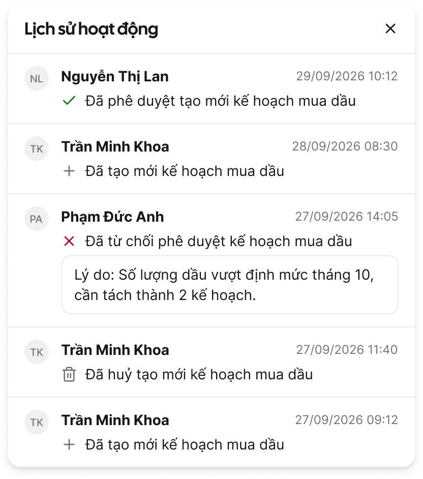

# UI Common Components (CMP)

Component dùng chung toàn hệ thống web. UC/màn gọi theo mã: `Xem CMP-xx — {tên}`, rồi chỉ điền phần
**UC phải khai báo** của CMP đó. Quy tắc nhập liệu, định dạng, bảng ở [[docs/_shared/conventions.md|Quy tắc chung (GR)]].

Màu, cỡ, khoảng cách, câu chữ lấy theo `docs/design.md` (Content & Formatting › Copy động). File này
không chứa wording cố định; chỗ nào có câu mẫu là trỏ về design.md.

| Mã | Tên | Dùng khi | Nguồn gốc |
|---|---|---|---|
| CMP-01 | Toast Notification | Phản hồi sau hành động (thành công, lỗi hệ thống, cảnh báo, thông tin) | SC-01 |
| CMP-02 | In-app Notification | Hành động nghiệp vụ cần báo cho người liên quan trong luồng | SC-02 |
| CMP-03 | Confirm Dialog | Trước hành động quan trọng hoặc không hoàn tác được | SC-03 |
| CMP-04 | Pagination | Cuối mọi màn danh sách | SC-04 |
| CMP-05 | Filter Drawer (Bộ lọc nâng cao) | Lọc nâng cao trên màn danh sách | SC-05 + 2.20 |
| CMP-06 | Column Customizer | Bật/tắt, sắp thứ tự cột bảng danh sách | SC-06 |
| CMP-07 | Action Matrix | Cột hành động cuối mỗi hàng danh sách | SC-07 |
| CMP-08 | Activity Log | Lịch sử hành động trên màn chi tiết/drawer | SC-08 |
| CMP-09 | Stepper | Luồng nghiệp vụ nhiều bước liên tiếp | SC-09 |
| CMP-10 | File Upload | Đính kèm chứng từ, tài liệu | SC-10 |
| CMP-11 | Sidebar Menu | Điều hướng giữa module/feature | SC-13 |

Mỗi CMP có dòng **Figma**: component trong thư viện Astryx (tên set theo `docs/figma-library-keys.json`)
hoặc component dự án (mục *Components - innvie logis* của design.md), node mẫu trong file Figma dự án
`FifpyOMpZk9OP8qyNzbRVJ`, và ảnh cache `docs/_shared/images/cmp-NN.png` (chụp qua Figma MCP). Dòng
**design.md** liệt kê mục design.md chứa chi tiết (tách bằng `;`) — `_scripts/ui-common-expand.py` đọc
dòng này để chép nguyên văn vào Phụ lục A của SRS.

**Việc còn mở (2026-10-01):** CMP-07 cần dựng component dự án Action Matrix · CMP-09 Stepper nghiệp vụ
cần component riêng · CMP-10 File Upload và CMP-11 Sidebar bản thư viện chưa đạt yêu cầu. Bốn mục này
đang tạm dùng component Astryx, chưa có ảnh.
CMP-05 Bộ lọc nâng cao và CMP-06 Tuỳ chỉnh cột: đã có node nhưng ảnh chụp UI chưa đủ rõ (chip co chữ,
popover tách khỏi ngữ cảnh) — cần chọn/dựng khung chụp riêng rồi gắn lại ảnh.

---

## CMP-01 — Toast Notification

Thông báo ngắn góc trên phải, tự ẩn sau 3 giây, không chặn thao tác.

_Ảnh: Toast "Đã lưu thay đổi." — node [5080:2503](https://www.figma.com/design/FifpyOMpZk9OP8qyNzbRVJ/-innvie--invlogis-v0.3?node-id=5080-2503), xuất PNG 2x._

| # | Items | Control type | Data type | Description |
|---|---|---|---|---|
| 1 | Toast thành công | Toast | ReadOnly | • Sau khi hành động hoàn tất • Câu: mẫu "Đã {hành động}" theo design.md › Copy động › Toast; thêm `[Hoàn tác]` nếu đảo ngược được |
| 2 | Toast lỗi | Toast | ReadOnly | • Chỉ cho lỗi kỹ thuật/hệ thống (GR-15 Loại 3) — `E-common-008..010` • Lỗi của trường → inline; lỗi nghiệp vụ server → Popup Error (GR-15) |
| 3 | Toast cảnh báo | Toast | ReadOnly | • Cảnh báo không chặn hành động |
| 4 | Toast thông tin | Toast | ReadOnly | • Hướng dẫn hoặc trạng thái trung gian |

- **Figma:** Astryx `Toast` · node: [172:56853](https://www.figma.com/design/FifpyOMpZk9OP8qyNzbRVJ/-innvie--invlogis-v0.3?node-id=172-56853)
- **design.md:** Copy động
- **UC phải khai báo:** hành động nào có toast thành công + động từ dùng trong câu; hành động có `[Hoàn tác]` không.

## CMP-02 — In-app Notification

Icon chuông trên header, badge chưa đọc, panel danh sách thông báo. Spec đầy đủ: design.md ›
*Notification Center (theo SC-02)*.

_Ảnh: Panel Desktop — node [5144:2204](https://www.figma.com/design/FifpyOMpZk9OP8qyNzbRVJ/-innvie--invlogis-v0.3?node-id=5144-2204), xuất PNG 2x._

| # | Items | Control type | Data type | Description |
|---|---|---|---|---|
| 1 | Icon chuông | Button | Click | • Mở panel thông báo |
| 2 | Badge chưa đọc | Badge | ReadOnly | • Số chưa đọc, tối đa `9+`, ẩn khi 0, cập nhật realtime |
| 3 | Tiêu đề panel | Label | ReadOnly | • "Thông báo" + số chưa đọc |
| 4 | Đánh dấu đã đọc | Button | Click | • Ghost/link; toàn bộ về Đã đọc, badge về 0; ẩn khi không còn chưa đọc |
| 5 | Một thông báo | Item | Click | • Module nguồn · nội dung · thời gian (GR-03 dạng Relative) • Chưa đọc / đã đọc phân biệt bằng nền + chấm • Click → Đã đọc, badge −1, mở chi tiết bản ghi |

Mẫu nội dung chung: `[Tên module] · [Tên feature] — [Định danh] vừa được/bị [hành động] bởi [Người thực hiện]`.
Định danh: có mã → mã bản ghi; chưa có mã (trước phê duyệt, GR-11) → "một [tên feature]".

Hành động mặc định:

| Hành động | Động từ | Người nhận |
|---|---|---|
| Tạo mới (submit) | vừa được tạo | Người có quyền phê duyệt |
| Phê duyệt | vừa được phê duyệt | Người tạo |
| Từ chối | vừa bị từ chối | Người tạo |
| Thu hồi | vừa bị thu hồi | Người có quyền phê duyệt |

- **Figma:** component dự án `Notification Center` · node: [5142:2017](https://www.figma.com/design/FifpyOMpZk9OP8qyNzbRVJ/-innvie--invlogis-v0.3?node-id=5142-2017)
- **design.md:** Notification Center
- **UC phải khai báo:** hành động nào phát thông báo; người nhận; nội dung theo hành động (dùng bảng mặc định hay động từ riêng); định danh (tên feature, mã bản ghi); màn đích khi click.

## CMP-03 — Confirm Dialog

Modal xác nhận trước hành động quan trọng hoặc không hoàn tác được. Bắt buộc với: Xoá, Thu hồi, Phê
duyệt, Từ chối, Huỷ form khi có dữ liệu chưa lưu (GR-13). Tiêu đề, nội dung, nhãn nút theo design.md ›
Copy động › *Hộp xác nhận*.

_Ảnh: Destructive, Default — node [5046:66967](https://www.figma.com/design/FifpyOMpZk9OP8qyNzbRVJ/-innvie--invlogis-v0.3?node-id=5046-66967), xuất PNG 2x._

| # | Items | Control type | Data type | Description |
|---|---|---|---|---|
| 1 | Tiêu đề | Label | ReadOnly | • Câu hỏi nêu hành động + đối tượng |
| 2 | Nội dung | Label | ReadOnly | • Nêu bản ghi bị tác động (ưu tiên tên, không có thì mã, không có cả hai thì bỏ) + hệ quả |
| 3 | Trường lý do | Text area | Text | • Chỉ khi hành động cần lý do (vd Từ chối); bắt buộc hay không do UC quy định |
| 4 | Nút xác nhận | Button | Click | • Nhãn = động từ hành động; hành động phá huỷ dùng biến thể destructive • Loading khi đang gửi |
| 5 | Nút huỷ | Button | Click | • Đóng dialog, không thay đổi dữ liệu |

- **Figma:** Astryx `AlertDialog` (có trường lý do → `Dialog` [2266:9922](https://www.figma.com/design/FifpyOMpZk9OP8qyNzbRVJ/-innvie--invlogis-v0.3?node-id=2266-9922)) · node: [5046:66987](https://www.figma.com/design/FifpyOMpZk9OP8qyNzbRVJ/-innvie--invlogis-v0.3?node-id=5046-66987)
- **design.md:** Copy động
- **UC phải khai báo:** hành động nào cần xác nhận; tên feature + trường định danh hiển thị; có trường lý do không, bắt buộc không; hệ quả nêu trong nội dung (vd "trở về Bản nháp").

## CMP-04 — Pagination

Thanh phân trang cuối mọi màn danh sách. Spec: design.md › *Phân trang danh sách (theo SC-04)*.

_Ảnh: Pages, md — node [2347:57791](https://www.figma.com/design/FifpyOMpZk9OP8qyNzbRVJ/-innvie--invlogis-v0.3?node-id=2347-57791), xuất PNG 2x._

| # | Items | Control type | Data type | Description |
|---|---|---|---|---|
| 1 | Số bản ghi/trang | Dropdown | Select | • 25 / 50 / 100, mặc định 50 |
| 2 | Nhãn tổng | Label | ReadOnly | • Cập nhật theo bộ lọc hiện tại |
| 3 | Số trang | Button | Click | • Trang đầu, hiện tại ±1, `…`, trang cuối; trang hiện tại nổi bật |
| 4 | Trước / Sau | Button | Click | • Vô hiệu ở trang đầu/cuối |

- **Figma:** Astryx `Pagination` · node: [2347:58586](https://www.figma.com/design/FifpyOMpZk9OP8qyNzbRVJ/-innvie--invlogis-v0.3?node-id=2347-58586)
- **design.md:** Phân trang danh sách
- **UC phải khai báo:** chỉ khi khác mặc định (vd số bản ghi/trang khác 50). Khi nhóm dữ liệu, phân trang theo nhóm (GR-17).

## CMP-05 — Filter Drawer (Bộ lọc nâng cao)

Bộ lọc nâng cao màn danh sách. Spec + phương án đã chốt: design.md › *Bộ lọc nâng cao (theo SC-05 +
2.20)*. Lọc theo từng cột trên header bảng: GR-20.

| # | Items | Control type | Data type | Description |
|---|---|---|---|---|
| 1 | Tiêu đề | Label | ReadOnly | • "Bộ lọc" + số điều kiện đang áp dụng |
| 2 | Trường lọc | Dropdown / DatePicker / Textbox | Select / Date / Number | • Thứ tự theo thứ tự cột của bảng (kể cả cột ẩn) • Kiểu: chọn đơn, chọn nhiều (có giá trị "Không có" cho dữ liệu rỗng), khoảng ngày, khoảng số |
| 3 | Xoá bộ lọc | Button | Click | • Ghost; đưa mọi trường về rỗng |
| 4 | Áp dụng | Button | Click | • Primary; đóng, áp dụng, tải lại danh sách |
| 5 | Badge trên nút Bộ lọc | Badge | ReadOnly | • Số điều kiện đang áp dụng; ẩn khi không có |

- **Figma:** component dự án `Bộ lọc nâng cao` (PowerSearch + `.Value Editor`) · node: [5176:9303](https://www.figma.com/design/FifpyOMpZk9OP8qyNzbRVJ/-innvie--invlogis-v0.3?node-id=5176-9303) · **ảnh: chưa gắn — xử lý sau:** ảnh chụp UI chưa đủ rõ
- **design.md:** Bộ lọc nâng cao
- **UC phải khai báo:** danh sách trường lọc + kiểu lọc mỗi trường; giá trị mặc định; phụ thuộc giữa các trường (nếu có); trường không lọc được.

## CMP-06 — Column Customizer (Tuỳ chỉnh cột)

Bật/tắt và sắp thứ tự cột, lưu theo từng người dùng. Spec: design.md › *Tuỳ chỉnh cột (theo SC-06)*.

| # | Items | Control type | Data type | Description |
|---|---|---|---|---|
| 1 | Danh sách cột | Checkbox | Check | • Mọi cột theo thứ tự bảng (kể cả cột ẩn); tick để hiện/ẩn; kéo thả để đổi thứ tự |
| 2 | Cột khoá | Checkbox | ReadOnly | • Không ẩn được, checkbox vô hiệu + icon khoá |
| 3 | Đặt lại mặc định | Button | Click | • Về cấu hình cột mặc định của màn |
| 4 | Áp dụng | Button | Click | • Bảng cập nhật ngay |

- **Figma:** component dự án `Tuỳ chỉnh cột` · node: [5177:7634](https://www.figma.com/design/FifpyOMpZk9OP8qyNzbRVJ/-innvie--invlogis-v0.3?node-id=5177-7634) · **ảnh: chưa gắn — xử lý sau:** ảnh chụp UI chưa đủ rõ
- **design.md:** Tuỳ chỉnh cột
- **UC phải khai báo:** danh sách cột + thứ tự mặc định; cột nào hiện mặc định; cột khoá.

## CMP-07 — Action Matrix (hành động trên hàng)

Cột hành động cuối mỗi hàng danh sách. Quy tắc bảng: design.md › *Quy tắc bảng danh sách*.

| # | Items | Control type | Data type | Description |
|---|---|---|---|---|
| 1 | Icon hành động hiện sẵn | Button | Click | • Tối đa 2 icon; chỉ hiện hành động khả dụng theo trạng thái + quyền (không hiện rồi vô hiệu) |
| 2 | Menu ⋯ | Button | Click | • Gom hành động phụ; hành động phá huỷ (Xoá, Huỷ) luôn nằm trong ⋯; chỉ có 1 hành động phụ thì hiện thẳng, không dùng ⋯ |
| 3 | Vùng thông tin hàng | Link | Click | • Click → màn chi tiết; click vùng hành động không mở chi tiết |

- **Figma:** tạm Astryx `MoreMenu` + `Button` (Ghost Icon Only) · node: [198:12758](https://www.figma.com/design/FifpyOMpZk9OP8qyNzbRVJ/-innvie--invlogis-v0.3?node-id=198-12758) · **chưa chuẩn — xử lý sau:** cần dựng component dự án Action Matrix · ảnh: chưa gắn
- **design.md:** Quy tắc bảng danh sách
- **UC phải khai báo:** ma trận **trạng thái × quyền → hành động**; 2 hành động hiện sẵn; hành động nào cần CMP-03.

## CMP-08 — Activity Log

Lịch sử thay đổi trạng thái/hành động trên bản ghi, mở từ icon đồng hồ góc trên phải màn chi tiết.
Spec: design.md › *Activity Log (theo SC-08)*.

_Ảnh: Panel Desktop — node [5162:3528](https://www.figma.com/design/FifpyOMpZk9OP8qyNzbRVJ/-innvie--invlogis-v0.3?node-id=5162-3528), xuất PNG 2x._

| # | Items | Control type | Data type | Description |
|---|---|---|---|---|
| 1 | Icon mở | Button | Click | • Mở panel lịch sử |
| 2 | Một mốc | Item | ReadOnly | • Avatar · tên tài khoản · ngày (GR-03) · icon · nội dung hành động • Dòng "Lý do: …" chỉ khi hành động có lý do (vd Từ chối) |
| 3 | Sắp xếp | — | — | • Mới nhất trên cùng |

Hành động mặc định: Tạo mới (`+`, "Đã tạo mới [tên feature]") · Phê duyệt (`✓`, "Đã phê duyệt tạo mới [tên feature]") ·
Từ chối (`✕`, "Đã từ chối phê duyệt [tên feature]") · Thu hồi ("Đã huỷ tạo mới [tên feature]").

- **Figma:** component dự án `Activity Log` · node: [5160:3295](https://www.figma.com/design/FifpyOMpZk9OP8qyNzbRVJ/-innvie--invlogis-v0.3?node-id=5160-3295)
- **design.md:** Activity Log
- **UC phải khai báo:** tên feature dùng trong câu; hành động ghi log ngoài 4 hành động mặc định + icon/nội dung.

## CMP-09 — Stepper

Thanh tiến trình đầu màn cho luồng nghiệp vụ nhiều bước liên tiếp.

| # | Items | Control type | Data type | Description |
|---|---|---|---|---|
| 1 | Bước | Label | Click | • Trạng thái: đã xong / hiện tại / chưa tới • Click bước đã xong → chuyển sang màn nghiệp vụ của bước đó (nếu có quyền) |

- **Figma:** tạm Astryx `Stepper` + `Stepper / Step` · node: [5045:66913](https://www.figma.com/design/FifpyOMpZk9OP8qyNzbRVJ/-innvie--invlogis-v0.3?node-id=5045-66913) · **chưa chuẩn — xử lý sau:** Stepper nghiệp vụ phức tạp hơn bản thư viện, cần dựng component dự án · ảnh: chưa gắn
- **design.md:** —
- **UC phải khai báo:** danh sách bước + thứ tự; điều kiện hoàn thành mỗi bước; bước nào được click quay lại.

## CMP-10 — File Upload

Đính kèm chứng từ, tài liệu.

| # | Items | Control type | Data type | Description |
|---|---|---|---|---|
| 1 | Vùng upload | Browse Button | File | • Viền đứt + icon + hướng dẫn; hỗ trợ kéo thả |
| 2 | Nút chọn file | Button | Click | • Outlined; mở hộp chọn file |
| 3 | Định dạng cho phép | Label | ReadOnly | • Mặc định JPG, PNG, PDF |
| 4 | Dung lượng tối đa | Label | ReadOnly | • Mặc định 250MB |
| 5 | Thẻ file | Card | Click | • Đang tải: icon loại + tên + dung lượng + đang tải • Thành công/thất bại: thêm icon kết quả + Xoá • Màn xem: icon loại + tên (click xem/tải) |
| 6 | Giới hạn số file | — | — | • 1 file: tải xong ẩn vùng upload, xoá file thì hiện lại • Nhiều file: giữ vùng upload, thẻ file xếp bên dưới |
| 7 | Lỗi định dạng | Label | ReadOnly | • Inline ngay khi chọn file, file không được ghi nhận — `E-common-006` |
| 8 | Lỗi dung lượng | Label | ReadOnly | • Inline ngay khi chọn file, file không được ghi nhận — `E-common-007` |

- **Figma:** tạm Astryx `FileInput` · node: [2577:20886](https://www.figma.com/design/FifpyOMpZk9OP8qyNzbRVJ/-innvie--invlogis-v0.3?node-id=2577-20886) · **chưa chuẩn — xử lý sau:** chưa đạt yêu cầu CMP-10 (thẻ file, trạng thái tải, giới hạn số file) · ảnh: chưa gắn
- **design.md:** —
- **UC phải khai báo:** định dạng bổ sung; dung lượng nếu khác 250MB; 1 hay nhiều file (tối đa bao nhiêu); bắt buộc không.

## CMP-11 — Sidebar Menu

Menu cố định bên trái, điểm truy cập chính tới module/feature.

| # | Items | Control type | Data type | Description |
|---|---|---|---|---|
| 1 | Logo | Link | Click | • Về danh sách module |
| 2 | Thu gọn | Button | Click | • Chỉ còn icon, hover hiện tooltip tên; trạng thái lưu theo người dùng |
| 3 | Mục cấp 1 (module) | Button | Click | • Tên + icon; có submenu thì mũi tên mở/đóng; module chứa trang hiện tại tự mở |
| 4 | Mục cấp 2 | Link | Click | • Thụt lề dưới module cha; điều hướng tới màn |
| 5 | Trạng thái active | — | — | • Chỉ 1 mục active, nổi bật + vạch dọc trái |
| 6 | Footer: tên module | Label | ReadOnly | • Module hiện tại |
| 7 | Footer: tên cơ sở | Dropdown | Select | • Ẩn khi module không chia cơ sở • 1 cơ sở: chỉ hiện tên, không mở được • Nhiều cơ sở: chọn để chuyển sang cơ sở khác |

Cấu trúc menu theo phân quyền role: người dùng chỉ thấy module được phép.

- **Figma:** tạm Astryx `Navigation / SideNav` trong `AppShell` · node: [2401:17634](https://www.figma.com/design/FifpyOMpZk9OP8qyNzbRVJ/-innvie--invlogis-v0.3?node-id=2401-17634) · **chưa chuẩn — xử lý sau:** chưa đạt yêu cầu CMP-11 (footer module/cơ sở, menu theo role) · ảnh: chưa gắn
- **design.md:** —
- **UC phải khai báo:** vị trí mục menu của feature (module cha, cấp); role nào thấy; module có chia cơ sở không.
