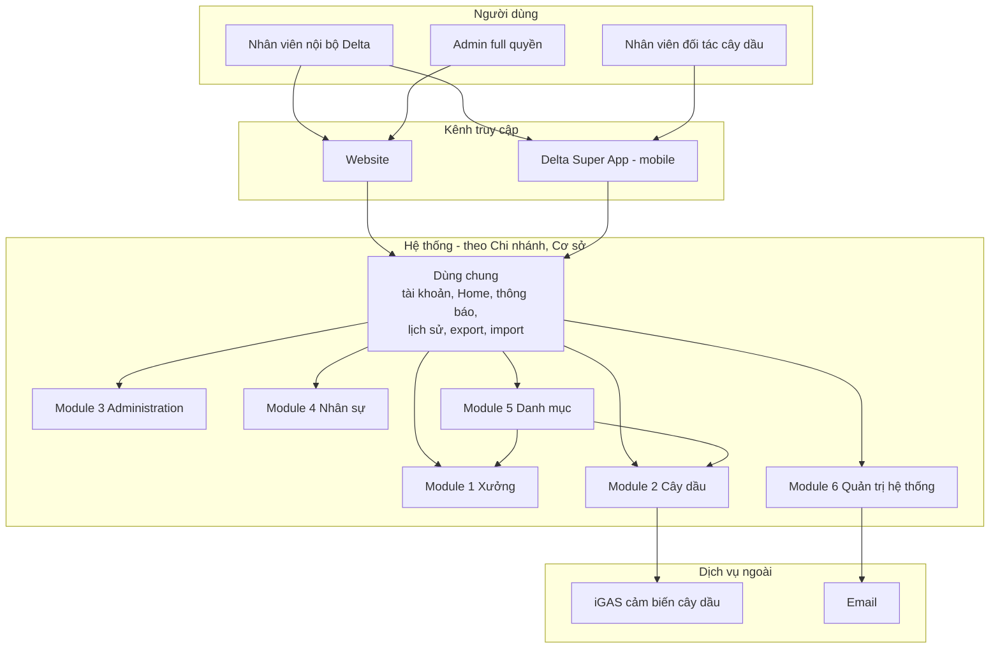

# System Overview

Bức tranh tổng của hệ thống: ai dùng, gồm những module nào, tổ chức dữ liệu ra sao và nối với dịch
vụ ngoài nào. Nguồn: tài liệu SRS LG (`docs-input/srs-cu/lg-srs-export.md`, bản export 2026-10). Chi tiết từng
feature nằm ở `docs/{feature}/`.

## Actors

- **Nhân viên nội bộ Delta** — thấy và làm được gì **tuỳ theo phân quyền** (nhóm quyền, quyền chức năng theo nền tảng, phạm vi chi nhánh / cơ sở). Dùng Website, và Delta Super App (mobile) cho một số nghiệp vụ. Trong luồng phê duyệt đóng vai *người tạo* (tạo, thu hồi, xoá yêu cầu của mình) hoặc *người có quyền phê duyệt* (phê duyệt / từ chối).
- **Admin** — **full quyền** trên toàn hệ thống, gồm quản lý tài khoản, nhóm quyền và phân quyền tài khoản (Module Administration).
- **Nhân viên đối tác cây dầu** — dùng Delta Super App (Partner Portal cũ đã gộp vào app, hiện chỉ có mobile) cho nghiệp vụ Cấp dầu: xem phiếu cấp dầu, ghi nhận bơm dầu, xuất hoá đơn, chốt phiếu.

## Tổ chức dữ liệu

> Nguồn đánh dấu phần này **chưa hoàn thiện** (`[not done]`) — dùng làm định hướng, chờ chốt.

| Cấp       | Ý nghĩa                                                                                                                                                        | Ví dụ                                |
| ---------- | ---------------------------------------------------------------------------------------------------------------------------------------------------------------- | -------------------------------------- |
| Công ty   | Đơn vị cao nhất, sở hữu mọi chi nhánh                                                                                                                    | Delta                                  |
| Chi nhánh | Vận hành độc lập về dữ liệu: cùng bộ feature nhưng dữ liệu tách hẳn, người ở chi nhánh A không thấy dữ liệu chi nhánh B dù cùng quyền | Chi nhánh Hà Nội, Chi nhánh TP.HCM |
| Cơ sở    | Đơn vị vật lý trực thuộc 1 chi nhánh, chỉ có ở module tổ chức theo cơ sở (Xưởng, Cây dầu); dữ liệu quản lý riêng theo cơ sở            | Cây dầu nội bộ A, Xưởng B        |

- Sau đăng nhập: được cấp 1 chi nhánh thì vào thẳng, nhiều chi nhánh thì chọn trước khi vào Home. Sau đó chọn Module → Cơ sở.
- **Phạm vi đặc biệt:** "Ngoài cơ sở" — nghiệp vụ phát sinh ngoài mọi cơ sở nội bộ (vd cấp dầu tại cây dầu mua ngoài), phải được cấp quyền riêng. "Tất cả cơ sở" — xem gộp dữ liệu các cơ sở được cấp quyền; thao tác trên từng bản ghi vẫn theo quyền tại cơ sở gốc của bản ghi.
- **Phân quyền dữ liệu theo quyền chức năng:** không có quyền thì không thấy feature trên menu. Có quyền xem thì thấy mọi yêu cầu do bất kỳ ai tạo; chỉ thu hồi / xoá được yêu cầu của chính mình. Nút hành động không có quyền thì ẩn, không vô hiệu. Được xem thông tin của feature liên quan qua liên kết (vd có quyền Khách hàng thì vẫn mở được chi tiết Xe của khách hàng).

## Subsystems

| Module                     | Nhóm năng lực                                                                                                                                                                                                                                                 | Nền tảng                             |
| -------------------------- | ---------------------------------------------------------------------------------------------------------------------------------------------------------------------------------------------------------------------------------------------------------------- | -------------------------------------- |
| Dùng chung                | Tài khoản cá nhân (đăng nhập, quên / đổi mật khẩu), màn Home chọn phạm vi, lưu nháp, thanh tiến trình nghiệp vụ, tạo nghiệp vụ tiếp theo, export / import, thao tác hàng loạt, thông báo, lịch sử hoạt động, đổi ngôn ngữ | Website, Delta Super App               |
| 1 — Xưởng               | Danh mục của xưởng · Quản lý tài sản (tồn kho, tồn xưởng, rác thải) · Nghiệp vụ xưởng (mua HHDV, báo giá, nhập / xuất kho, sửa chữa, báo cáo sự cố) · Thanh toán · Dashboard · Báo cáo                                       | Website, Delta Super App (một phần)  |
| 2 — Cây dầu             | Nghiệp vụ cây dầu (mua, nhập, cấp dầu) · Thanh toán trả sau · Danh mục bổ sung (cây dầu mua ngoài) · Dashboard                                                                                                                                  | Website, Delta Super App (đối tác: cấp dầu) |
| 3 — Administration        | Quản lý tài khoản, nhóm quyền, phân quyền tài khoản                                                                                                                                                                                                    | Website                                |
| 4 — Nhân sự             | Quản trị nhân viên (cấp mới, xin nghỉ)                                                                                                                                                                                                                    | Website                                |
| 5 — Danh mục             | Danh mục dùng chung cấp chi nhánh: phương tiện (bàn giao, thu hồi, định mức nhiên liệu), xưởng, cây dầu nội bộ                                                                                                                               | Website                                |
| 6 — Quản trị hệ thống | Lịch nhắc · Trợ giúp (FAQs, hướng dẫn sử dụng)                                                                                                                                                                                                         | Website, Delta Super App (lịch nhắc) |

## Feature Map

Mã và tên theo tài liệu nguồn. Cột **Vault** cho biết feature đã có tài liệu trong `docs/` chưa.

| Module                     | Epic                               | Feature                                                                                                                                                                                                                                      | Vault     |
| -------------------------- | ---------------------------------- | -------------------------------------------------------------------------------------------------------------------------------------------------------------------------------------------------------------------------------------------- | --------- |
| Dùng chung                | 01 Quản lý tài khoản cá nhân | UC01.01–01.06 (đăng nhập, quên / đổi / tạo mật khẩu, đăng xuất, thông tin cá nhân)                                                                                                                                           | chưa có |
| 1 — Xưởng               | 03 Danh mục                       | 03.01 Dịch vụ kỹ thuật · 03.03 Phụ tùng vật tư · 03.04 Công cụ dụng cụ · 03.05 Lốp · 03.06 Ắc quy · 03.07 Nhà cung cấp HHDV · 03.08 Khách hàng DK05 · 03.09 Xe của khách hàng · 03.10–03.12 Chi phí cấp 1–3 | chưa có |
| 1 — Xưởng               | 04 Quản lý tài sản             | 04.02 Hàng tồn kho (kiểm kê) · 04.03 Hàng tồn xưởng (kiểm kê) · 04.04 Danh mục rác thải (thanh lý)                                                                                                                           | chưa có |
| 1 — Xưởng               | 05 Nghiệp vụ xưởng             | 05.01 Mua HHDV · 05.02 Báo giá HHDV · 05.03 Nhập kho · 05.04 Xuất kho · 05.06 Sửa chữa · 05.07 Báo cáo sự cố                                                                                                                  | chưa có |
| 1 — Xưởng               | 06 Thanh toán                     | 06.01 Trả trước · 06.02 Trả sau · 06.03 Bồi thường thiệt hại · 06.04 Thanh toán bán HHDV (trả trước, trả sau)                                                                                                              | chưa có |
| 1 — Xưởng               | 10 Báo cáo · 11 Dashboards      | —                                                                                                                                                                                                                                           | chưa có |
| 2 — Cây dầu             | 12 Nghiệp vụ cây dầu           | 12.1 Mua dầu · 12.2 Nhập dầu · 12.3 Cấp dầu                                                                                                                                                                                           | chưa có |
| 2 — Cây dầu             | 15 Thanh toán                     | 12.05 Thanh toán trả sau                                                                                                                                                                                                                   | chưa có |
| 2 — Cây dầu             | 16 Danh mục                       | 12.4 Danh mục bổ sung — 12.4.2 Cây dầu mua ngoài                                                                                                                                                                                       | chưa có |
| 2 — Cây dầu             | 14 Dashboards                      | —                                                                                                                                                                                                                                           | chưa có |
| 3 — Administration        | —                                 | 13.01 Quản lý tài khoản · 13.02 Quản lý nhóm quyền · 02.02 Phân quyền tài khoản                                                                                                                                                | chưa có |
| 4 — Nhân sự             | —                                 | 02.01 Quản trị nhân viên (cấp mới, xin nghỉ)                                                                                                                                                                                          | chưa có |
| 5 — Danh mục             | —                                 | 04.01 Phương tiện (bàn giao, thu hồi, định mức nhiên liệu) · 03.02 Xưởng · 12.4.1 Cây dầu nội bộ                                                                                                                           | chưa có |
| 6 — Quản trị hệ thống | 08 Lịch nhắc · 09 Trợ giúp    | 08.04 Lịch nhắc · 09.01 FAQs · 09.02 Hướng dẫn sử dụng                                                                                                                                                                              | chưa có |

## External Integrations

- **iGAS** — dịch vụ cảm biến cây dầu: kiểm tra sensor khi tạo / sửa cây dầu nội bộ (UC12.04.03), kèm tải và xem trước bảng barem (bảng quy đổi mức dầu).
- **Email** — gửi email nhắc lịch cho phương tiện (UC08.04.07).

## Architecture

Module 5 Danh mục cấp dữ liệu danh mục dùng chung (phương tiện, xưởng, cây dầu nội bộ) cho các module
nghiệp vụ.
