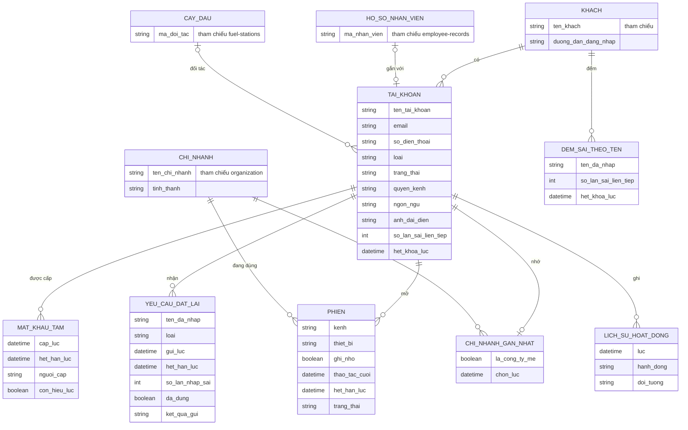

# Đăng nhập và tài khoản cá nhân — Entity Relationship Diagram

> Scope: tài khoản và các đối tượng phục vụ đăng nhập, đặt lại mật khẩu. KHACH, CHI_NHANH, HO_SO_NHAN_VIEN, CAY_DAU thuộc feature khác (`organization`, `employee-records`, `fuel-stations`), chỉ vẽ để thấy quan hệ.

## Diagram

## Ghi chú

| Thực thể | Ghi chú nghiệp vụ |
|---|---|
| TAI_KHOAN | `loai`: nội bộ / đối tác. `trang_thai`: Chờ kích hoạt, Đang hoạt động, Tạm khoá, Vô hiệu hoá (xem states.md). Tên tài khoản và email duy nhất trong một KHACH (BR-account-access-001). |
| MAT_KHAU_TAM | Chỉ bản mới nhất còn hiệu lực (BR-account-access-005). Không lưu mật khẩu dạng xem được (NFR-account-access-005). |
| PHIEN | `kenh`: web / app. Kết thúc theo BR-account-access-012 và FR-account-access-013, 014, 016. |
| YEU_CAU_DAT_LAI | `loai`: link / mã OTP / Liên hệ IT. Ghi cả khi tên đã nhập không tồn tại (để đếm giới hạn, BR-account-access-010); khi đó không gắn TAI_KHOAN. |
| DEM_SAI_THEO_TEN | Bộ đếm sai cho tên đã nhập không tồn tại, để báo và "khoá" giống tên có thật (BR-account-access-003, 022). |
| LICH_SU_HOAT_DONG | Lưu không giới hạn (OQ-7); người dùng xem 90 ngày gần nhất (NFR-account-access-007). |
