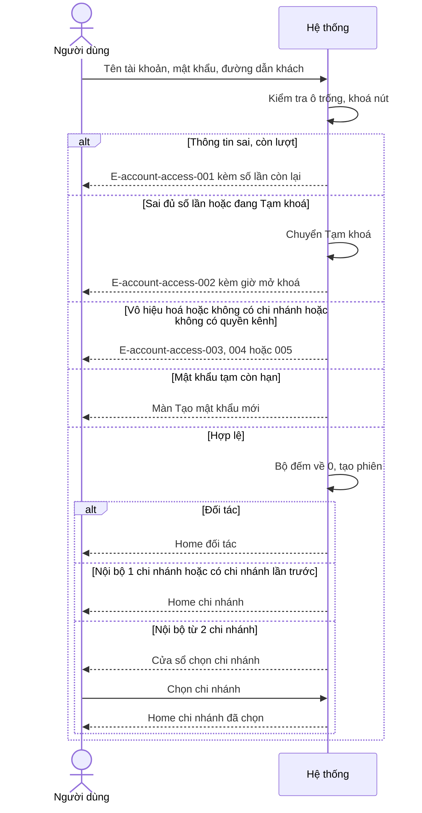
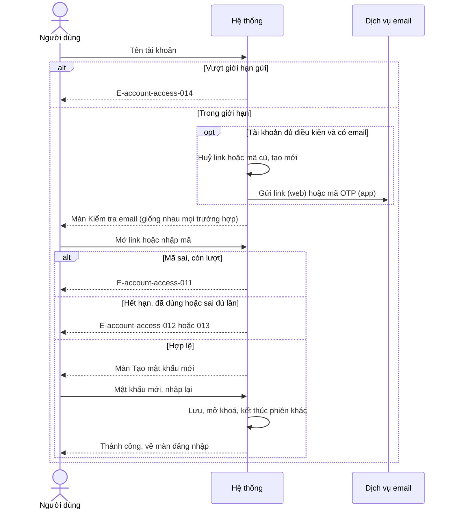
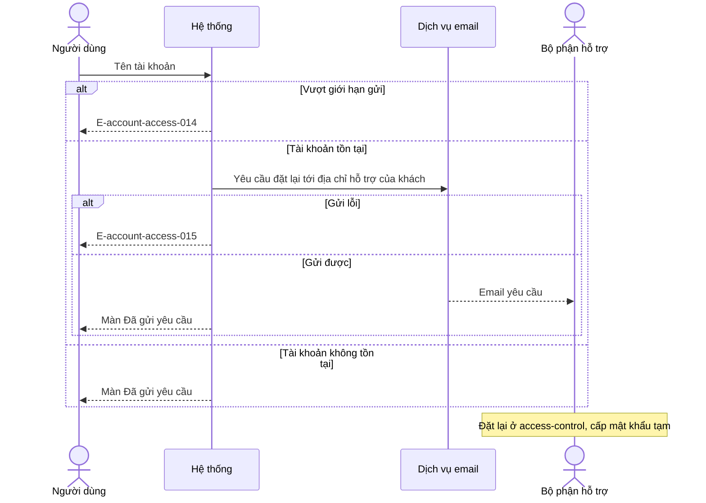
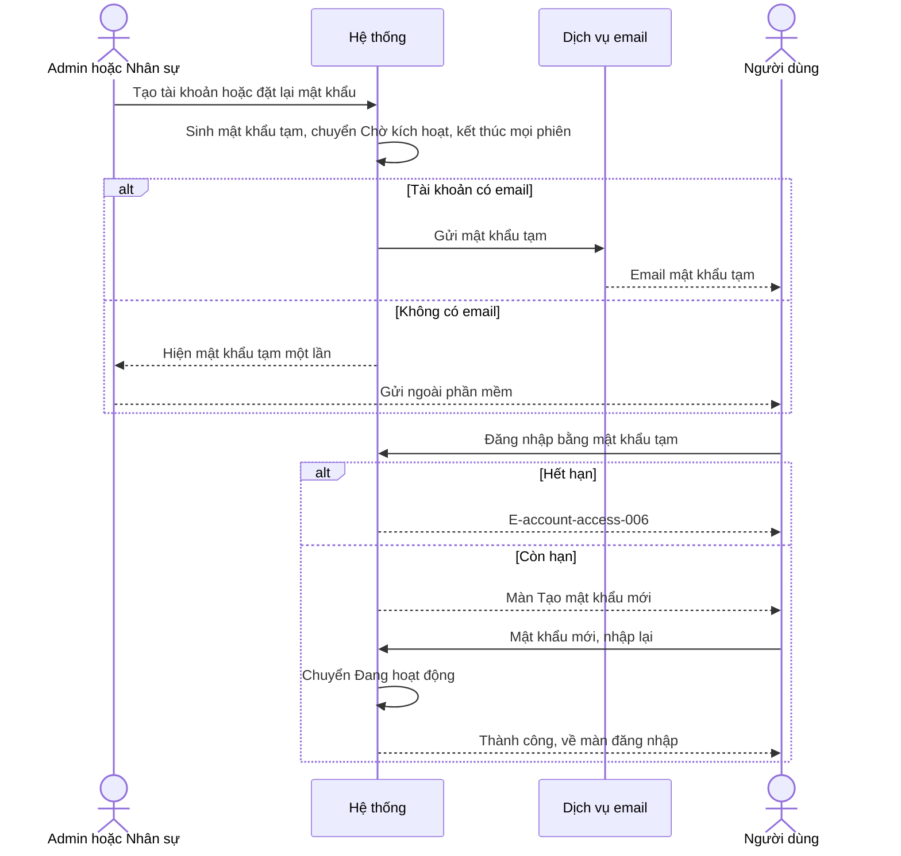

# Đăng nhập và tài khoản cá nhân — Flows

## Flow: Đăng nhập
__Trigger__: Người dùng bấm Đăng nhập · __Related__: FR-account-access-001, 005, 007, 010

## Flow: Tự đặt lại mật khẩu (web link, app mã OTP)
__Trigger__: Người dùng xác nhận Đặt lại qua email · __Related__: FR-account-access-018, 019, 020

## Flow: Liên hệ IT
__Trigger__: Người dùng xác nhận Liên hệ IT · __Related__: FR-account-access-020, 021

## Flow: Cấp mật khẩu tạm và kích hoạt
__Trigger__: Admin tạo tài khoản hoặc đặt lại mật khẩu · __Related__: FR-account-access-008, 009, 016

