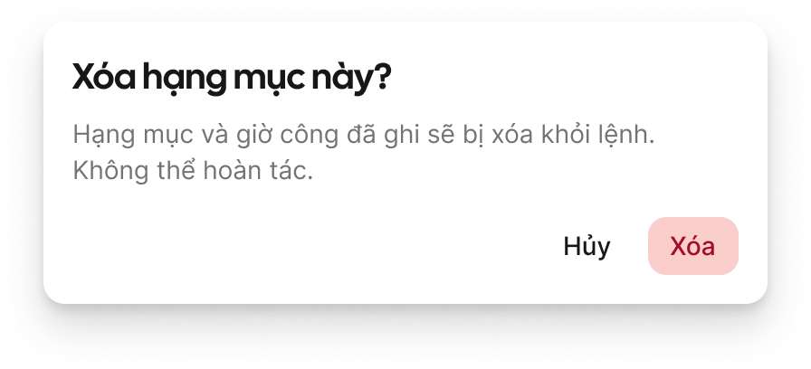
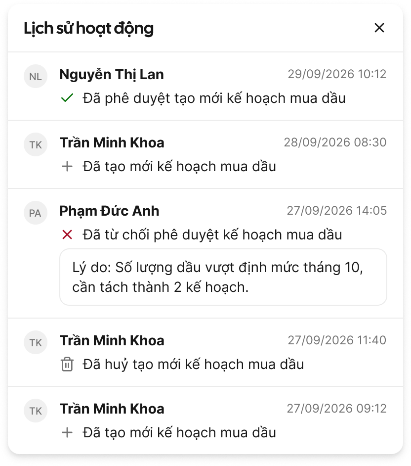

# account-access — Software Requirements Specification

## 1. Scope

Đăng nhập và tài khoản cá nhân, cửa vào chung của mọi module trên web và app: đăng nhập theo đường dẫn riêng của từng khách, chọn hoặc đổi chi nhánh, kích hoạt bằng mật khẩu tạm, quên mật khẩu (tự đặt lại qua email hoặc liên hệ IT), đổi mật khẩu, đăng xuất, xem thông tin cá nhân, lịch sử hoạt động, đổi ngôn ngữ, và màn tài khoản của đối tác cây dầu.

Ngoài phạm vi: tạo tài khoản, phân quyền, vô hiệu hoá, mở khoá tay và đặt lại mật khẩu của Admin (`access-control`); sửa hồ sơ nhân viên (`employee-records`); khai báo cơ cấu chi nhánh, cơ sở (`organization`); chọn cơ sở ở Home (`common-workspace`); sửa thông tin cây dầu (`fuel-stations`); gửi mã qua SMS; nhật ký bảo mật cho Admin (để sau v1).

## 2. Actors & Stakeholders

| Actor | Loại (người/hệ thống/ngoài) | Mục tiêu | Trong scope? |
|-------|-----------------------------|----------|--------------|
| Người dùng nội bộ (web) | người | Vào đúng chi nhánh, đổi chi nhánh, quản mật khẩu của mình | Có |
| Người dùng nội bộ (app): lái xe, hiện trường | người | Ít phải đăng nhập lại; lấy lại quyền vào khi quên mật khẩu hoặc bị khoá | Có |
| Nhân viên đối tác cây dầu (app) | người | Đăng nhập, xem thông tin cây dầu của mình, quản mật khẩu | Có |
| Bộ phận hỗ trợ của khách (IT hoặc Admin) | người | Nhận yêu cầu Liên hệ IT, đặt lại mật khẩu ở `access-control` | Có (nhận email); thao tác đặt lại ngoài scope |
| Admin của khách | người | Tạo tài khoản, đặt lại mật khẩu, vô hiệu hoá, mở khoá | Không (thuộc `access-control`) |
| Nhân sự | người | Tạo nhân viên mới, kéo theo tạo tài khoản qua `access-control` | Không (thuộc `employee-records`) |
| Dịch vụ gửi email | hệ thống ngoài | Gửi mật khẩu tạm, link, mã OTP, yêu cầu Liên hệ IT | Có |

## 3. Functional Requirements (FR)

| ID | Title | Description | Priority | Tầng | Verify by | Source |
|----|-------|-------------|----------|------|-----------|--------|
| FR-account-access-001 | Đăng nhập | Khi người dùng nhập tên tài khoản (hoặc email) và mật khẩu rồi bấm Đăng nhập, hệ thống phải kiểm tra theo BR-account-access-002 và cho vào nếu hợp lệ. Đăng nhập bằng số điện thoại chỉ có khi bật `P-dang-nhap-bang-sdt` (Delta: tắt). | P0 | [Lõi] [Cấu hình] | test: tên tài khoản, email đều vào được; SĐT bị từ chối khi tham số tắt | brainstorm A1 |
| FR-account-access-002 | Xác định khách khi đăng nhập | Trên web, mỗi khách có đường dẫn đăng nhập riêng; màn đăng nhập lấy tên khách và các tham số theo khách của đường dẫn đó. Trên app, lần đầu mở (hoặc sau khi đăng xuất và chọn "Đổi doanh nghiệp") người dùng nhập mã doanh nghiệp; app nhớ mã trên máy (BR-account-access-026). Tên tài khoản và email chỉ cần duy nhất trong một khách (BR-account-access-001). Nếu đường dẫn hoặc mã doanh nghiệp không tồn tại hoặc khách đã ngừng dùng, thì báo E-account-access-017. | P0 | [Lõi] | test: cùng tên tài khoản ở 2 khách vào đúng khách theo đường dẫn (web) và mã doanh nghiệp (app); mã sai báo E-017; phiên của khách A không dùng được ở khách B | brainstorm A11; review tech 2026-10-15 |
| FR-account-access-003 | Kiểm tra ô trống và chống bấm lặp | Nếu người dùng bấm Đăng nhập hoặc Xác nhận khi còn ô bắt buộc trống, thì hệ thống phải báo lỗi tại ô (E-common-001) và không gửi. Khi đang gửi, nút bị khoá và hiện vòng chờ. | P0 | [Lõi] | test: bấm 2 lần liên tiếp chỉ gửi 1 yêu cầu | brainstorm A10; SRS Web tr.248 |
| FR-account-access-004 | Hiện, ẩn mật khẩu | Mọi ô mật khẩu mặc định ẩn ký tự và có biểu tượng hiện/ẩn. | P0 | [Lõi] | demo trên 3 màn có ô mật khẩu | brainstorm A10 |
| FR-account-access-005 | Đếm lần sai và tạm khoá | Nếu mật khẩu sai, thì hệ thống phải báo E-account-access-001 kèm số lần thử còn lại; sai liên tiếp đủ `P-so-lan-sai-mat-khau` (Delta: 5) lần thì chuyển tài khoản sang Tạm khoá và báo E-account-access-002 (BR-account-access-003, 004). | P0 | [Lõi] [Cấu hình] | test: sai lần 4 còn 1 lần thử; lần 5 bị khoá; web và app dùng chung bộ đếm; đúng mật khẩu khi đang Tạm khoá vẫn báo E-002 và không đưa bộ đếm về 0; tên không tồn tại cũng bị "khoá" như tên có thật | brainstorm A2 |
| FR-account-access-006 | Tự mở khoá | Hệ thống phải tự chuyển Tạm khoá về trạng thái trước khi khoá sau `P-thoi-gian-tam-khoa` (Delta: 30 phút) và đưa bộ đếm về 0; đặt lại mật khẩu thành công cũng mở khoá (BR-account-access-011). | P0 | [Lõi] [Cấu hình] | test biên: khoá lúc T, đăng nhập đúng ở T+29:59 bị chặn, ở T+30:00 vào được; khoá từ Chờ kích hoạt thì hết khoá về Chờ kích hoạt | brainstorm A3 |
| FR-account-access-007 | Chặn tài khoản không đủ điều kiện | Nếu tài khoản bị vô hiệu hoá, chưa được cấp chi nhánh nào (nội bộ) hoặc không có quyền dùng kênh đang đăng nhập (web hoặc app), thì hệ thống phải không cho vào và báo lần lượt E-account-access-003, 004, 005. Các lỗi này chỉ hiện sau khi mật khẩu đã khớp (BR-account-access-022). | P0 | [Lõi] | test 3 ca với mật khẩu đúng → E-003/004/005; cùng 3 ca với mật khẩu sai → E-001 như tên thường | brainstorm A4; SRS Web tr.253–257 |
| FR-account-access-008 | Mật khẩu tạm | Khi tài khoản được tạo hoặc được đặt lại mật khẩu (thao tác ở `access-control`, từ Admin hay từ hồ sơ nhân viên), hệ thống phải sinh mật khẩu tạm riêng, chuyển tài khoản sang Chờ kích hoạt và gửi email mật khẩu tạm; tài khoản không có email thì hiện mật khẩu tạm đúng một lần cho người thao tác để họ gửi ngoài phần mềm (BR-account-access-005). Nếu gửi email mật khẩu tạm lỗi, thì báo cho người thao tác và hiện mật khẩu tạm một lần như trường hợp không có email. Màn thao tác thuộc `access-control`; feature này giữ quy tắc mật khẩu tạm và nội dung email. | P0 | [Lõi] [Cấu hình] | test: có email nhận được thư; không email thì màn hiện 1 lần, mở lại không thấy | brainstorm A5 |
| FR-account-access-009 | Tạo mật khẩu mới | Khi người dùng đăng nhập bằng mật khẩu tạm còn hạn, hoặc mở link/nhập đúng mã đặt lại, hệ thống phải mở màn Tạo mật khẩu mới (mật khẩu mới, nhập lại). Lưu thành công thì tài khoản sang Đang hoạt động, báo thành công và về màn đăng nhập. Mở link hoặc nhập đúng mã thì người dùng có `P-han-tao-mat-khau` (Delta: 15 phút) để lưu; quá hạn báo E-account-access-018 (BR-account-access-023). | P0 | [Lõi] [Cấu hình] | test 3 đường vào: mật khẩu tạm, link web, OTP app; lưu ở phút 15 được, phút 16 báo E-018 | brainstorm B6, 5.2 |
| FR-account-access-010 | Phân luồng sau đăng nhập | Sau khi đăng nhập hợp lệ, hệ thống phải: tài khoản đối tác vào Home đối tác; tài khoản nội bộ có 1 chi nhánh vào thẳng chi nhánh đó; có chi nhánh lần trước còn quyền thì vào thẳng chi nhánh đó; còn lại mở cửa sổ chọn chi nhánh. | P0 | [Lõi] | test 4 ca: đối tác → Home đối tác; 1 chi nhánh → Home; có chi nhánh lần trước còn quyền → Home chi nhánh đó; từ 2 chi nhánh chưa chọn → cửa sổ chọn | brainstorm A6, DP-6 |
| FR-account-access-011 | Cửa sổ chọn chi nhánh | Hệ thống phải cho chọn công ty mẹ (chỉ khi có quyền toàn tổ chức) hoặc đúng một chi nhánh; tìm theo tên chi nhánh hoặc tỉnh thành; sắp theo lần dùng gần nhất; nút Chọn khoá tới khi đã chọn; bấm Huỷ thì đăng xuất (BR-account-access-013, 014). | P0 | [Lõi] | demo; test Huỷ quay về đăng nhập và không còn phiên ghi nhớ | brainstorm A6 |
| FR-account-access-012 | Đổi chi nhánh trong phiên | Khi người dùng có từ 2 chi nhánh bấm tên chi nhánh đang dùng, hệ thống phải mở cửa sổ chọn chi nhánh; chọn chi nhánh khác thì tải lại Home của chi nhánh đó và nhớ lựa chọn. Nếu đang có dữ liệu chưa lưu, thì hỏi xác nhận rời trang theo GR-13. | P1 | [Lõi] | test: đổi chi nhánh khi form chưa lưu hiện hộp xác nhận | brainstorm A7 |
| FR-account-access-013 | Phiên trên web | Không chọn "Ghi nhớ đăng nhập" thì phiên kết thúc khi đóng trình duyệt hoặc sau `P-het-phien-khong-thao-tac` (Delta: 8 giờ) không thao tác; có chọn thì giữ `P-thoi-han-ghi-nho` (Delta: 30 ngày) tính từ lần thao tác cuối. "Thao tác" là người dùng bấm hoặc nhập; việc trang tự làm mới không tính. Ô ghi nhớ mặc định không chọn. | P0 | [Lõi] [Cấu hình] | test biên: không ghi nhớ, 7 giờ 59 phút không thao tác còn phiên, 8 giờ 01 phút hết; ghi nhớ, 29 ngày còn, 31 ngày hết | brainstorm A8 |
| FR-account-access-014 | Phiên trên app | App không có ô ghi nhớ; phiên giữ tới khi đăng xuất hoặc không mở app quá `P-thoi-han-ghi-nho` (Delta: 30 ngày). | P0 | [Lõi] [Cấu hình] | test: mở lại app sau 29 ngày vào thẳng Home | brainstorm A8 |
| FR-account-access-015 | Có phiên, hết phiên, lỗi kết nối | Có phiên hợp lệ thì bỏ qua màn đăng nhập. Nếu phiên hết hạn khi đang dùng, thì hệ thống phải đưa về màn đăng nhập với E-common-010. Lỗi hệ thống và mất mạng báo E-common-008, E-common-009 trên mọi màn có gửi dữ liệu. App mở khi có phiên mà mất mạng thì vào Home ở chế độ mất mạng (GR-25). Áp cho web và app. | P0 | [Lõi] | test: có phiên bỏ qua đăng nhập; phiên hết hạn hiện E-common-010; ngắt mạng khi bấm Đăng nhập hiện E-common-009; lỗi hệ thống hiện E-common-008 | brainstorm A9 |
| FR-account-access-016 | Kết thúc phiên khi tài khoản đổi | Nếu tài khoản bị vô hiệu hoá, bị Admin đặt lại mật khẩu, hoặc mất quyền chi nhánh đang dùng, thì ở lần thao tác kế tiếp hệ thống phải kết thúc phiên (vô hiệu hoá, đặt lại) hoặc báo E-common-012 (đổi quyền). | P0 | [Lõi] | test: Admin đặt lại mật khẩu → thiết bị đang mở bị đăng xuất | brainstorm 6.5; BR-account-access-012 |
| FR-account-access-017 | Chọn cách lấy lại mật khẩu | Bấm Quên mật khẩu ở màn đăng nhập, hệ thống phải cho chọn "Đặt lại qua email" hoặc "Liên hệ IT". | P0 | [Lõi] | demo | brainstorm B1, B3 |
| FR-account-access-018 | Đặt lại qua email trên web | Khi người dùng nhập tên tài khoản và bấm Xác nhận trên web, hệ thống phải gửi email có link đặt lại nếu tài khoản đủ điều kiện (BR-account-access-007) và luôn hiện cùng màn "Kiểm tra email". Link có hạn `P-han-link-dat-lai` (Delta: 30 phút), dùng một lần. Nếu link hết hạn hoặc đã dùng, thì báo E-account-access-013. | P0 | [Lõi] [Cấu hình] | test: tài khoản có và không có email thấy cùng màn; link dùng lần 2 bị từ chối | brainstorm B1 |
| FR-account-access-019 | Đặt lại qua email trên app | Như FR-account-access-018 nhưng gửi mã OTP 6 chữ số; người dùng nhập đủ 6 số thì hệ thống tự kiểm tra (BR-account-access-009). Mã sai báo E-account-access-011; sai đủ lần hoặc hết hạn báo E-account-access-012. | P0 | [Lõi] [Cấu hình] | test biên: mã đúng ở 4:59 vào được, ở 5:00 báo E-012; sai lần 4 báo E-011 còn 1 lần, lần 5 báo E-012; mã cũ sau khi gửi mã mới bị từ chối | brainstorm B1, B2 |
| FR-account-access-020 | Giới hạn gửi | Hệ thống phải giới hạn việc gửi link, mã OTP và yêu cầu Liên hệ IT theo BR-account-access-010 và BR-account-access-025; trong thời gian chờ nút Gửi lại hiện đếm ngược; vượt số lần mỗi giờ báo E-account-access-014 tại màn đang gửi (Nhập tên tài khoản, Kiểm tra email, Nhập mã xác thực, Liên hệ IT). | P0 | [Lõi] [Cấu hình] | test: gửi vượt `P-so-lan-gui-ma-moi-gio` (Delta: 5) lần mỗi giờ bị chặn, cả với tên không tồn tại; gửi lại ở giây 59 bị chặn, giây 60 được | brainstorm B1 |
| FR-account-access-021 | Liên hệ IT | Khi người dùng nhập tên tài khoản và bấm Xác nhận ở Liên hệ IT, hệ thống phải gửi email tới `P-email-ho-tro-mat-khau` (Delta: it@delta.com.vn) gồm tên tài khoản, họ tên, chi nhánh, thời gian, kênh gửi (chỉ khi tài khoản tồn tại) và hiện màn "Đã gửi yêu cầu". Nếu gửi email lỗi, thì báo E-account-access-015, không tự gửi lại (BR-account-access-021). | P0 | [Lõi] [Cấu hình] | test: gửi thành công; mô phỏng lỗi dịch vụ email | brainstorm B3 |
| FR-account-access-022 | Đổi mật khẩu | Từ Thông tin cá nhân, người dùng nhập mật khẩu cũ, mật khẩu mới, nhập lại. Hệ thống phải kiểm tra theo BR-account-access-006 (lỗi E-account-access-007 đến 010), lưu, báo thành công qua toast và ở lại màn Thông tin cá nhân. | P0 | [Lõi] [Cấu hình] | test từng lỗi; test thành công | brainstorm B4 |
| FR-account-access-023 | Đăng xuất thiết bị khác | Khi đổi mật khẩu hoặc đặt lại mật khẩu thành công, hệ thống phải kết thúc mọi phiên khác của tài khoản (BR-account-access-012). | P0 | [Lõi] | test: đổi trên web, app đang mở bị đăng xuất | brainstorm B5 |
| FR-account-access-024 | Đăng xuất | Từ menu ảnh đại diện (web) hoặc tab Tài khoản (app), bấm Đăng xuất thì hệ thống phải hỏi xác nhận (CMP-03); đồng ý thì kết thúc phiên trên thiết bị này và về màn đăng nhập. Như nhau cho mọi loại tài khoản. | P0 | [Lõi] | test trên web và app | brainstorm C1 |
| FR-account-access-025 | Tài khoản đối tác | Tài khoản đối tác (v1: loại Cây dầu) đăng nhập vào thẳng Home đối tác, không qua chọn chi nhánh, dùng đủ FR-account-access-009, 017–023 như tài khoản nội bộ. | P1 | [Lõi] | test với tài khoản cây dầu | brainstorm C2 |
| FR-account-access-026 | Màn Tài khoản cây dầu | Trên app, tài khoản đối tác cây dầu có màn Tài khoản chỉ đọc: tên cây dầu, mã đối tác, nhà cung cấp, người đại diện, hạn mức lít của tháng hiện tại (đã cấp, còn lại), loại hợp đồng, số tiền đặt cọc, mục Hợp đồng, ghi chú (BR-account-access-020); kèm Đổi mật khẩu, Ngôn ngữ, Đăng xuất. | P1 | [Gói: Nhiên liệu] | demo với hợp đồng Đặt cọc và Tín chấp | brainstorm C3; SRS Mobile tr.75–79 |
| FR-account-access-027 | Thông tin cá nhân | Hệ thống phải hiện thông tin hồ sơ của người dùng lấy từ `employee-records` (chỉ đọc; trường không có dữ liệu theo GR-10) và cho đổi ảnh đại diện (JPG, PNG, tối đa 5 MB). | P1 | [Lõi] | demo; test ảnh 6 MB bị từ chối | brainstorm D1 |
| FR-account-access-028 | Lịch sử hoạt động | Hệ thống phải cho người dùng xem thao tác của chính mình trong `P-so-ngay-lich-su-hoat-dong` (Delta: 90 ngày) gần nhất, theo CMP-08. | P1 | [Lõi] [Cấu hình] | test: không thấy thao tác của người khác, không thấy quá 90 ngày | brainstorm D2 |
| FR-account-access-029 | Đổi ngôn ngữ | Hệ thống phải cho chọn ngôn ngữ giao diện trong `P-ngon-ngu-giao-dien` (Delta: Tiếng Việt, Tiếng Anh) trên web và app; lưu theo tài khoản, giao diện tải lại theo ngôn ngữ mới. | P1 | [Lõi] [Cấu hình] | test: đổi trên web, mở app thấy cùng ngôn ngữ | brainstorm D3 |
| FR-account-access-030 | Splash và Onboarding | App hiện màn Splash khi mở; lần đầu cài (hoặc sau khi xoá dữ liệu app) hiện Onboarding giới thiệu, có nút Đăng nhập. | P1 | [Lõi] | demo trên máy mới cài | brainstorm D4 |
| FR-account-access-032 | Huỷ link, mã, mật khẩu tạm còn hiệu lực | Khi người dùng đổi mật khẩu, đặt lại mật khẩu thành công, Admin đặt lại mật khẩu hoặc vô hiệu hoá tài khoản, hệ thống phải làm mọi link, mã OTP và mật khẩu tạm đang còn hiệu lực của tài khoản hết hiệu lực (BR-account-access-024). | P0 | [Lõi] | test: gửi link, rồi đổi mật khẩu, mở link → E-013 | review tech, senior-ba 2026-10-15 |
| FR-account-access-033 | Ghi sự kiện tài khoản | Hệ thống phải ghi các sự kiện: đăng nhập sai, tạm khoá, mở khoá, gửi và hoàn tất đặt lại mật khẩu, gửi Liên hệ IT, hiện mật khẩu tạm một lần, kèm thời điểm, kênh, khách. Dùng để đo Mục 7; màn xem cho Admin để sau v1 (E1 brainstorm). | P0 | [Lõi] | kiểm tra: mỗi sự kiện sinh đúng 1 bản ghi | review qa, tech 2026-10-15 |
| FR-account-access-031 | Hướng dẫn người chưa có tài khoản | Màn đăng nhập hiện một dòng hướng dẫn với nội dung `P-huong-dan-cap-tai-khoan` (Delta: như mặc định sản phẩm "Chưa có tài khoản? Liên hệ quản trị viên."). | P1 | [Lõi] [Cấu hình] | demo | brainstorm D5 |

## 4. Non-Functional Requirements (NFR)

| ID | Category | Requirement | Priority | Acceptance |
|----|----------|-------------|----------|------------|
| NFR-account-access-001 | performance | Từ lúc bấm Đăng nhập tới khi thấy Home hoặc cửa sổ chọn chi nhánh. | P0 | ≤ 3 giây ở 95% lần, mạng bình thường |
| NFR-account-access-002 | performance | Mở app hoặc web khi đã có phiên tới khi thấy Home. | P0 | dưới 3 giây ở 95% lần, mạng 4G hoặc wifi bình thường |
| NFR-account-access-003 | availability | Đăng nhập dùng được mọi giờ trong ngày, mọi ngày (lái xe chạy đêm). | P0 | 99,9% mỗi tháng (mất tối đa khoảng 43 phút), không tính bảo trì đã báo trước |
| NFR-account-access-004 | capacity | Số người đăng nhập cùng lúc giờ cao điểm của Delta. | P1 | Khoảng 80 người đăng nhập cùng lúc giờ cao điểm (ước lượng Delta) |
| NFR-account-access-005 | security | Không ai xem được mật khẩu của người khác, kể cả Admin; Admin chỉ đặt lại. Mật khẩu tạm chỉ hiện một lần cho người thao tác khi tài khoản không có email. | P0 | kiểm tra: không màn nào hiện mật khẩu; mở lại màn đặt lại không thấy mật khẩu tạm |
| NFR-account-access-006 | security | Người ngoài không dò được tài khoản nào tồn tại qua màn đăng nhập, quên mật khẩu, giới hạn gửi. | P0 | test: tên có thật và không có thật cho cùng câu báo, cùng số lần thử, cùng giới hạn |
| NFR-account-access-007 | privacy | Lịch sử hoạt động: người dùng chỉ xem của mình. Hệ thống lưu lịch sử không giới hạn thời gian. | P1 | kiểm tra: người dùng chỉ thấy 90 ngày gần nhất; dữ liệu cũ hơn vẫn còn |
| NFR-account-access-009 | security | Lần mở link hoặc kiểm tra tự động của hệ thống quét email không được làm link hết hiệu lực; link chỉ tính là đã dùng khi lưu mật khẩu mới thành công. | P0 | test: mở link 2 lần rồi mới lưu vẫn được |
| NFR-account-access-008 | localization | Giao diện, câu báo và email theo ngôn ngữ của tài khoản; email trước đăng nhập theo ngôn ngữ mặc định của khách. | P1 | test với Tiếng Việt, Tiếng Anh |

## 5. Business Rules

| ID | Rule | Tầng | Trigger | Implements FR | Source |
|----|------|------|---------|---------------|--------|
| BR-account-access-001 | Tên tài khoản và email duy nhất trong một khách; khách xác định theo đường dẫn đăng nhập. | [Lõi] | Đăng nhập, tạo tài khoản | FR-account-access-001, 002 | brainstorm A11 |
| BR-account-access-002 | Chỉ vào được khi (kiểm theo thứ tự BR-account-access-022): thông tin khớp; tài khoản Đang hoạt động, hoặc Chờ kích hoạt với mật khẩu tạm còn hạn; có quyền dùng kênh đang đăng nhập; tài khoản nội bộ có ít nhất 1 chi nhánh. | [Lõi] | Bấm Đăng nhập | FR-account-access-001, 007 | brainstorm DP-1–5 |
| BR-account-access-003 | Bộ đếm sai mật khẩu tính theo tài khoản, chung web và app; tên không tồn tại cũng đếm và báo như tên có thật; về 0 khi đăng nhập đúng hoặc khi tự mở khoá. | [Lõi] | Đăng nhập sai | FR-account-access-005 | brainstorm A2 |
| BR-account-access-004 | Sai liên tiếp đủ `P-so-lan-sai-mat-khau` (Delta: 5) lần thì Tạm khoá; tự mở sau `P-thoi-gian-tam-khoa` (Delta: 30 phút). | [Lõi] [Cấu hình] | Đăng nhập sai | FR-account-access-005, 006 | brainstorm A2, A3 |
| BR-account-access-005 | Mật khẩu tạm riêng từng tài khoản, hết hạn sau `P-han-mat-khau-tam` (Delta: 72 giờ); lần đặt lại mới làm mật khẩu tạm cũ hết hiệu lực; sai mật khẩu tạm cũng đếm theo BR-account-access-003. | [Lõi] [Cấu hình] | Tạo hoặc đặt lại tài khoản | FR-account-access-008 | brainstorm A5 |
| BR-account-access-006 | Mật khẩu mới theo `P-chinh-sach-mat-khau` (Delta: ít nhất 8 ký tự gồm chữ thường, chữ hoa, số, ký tự đặc biệt), khác mật khẩu hiện tại và mật khẩu tạm, trùng ô nhập lại; đổi mật khẩu phải nhập đúng mật khẩu cũ. | [Lõi] [Cấu hình] | Lưu mật khẩu mới | FR-account-access-009, 022 | brainstorm B4 |
| BR-account-access-007 | Đặt lại qua email chỉ gửi khi tài khoản Đang hoạt động, Tạm khoá hoặc Chờ kích hoạt và có email; Vô hiệu hoá hoặc không có email thì không gửi; màn kết quả luôn giống nhau. | [Lõi] | Xác nhận đặt lại | FR-account-access-018, 019 | brainstorm B1, vòng 2 r04 |
| BR-account-access-008 | Mỗi lần gửi link hoặc mã mới làm link, mã trước hết hiệu lực; link dùng một lần, hạn `P-han-link-dat-lai` (Delta: 30 phút). | [Lõi] [Cấu hình] | Gửi lại | FR-account-access-018, 019 | brainstorm B1 |
| BR-account-access-009 | Mã OTP 6 chữ số, hiệu lực `P-han-ma-otp` (Delta: 5 phút), sai tối đa `P-so-lan-sai-otp` (Delta: 5) lần thì phải gửi mã mới. | [Lõi] [Cấu hình] | Nhập mã | FR-account-access-019 | brainstorm B2 |
| BR-account-access-010 | Giữa 2 lần gửi (link, mã, Liên hệ IT) chờ `P-cho-gui-lai-ma` (Delta: 60 giây); tối đa `P-so-lan-gui-ma-moi-gio` (Delta: 5) lần mỗi giờ, đếm theo tên đã nhập dù có tồn tại hay không. Email gửi lại nằm chung một chuỗi thư với email trước trong hộp thư người nhận. | [Lõi] [Cấu hình] | Gửi | FR-account-access-020 | brainstorm B1 |
| BR-account-access-011 | Đặt lại mật khẩu thành công (qua email hoặc mật khẩu tạm) mở khoá tài khoản đang Tạm khoá. | [Lõi] | Lưu mật khẩu mới | FR-account-access-006, 009 | brainstorm A3 |
| BR-account-access-012 | Đổi hoặc tự đặt lại mật khẩu kết thúc mọi phiên khác; Admin đặt lại mật khẩu hoặc vô hiệu hoá kết thúc mọi phiên. | [Lõi] | Đổi, đặt lại, vô hiệu hoá | FR-account-access-016, 023 | brainstorm B5, vòng 2 r08 |
| BR-account-access-013 | Chọn đúng một: công ty mẹ hoặc một chi nhánh; công ty mẹ chỉ hiện khi tài khoản có quyền toàn tổ chức. | [Lõi] | Mở cửa sổ chọn | FR-account-access-011 | SRS Web tr.255–257 |
| BR-account-access-014 | Huỷ ở cửa sổ chọn chi nhánh khi vừa đăng nhập = đăng xuất và xoá phiên ghi nhớ. | [Lõi] | Bấm Huỷ | FR-account-access-011 | brainstorm 6.5 |
| BR-account-access-015 | Chi nhánh dùng lần trước lưu theo tài khoản, áp cho web và app; mất quyền thì bỏ qua. | [Lõi] | Chọn chi nhánh | FR-account-access-010, 012 | vòng 2 r11 |
| BR-account-access-016 | Tài khoản đối tác không qua chọn chi nhánh; mật khẩu của tài khoản đối tác do Admin của khách đặt lại ở `access-control`. | [Lõi] | Đăng nhập | FR-account-access-025 | vòng 2 r16 |
| BR-account-access-017 | Ngôn ngữ giao diện lưu theo tài khoản. | [Lõi] | Đổi ngôn ngữ | FR-account-access-029 | brainstorm D3 |
| BR-account-access-018 | Thông tin cá nhân chỉ đọc, trừ ảnh đại diện; nguồn là hồ sơ ở `employee-records`. | [Lõi] | Mở Thông tin cá nhân | FR-account-access-027 | brainstorm D1 |
| BR-account-access-019 | Lịch sử hoạt động chỉ gồm thao tác của chính người dùng trong `P-so-ngay-lich-su-hoat-dong` (Delta: 90 ngày). | [Lõi] [Cấu hình] | Mở lịch sử | FR-account-access-028 | brainstorm D2 |
| BR-account-access-020 | Màn cây dầu: hạn mức tính theo tháng hiện tại; đầu tháng "Đã cấp" về 0 và "Còn lại" bằng hạn mức tháng mới; số tiền đặt cọc chỉ hiện khi hợp đồng Đặt cọc; mục Hợp đồng ẩn khi Tín chấp; ghi chú ẩn khi trống. | [Gói: Nhiên liệu] | Mở màn | FR-account-access-026 | SRS Mobile tr.77–79 |
| BR-account-access-022 | Thứ tự kiểm khi đăng nhập: (1) khách theo đường dẫn hoặc mã doanh nghiệp; (2) tài khoản đang Tạm khoá → E-002 dù mật khẩu đúng hay sai; (3) mật khẩu khớp chưa → sai thì E-001 và đếm; (4) chỉ khi mật khẩu khớp mới báo E-003, 004, 005, 006 hoặc vào Tạo mật khẩu mới. Tên không tồn tại đi đúng bước (2)–(3) như tên có thật. | [Lõi] | Bấm Đăng nhập | FR-account-access-001, 005, 007 | review qa, tech, senior-ba 2026-10-15 |
| BR-account-access-023 | Link hoặc mã đặt lại chỉ tính là đã dùng khi lưu mật khẩu mới thành công; mở link hoặc nhập đúng mã thì có `P-han-tao-mat-khau` (Delta: 15 phút) để lưu. | [Lõi] [Cấu hình] | Mở link, nhập mã | FR-account-access-009, 018, 019 | review 2026-10-15 |
| BR-account-access-024 | Đổi mật khẩu, đặt lại thành công, Admin đặt lại hoặc vô hiệu hoá làm mọi link, mã, mật khẩu tạm còn hiệu lực hết hiệu lực. | [Lõi] | Đổi, đặt lại, vô hiệu hoá | FR-account-access-032 | review 2026-10-15 |
| BR-account-access-025 | Giới hạn gửi tính theo cửa sổ một giờ trượt, đếm chung link, mã và Liên hệ IT theo tên đã nhập (không phân biệt hoa thường); giờ trong E-014 là lúc lần gửi cũ nhất trong cửa sổ hết tính. | [Lõi] | Gửi | FR-account-access-020 | review qa 2026-10-15 |
| BR-account-access-026 | App nhớ mã doanh nghiệp trên máy sau lần nhập đầu; đổi doanh nghiệp chỉ làm được khi đã đăng xuất. | [Lõi] | Mở app lần đầu | FR-account-access-002 | review tech 2026-10-15 |
| BR-account-access-021 | Liên hệ IT gửi tới `P-email-ho-tro-mat-khau`; tham số này bắt buộc khi khởi tạo khách; gửi lỗi không tự thử lại. | [Lõi] [Cấu hình] | Xác nhận Liên hệ IT | FR-account-access-021 | brainstorm B3, vòng 2 r03 |

## 6. Error Matrix

| Error ID | Title | Trigger | Severity | Related FR | Screen state | Recovery |
|----------|-------|---------|----------|------------|--------------|----------|
| E-account-access-001 | Sai tên tài khoản hoặc mật khẩu | Thông tin không khớp | major | FR-account-access-005 | Inline dưới ô Mật khẩu (GR-15); xoá mật khẩu đã nhập | "Tên tài khoản hoặc mật khẩu không đúng. Còn {n} lần thử." |
| E-account-access-002 | Tài khoản tạm khoá | Sai đủ số lần, hoặc đăng nhập khi đang khoá | major | FR-account-access-005, 006 | Inline dưới ô Mật khẩu | "Tài khoản tạm khoá. Thử lại sau {hh:mm} hoặc đặt lại mật khẩu." |
| E-account-access-003 | Tài khoản bị vô hiệu hoá | Đăng nhập tài khoản Vô hiệu hoá | major | FR-account-access-007 | Inline dưới ô Mật khẩu | "Tài khoản đã bị vô hiệu hoá. Liên hệ quản trị viên." |
| E-account-access-004 | Chưa được cấp chi nhánh | Nội bộ, 0 chi nhánh | major | FR-account-access-007 | Inline dưới ô Mật khẩu | "Tài khoản chưa được cấp chi nhánh nào. Liên hệ quản trị viên." |
| E-account-access-005 | Không được dùng kênh này | Không có quyền web hoặc app | major | FR-account-access-007 | Màn lỗi Loại 2, nút Quay về đăng nhập | "Tài khoản này không được dùng {Web/ứng dụng}. Liên hệ quản trị viên." |
| E-account-access-006 | Mật khẩu tạm hết hạn | Đăng nhập bằng mật khẩu tạm quá hạn | major | FR-account-access-001, 008 | Inline dưới ô Mật khẩu | "Mật khẩu tạm đã hết hạn. Đặt lại mật khẩu hoặc liên hệ IT." |
| E-account-access-007 | Mật khẩu cũ sai | Đổi mật khẩu | major | FR-account-access-022 | Inline ô Mật khẩu cũ | "Mật khẩu cũ không đúng." |
| E-account-access-008 | Mật khẩu mới không đúng chính sách | Lưu mật khẩu mới | major | FR-account-access-009, 022 | Inline ô Mật khẩu mới | "Mật khẩu cần ít nhất {n} ký tự, có {loại ký tự bắt buộc}." (điền theo `P-chinh-sach-mat-khau`) |
| E-account-access-009 | Trùng mật khẩu đang dùng | Lưu mật khẩu mới | major | FR-account-access-009, 022 | Inline ô Mật khẩu mới | "Mật khẩu mới phải khác mật khẩu đang dùng." |
| E-account-access-010 | Nhập lại không khớp | Lưu mật khẩu mới | major | FR-account-access-009, 022 | Inline ô Nhập lại | "Mật khẩu nhập lại không khớp." |
| E-account-access-011 | Mã OTP sai | Nhập mã sai, còn lượt | major | FR-account-access-019 | Inline dưới ô mã, xoá mã đã nhập | "Mã không đúng. Còn {n} lần nhập." |
| E-account-access-012 | Mã hết hiệu lực | Sai đủ lần hoặc hết hạn | major | FR-account-access-019 | Inline dưới ô mã, khoá ô nhập | "Mã đã hết hiệu lực. Gửi mã mới để tiếp tục." |
| E-account-access-013 | Link hết hạn hoặc đã dùng | Mở link đặt lại | major | FR-account-access-018 | Màn kết quả, nút Gửi lại link | "Link đặt lại mật khẩu đã hết hạn. Gửi lại link mới." |
| E-account-access-014 | Gửi quá nhiều lần | Vượt số lần mỗi giờ | minor | FR-account-access-020 | Inline dưới ô Tên tài khoản hoặc dưới nút Gửi lại | "Bạn đã gửi quá nhiều yêu cầu. Thử lại sau {hh:mm}." |
| E-account-access-015 | Gửi yêu cầu Liên hệ IT lỗi | Dịch vụ email lỗi | major | FR-account-access-021 | Toast lỗi (CMP-01), giữ màn nhập | "Chưa gửi được yêu cầu. Thử lại sau." — giữ mã riêng thay E-common-008 vì câu do người dùng chốt 15/10 nói rõ yêu cầu chưa đi |
| E-account-access-017 | Không tìm thấy doanh nghiệp | Đường dẫn hoặc mã doanh nghiệp sai, khách ngừng dùng | major | FR-account-access-002 | Web: màn lỗi; app: inline dưới ô Mã doanh nghiệp | "Không tìm thấy doanh nghiệp. Kiểm tra lại mã hoặc đường dẫn." |
| E-account-access-018 | Hết thời gian tạo mật khẩu | Lưu mật khẩu mới sau `P-han-tao-mat-khau` | major | FR-account-access-009 | Màn kết quả, nút Gửi lại yêu cầu | "Đã quá thời gian đặt mật khẩu. Gửi lại yêu cầu đặt lại." |
| E-account-access-016 | Ảnh đại diện quá dung lượng | Ảnh > 5 MB | minor | FR-account-access-027 | Inline dưới vùng tải ảnh | "Ảnh tối đa 5 MB." — Override E-common-007 (250 MB): ảnh đại diện không cần dung lượng lớn |

E-common dùng: E-common-001 (ô trống), E-common-006 (ảnh sai định dạng), E-common-008 (lỗi hệ thống), E-common-009 (mất mạng), E-common-010 (phiên hết hạn), E-common-012 (quyền vừa đổi).

## 7. Success Criteria

| ID | Outcome nghiệp vụ | Đo bằng | Mốc đạt |
|----|-------------------|---------|---------|
| SC-account-access-01 | Người có email tự lấy lại mật khẩu, không cần IT | Yêu cầu đặt lại qua email hoàn tất / tổng yêu cầu quên mật khẩu của người có email | ≥ 80% sau 3 tháng chạy thật |
| SC-account-access-02 | Ít phải nhờ bộ phận hỗ trợ | Số yêu cầu Liên hệ IT mỗi tháng trên 100 người dùng | < 2 |
| SC-account-access-03 | Ngưỡng khoá hợp lý | Số lần tạm khoá mỗi tuần, theo dõi để chỉnh `P-so-lan-sai-mat-khau`, `P-thoi-gian-tam-khoa` | có số liệu theo tuần từ tuần đầu chạy thật; xem lại 2 tham số sau 1 tháng |
| SC-account-access-04 | Vào làm việc nhanh | Thời gian từ mở app có phiên tới Home | < 3 giây |

## 8. Data Entities (tóm tắt — chi tiết ở erd.md)

| Thực thể | Thông tin nghiệp vụ chính |
|---|---|
| Tài khoản | Khách, tên tài khoản, email, số điện thoại, loại (nội bộ / đối tác), trạng thái (Chờ kích hoạt, Đang hoạt động, Tạm khoá, Vô hiệu hoá), quyền kênh (web, app), ngôn ngữ, ảnh đại diện, số lần sai liên tiếp, thời điểm hết khoá |
| Mật khẩu tạm | Tài khoản, thời điểm cấp, hạn dùng, người cấp, còn hiệu lực |
| Phiên đăng nhập | Tài khoản, kênh, thiết bị, có ghi nhớ, chi nhánh đang dùng, lần thao tác cuối, thời điểm hết hạn |
| Yêu cầu đặt lại mật khẩu | Tên đã nhập, tài khoản (nếu có), loại (link / mã OTP / Liên hệ IT), thời điểm gửi, hạn, số lần nhập sai, đã dùng, kết quả gửi email |
| Chi nhánh dùng lần trước | Tài khoản, chi nhánh hoặc công ty mẹ, thời điểm |
| Lịch sử hoạt động | Tài khoản, thời điểm, hành động, đối tượng |

Tham chiếu từ feature khác: Khách, Chi nhánh (`organization`), Hồ sơ nhân viên (`employee-records`), Cây dầu (`fuel-stations`), quyền (`access-control`).

## 9. Flows (tóm tắt — chi tiết ở flows.md)

8 luồng theo brainstorm Mục 5: Đăng nhập và chọn chi nhánh · Kích hoạt bằng mật khẩu tạm · Tự đặt lại mật khẩu (web link, app OTP) · Liên hệ IT · Đổi mật khẩu · Đổi chi nhánh trong phiên · Đăng xuất · Thông tin cá nhân, lịch sử, ngôn ngữ.

## 10. Screens — Design (Figma)

### Danh mục màn

<!-- screens-catalog:begin — máy sinh bởi _scripts/screens-md.py (/figma-sync --done), KHÔNG sửa tay -->
<!-- screens-catalog:end -->

### Cấu hình UI Common Rules & Components

| Mã (CMP/GR) | Áp ở màn | Phần UC khai báo / Override + lý do |
|---|---|---|
| GR-01 | Đăng nhập, Nhập tên tài khoản, Liên hệ IT, Tạo mật khẩu mới, Đổi mật khẩu | Bắt buộc: tên tài khoản, mật khẩu, mật khẩu cũ, mật khẩu mới, nhập lại |
| GR-09 | Chọn chi nhánh | Tìm theo tên chi nhánh hoặc tỉnh thành |
| GR-10 | Thông tin tài khoản, Tài khoản cây dầu | Trường hồ sơ trống |
| GR-12 | Chọn chi nhánh (tìm không ra), Thông tin tài khoản, Tài khoản cây dầu, Lịch sử hoạt động | Rỗng: "Không có chi nhánh phù hợp.", "Chưa có hoạt động nào."; đang tải theo khung màn; tải lỗi kèm Thử lại |
| GR-13 | Đổi chi nhánh trong phiên, Tạo mật khẩu mới, Đổi mật khẩu | Rời trang hoặc bấm Huỷ khi đã nhập dữ liệu |
| GR-15 | Mọi màn | Loại lỗi ghi ở cột Screen state Mục 6 |
| GR-25 | App: mở khi có phiên mà mất mạng | Vào Home ở chế độ mất mạng |
| GR-26 | App: phiên hết hạn, quyền vừa đổi | Popup chặn |
| CMP-01 | Đổi mật khẩu, Đổi ngôn ngữ, Ảnh đại diện | Toast thành công: "Đã đổi mật khẩu. Các thiết bị khác đã được đăng xuất." · "Đã đổi ngôn ngữ." · "Đã cập nhật ảnh đại diện." |
| CMP-03 | Đăng xuất | Tiêu đề "Đăng xuất?" · "Bạn sẽ cần đăng nhập lại để tiếp tục." · `[Đăng xuất] [Ở lại]` |
| CMP-08 | Lịch sử hoạt động | Chỉ thao tác của chính người dùng, 90 ngày |
| CMP-10 | Ảnh đại diện | JPG, PNG; Override dung lượng 5 MB — lý do: ảnh đại diện |
| CMP-11 | App nội bộ và app đối tác | Bottom Navigation có tab Tài khoản dẫn tới Thông tin tài khoản (nội bộ) hoặc Tài khoản cây dầu (đối tác) |

E-common dùng: E-common-001, E-common-006, E-common-008, E-common-009, E-common-010, E-common-012.

<!-- screens:begin — máy sinh bởi _scripts/screens-md.py (/figma-sync --done): ảnh Figma + bảng 5 cột theo flow, KHÔNG sửa tay -->
<!-- screens:end -->

## 11. Constraints, Dependencies & Assumptions

**Constraints (ràng buộc áp đặt — có source/owner):**

| Ràng buộc | Source / Owner |
|-----------|----------------|
| Đăng nhập Google song song mật khẩu, chi tiết ở brainstorm google-sso; FR viết ở lần /srs kế tiếp | DEC-405 — @szitphan, 06/11/2026 |
| Chỉ gửi qua email, không có SMS | Phỏng vấn brainstorm 15/10/2026 — @szitphan |
| Con số chính sách đi qua tham số theo khách `P-…` | `.claude/rules/saas-layer.md` |

**Dependencies (deliverable do bên khác sở hữu):**

| Phụ thuộc | Owner | Blocks nếu chưa sẵn |
|-----------|-------|---------------------|
| Tạo tài khoản, đặt lại mật khẩu, vô hiệu hoá, mở khoá, quyền kênh | `access-control` | FR-account-access-008, 016 |
| Cơ cấu công ty, chi nhánh | `organization` | FR-account-access-010, 011 |
| Hồ sơ nhân viên | `employee-records` | FR-account-access-027 |
| Dữ liệu cây dầu, hạn mức, hợp đồng | `fuel-stations` | FR-account-access-026 |
| Dịch vụ gửi email | dev | FR-account-access-008, 018, 019, 021 |

**Assumptions (tin là đúng — nêu hệ quả nếu sai):**

| Giả định | Invalidate {X} nếu sai |
|----------|------------------------|
| Web và app dùng chung tài khoản, mật khẩu, trạng thái, bộ đếm sai | BR-account-access-003 |
| Phần lớn lái xe không có email, dùng Liên hệ IT | SC-account-access-02 |
| Bộ phận nhận Liên hệ IT có quyền đặt lại mật khẩu ở `access-control` | FR-account-access-021 |

## 12. Open Questions

* [x] OQ-1: Link đặt lại mật khẩu trên web có hạn bao lâu? — Nguồn khách: Tài liệu SRS - ERP Delta 3.0 (Web) (30/9/2026), UC01.02 Quên mật khẩu, trang 264 — Resolved 15/10: 30 phút.
* [x] OQ-2: Địa chỉ email nhận yêu cầu Liên hệ IT của Delta là gì? — Nguồn khách: Tài liệu SRS - ERP Delta 3.0 (Web) (30/9/2026), UC01.02 Quên mật khẩu, trang 263 — Resolved 15/10: it@delta.com.vn.
* [x] OQ-3: Dòng hướng dẫn người chưa có tài khoản của Delta ghi nơi liên hệ nào? — Nguồn khách: Tài liệu SRS - ERP Delta 3.0 (Mobile) (5/10/2026), UC01.01.01 Đăng nhập, trang 46 — Resolved 15/10: dùng câu mặc định sản phẩm "Chưa có tài khoản? Liên hệ quản trị viên.".
* [x] OQ-4: Mục tiêu sẵn sàng của đăng nhập (phần trăm thời gian dùng được mỗi tháng)? — owner PO — Nguồn khách: chưa có trong tài liệu khách gửi — Resolved 15/10: 99,9% mỗi tháng.
* [x] OQ-5: Số người đăng nhập cùng lúc giờ cao điểm của Delta? — owner PO — Nguồn khách: chưa có trong tài liệu khách gửi — Resolved 15/10: khoảng 80 người cùng lúc (ước lượng).
* [ ] OQ-7: Lưu lịch sử hoạt động không giới hạn có hợp với quy định bảo vệ dữ liệu cá nhân (Nghị định 13/2023) không, có cần thời hạn xoá? — owner PO, pháp chế — Nguồn khách: chưa có trong tài liệu khách gửi
* [ ] OQ-8: Người ngoài biết tên tài khoản có thể cố tình nhập sai để khoá người đó 30 phút, lặp lại được. Có cần thêm giới hạn theo thiết bị hoặc mạng gửi không? — owner PO — Nguồn khách: chưa có trong tài liệu khách gửi
* [x] OQ-6: Hệ thống lưu lịch sử hoạt động bao lâu? — owner PO — Nguồn khách: chưa có trong tài liệu khách gửi — Resolved 15/10: lưu không giới hạn; người dùng xem 90 ngày gần nhất.

## Phụ lục A — UI Common Rules & Components áp dụng

<!-- ui-common:begin — máy sinh bởi _scripts/ui-common-expand.py, KHÔNG sửa tay; sửa ở nguồn rồi chạy lại. Sinh 2026-10-15 -->

### A.1 Component dùng chung (CMP)

#### CMP-01 — Toast Notification

_Nguồn: `design/ui-common/screen-patterns.md:62`_

Thông báo ngắn góc trên phải, tự ẩn sau 3 giây, không chặn thao tác.

_Ảnh: Toast "Đã lưu thay đổi." — node [5080:2503](https://www.figma.com/design/FifpyOMpZk9OP8qyNzbRVJ/-innvie--invlogis-v0.3?node-id=5080-2503), xuất PNG 2x._

| # | Items | Control type | Data type | Description |
|---|---|---|---|---|
| 1 | Toast thành công | Toast | ReadOnly | • Sau khi hành động hoàn tất • Câu: mẫu "Đã {hành động}" theo design.md › Copy động › Toast; thêm `[Hoàn tác]` nếu đảo ngược được |
| 2 | Toast lỗi | Toast | ReadOnly | • Chỉ cho lỗi kỹ thuật/hệ thống (GR-15 Loại 3) — `E-common-008..010` • Lỗi của trường → inline; lỗi nghiệp vụ server → Popup Error (GR-15) |
| 3 | Toast cảnh báo | Toast | ReadOnly | • Cảnh báo không chặn hành động |
| 4 | Toast thông tin | Toast | ReadOnly | • Hướng dẫn hoặc trạng thái trung gian |

- **Figma:** Astryx `Toast` · node: [172:56853](https://www.figma.com/design/FifpyOMpZk9OP8qyNzbRVJ/-innvie--invlogis-v0.3?node-id=172-56853)
- **design.md:** Copy động
- **UC phải khai báo:** hành động nào có toast thành công + động từ dùng trong câu; hành động có `[Hoàn tác]` không.

##### Mobile

- Cùng 4 loại và câu chữ như web. Toast lỗi nền error cho lỗi không gắn với trường nào (lỗi server,
  lỗi mạng — `E-common-008`, `E-common-009`).
- Vị trí và thời gian hiện trên màn app: chưa có chuẩn trong design.md.
- **Figma:** chưa gắn.

#### CMP-03 — Confirm Dialog

_Nguồn: `design/ui-common/screen-patterns.md:127`_

Modal xác nhận trước hành động quan trọng hoặc không hoàn tác được. Bắt buộc với: Xoá, Thu hồi, Phê
duyệt, Từ chối, Huỷ form khi có dữ liệu chưa lưu (GR-13). Tiêu đề, nội dung, nhãn nút theo design.md ›
Copy động › *Hộp xác nhận*.

_Ảnh: Destructive, Default — node [5046:66967](https://www.figma.com/design/FifpyOMpZk9OP8qyNzbRVJ/-innvie--invlogis-v0.3?node-id=5046-66967), xuất PNG 2x._

| # | Items | Control type | Data type | Description |
|---|---|---|---|---|
| 1 | Tiêu đề | Label | ReadOnly | • Câu hỏi nêu hành động + đối tượng |
| 2 | Nội dung | Label | ReadOnly | • Nêu bản ghi bị tác động (ưu tiên tên, không có thì mã, không có cả hai thì bỏ) + hệ quả |
| 3 | Trường lý do | Text area | Text | • Chỉ khi hành động cần lý do (vd Từ chối); bắt buộc hay không do UC quy định |
| 4 | Nút xác nhận | Button | Click | • Nhãn = động từ hành động; hành động phá huỷ dùng biến thể destructive • Loading khi đang gửi |
| 5 | Nút huỷ | Button | Click | • Đóng dialog, không thay đổi dữ liệu |

- **Figma:** Astryx `AlertDialog` (có trường lý do → `Dialog` [2266:9922](https://www.figma.com/design/FifpyOMpZk9OP8qyNzbRVJ/-innvie--invlogis-v0.3?node-id=2266-9922)) · node: [5046:66987](https://www.figma.com/design/FifpyOMpZk9OP8qyNzbRVJ/-innvie--invlogis-v0.3?node-id=5046-66987)
- **design.md:** Copy động
- **UC phải khai báo:** hành động nào cần xác nhận; tên feature + trường định danh hiển thị; có trường lý do không, bắt buộc không; hệ quả nêu trong nội dung (vd "trở về Bản nháp").

##### Mobile

Bottom sheet xác nhận (kéo lên từ đáy màn), cùng bộ hành động bắt buộc và cùng câu chữ như web.
Mẫu: `design/_lab/lab-confirm.html` phương án B (chốt 09/10/2026).

| # | Items | Control type | Data type | Description |
|---|---|---|---|---|
| 0 | Tay nắm | — | — | • Thanh ngang trên đỉnh sheet; vuốt xuống = Huỷ, trừ các trường hợp ở hàng 8 |
| 1 | Icon hành động | Icon | ReadOnly | • Tông theo loại: phá huỷ / xác nhận / cảnh báo (design.md › Ánh xạ trạng thái nghiệp vụ); luôn đi kèm tiêu đề, không chỉ dựa vào màu |
| 2 | Tiêu đề | Label | ReadOnly | • Căn giữa, chữ đậm |
| 3 | Nội dung | Label | ReadOnly | • Như web; tên/mã bản ghi in đậm |
| 4 | Trường lý do | Chip + Text area | Select + Text | • Chỉ khi hành động cần lý do (vd Từ chối): chip lý do nhanh + ô ghi thêm; danh sách chip và bắt buộc hay không do UC khai |
| 5 | Nút xác nhận | Button | Click | • Full width, đứng trên; phá huỷ dùng biến thể destructive • Loading khi đang gửi |
| 6 | Nút huỷ | Button | Click | • Full width, ghost, đứng dưới • Huỷ form (GR-13): đảo vai — "Tiếp tục chỉnh sửa" là nút chính, "Bỏ thay đổi" là nút chữ đỏ |
| 7 | Nền mờ | — | — | • Chạm ngoài = Huỷ |
| 8 | Khoá đóng | — | — | • **Không** đóng bằng chạm ngoài / vuốt xuống với hành động không hoàn tác được (Xoá) và với popup chặn GR-26 |

**Biến thể Vuốt để xác nhận** — cho hành động quan trọng cần chắc chắn người dùng cố ý (mẫu: `lab-confirm.html`
phương án E). Cùng sheet trên, thay nút xác nhận (hàng 5) bằng thanh vuốt "Vuốt để [động từ]": kéo hết thanh
mới gửi, thả giữa chừng thì trượt về; phá huỷ dùng tông destructive. Thêm nút đóng (X) góc phải; nút huỷ giữ ở dưới.
Trình đọc màn hình / bàn phím: thanh vuốt kích hoạt được bằng Enter/Space.
- **UC phải khai báo thêm:** hành động nào dùng biến thể vuốt. Không khai → dùng sheet nút bấm thường.

- Thêm trường hợp chỉ app có — **Chuyển site** (chạm bản ghi thuộc site khác): "Chuyển sang [Tên site]?" ·
  "Trang sẽ tải lại theo site mới." → `[Chuyển site] [Huỷ]`. Câu gốc app 2.18: "Bạn đang chuyển sang
  [Tên site]. Trang sẽ được tải lại theo site mới."
- Back / vuốt back khi form có dữ liệu chưa lưu: GR-13 (Mobile).
- **Figma:** chưa có node Figma cho sheet xác nhận — chưa có chuẩn trong design.md (mẫu ở lab, chờ vẽ lại).

#### CMP-08 — Activity Log

_Nguồn: `design/ui-common/screen-patterns.md:270`_

Lịch sử thay đổi trạng thái/hành động trên bản ghi, mở từ icon đồng hồ góc trên phải màn chi tiết.
Spec: design.md › *Activity Log (theo SC-08)*.

_Ảnh: Panel Desktop — node [5162:3528](https://www.figma.com/design/FifpyOMpZk9OP8qyNzbRVJ/-innvie--invlogis-v0.3?node-id=5162-3528), xuất PNG 2x._

| # | Items | Control type | Data type | Description |
|---|---|---|---|---|
| 1 | Icon mở | Button | Click | • Mở panel lịch sử |
| 2 | Một mốc | Item | ReadOnly | • Avatar · tên tài khoản · ngày (GR-03) · icon · nội dung hành động • Dòng "Lý do: …" chỉ khi hành động có lý do (vd Từ chối) |
| 3 | Sắp xếp | — | — | • Mới nhất trên cùng |

Hành động mặc định: Tạo mới (`+`, "Đã tạo mới [tên feature]") · Phê duyệt (`✓`, "Đã phê duyệt tạo mới [tên feature]") ·
Từ chối (`✕`, "Đã từ chối phê duyệt [tên feature]") · Thu hồi ("Đã huỷ tạo mới [tên feature]").

- **Figma:** component dự án `Activity Log` · node: [5160:3295](https://www.figma.com/design/FifpyOMpZk9OP8qyNzbRVJ/-innvie--invlogis-v0.3?node-id=5160-3295)
- **design.md:** Activity Log
- **UC phải khai báo:** tên feature dùng trong câu; hành động ghi log ngoài 4 hành động mặc định + icon/nội dung.

##### Mobile

- Icon đồng hồ trên header màn chi tiết (nút LG trong vùng chạm 44).
- Mở `BottomSheet` (design.md › Activity Log, Platform = Mobile). Khác MSC-05 (tài liệu app ghi "màn
  riêng") — đã chốt theo design.md, 2026-10-04.
- Timeline dọc, mới nhất trên cùng, nội dung mốc như web.
- **Figma:** `Activity Log / Panel` Platform = Mobile (khung [5160:3295](https://www.figma.com/design/FifpyOMpZk9OP8qyNzbRVJ/-innvie--invlogis-v0.3?node-id=5160-3295)).

#### CMP-10 — File Upload

_Nguồn: `design/ui-common/screen-patterns.md:359`_

Đính kèm chứng từ, tài liệu.

| # | Items | Control type | Data type | Description |
|---|---|---|---|---|
| 1 | Vùng upload | Browse Button | File | • Viền đứt + icon + hướng dẫn; hỗ trợ kéo thả |
| 2 | Nút chọn file | Button | Click | • Outlined; mở hộp chọn file |
| 3 | Định dạng cho phép | Label | ReadOnly | • Mặc định JPG, PNG, PDF |
| 4 | Dung lượng tối đa | Label | ReadOnly | • Mặc định 250MB |
| 5 | Thẻ file | Card | Click | • Đang tải: icon loại + tên + dung lượng + đang tải • Thành công/thất bại: thêm icon kết quả + Xoá • Màn xem: icon loại + tên (click xem/tải) |
| 6 | Giới hạn số file | — | — | • 1 file: tải xong ẩn vùng upload, xoá file thì hiện lại • Nhiều file: giữ vùng upload, thẻ file xếp bên dưới |
| 7 | Lỗi định dạng | Label | ReadOnly | • Inline ngay khi chọn file, file không được ghi nhận — `E-common-006` |
| 8 | Lỗi dung lượng | Label | ReadOnly | • Inline ngay khi chọn file, file không được ghi nhận — `E-common-007` |

- **Figma:** tạm Astryx `FileInput` · node: [2577:20886](https://www.figma.com/design/FifpyOMpZk9OP8qyNzbRVJ/-innvie--invlogis-v0.3?node-id=2577-20886) · **chưa chuẩn — xử lý sau:** chưa đạt yêu cầu CMP-10 (thẻ file, trạng thái tải, giới hạn số file) · ảnh: chưa gắn
- **design.md:** —
- **UC phải khai báo:** định dạng bổ sung; dung lượng nếu khác 250MB; 1 hay nhiều file (tối đa bao nhiêu); bắt buộc không.

##### Mobile

- Chạm vùng upload → `BottomSheet` chọn nguồn: **Thư viện ảnh** · **Chụp ảnh** · **Files**. Không có kéo thả.
- Thẻ file: đang tải có thanh tiến độ + nút huỷ · thành công icon ✓ + xoá · thất bại icon ✕ + **Thử lại** + xoá.
- Định dạng, dung lượng, lỗi (`E-common-006`, `E-common-007`) như web; hiện dưới vùng upload.
- **Figma:** chưa gắn.

#### CMP-11 — Sidebar Menu

_Nguồn: `design/ui-common/screen-patterns.md:385`_

Menu cố định bên trái, điểm truy cập chính tới module/feature.

| # | Items | Control type | Data type | Description |
|---|---|---|---|---|
| 1 | Logo | Link | Click | • Về danh sách module |
| 2 | Thu gọn | Button | Click | • Chỉ còn icon, hover hiện tooltip tên; trạng thái lưu theo người dùng |
| 3 | Mục cấp 1 (module) | Button | Click | • Tên + icon; có submenu thì mũi tên mở/đóng; module chứa trang hiện tại tự mở |
| 4 | Mục cấp 2 | Link | Click | • Thụt lề dưới module cha; điều hướng tới màn |
| 5 | Trạng thái active | — | — | • Chỉ 1 mục active: nền muted, chữ + icon primary (không vạch) |
| 6 | Footer: tên module | Label | ReadOnly | • Module hiện tại |
| 7 | Footer: tên cơ sở | Dropdown | Select | • Ẩn khi module không chia cơ sở • 1 cơ sở: chỉ hiện tên, không mở được • Nhiều cơ sở: chọn để chuyển sang cơ sở khác |

Cấu trúc menu theo phân quyền role: người dùng chỉ thấy module được phép.

- **Figma:** component dự án `Khung trang / Menu trái` [5596:129316](https://www.figma.com/design/FifpyOMpZk9OP8qyNzbRVJ/-innvie--invlogis-v0.3?node-id=5596-129316) + `Khung trang / Thanh trên` [5596:129536](https://www.figma.com/design/FifpyOMpZk9OP8qyNzbRVJ/-innvie--invlogis-v0.3?node-id=5596-129536) (khung `5596:129165`) · ảnh: chưa gắn
- **design.md:** Khung trang web (CMP-11, component thật 12/10/2026)
- **UC phải khai báo:** vị trí mục menu của feature (module cha, cấp); role nào thấy; module có chia cơ sở không.

##### Mobile — Bottom Navigation

| # | Items | Control type | Data type | Description |
|---|---|---|---|---|
| 1 | Thanh điều hướng | — | — | • Thanh nổi cố định đáy, phía trên vùng an toàn của máy • Chỉ hiện ở 4 màn gốc; màn con ẩn thanh, đáy dành cho hành động chính của màn |
| 2 | Tab | Button | Click | • 4 tab chỉ icon (không hiện chữ), nhãn truy cập: Trang chủ · Lịch nhắc · Thông báo · Tài khoản |
| 3 | Tab đang chọn | — | — | • Khối nền đồng tâm với thanh + icon đậm; tab khác icon nhạt • Chạm lại → cuộn về đầu |
| 4 | Badge | Badge | ReadOnly | • Trên tab Thông báo, tối đa `9+` (theo CMP-02) |
| 5 | Nút Quét | Button | Click | • Tròn, giữa thanh, nhô lên trên mép; chỉ icon, nhãn truy cập "Quét mã QR" • Mở màn quét bằng camera |

- Là điều hướng của mẫu M1 (design.md › Bottom Navigation, chốt 06/10/2026). Astryx chưa có component
  này → component dự án.
- **Figma:** component dự án `Bottom Navigation` · node mẫu: [5381:3341](https://www.figma.com/design/FifpyOMpZk9OP8qyNzbRVJ/-innvie--invlogis-v0.3?node-id=5381-3341) · ảnh: chưa gắn
- **design.md:** Bottom Navigation
- **UC phải khai báo:** feature mở từ tab nào / màn nào; quét xong đi tới màn nào.

### A.2 Quy tắc giao diện chung (GR)

#### GR-01 — Input / Textbox

_Nguồn: `design/ui-common/conventions.md:57`_

- **Khi nào kiểm:** On Blur (rời trường) và On Submit (kiểm mọi trường, kể cả trường chưa chạm).
- **Submit có lỗi:** inline error mọi trường lỗi, cuộn tới lỗi đầu tiên, không gửi, nút về thường.
- **Submit hợp lệ:** nút loading + vô hiệu; server trả lỗi → hiện lỗi, giữ form, nút về thường.
- **Độ dài:** Tiêu đề tối đa 50 (`E-common-002`) · text ngắn 255, không gõ thêm được, dán vượt tự cắt · textarea 1000 (hoặc theo UC), có đếm ký tự, dán vượt tự cắt.
- **Bắt buộc:** nhãn có `*`; bỏ trống → `E-common-001`.
- **UC phải khai báo:** trường nào bắt buộc; loại trường (tiêu đề / ngắn / textarea); giới hạn khác mặc định; rule riêng của trường (`E-{feature}-NNN`).
- **Mobile:** mở đúng bàn phím theo loại trường (chữ · số · email · điện thoại · số thập phân); icon ✕ trong ô khi có nội dung, chạm để xoá hết. Textarea tối đa 1000 như web, bộ đếm chỉ hiện khi còn ≤ 200 ký tự (tài liệu app ghi 4000 — đã chốt 1000, 2026-10-04).
- **design.md:** Nhập liệu và kiểm tra

#### GR-09 — Thanh tìm kiếm

_Nguồn: `design/ui-common/conventions.md:113`_

- Tìm gần đúng toàn bộ dữ liệu bảng. Chạy khi Enter hoặc rời ô; màn realtime debounce 300ms. Trường cố định (trạng thái, phân loại) không tìm được → tooltip liệt kê, dùng lọc thay thế.
- **UC phải khai báo:** trường tìm được / không tìm được; có realtime không.
- **Mobile:** luôn realtime, debounce 300ms. Không ra kết quả → GR-12 (tìm không ra). Trường cố định → lọc bằng CMP-05.
- **design.md:** Quy tắc bảng danh sách

#### GR-10 — Trường không có thông tin

_Nguồn: `design/ui-common/conventions.md:150`_

- Ghi chú: ẩn hẳn · ID/Mã: `N/A` · trường khác: `-`.
- **Mobile:** dùng chung web (tài liệu app ghi `--` — đã chốt `-`, 2026-10-04).
- **design.md:** —

#### GR-12 — Trạng thái rỗng / đang tải

_Nguồn: `design/ui-common/conventions.md:166`_

- Chưa có dữ liệu: hình + mô tả + nút Tạo mới (nếu có quyền).
- Lọc không ra kết quả: thông báo không có kết quả + nút Xoá bộ lọc, không có Tạo mới.
- Đang tải: skeleton theo số cột/dòng hiện tại. Câu chữ theo design.md › Copy động.
- **UC phải khai báo:** nội dung trạng thái rỗng (cái gì rỗng + CTA).
- **Mobile (MSC-09, MSC-10):** rỗng = hình minh hoạ + tiêu đề + mô tả + CTA (chỉ khi có quyền tạo) — hình minh hoạ chưa có chuẩn (design.md KG-29). Tải lần đầu: skeleton theo hình bố cục thật, hiệu ứng shimmer; tải xong chuyển mờ sang dữ liệu. Không tải được dữ liệu: màn lỗi = `EmptyState` lỗi + nút **Thử lại** (design.md › Quy ước chung của component dự án).
- **design.md:** Trạng thái giao diện; Copy động

#### GR-13 — Dữ liệu chưa lưu

_Nguồn: `design/ui-common/conventions.md:174`_

- Đóng tab / trình duyệt / tải lại: hộp confirm gốc của trình duyệt.
- Bấm Huỷ trên form đã nhập: CMP-03 (Huỷ form).
- **UC phải khai báo:** form nào áp dụng.
- **Mobile:** Back hoặc vuốt back khi form đã đổi so với ban đầu → CMP-03 Mobile: "Thoát mà không lưu?" · "Dữ liệu đã nhập sẽ mất." → `[Thoát]` (destructive) `[Ở lại]`. Form chưa đổi → thoát luôn. Câu gốc app 2.13: "Bạn có chắc muốn thoát? Dữ liệu đã nhập sẽ bị mất."
- **design.md:** Copy động

#### GR-15 — Phân loại thông báo lỗi

_Nguồn: `design/ui-common/conventions.md:181`_

| | Loại 1 — Inline | Loại 2 — Popup Error | Loại 3 — Toast Error |
|---|---|---|---|
| Khi nào | Lỗi của 1 trường (định dạng, bắt buộc, giá trị không hợp lệ); On Blur / On Submit | Lỗi chỉ biết sau khi submit do đối chiếu dữ liệu server (trùng mã, vượt hạn mức, ràng buộc nghiệp vụ); không gắn trường nào | Lỗi kỹ thuật/hệ thống (API lỗi, mất kết nối, timeout, 5xx); người dùng không tự sửa được |
| Vị trí | Dưới trường | Modal giữa màn, có nền mờ | Toast góc trên phải (CMP-01) |
| Hiển thị | Viền trường + câu lỗi màu error | Tiêu đề lỗi + mô tả + Đóng; thêm Thử lại nếu retry được | Nền error |
| Hành vi | Tự ẩn khi giá trị hợp lệ | Không tự đóng; đóng xong giữ nguyên form | Tự ẩn sau 3 giây, không chặn |

- **UC phải khai báo:** mỗi lỗi nghiệp vụ (`E-{feature}-NNN`) thuộc loại nào; lỗi Loại 2 có Thử lại không.
- **Mobile:**
  - Loại 1: như web, chữ error + icon cảnh báo dưới trường.
  - Loại 2: bottom sheet cùng khung CMP-03 Mobile — icon lỗi + tiêu đề lỗi + mô tả + nút **Đóng** full width; retry được thì **Thử lại** là nút chính đứng trên, **Đóng** ghost đứng dưới; khoá đóng như hàng 8 CMP-03 Mobile (chạm nền / vuốt xuống không đóng); đóng xong giữ nguyên form. Tài liệu app không có loại này — bổ sung 2026-10-04, chưa có chuẩn trong design.md.
  - Loại 3: toast CMP-01 (Mobile).
  - Không tải được dữ liệu cả màn: màn lỗi theo GR-12 (Mobile). Lỗi phiên/quyền: GR-26.
- **design.md:** Copy động; Nhập liệu và kiểm tra

#### GR-25 — Trạng thái kết nối mạng

_Nguồn: `design/ui-common/conventions.md:242`_

- Mất kết nối → banner tông neutral đầu màn "Không có kết nối internet", giữ tới khi có mạng lại.
- Có mạng lại → banner tông success "Đã kết nối lại", tự ẩn sau 2 giây; tự gửi lại các yêu cầu đang chờ.
- Yêu cầu thất bại do mạng → toast `E-common-009`.
- **design.md:** Copy động

#### GR-26 — Popup chặn

_Nguồn: `design/ui-common/conventions.md:248`_

- Popup cùng khung CMP-03 Mobile nhưng **không đóng** khi chạm nền hay vuốt xuống — chỉ đóng bằng nút.
- Phiên hết hạn → `E-common-010`, nút **Đăng nhập lại** (duy nhất).
- Mở màn không có quyền → `E-common-011`, nút **Quay lại**.
- Quyền tài khoản vừa thay đổi → `E-common-012`, nút **Tải lại ngay** (duy nhất).
- Chuyển site là hộp xác nhận đóng được → CMP-03 Mobile, không thuộc mục này.
- **design.md:** Copy động

### A.3 Chi tiết từ design system

#### Copy động: lỗi, xác nhận, trạng thái rỗng, toast, loading

_Nguồn: `design/design.md:1613`_

Cấu trúc câu cho copy ĐỘNG (đổi theo tình huống, khác nhãn tĩnh ở trên) — gộp lại một chỗ theo khung
`ux-copy` (CTA / Error / Empty state / Confirmation / Loading). Giọng và nhãn nút giữ đúng như Astryx
đã dùng; các mục đánh dấu *(đã có)* chỉ gom lại từ `components.md` để nằm một chỗ, không đổi nội dung gốc.

* **Tông giọng chung:** ngôi "bạn", câu ngắn, động từ đứng đầu cho hành động, không đùa cợt, không "Vui lòng" rườm rà. Áp dụng cho mọi dòng dưới.
* **Xác nhận hành động phá hủy** (Dialog — Confirmation): tiêu đề `"<Động từ> <đối tượng>?"` + nội dung nói rõ hậu quả/có hoàn tác được không + nút ghi đúng hành động (Destructive) thay "OK"/"Hủy" chung.
  Ví dụ: "Xóa yêu cầu #1024? Yêu cầu và lịch sử xử lý sẽ mất, không thể hoàn tác." → `[Xóa yêu cầu] [Hủy]`
* **Xác nhận hành động khác** (Dialog — Confirmation, theo SC-03 `web-common-rules.md`): 4 mẫu cố định,
  ưu tiên dùng tên bản ghi nếu có, không có tên thì dùng mã, không có cả hai thì bỏ qua phần đó.
  - Thu hồi: "Thu hồi yêu cầu?" · "Bạn đang thu hồi [tên feature] **[tên/mã]**. Yêu cầu sẽ trở về trạng thái Bản nháp." → `[Thu hồi] [Hủy]`
  - Phê duyệt: "Xác nhận phê duyệt?" · "Bạn đang phê duyệt [tên feature] **[tên/mã]**." → `[Phê duyệt] [Hủy]`
  - Từ chối: "Từ chối yêu cầu?" · "Bạn đang từ chối [tên feature] **[tên/mã]**." → `[Từ chối] [Hủy]`
  - Huỷ form (có dữ liệu chưa lưu): "Huỷ bản ghi?" · "Bạn có dữ liệu chưa được lưu. Nếu rời khỏi trang, toàn bộ thông tin sẽ bị mất." → `[Huỷ] [Tiếp tục chỉnh sửa]`
  - Rời trang khi có dữ liệu chưa lưu (đóng tab, đóng trình duyệt, tải lại — theo 2.13): dùng hộp
    confirm **gốc của trình duyệt**, không vẽ Dialog. Câu: "Bạn có muốn rời trang? Dữ liệu chưa lưu sẽ mất."
    (Trình duyệt có thể thay bằng câu mặc định của nó; không vẽ màn này trong Figma.)
* **Lỗi kiểm tra trường** (cấp field, khác Banner/Toast): nói đúng trường nào sai + cách sửa, câu ngắn dưới field, không lộ mã lỗi kỹ thuật.
  Ví dụ: "Số điện thoại phải có 10 số" thay vì "Lỗi 422: invalid_format".
* **Lỗi xung đột nghiệp vụ** (Dialog — Popup Error, theo mục 2.15 Loại 2 của `web-common-rules.md`,
  khác Dialog xác nhận ở trên): dùng khi lỗi chỉ phát hiện được SAU KHI submit, do đối chiếu dữ liệu
  hoặc ràng buộc nghiệp vụ ở server (trùng mã, vượt hạn mức, xung đột dữ liệu...) — không thuộc về
  một trường cụ thể nên không báo inline được. Tiêu đề lỗi (màu error) + mô tả chi tiết + nút Đóng,
  thêm nút Thử lại nếu hành động retry được. Không tự đóng; giữ nguyên form sau khi đóng để user
  xem lại và điều chỉnh.
  Ví dụ: "Nhà cung cấp này đã tồn tại trong hệ thống." · "Lượng đặt mua vượt quá hạn mức hợp đồng." ·
  "Tên cây dầu đã được sử dụng. Vui lòng chọn tên khác."
* **Trạng thái rỗng** *(đã có khung ở components.md, thêm câu Việt)*: tiêu đề nói rõ cái gì rỗng + vì sao + CTA cụ thể.
  Ví dụ: "Chưa có đơn hàng nào. Tạo đơn đầu tiên để bắt đầu theo dõi." → `[Tạo đơn hàng]`
* **Banner** *(đã có)* — xem `components.md` § Banner: tiêu đề ngắn, dễ lướt, không kể lể nguyên nhân.
  Ví dụ: "Thanh toán thất bại" (không phải "Đã có sự cố khi xử lý khoản thanh toán gần nhất của bạn").
* **Toast** *(đã có)* — xem `components.md` § Toast: vài từ xác nhận hành động; thêm `[Hoàn tác]` nếu đảo ngược được.
  Ví dụ: "Đã lưu thay đổi" · "Đã xóa 3 mục [Hoàn tác]".
* **Đang tải/xử lý:** mẫu "Đang <động từ>…", không dùng "Loading...".
  Ví dụ: "Đang tải…" · "Đang lưu…" · "Đang xử lý…".

#### Activity Log (theo SC-08, component thật 29/09/2026)

_Nguồn: `design/design.md:1231`_

Lịch sử thay đổi trạng thái và hành động trên **một bản ghi**, mở từ màn chi tiết. Nguồn:
`web-common-rules.md` SC-08. Code Astryx không có Timeline/Activity nên dựng riêng; cấu trúc
mỗi mốc theo `TimelineSection` của mẫu P7 (Avatar → tên đậm + nội dung → thời gian).

**Nút mở** = `Activity Log / Trigger`: góc trên phải header màn chi tiết/drawer, **ngoài cùng bên phải**,
sau các nút hành động (vd `[Từ chối] [Phê duyệt] [🕐]`). Nhãn truy cập "Lịch sử hoạt động". Khung
`Trạng thái · instances` có ví dụ *Trong màn chi tiết* cho Desktop (header P7 + panel neo dưới nút) và
Mobile (M4 + scrim + BottomSheet).

**Component Figma** (trang Overlay, khung `ActivityLog · innvie`, node `5160:3295`; khung `Trạng thái ·
instances` bày mọi trạng thái Desktop/Mobile, BottomSheet kéo lên Tall và phần *Chữ dài · kiểm tra*).

| Component | Key | Biến thể / thuộc tính | Dựng từ |
| --- | --- | --- | --- |
| `Activity Log / Trigger` | — | Platform = Desktop (MD 32) / Mobile (LG trong vùng chạm 44) · State = Rest / Hover (chỉ Desktop, có `Tooltip` "Lịch sử hoạt động") / Open (Pressed khi panel đang mở) | `Button` Ghost Icon Only + `icon/history`; `Tooltip` |
| `Activity Log / Entry` | `f4a0a7dd…` | Tone = Neutral / Success / Error · TEXT `Actor`, `Action`, `Reason` · BOOLEAN `Has Reason` · instance `Icon`, `Avatar`, `Timestamp` được expose (đổi trực tiếp) | `Avatar` chữ tắt + tên (`Heading/Heading 4`) + `Timestamp` Date Time bên phải + icon 16px + dòng hành động (`Text/Body`) + khung lý do |
| `Activity Log / Body` | `8bb34a41…` | Platform = Desktop 400 / Mobile 390 · State = Có dữ liệu / Rỗng / Đang tải / Lỗi mạng | Header "Lịch sử hoạt động" (`Heading/Heading 3`) + nút đóng (Icon Only) → danh sách Entry · `EmptyState` · `Skeleton` |
| `Activity Log / Panel` | `77e7c7d3…` | Platform = Desktop / Mobile | Desktop: `Popover` 400px neo dưới nút, căn phải. Mobile: `BottomSheet` Height=Capped, `Content` = Body Mobile |

**Nội dung (nguyên văn SC-08)** — `[feature]` điền theo từng màn (vd "kế hoạch mua dầu"):

| Hành động | Action | Icon | Tone |
| --- | --- | --- | --- |
| Tạo mới (submit) | Đã tạo mới [feature] | `icon/plus` | Neutral |
| Phê duyệt | Đã phê duyệt tạo mới [feature] | `icon/check` | Success |
| Từ chối | Đã từ chối phê duyệt [feature] + Lý do | `icon/x` | Error |
| Thu hồi | Đã huỷ tạo mới [feature] | `icon/trash-2` | Neutral |

* Icon không dùng thuộc tính INSTANCE_SWAP (giá trị mặc định dùng chung mọi Tone): mỗi Tone có icon
  mặc định (Neutral `plus`, Success `check`, Error `x`); đổi bằng cách chọn lớp `Icon` (exposed) → swap, rồi
  gán lại màu nét theo Tone nếu icon mới mất màu.
* Hành động khác: đổi `Icon`, chọn Tone theo *Ánh xạ trạng thái nghiệp vụ* (hoàn tất → Success; lỗi /
  từ chối / huỷ nghiêm trọng → Error; còn lại Neutral). Icon Neutral = `Icon/Secondary`. Luôn có chữ
  đi kèm, không chỉ màu.
* **Lý do** (chỉ khi Từ chối): khung nền `{colors.background-surface}` + viền `{colors.border-default}`,
  bo `{rounded.element}`, chữ `Lý do: [nội dung]` `Text/Body` primary. **Hiện đủ, không cắt** (khác
  Notification Center: SC-08 yêu cầu giữ lý do). Không dùng nền muted vì chữ trên đó chỉ ~4,2:1.
* **Thời gian:** `Timestamp` Date Time `dd/MM/yyyy hh:mm` (quyết định 29/09/2026; SC-08 gốc chỉ ghi ngày).
* **Thứ tự:** mới nhất trên cùng. Không nhóm theo ngày (mỗi mốc có ngày đầy đủ).
* **Không tương tác trên mốc:** không hover, không click.

**Trạng thái (Body):** Có dữ liệu · Rỗng — `EmptyState` "Chưa có hoạt động nào" / "Các thao tác trên
bản ghi này sẽ hiện ở đây." · Đang tải — `Skeleton` theo hình Entry · Lỗi mạng — `EmptyState` icon
`wifi-off` + "Không tải được lịch sử" + "Kiểm tra kết nối mạng rồi thử lại." + Button Secondary "Thử lại".
Tải thêm: 20 mốc mỗi lần, cuộn tới cuối tự tải (xem § Phân trang danh sách).

**Chữ dài:**

| Phần | Quy tắc |
| --- | --- |
| Actor (tên) | 1 dòng, cắt cuối "…" |
| Timestamp | Không co |
| Action | Xuống dòng đủ, không cắt |
| Reason | Xuống dòng đủ, không cắt |

**Mobile:** `BottomSheet` (quyết định 29/09/2026), không phải màn riêng như Notification Center — người
dùng xem lịch sử để quay lại xử lý **chính bản ghi đó**, nên giữ màn chi tiết phía sau; đúng cơ chế
Popover → bottom-sheet của Astryx và thumb zone của spec M. Mặc định Capped (62%), kéo lên Tall
(92%), cuộn bên trong; nút đóng LG trên header. Trạng thái kéo lên: dùng trực tiếp `BottomSheet`
Height=Tall + Content = Body Mobile (instance BottomSheet lồng trong Panel giữ chiều cao Capped). Bố cục mobile chưa có chuẩn trong design.md — theo spec M.

###### Phương án A + B (đã duyệt 01/10/2026)

Dựng lại từ việc người dùng cần làm, không theo hình SC-08: người tạo cần **lý do bị từ chối** để sửa; người
duyệt cần **lý do lần trước** khi phiếu được gửi lại; người xem cần biết **đang ở đâu**. Bản danh sách phẳng
ở trên (Body `State=Có dữ liệu`) giữ làm dự phòng.

| Component | Key | Biến thể / thuộc tính | Dựng từ |
| --- | --- | --- | --- |
| `Activity Log / Latest` (**A**) | `25e5dd1d…` | Platform = Desktop / Mobile × Case = Bị từ chối (Banner error) / Gửi lại sau từ chối (info) / Đã thu hồi (info) = 6 · lớp `Banner` exposed (sửa Title, Description) | `Banner` Container=section + `Button` Ghost SM "Xem lịch sử" (mở Panel): Desktop ở End Content (cuối hàng tiêu đề); Mobile ở Content Area, dưới phần chữ, thẳng lề chữ — để chữ dùng hết bề ngang |
| `Activity Log / Round` (**B**) | `4c6aa3cf…` | Result = Đang xử lý / Đã phê duyệt / Bị từ chối / Đã thu hồi · lớp chữ `Round Label` sửa trực tiếp (không dùng thuộc tính TEXT vì mặc định dùng chung mọi biến thể) · exposed `Result Badge`, `Outcome Entry`, `Older Activities` | Tiêu đề lượt (`Heading/Heading 5`, 1 dòng "…") + `Badge` → Entry kết quả → `Collapsible` "Xem n hoạt động trước" (nhãn hạ về `Text/Label` secondary) |
| `Activity Log / Body` | `8bb34a41…` | thêm State = **Theo lượt** (Desktop, Mobile) | Header → dòng "Đang chờ duyệt · đã chờ n ngày" (nền muted) → Round, lượt mới nhất trên cùng |

**Quy tắc A (Latest):**
* Đặt ngay dưới hàng meta của header màn chi tiết (P7, M4), rộng theo vùng nội dung.
* **Chỉ hiện** khi: phiếu đang bị từ chối (cho người tạo) · phiếu đã gửi lại sau khi bị từ chối (cho
  người duyệt) · phiếu đã thu hồi. Trạng thái khác → không hiện.
* Title: `[kết quả] · [người] · dd/MM/yyyy hh:mm`. Description: `Lý do: …`, **hiện đủ, không cắt**.
* Badge trạng thái trên header phải khớp Banner (vd Bị từ chối → Badge Error). Không thêm Toast/Badge khác lặp cùng thông tin.

**Quy tắc B (Round, Body Theo lượt):**
* Một lượt = từ lúc gửi tới khi có kết quả. Lượt đang xử lý hiện đủ mọi mốc, không thu gọn.
* Lượt đã kết thúc: luôn hiện mốc kết quả (lý do hiện đủ); các mốc cũ hơn nằm trong `Collapsible`, mặc định đóng.
* Dòng "Hiện tại" chỉ nêu trạng thái + thời gian chờ (không tên người duyệt — quyết định 29/09/2026), không lặp Badge vì Badge lượt đã có.
* Chữ dài: `Round Label` 1 dòng "…"; phần còn lại theo bảng *Chữ dài* ở trên.

**Chưa có chuẩn:** hành động "Gửi lại" và khái niệm "lượt" không có trong SC-08 (câu mẫu "Đã gửi lại
[feature]" là đề xuất).

Ví dụ: khung `Trạng thái · instances` → "Phương án A + B · trong màn chi tiết" (Desktop P7 + Banner +
panel theo lượt · Mobile M4 + Banner · Mobile BottomSheet theo lượt) và "Chữ dài · A + B" (752 / 320px).

#### Khung trang web (CMP-11, component thật 12/10/2026)

_Nguồn: `design/design.md:1416`_

Menu trái + thanh trên cho mọi màn web, thay `AppShell` SideNav 300 của Astryx. Số đo khung: § Grid & Container ›
Khung trang dự án; nội dung + hành vi: `design/ui-common/screen-patterns.md` § CMP-11. Figma: trang 00 · Chung ›
khung `Khung trang · innvie` (`5596:129165`).

| Component | Node | Biến thể / thuộc tính | Ghi chú |
| --- | --- | --- | --- |
| `Khung trang / .Mục menu` | `5596:129193` | Dạng Mở rộng / Thu gọn × Tương tác Thường / Rê chuột / Đang chọn · `Nhãn`, `Icon` (swap), `Có số đếm` | Mở rộng 216×34 (icon 16 + nhãn 14, đệm 10, khe 10, bo `{rounded.element}`); Thu gọn 40×34 chỉ icon, số đếm thành chấm, rê chuột hiện tooltip tên. Rê chuột: nền `{colors.overlay-hover}`; Đang chọn: nền `{colors.background-muted}`, chữ `{typography.label}`; cả hai chữ + icon primary. **Không vạch dọc.** Số đếm = `Badge` Info |
| `Khung trang / .Nhóm menu` | `5596:129227` | `Tên nhóm` | Chữ hoa `{typography.supporting}` secondary; cách mục trên 16, mục dưới 6; ẩn khi thu gọn |
| `Khung trang / .Chân menu` | `5596:129268` | Trường hợp Nhiều cơ sở / Một cơ sở / Không chia cơ sở / Thu gọn · `Module`, `Cơ sở`, `Icon module` (swap) | Thẻ viền `{colors.border-default}` bo `{rounded.container}`, đệm 8: ô icon module 32 + tên module, vạch, dòng cơ sở (pin + tên + chevron khi nhiều cơ sở). Không kẻ vạch phía trên chân menu |
| `Khung trang / Menu trái` | `5596:129316` | Dạng Mở rộng 240 / Thu gọn 64 · `Tên đơn vị`, `Tên module`, `Chữ logo` | Nền surface, viền phải 1px, đệm 12, mục cách 2. Đầu: ô logo 30 (màu `P-mau-logo`) + tên đơn vị + module + nút thu gọn (Ghost icon-only). Chân menu ghim đáy. Mục và nhóm là instance — sửa nhãn, icon, số đếm, mục đang chọn trên instance; thêm/bớt theo module và phân quyền role |
| `Khung trang / Thanh trên` | `5596:129536` | `Mục cha`, `Trang hiện tại`, `Có thông báo` | Cao 44, nền surface, vạch dưới 1px: đường dẫn (mục cha secondary › trang hiện tại primary) · tìm · chuông (chấm đỏ khi có việc cần xử lý, CMP-02) · avatar chữ tắt |

* **Ghép màn:** khung ngang [Menu trái (STRETCH)][Vùng chính: Thanh trên (STRETCH) + Nội dung đệm 24, nền surface].
  Danh sách giãn hết; chi tiết ≤ 1440, form ≤ 720, căn giữa. 768–1279 dùng Menu trái Thu gọn; < 768 dùng MobileNav.
* **Chữ dài:** mọi chữ 1 dòng, code cắt "…" (Figma cắt cứng ở mép — KG-32); số đếm, chevron giữ bên phải.
* **Icon mục menu:** feature khai trong UC (vị trí mục, module cha); mẫu theo lab — chưa có bảng icon theo module.

#### Nhập liệu và kiểm tra (theo 2.1–2.3, 2.7, 2.15)

_Nguồn: `design/design.md:1650`_

Lỗi cấp field là **Inline Error** (2.15 Loại 1): viền field chuyển error + câu lỗi dưới field
(Field `state=error`), tự ẩn khi giá trị hợp lệ. Lỗi server không gắn với field → Popup Error; lỗi
kỹ thuật → Toast error (xem Copy động).

| Quy tắc | Chuẩn |
| --- | --- |
| Khi nào kiểm | **On Blur**: rời field (click ra ngoài, sang field khác) thì kiểm và hiện lỗi field đó. **On Submit**: bấm Lưu/Gửi/Tạo mới thì kiểm **mọi** field, kể cả field chưa chạm |
| Submit có lỗi | Hiện inline error mọi field lỗi, cuộn tới field lỗi **đầu tiên**, không gửi đi, nút về trạng thái thường |
| Submit hợp lệ | Nút Loading + vô hiệu tới khi có kết quả. Server trả lỗi → hiện lỗi tương ứng, giữ nguyên form, nút về thường |
| Bắt buộc bỏ trống (Input, Select) | Nhãn có `*` (FieldLabel Indicator=Required). Câu chung: "Nhập [tên trường]." (Select: "Chọn [tên trường].") — dùng khi UC không ghi câu riêng |
| Tiêu đề (Title) | Tối đa **50** ký tự. Vượt → "Tối đa 50 ký tự." |
| Text ngắn | Tối đa **255** ký tự. Không gõ thêm được; dán vượt thì tự cắt |
| TextArea | Tối đa **1000** ký tự (hoặc theo UC), đếm ký tự góc dưới phải (`120/1000`); dán vượt thì tự cắt |
| Ngày sai định dạng | "Hãy nhập ngày tháng theo định dạng: dd/mm/yyyy" |
| Email sai định dạng | Phải có `@`. Câu lỗi: "Email không đúng định dạng." |
| Select | Single: chọn 1. Multi: giá trị hiện dạng tag trong ô. Danh sách từ server: tìm gần đúng khi gõ |

* Câu lỗi theo tông giọng của Copy động (không "Vui lòng"), không lấy nguyên văn `web-common-rules.md`.

#### Quy tắc bảng danh sách (theo 2.9, 2.14, 2.16–2.20, SC-07 — 01/10/2026)

_Nguồn: `design/design.md:876`_

Nguồn: `web-common-rules.md`. Áp dụng cho mọi bảng danh sách (mẫu P1). Cột/trường cụ thể (cột
nào tìm, nhóm, lọc được; action nào có ở trạng thái nào) do từng UC định nghĩa.

| Quy tắc | Chuẩn |
| --- | --- |
| **Căn lề** (2.14) | Số, tiền, % → **phải** · ngày giờ → **giữa** · văn bản, trạng thái → **trái**. Tiêu đề cột căn theo dữ liệu của cột (TableHeaderCell/TableCell Align tương ứng) |
| **Tìm kiếm** (2.9) | Tìm gần đúng trên toàn bộ dữ liệu bảng. Chạy khi nhấn **Enter** hoặc click ra ngoài ô tìm; màn tìm realtime thì debounce **300ms**. Trường cố định (trạng thái, phân loại…) không tìm được → tooltip trên ô tìm liệt kê các trường đó, user dùng lọc thay thế |
| **Freeze cột** (2.16) | Chỉ khi bảng phải cuộn ngang. Cột đầu (Tên/Mã) cố định trái, cột action cố định phải; cột cố định có bóng nhẹ ở cạnh trong. Đủ rộng hiện hết cột thì không freeze |
| **Nhóm** (2.17) | Nút **Nhóm** trên toolbar, chọn **1 cột**; chọn **Xoá** để bỏ nhóm. Dòng cha = giá trị nhóm + số bản ghi ("Petrolimex (5)"). Nhóm đầu mở sẵn tối đa 10 dòng con, nhóm khác thu gọn; click dòng cha để mở/thu. > 10 dòng → **"Xem thêm"** (+10 mỗi lần). Phân trang theo nhóm (xem Phân trang) |
| **Sắp xếp** (2.18) | Click tiêu đề cột: lần 1 tăng dần ↑ → lần 2 giảm dần ↓ → lần 3 về mặc định. Mọi cột sort được; mỗi lúc chỉ **1 cột** (sort cột khác thì cột cũ reset). Chưa sort: icon mờ. Mặc định: **mới nhất trước** (thời gian tạo giảm dần) |
| **Export** (2.19) | Xuất PDF / Excel **toàn bộ** dữ liệu sau khi đã lọc, nhóm, tuỳ chỉnh cột — gồm mọi trang, không chỉ trang đang xem |
| **Lọc theo cột** (2.20) | Nhập giá trị/ID → ô tìm · chọn giá trị → dropdown · ngày giờ → chọn khoảng ngày (chỉ `dd/mm/yyyy`, không chọn giờ) · số/tiền/% → 2 ô Từ – Đến. Cách trình bày trên innvie: § Bộ lọc nâng cao |
| **Cột action** (SC-07) | Tối đa **2** icon hiện thẳng trên hàng, còn lại gom vào `⋯` (MoreMenu). Chỉ hiện action **dùng được** theo trạng thái + quyền — không hiện rồi vô hiệu. Xoá/Huỷ luôn nằm trong `⋯`; chỉ có 1 action phụ thì hiện thẳng, không dùng `⋯`. Nút icon phải có nhãn truy cập |
| **Sửa trong ô** | Theo § Sửa trong bảng: bảng danh sách click-to-edit, lưu từng ô; bảng dòng hàng trong form luôn là input, lưu cùng form. Ô đang sửa được thì click ô **không** mở chi tiết |
| **Mở chi tiết** (SC-07) | Click vùng thông tin của hàng (tên, mã, người phụ trách…) → mở chi tiết. Click vùng action **không** mở chi tiết |

#### Trạng thái giao diện: mọi màn phải có đủ

_Nguồn: `design/design.md:1539`_

| Trạng thái | Component dùng | Mẫu tham chiếu |
| --- | --- | --- |
| **Rỗng · chưa có dữ liệu** | `EmptyState` (icon + tiêu đề + mô tả + hành động); trong cột/khối nhỏ dùng Size=Compact. Nút **+ Tạo mới** nếu user có quyền | Cột "In review" của Kanban: "Nothing in review / Items awaiting your review appear here." |
| **Rỗng · lọc/tìm không ra** | `EmptyState`: "Không tìm thấy kết quả phù hợp" + nút **Xoá bộ lọc**. **Không** có Tạo mới (2.12) | — |
| **Đang tải** | `Skeleton` giữ đúng hình khối nội dung; `Spinner` cho thao tác ngắn; Button State=Loading khi gửi; ProgressBar khi biết tiến độ | Shell Side/Top Nav: vùng nội dung skeleton |
| **Lỗi field** | Field`state=error` + status message dưới field, chữ `{colors.error}` + ring error | — |
| **Lỗi trang/khối** | `Banner` Status=error (có hành động thử lại ở End Content). Khối dữ liệu tải lỗi trong panel/sheet (lịch sử hoạt động CMP-08/CMP-09, sơ đồ CMP-09): `EmptyState` icon `wifi-off` + câu theo E-common-008/009 + **Thử lại** (Compact trong khối nhỏ) | — |
| **Thành công/xác nhận** | `Toast` (tạm thời) hoặc `Banner` success (bền) | — |
| **Vô hiệu** | State=Disabled (opacity 0.5 cho nút; chữ`{colors.text-disabled}` cho field) | — |
| **Đang chọn** | TableCell/ListItem/SideNavItem State=Selected; SelectableCard Selected | — |

### A.4 Lỗi dùng chung (E-common)

| Mã lỗi | Loại (GR-15) | Khi nào | Câu hiển thị | Quy tắc |
|---|---|---|---|---|
| E-common-001 | Inline | Trường bắt buộc bỏ trống khi submit | "Nhập [tên trường]." · Select: "Chọn [tên trường]." | GR-01, GR-02 |
| E-common-006 | Inline | File sai định dạng | "File không đúng định dạng." | CMP-10 |
| E-common-007 | Inline | File vượt dung lượng | "Dung lượng file tối đa 250MB." | CMP-10 |
| E-common-008 | Toast | Lỗi hệ thống / API / timeout | "Đã xảy ra lỗi. Thử lại sau." | GR-15 Loại 3 |
| E-common-009 | Toast | Mất kết nối mạng | "Mất kết nối. Kiểm tra mạng và thử lại." | GR-15 Loại 3 |
| E-common-010 | Toast (web) · Popup chặn (app) | Phiên đăng nhập hết hạn | "Phiên làm việc đã hết hạn. Đăng nhập lại." | GR-15 Loại 3 · GR-26 |
| E-common-012 | Popup chặn (app) | Quyền tài khoản vừa thay đổi | "Quyền của tài khoản vừa thay đổi. Tải lại để áp dụng." | GR-26 |

<!-- ui-common:end -->
