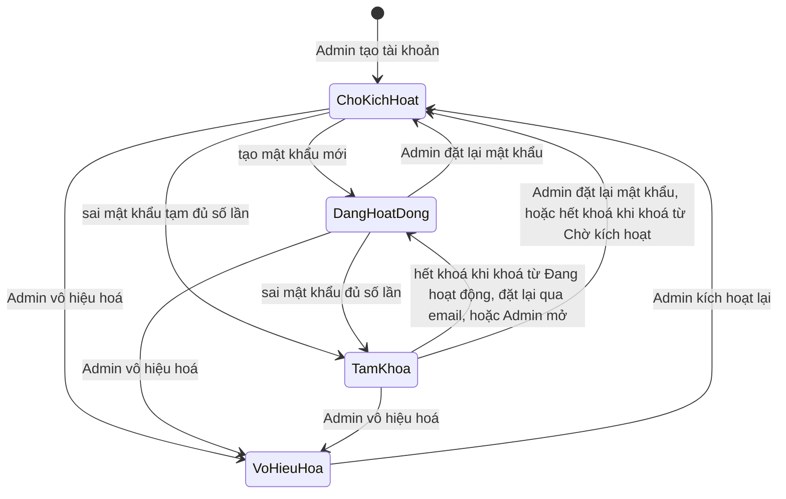
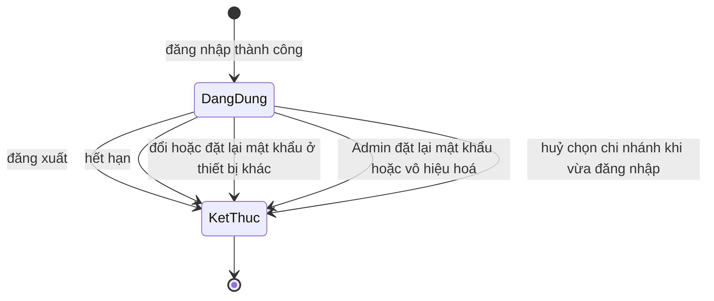
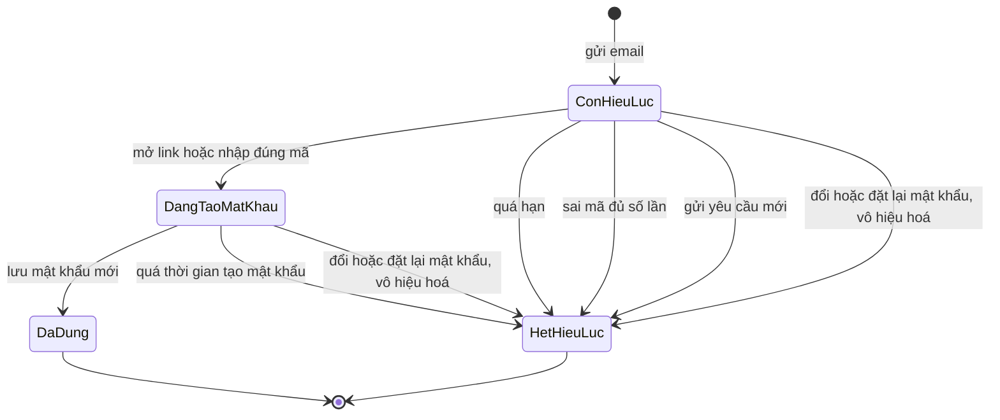

# account-access — State Diagrams

## Tài khoản

| Trạng thái | Đăng nhập | Đặt lại qua email | Ghi chú |
|---|---|---|---|
| Chờ kích hoạt | Chỉ bằng mật khẩu tạm còn hạn, vào thẳng Tạo mật khẩu mới | Có | Mật khẩu tạm hạn `P-han-mat-khau-tam` |
| Đang hoạt động | Có | Có | |
| Tạm khoá | Không (E-account-access-002) | Có, thành công thì mở khoá | Tự mở sau `P-thoi-gian-tam-khoa` |
| Vô hiệu hoá | Không (E-account-access-003) | Không gửi | Chỉ Admin đổi, ở `access-control` |

Chuyển cấm: Vô hiệu hoá → Đang hoạt động (phải qua Chờ kích hoạt với mật khẩu tạm mới).

## Phiên đăng nhập

## Yêu cầu đặt lại mật khẩu (link, mã OTP)

