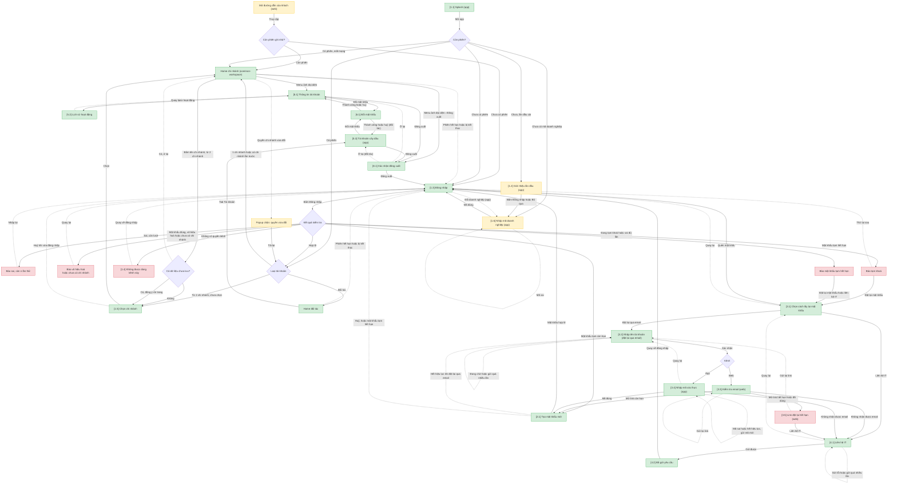

# Đăng nhập và tài khoản cá nhân — User Flow

## 1. User Flow (tổng)

## 2. Danh sách màn hình

| [#] | Slug | Màn hình | Mục đích | Trạng thái | Thiết bị | Thuộc flow |
|-----|------|----------|----------|------------|----------|------------|
| 1.1 | splash | Splash | Màn mở app, kiểm tra phiên và mã doanh nghiệp | Offline (vào Home chế độ mất mạng nếu có phiên, GR-25) | mob | sign-in |
| 1.2 | onboarding | Giới thiệu lần đầu | Giới thiệu app lần đầu cài, có nút Đăng nhập | — | mob | sign-in |
| 1.6 | company-code | Nhập mã doanh nghiệp | App lần đầu hoặc sau Đổi doanh nghiệp: nhập mã để biết khách (FR-account-access-002) | Submitting, Field error, Network error | mob | sign-in |
| 1.3 | sign-in | Đăng nhập | Nhập tên tài khoản (hoặc email), mật khẩu; web có Ghi nhớ đăng nhập; dòng hướng dẫn người chưa có tài khoản | Submitting, Field error, Network error, Session expired, Password created, Tenant not found (web) | web, mob | sign-in (dùng chung: activate-account, reset-password, contact-it, sign-out) |
| 1.4 | channel-denied | Không được dùng kênh này | Báo E-account-access-005, nút Quay về đăng nhập | — | web, mob | sign-in |
| 1.5 | branch-picker | Chọn chi nhánh | Chọn công ty mẹ hoặc một chi nhánh; modal trên web, bottom sheet trên app | Empty | web, mob | sign-in (dùng chung: switch-branch) |
| 2.1 | create-password | Tạo mật khẩu mới | Đặt mật khẩu mới sau mật khẩu tạm, link hoặc mã | Submitting, Field error, Network error, Expired | web, mob | activate-account (dùng chung: reset-password) |
| 3.1 | forgot-options | Chọn cách lấy lại mật khẩu | Đặt lại qua email hoặc Liên hệ IT | — | web, mob | reset-password (dùng chung: contact-it) |
| 3.2 | reset-request | Nhập tên tài khoản | Gửi link (web) hoặc mã (app) đặt lại mật khẩu | Submitting, Cooldown, Rate limited, Network error | web, mob | reset-password |
| 3.3 | check-email | Kiểm tra email | Báo đã gửi (câu chung), gửi lại link có đếm ngược, Không nhận được email | Cooldown, Rate limited | web | reset-password |
| 3.4 | otp-entry | Nhập mã xác thực | Nhập mã 6 số, gửi mã mới, Không nhận được email | Wrong code, Code expired, Cooldown, Rate limited | mob | reset-password |
| 3.5 | reset-link-expired | Link đặt lại hết hạn | Báo E-account-access-013, Gửi lại link, Liên hệ IT | — | web | reset-password |
| 4.1 | contact-it | Liên hệ IT | Nhập tên tài khoản để gửi yêu cầu cho bộ phận hỗ trợ | Submitting, Send failed, Rate limited, Network error | web, mob | contact-it |
| 4.2 | contact-it-sent | Đã gửi yêu cầu | Báo đã gửi, nút Quay về đăng nhập | — | web, mob | contact-it |
| 5.1 | account-info | Thông tin tài khoản | Hồ sơ chỉ đọc, đổi ảnh đại diện, đổi ngôn ngữ, mở lịch sử, đổi mật khẩu, đăng xuất | Loading, Load error, Uploading, Upload error, Saving | web, mob | account-profile |
| 5.2 | activity-history | Lịch sử hoạt động | Thao tác của chính người dùng trong 90 ngày | Loading, Load error, Empty | web, mob | account-profile |
| 5.3 | oil-station-account | Tài khoản cây dầu | Thông tin cây dầu, hạn mức tháng, hợp đồng (chỉ đối tác) | Loading, Load error, Saving | mob | account-profile |
| 6.1 | change-password | Đổi mật khẩu | Mật khẩu cũ, mới, nhập lại; popup trên web, màn riêng trên app | Submitting, Field error, Network error | web, mob | change-password |
| 8.1 | sign-out-confirm | Xác nhận đăng xuất | Hộp xác nhận theo CMP-03 | — | web, mob | sign-out |

Thanh đầu trang: tài khoản có 1 chi nhánh thấy tên chi nhánh nhưng không bấm được; từ 2 chi nhánh thì bấm được (FR-account-access-012).

## 3. Danh sách flow

| Flow-slug | Tên flow | Thiết bị | Màn hình gồm | Cases phủ |
|-----------|----------|----------|--------------|-----------|
| sign-in | Đăng nhập và chọn chi nhánh | web, mob | splash → onboarding / company-code → sign-in → (channel-denied) → branch-picker → Home | happy; error: sai, khoá, vô hiệu hoá, chưa có chi nhánh, không có quyền kênh, mất mạng; edge: có phiên, chi nhánh lần trước, đối tác, huỷ chọn |
| activate-account | Kích hoạt bằng mật khẩu tạm | web, mob | sign-in → create-password → sign-in | happy; error: mật khẩu tạm hết hạn, mật khẩu không đúng chính sách; edge: hết hiệu lực giữa chừng |
| reset-password | Tự đặt lại mật khẩu | web, mob | forgot-options → reset-request → check-email (web) / otp-entry (app) / reset-link-expired → create-password → sign-in | happy; error: mã sai, mã hết hiệu lực, link hết hạn, gửi quá nhiều; edge: không nhận được email, quay lại, hết hiệu lực giữa chừng |
| contact-it | Liên hệ IT | web, mob | forgot-options → contact-it → contact-it-sent → sign-in | happy; error: gửi email lỗi, gửi quá nhiều |
| account-profile | Thông tin cá nhân, lịch sử, ngôn ngữ | web, mob | account-info → activity-history; oil-station-account (đối tác) | happy; edge: đang tải, rỗng, tải lỗi |
| change-password | Đổi mật khẩu | web, mob | account-info / oil-station-account → change-password → account-info | happy; error: mật khẩu cũ sai, không đúng chính sách, trùng, nhập lại không khớp |
| switch-branch | Đổi chi nhánh trong phiên | web, mob | Home → branch-picker → Home | happy; edge: dữ liệu chưa lưu, quyền vừa đổi, chỉ 1 chi nhánh |
| sign-out | Đăng xuất | web, mob | account-info / oil-station-account → sign-out-confirm → sign-in | happy; edge: ở lại |

## 3.5. Chuyển màn (transitions)

| Từ màn [#] | Đến màn [#] | Trigger | Điều kiện |
|-----------|------------|---------|-----------|
| Mở đường dẫn của khách (web) | Home chi nhánh | Mở đường dẫn | còn phiên ghi nhớ (FR-account-access-013), vào chi nhánh đang dùng |
| Mở đường dẫn của khách (web) | Đăng nhập [1.3] | Mở đường dẫn | chưa có phiên hoặc phiên đã hết |
| Mở đường dẫn của khách (web) | Đăng nhập [1.3] · Tenant not found | Mở đường dẫn | đường dẫn không tồn tại hoặc khách ngừng dùng (E-account-access-017); không có nút |
| Splash [1.1] | Home chi nhánh hoặc Home đối tác | Mở app | còn phiên, theo loại tài khoản |
| Splash [1.1] | Giới thiệu lần đầu [1.2] | Mở app | lần đầu cài, chưa có phiên |
| Splash [1.1] | Đăng nhập [1.3] | Mở app | chưa có phiên |
| Giới thiệu lần đầu [1.2] | Nhập mã doanh nghiệp [1.6] | Bấm Đăng nhập hoặc Bỏ qua | chưa có mã doanh nghiệp trên máy |
| Splash [1.1] | Nhập mã doanh nghiệp [1.6] | Mở app | chưa có mã doanh nghiệp, đã qua giới thiệu |
| Splash [1.1] · Offline | Home chi nhánh (chế độ mất mạng) | Mở app | có phiên, mất mạng (GR-25) |
| Nhập mã doanh nghiệp [1.6] | Đăng nhập [1.3] | Bấm Tiếp tục | mã đúng, khách đang dùng |
| Nhập mã doanh nghiệp [1.6] | Nhập mã doanh nghiệp [1.6] · Field error | Bấm Tiếp tục | mã sai hoặc khách ngừng dùng (E-account-access-017) |
| Đăng nhập [1.3] | Nhập mã doanh nghiệp [1.6] | Bấm Đổi doanh nghiệp (app) | — |
| Đăng nhập [1.3] | Đăng nhập [1.3] · Field error | Bấm Đăng nhập | theo thứ tự BR-account-access-022: tạm khoá (002), sai còn lượt (001); chỉ khi mật khẩu đúng: vô hiệu hoá (003), chưa có chi nhánh (004), mật khẩu tạm hết hạn (006); ô trống (E-common-001) |
| Đăng nhập [1.3] | Đăng nhập [1.3] · Network error | Bấm Đăng nhập | mất mạng (E-common-009) hoặc lỗi hệ thống (E-common-008) |
| Đăng nhập [1.3] | Chọn cách lấy lại mật khẩu [3.1] | Bấm Quên mật khẩu, hoặc link trong lỗi 002/006 | lỗi 003/004 không có link đặt lại |
| Đăng nhập [1.3] | Không được dùng kênh này [1.4] | Bấm Đăng nhập | không có quyền kênh |
| Đăng nhập [1.3] | Tạo mật khẩu mới [2.1] | Bấm Đăng nhập | mật khẩu tạm còn hạn |
| Đăng nhập [1.3] | Home đối tác | Bấm Đăng nhập | hợp lệ, tài khoản đối tác |
| Đăng nhập [1.3] | Home chi nhánh | Bấm Đăng nhập | hợp lệ, 1 chi nhánh hoặc có chi nhánh lần trước còn quyền |
| Đăng nhập [1.3] | Chọn chi nhánh [1.5] | Bấm Đăng nhập | hợp lệ, từ 2 chi nhánh, chưa có lựa chọn |
| Không được dùng kênh này [1.4] | Đăng nhập [1.3] | Bấm Quay về đăng nhập | — |
| Chọn chi nhánh [1.5] | Home chi nhánh | Bấm Chọn | đã chọn 1 mục |
| Chọn chi nhánh [1.5] | Đăng nhập [1.3] | Bấm Huỷ | vừa đăng nhập (đăng xuất, xoá ghi nhớ) |
| Chọn chi nhánh [1.5] | Home chi nhánh hiện tại | Bấm Huỷ | đang đổi chi nhánh trong phiên |
| Chọn chi nhánh [1.5] · Empty | Chọn chi nhánh [1.5] | Xoá từ khoá tìm | — |
| Tạo mật khẩu mới [2.1] | Đăng nhập [1.3] · Password created | Bấm Xác nhận | mật khẩu hợp lệ |
| Tạo mật khẩu mới [2.1] | Tạo mật khẩu mới [2.1] · Field error | Bấm Xác nhận | E-account-access-008, 009, 010 |
| Tạo mật khẩu mới [2.1] · Expired | Nhập tên tài khoản [3.2] | Bấm Gửi lại yêu cầu | đến từ link hoặc mã, quá `P-han-tao-mat-khau` (E-account-access-018) |
| Tạo mật khẩu mới [2.1] · Expired | Đăng nhập [1.3] | Bấm Quay về đăng nhập | đến từ mật khẩu tạm, mật khẩu tạm đã hết hạn (E-account-access-006) |
| Tạo mật khẩu mới [2.1] | Đăng nhập [1.3] | Bấm Huỷ / Quay lại | không lưu gì; đã nhập thì hỏi xác nhận (GR-13) |
| Tạo mật khẩu mới [2.1] | Tạo mật khẩu mới [2.1] · Network error | Bấm Xác nhận | mất mạng hoặc lỗi hệ thống |
| Chọn cách lấy lại mật khẩu [3.1] | Nhập tên tài khoản [3.2] | Chọn Đặt lại qua email | — |
| Chọn cách lấy lại mật khẩu [3.1] | Liên hệ IT [4.1] | Chọn Liên hệ IT | — |
| Chọn cách lấy lại mật khẩu [3.1] | Đăng nhập [1.3] | Quay lại | — |
| Nhập tên tài khoản [3.2] | Kiểm tra email [3.3] | Bấm Xác nhận | web, trong giới hạn gửi |
| Nhập tên tài khoản [3.2] | Nhập mã xác thực [3.4] | Bấm Xác nhận | app, trong giới hạn gửi |
| Nhập tên tài khoản [3.2] | Nhập tên tài khoản [3.2] · Rate limited | Bấm Xác nhận | vượt `P-so-lan-gui-ma-moi-gio` (E-account-access-014) |
| Nhập tên tài khoản [3.2] | Chọn cách lấy lại mật khẩu [3.1] | Quay lại | — |
| Kiểm tra email [3.3] | Tạo mật khẩu mới [2.1] | Mở link trong email | link còn hạn, chưa dùng |
| Kiểm tra email [3.3] | Link đặt lại hết hạn [3.5] | Mở link trong email | link hết hạn hoặc đã dùng |
| Kiểm tra email [3.3] | Kiểm tra email [3.3] · Cooldown | Bấm Gửi lại link | hết thời gian chờ, trong giới hạn |
| Kiểm tra email [3.3] | Liên hệ IT [4.1] | Bấm Không nhận được email | — |
| Kiểm tra email [3.3] | Đăng nhập [1.3] | Bấm Quay về đăng nhập | — |
| Kiểm tra email [3.3] | Kiểm tra email [3.3] · Rate limited | Bấm Gửi lại link | vượt giới hạn mỗi giờ (E-account-access-014) |
| Nhập mã xác thực [3.4] | Tạo mật khẩu mới [2.1] | Nhập đủ 6 số | mã đúng, còn hạn |
| Nhập mã xác thực [3.4] | Nhập mã xác thực [3.4] · Wrong code | Nhập đủ 6 số | mã sai, còn lượt (E-account-access-011) |
| Nhập mã xác thực [3.4] | Nhập mã xác thực [3.4] · Code expired | Nhập đủ 6 số / hết hạn | sai đủ lần hoặc quá hạn (E-account-access-012) |
| Nhập mã xác thực [3.4] · Code expired | Nhập mã xác thực [3.4] · Cooldown | Bấm Gửi mã mới | — |
| Nhập mã xác thực [3.4] | Nhập tên tài khoản [3.2] | Quay lại | mã đã gửi vẫn còn hiệu lực tới hết hạn |
| Nhập mã xác thực [3.4] | Liên hệ IT [4.1] | Bấm Không nhận được email | — |
| Nhập mã xác thực [3.4] | Nhập mã xác thực [3.4] · Rate limited | Bấm Gửi mã mới | vượt giới hạn mỗi giờ (E-account-access-014) |
| Link đặt lại hết hạn [3.5] | Nhập tên tài khoản [3.2] | Bấm Gửi lại link | — |
| Link đặt lại hết hạn [3.5] | Liên hệ IT [4.1] | Bấm Liên hệ IT | — |
| Liên hệ IT [4.1] | Đã gửi yêu cầu [4.2] | Bấm Xác nhận | gửi được, hoặc tên không tồn tại (cùng màn) |
| Liên hệ IT [4.1] | Liên hệ IT [4.1] · Send failed | Bấm Xác nhận | dịch vụ email lỗi (E-account-access-015) |
| Liên hệ IT [4.1] | Liên hệ IT [4.1] · Rate limited | Bấm Xác nhận | vượt giới hạn gửi (E-account-access-014) |
| Liên hệ IT [4.1] | Chọn cách lấy lại mật khẩu [3.1] | Quay lại | — |
| Nhập tên tài khoản [3.2] / Liên hệ IT [4.1] | cùng màn · Network error | Bấm Xác nhận | mất mạng hoặc lỗi hệ thống |
| Đã gửi yêu cầu [4.2] | Đăng nhập [1.3] | Bấm Quay về đăng nhập | — |
| Home chi nhánh | Thông tin tài khoản [5.1] | Menu ảnh đại diện › Thông tin tài khoản (app: tab Tài khoản) | — |
| Home chi nhánh | Chọn chi nhánh [1.5] | Bấm tên chi nhánh | từ 2 chi nhánh; có dữ liệu chưa lưu thì qua xác nhận rời trang (GR-13) |
| Home chi nhánh | Popup chặn quyền vừa đổi | Thao tác bất kỳ | quyền chi nhánh vừa đổi (E-common-012) |
| Popup chặn quyền vừa đổi | Home chi nhánh hoặc Chọn chi nhánh [1.5] | Bấm Tải lại | phân luồng lại theo quyền mới |
| Mọi màn có phiên | Đăng nhập [1.3] · Session expired | Thao tác bất kỳ | phiên hết hạn, bị kết thúc do đổi/đặt lại mật khẩu ở nơi khác, bị vô hiệu hoá (E-common-010; app: popup chặn GR-26) |
| Home chi nhánh | Xác nhận đăng xuất [8.1] | Menu ảnh đại diện › Đăng xuất | — |
| Home đối tác | Tài khoản cây dầu [5.3] | Tab Tài khoản | tài khoản đối tác cây dầu |
| Thông tin tài khoản [5.1] | Lịch sử hoạt động [5.2] | Bấm Lịch sử hoạt động | — |
| Thông tin tài khoản [5.1] · Load error | Thông tin tài khoản [5.1] | Bấm Thử lại | — |
| Lịch sử hoạt động [5.2] | Thông tin tài khoản [5.1] | Quay lại | — |
| Lịch sử hoạt động [5.2] · Load error | Lịch sử hoạt động [5.2] | Bấm Thử lại | — |
| Tài khoản cây dầu [5.3] · Load error | Tài khoản cây dầu [5.3] | Bấm Thử lại | — |
| Tài khoản cây dầu [5.3] | Tài khoản cây dầu [5.3] · Saving | Chọn ngôn ngữ | xong thì tải lại giao diện, toast CMP-01 (FR-account-access-026) |
| Thông tin tài khoản [5.1] | Thông tin tài khoản [5.1] · Uploading | Chọn ảnh đại diện | JPG, PNG; quá 5 MB hoặc sai định dạng → Upload error (E-account-access-016, E-common-006) |
| Thông tin tài khoản [5.1] | Thông tin tài khoản [5.1] · Saving | Chọn ngôn ngữ | xong thì tải lại giao diện, toast CMP-01 |
| Thông tin tài khoản [5.1] | Đổi mật khẩu [6.1] | Bấm Đổi mật khẩu | — |
| Tài khoản cây dầu [5.3] | Đổi mật khẩu [6.1] | Bấm Đổi mật khẩu | — |
| Đổi mật khẩu [6.1] | Thông tin tài khoản [5.1] | Bấm Xác nhận | thành công: toast, các thiết bị khác bị đăng xuất |
| Đổi mật khẩu [6.1] | Tài khoản cây dầu [5.3] | Bấm Xác nhận / Bấm Huỷ | mở từ Tài khoản cây dầu (tài khoản đối tác) |
| Đổi mật khẩu [6.1] | Đổi mật khẩu [6.1] · Field error | Bấm Xác nhận | E-account-access-007 đến 010 |
| Đổi mật khẩu [6.1] | Thông tin tài khoản [5.1] | Bấm Huỷ | đã nhập thì hỏi xác nhận (GR-13) |
| Đổi mật khẩu [6.1] | Đổi mật khẩu [6.1] · Network error | Bấm Xác nhận | mất mạng hoặc lỗi hệ thống |
| Thông tin tài khoản [5.1] | Xác nhận đăng xuất [8.1] | Bấm Đăng xuất | — |
| Tài khoản cây dầu [5.3] | Xác nhận đăng xuất [8.1] | Bấm Đăng xuất | — |
| Xác nhận đăng xuất [8.1] | Đăng nhập [1.3] | Bấm Đăng xuất | — |
| Xác nhận đăng xuất [8.1] | Màn trước đó ([5.1], [5.3] hoặc Home) | Bấm Ở lại | — |

## 3.6. Tác vụ chính

| Tác vụ | Vai trò | Tần suất | Mức quan trọng | Đường đi | Số bước | Thành công khi |
|--------|---------|----------|----------------|----------|---------|----------------|
| Đăng nhập web | Nhân viên văn phòng | mỗi ngày | cao | [1.3] → Home | 3 | ≤ 3 bước, vào đúng chi nhánh lần trước |
| Đăng nhập lần đầu, nhiều chi nhánh | Người phụ trách nhiều chi nhánh | mỗi lần chưa có lựa chọn | cao | [1.3] → [1.5] → Home | 5 | ≤ 5 bước |
| Mở app khi đã có phiên | Lái xe, hiện trường | mỗi ca | cao | [1.1] → Home | 0 | dưới 3 giây |
| Đổi chi nhánh | Người phụ trách nhiều chi nhánh | vài lần mỗi tuần | trung | Home → [1.5] → Home | 3 | không đăng xuất |
| Tự đặt lại mật khẩu (app) | Mọi người dùng có email | hiếm | trung | [1.3] → [3.1] → [3.2] → [3.4] → [2.1] → [1.3] | 8 | xong trong một lần, không cần IT |
| Liên hệ IT | Người không có email | hiếm | trung | [1.3] → [3.1] → [4.1] → [4.2] | 4 | ≤ 4 bước |
| Kích hoạt bằng mật khẩu tạm | Người dùng mới | 1 lần | trung | [1.3] → [2.1] → [1.3] → Home | 9 | không cần trợ giúp (gồm cả lần đăng nhập lại cuối) |
| Đổi mật khẩu | Mọi người dùng | hiếm | trung | Home → [5.1] → [6.1] → [5.1] | 7 | ≤ 7 bước |
| Đăng xuất | Mọi người dùng | hiếm | thấp | Home → [8.1] → [1.3] | 3 | ≤ 3 bước |

## 4. Open Questions

- [x] OQ-1: Sau khi mở link hoặc nhập đúng mã, người dùng có bao lâu để hoàn tất màn Tạo mật khẩu mới [2.1] trước khi phải gửi lại? — Resolved 15/10 (review /srs): `P-han-tao-mat-khau` (Delta: 15 phút), spec BR-account-access-023.
