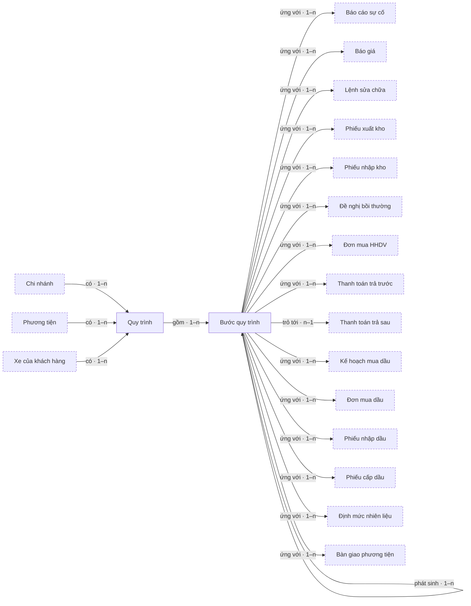

# Bản đồ đối tượng — cross-process-flow

## 0. Sơ đồ tổng quan

<!-- object-map:diagram:begin -->

<!-- object-map:diagram:end -->

## Vai trò nghiệp vụ

| Vai trò | Thuộc actor | Nguồn |
|---|---|---|
| Người theo dõi quy trình | Nhân viên nội bộ Delta | cross-process-flow.md:49 |
| Người tạo bản ghi | Nhân viên nội bộ Delta | cross-process-flow.md:148 |
| Admin | Admin | cross-process-flow.md:47 |
| Hệ thống | Hệ thống | cross-process-flow.md:47 |

## 1. Đối tượng

| Mã | Tên | Định nghĩa | Subsystem | Nguồn |
|---|---|---|---|---|
| OBJ-quy-trinh | Quy trình | Chuỗi nghiệp vụ nối nhau bắt đầu từ một bản ghi gốc; mã `QT-[Mã chi nhánh]-[YY]-[XXXX]` (dữ liệu cũ `QT-[Mã chi nhánh]-LG-[XXXX]`), trạng thái do hệ thống tự tính | Dùng chung | cross-process-flow.md:79 |
| OBJ-buoc-quy-trinh | Bước quy trình | Một nút trên cây quy trình, ứng với tối đa 1 bản ghi nghiệp vụ hiện hành (bước "1 bản ghi" có thể kèm các bản ghi Đã thay thế); có thể chưa có bản ghi ("Chưa tạo") | Dùng chung | cross-process-flow.md:75 |

## 2. Quan hệ

| Từ | Quan hệ | Tới | Bản số | Đi được từ màn chi tiết | Nguồn |
|---|---|---|---|---|---|
| Chi nhánh | có | Quy trình | 1–n | Quy trình → Chi nhánh | cross-process-flow.md:260 |
| Phương tiện | có | Quy trình | 1–n | Quy trình → Phương tiện | cross-process-flow.md:172 |
| Xe của khách hàng | có | Quy trình | 1–n | Quy trình → Xe của khách hàng | cross-process-flow.md:172 |
| Quy trình | gồm | Bước quy trình | 1–n | 2 chiều | cross-process-flow.md:75 |
| Bước quy trình | phát sinh | Bước quy trình | 1–n | 2 chiều | cross-process-flow.md:98 |
| Bước quy trình | ứng với | Báo cáo sự cố | 1–n | 2 chiều | lg-srs-export.md:1093 |
| Bước quy trình | ứng với | Báo giá | 1–n | 2 chiều | lg-srs-export.md:1073 |
| Bước quy trình | ứng với | Lệnh sửa chữa | 1–n | 2 chiều | lg-srs-export.md:1073 |
| Bước quy trình | ứng với | Phiếu xuất kho | 1–n | 2 chiều | lg-srs-export.md:1073 |
| Bước quy trình | ứng với | Phiếu nhập kho | 1–n | 2 chiều | lg-srs-export.md:1062 |
| Bước quy trình | ứng với | Đề nghị bồi thường | 1–n | 2 chiều | lg-srs-export.md:1062 |
| Bước quy trình | ứng với | Đơn mua HHDV | 1–n | 2 chiều | lg-srs-export.md:1062 |
| Bước quy trình | ứng với | Thanh toán trả trước | 1–n | 2 chiều | lg-srs-export.md:1062 |
| Bước quy trình | trỏ tới | Thanh toán trả sau | n–1 | Bước quy trình → Thanh toán trả sau | lg-srs-export.md:1044 |
| Bước quy trình | ứng với | Kế hoạch mua dầu | 1–n | 2 chiều | lg-srs-export.md:1118 |
| Bước quy trình | ứng với | Đơn mua dầu | 1–n | 2 chiều | lg-srs-export.md:1118 |
| Bước quy trình | ứng với | Phiếu nhập dầu | 1–n | 2 chiều | lg-srs-export.md:1118 |
| Bước quy trình | ứng với | Phiếu cấp dầu | 1–n | 2 chiều | lg-srs-export.md:1128 |
| Bước quy trình | ứng với | Định mức nhiên liệu | 1–n | 2 chiều | lg-srs-export.md:1128 |
| Bước quy trình | ứng với | Bàn giao phương tiện | 1–n | 2 chiều | lg-srs-export.md:1129 |

## 3. Hành động theo vai trò

| Đối tượng | Hành động | Vai trò | Kênh | Đổi trạng thái | Nguồn |
|---|---|---|---|---|---|
| Quy trình | Tạo tự động khi bản ghi gốc gửi thành công, sinh mã | Hệ thống | — | — → Đang triển khai | cross-process-flow.md:234 |
| Quy trình | Chuyển Đã dừng khi bước của luồng chính bị từ chối hoặc thu hồi | Hệ thống | — | Đang triển khai → Đã dừng | cross-process-flow.md:235 |
| Quy trình | Chuyển lại Đang triển khai khi bước đó được gửi lại, có bản ghi thay thế hoặc bị xoá | Hệ thống | — | Đã dừng → Đang triển khai | cross-process-flow.md:236 |
| Quy trình | Hoàn thành khi mọi bước chính và nhánh phát sinh đã xong (không tính nhánh Đã huỷ) | Hệ thống | — | Đang triển khai → Đã hoàn thành | cross-process-flow.md:237 |
| Quy trình | Xem danh sách | Người theo dõi quy trình | Website | — | cross-process-flow.md:162 |
| Quy trình | Tìm theo mã quy trình, mã yêu cầu hoặc mã bản ghi bất kỳ trong cây | Người theo dõi quy trình | Website | — | cross-process-flow.md:164 |
| Quy trình | Lọc theo luồng, trạng thái, chi nhánh, khoảng ngày | Người theo dõi quy trình | Website | — | cross-process-flow.md:164 |
| Quy trình | Xuất danh sách PDF, Excel | Người theo dõi quy trình | Website | — | cross-process-flow-spec.md FR-022 |
| Quy trình | Mở sơ đồ | Người theo dõi quy trình | Website · Delta Super App | — | cross-process-flow.md:102 |
| Quy trình | Mở sơ đồ | Lái xe | Delta Super App | — | cross-process-flow.md:200 |
| Quy trình | Tải lại khi có cập nhật | Người theo dõi quy trình | Website · Delta Super App | — | cross-process-flow.md:245 |
| Quy trình | Cấp quyền menu Quy trình theo module | Admin | Website | — | cross-process-flow.md:47 |
| Bước quy trình | Chọn xem bước | Người theo dõi quy trình | Website · Delta Super App | — | cross-process-flow.md:104 |
| Bước quy trình | Chọn xem bước | Lái xe | Delta Super App | — | cross-process-flow.md:200 |
| Bước quy trình | Mở màn hình chi tiết | Người theo dõi quy trình | Website · Delta Super App | — | cross-process-flow.md:106 |
| Bước quy trình | Mở màn hình chi tiết | Lái xe | Delta Super App | — | cross-process-flow.md:265 |
| Bước quy trình | Mở bảng công nợ | Người theo dõi quy trình | Website | — | cross-process-flow.md:158; userflow OQ-2 |
| Bước quy trình | Tạo nghiệp vụ tiếp theo | Người tạo bản ghi | Website · Delta Super App (nghiệp vụ có trên app) | — | cross-process-flow.md:148 |
| Bước quy trình | Thêm bước khi bản ghi gửi thành công | Hệ thống | — | Chưa triển khai → Đang triển khai | cross-process-flow.md:216 |
| Bước quy trình | Hoàn thành bước khi bản ghi được phê duyệt hoặc hoàn tất | Hệ thống | — | Đang triển khai → Đã hoàn thành | cross-process-flow.md:217 |
| Bước quy trình | Chuyển Đã thu hồi/từ chối khi bản ghi bị thu hồi hoặc từ chối | Hệ thống | — | Đang triển khai → Đã thu hồi/từ chối | cross-process-flow.md:218 |
| Bước quy trình | Chuyển lại Đang triển khai khi bản ghi được gửi lại hoặc có bản ghi thay thế | Hệ thống | — | Đã thu hồi/từ chối → Đang triển khai | cross-process-flow.md:219 |
| Bước quy trình | Đưa về Chưa triển khai khi bản ghi của bước chính bị xoá | Hệ thống | — | Đã thu hồi/từ chối → Chưa triển khai | cross-process-flow.md:220 |
| Bước quy trình | Chuyển Đã huỷ khi bản ghi của nhánh phát sinh bị xoá | Hệ thống | — | Đã thu hồi/từ chối → Đã huỷ | cross-process-flow-spec.md BR-009 |
| Bước quy trình | Đánh dấu bản ghi cũ Đã thay thế khi bước "1 bản ghi" nhận bản ghi mới | Hệ thống | — | Đã thu hồi/từ chối → Đang triển khai | cross-process-flow-spec.md BR-011 |
| Bước quy trình | Chuyển Đang triển khai khi chốt công nợ lần đầu (bước công nợ) | Hệ thống | — | Chưa triển khai → Đang triển khai | cross-process-flow.md:221 |
| Bước quy trình | Hoàn thành khi phần công nợ của luồng đã thanh toán (bước công nợ) | Hệ thống | — | Đang triển khai → Đã hoàn thành | cross-process-flow.md:222 |

## 4. Thuộc tính

| Đối tượng | Thuộc tính | Loại nghiệp vụ | Hiện ở | Lọc / Sắp | Nguồn |
|---|---|---|---|---|---|
| Quy trình | Mã quy trình (`QT-[Mã chi nhánh]-[YY]-[XXXX]`) | mã định danh | Thẻ · Danh sách · Chi tiết | Tìm | cross-process-flow.md:169 |
| Quy trình | Luồng | danh mục | Thẻ · Danh sách · Chi tiết | Lọc | cross-process-flow.md:170 |
| Quy trình | Bản ghi gốc (tên bước + mã) | văn bản | Danh sách | — | cross-process-flow.md:171 |
| Quy trình | Tiến độ (Xong x/y bước; y gồm mọi bước trừ nhánh Đã huỷ) | số | Thẻ · Danh sách | — | cross-process-flow.md:173 |
| Quy trình | Số nhánh phát sinh | số | Thẻ · Danh sách | — | cross-process-flow.md:174 |
| Quy trình | Bước đang chờ (bước chờ lâu nhất + "+n bước khác", trạng thái, chờ bao lâu) | văn bản | Danh sách | — | cross-process-flow.md:175 |
| Quy trình | Trạng thái | trạng thái | Thẻ · Danh sách · Chi tiết | Lọc | cross-process-flow.md:176 |
| Quy trình | Chi nhánh | danh mục | Danh sách | Lọc | cross-process-flow.md:177 |
| Quy trình | Cập nhật lần cuối (dùng cho bộ lọc khoảng ngày) | ngày | Danh sách | Lọc · Sắp | cross-process-flow.md:163 |
| Bước quy trình | Tên bước | văn bản | Thẻ · Chi tiết | — | cross-process-flow.md:76 |
| Bước quy trình | Mã (mã yêu cầu trước khi duyệt, mã bản ghi sau khi duyệt; N/A khi chưa tạo) | mã định danh | Thẻ · Chi tiết | Tìm | cross-process-flow.md:220 |
| Bước quy trình | Trạng thái bước | trạng thái | Thẻ · Chi tiết | — | cross-process-flow.md:206 |
| Bước quy trình | Loại bước (bước chính, nhánh phát sinh, ngã rẽ chưa chốt, công nợ, liên module) | danh mục | Thẻ · Chi tiết | — | cross-process-flow.md:75 |
| Bước quy trình | Module | danh mục | Thẻ · Chi tiết | — | cross-process-flow.md:76 |
| Bước quy trình | Trường hợp phát sinh (câu cho người dùng đọc, giá trị lúc phát sinh) | văn bản | Thẻ · Chi tiết | — | cross-process-flow.md:289 |
| Bước quy trình | Các hướng có thể đi (chỉ ngã rẽ) | văn bản | Chi tiết | — | cross-process-flow.md:190 |
| Bước quy trình | Bản ghi trước đó (mã · Đã thay thế · ngày bị từ chối/thu hồi) | văn bản | Thẻ · Chi tiết | — | cross-process-flow-spec.md BR-011 |

## 5. Đề xuất hiển thị dùng chung

| Đối tượng | Dùng ở feature | Thẻ hiện | Dòng danh sách hiện | Gợi ý CMP |
|---|---|---|---|---|
| Quy trình | Xưởng, Cây dầu, Liên module, Điều phối (khi chốt luồng) | Luồng · Tiến độ "Xong x/y bước · n nhánh phát sinh" · Bước trước / Phát sinh từ | Mã · Luồng · Bản ghi gốc · Tiến độ · Bước đang chờ · Trạng thái | CMP-09 Liên quy trình — dòng quy trình đầu màn chi tiết (web) / thẻ quy trình (mobile) |
| Bước quy trình | Mọi nghiệp vụ có bảng liên quy trình | Tên bước · Mã · Trạng thái · nhãn Loại bước / Module | — | CMP-09 Liên quy trình — thẻ bước trên sơ đồ + panel chi tiết bước |

## 6. Câu hỏi mở

| # | Câu hỏi | Liên quan |
|---|---|---|
| OQ-1 | Bảng phát sinh luồng Điều vận (Cung cấp dịch vụ tổng quát → Điều phối → Lệnh vận tải → Thanh toán chi/thu): bước nào ứng với đối tượng nào? Chờ chốt với khách. — Nguồn khách: chưa có trong tài liệu khách gửi | Mục 2, Bước quy trình |
