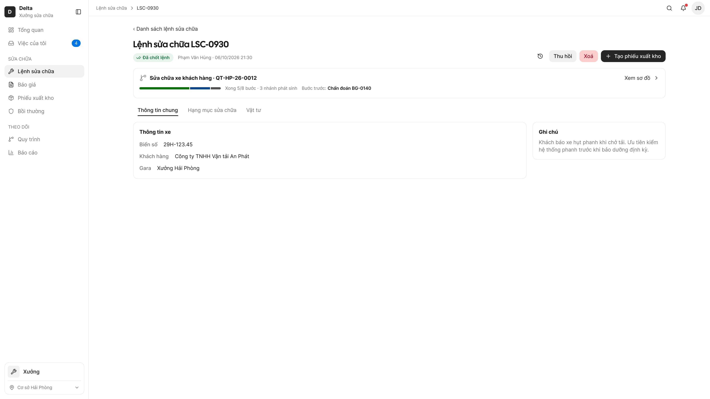
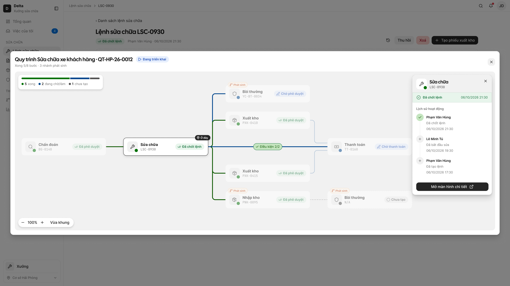
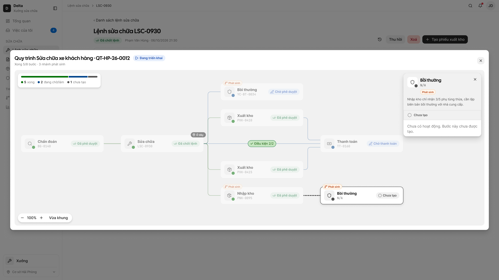
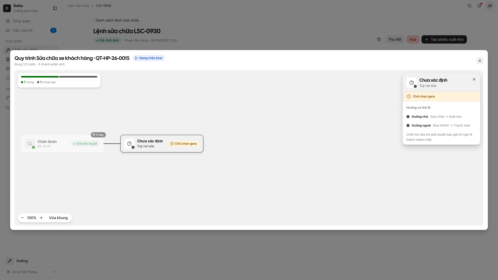
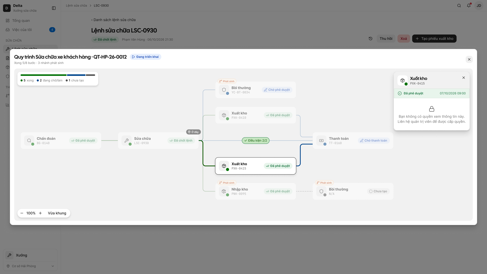
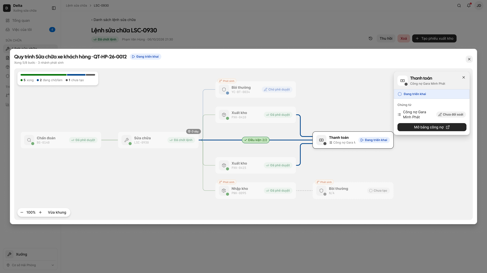
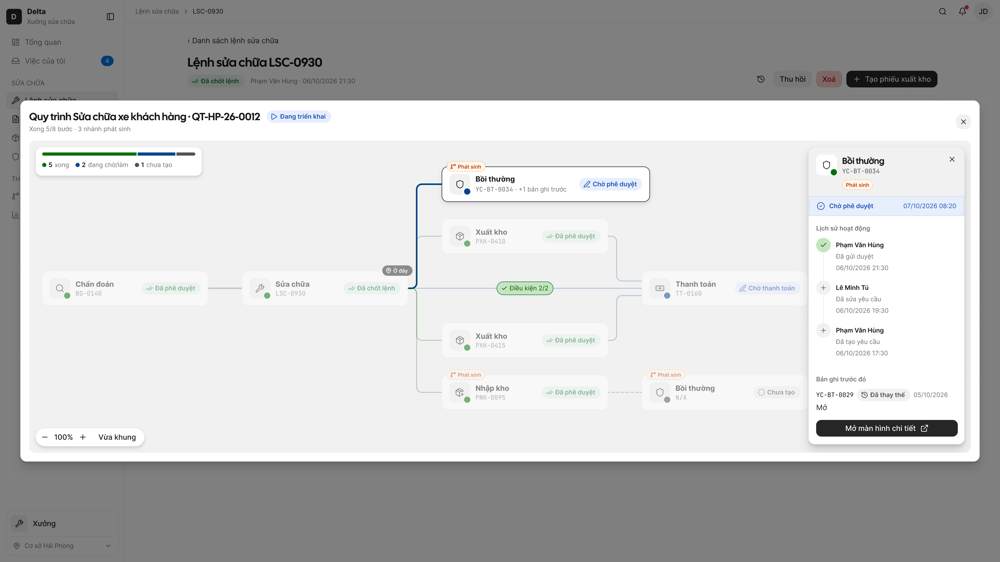
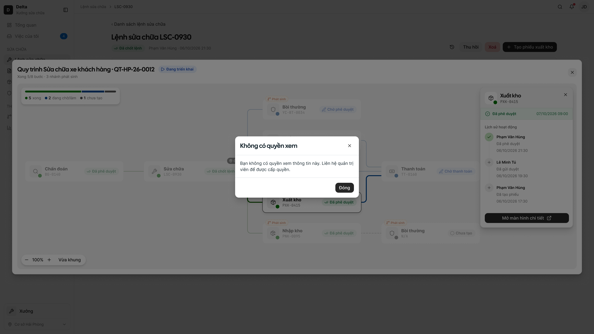
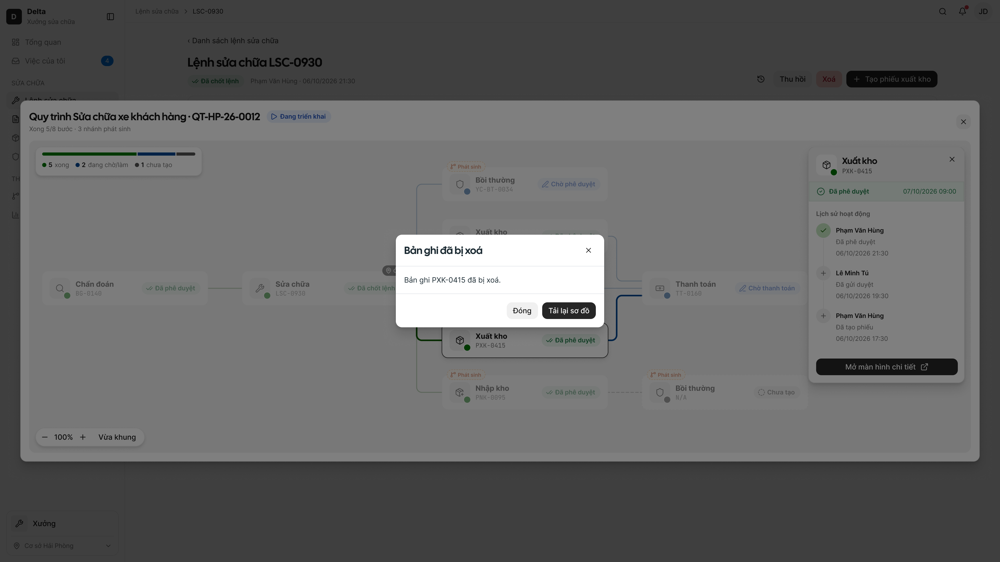

# Xem quy trình từ màn chi tiết

> Flow `view-process` · thiết bị `web` · bảng chép từ `docs/cross-process-flow/html-wireframe/view-process.html` ngày 2026-10-13. Giao diện là frame Figma; bảng 5 cột là hợp đồng — sửa qua `/figma-sync` hoặc `/cr`.

## Screen: record-detail — Màn chi tiết bản ghi có dòng quy trình

- **screenId:** 1.1 · web
- **Figma:** [1.1 · web](https://www.figma.com/design/FifpyOMpZk9OP8qyNzbRVJ/?node-id=5587-117888)
- **Mô tả:** Màn chi tiết của bản ghi nghiệp vụ, có dòng quy trình ở đầu cho biết bản ghi đang ở bước nào; bấm dòng để mở sơ đồ, có nút tạo nghiệp vụ tiếp theo khi đạt điều kiện.

| # | Items | Control type | Data type | Description |
|---|---|---|---|---|
| 1 | Dòng quy trình | Row | Click | • Xem CMP-09 — Cross Process Flow (#1 Dòng quy trình) • Mục đích: cho người xem biết bản ghi đang ở đâu trong quy trình mà không mở từng phiếu; bấm để mở sơ đồ (FR-cross-process-flow-005, -006) • Đặt đầu màn chi tiết, ngay dưới tiêu đề và vùng hành động • Chỉ hiện khi bản ghi thuộc quy trình. Không thuộc quy trình, hoặc luồng độc lập chưa có nhánh → không hiện gì, màn chi tiết như cũ (D1, R11) • Bấm bất kỳ chỗ nào trên dòng → popup sơ đồ đang tải [1.2] · Loading rồi popup sơ đồ [1.2] • Không làm chậm màn chi tiết: màn hiện trước, dòng quy trình hiện trong tối đa 2 giây (NFR-cross-process-flow-002); đang tải → skeleton [1.1] · Loading; tải lỗi → [1.1] · Load error |
| 2 | Tên luồng · mã quy trình | Label | ReadOnly | • Vd "Sửa chữa xe khách hàng · QT-HP-0012" • Tên luồng khai trong bảng liên quy trình của nghiệp vụ (BR-cross-process-flow-007) • Mã theo P-mau-ma-quy-trinh (Delta: QT-[Mã chi nhánh]-[YY]-[XXXX], đánh lại số đầu mỗi năm); quy trình tự tạo nên sinh ngay khi bản ghi gốc gửi thành công (FR-cross-process-flow-001) • Giữ chi nhánh lúc tạo dù bản ghi chuyển chi nhánh sau đó; quy trình dựng từ dữ liệu cũ mang dãy QT-[Mã chi nhánh]-LG-[XXXX] (BR-cross-process-flow-004) |
| 3 | Thanh tiến độ | Progress bar | ReadOnly | • Tỉ lệ bước đã xong trên tổng bước của cây (vd 5/8); tổng gồm bước chính kể cả Chưa tạo, ngã rẽ (tính 1 bước), nhánh phát sinh, bước công nợ — không tính nhánh Đã huỷ và bản ghi Đã thay thế (FR-cross-process-flow-005) • Luôn đi kèm dòng tóm tắt bằng chữ, không chỉ báo bằng hình (NFR-cross-process-flow-005) |
| 4 | Dòng tóm tắt | Label | ReadOnly | • "Xong x/y bước · n nhánh phát sinh" (R12) • Nhánh phát sinh Đã huỷ (bản ghi bị xoá) không tính vào tiến độ, không chặn quy trình Đã hoàn thành (BR-cross-process-flow-003, -009) |
| 5 | Bước trước / Phát sinh từ | Label | ReadOnly | • Bản ghi là bước chính: "Bước trước: {tên bước} {mã}"; là nhánh phát sinh: "Phát sinh từ: {tên bước} {mã}" (FR-cross-process-flow-005) • Bản ghi là nút đầu cây: không có dòng này |
| 6 | Xem sơ đồ › | Link | Click | • Cùng hành động với bấm dòng quy trình; giúp người dùng nhận ra dòng bấm được |
| 7 | Nút tạo nghiệp vụ tiếp theo (vd "Tạo phiếu xuất kho") | Button | Click | • Ở vùng hành động đầu trang, không đặt trên sơ đồ (R13); là nút chính của nhóm • Chỉ hiện khi bản ghi đạt hành động trigger theo bảng liên quy trình VÀ người xem có quyền tạo (D6, FR-cross-process-flow-012). Không đạt → không hiện nút • Tên nút, form đích và thông tin mang sang form sau khai trong bảng liên quy trình của nghiệp vụ (BR-cross-process-flow-007) • Bấm → form tạo mới đã điền sẵn thông tin mang từ bản ghi này (ngoài feature) — xem flow create-next-step |
| 8 | Thu hồi / Xoá | Button | Click | • Hành động của nghiệp vụ, không thuộc feature • Bản ghi đã sinh bước con → chặn bằng popup E-cross-process-flow-002 (FR-cross-process-flow-014) — màn [3.4]; hiện chưa nghiệp vụ nào cho thu hồi/xoá khi đã có bước con (spec Mục 11 — giả định) |
| 9 | Lịch sử (icon đồng hồ) | Button | Click | • Xem CMP-08 — Activity Log của bản ghi đang mở; không thuộc feature, vẽ để đủ vùng hành động |

### Trạng thái: Load error — Dòng quy trình tải lỗi

- **Figma:** [1.1 · web · record-detail · Load error](https://www.figma.com/design/FifpyOMpZk9OP8qyNzbRVJ/?node-id=5587-118875)

| # | Items | Control type | Data type | Description |
|---|---|---|---|---|
| 1 | Thông báo lỗi tại chỗ dòng quy trình | Banner | ReadOnly | • "Không tải được quy trình." nằm đúng vị trí dòng quy trình (FR-cross-process-flow-005) • Chỉ khối này lỗi; phần còn lại của màn chi tiết vẫn dùng bình thường (UC xem quy trình — Minimal Guarantee) • Dùng Banner lỗi khối có Thử lại (design.md › Lỗi trang/khối), không dùng toast |
| 2 | Thử lại | Button | Click | • Tải lại riêng dòng quy trình; được → [1.1], vẫn lỗi → giữ màn này • Đang tải lại: nút ở trạng thái đang xử lý (design.md › Đang tải) |

### Trạng thái: Loading — Dòng quy trình đang tải

- **Figma:** [1.1 · web · record-detail · Loading](https://www.figma.com/design/FifpyOMpZk9OP8qyNzbRVJ/?node-id=5587-118511)

| # | Items | Control type | Data type | Description |
|---|---|---|---|---|
| 1 | Skeleton dòng quy trình | Skeleton | ReadOnly | • Theo GR-12: khung xám cao bằng dòng thật, không đẩy bố cục khi tải xong (FR-cross-process-flow-005) • Màn chi tiết hiện trước, không chờ dòng quy trình (NFR-cross-process-flow-002); tải xong → [1.1], lỗi → [1.1] · Load error |

## Screen: process-diagram — Popup sơ đồ — chọn sẵn Ở đây

- **screenId:** 1.2 · web
- **Figma:** [1.2 · web](https://www.figma.com/design/FifpyOMpZk9OP8qyNzbRVJ/?node-id=5587-119271)
- **Mô tả:** Popup sơ đồ cây quy trình mở từ màn chi tiết, chọn sẵn bước "Ở đây" và mở panel của bước đó.

| # | Items | Control type | Data type | Description |
|---|---|---|---|---|
| 1 | Popup sơ đồ | Popup | Click | • Xem CMP-09 (#2 Sơ đồ). Mở từ màn chi tiết: chọn sẵn bước "Ở đây" và mở panel bước đó (FR-cross-process-flow-006); app chỉ đánh dấu bước, không tự mở sheet bước • Mặc định vừa khung; hiện đủ trong tối đa 2 giây với cây đến 20 bước, 3 giây với cây đến 50 bước (NFR-cross-process-flow-001); cây trên 20 bước vẫn vẽ đủ, vừa khung (NFR-cross-process-flow-006) • Nền là màn chi tiết đang mở, làm mờ |
| 2 | Tiêu đề popup | Label | ReadOnly | • "Quy trình {Tên luồng}" · mã quy trình · trạng thái quy trình: Đang triển khai / Đã dừng / Đã hoàn thành (FR-cross-process-flow-002), nhãn chữ |
| 3 | Đóng × | Button | Click | • Đóng popup → về màn chi tiết [1.1] |
| 4 | Card tóm tắt | Card | ReadOnly | • Góc trên trái vùng sơ đồ: "Xong x/y bước · n nhánh phát sinh" + thanh tiến độ + số bước theo trạng thái (CMP-09 #2) |
| 5 | Thẻ bước | Card | Click | • Xem CMP-09 (#3 Thẻ bước): tên bước · mã · trạng thái của bản ghi kèm icon ✓ / đồng hồ / ▶ / ✕ / vòng đứt / ⊘ (R7) • Mã: mã yêu cầu khi bản ghi chưa được duyệt (vd YC-BT-0034), mã bản ghi khi đã duyệt (vd PXK-0410); sửa rồi gửi lại giữ nguyên mã yêu cầu; N/A khi chưa tạo, Theo GR-10 (BR-cross-process-flow-012) • Bước "1 bản ghi" có bản ghi Đã thay thế: thẻ hiện bản ghi hiện hành kèm "+n bản ghi trước" (vd Bồi thường YC-BT-0034) → panel [1.7] (BR-cross-process-flow-011) • Nhánh phát sinh Đã huỷ (bản ghi bị xoá): viền đứt, tên gạch ngang, icon ⊘ + "Đã huỷ" (vd Mua HHDV YC-DMH-0071) (BR-cross-process-flow-009) • Nhãn Phát sinh góc trên trái (R16), ghim "Ở đây" góc trên phải (R10), nhãn module khi bước thuộc module khác (R9) • Mỗi bản ghi 1 thẻ; nhiều phiếu cùng loại cùng nguồn là các thẻ anh em cùng tên, phân biệt bằng mã (BR-cross-process-flow-008) — vd Xuất kho PXK-0410 và PXK-0415 • Ngã rẽ đã chốt hướng: thẻ ngã rẽ thành bước của hướng đã chọn, các hướng khác biến mất (FR-cross-process-flow-007) • Mọi bước đều hiện tên, mã, trạng thái kể cả bước người xem không có quyền (FR-cross-process-flow-009) • Chọn thẻ → viền đậm + panel đổi theo bước (màn [1.3]–[1.6], [1.7]) |
| 6 | Đường nối + nhãn điều kiện | Line | ReadOnly | • Xem CMP-09 (#4): nét liền khi bước đích đã tạo, nét đứt khi chưa tạo; đường từ gốc tới "Ở đây" tô đậm (R10) • Vệt sáng chạy theo chiều đi khi bước đích Đang triển khai, tắt khi thiết bị bật giảm chuyển động (R15, NFR-cross-process-flow-005) • Nhãn điều kiện chỉ trên đường vào bước chính, 1 dòng, tối đa 40 ký tự (bắt buộc), lấy giá trị lúc phát sinh (R17, BR-cross-process-flow-005, -007) |
| 7 | Thanh phóng to | Button | Click | • − · tỉ lệ hiện tại · + · Vừa khung; phóng 40–250%, kéo để di chuyển (FR-cross-process-flow-006) |
| 8 | Panel bước | Panel | ReadOnly | • Xem CMP-09 (#6): rộng 300px, nổi đè cột phải; nội dung dài thì cuộn • Đầu panel: tên, mã, trạng thái bản ghi, nhãn Ở đây / Phát sinh / module; nhánh phát sinh có thêm lý do phát sinh, viết cho người dùng đọc, không ghi mã TH (FR-cross-process-flow-008) |
| 9 | Lịch sử hoạt động | List | ReadOnly | • Theo CMP-08: 5 dòng mới nhất, mới nhất trên cùng — tên tài khoản · ngày giờ dd/mm/yyyy hh:mm (GR-03) · icon · nội dung; dòng "Lý do: …" khi hành động có lý do • Đang tải: skeleton 5 dòng · lỗi: "Không tải được lịch sử." + Thử lại trong khối → [1.2] · History load error · rỗng: "Chưa có hoạt động." (FR-cross-process-flow-008) • CMP-08 khai báo: tên trong câu = tên nghiệp vụ của bước (vd "Lệnh sửa chữa"); tạm dùng bộ câu hiện hành của bản ghi (spec Mục 11 — giả định) |
| 10 | Xem tất cả | Link | Click | • Mở màn chi tiết bản ghi của bước (CMP-09 #6) |
| 11 | Mở màn hình chi tiết | Button | Click | • Nút chính duy nhất, ghim đáy panel (CMP-09 #7) • Mở màn chi tiết bản ghi của bước cùng tab, đóng popup; Back trình duyệt về màn cũ, popup không mở lại (FR-cross-process-flow-010) • Bản ghi vừa bị thu quyền: popup Loại 2 (GR-15) câu E-common-011 + Đóng, ở lại sơ đồ → [1.8] (GR-26 chỉ áp cho app) • Bản ghi đã bị xoá trong lúc sơ đồ đang mở: popup E-cross-process-flow-004 + Tải lại sơ đồ → [1.9] |
| 12 | Chip Điều kiện x/y | Chip | Click | • Xem CMP-09 #4 (R1): chip trên đường nguồn khi bước có ≥2 bước trước cùng phải xong — vd "Điều kiện 2/2" trên đường Sửa chữa LSC-0930 → Thanh toán TT-0160 • Bấm chip → tooltip "Điều kiện" neo dưới chip: mỗi điều kiện 1 dòng ✓ / ○ kèm mã nguồn ("Chốt lệnh SC · LSC-0930", "Khách DK05 trả trước") + "Bước trước khác (đường riêng): Xuất kho PXK-0410, PXK-0415" • Bấm ra ngoài hoặc bấm lại chip để đóng; không đổi bước đang chọn, không mở panel |

### Trạng thái: Loading — Popup sơ đồ đang tải

- **Figma:** [1.2 · web · process-diagram · Loading](https://www.figma.com/design/FifpyOMpZk9OP8qyNzbRVJ/?node-id=5587-120011)

| # | Items | Control type | Data type | Description |
|---|---|---|---|---|
| 1 | Vùng sơ đồ đang tải | Label | ReadOnly | • Override GR-12: "Đang tải sơ đồ…" + khung xám theo hình thẻ bước thay skeleton theo bố cục thật — lý do: mỗi cây một hình, không dựng được skeleton đúng (spec Mục 10) • Tiêu đề popup đã có tên luồng (lấy từ dòng quy trình) • Tải xong → [1.2]; lỗi hệ thống hoặc mất mạng → [1.2] · Load error; mục tiêu tối đa 2 giây (NFR-cross-process-flow-001) |
| 2 | Đóng × | Button | Click | • Huỷ tải, về màn chi tiết [1.1] |

### Trạng thái: Load error — Popup sơ đồ lỗi

- **Figma:** [1.2 · web · process-diagram · Load error](https://www.figma.com/design/FifpyOMpZk9OP8qyNzbRVJ/?node-id=5587-120750)

| # | Items | Control type | Data type | Description |
|---|---|---|---|---|
| 1 | Khối lỗi trong vùng sơ đồ | Label | ReadOnly | • Tiêu đề "Không tải được sơ đồ." + câu mô tả (FR-cross-process-flow-006) • Lỗi hệ thống: E-common-008 "Đã xảy ra lỗi. Thử lại sau." • Mất mạng: E-common-009 "Mất kết nối. Kiểm tra mạng và thử lại." • Override GR-15: lỗi hiện tại chỗ trong popup kèm Thử lại thay toast Loại 3 — lý do: toast tự ẩn sau 3 giây làm mất nút Thử lại (spec Mục 10) |
| 2 | Thử lại | Button | Click | • Dưới câu mô tả, giữa vùng sơ đồ; bấm → [1.2] · Loading tải lại |
| 3 | Đóng × | Button | Click | • Về màn chi tiết [1.1] |

### Trạng thái: Update banner — Popup sơ đồ có banner cập nhật

- **Figma:** [1.2 · web · process-diagram · Update banner](https://www.figma.com/design/FifpyOMpZk9OP8qyNzbRVJ/?node-id=5587-121489)

| # | Items | Control type | Data type | Description |
|---|---|---|---|---|
| 1 | Banner cập nhật | Banner | ReadOnly | • Theo GR-27, [Đối tượng] = "Quy trình": "Quy trình vừa có cập nhật." đầu vùng nội dung popup (FR-cross-process-flow-020) • Chỉ hiện khi thông tin đang hiện trên sơ đồ đổi ở nơi khác trong lúc popup đang mở; thay đổi không làm đổi thông tin đang hiện thì không báo; không tự tải lại để người dùng không mất chỗ đang xem • Hiện banner tối đa 2 giây sau khi bản ghi đổi (NFR-cross-process-flow-003) |
| 2 | Tải lại | Button | Click | • Tải cây mới, giữ bước đang chọn, rồi ẩn banner → [1.2] |

### Trạng thái: History load error — Panel — lịch sử tải lỗi

- **Figma:** [1.2 · web · process-diagram · History load error](https://www.figma.com/design/FifpyOMpZk9OP8qyNzbRVJ/?node-id=5587-126054)

| # | Items | Control type | Data type | Description |
|---|---|---|---|---|
| 1 | Khối lỗi lịch sử | Banner | ReadOnly | • "Không tải được lịch sử." + Thử lại ngay trong khối lịch sử (FR-cross-process-flow-008) • Override GR-15: lỗi tại chỗ thay toast — lý do: toast tự ẩn làm mất Thử lại (spec Mục 10) • Đầu panel và nút Mở màn hình chi tiết vẫn dùng được |
| 2 | Thử lại | Button | Click | • Tải lại riêng khối lịch sử; được → [1.2] |

### Trạng thái: Condition tooltip — Tooltip chip Điều kiện trên đường nối

- **Figma:** [1.2 · web · process-diagram · Condition tooltip](https://www.figma.com/design/FifpyOMpZk9OP8qyNzbRVJ/?node-id=5627-156590)

| # | Items | Control type | Data type | Description |
|---|---|---|---|---|
| 1 | Chip "Điều kiện x/y" | Chip | Click | • Xem CMP-09 — Cross Process Flow (#4 Đường nối) • Hiện trên đường nguồn khi nhiều bước trước cùng vào 1 bước (R1); bấm chip mở tooltip |
| 2 | Tooltip điều kiện | Tooltip | ReadOnly | • Mỗi điều kiện của đường đó 1 dòng: ✓ đã đạt / ○ chưa đạt, kèm mã nguồn • Dòng cuối "Bước trước khác (đường riêng): …" • Bấm ra ngoài tooltip → đóng, giữ nguyên sơ đồ và bước đang chọn |

## Screen: step-not-created — Panel bước chưa tạo

- **screenId:** 1.3 · web
- **Figma:** [1.3 · web](https://www.figma.com/design/FifpyOMpZk9OP8qyNzbRVJ/?node-id=5587-122359)
- **Mô tả:** Panel của bước chưa tạo bản ghi: mã N/A, nhãn "Chưa tạo", chưa có lịch sử.

| # | Items | Control type | Data type | Description |
|---|---|---|---|---|
| 1 | Thẻ bước chưa tạo | Card | Click | • Viền đứt + "Chưa tạo" + mã N/A (R5, GR-10) • Nhánh phát sinh chỉ hiện khi điều kiện đã xảy ra; bước chính bị xoá bản ghi về "Chưa tạo" nét đứt, còn nhánh phát sinh bị xoá thì thành Đã huỷ (BR-cross-process-flow-009) |
| 2 | Đầu panel | Label | ReadOnly | • Tên, mã N/A, trạng thái "Chưa tạo", nhãn Phát sinh, lý do phát sinh lấy giá trị lúc xảy ra (BR-cross-process-flow-005) |
| 3 | Câu trạng thái | Label | ReadOnly | • "Chưa có hoạt động. Bước này chưa được tạo." (D2, FR-cross-process-flow-008) • Không có lịch sử, không có nút mở |
| 4 | Chọn bước khác | Card | Click | • Bấm thẻ khác trên sơ đồ → panel đổi theo bước đó |

## Screen: branch-point — Panel ngã rẽ

- **screenId:** 1.4 · web
- **Figma:** [1.4 · web](https://www.figma.com/design/FifpyOMpZk9OP8qyNzbRVJ/?node-id=5587-124576)
- **Mô tả:** Panel ngã rẽ: bước sau chưa xác định vì còn chờ một lựa chọn, liệt kê các hướng có thể đi.

| # | Items | Control type | Data type | Description |
|---|---|---|---|---|
| 1 | Thẻ ngã rẽ | Card | Click | • Xem CMP-09 (#5 Nút ngã rẽ): "Chưa xác định …" khi bước sau phụ thuộc lựa chọn chưa có (R6); viền đứt |
| 2 | Đầu panel | Label | ReadOnly | • Tên ngã rẽ + nhãn điều kiện (vd "Tuỳ nơi sửa") |
| 3 | Các hướng có thể đi | List | ReadOnly | • Liệt kê từng hướng: lựa chọn → các bước sẽ sinh (D5, FR-cross-process-flow-008) • Nội dung lấy từ bảng liên quy trình của nghiệp vụ (BR-cross-process-flow-007) • Không có lịch sử, không có nút mở |

## Screen: step-no-permission — Panel không có quyền

- **screenId:** 1.5 · web
- **Figma:** [1.5 · web](https://www.figma.com/design/FifpyOMpZk9OP8qyNzbRVJ/?node-id=5587-123098)
- **Mô tả:** Panel của bước người xem không có quyền: vẫn thấy tên, mã, trạng thái, ẩn chi tiết và hiện câu không có quyền.

| # | Items | Control type | Data type | Description |
|---|---|---|---|---|
| 1 | Thẻ bước | Card | Click | • Vẫn hiện tên, mã, trạng thái như bước khác (FR-cross-process-flow-009) |
| 2 | Đầu panel | Label | ReadOnly | • Tên, mã, trạng thái, nhãn và lý do phát sinh — mọi người xem đều thấy (FR-cross-process-flow-009, OQ-20 chốt 12/10) |
| 3 | Câu không có quyền | Label | ReadOnly | • E-common-011 "Bạn không có quyền xem thông tin này. Liên hệ quản trị viên để được cấp quyền." hiện tại chỗ trong panel • Override GR-26: hiện trong panel thay vì popup chặn — lý do: chỉ 1 bước không xem được, không chặn cả màn (spec Mục 10) • Ẩn lịch sử và nút mở (NFR-cross-process-flow-004); quyền tính theo phân quyền xem của nghiệp vụ ứng với bước đó, như nhau cho mọi người dùng kể cả Lái xe; bước thuộc module khác mà người xem có quyền thì mở bình thường |

## Screen: debt-step — Panel công nợ

- **screenId:** 1.6 · web
- **Figma:** [1.6 · web](https://www.figma.com/design/FifpyOMpZk9OP8qyNzbRVJ/?node-id=5587-123837)
- **Mô tả:** Panel bước công nợ của nhà cung cấp, có trạng thái thanh toán và nút mở bảng công nợ.

| # | Items | Control type | Data type | Description |
|---|---|---|---|---|
| 1 | Thẻ công nợ | Card | Click | • "Công nợ {Tên nhà cung cấp}" (R8); mỗi cây trả sau có bước Thanh toán riêng trỏ tới bảng công nợ của nhà cung cấp (BR-cross-process-flow-006) • Đang triển khai khi chốt công nợ lần đầu, Đã hoàn thành khi phần công nợ thuộc nghiệp vụ của luồng đã thanh toán, không chờ cả bảng (FR-cross-process-flow-004) |
| 2 | Đầu panel | Label | ReadOnly | • Tên "Công nợ {Tên NCC}" + trạng thái bước • Quy tắc bảng công nợ (hoàn thành khi nào, nhận thêm đơn không) thuộc SRS Thanh toán |
| 3 | Mở bảng công nợ | Button | Click | • Thay "Mở màn hình chi tiết" (D4, FR-cross-process-flow-011) • Mở bảng công nợ đã lọc theo nhà cung cấp + khoảng thời gian của bảng công nợ đó (R8) • Chỉ có trên web — Delta Super App không có màn Bảng công nợ (OQ-2 chốt 12/10/2026) |

## Screen: step-previous-records — Panel bước có bản ghi trước

- **screenId:** 1.7 · web
- **Figma:** [1.7 · web](https://www.figma.com/design/FifpyOMpZk9OP8qyNzbRVJ/?node-id=5587-125315)
- **Mô tả:** Panel bước nhận bản ghi mới sau khi bản cũ bị từ chối/thu hồi: hiện bản ghi hiện hành kèm số bản ghi trước.

| # | Items | Control type | Data type | Description |
|---|---|---|---|---|
| 1 | Thẻ bước có bản ghi trước | Card | Click | • Bước khai "1 bản ghi" nhận bản ghi mới sau khi bản cũ bị từ chối/thu hồi: thẻ hiện bản ghi hiện hành (YC-BT-0034) kèm "+1 bản ghi trước" (BR-cross-process-flow-011, OQ-4 phương án A) • Trạng thái bước tính theo bản ghi hiện hành; bản cũ không tính vào tiến độ, không làm quy trình Đã dừng |
| 2 | Khối Bản ghi trước đó | List | Click | • Dưới lịch sử: mỗi bản ghi 1 dòng — mã · nhãn Đã thay thế · ngày bị từ chối/thu hồi · Mở (FR-cross-process-flow-008) • Mở → màn chi tiết bản ghi cũ, theo quyền như FR-cross-process-flow-009; không có quyền thì ẩn Mở • Bản cũ bị xoá → bỏ khỏi khối, không đổi gì khác (BR-cross-process-flow-009) • Sửa bản cũ rồi gửi lại bị chặn bằng E-cross-process-flow-001 (BR-cross-process-flow-011) |
| 3 | Mở màn hình chi tiết | Button | Click | • Mở bản ghi hiện hành, như [1.2] |

## Screen: open-denied — Popup không có quyền mở bản ghi

- **screenId:** 1.8 · web
- **Figma:** [1.8 · web](https://www.figma.com/design/FifpyOMpZk9OP8qyNzbRVJ/?node-id=5587-127273)
- **Mô tả:** Popup báo không có quyền khi mở bản ghi vừa bị thu quyền xem.

| # | Items | Control type | Data type | Description |
|---|---|---|---|---|
| 1 | Popup không có quyền | Popup | ReadOnly | • Bản ghi vừa bị thu quyền xem: popup Loại 2 (GR-15) câu E-common-011 "Bạn không có quyền xem thông tin này. Liên hệ quản trị viên để được cấp quyền." (FR-cross-process-flow-010) • Web dùng popup Loại 2 vì GR-26 chỉ áp cho app; quy tắc web đang đề xuất thêm (BL-064) |
| 2 | Đóng | Button | Click | • Đóng popup, ở lại sơ đồ [1.2] |

## Screen: record-deleted — Popup E-cross-process-flow-004

- **screenId:** 1.9 · web
- **Figma:** [1.9 · web](https://www.figma.com/design/FifpyOMpZk9OP8qyNzbRVJ/?node-id=5587-128058)
- **Mô tả:** Popup báo bản ghi đã bị xoá trong lúc sơ đồ đang mở.

| # | Items | Control type | Data type | Description |
|---|---|---|---|---|
| 1 | Popup lỗi | Popup | ReadOnly | • E-cross-process-flow-004, GR-15 Loại 2: "Bản ghi [mã] đã bị xoá." (FR-cross-process-flow-010) • Bản ghi bị xoá trong lúc sơ đồ đang mở; sơ đồ giữ nguyên tới khi tải lại |
| 2 | Tải lại sơ đồ | Button | Click | • Nút chính: tải lại cây → [1.2] · Loading → [1.2]; bước chính thành "Chưa tạo", nhánh phát sinh thành Đã huỷ (BR-cross-process-flow-009) |
| 3 | Đóng | Button | Click | • Đóng popup, ở lại sơ đồ như cũ |
