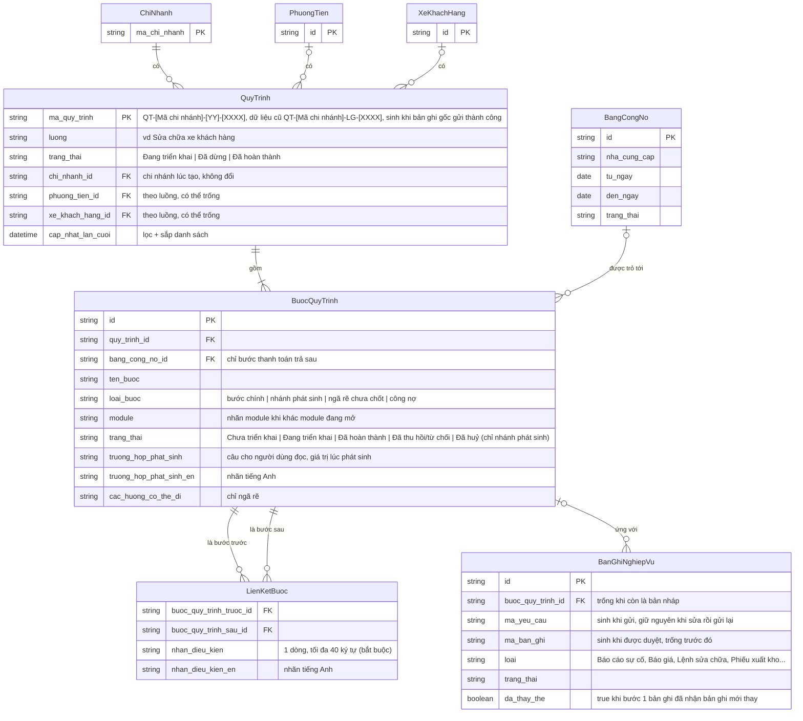

# Liên quy trình — Entity Relationship Diagram

> Scope: Quy trình, Bước quy trình và các đối tượng nó trỏ tới. Bản ghi nghiệp vụ của từng module (Báo giá, Lệnh sửa chữa, Phiếu xuất kho…) chi tiết ở SRS module đó.

## Diagram

## Entity Reference

| Entity | Purpose | Key attributes |
|--------|---------|----------------|
| QuyTrinh | Quy trình — chuỗi nghiệp vụ bắt đầu từ một bản ghi gốc, trạng thái do hệ thống tự tính | Mã quy trình (BR-cross-process-flow-004) · Luồng · Trạng thái · Chi nhánh · Cập nhật lần cuối |
| BuocQuyTrinh | Bước quy trình — một nút trên cây, ứng với tối đa 1 bản ghi hiện hành; bước "1 bản ghi" có thể kèm các bản ghi Đã thay thế | Tên bước · Loại bước · Module · Trạng thái · Trường hợp phát sinh |
| LienKetBuoc | Đường nối bước trước → bước sau; 1 bước có thể có nhiều bước trước (R1) | Bước trước · Bước sau · Nhãn điều kiện |
| BanGhiNghiepVu | Đại diện cho 14 loại bản ghi của các module (object map Mục 2) | Mã yêu cầu · Mã bản ghi · Loại · Trạng thái · Đã thay thế |
| BangCongNo | Bảng công nợ (nhóm đơn) của nhà cung cấp — thuộc SRS Thanh toán | Nhà cung cấp · Khoảng thời gian · Trạng thái |
| ChiNhanh, PhuongTien, XeKhachHang | Đối tượng cấp dự án (object map dự án) | — |

## Notes & Assumptions

- Object map ghi "Bước quy trình phát sinh Bước quy trình 1–n". ERD tách thành `LienKetBuoc` vì một bước có thể cần nhiều bước trước cùng xong (R1).
- Mỗi bản ghi thuộc đúng 1 cây (BR-cross-process-flow-001): `BanGhiNghiepVu` ứng với tối đa 1 `BuocQuyTrinh` (bản nháp chưa ứng với bước nào).
- Một `BuocQuyTrinh` có nhiều `BanGhiNghiepVu` chỉ khi bước khai "1 bản ghi" nhận bản ghi thay thế (BR-cross-process-flow-011): đúng 1 bản ghi hiện hành (`da_thay_the` = false), còn lại Đã thay thế. Bước "nhiều bản ghi" không dùng cách này — mỗi bản ghi là 1 bước anh em (BR-cross-process-flow-008).
- Mã trên thẻ bước: `ma_ban_ghi` nếu đã có, không thì `ma_yeu_cau` (BR-cross-process-flow-012). Ô tìm tìm cả hai.
- Nhãn tiếng Anh lấy từ bảng liên quy trình của nghiệp vụ (BR-cross-process-flow-007).
- Bản ghi gốc của quy trình là bước không có `LienKetBuoc` nào trỏ vào.
- Tiến độ, số nhánh phát sinh và Bước đang chờ tính từ các bước, không lưu riêng; không tính bước Đã huỷ và bản ghi Đã thay thế.
