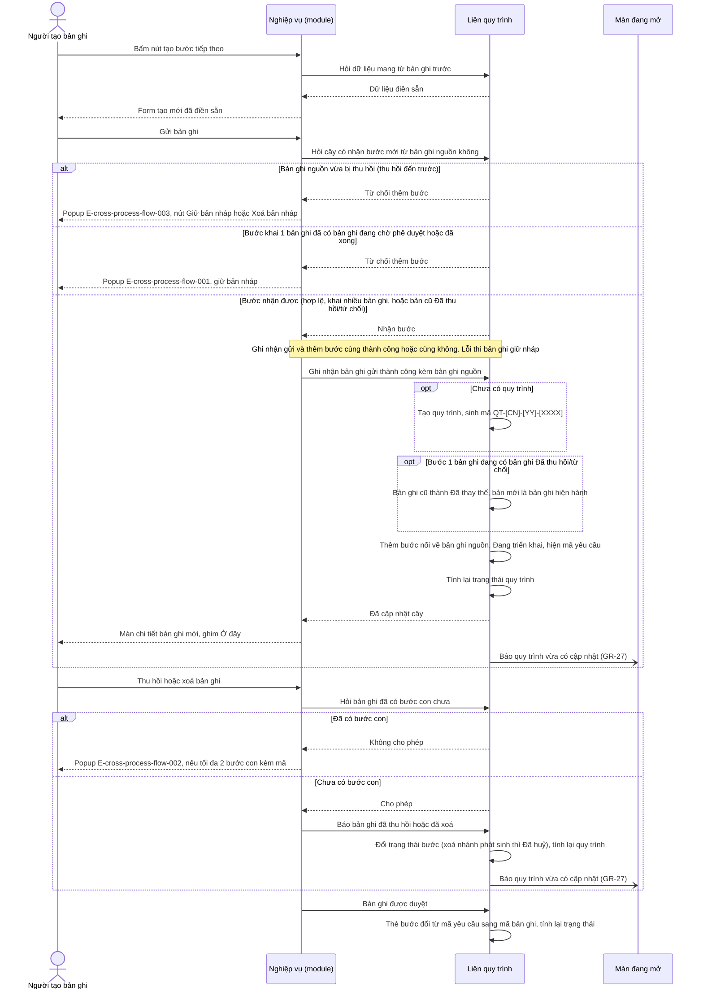
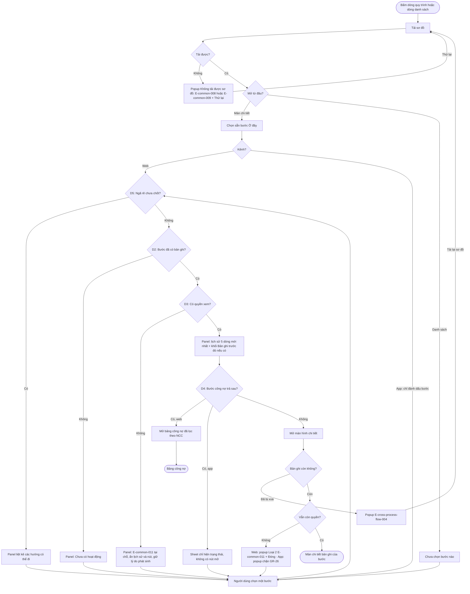

# Liên quy trình — Flows

## Flow: Gửi bản ghi → cập nhật cây quy trình
__Trigger__: Người tạo bản ghi gửi, thu hồi hoặc xoá một bản ghi thuộc bảng liên quy trình
__Related UC__: [[docs/cross-process-flow/usecases/uc-tao-nghiep-vu-tiep-theo.md|uc-tao-nghiep-vu-tiep-theo]] · [[docs/cross-process-flow/usecases/uc-cap-nhat-quy-trinh-theo-ban-ghi.md|uc-cap-nhat-quy-trinh-theo-ban-ghi]]
__Related FR__: FR-cross-process-flow-001, -002, -003, -004, -012, -013, -014, -020 · BR-cross-process-flow-011, -012

## Flow: Mở sơ đồ và xem một bước
__Trigger__: Người theo dõi quy trình bấm dòng quy trình trên màn chi tiết, hoặc bấm một dòng ở danh sách Quy trình
__Related UC__: [[docs/cross-process-flow/usecases/uc-xem-quy-trinh-cua-ban-ghi.md|uc-xem-quy-trinh-cua-ban-ghi]] · [[docs/cross-process-flow/usecases/uc-tra-cuu-quy-trinh.md|uc-tra-cuu-quy-trinh]]
__Related FR__: FR-cross-process-flow-006 → 011, FR-cross-process-flow-020

Trong khi sơ đồ đang mở, thông tin đang hiện trên sơ đồ đổi ở nơi khác thì hiện banner Theo GR-27 + Tải lại; tải lại giữ bước đang chọn nếu còn. Thay đổi không làm đổi thông tin đang hiện thì không báo (FR-cross-process-flow-020).

Không vẽ trong sơ đồ, theo spec: đang tải sơ đồ hiện "Đang tải sơ đồ…" (FR-cross-process-flow-006) · khối lịch sử có đang tải (skeleton 5 dòng), lỗi ("Không tải được lịch sử." + Thử lại, đầu panel và nút mở vẫn dùng được), rỗng (FR-cross-process-flow-008) · trên app, nút mở chỉ có khi app có màn chi tiết của loại bản ghi đó (FR-cross-process-flow-009).

## Notes

- Mã lỗi theo Error Matrix trong [[docs/cross-process-flow/srs/cross-process-flow-spec.md|SRS spec]] Mục 6.
- "Liên quy trình" trong sequence là phần dùng chung của hệ thống. "Nghiệp vụ (module)" là phần của từng nghiệp vụ (Xưởng, Kho, Thanh toán…).
