# Liên quy trình — Software Requirements Specification

## 1. Scope

Tính năng dùng chung cho mọi module có quy trình nhiều nghiệp vụ (Xưởng, Cây dầu, Liên module; Điều vận khi chốt với khách — OQ-1). Từ màn chi tiết của bất kỳ bản ghi nào thuộc một quy trình, người dùng thấy dòng quy trình, mở sơ đồ cây toàn bộ bước chính và nhánh phát sinh, xem trạng thái + lịch sử từng bước rồi mở màn hình chi tiết của bước đó. Tính năng cũng hiện nút tạo nghiệp vụ tiếp theo khi bản ghi đạt điều kiện, và có màn danh sách Quy trình (web) để theo dõi mọi quy trình đang chạy.

Tài liệu gồm 2 lớp:
- **Lớp nghiệp vụ** (tài liệu này): tạo quy trình, thêm bước, trạng thái bước và quy trình, mã quy trình, quyền xem, ràng buộc gửi/thu hồi/xoá, danh sách Quy trình.
- **Lớp hiển thị**: Xem CMP-09 — Cross Process Flow (Liên quy trình), quy tắc vẽ R1–R17.

Mỗi nghiệp vụ thuộc quy trình khai **bảng liên quy trình** trong SRS của nghiệp vụ đó (BR-cross-process-flow-007). Tài liệu này không chứa bảng phát sinh của từng luồng.

**Ngoài phạm vi:** quy tắc bảng công nợ (hoàn thành khi nào, nhận thêm đơn không) — thuộc SRS Thanh toán · nội dung form của từng nghiệp vụ được tạo · thông báo cho người liên quan (đi theo từng nghiệp vụ, CMP-02) · đóng quy trình thủ công.

## 2. Actors & Stakeholders

| Actor | Loại (người/hệ thống/ngoài) | Mục tiêu | Trong scope? |
|-------|-----------------------------|----------|--------------|
| Người theo dõi quy trình (Nhân viên nội bộ Delta: Kế toán thanh toán, Quản lý xưởng, Thủ kho, Người duyệt, Điều phối) | người | Thấy các bước trước/sau và bước đang kẹt của một bản ghi mà không mở từng phiếu | Có |
| Người tạo bản ghi (Nhân viên nội bộ Delta) | người | Tạo nghiệp vụ tiếp theo từ bản ghi trước, dữ liệu điền sẵn | Có |
| Lái xe | người | Xem tiến độ sửa xe của mình trên Delta Super App | Có |
| Admin | người | Cấp quyền menu Quy trình theo module | Có |
| Hệ thống | hệ thống | Tự tạo quy trình, sinh mã, thêm bước, tính trạng thái | Có |
| Nhân viên đối tác cây dầu | người | — | Không — không dùng liên quy trình |

## 3. Functional Requirements (FR)

| ID | Tầng | Title | Description | Priority | Verify by | Source |
|----|------|-------|-------------|----------|-----------|--------|
| FR-cross-process-flow-001 | [Lõi] [Cấu hình] | Tạo quy trình tự động | Khi bản ghi gốc của một luồng gửi thành công, hệ thống phải tạo Quy trình ở trạng thái Đang triển khai và sinh mã theo `P-mau-ma-quy-trinh` (Delta: `QT-[Mã chi nhánh]-[YY]-[XXXX]`) ngay lúc đó (BR-cross-process-flow-004). Luồng độc lập (bản ghi gốc tự nó không tạo quy trình): quy trình tạo khi nhánh phát sinh đầu tiên gửi thành công, bản ghi gốc là nút đầu cây. Lưu nháp không tạo quy trình. | P0 | test: gửi bản ghi gốc → có mã QT; lưu nháp → không có | brainstorm Mục 6.3; object map Mục 3; OQ-10 |
| FR-cross-process-flow-002 | [Lõi] | Tính trạng thái quy trình | Hệ thống phải tự tính trạng thái Quy trình theo BR-cross-process-flow-002/003, không ai sửa tay: Đang triển khai · Đã dừng · Đã hoàn thành. | P0 | test theo bảng chuyển trạng thái Mục 9 | brainstorm Mục 6.3 |
| FR-cross-process-flow-003 | [Lõi] | Thêm bước vào cây | Khi một bản ghi thuộc bảng liên quy trình gửi thành công, hệ thống phải thêm Bước vào cây của bản ghi nguồn, nối về đúng bản ghi tạo ra nó (R1), và gắn "Ở đây" cho bước đó khi người tạo vào màn chi tiết. Gửi bản ghi và thêm bước cùng thành công hoặc cùng không: cây không nhận thì bản ghi không được ghi nhận gửi và giữ nguyên bản nháp. Nếu bản ghi nguồn vừa bị thu hồi trong lúc gửi, thì thu hồi thắng: hệ thống chặn bằng E-cross-process-flow-003. Bản nháp không hiện trên cây. | P0 | test: gửi phiếu xuất kho từ lệnh sửa chữa → cây có bước mới nối từ lệnh; thu hồi lệnh cùng lúc gửi phiếu → E-003, phiếu giữ nháp | brainstorm Mục 5.3; OQ-3, OQ-7 |
| FR-cross-process-flow-004 | [Lõi] | Tính trạng thái bước | Hệ thống phải tính trạng thái Bước theo bản ghi hiện hành ứng với nó: Chưa triển khai · Đang triển khai · Đã hoàn thành · Đã thu hồi/từ chối · Đã huỷ (chỉ nhánh phát sinh, BR-cross-process-flow-009) (bảng chuyển Mục 9). Bước công nợ trả sau: Đang triển khai khi chốt công nợ lần đầu, Đã hoàn thành khi phần công nợ thuộc nghiệp vụ của luồng đó đã thanh toán (không chờ cả bảng công nợ), không có trạng thái Đã thu hồi/từ chối. | P0 | test theo bảng chuyển trạng thái Mục 9 | brainstorm Mục 6.3; OQ-14, OQ-15 |
| FR-cross-process-flow-005 | [Lõi] | Dòng quy trình trên màn chi tiết | Khi người dùng mở màn chi tiết của một bản ghi thuộc quy trình, hệ thống phải hiện dòng quy trình (web: đầu màn · mobile: thẻ quy trình) gồm tên luồng, thanh tiến độ, "Xong x/y bước · n nhánh phát sinh", và "Bước trước: {tên bước} {mã}" (bước chính) hoặc "Phát sinh từ: {tên bước} {mã}" (nhánh phát sinh). y = mọi bước trên cây: bước chính (kể cả bước Chưa tạo), ngã rẽ (tính 1 bước), nhánh phát sinh, bước công nợ; không tính nhánh Đã huỷ và bản ghi Đã thay thế. Bản ghi không thuộc quy trình, hoặc luồng độc lập chưa có nhánh → không hiện gì. Đang tải: web hiện skeleton cao bằng dòng thật, không đẩy bố cục; app hiện skeleton thẻ có shimmer (GR-12). Nếu tải dòng quy trình lỗi, thì hệ thống phải hiện "Không tải được quy trình." + Thử lại và vẫn cho dùng màn chi tiết bình thường. | P0 | demo trên 3 loại bản ghi: bước chính, nhánh phát sinh, không thuộc quy trình | brainstorm Mục 5.1, D1; OQ-11, OQ-22 |
| FR-cross-process-flow-006 | [Lõi] | Mở sơ đồ | Khi người dùng bấm dòng quy trình hoặc một dòng ở danh sách Quy trình, hệ thống phải mở sơ đồ (web: popup · mobile: sheet), mặc định vừa khung. Mở từ màn chi tiết: chọn sẵn bước "Ở đây"; web mở luôn panel bước đó, app chỉ đánh dấu bước, không tự mở sheet bước. Mở từ danh sách: chưa chọn bước nào. Web: zoom 40–250%, kéo, nút vừa khung. App: chụm hai ngón để thu phóng, vuốt để kéo, không có nút thu phóng. Đang tải: "Đang tải sơ đồ…" (Override GR-12, Mục 10). Tải lỗi: tiêu đề "Không tải được sơ đồ." + câu E-common-008 hoặc E-common-009 + Thử lại. | P0 | demo: mở từ màn chi tiết và từ danh sách | brainstorm Mục 5.2; OQ-23, OQ-25, OQ-26 |
| FR-cross-process-flow-007 | [Lõi] | Vẽ cây quy trình | Hệ thống phải vẽ cây theo quy tắc R1–R17 của CMP-09: bước chính, nhánh phát sinh (nhãn Phát sinh), ngã rẽ chưa chốt, bước thuộc module khác (nhãn module), bước công nợ "Công nợ {Tên NCC}", nhiều bước trước cùng nối vào 1 bước, nhiều phiếu cùng loại là các bước anh em. Bước chính chưa tới hiện "Chưa tạo" viền đứt; nhánh phát sinh chỉ hiện khi điều kiện đã xảy ra. Ngã rẽ đã chốt hướng: nút ngã rẽ thành bước của hướng đã chọn, các hướng khác biến mất. Nhánh phát sinh Đã huỷ: viền đứt, chữ gạch, nhãn Đã huỷ. Bước "1 bản ghi" có bản ghi Đã thay thế: thẻ hiện bản ghi hiện hành kèm "+n bản ghi trước" (BR-cross-process-flow-011). Mã trên thẻ theo BR-cross-process-flow-012. | P0 | kiểm tra trên mẫu luồng Sửa chữa xe khách hàng có Nhập kho dư → Bồi thường và 2 phiếu Xuất kho | brainstorm Mục 4 P0; CMP-09; OQ-4, OQ-9, OQ-11, OQ-14 |
| FR-cross-process-flow-008 | [Lõi] | Panel chi tiết bước | Khi người dùng chọn một bước, hệ thống phải mở panel gồm đầu panel (tên, mã, trạng thái, nhãn Ở đây / Phát sinh / module; nhánh phát sinh có thêm lý do phát sinh), 5 dòng lịch sử hoạt động mới nhất + "Xem tất cả", và nút mở ghim đáy panel. Nếu bước chưa có bản ghi, thì hiện "Chưa có hoạt động. Bước này chưa được tạo." (D2). Nếu bước là ngã rẽ chưa chốt, thì liệt kê các hướng có thể đi (D5). Nếu bước có bản ghi Đã thay thế, thì thêm khối "Bản ghi trước đó": mỗi bản ghi 1 dòng gồm mã · Đã thay thế · ngày bị từ chối/thu hồi · Mở (theo quyền FR-cross-process-flow-009). Khối lịch sử: đang tải hiện skeleton 5 dòng; lỗi hiện "Không tải được lịch sử." + Thử lại trong khối, đầu panel và nút mở vẫn dùng được; rỗng hiện "Chưa có hoạt động." | P0 | demo 5 loại bước: có bản ghi, chưa tạo, ngã rẽ, công nợ, có bản ghi thay thế | brainstorm Mục 5.2, D2, D5; OQ-4, OQ-22 |
| FR-cross-process-flow-009 | [Lõi] | Quyền xem theo bước | Hệ thống phải cho người xem thấy mọi bước của cây (tên, mã, trạng thái, lý do phát sinh). Quyền xem lịch sử và mở bản ghi của một bước tính theo phân quyền xem của nghiệp vụ ứng với bước đó, áp như nhau cho mọi người dùng kể cả Lái xe; bước thuộc module khác mà người xem có quyền thì mở bình thường. Nếu người xem không có quyền (D3), thì panel ẩn lịch sử và nút mở, hiện câu E-common-011 tại chỗ. Trên app, nút mở chỉ có khi app có màn chi tiết của loại bản ghi đó (Mục 11). | P0 | test: người Xưởng xem bước Cấp dầu khi có và không có quyền Cây dầu | brainstorm Mục 6.2, D3; OQ-16, OQ-17, OQ-18, OQ-20 |
| FR-cross-process-flow-010 | [Lõi] | Mở màn hình chi tiết của bước | Khi người dùng bấm "Mở màn hình chi tiết", hệ thống phải mở màn chi tiết bản ghi của bước — web: cùng tab, đóng popup, Back trình duyệt về màn cũ và popup không mở lại · mobile: đẩy màn mới, Back về màn trước, sheet đã đóng. Nếu bản ghi vừa bị thu quyền, thì web hiện popup Loại 2 (GR-15) câu E-common-011 + Đóng, ở lại sơ đồ; app hiện popup chặn E-common-011 Theo GR-26. Nếu bản ghi đã bị xoá trong lúc sơ đồ đang mở, thì hiện E-cross-process-flow-004 + Tải lại sơ đồ. | P0 | demo web + mobile, kiểm Back | brainstorm Mục 5.2, Mục 6.4; OQ-23, OQ-26 |
| FR-cross-process-flow-011 | [Lõi] | Mở bảng công nợ | Nếu bước là thanh toán trả sau (D4), thì panel phải có nút "Mở bảng công nợ" thay cho "Mở màn hình chi tiết", mở bảng công nợ đã lọc theo nhà cung cấp và khoảng thời gian của bảng công nợ đó. Chỉ trên web: Delta Super App không có màn Bảng công nợ, sheet bước công nợ chỉ hiện trạng thái, không có nút mở. | P0 | demo trên luồng trả sau | brainstorm Mục 5.4, D4; userflow OQ-2 |
| FR-cross-process-flow-012 | [Lõi] | Tạo nghiệp vụ tiếp theo | Khi bản ghi đạt hành động trigger theo bảng liên quy trình và người xem có quyền tạo (D6), hệ thống phải hiện nút tạo bước tiếp theo (vd "Tạo phiếu xuất kho") ở vùng hành động đầu trang, không đặt trên sơ đồ. Bấm → form tạo mới đã điền sẵn thông tin mang từ bản ghi trước. Gửi thành công → vào màn chi tiết bản ghi mới, cây có bước mới (FR-cross-process-flow-003). Trên app: chỉ có ở nghiệp vụ có màn trên app (cột "Có trên app" của bảng liên quy trình, BR-cross-process-flow-007); lỗi E-cross-process-flow-001/003 hiện dạng sheet lỗi Loại 2 (GR-15 Mobile). | P0 | test: chốt lệnh sửa chữa → hiện nút; người không có quyền tạo → không hiện | brainstorm Mục 5.3, D6; OQ-19 |
| FR-cross-process-flow-013 | [Lõi] | Chặn gửi trùng bước "1 bản ghi" | Nếu người dùng gửi bản ghi cho một bước khai "1 bản ghi" mà bước đó đã có bản ghi khác đang chờ phê duyệt hoặc đã xong, thì hệ thống phải chặn bằng E-cross-process-flow-001 (câu theo từng trường hợp) và giữ nguyên bản nháp. Hai người cùng gửi thì chỉ người gửi trước được nhận. Bản ghi hiện có đang Đã thu hồi/từ chối thì không chặn: bản ghi mới thay thế bản cũ (BR-cross-process-flow-011). Bước khai "nhiều bản ghi" (vd Xuất kho) không chặn — bản ghi mới thành bước anh em. | P0 | test 2 người cùng gửi cho 1 bước "1 bản ghi"; gửi khi bản cũ đã bị từ chối | brainstorm Mục 6.4; OQ-3, OQ-4, OQ-5 |
| FR-cross-process-flow-014 | [Lõi] | Chặn thu hồi/xoá khi đã có bước con | Nếu người tạo thu hồi hoặc xoá một bản ghi đã sinh bước con, thì hệ thống phải chặn bằng E-cross-process-flow-002, nêu tối đa 2 bước con kèm mã và "và n bước khác" khi nhiều hơn. Hiện chưa nghiệp vụ nào cho thu hồi/xoá khi đã có bước con (Giả định Mục 11). | P0 | test: thu hồi lệnh sửa chữa đã có 3 phiếu xuất kho | brainstorm Mục 6.5; OQ-6, OQ-8 |
| FR-cross-process-flow-015 | [Lõi] | Danh sách Quy trình | Hệ thống phải có màn danh sách Quy trình (web) ở menu {Module} › Quy trình theo phân quyền, chỉ gồm quy trình thuộc chi nhánh người dùng được phân quyền dữ liệu, có 10 cột: Mã quy trình · Luồng · Bản ghi gốc · Phương tiện / khách hàng · Tiến độ · Nhánh phát sinh · Bước đang chờ · Trạng thái · Chi nhánh · Cập nhật lần cuối. Bước đang chờ: bước chờ lâu nhất + "+n bước khác"; trạng thái lấy theo bản ghi; thời gian chờ tính riêng từng bước, từ lúc bước vào trạng thái hiện tại, ghi "n phút" (dưới 1 giờ) · "n giờ" (dưới 24 giờ) · "n ngày". Mặc định sắp theo Cập nhật lần cuối mới nhất; phân trang Xem CMP-04; tuỳ chỉnh cột Xem CMP-06. Luồng liên module hiện ở cả 2 module. Đang tải: skeleton theo 10 cột (GR-12). Tải lỗi: thay vùng bảng bằng khối "Không tải được danh sách." + Thử lại, giữ thanh công cụ và bộ lọc. | P0 | demo; kiểm luồng liên module ở 2 menu; người chỉ được phân 1 chi nhánh chỉ thấy quy trình chi nhánh đó | brainstorm Mục 5.5; OQ-12, OQ-16, OQ-21, OQ-26, OQ-31 |
| FR-cross-process-flow-016 | [Lõi] | Tìm theo mã bất kỳ | Khi người dùng gõ từ 3 ký tự vào ô tìm (D7), hệ thống phải tìm các quy trình có mã quy trình, mã yêu cầu hoặc mã bản ghi chứa chuỗi đã gõ ở bất kỳ vị trí nào, không phân biệt hoa thường, chạy sau khi ngừng gõ 0,3 giây. Dưới 3 ký tự: chưa tìm, không báo lỗi. | P0 | test: gõ "0410" → ra quy trình chứa PXK-0410; gõ mã yêu cầu của phiếu chưa duyệt → ra quy trình | brainstorm Mục 7.1, D7; OQ-9, OQ-28 |
| FR-cross-process-flow-017 | [Lõi] | Lọc danh sách | Hệ thống phải cho lọc theo Luồng · Trạng thái · Chi nhánh · Khoảng ngày theo Cập nhật lần cuối. Lọc ra 0 dòng: có từ khoá thì "Không tìm thấy quy trình chứa mã "[mã]".", không có từ khoá thì "Không có quy trình phù hợp với bộ lọc."; cả hai kèm Xoá bộ lọc. | P0 | demo từng bộ lọc | brainstorm Mục 7.1; OQ-24 |
| FR-cross-process-flow-018 | [Lõi] | Mở từ dòng danh sách | Khi người dùng bấm một dòng, hệ thống phải mở popup sơ đồ ngay trên danh sách (FR-cross-process-flow-006), chưa chọn bước nào. Khi người dùng bấm ô Phương tiện / khách hàng, hệ thống phải mở màn chi tiết Phương tiện hoặc Xe của khách hàng. | P0 | demo | brainstorm Mục 5.5; object map Mục 2 |
| FR-cross-process-flow-019 | [Lõi] | Cấp quyền menu Quy trình | Admin phải cấp được quyền xem menu Quy trình theo từng module. Người không có quyền mở thẳng đường dẫn danh sách: vùng nội dung hiện câu E-common-011 + nút Về trang chủ. | P0 | kiểm tra trên màn phân quyền; mở đường dẫn khi không có quyền | brainstorm Mục 3; OQ-20 |
| FR-cross-process-flow-020 | [Lõi] | Báo dữ liệu đã cũ | Trong khi popup sơ đồ, sheet hoặc danh sách Quy trình đang mở, nếu thông tin đang hiện trên màn đó đổi ở nơi khác, thì hệ thống phải hiện banner Theo GR-27 ("Quy trình vừa có cập nhật." / "Danh sách vừa có cập nhật." + Tải lại); tải lại giữ bước đang chọn và bộ lọc nếu còn. Thay đổi không làm đổi thông tin đang hiện thì không báo. | P0 | test: người khác phê duyệt phiếu khi sơ đồ đang mở | brainstorm Mục 4 P1, Mục 6.4; OQ-30 |
| FR-cross-process-flow-021 | [Lõi] | Liên quy trình trên Delta Super App | Hệ thống phải có thẻ quy trình, sheet sơ đồ (cây rẽ nhánh dọc, vuốt ngang khi cây rộng hơn màn) và sheet bước trên Delta Super App, cùng nội dung với web. Sheet bước không tự mở; thu phóng bằng hai ngón (FR-cross-process-flow-006). Danh sách Quy trình không có trên app. | P0 | demo trên Delta Super App | brainstorm Mục 4 P0; CMP-09 Mobile; OQ-25 |
| FR-cross-process-flow-022 | [Lõi] | Xuất danh sách Quy trình | Khi người dùng bấm Xuất trên danh sách Quy trình, hệ thống phải xuất PDF hoặc Excel đúng tập dữ liệu đang thấy (sau tìm, lọc, sắp, gồm mọi trang) và đúng các cột đang hiện theo thứ tự đang cấu hình. File theo quy định xuất danh sách chung: 1 dòng = 1 quy trình, không dòng nhóm/tổng; khối thông tin phụ gồm Thời gian xuất · Người xuất · Tổng số dòng · Tiêu chí lọc; tên sheet "DS - Quy trình"; tên file `Export_DanhSach_QuyTrinh_<yyyyMMdd_HHmm>.xlsx`; trang in nằm ngang. Ai xem được menu Quy trình của module thì xuất được. | P0 | test: lọc 1 chi nhánh + ẩn 2 cột → file đúng số dòng, đúng 8 cột, khối thông tin phụ ghi đúng bộ lọc | SRS cũ UC00.00.09 Export danh sách; Theo GR-19; OQ-16, OQ-31 |

## 4. Non-Functional Requirements (NFR)

| ID | Category | Requirement | Priority | Acceptance |
|----|----------|-------------|----------|------------|
| NFR-cross-process-flow-001 | performance | Sơ đồ hiện đủ sau khi bấm dòng quy trình | P0 | ≤2 giây với cây ≤20 bước; ≤3 giây với cây ≤50 bước |
| NFR-cross-process-flow-002 | performance | Dòng quy trình không làm chậm màn chi tiết | P0 | Màn chi tiết hiện không phải chờ dòng quy trình; dòng quy trình hiện trong ≤2 giây |
| NFR-cross-process-flow-003 | freshness | Trạng thái bước và quy trình phản ánh gần như ngay sau khi bản ghi đổi | P0 | Màn mở sau thay đổi thấy trạng thái mới; màn đang mở hiện banner GR-27 trong vòng tối đa 2 giây kể từ lúc bản ghi đổi |
| NFR-cross-process-flow-004 | security | Không lộ thông tin bước người xem không có quyền | P0 | Panel bước không có quyền không hiện lịch sử, không có nút mở; quyền theo phân quyền xem của nghiệp vụ ứng với từng bước (FR-cross-process-flow-009) |
| NFR-cross-process-flow-005 | usability | Trạng thái không chỉ báo bằng màu; tôn trọng giảm chuyển động | P0 | Mọi trạng thái có chữ + icon; vệt sáng trên đường nối tắt khi thiết bị bật giảm chuyển động |
| NFR-cross-process-flow-006 | capacity | Mức thiết kế 20 bước mỗi cây | P1 | Cây trên 20 bước vẫn vẽ đủ, mặc định vừa khung, zoom/kéo xem được |
| NFR-cross-process-flow-007 | localization | Giao diện Tiếng Việt và Tiếng Anh | P0 | Mọi câu chữ của tính năng có 2 ngôn ngữ, gồm câu lỗi ở Error Matrix và nhãn trong bảng liên quy trình (BR-cross-process-flow-007) |
| NFR-cross-process-flow-008 | data | Quy trình dựng từ dữ liệu cũ khớp chứng từ nguồn | P0 | Dựng toàn bộ, kể cả quy trình đã hoàn thành; đối chiếu mẫu theo từng luồng trước khi lên: 0 sai lệch về bước, nguồn, trạng thái; mã theo dãy `QT-[Mã chi nhánh]-LG-[XXXX]` (BR-cross-process-flow-004); Cập nhật lần cuối = ngày chuyển dữ liệu |
| NFR-cross-process-flow-009 | performance | Danh sách và ô tìm phản hồi nhanh | P0 | Trang 50 dòng hiện trong ≤2 giây; kết quả tìm hiện trong ≤1 giây sau khi ngừng gõ |
| NFR-cross-process-flow-010 | data | Cây không lệch với bản ghi | P1 | Đối soát hằng đêm giữa cây và trạng thái bản ghi; lệch thì sửa theo bản ghi và ghi log, người dùng không thấy |

## 5. Business Rules

| ID | Tầng | Rule | Trigger | Implements FR | Source |
|----|------|------|---------|---------------|--------|
| BR-cross-process-flow-001 | [Lõi] | Mỗi bản ghi thuộc đúng 1 quy trình, không có ngoại lệ. | Thêm bước | FR-cross-process-flow-003 | brainstorm Mục 6.5 |
| BR-cross-process-flow-002 | [Lõi] | Quy trình chuyển Đã dừng khi một bước của **luồng chính** bị từ chối/thu hồi chưa gửi lại; về Đang triển khai khi bước đó được gửi lại, có bản ghi thay thế (BR-cross-process-flow-011), hoặc bản ghi bị xoá (tính lại như thể bản ghi đó chưa từng có). Nhánh phát sinh bị từ chối không làm quy trình Đã dừng; cột Bước đang chờ hiện nhánh đó kèm trạng thái. | Bước đổi trạng thái | FR-cross-process-flow-002, FR-cross-process-flow-015 | brainstorm Mục 6.3; OQ-13 |
| BR-cross-process-flow-003 | [Lõi] | Quy trình Đã hoàn thành khi mọi bước chính và nhánh phát sinh đã xong; nhánh phát sinh Đã huỷ không tính. Không có đóng thủ công. Đã hoàn thành là trạng thái kết thúc. | Bước đổi trạng thái | FR-cross-process-flow-002 | brainstorm Mục 6.3, 6.5; OQ-14 |
| BR-cross-process-flow-004 | [Lõi] [Cấu hình] [Riêng Delta] | Mã quy trình theo `P-mau-ma-quy-trinh` (Delta: `QT-[Mã chi nhánh]-[YY]-[XXXX]`, vd QT-HP-26-0012, đánh lại từ 0001 đầu mỗi năm); giữ theo chi nhánh lúc tạo, kể cả khi bản ghi chuyển chi nhánh sau đó. [Riêng Delta] Quy trình dựng từ dữ liệu phần mềm cũ dùng dãy riêng `QT-[Mã chi nhánh]-LG-[XXXX]`, không tiêu số của dãy theo năm. | Tạo quy trình | FR-cross-process-flow-001 | brainstorm Mục 6.5; OQ-10 |
| BR-cross-process-flow-005 | [Lõi] | Điều kiện phát sinh lưu giá trị lúc xảy ra; sửa bản ghi nguồn sau đó không đổi nhãn trên cây. | Thêm nhánh phát sinh | FR-cross-process-flow-007, FR-cross-process-flow-008 | brainstorm Mục 8 |
| BR-cross-process-flow-006 | [Lõi] | Mỗi cây trả sau có bước Thanh toán riêng, trỏ tới bảng công nợ của nhà cung cấp (nhiều bước – 1 bảng công nợ). Thanh toán không chờ Bồi thường / Nhập kho dư — không nối 2 nhánh đó sang Thanh toán. | Vẽ cây | FR-cross-process-flow-007, FR-cross-process-flow-011 | brainstorm Mục 5.4, OQ-2, OQ-6 |
| BR-cross-process-flow-007 | [Lõi] | Mỗi nghiệp vụ thuộc quy trình bắt buộc khai bảng liên quy trình trong SRS của nó: bước · tạo từ · trigger · hành động hoàn thành bước · thông tin mang sang form sau · trường hợp phát sinh · điều kiện · 1 hay nhiều bản ghi · cho thu hồi/xoá khi đã có bước con · cho xoá · có trên app · nhãn tiếng Anh. Câu chữ viết bằng lời nghiệp vụ, không ký hiệu so sánh, không mã TH; số liệu lấy giá trị lúc phát sinh; nhãn điều kiện tối đa 40 ký tự (bắt buộc). | Viết SRS nghiệp vụ | FR-cross-process-flow-007, FR-cross-process-flow-012, FR-cross-process-flow-013, FR-cross-process-flow-014, FR-cross-process-flow-021 | brainstorm Mục 4, 7.2; OQ-19, OQ-29, OQ-31 |
| BR-cross-process-flow-008 | [Lõi] | Nhiều phiếu cùng loại cùng nguồn là các bước anh em, phân biệt bằng mã, không ghi "lần 1/lần 2". | Thêm bước | FR-cross-process-flow-003, FR-cross-process-flow-007 | brainstorm Mục 6.5 |
| BR-cross-process-flow-009 | [Lõi] | Xoá bản ghi (chỉ nghiệp vụ cho xoá): bước chính về Chưa triển khai, mã về `N/A`, hiện "Chưa tạo" nét đứt; nhánh phát sinh chuyển Đã huỷ (viền đứt, chữ gạch), không tính vào tiến độ và không chặn quy trình Đã hoàn thành; bản ghi Đã thay thế bị xoá thì bỏ khỏi khối "Bản ghi trước đó", không đổi trạng thái gì. | Xoá bản ghi | FR-cross-process-flow-004, FR-cross-process-flow-007 | brainstorm Mục 6.3; OQ-14 |
| BR-cross-process-flow-010 | [Lõi] | Liên quy trình không tự gửi thông báo; thông báo đi theo từng nghiệp vụ (CMP-02). | — | FR-cross-process-flow-003 | brainstorm Mục 8 |
| BR-cross-process-flow-011 | [Lõi] | Bước khai "1 bản ghi" có bản ghi đang Đã thu hồi/từ chối vẫn nhận bản ghi mới. Bản ghi mới thành bản ghi hiện hành, trạng thái bước tính theo nó; bản ghi cũ mang nhãn Đã thay thế, không tính vào tiến độ, không làm quy trình Đã dừng. Sửa bản cũ rồi gửi lại bị chặn bằng E-cross-process-flow-001. Bản mới bị từ chối tiếp thì lặp lại cách trên. | Gửi bản ghi cho bước "1 bản ghi" | FR-cross-process-flow-007, FR-cross-process-flow-008, FR-cross-process-flow-013 | OQ-4 |
| BR-cross-process-flow-012 | [Lõi] | Mã trên bước: bản ghi chưa được duyệt hiện mã yêu cầu; được duyệt thì hiện mã bản ghi. Sửa rồi gửi lại giữ nguyên mã yêu cầu. Ô tìm tìm được cả hai mã. | Bản ghi gửi / được duyệt | FR-cross-process-flow-007, FR-cross-process-flow-016 | OQ-9 |

## 6. Error Matrix

| Error ID | Title | Trigger | Severity | Related FR | Screen state | Recovery |
|----------|-------|---------|----------|------------|--------------|----------|
| E-cross-process-flow-001 | Bước đã có yêu cầu khác | Gửi bản ghi cho bước "1 bản ghi" đã có bản ghi khác đang chờ phê duyệt hoặc đã xong; hoặc gửi lại bản ghi Đã thay thế. Popup (GR-15 Loại 2), tiêu đề "Không thể gửi", không có Thử lại. Wording — đang chờ: "Bước [Tên bước] đã có yêu cầu khác đang chờ phê duyệt. Chờ yêu cầu đó được xử lý rồi gửi lại." / EN: "Step [Step name] already has another request awaiting approval. Wait for it to be processed, then submit again." — đã xong: "Bước [Tên bước] đã hoàn thành với [mã]. Không gửi thêm được." / EN: "Step [Step name] was already completed with [code]. No further submissions are allowed." | major | FR-cross-process-flow-013 | Form giữ nguyên; bản nháp giữ lại | Chờ yêu cầu kia được xử lý rồi gửi lại; bước đã xong thì không gửi được |
| E-cross-process-flow-002 | Đã có bước con | Thu hồi/xoá bản ghi đã sinh bước con. Popup (GR-15 Loại 2), tiêu đề "Không thể thu hồi" / "Không thể xoá", không có Thử lại. [Danh sách bước] = tối đa 2 bước kèm mã, thêm "và n bước khác" khi nhiều hơn (vd "Phiếu xuất kho PXK-0410, Phiếu xuất kho PXK-0415 và 1 bước khác"). Wording: "Không thể thu hồi vì đã có [Danh sách bước] tạo từ bản ghi này." (xoá: "Không thể xoá vì đã có [Danh sách bước] tạo từ bản ghi này.") / EN: "Cannot withdraw because [Step list] was created from this record." (delete: "Cannot delete because [Step list] was created from this record.") | major | FR-cross-process-flow-014 | Bản ghi giữ nguyên trạng thái | Xử lý bước con trước theo nghiệp vụ của bước đó |
| E-cross-process-flow-003 | Bản ghi nguồn vừa bị thu hồi | Gửi bản ghi tạo từ một bản ghi vừa bị thu hồi (thu hồi đến trước). Popup (GR-15 Loại 2), tiêu đề "Không thể gửi". Wording: "Không thể gửi vì [Tên bước] [mã] vừa bị thu hồi. Bản nháp đã được giữ." / EN: "Cannot submit because [Step name] [code] was just withdrawn. Your draft has been kept." Nút: Giữ bản nháp (chính, đóng popup) · Xoá bản nháp (phụ, nguy hiểm, Xem CMP-03 để xác nhận). | major | FR-cross-process-flow-003 | Bản ghi không được ghi nhận gửi; bản nháp giữ lại | Giữ nháp chờ bản ghi nguồn được gửi lại, hoặc xoá bản nháp |
| E-cross-process-flow-004 | Bản ghi đã bị xoá | Bấm Mở màn hình chi tiết của bước có bản ghi vừa bị xoá trong lúc sơ đồ đang mở. Popup (GR-15 Loại 2). Wording: "Bản ghi [mã] đã bị xoá." / EN: "Record [code] has been deleted." Nút: Tải lại sơ đồ (chính) · Đóng. | minor | FR-cross-process-flow-010 | Sơ đồ giữ nguyên tới khi tải lại | Tải lại sơ đồ để thấy trạng thái mới |

E-common dùng lại (wording ở `design/ui-common/conventions.md`):

| Mã lỗi | Chỗ dùng | Related FR |
|---|---|---|
| E-common-008 | Lỗi tải sơ đồ (mô tả trong popup lỗi) / danh sách (khối lỗi trong vùng bảng) / lịch sử trong panel — kèm Thử lại tại chỗ | FR-cross-process-flow-006, FR-cross-process-flow-008, FR-cross-process-flow-015 |
| E-common-009 | Mất mạng khi mở sơ đồ — mô tả trong popup lỗi + Thử lại | FR-cross-process-flow-006 |
| E-common-011 | Bước không có quyền xem (hiện tại chỗ trong panel) · bản ghi vừa bị thu quyền khi bấm mở (web: popup Loại 2 · app: popup chặn) · mở đường dẫn danh sách khi không có quyền | FR-cross-process-flow-009, FR-cross-process-flow-010, FR-cross-process-flow-019 |

## 7. Success Criteria

| ID | Outcome nghiệp vụ | Đo bằng | Mốc đạt |
|----|-------------------|---------|---------|
| SC-cross-process-flow-01 | Mọi luồng có bảng liên quy trình theo quy tắc câu chữ mới | Đối chiếu bảng phát sinh SRS cũ (Xưởng, Cây dầu, Liên module) | 100% luồng |
| SC-cross-process-flow-02 | Từ một mã bất kỳ tìm ra quy trình chứa nó nhanh | Số thao tác: gõ mã → bấm dòng | ≤2 thao tác |
| SC-cross-process-flow-03 | Quản lý xưởng thấy bước kẹt của một lệnh sửa chữa mà không mở từng phiếu | Demo nghiệm thu trên luồng Sửa chữa | Thấy được từ cột Bước đang chờ hoặc sơ đồ |
| SC-cross-process-flow-04 | Bản ghi được tạo qua nút "tạo nghiệp vụ tiếp theo" thay vì tạo tay | Tỉ lệ tạo qua nút / tạo tay | Đo sau khi lên; mốc chốt ở URD/BRD |
| SC-cross-process-flow-05 | Giảm việc mở từng phiếu để tìm bước kẹt | Số lần mở phiếu trước và sau khi lên | Đo sau khi lên; mốc chốt ở URD/BRD |

## 8. Data Entities (tóm tắt — chi tiết ở erd.md)

| Đối tượng | Thuộc tính nghiệp vụ | Quan hệ |
|---|---|---|
| Quy trình | Mã quy trình · Luồng · Bản ghi gốc · Tiến độ (Xong x/y bước) · Số nhánh phát sinh · Bước đang chờ · Trạng thái · Chi nhánh · Cập nhật lần cuối | Chi nhánh / Phương tiện / Xe của khách hàng 1–n Quy trình · Quy trình gồm 1–n Bước |
| Bước quy trình | Tên bước · Mã bản ghi (`N/A` khi chưa tạo) · Trạng thái bước · Loại bước (bước chính, nhánh phát sinh, ngã rẽ chưa chốt, công nợ, liên module) · Module · Trường hợp phát sinh · Các hướng có thể đi (chỉ ngã rẽ) | Bước phát sinh 1–n Bước · Bước ứng với 1–1 bản ghi nghiệp vụ (Báo cáo sự cố, Báo giá, Lệnh sửa chữa, Phiếu xuất kho, Phiếu nhập kho, Đề nghị bồi thường, Đơn mua HHDV, Thanh toán trả trước, Kế hoạch mua dầu, Đơn mua dầu, Phiếu nhập dầu, Phiếu cấp dầu, Định mức nhiên liệu, Bàn giao phương tiện) · Bước trỏ tới n–1 Thanh toán trả sau |

Nguồn: [[docs/cross-process-flow/cross-process-flow-object-map.md|Bản đồ đối tượng]].

## 9. Flows (tóm tắt — chi tiết ở flows.md)

| Flow | Mô tả | FR |
|---|---|---|
| F1 Xem dòng quy trình | Mở màn chi tiết → D1 → hiện dòng / thẻ quy trình | 005 |
| F2+F3 Mở sơ đồ, xem bước, mở chi tiết | Bấm dòng → sơ đồ → chọn bước → D5/D2/D3/D4 → mở màn chi tiết hoặc bảng công nợ | 006–011, 021 |
| F4 Tạo nghiệp vụ tiếp theo | D6 → nút đầu trang → form điền sẵn → gửi → cây thêm bước, tính lại trạng thái | 003, 012, 013 |
| F5 Bước công nợ trả sau | Chốt công nợ lần đầu → Đang triển khai · phần công nợ của luồng đã thanh toán → Đã hoàn thành | 004, 011 |
| F6 Danh sách Quy trình | Menu → lọc / tìm → bấm dòng mở sơ đồ · xuất danh sách | 015–019, 022 |
| Hệ thống cập nhật quy trình | Bản ghi gửi / phê duyệt / từ chối / thu hồi / xoá → cập nhật bước → tính lại quy trình | 001–004, 014, 020 |

**Trạng thái Bước:**

| Từ | Sang | Trigger |
|---|---|---|
| Chưa triển khai | Đang triển khai | Bản ghi gửi thành công (nháp không tính) |
| Đang triển khai | Đã hoàn thành | Phê duyệt nếu là hành động cuối, hoặc hoàn tất theo UC riêng của nghiệp vụ |
| Đang triển khai | Đã thu hồi/từ chối | Thu hồi hoặc từ chối |
| Đã thu hồi/từ chối | Đang triển khai | Sửa rồi gửi lại, giữ nguyên mã yêu cầu; hoặc bước "1 bản ghi" nhận bản ghi thay thế (BR-cross-process-flow-011) |
| Đã thu hồi/từ chối | Chưa triển khai | Xoá bản ghi của bước chính (BR-cross-process-flow-009) |
| Đã thu hồi/từ chối | Đã huỷ | Xoá bản ghi của nhánh phát sinh (BR-cross-process-flow-009) |

**Trạng thái Quy trình:**

| Từ | Sang | Trigger |
|---|---|---|
| (chưa có) | Đang triển khai | FR-cross-process-flow-001 |
| Đang triển khai | Đã dừng | Bước của luồng chính bị từ chối/thu hồi chưa gửi lại |
| Đã dừng | Đang triển khai | Bước đó được gửi lại, có bản ghi thay thế, hoặc bản ghi bị xoá |
| Đang triển khai | Đã hoàn thành | Mọi bước chính và nhánh phát sinh đã xong (không tính nhánh Đã huỷ) |

## 10. Screens — Design (Figma)

### Danh mục màn

<!-- screens-catalog:begin — máy sinh bởi _scripts/screens-md.py, KHÔNG sửa tay; sửa screens/*.md (qua /figma-sync) rồi chạy lại. Sinh 2026-10-13 -->

| # | Slug | Màn | Status | Thuộc flow | Used by | Mô tả | Figma |
|---|---|---|---|---|---|---|---|
| 1 | `record-detail` | 1.1 · web · Màn chi tiết bản ghi có dòng quy trình | approved | view-process | FR-001, FR-002, FR-005, FR-006, FR-012, FR-014 | Màn chi tiết của bản ghi nghiệp vụ, có dòng quy trình ở đầu cho biết bản ghi đang ở bước nào; bấm dòng để mở sơ đồ, có nút tạo nghiệp vụ tiếp theo khi đạt điều kiện. | [1.1 · web](https://www.figma.com/design/FifpyOMpZk9OP8qyNzbRVJ/?node-id=5587-117888) |
| 2 | `process-diagram` | 1.2 · web · Popup sơ đồ — chọn sẵn Ở đây | approved | view-process | FR-001, FR-002, FR-003, FR-005, FR-006, FR-007, FR-008, FR-009, FR-010, FR-020 | Popup sơ đồ cây quy trình mở từ màn chi tiết, chọn sẵn bước "Ở đây" và mở panel của bước đó. | [1.2 · web](https://www.figma.com/design/FifpyOMpZk9OP8qyNzbRVJ/?node-id=5587-119271) |
| 3 | `step-not-created` | 1.3 · web · Panel bước chưa tạo | approved | view-process | FR-008 | Panel của bước chưa tạo bản ghi: mã N/A, nhãn "Chưa tạo", chưa có lịch sử. | [1.3 · web](https://www.figma.com/design/FifpyOMpZk9OP8qyNzbRVJ/?node-id=5587-122359) |
| 4 | `branch-point` | 1.4 · web · Panel ngã rẽ | approved | view-process | FR-008 | Panel ngã rẽ: bước sau chưa xác định vì còn chờ một lựa chọn, liệt kê các hướng có thể đi. | [1.4 · web](https://www.figma.com/design/FifpyOMpZk9OP8qyNzbRVJ/?node-id=5587-124576) |
| 5 | `step-no-permission` | 1.5 · web · Panel không có quyền | approved | view-process | FR-004, FR-009 | Panel của bước người xem không có quyền: vẫn thấy tên, mã, trạng thái, ẩn chi tiết và hiện câu không có quyền. | [1.5 · web](https://www.figma.com/design/FifpyOMpZk9OP8qyNzbRVJ/?node-id=5587-123098) |
| 6 | `debt-step` | 1.6 · web · Panel công nợ | approved | view-process | FR-004, FR-011 | Panel bước công nợ của nhà cung cấp, có trạng thái thanh toán và nút mở bảng công nợ. | [1.6 · web](https://www.figma.com/design/FifpyOMpZk9OP8qyNzbRVJ/?node-id=5587-123837) |
| 7 | `step-previous-records` | 1.7 · web · Panel bước có bản ghi trước | approved | view-process | FR-008, FR-009 | Panel bước nhận bản ghi mới sau khi bản cũ bị từ chối/thu hồi: hiện bản ghi hiện hành kèm số bản ghi trước. | [1.7 · web](https://www.figma.com/design/FifpyOMpZk9OP8qyNzbRVJ/?node-id=5587-125315) |
| 8 | `open-denied` | 1.8 · web · Popup không có quyền mở bản ghi | approved | view-process | FR-010 | Popup báo không có quyền khi mở bản ghi vừa bị thu quyền xem. | [1.8 · web](https://www.figma.com/design/FifpyOMpZk9OP8qyNzbRVJ/?node-id=5587-127273) |
| 9 | `record-deleted` | 1.9 · web · Popup E-cross-process-flow-004 | approved | view-process | FR-010 | Popup báo bản ghi đã bị xoá trong lúc sơ đồ đang mở. | [1.9 · web](https://www.figma.com/design/FifpyOMpZk9OP8qyNzbRVJ/?node-id=5587-128058) |
| 10 | `process-list` | 2.1 · web · Danh sách Quy trình | approved | search-process | FR-001, FR-002, FR-003, FR-009, FR-015, FR-016, FR-017, FR-018, FR-019, FR-020, FR-022 | Danh sách Quy trình trong menu mỗi module: tìm theo mã, lọc, sắp xếp, tuỳ chỉnh cột và xuất file. | [2.1 · web](https://www.figma.com/design/FifpyOMpZk9OP8qyNzbRVJ/?node-id=5600-132884) |
| 11 | `list-process-diagram` | 2.2 · web · Popup sơ đồ trên danh sách | approved | search-process | FR-006, FR-018 | Popup sơ đồ mở từ danh sách: chưa chọn bước nào; chọn bước thì mở panel như khi mở từ màn chi tiết. | [2.2 · web](https://www.figma.com/design/FifpyOMpZk9OP8qyNzbRVJ/?node-id=5600-142559) |
| 12 | `new-record-detail` | 3.1 · web · Màn chi tiết bản ghi mới | approved | create-next-step | FR-003, FR-004, FR-013 | Màn chi tiết của bản ghi vừa tạo từ bước trước: dòng quy trình đã thêm bước mới và gắn "Ở đây". | [3.1 · web](https://www.figma.com/design/FifpyOMpZk9OP8qyNzbRVJ/?node-id=5600-157912) |
| 13 | `step-already-requested` | 3.2 · web · Popup E-cross-process-flow-001 | approved | create-next-step | FR-012, FR-013 | Popup chặn gửi vì bước chỉ nhận 1 bản ghi đã có yêu cầu khác đang chờ duyệt hoặc đã xong. | [3.2 · web](https://www.figma.com/design/FifpyOMpZk9OP8qyNzbRVJ/?node-id=5600-158266) |
| 14 | `has-child-step` | 3.4 · web · Popup E-cross-process-flow-002 | approved | create-next-step | FR-014 | Popup chặn thu hồi/xoá vì bản ghi đã sinh bước con. | [3.4 · web](https://www.figma.com/design/FifpyOMpZk9OP8qyNzbRVJ/?node-id=5600-158620) |
| 15 | `source-revoked` | 3.3 · web · Popup E-cross-process-flow-003 | approved | create-next-step | FR-003 | Popup báo không gửi được vì bản ghi nguồn vừa bị thu hồi; bản nháp được giữ. | [3.3 · web](https://www.figma.com/design/FifpyOMpZk9OP8qyNzbRVJ/?node-id=5600-158974) |
| 16 | `record-detail` | 1.1 · mob · App — màn chi tiết có thẻ quy trình | approved | view-process-mobile | FR-002, FR-005, FR-012, FR-021 | Màn chi tiết trên app, có thẻ quy trình (tên luồng, tiến độ, bước trước); chạm thẻ để mở sheet sơ đồ. | [1.1 · mob](https://www.figma.com/design/FifpyOMpZk9OP8qyNzbRVJ/?node-id=5600-159935) |
| 17 | `process-diagram` | 1.2 · mob · App — sheet sơ đồ | approved | view-process-mobile | FR-001, FR-003, FR-006, FR-020, FR-021 | Sheet sơ đồ quy trình mở từ đáy, đánh dấu bước "Ở đây"; chạm bước để mở sheet bước. | [1.2 · mob](https://www.figma.com/design/FifpyOMpZk9OP8qyNzbRVJ/?node-id=5600-160887) |
| 18 | `step-sheet` | 4.1 · mob · App — sheet bước | approved | view-process-mobile | FR-009, FR-010 | Sheet chi tiết một bước có bản ghi, chồng lên sheet sơ đồ: trạng thái, lịch sử và nút mở bản ghi. | [4.1 · mob](https://www.figma.com/design/FifpyOMpZk9OP8qyNzbRVJ/?node-id=5600-162600) |
| 19 | `step-not-created` | 1.3 · mob · App — sheet bước chưa tạo | approved | view-process-mobile | — | Sheet bước chưa tạo: mã N/A, "Chưa tạo", không có lịch sử và nút. | [1.3 · mob](https://www.figma.com/design/FifpyOMpZk9OP8qyNzbRVJ/?node-id=5600-163096) |
| 20 | `branch-point` | 1.4 · mob · App — sheet ngã rẽ | approved | view-process-mobile | — | Sheet ngã rẽ: điều kiện đang chờ và các hướng có thể đi. | [1.4 · mob](https://www.figma.com/design/FifpyOMpZk9OP8qyNzbRVJ/?node-id=5600-163629) |
| 21 | `debt-step` | 1.6 · mob · App — sheet công nợ | approved | view-process-mobile | FR-004 | Sheet bước công nợ của nhà cung cấp; app không có nút mở bảng công nợ. | [1.6 · mob](https://www.figma.com/design/FifpyOMpZk9OP8qyNzbRVJ/?node-id=5600-164169) |
| 22 | `step-no-permission` | 1.5 · mob · App — sheet bước không có quyền | approved | view-process-mobile | FR-004, FR-009 | Sheet bước người xem không có quyền: hiện câu không có quyền, ẩn lịch sử và nút. | [1.5 · mob](https://www.figma.com/design/FifpyOMpZk9OP8qyNzbRVJ/?node-id=5600-164723) |

<!-- screens-catalog:end -->

### Cấu hình UI Common Rules & Components

| Mã (CMP/GR) | Áp ở màn | Phần UC khai báo / Override + lý do |
|---|---|---|
| CMP-09 — Cross Process Flow (Liên quy trình) | Dòng/thẻ quy trình · popup/sheet sơ đồ · panel bước | Bảng liên quy trình, tên luồng, tên bước + icon, màn chi tiết đích: khai ở SRS của từng nghiệp vụ (BR-cross-process-flow-007). Tài liệu này khai phần chung: mở từ chi tiết chọn sẵn "Ở đây", từ danh sách chưa chọn bước (FR-cross-process-flow-006) |
| CMP-08 — Activity Log | Panel bước | 5 dòng mới nhất + "Xem tất cả" mở màn chi tiết; tạm dùng bộ câu hiện hành của bản ghi. Đang tải: skeleton 5 dòng · lỗi: "Không tải được lịch sử." + Thử lại trong khối · rỗng: "Chưa có hoạt động." |
| CMP-05 — Filter Drawer | Danh sách Quy trình | Trường lọc: Luồng (chọn nhiều) · Trạng thái (chọn nhiều) · Chi nhánh (chọn) · Cập nhật lần cuối (khoảng ngày); không có giá trị mặc định; không có phụ thuộc giữa các trường |
| CMP-04 — Pagination | Danh sách Quy trình | Mặc định |
| CMP-11 — Sidebar Menu | Danh sách Quy trình | Mục "Quy trình" trong menu mỗi module, theo quyền FR-cross-process-flow-019 |
| GR-09 — Thanh tìm kiếm | Danh sách Quy trình | Tìm được: mã quy trình + mã của bất kỳ bản ghi trong cây. Không tìm được: Luồng, Trạng thái, Chi nhánh (dùng lọc). Realtime, debounce 300ms, chỉ chạy từ 3 ký tự |
| GR-11 — Sinh mã bản ghi | Quy trình · thẻ bước | Mã quy trình `QT-[Mã chi nhánh]-[YY]-[XXXX]`, dữ liệu cũ `QT-[Mã chi nhánh]-LG-[XXXX]` (BR-cross-process-flow-004); quy trình tạo tự động nên sinh ngay khi bản ghi gốc gửi thành công. Thẻ bước: mã yêu cầu trước phê duyệt, mã bản ghi sau phê duyệt (BR-cross-process-flow-012) — GR-11 đang được đề xuất sửa cho khớp (BL-063) |
| GR-10 — Trường không có thông tin | Thẻ bước | Mã bản ghi chưa tạo: `N/A` |
| GR-12 — Trạng thái rỗng / đang tải | Danh sách · sơ đồ · dòng/thẻ quy trình · lịch sử | Rỗng: "Chưa có quy trình nào. Quy trình tự tạo khi có bản ghi đầu tiên được gửi." (không có nút Tạo mới) · tìm không ra: "Không tìm thấy quy trình chứa mã "[mã]"." + Xoá bộ lọc · lọc ra 0 dòng khi ô tìm trống: "Không có quy trình phù hợp với bộ lọc." + Xoá bộ lọc · đang tải danh sách: skeleton 10 cột · đang tải dòng/thẻ quy trình và lịch sử: skeleton. Override GR-12: sơ đồ đang tải dùng "Đang tải sơ đồ…" thay skeleton — lý do: mỗi cây có hình khác nhau, không dựng được skeleton theo bố cục thật |
| GR-15 — Phân loại thông báo lỗi | Form của nghiệp vụ được tạo · thao tác thu hồi/xoá · sơ đồ · danh sách | E-cross-process-flow-001 → 004: Loại 2 Popup, không có Thử lại; app dạng sheet lỗi Loại 2. Override GR-15: lỗi tải sơ đồ, danh sách, lịch sử hiện tại chỗ trong khối + Thử lại thay cho toast Loại 3 — lý do: toast tự ẩn sau 3 giây làm mất nút Thử lại |
| GR-18 — Sắp xếp | Danh sách Quy trình | Override GR-18: mặc định Cập nhật lần cuối giảm dần (thay thời gian tạo) — lý do: người theo dõi cần thấy quy trình vừa có biến động trước |
| GR-20 — Lọc theo cột | Danh sách Quy trình | Luồng, Trạng thái, Chi nhánh: dropdown · Cập nhật lần cuối: khoảng ngày |
| GR-26 — Popup chặn | Panel bước | Override GR-26: không có quyền xem 1 bước → hiện E-common-011 trong panel thay vì popup chặn — lý do: chỉ 1 bước không xem được, không chặn cả màn. Bấm mở bản ghi vừa bị thu quyền: app theo GR-26; web dùng popup Loại 2 (GR-15) với câu E-common-011 + Đóng — GR-26 chỉ áp cho app, quy tắc web đang đề xuất thêm (BL-064) |
| GR-27 — Dữ liệu đã cũ | Popup/sheet sơ đồ · danh sách | Từ thay [Đối tượng]: "Quy trình" (sơ đồ), "Danh sách" (danh sách). Chỉ hiện khi thông tin đang hiện trên màn đổi. Tải lại giữ bước đang chọn và bộ lọc nếu còn |
| CMP-06 — Column Customizer | Danh sách Quy trình | 10 cột theo thứ tự FR-cross-process-flow-015, hiện hết mặc định; cột khoá: Mã quy trình |
| GR-19 — Export | Danh sách Quy trình | Có export, PDF + Excel (mặc định GR-19), theo quy định xuất danh sách chung của SRS cũ UC00.00.09 (FR-cross-process-flow-022); quyền: ai xem được menu Quy trình của module thì xuất được |

E-common dùng: E-common-008, E-common-009, E-common-011

<!-- screens:begin — máy sinh bởi _scripts/screens-md.py, KHÔNG sửa tay; sửa screens/*.md (qua /figma-sync) rồi chạy lại. Sinh 2026-10-13 -->

### Màn hình flow: Xem quy trình từ màn chi tiết

_Nguồn: docs/cross-process-flow/screens/view-process.md_

> Flow `view-process` · thiết bị `web` · bảng chép từ `docs/cross-process-flow/html-wireframe/view-process.html` ngày 2026-10-13. Giao diện là frame Figma; bảng 5 cột là hợp đồng — sửa qua `/figma-sync` hoặc `/cr`.

#### Screen: record-detail — Màn chi tiết bản ghi có dòng quy trình

- **screenId:** 1.1 · web
- **Figma:** [1.1 · web](https://www.figma.com/design/FifpyOMpZk9OP8qyNzbRVJ/?node-id=5587-117888)
- **Mô tả:** Màn chi tiết của bản ghi nghiệp vụ, có dòng quy trình ở đầu cho biết bản ghi đang ở bước nào; bấm dòng để mở sơ đồ, có nút tạo nghiệp vụ tiếp theo khi đạt điều kiện.

| # | Items | Control type | Data type | Description |
|---|---|---|---|---|
| 1 | Dòng quy trình | Row | Click | • Xem CMP-09 — Cross Process Flow (#1 Dòng quy trình) • Mục đích: cho người xem biết bản ghi đang ở đâu trong quy trình mà không mở từng phiếu; bấm để mở sơ đồ (FR-cross-process-flow-005, -006) • Đặt đầu màn chi tiết, ngay dưới tiêu đề và vùng hành động • Chỉ hiện khi bản ghi thuộc quy trình. Không thuộc quy trình, hoặc luồng độc lập chưa có nhánh → không hiện gì, màn chi tiết như cũ (D1, R11) • Bấm bất kỳ chỗ nào trên dòng → popup sơ đồ đang tải [1.2] · Loading rồi popup sơ đồ [1.2] • Không làm chậm màn chi tiết: màn hiện trước, dòng quy trình hiện trong tối đa 2 giây (NFR-cross-process-flow-002); đang tải → skeleton [1.1] · Loading; tải lỗi → [1.1] · Load error |
| 2 | Tên luồng · mã quy trình | Label | ReadOnly | • Vd "Sửa chữa xe khách hàng · QT-HP-0012" • Tên luồng khai trong bảng liên quy trình của nghiệp vụ (BR-cross-process-flow-007) • Mã theo P-mau-ma-quy-trinh (Delta: QT-[Mã chi nhánh]-[YY]-[XXXX], đánh lại số đầu mỗi năm); quy trình tự tạo nên sinh ngay khi bản ghi gốc gửi thành công (FR-cross-process-flow-001) • Giữ chi nhánh lúc tạo dù bản ghi chuyển chi nhánh sau đó; quy trình dựng từ dữ liệu cũ mang dãy QT-[Mã chi nhánh]-LG-[XXXX] (BR-cross-process-flow-004) |
| 3 | Thanh tiến độ | Progress bar | ReadOnly | • Tỉ lệ bước đã xong trên tổng bước của cây (vd 5/8); tổng gồm bước chính kể cả Chưa tạo, ngã rẽ (tính 1 bước), nhánh phát sinh, bước công nợ — không tính nhánh Đã huỷ và bản ghi Đã thay thế (FR-cross-process-flow-005) • Luôn đi kèm dòng tóm tắt bằng chữ, không chỉ báo bằng hình (NFR-cross-process-flow-005) |
| 4 | Dòng tóm tắt | Label | ReadOnly | • "Xong x/y bước · n nhánh phát sinh" (R12) • Nhánh phát sinh Đã huỷ (bản ghi bị xoá) không tính vào tiến độ, không chặn quy trình Đã hoàn thành (BR-cross-process-flow-003, -009) |
| 5 | Bước trước / Phát sinh từ | Label | ReadOnly | • Bản ghi là bước chính: "Bước trước: {tên bước} {mã}"; là nhánh phát sinh: "Phát sinh từ: {tên bước} {mã}" (FR-cross-process-flow-005) • Bản ghi là nút đầu cây: không có dòng này |
| 6 | Xem sơ đồ › | Link | Click | • Cùng hành động với bấm dòng quy trình; giúp người dùng nhận ra dòng bấm được |
| 7 | Nút tạo nghiệp vụ tiếp theo (vd "Tạo phiếu xuất kho") | Button | Click | • Ở vùng hành động đầu trang, không đặt trên sơ đồ (R13); là nút chính của nhóm • Chỉ hiện khi bản ghi đạt hành động trigger theo bảng liên quy trình VÀ người xem có quyền tạo (D6, FR-cross-process-flow-012). Không đạt → không hiện nút • Tên nút, form đích và thông tin mang sang form sau khai trong bảng liên quy trình của nghiệp vụ (BR-cross-process-flow-007) • Bấm → form tạo mới đã điền sẵn thông tin mang từ bản ghi này (ngoài feature) — xem flow create-next-step |
| 8 | Thu hồi / Xoá | Button | Click | • Hành động của nghiệp vụ, không thuộc feature • Bản ghi đã sinh bước con → chặn bằng popup E-cross-process-flow-002 (FR-cross-process-flow-014) — màn [3.4]; hiện chưa nghiệp vụ nào cho thu hồi/xoá khi đã có bước con (spec Mục 11 — giả định) |
| 9 | Lịch sử (icon đồng hồ) | Button | Click | • Xem CMP-08 — Activity Log của bản ghi đang mở; không thuộc feature, vẽ để đủ vùng hành động |

##### Trạng thái: Load error — Dòng quy trình tải lỗi

- **Figma:** [1.1 · web · record-detail · Load error](https://www.figma.com/design/FifpyOMpZk9OP8qyNzbRVJ/?node-id=5587-118875)

| # | Items | Control type | Data type | Description |
|---|---|---|---|---|
| 1 | Thông báo lỗi tại chỗ dòng quy trình | Banner | ReadOnly | • "Không tải được quy trình." nằm đúng vị trí dòng quy trình (FR-cross-process-flow-005) • Chỉ khối này lỗi; phần còn lại của màn chi tiết vẫn dùng bình thường (UC xem quy trình — Minimal Guarantee) • Dùng Banner lỗi khối có Thử lại (design.md › Lỗi trang/khối), không dùng toast |
| 2 | Thử lại | Button | Click | • Tải lại riêng dòng quy trình; được → [1.1], vẫn lỗi → giữ màn này • Đang tải lại: nút ở trạng thái đang xử lý (design.md › Đang tải) |

##### Trạng thái: Loading — Dòng quy trình đang tải

- **Figma:** [1.1 · web · record-detail · Loading](https://www.figma.com/design/FifpyOMpZk9OP8qyNzbRVJ/?node-id=5587-118511)

| # | Items | Control type | Data type | Description |
|---|---|---|---|---|
| 1 | Skeleton dòng quy trình | Skeleton | ReadOnly | • Theo GR-12: khung xám cao bằng dòng thật, không đẩy bố cục khi tải xong (FR-cross-process-flow-005) • Màn chi tiết hiện trước, không chờ dòng quy trình (NFR-cross-process-flow-002); tải xong → [1.1], lỗi → [1.1] · Load error |

#### Screen: process-diagram — Popup sơ đồ — chọn sẵn Ở đây

- **screenId:** 1.2 · web
- **Figma:** [1.2 · web](https://www.figma.com/design/FifpyOMpZk9OP8qyNzbRVJ/?node-id=5587-119271)
- **Mô tả:** Popup sơ đồ cây quy trình mở từ màn chi tiết, chọn sẵn bước "Ở đây" và mở panel của bước đó.

| # | Items | Control type | Data type | Description |
|---|---|---|---|---|
| 1 | Popup sơ đồ | Popup | Click | • Xem CMP-09 (#2 Sơ đồ). Mở từ màn chi tiết: chọn sẵn bước "Ở đây" và mở panel bước đó (FR-cross-process-flow-006); app chỉ đánh dấu bước, không tự mở sheet bước • Mặc định vừa khung; hiện đủ trong tối đa 2 giây với cây đến 20 bước, 3 giây với cây đến 50 bước (NFR-cross-process-flow-001); cây trên 20 bước vẫn vẽ đủ, vừa khung (NFR-cross-process-flow-006) • Nền là màn chi tiết đang mở, làm mờ |
| 2 | Tiêu đề popup | Label | ReadOnly | • "Quy trình {Tên luồng}" · mã quy trình · trạng thái quy trình: Đang triển khai / Đã dừng / Đã hoàn thành (FR-cross-process-flow-002), nhãn chữ |
| 3 | Đóng × | Button | Click | • Đóng popup → về màn chi tiết [1.1] |
| 4 | Card tóm tắt | Card | ReadOnly | • Góc trên trái vùng sơ đồ: "Xong x/y bước · n nhánh phát sinh" + thanh tiến độ + số bước theo trạng thái (CMP-09 #2) |
| 5 | Thẻ bước | Card | Click | • Xem CMP-09 (#3 Thẻ bước): tên bước · mã · trạng thái của bản ghi kèm icon ✓ / đồng hồ / ▶ / ✕ / vòng đứt / ⊘ (R7) • Mã: mã yêu cầu khi bản ghi chưa được duyệt (vd YC-BT-0034), mã bản ghi khi đã duyệt (vd PXK-0410); sửa rồi gửi lại giữ nguyên mã yêu cầu; N/A khi chưa tạo, Theo GR-10 (BR-cross-process-flow-012) • Bước "1 bản ghi" có bản ghi Đã thay thế: thẻ hiện bản ghi hiện hành kèm "+n bản ghi trước" (vd Bồi thường YC-BT-0034) → panel [1.7] (BR-cross-process-flow-011) • Nhánh phát sinh Đã huỷ (bản ghi bị xoá): viền đứt, tên gạch ngang, icon ⊘ + "Đã huỷ" (vd Mua HHDV YC-DMH-0071) (BR-cross-process-flow-009) • Nhãn Phát sinh góc trên trái (R16), ghim "Ở đây" góc trên phải (R10), nhãn module khi bước thuộc module khác (R9) • Mỗi bản ghi 1 thẻ; nhiều phiếu cùng loại cùng nguồn là các thẻ anh em cùng tên, phân biệt bằng mã (BR-cross-process-flow-008) — vd Xuất kho PXK-0410 và PXK-0415 • Ngã rẽ đã chốt hướng: thẻ ngã rẽ thành bước của hướng đã chọn, các hướng khác biến mất (FR-cross-process-flow-007) • Mọi bước đều hiện tên, mã, trạng thái kể cả bước người xem không có quyền (FR-cross-process-flow-009) • Chọn thẻ → viền đậm + panel đổi theo bước (màn [1.3]–[1.6], [1.7]) |
| 6 | Đường nối + nhãn điều kiện | Line | ReadOnly | • Xem CMP-09 (#4): nét liền khi bước đích đã tạo, nét đứt khi chưa tạo; đường từ gốc tới "Ở đây" tô đậm (R10) • Vệt sáng chạy theo chiều đi khi bước đích Đang triển khai, tắt khi thiết bị bật giảm chuyển động (R15, NFR-cross-process-flow-005) • Nhãn điều kiện chỉ trên đường vào bước chính, 1 dòng, tối đa 40 ký tự (bắt buộc), lấy giá trị lúc phát sinh (R17, BR-cross-process-flow-005, -007) |
| 7 | Thanh phóng to | Button | Click | • − · tỉ lệ hiện tại · + · Vừa khung; phóng 40–250%, kéo để di chuyển (FR-cross-process-flow-006) |
| 8 | Panel bước | Panel | ReadOnly | • Xem CMP-09 (#6): rộng 300px, nổi đè cột phải; nội dung dài thì cuộn • Đầu panel: tên, mã, trạng thái bản ghi, nhãn Ở đây / Phát sinh / module; nhánh phát sinh có thêm lý do phát sinh, viết cho người dùng đọc, không ghi mã TH (FR-cross-process-flow-008) |
| 9 | Lịch sử hoạt động | List | ReadOnly | • Theo CMP-08: 5 dòng mới nhất, mới nhất trên cùng — tên tài khoản · ngày giờ dd/mm/yyyy hh:mm (GR-03) · icon · nội dung; dòng "Lý do: …" khi hành động có lý do • Đang tải: skeleton 5 dòng · lỗi: "Không tải được lịch sử." + Thử lại trong khối → [1.2] · History load error · rỗng: "Chưa có hoạt động." (FR-cross-process-flow-008) • CMP-08 khai báo: tên trong câu = tên nghiệp vụ của bước (vd "Lệnh sửa chữa"); tạm dùng bộ câu hiện hành của bản ghi (spec Mục 11 — giả định) |
| 10 | Xem tất cả | Link | Click | • Mở màn chi tiết bản ghi của bước (CMP-09 #6) |
| 11 | Mở màn hình chi tiết | Button | Click | • Nút chính duy nhất, ghim đáy panel (CMP-09 #7) • Mở màn chi tiết bản ghi của bước cùng tab, đóng popup; Back trình duyệt về màn cũ, popup không mở lại (FR-cross-process-flow-010) • Bản ghi vừa bị thu quyền: popup Loại 2 (GR-15) câu E-common-011 + Đóng, ở lại sơ đồ → [1.8] (GR-26 chỉ áp cho app) • Bản ghi đã bị xoá trong lúc sơ đồ đang mở: popup E-cross-process-flow-004 + Tải lại sơ đồ → [1.9] |
| 12 | Chip Điều kiện x/y | Chip | Click | • Xem CMP-09 #4 (R1): chip trên đường nguồn khi bước có ≥2 bước trước cùng phải xong — vd "Điều kiện 2/2" trên đường Sửa chữa LSC-0930 → Thanh toán TT-0160 • Bấm chip → tooltip "Điều kiện" neo dưới chip: mỗi điều kiện 1 dòng ✓ / ○ kèm mã nguồn ("Chốt lệnh SC · LSC-0930", "Khách DK05 trả trước") + "Bước trước khác (đường riêng): Xuất kho PXK-0410, PXK-0415" • Bấm ra ngoài hoặc bấm lại chip để đóng; không đổi bước đang chọn, không mở panel |

##### Trạng thái: Loading — Popup sơ đồ đang tải

- **Figma:** [1.2 · web · process-diagram · Loading](https://www.figma.com/design/FifpyOMpZk9OP8qyNzbRVJ/?node-id=5587-120011)

| # | Items | Control type | Data type | Description |
|---|---|---|---|---|
| 1 | Vùng sơ đồ đang tải | Label | ReadOnly | • Override GR-12: "Đang tải sơ đồ…" + khung xám theo hình thẻ bước thay skeleton theo bố cục thật — lý do: mỗi cây một hình, không dựng được skeleton đúng (spec Mục 10) • Tiêu đề popup đã có tên luồng (lấy từ dòng quy trình) • Tải xong → [1.2]; lỗi hệ thống hoặc mất mạng → [1.2] · Load error; mục tiêu tối đa 2 giây (NFR-cross-process-flow-001) |
| 2 | Đóng × | Button | Click | • Huỷ tải, về màn chi tiết [1.1] |

##### Trạng thái: Load error — Popup sơ đồ lỗi

- **Figma:** [1.2 · web · process-diagram · Load error](https://www.figma.com/design/FifpyOMpZk9OP8qyNzbRVJ/?node-id=5587-120750)

| # | Items | Control type | Data type | Description |
|---|---|---|---|---|
| 1 | Khối lỗi trong vùng sơ đồ | Label | ReadOnly | • Tiêu đề "Không tải được sơ đồ." + câu mô tả (FR-cross-process-flow-006) • Lỗi hệ thống: E-common-008 "Đã xảy ra lỗi. Thử lại sau." • Mất mạng: E-common-009 "Mất kết nối. Kiểm tra mạng và thử lại." • Override GR-15: lỗi hiện tại chỗ trong popup kèm Thử lại thay toast Loại 3 — lý do: toast tự ẩn sau 3 giây làm mất nút Thử lại (spec Mục 10) |
| 2 | Thử lại | Button | Click | • Dưới câu mô tả, giữa vùng sơ đồ; bấm → [1.2] · Loading tải lại |
| 3 | Đóng × | Button | Click | • Về màn chi tiết [1.1] |

##### Trạng thái: Update banner — Popup sơ đồ có banner cập nhật

- **Figma:** [1.2 · web · process-diagram · Update banner](https://www.figma.com/design/FifpyOMpZk9OP8qyNzbRVJ/?node-id=5587-121489)

| # | Items | Control type | Data type | Description |
|---|---|---|---|---|
| 1 | Banner cập nhật | Banner | ReadOnly | • Theo GR-27, [Đối tượng] = "Quy trình": "Quy trình vừa có cập nhật." đầu vùng nội dung popup (FR-cross-process-flow-020) • Chỉ hiện khi thông tin đang hiện trên sơ đồ đổi ở nơi khác trong lúc popup đang mở; thay đổi không làm đổi thông tin đang hiện thì không báo; không tự tải lại để người dùng không mất chỗ đang xem • Hiện banner tối đa 2 giây sau khi bản ghi đổi (NFR-cross-process-flow-003) |
| 2 | Tải lại | Button | Click | • Tải cây mới, giữ bước đang chọn, rồi ẩn banner → [1.2] |

##### Trạng thái: History load error — Panel — lịch sử tải lỗi

- **Figma:** [1.2 · web · process-diagram · History load error](https://www.figma.com/design/FifpyOMpZk9OP8qyNzbRVJ/?node-id=5587-126054)

| # | Items | Control type | Data type | Description |
|---|---|---|---|---|
| 1 | Khối lỗi lịch sử | Banner | ReadOnly | • "Không tải được lịch sử." + Thử lại ngay trong khối lịch sử (FR-cross-process-flow-008) • Override GR-15: lỗi tại chỗ thay toast — lý do: toast tự ẩn làm mất Thử lại (spec Mục 10) • Đầu panel và nút Mở màn hình chi tiết vẫn dùng được |
| 2 | Thử lại | Button | Click | • Tải lại riêng khối lịch sử; được → [1.2] |

##### Trạng thái: Condition tooltip — Tooltip chip Điều kiện trên đường nối

- **Figma:** [1.2 · web · process-diagram · Condition tooltip](https://www.figma.com/design/FifpyOMpZk9OP8qyNzbRVJ/?node-id=5627-156590)

| # | Items | Control type | Data type | Description |
|---|---|---|---|---|
| 1 | Chip "Điều kiện x/y" | Chip | Click | • Xem CMP-09 — Cross Process Flow (#4 Đường nối) • Hiện trên đường nguồn khi nhiều bước trước cùng vào 1 bước (R1); bấm chip mở tooltip |
| 2 | Tooltip điều kiện | Tooltip | ReadOnly | • Mỗi điều kiện của đường đó 1 dòng: ✓ đã đạt / ○ chưa đạt, kèm mã nguồn • Dòng cuối "Bước trước khác (đường riêng): …" • Bấm ra ngoài tooltip → đóng, giữ nguyên sơ đồ và bước đang chọn |

#### Screen: step-not-created — Panel bước chưa tạo

- **screenId:** 1.3 · web
- **Figma:** [1.3 · web](https://www.figma.com/design/FifpyOMpZk9OP8qyNzbRVJ/?node-id=5587-122359)
- **Mô tả:** Panel của bước chưa tạo bản ghi: mã N/A, nhãn "Chưa tạo", chưa có lịch sử.

| # | Items | Control type | Data type | Description |
|---|---|---|---|---|
| 1 | Thẻ bước chưa tạo | Card | Click | • Viền đứt + "Chưa tạo" + mã N/A (R5, GR-10) • Nhánh phát sinh chỉ hiện khi điều kiện đã xảy ra; bước chính bị xoá bản ghi về "Chưa tạo" nét đứt, còn nhánh phát sinh bị xoá thì thành Đã huỷ (BR-cross-process-flow-009) |
| 2 | Đầu panel | Label | ReadOnly | • Tên, mã N/A, trạng thái "Chưa tạo", nhãn Phát sinh, lý do phát sinh lấy giá trị lúc xảy ra (BR-cross-process-flow-005) |
| 3 | Câu trạng thái | Label | ReadOnly | • "Chưa có hoạt động. Bước này chưa được tạo." (D2, FR-cross-process-flow-008) • Không có lịch sử, không có nút mở |
| 4 | Chọn bước khác | Card | Click | • Bấm thẻ khác trên sơ đồ → panel đổi theo bước đó |

#### Screen: branch-point — Panel ngã rẽ

- **screenId:** 1.4 · web
- **Figma:** [1.4 · web](https://www.figma.com/design/FifpyOMpZk9OP8qyNzbRVJ/?node-id=5587-124576)
- **Mô tả:** Panel ngã rẽ: bước sau chưa xác định vì còn chờ một lựa chọn, liệt kê các hướng có thể đi.

| # | Items | Control type | Data type | Description |
|---|---|---|---|---|
| 1 | Thẻ ngã rẽ | Card | Click | • Xem CMP-09 (#5 Nút ngã rẽ): "Chưa xác định …" khi bước sau phụ thuộc lựa chọn chưa có (R6); viền đứt |
| 2 | Đầu panel | Label | ReadOnly | • Tên ngã rẽ + nhãn điều kiện (vd "Tuỳ nơi sửa") |
| 3 | Các hướng có thể đi | List | ReadOnly | • Liệt kê từng hướng: lựa chọn → các bước sẽ sinh (D5, FR-cross-process-flow-008) • Nội dung lấy từ bảng liên quy trình của nghiệp vụ (BR-cross-process-flow-007) • Không có lịch sử, không có nút mở |

#### Screen: step-no-permission — Panel không có quyền

- **screenId:** 1.5 · web
- **Figma:** [1.5 · web](https://www.figma.com/design/FifpyOMpZk9OP8qyNzbRVJ/?node-id=5587-123098)
- **Mô tả:** Panel của bước người xem không có quyền: vẫn thấy tên, mã, trạng thái, ẩn chi tiết và hiện câu không có quyền.

| # | Items | Control type | Data type | Description |
|---|---|---|---|---|
| 1 | Thẻ bước | Card | Click | • Vẫn hiện tên, mã, trạng thái như bước khác (FR-cross-process-flow-009) |
| 2 | Đầu panel | Label | ReadOnly | • Tên, mã, trạng thái, nhãn và lý do phát sinh — mọi người xem đều thấy (FR-cross-process-flow-009, OQ-20 chốt 12/10) |
| 3 | Câu không có quyền | Label | ReadOnly | • E-common-011 "Bạn không có quyền xem thông tin này. Liên hệ quản trị viên để được cấp quyền." hiện tại chỗ trong panel • Override GR-26: hiện trong panel thay vì popup chặn — lý do: chỉ 1 bước không xem được, không chặn cả màn (spec Mục 10) • Ẩn lịch sử và nút mở (NFR-cross-process-flow-004); quyền tính theo phân quyền xem của nghiệp vụ ứng với bước đó, như nhau cho mọi người dùng kể cả Lái xe; bước thuộc module khác mà người xem có quyền thì mở bình thường |

#### Screen: debt-step — Panel công nợ

- **screenId:** 1.6 · web
- **Figma:** [1.6 · web](https://www.figma.com/design/FifpyOMpZk9OP8qyNzbRVJ/?node-id=5587-123837)
- **Mô tả:** Panel bước công nợ của nhà cung cấp, có trạng thái thanh toán và nút mở bảng công nợ.

| # | Items | Control type | Data type | Description |
|---|---|---|---|---|
| 1 | Thẻ công nợ | Card | Click | • "Công nợ {Tên nhà cung cấp}" (R8); mỗi cây trả sau có bước Thanh toán riêng trỏ tới bảng công nợ của nhà cung cấp (BR-cross-process-flow-006) • Đang triển khai khi chốt công nợ lần đầu, Đã hoàn thành khi phần công nợ thuộc nghiệp vụ của luồng đã thanh toán, không chờ cả bảng (FR-cross-process-flow-004) |
| 2 | Đầu panel | Label | ReadOnly | • Tên "Công nợ {Tên NCC}" + trạng thái bước • Quy tắc bảng công nợ (hoàn thành khi nào, nhận thêm đơn không) thuộc SRS Thanh toán |
| 3 | Mở bảng công nợ | Button | Click | • Thay "Mở màn hình chi tiết" (D4, FR-cross-process-flow-011) • Mở bảng công nợ đã lọc theo nhà cung cấp + khoảng thời gian của bảng công nợ đó (R8) • Chỉ có trên web — Delta Super App không có màn Bảng công nợ (OQ-2 chốt 12/10/2026) |

#### Screen: step-previous-records — Panel bước có bản ghi trước

- **screenId:** 1.7 · web
- **Figma:** [1.7 · web](https://www.figma.com/design/FifpyOMpZk9OP8qyNzbRVJ/?node-id=5587-125315)
- **Mô tả:** Panel bước nhận bản ghi mới sau khi bản cũ bị từ chối/thu hồi: hiện bản ghi hiện hành kèm số bản ghi trước.

| # | Items | Control type | Data type | Description |
|---|---|---|---|---|
| 1 | Thẻ bước có bản ghi trước | Card | Click | • Bước khai "1 bản ghi" nhận bản ghi mới sau khi bản cũ bị từ chối/thu hồi: thẻ hiện bản ghi hiện hành (YC-BT-0034) kèm "+1 bản ghi trước" (BR-cross-process-flow-011, OQ-4 phương án A) • Trạng thái bước tính theo bản ghi hiện hành; bản cũ không tính vào tiến độ, không làm quy trình Đã dừng |
| 2 | Khối Bản ghi trước đó | List | Click | • Dưới lịch sử: mỗi bản ghi 1 dòng — mã · nhãn Đã thay thế · ngày bị từ chối/thu hồi · Mở (FR-cross-process-flow-008) • Mở → màn chi tiết bản ghi cũ, theo quyền như FR-cross-process-flow-009; không có quyền thì ẩn Mở • Bản cũ bị xoá → bỏ khỏi khối, không đổi gì khác (BR-cross-process-flow-009) • Sửa bản cũ rồi gửi lại bị chặn bằng E-cross-process-flow-001 (BR-cross-process-flow-011) |
| 3 | Mở màn hình chi tiết | Button | Click | • Mở bản ghi hiện hành, như [1.2] |

#### Screen: open-denied — Popup không có quyền mở bản ghi

- **screenId:** 1.8 · web
- **Figma:** [1.8 · web](https://www.figma.com/design/FifpyOMpZk9OP8qyNzbRVJ/?node-id=5587-127273)
- **Mô tả:** Popup báo không có quyền khi mở bản ghi vừa bị thu quyền xem.

| # | Items | Control type | Data type | Description |
|---|---|---|---|---|
| 1 | Popup không có quyền | Popup | ReadOnly | • Bản ghi vừa bị thu quyền xem: popup Loại 2 (GR-15) câu E-common-011 "Bạn không có quyền xem thông tin này. Liên hệ quản trị viên để được cấp quyền." (FR-cross-process-flow-010) • Web dùng popup Loại 2 vì GR-26 chỉ áp cho app; quy tắc web đang đề xuất thêm (BL-064) |
| 2 | Đóng | Button | Click | • Đóng popup, ở lại sơ đồ [1.2] |

#### Screen: record-deleted — Popup E-cross-process-flow-004

- **screenId:** 1.9 · web
- **Figma:** [1.9 · web](https://www.figma.com/design/FifpyOMpZk9OP8qyNzbRVJ/?node-id=5587-128058)
- **Mô tả:** Popup báo bản ghi đã bị xoá trong lúc sơ đồ đang mở.

| # | Items | Control type | Data type | Description |
|---|---|---|---|---|
| 1 | Popup lỗi | Popup | ReadOnly | • E-cross-process-flow-004, GR-15 Loại 2: "Bản ghi [mã] đã bị xoá." (FR-cross-process-flow-010) • Bản ghi bị xoá trong lúc sơ đồ đang mở; sơ đồ giữ nguyên tới khi tải lại |
| 2 | Tải lại sơ đồ | Button | Click | • Nút chính: tải lại cây → [1.2] · Loading → [1.2]; bước chính thành "Chưa tạo", nhánh phát sinh thành Đã huỷ (BR-cross-process-flow-009) |
| 3 | Đóng | Button | Click | • Đóng popup, ở lại sơ đồ như cũ |

### Màn hình flow: Tra cứu danh sách Quy trình

_Nguồn: docs/cross-process-flow/screens/search-process.md_

> Flow `search-process` · thiết bị `web` · bảng chép từ `docs/cross-process-flow/html-wireframe/search-process.html` ngày 2026-10-13. Giao diện là frame Figma; bảng 5 cột là hợp đồng — sửa qua `/figma-sync` hoặc `/cr`.

#### Screen: process-list — Danh sách Quy trình

- **screenId:** 2.1 · web
- **Figma:** [2.1 · web](https://www.figma.com/design/FifpyOMpZk9OP8qyNzbRVJ/?node-id=5600-132884)
- **Mô tả:** Danh sách Quy trình trong menu mỗi module: tìm theo mã, lọc, sắp xếp, tuỳ chỉnh cột và xuất file.

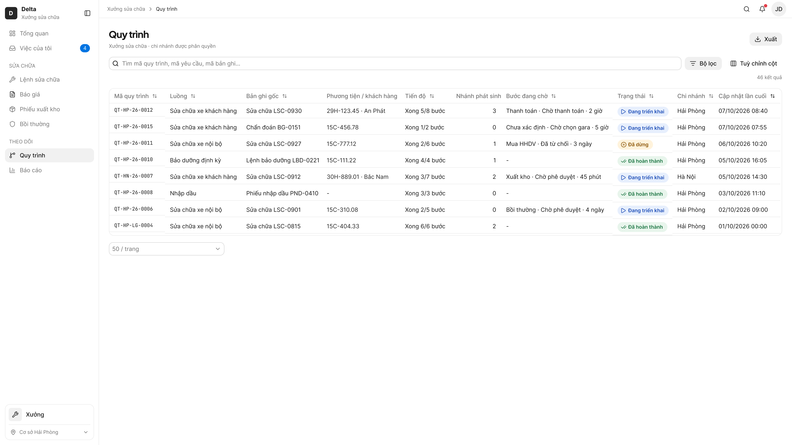

| # | Items | Control type | Data type | Description |
|---|---|---|---|---|
| 1 | Menu {Module} › Quy trình | Menu | Click | • Xem CMP-11 — mục "Quy trình" trong menu mỗi module • Chỉ hiện với người được Admin cấp quyền theo module (FR-cross-process-flow-019) • Luồng liên module hiện ở danh sách của cả 2 module (FR-cross-process-flow-015) • Chỉ gồm quy trình thuộc chi nhánh người dùng được phân quyền dữ liệu (FR-cross-process-flow-015) • Đang tải → [2.1] · Loading; tải lỗi → khối lỗi [2.1] · Load error; không có quyền menu mà mở thẳng đường dẫn → [2.1] · No permission |
| 2 | Ô tìm | Textbox | Text | • Theo GR-09: tìm được mã quy trình + mã của bất kỳ bản ghi trong cây; không tìm theo Luồng, Trạng thái, Chi nhánh (dùng bộ lọc) • Tìm mã quy trình, mã yêu cầu hoặc mã bản ghi chứa chuỗi đã gõ ở bất kỳ vị trí nào (vd "0410" ra quy trình chứa PXK-0410), không phân biệt hoa thường, chạy sau khi ngừng gõ 0,3 giây; kết quả trong tối đa 1 giây (FR-cross-process-flow-016, NFR-cross-process-flow-009) • Dưới 3 ký tự: chưa tìm, không báo lỗi (D7); không ra kết quả → [2.1] · No search results • Placeholder "Tìm mã quy trình, mã yêu cầu, mã bản ghi…" (nêu đúng trường tìm được) |
| 3 | Bộ lọc | Button | Click | • Xem CMP-05 — Filter Drawer. Trường lọc: Luồng (chọn nhiều) · Trạng thái (chọn nhiều) · Chi nhánh (chọn) · Cập nhật lần cuối (khoảng ngày, chỉ ngày) (FR-cross-process-flow-017, GR-20) • Không có giá trị mặc định, không có phụ thuộc giữa các trường • Badge trên nút = số điều kiện đang áp dụng |
| 4 | Chip điều kiện lọc | Chip | Click | • Hàng 2 thanh công cụ: mỗi điều kiện 1 chip "[Cột]: [giá trị]"; bấm chip → sửa điều kiện, × → xoá điều kiện đó (CMP-05, design.md › Bộ lọc nâng cao) |
| 5 | Xoá tất cả | Button | Click | • Xoá mọi chip, không xoá từ khoá trong ô tìm; chỉ hiện khi có điều kiện |
| 6 | Số kết quả | Label | ReadOnly | • "n kết quả" căn phải hàng 2 — tổng duy nhất của danh sách sau tìm + lọc (design.md › Bộ lọc nâng cao) |
| 7 | Tuỳ chỉnh cột | Button | Click | • Xem CMP-06: 10 cột theo thứ tự FR-cross-process-flow-015, hiện hết mặc định; cột khoá: Mã quy trình |
| 8 | Xuất ▾ | Button | Click | • Theo GR-19, FR-cross-process-flow-022: PDF hoặc Excel đúng tập dữ liệu đang thấy (sau tìm, lọc, sắp, mọi trang) và đúng các cột đang hiện theo thứ tự đang cấu hình • 1 dòng = 1 quy trình; khối thông tin phụ: Thời gian xuất · Người xuất · Tổng số dòng · Tiêu chí lọc; sheet "DS - Quy trình"; file Export_DanhSach_QuyTrinh_.xlsx; trang in nằm ngang • Ai xem được menu Quy trình của module thì xuất được |
| 9 | Cột Mã quy trình | Label | ReadOnly | • Theo P-mau-ma-quy-trinh (Delta: QT-[Mã chi nhánh]-[YY]-[XXXX]); quy trình dựng từ dữ liệu cũ: QT-[Mã chi nhánh]-LG-[XXXX], Cập nhật lần cuối = ngày chuyển dữ liệu (vd QT-HP-LG-0004) • Cột khoá, không ẩn được |
| 10 | Cột Luồng | Label | ReadOnly | • Tên luồng theo bảng liên quy trình |
| 11 | Cột Bản ghi gốc | Label | ReadOnly | • Tên bước + mã của nút đầu cây |
| 12 | Cột Phương tiện / khách hàng | Link | Click | • Bấm ô → màn chi tiết Phương tiện hoặc Xe của khách hàng (FR-cross-process-flow-018), ngoài feature • Không có thông tin: "-" (GR-10) |
| 13 | Cột Tiến độ | Label | ReadOnly | • "Xong x/y bước" |
| 14 | Cột Nhánh phát sinh | Label | ReadOnly | • Số nhánh phát sinh, căn phải |
| 15 | Cột Bước đang chờ | Label | ReadOnly | • Bước chờ lâu nhất: tên bước · trạng thái (lấy theo bản ghi) · chờ bao lâu; nhiều bước cùng chờ thì thêm dòng "+n bước khác" (FR-cross-process-flow-015) • Chờ bao lâu tính riêng từng bước, từ lúc bước vào trạng thái hiện tại: "n phút" (dưới 1 giờ) · "n giờ" (dưới 24 giờ) · "n ngày" • Quy trình Đã dừng: hiện bước của luồng chính bị từ chối/thu hồi; nhánh phát sinh bị từ chối không làm quy trình dừng nhưng vẫn hiện ở cột này kèm trạng thái (BR-cross-process-flow-002) • Quy trình Đã hoàn thành: "-" (GR-10) |
| 16 | Cột Trạng thái | Badge | ReadOnly | • Đang triển khai · Đã dừng · Đã hoàn thành (FR-cross-process-flow-002), nhãn chữ |
| 17 | Cột Chi nhánh | Label | ReadOnly | • Chi nhánh lúc tạo quy trình (BR-cross-process-flow-004) |
| 18 | Cột Cập nhật lần cuối | Label | ReadOnly | • dd/mm/yyyy hh:mm, căn giữa • Override GR-18: mặc định sắp giảm dần theo cột này (thay thời gian tạo) — lý do: người theo dõi cần thấy quy trình vừa có biến động trước |
| 19 | Dòng quy trình | Row | Click | • Bấm dòng (ngoài ô Phương tiện) → popup sơ đồ ngay trên danh sách, chưa chọn bước nào [2.2] (FR-cross-process-flow-018) |
| 20 | Phân trang | Pagination | Click | • Xem CMP-04, mặc định: trái ô "50 / trang" (25 / 50 / 100), phải Trước · số trang · Sau; không có nhãn tổng (design.md › Phân trang, chốt 12/10/2026) • Mẫu chỉ 46 kết quả nên có 1 trang; theo design.md 1 trang thì ẩn số trang và Trước/Sau — vẽ để minh hoạ vị trí |

##### Trạng thái: Empty — Danh sách rỗng

- **Figma:** [2.1 · web · process-list · Empty](https://www.figma.com/design/FifpyOMpZk9OP8qyNzbRVJ/?node-id=5600-144980)

| # | Items | Control type | Data type | Description |
|---|---|---|---|---|
| 1 | Trạng thái rỗng | Label | ReadOnly | • Theo GR-12: "Chưa có quy trình nào." + "Quy trình tự tạo khi có bản ghi đầu tiên được gửi." • Không có nút Tạo mới — quy trình chỉ tạo tự động (FR-cross-process-flow-001) |
| 2 | Ô tìm, Bộ lọc, Xuất | Button | Click | • Vẫn hiện như màn [2.1] |

##### Trạng thái: Loading — Danh sách đang tải

- **Figma:** [2.1 · web · process-list · Loading](https://www.figma.com/design/FifpyOMpZk9OP8qyNzbRVJ/?node-id=5600-137717)

| # | Items | Control type | Data type | Description |
|---|---|---|---|---|
| 1 | Skeleton bảng | Skeleton | ReadOnly | • Theo GR-12: skeleton theo 10 cột đang hiện (FR-cross-process-flow-015) • Trang 50 dòng hiện trong tối đa 2 giây (NFR-cross-process-flow-009) • Thanh công cụ và bộ lọc dùng được ngay; tải xong → [2.1] / [2.1] · Empty, lỗi → [2.1] · Load error |

##### Trạng thái: Load error — Danh sách tải lỗi

- **Figma:** [2.1 · web · process-list · Load error](https://www.figma.com/design/FifpyOMpZk9OP8qyNzbRVJ/?node-id=5600-152243)

| # | Items | Control type | Data type | Description |
|---|---|---|---|---|
| 1 | Khối lỗi | Label | ReadOnly | • Thay vùng bảng: "Không tải được danh sách." + câu E-common-008 (FR-cross-process-flow-015) • Override GR-15: khối lỗi tại chỗ thay toast — lý do: toast tự ẩn sau 3 giây làm mất nút Thử lại (spec Mục 10) • Giữ thanh công cụ, ô tìm và chip lọc đang chọn |
| 2 | Thử lại | Button | Click | • Tải lại với đúng ô tìm và bộ lọc đang chọn → [2.1] · Loading |

##### Trạng thái: No filter results — Lọc không ra kết quả

- **Figma:** [2.1 · web · process-list · No filter results](https://www.figma.com/design/FifpyOMpZk9OP8qyNzbRVJ/?node-id=5600-149822)

| # | Items | Control type | Data type | Description |
|---|---|---|---|---|
| 1 | Trạng thái không có kết quả | Label | ReadOnly | • Ô tìm trống, bộ lọc ra 0 dòng: "Không có quy trình phù hợp với bộ lọc." (FR-cross-process-flow-017) • Có từ khoá trong ô tìm → dùng câu của [2.1] · No search results • Không có nút Tạo mới |
| 2 | Xoá bộ lọc | Button | Click | • Xoá mọi điều kiện lọc → [2.1] |

##### Trạng thái: No permission — Trang không có quyền

- **Figma:** [2.1 · web · process-list · No permission](https://www.figma.com/design/FifpyOMpZk9OP8qyNzbRVJ/?node-id=5600-154664)

| # | Items | Control type | Data type | Description |
|---|---|---|---|---|
| 1 | Nội dung không có quyền | Label | ReadOnly | • Người không có quyền menu Quy trình mở thẳng đường dẫn danh sách: vùng nội dung hiện câu E-common-011 "Bạn không có quyền xem thông tin này. Liên hệ quản trị viên để được cấp quyền." (FR-cross-process-flow-019) • Menu bên trái không có mục Quy trình; quy tắc chung cho web đang đề xuất thêm (BL-064) |
| 2 | Về trang chủ | Button | Click | • Về trang chủ của người dùng |

##### Trạng thái: No search results — Tìm không ra

- **Figma:** [2.1 · web · process-list · No search results](https://www.figma.com/design/FifpyOMpZk9OP8qyNzbRVJ/?node-id=5600-147401)

| # | Items | Control type | Data type | Description |
|---|---|---|---|---|
| 1 | Trạng thái không có kết quả | Label | ReadOnly | • Theo GR-12: "Không tìm thấy quy trình chứa mã "[mã]"." — [mã] là chuỗi đang gõ • Không có nút Tạo mới |
| 2 | Xoá bộ lọc | Button | Click | • Xoá ô tìm và mọi điều kiện lọc → [2.1] (UC tra cứu 5a2) |

##### Trạng thái: Update banner — Danh sách có banner cập nhật

- **Figma:** [2.1 · web · process-list · Update banner](https://www.figma.com/design/FifpyOMpZk9OP8qyNzbRVJ/?node-id=5600-140138)

| # | Items | Control type | Data type | Description |
|---|---|---|---|---|
| 1 | Banner cập nhật | Banner | ReadOnly | • Theo GR-27, [Đối tượng] = "Danh sách": "Danh sách vừa có cập nhật." đầu vùng nội dung (FR-cross-process-flow-020) • Không tự tải lại; hiện banner tối đa 2 giây sau khi bản ghi đổi (NFR-cross-process-flow-003) |
| 2 | Tải lại | Button | Click | • Tải dữ liệu mới, giữ ô tìm + bộ lọc + trang đang xem, rồi ẩn banner → [2.1] |

#### Screen: list-process-diagram — Popup sơ đồ trên danh sách

- **screenId:** 2.2 · web
- **Figma:** [2.2 · web](https://www.figma.com/design/FifpyOMpZk9OP8qyNzbRVJ/?node-id=5600-142559)
- **Mô tả:** Popup sơ đồ mở từ danh sách: chưa chọn bước nào; chọn bước thì mở panel như khi mở từ màn chi tiết.

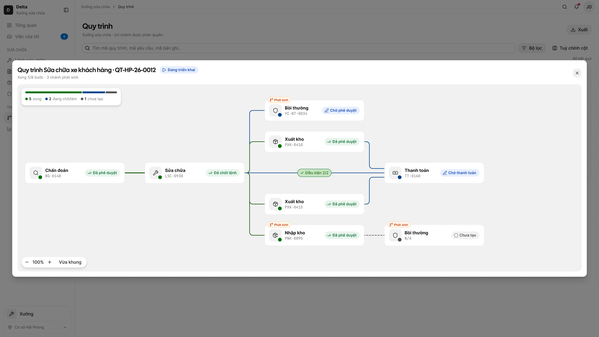

| # | Items | Control type | Data type | Description |
|---|---|---|---|---|
| 1 | Popup sơ đồ | Popup | Click | • Như [1.2] nhưng mở từ danh sách: chưa chọn bước nào, panel đóng, không có ghim "Ở đây" (FR-cross-process-flow-006, -018) • Chọn bước → panel như [1.2] (có bản ghi), [1.3] chưa tạo, [1.4] ngã rẽ, [1.5] không có quyền, [1.6] công nợ, [1.7] có bản ghi trước |
| 2 | Đóng × | Button | Click | • Về danh sách [2.1], giữ ô tìm và bộ lọc |
| 3 | Chip Điều kiện x/y | Chip | Click | • Như [1.2] (Xem CMP-09 #4): bấm chip → tooltip điều kiện neo dưới chip; popup vẫn chưa chọn bước nào |

### Màn hình flow: Tạo nghiệp vụ tiếp theo, chặn thu hồi/xoá

_Nguồn: docs/cross-process-flow/screens/create-next-step.md_

> Flow `create-next-step` · thiết bị `web` · bảng chép từ `docs/cross-process-flow/html-wireframe/create-next-step.html` ngày 2026-10-13. Giao diện là frame Figma; bảng 5 cột là hợp đồng — sửa qua `/figma-sync` hoặc `/cr`.

#### Screen: new-record-detail — Màn chi tiết bản ghi mới

- **screenId:** 3.1 · web
- **Figma:** [3.1 · web](https://www.figma.com/design/FifpyOMpZk9OP8qyNzbRVJ/?node-id=5600-157912)
- **Mô tả:** Màn chi tiết của bản ghi vừa tạo từ bước trước: dòng quy trình đã thêm bước mới và gắn "Ở đây".

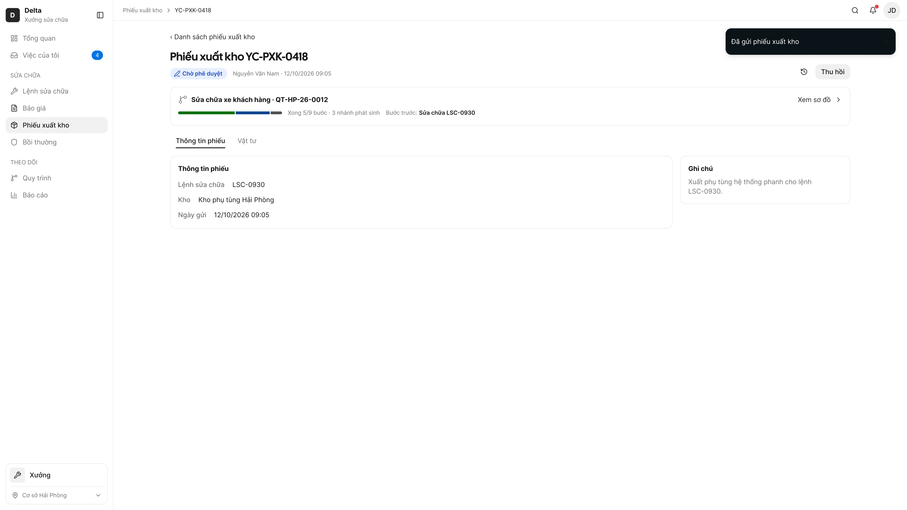

| # | Items | Control type | Data type | Description |
|---|---|---|---|---|
| 1 | Dòng quy trình | Row | Click | • Như [1.1]; bước mới gắn "Ở đây" khi người tạo vào màn chi tiết (FR-cross-process-flow-003) • "Bước trước: Sửa chữa LSC-0930"; tóm tắt cập nhật số bước ("Xong 5/9 bước · 3 nhánh phát sinh") • Ghi nhận gửi và thêm bước cùng thành công hoặc cùng không; cây không nhận thì bản ghi giữ nháp (FR-cross-process-flow-003) |
| 2 | Thẻ bước mới trên sơ đồ | Card | Click | • Bản ghi gửi thành công → bước Đang triển khai nối về bản ghi tạo ra nó (R1, FR-cross-process-flow-003, -004) • Bước khai "nhiều bản ghi" (Xuất kho): YC-PXK-0418 thành bước anh em thứ 3 cạnh PXK-0410, PXK-0415, không ghi "lần 1/2" (BR-cross-process-flow-008, FR-cross-process-flow-013) |
| 3 | Trạng thái bản ghi | Badge | ReadOnly | • Trạng thái của nghiệp vụ (vd "Chờ phê duyệt") • Chưa được duyệt nên tiêu đề và thẻ bước mang mã yêu cầu YC-PXK-0418; duyệt xong đổi sang mã bản ghi (BR-cross-process-flow-012) |
| 4 | Toast gửi thành công | Toast | ReadOnly | • Theo toast của nghiệp vụ được tạo (CMP-01); liên quy trình không tự gửi thông báo (BR-cross-process-flow-010) |

#### Screen: step-already-requested — Popup E-cross-process-flow-001

- **screenId:** 3.2 · web
- **Figma:** [3.2 · web](https://www.figma.com/design/FifpyOMpZk9OP8qyNzbRVJ/?node-id=5600-158266)
- **Mô tả:** Popup chặn gửi vì bước chỉ nhận 1 bản ghi đã có yêu cầu khác đang chờ duyệt hoặc đã xong.

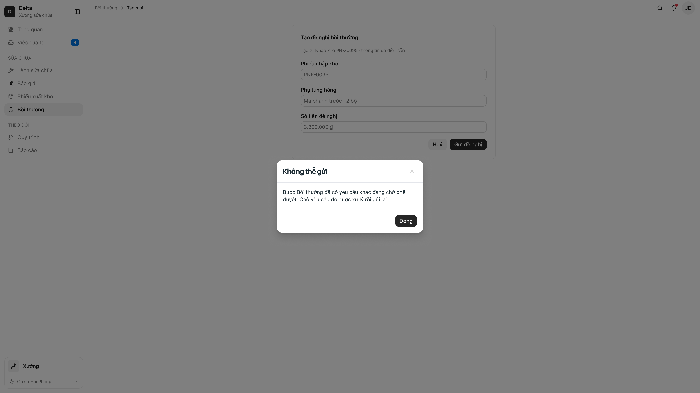

| # | Items | Control type | Data type | Description |
|---|---|---|---|---|
| 1 | Popup lỗi | Popup | ReadOnly | • E-cross-process-flow-001, GR-15 Loại 2 Popup, không có Thử lại (FR-cross-process-flow-013) • Đang chờ: "Bước [Tên bước] đã có yêu cầu khác đang chờ phê duyệt. Chờ yêu cầu đó được xử lý rồi gửi lại." — [Tên bước] = bước khai "1 bản ghi" đang gửi • Đã xong: "Bước [Tên bước] đã hoàn thành với [mã]. Không gửi thêm được."; gửi lại bản ghi Đã thay thế cũng chặn bằng lỗi này (BR-cross-process-flow-011) • Hai người cùng gửi thì chỉ người gửi trước được nhận; bản cũ đang Đã thu hồi/từ chối thì không chặn — bản mới thay thế (xem [1.7]) • Tiêu đề popup "Không thể gửi"; app: sheet lỗi Loại 2 cùng nội dung (FR-cross-process-flow-012) |
| 2 | Đóng | Button | Click | • Đóng popup, form giữ nguyên, bản nháp giữ lại (FR-cross-process-flow-013) • Tải lại màn bản ghi trước thì nút tạo ẩn theo điều kiện của nghiệp vụ (UC tạo nghiệp vụ 5a2) |

#### Screen: has-child-step — Popup E-cross-process-flow-002

- **screenId:** 3.4 · web
- **Figma:** [3.4 · web](https://www.figma.com/design/FifpyOMpZk9OP8qyNzbRVJ/?node-id=5600-158620)
- **Mô tả:** Popup chặn thu hồi/xoá vì bản ghi đã sinh bước con.

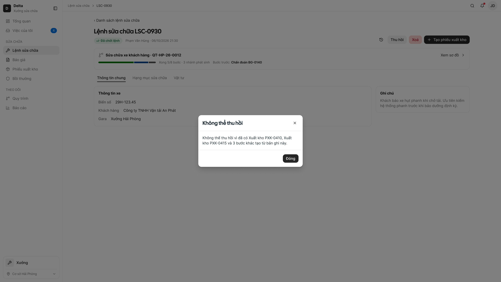

| # | Items | Control type | Data type | Description |
|---|---|---|---|---|
| 1 | Popup lỗi | Popup | ReadOnly | • E-cross-process-flow-002, GR-15 Loại 2 Popup, không có Thử lại (FR-cross-process-flow-014) • Thu hồi: "Không thể thu hồi vì đã có [Danh sách bước] tạo từ bản ghi này." · Xoá: tiêu đề "Không thể xoá", câu "Không thể xoá vì đã có [Danh sách bước] tạo từ bản ghi này." • [Danh sách bước] = tối đa 2 bước kèm mã, thêm "và n bước khác" khi nhiều hơn (vd LSC-0930 có 5 bước con) • Hiện chưa nghiệp vụ nào cho thu hồi/xoá khi đã có bước con (spec Mục 11 — giả định) |
| 2 | Đóng | Button | Click | • Về màn chi tiết [1.1], bản ghi giữ nguyên trạng thái |

#### Screen: source-revoked — Popup E-cross-process-flow-003

- **screenId:** 3.3 · web
- **Figma:** [3.3 · web](https://www.figma.com/design/FifpyOMpZk9OP8qyNzbRVJ/?node-id=5600-158974)
- **Mô tả:** Popup báo không gửi được vì bản ghi nguồn vừa bị thu hồi; bản nháp được giữ.

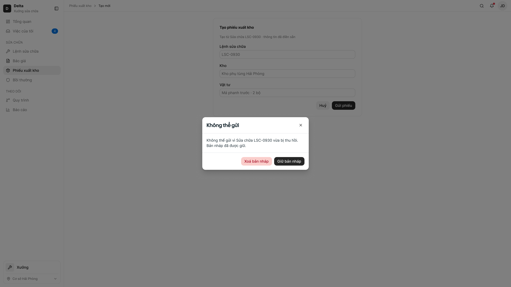

| # | Items | Control type | Data type | Description |
|---|---|---|---|---|
| 1 | Popup lỗi | Popup | ReadOnly | • E-cross-process-flow-003, GR-15 Loại 2: bản ghi nguồn vừa bị thu hồi trong lúc gửi — thu hồi thắng (FR-cross-process-flow-003) • Câu: "Không thể gửi vì [Tên bước] [mã] vừa bị thu hồi. Bản nháp đã được giữ." • Bản ghi không được ghi nhận gửi, cây không đổi; app: sheet lỗi Loại 2 cùng nội dung |
| 2 | Giữ bản nháp | Button | Click | • Nút chính: đóng popup, bản nháp giữ lại chờ bản ghi nguồn được gửi lại |
| 3 | Xoá bản nháp | Button | Click | • Nút phụ kiểu nguy hiểm; Xem CMP-03 để xác nhận rồi xoá bản nháp |

### Màn hình flow: Xem quy trình trên Delta Super App

_Nguồn: docs/cross-process-flow/screens/view-process-mobile.md_

> Flow `view-process-mobile` · thiết bị `mob` · bảng chép từ `docs/cross-process-flow/html-wireframe/view-process-mobile.html` ngày 2026-10-13. Giao diện là frame Figma; bảng 5 cột là hợp đồng — sửa qua `/figma-sync` hoặc `/cr`.

#### Screen: record-detail — App — màn chi tiết có thẻ quy trình

- **screenId:** 1.1 · mob
- **Figma:** [1.1 · mob](https://www.figma.com/design/FifpyOMpZk9OP8qyNzbRVJ/?node-id=5600-159935)
- **Mô tả:** Màn chi tiết trên app, có thẻ quy trình (tên luồng, tiến độ, bước trước); chạm thẻ để mở sheet sơ đồ.

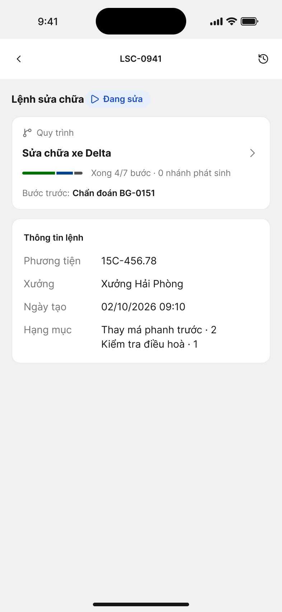

| # | Items | Control type | Data type | Description |
|---|---|---|---|---|
| 1 | Thẻ quy trình | Card | Click | • Xem CMP-09 Mobile: tên luồng là chính ("Sửa chữa xe Delta"), dòng tóm tắt là phụ: thanh tiến độ · "Xong x/y bước · n nhánh phát sinh" · "Bước trước / Phát sinh từ" (FR-cross-process-flow-005, -021) • Không thuộc quy trình hoặc luồng độc lập chưa có nhánh → không có thẻ (D1) • Chạm thẻ → sheet đang tải [1.2] · Loading rồi sheet sơ đồ [1.2]; tải lỗi → [1.1] · Load error • Thẻ hiện trong tối đa 2 giây, không bắt màn chi tiết chờ (NFR-cross-process-flow-002); đang tải → skeleton thẻ [1.1] · Loading |
| 2 | Header màn chi tiết | Header | Click | • ← quay lại · mã bản ghi · icon lịch sử Xem CMP-08 (Mobile); thuộc nghiệp vụ |
| 3 | Nút tạo nghiệp vụ tiếp theo | Button | Click | • Chỉ có ở nghiệp vụ có màn trên app (cột "Có trên app" của bảng liên quy trình), cùng điều kiện D6 như web; nút cố định đáy (thumb zone) (FR-cross-process-flow-012) • Lỗi E-cross-process-flow-001 / -003 khi gửi: sheet lỗi Loại 2 (GR-15 Mobile), nội dung như [3.2] / [3.3] |

##### Trạng thái: Load error — App — thẻ quy trình tải lỗi

- **Figma:** [1.1 · mob · record-detail · Load error](https://www.figma.com/design/FifpyOMpZk9OP8qyNzbRVJ/?node-id=5600-160682)

| # | Items | Control type | Data type | Description |
|---|---|---|---|---|
| 1 | Thẻ lỗi | Banner | ReadOnly | • "Không tải được quy trình." thay chỗ thẻ quy trình; màn chi tiết vẫn dùng bình thường (FR-cross-process-flow-005) |
| 2 | Thử lại | Button | Click | • Vùng chạm tối thiểu 44 (design.md › Touch Targets); được → [1.1] |

##### Trạng thái: Loading — App — thẻ quy trình đang tải

- **Figma:** [1.1 · mob · record-detail · Loading](https://www.figma.com/design/FifpyOMpZk9OP8qyNzbRVJ/?node-id=5600-160508)

| # | Items | Control type | Data type | Description |
|---|---|---|---|---|
| 1 | Skeleton thẻ quy trình | Skeleton | ReadOnly | • Theo GR-12 (Mobile): skeleton theo hình thẻ thật, có shimmer; tải xong chuyển mờ sang thẻ [1.1] (FR-cross-process-flow-005) • Màn chi tiết dùng được ngay; tải lỗi → [1.1] · Load error |

#### Screen: process-diagram — App — sheet sơ đồ

- **screenId:** 1.2 · mob
- **Figma:** [1.2 · mob](https://www.figma.com/design/FifpyOMpZk9OP8qyNzbRVJ/?node-id=5600-160887)
- **Mô tả:** Sheet sơ đồ quy trình mở từ đáy, đánh dấu bước "Ở đây"; chạm bước để mở sheet bước.

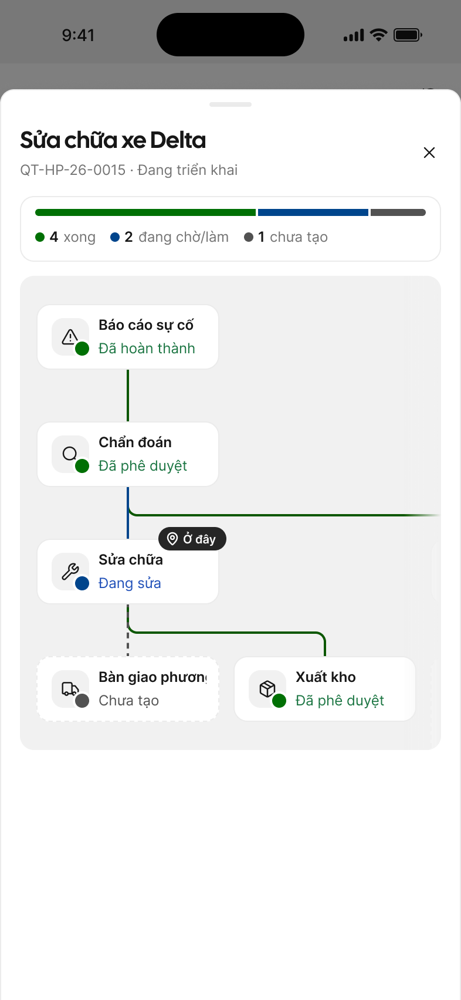

| # | Items | Control type | Data type | Description |
|---|---|---|---|---|
| 1 | Sheet sơ đồ | BottomSheet | Click | • Xem CMP-09 Mobile: mở từ đáy, che gần hết màn; header tên luồng + mã + trạng thái quy trình + × • Vuốt xuống, chạm nền hoặc × → đóng, về [1.1] (conventions — BottomSheet) • Hiện đủ trong tối đa 2 giây (NFR-cross-process-flow-001) |
| 2 | Card tóm tắt | Card | ReadOnly | • Xem CMP-09 Mobile: thanh tiến độ + số bước theo trạng thái ("4 xong · 2 đang chờ/làm · 1 chưa tạo"); không lặp dòng "Xong x/y bước" (đã có ở thẻ [1.1]) |
| 3 | Cây dọc | Tree | Click | • Cây rẽ nhánh dọc, thẻ cùng dạng web (R7, R16, R10); vuốt ngang khi cây rộng hơn màn (FR-cross-process-flow-021) • Mở từ màn chi tiết: thẻ "Ở đây" được chọn sẵn (viền đậm) — sheet bước chưa tự mở để không che cây • Chụm hai ngón để thu phóng, vuốt để kéo; không có nút thu phóng (FR-cross-process-flow-006, -021) • Chạm thẻ → sheet bước [4.1], [1.3]–[1.6] |
| 4 | Chip Điều kiện x/y | Chip | Click | • Xem CMP-09 Mobile: chạm chip trên đường → tooltip như web [1.2] (mỗi điều kiện 1 dòng ✓ / ○ kèm mã nguồn + "Bước trước khác (đường riêng): …"), neo dưới chip, rộng tối đa bằng vùng cây • Chạm ra ngoài hoặc chạm lại chip để đóng; không mở sheet bước • Cây mẫu LSC-0941 chưa có bước nào ≥2 bước trước cùng vào — chip chỉ hiện khi có |

##### Trạng thái: Loading — App — sheet sơ đồ đang tải

- **Figma:** [1.2 · mob · process-diagram · Loading](https://www.figma.com/design/FifpyOMpZk9OP8qyNzbRVJ/?node-id=5600-161816)

| # | Items | Control type | Data type | Description |
|---|---|---|---|---|
| 1 | Sheet đang tải | BottomSheet | ReadOnly | • Theo GR-12 (Mobile): "Đang tải sơ đồ…" + khung xám theo hình thẻ • Tải xong → [1.2]; lỗi → [1.2] · Load error |

##### Trạng thái: Load error — App — sheet sơ đồ lỗi

- **Figma:** [1.2 · mob · process-diagram · Load error](https://www.figma.com/design/FifpyOMpZk9OP8qyNzbRVJ/?node-id=5600-161987)

| # | Items | Control type | Data type | Description |
|---|---|---|---|---|
| 1 | Khối lỗi trong sheet | Label | ReadOnly | • Tiêu đề "Không tải được sơ đồ." + câu E-common-008 "Đã xảy ra lỗi. Thử lại sau." hoặc E-common-009 "Mất kết nối. Kiểm tra mạng và thử lại." (FR-cross-process-flow-006) • Override GR-15: lỗi tại chỗ thay toast (spec Mục 10) |
| 2 | Thử lại | Button | Click | • Nút chính dưới câu mô tả; chạm → [1.2] · Loading |

##### Trạng thái: Update banner — App — sheet sơ đồ có banner

- **Figma:** [1.2 · mob · process-diagram · Update banner](https://www.figma.com/design/FifpyOMpZk9OP8qyNzbRVJ/?node-id=5600-162173)

| # | Items | Control type | Data type | Description |
|---|---|---|---|---|
| 1 | Banner cập nhật | Banner | ReadOnly | • Theo GR-27 (Mobile): ngay dưới header sheet, "Quy trình vừa có cập nhật." (FR-cross-process-flow-020) • Hiện banner tối đa 2 giây sau khi bản ghi đổi (NFR-cross-process-flow-003) |
| 2 | Tải lại | Button | Click | • Tải lại cây, giữ bước đang chọn → [1.2] |

#### Screen: step-sheet — App — sheet bước

- **screenId:** 4.1 · mob
- **Figma:** [4.1 · mob](https://www.figma.com/design/FifpyOMpZk9OP8qyNzbRVJ/?node-id=5600-162600)
- **Mô tả:** Sheet chi tiết một bước có bản ghi, chồng lên sheet sơ đồ: trạng thái, lịch sử và nút mở bản ghi.

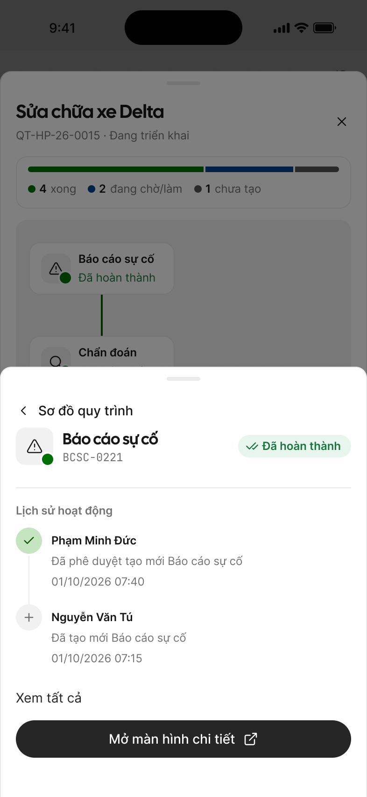

| # | Items | Control type | Data type | Description |
|---|---|---|---|---|
| 1 | Sheet bước | BottomSheet | ReadOnly | • Chồng lên sheet sơ đồ; đầu sheet: tên, mã, pill trạng thái có viền, nhãn đặt bên phải, không nền màu (CMP-09 Mobile) • Không header riêng, không ×: dòng đầu "‹ Sơ đồ quy trình" (Button Ghost LG) hoặc vuốt xuống / chạm nền → về sheet sơ đồ [1.2] (CMP-09 Mobile) |
| 2 | Lịch sử hoạt động | List | ReadOnly | • Theo CMP-08: 5 dòng mới nhất + "Xem tất cả" (mẫu có 2 dòng vì bản ghi mới có 2 hoạt động) |
| 3 | Mở màn hình chi tiết | Button | Click | • Nút chính full width cố định đáy; đẩy màn mới, Back về màn trước, sheet đã đóng (FR-cross-process-flow-010) • Chỉ có nút khi app có màn chi tiết của loại bản ghi đó (hiện có Đơn mua HHDV, Lệnh sửa chữa, Báo cáo sự cố); loại khác: sheet vẫn có lịch sử, không có nút (FR-cross-process-flow-009) • Bản ghi vừa bị thu quyền: Theo GR-26 popup chặn E-common-011 "Bạn không có quyền xem thông tin này. Liên hệ quản trị viên để được cấp quyền.", nút Quay lại về sheet sơ đồ • Bản ghi đã bị xoá: sheet lỗi Loại 2 E-cross-process-flow-004 + Tải lại sơ đồ, nội dung như [1.9] |

#### Screen: step-not-created — App — sheet bước chưa tạo

- **screenId:** 1.3 · mob
- **Figma:** [1.3 · mob](https://www.figma.com/design/FifpyOMpZk9OP8qyNzbRVJ/?node-id=5600-163096)
- **Mô tả:** Sheet bước chưa tạo: mã N/A, "Chưa tạo", không có lịch sử và nút.

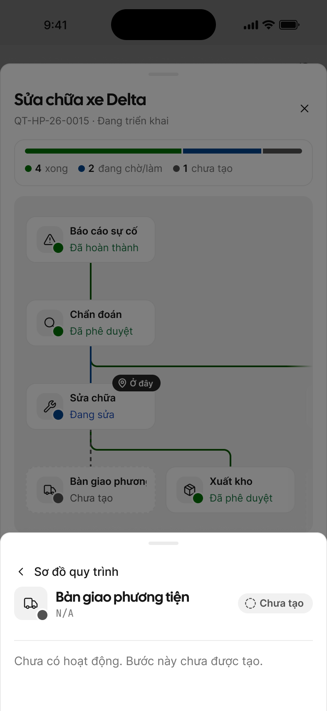

| # | Items | Control type | Data type | Description |
|---|---|---|---|---|
| 1 | Sheet bước chưa tạo | BottomSheet | ReadOnly | • Mã N/A (GR-10), "Chưa tạo"; "Chưa có hoạt động. Bước này chưa được tạo." (D2) • Không có lịch sử, không có nút |

#### Screen: branch-point — App — sheet ngã rẽ

- **screenId:** 1.4 · mob
- **Figma:** [1.4 · mob](https://www.figma.com/design/FifpyOMpZk9OP8qyNzbRVJ/?node-id=5600-163629)
- **Mô tả:** Sheet ngã rẽ: điều kiện đang chờ và các hướng có thể đi.

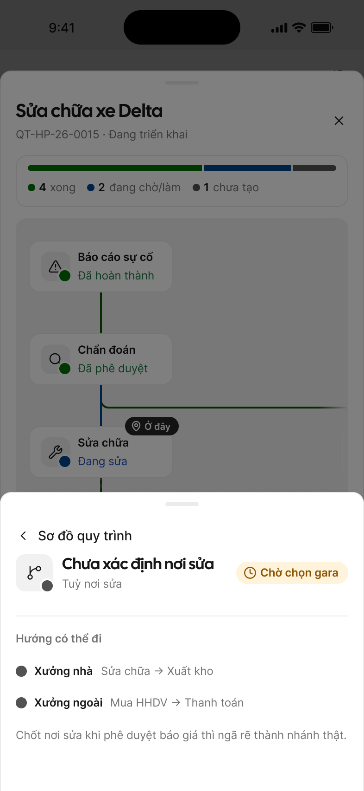

| # | Items | Control type | Data type | Description |
|---|---|---|---|---|
| 1 | Sheet ngã rẽ | BottomSheet | ReadOnly | • Tên "Chưa xác định nơi sửa", dòng phụ = điều kiện ("Tuỳ nơi sửa"), chip chờ theo điều kiện khai ở bảng liên quy trình (Delta: "Chờ chọn gara", Vàng) • Khối "Hướng có thể đi" lấy từ bảng liên quy trình (D5, R6) + câu "Chốt nơi sửa khi phê duyệt báo giá thì ngã rẽ thành nhánh thật." • Không có lịch sử, không có nút |

#### Screen: debt-step — App — sheet công nợ

- **screenId:** 1.6 · mob
- **Figma:** [1.6 · mob](https://www.figma.com/design/FifpyOMpZk9OP8qyNzbRVJ/?node-id=5600-164169)
- **Mô tả:** Sheet bước công nợ của nhà cung cấp; app không có nút mở bảng công nợ.

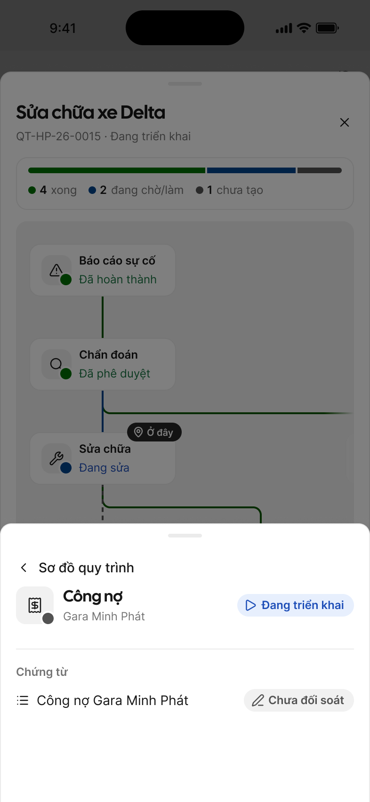

| # | Items | Control type | Data type | Description |
|---|---|---|---|---|
| 1 | Sheet công nợ | BottomSheet | ReadOnly | • Tên "Công nợ", dòng phụ tên NCC, chip trạng thái bước (R8, FR-cross-process-flow-004) • Khối "Chứng từ": dòng "Công nợ {Tên NCC}" + chip "Chưa đối soát" (theo component CMP-09) • KHÔNG có nút "Mở bảng công nợ" — Delta Super App không có màn Bảng công nợ (OQ-2 chốt 12/10/2026) |

#### Screen: step-no-permission — App — sheet bước không có quyền

- **screenId:** 1.5 · mob
- **Figma:** [1.5 · mob](https://www.figma.com/design/FifpyOMpZk9OP8qyNzbRVJ/?node-id=5600-164723)
- **Mô tả:** Sheet bước người xem không có quyền: hiện câu không có quyền, ẩn lịch sử và nút.

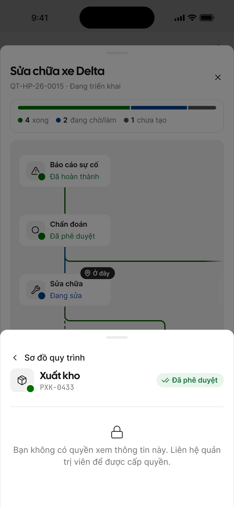

| # | Items | Control type | Data type | Description |
|---|---|---|---|---|
| 1 | Sheet không có quyền | BottomSheet | ReadOnly | • E-common-011 "Bạn không có quyền xem thông tin này. Liên hệ quản trị viên để được cấp quyền." tại chỗ; ẩn lịch sử và nút (FR-cross-process-flow-009, NFR-cross-process-flow-004) • Override GR-26 như web (spec Mục 10) • Quyền theo phân quyền xem của nghiệp vụ ứng với bước, như nhau cho mọi người dùng kể cả Lái xe; lý do phát sinh vẫn hiện nếu có (FR-cross-process-flow-009) |

<!-- screens:end -->

## 11. Constraints, Dependencies & Assumptions

**Constraints (ràng buộc áp đặt — có source/owner):**

| Ràng buộc | Source / Owner |
|-----------|----------------|
| Quy tắc vẽ sơ đồ theo R1–R17 của CMP-09 | `design/ui-common/screen-patterns.md` — BA |
| App chỉ có màn chi tiết của Đơn mua HHDV, Lệnh sửa chữa, Báo cáo sự cố: nút mở trên app chỉ có ở 3 loại bước này; app thêm màn thì tự mở rộng | Delta Super App hiện hành — Delta |
| Quy tắc bảng công nợ (hoàn thành khi nào, nhận thêm đơn) thuộc SRS Thanh toán | SRS Thanh toán — BA |

**Dependencies (deliverable do bên khác sở hữu):**

| Phụ thuộc | Owner | Blocks nếu chưa sẵn |
|-----------|-------|---------------------|
| Bảng liên quy trình trong SRS từng nghiệp vụ (Xưởng, Cây dầu, Liên module) | BA từng module | Cây thiếu bước/nhánh của nghiệp vụ đó |
| Bảng phát sinh luồng Điều vận | Delta (OQ-1) | Chưa có luồng Điều vận trên cây |
| Dựng quy trình cho toàn bộ dữ liệu cũ (cả quy trình đã hoàn thành) từ chứng từ nguồn trên mỗi phiếu, mã dãy LG, Cập nhật lần cuối = ngày chuyển dữ liệu — hạng mục triển khai | Đội triển khai | Kế toán không đối soát được quy trình cũ |
| Sửa GR-11 theo cách mã yêu cầu / mã bản ghi | BA (BL-063) | Quy tắc chung còn ghi khác BR-cross-process-flow-012 |
| Component dự án dạng cây cho CMP-09 trên Figma | Design | Chưa vẽ được màn Figma |

**Assumptions (tin là đúng — nêu hệ quả nếu sai):**

| Giả định | Invalidate {X} nếu sai |
|----------|------------------------|
| Mỗi phiếu trên hệ thống LG đã ghi chứng từ nguồn của nó | NFR-cross-process-flow-008, hạng mục dựng dữ liệu cũ |
| Lịch sử hoạt động trong panel tạm lấy lịch sử của bản ghi (bộ câu CMP-08 hiện hành) | FR-cross-process-flow-008 |
| Chưa luồng nào phát sinh nhánh sau khi quy trình Đã hoàn thành | BR-cross-process-flow-003 (Đã hoàn thành là kết thúc) |
| Hiện không có lệnh sửa chữa nào sinh từ 5 phiếu xuất kho trở lên | NFR-cross-process-flow-006 |
| Quy trình được giữ cùng thời hạn với bản ghi nghiệp vụ của nó | Mục 8 |
| Chưa nghiệp vụ nào cho thu hồi/xoá bản ghi khi đã có bước con | FR-cross-process-flow-014; nếu sai phải thêm quy tắc cho bước con khi bản ghi cha bị thu hồi |

## 12. Open Questions

| # | Câu hỏi | Owner | Nguồn khách |
|---|---|---|---|
| OQ-1 | Bảng phát sinh luồng Điều vận (Cung cấp dịch vụ tổng quát → Điều phối → Lệnh vận tải → Thanh toán chi/thu) — chờ chốt với khách, không chặn feature. (kế thừa brainstorm OQ-1) | Delta | chưa có trong tài liệu khách gửi |
| ✅ OQ-3 | ⭐ Gửi bản ghi và thêm bước vào cây có phải "cùng thành công hoặc cùng không" (cây không nhận → bản ghi giữ nháp; 2 người cùng gửi cho bước "1 bản ghi" thì chỉ 1 người được)? Đề xuất: có. → **Chốt 12/10:** Có — cùng thành công hoặc cùng không (FR-003, FR-013) | Delta | chưa có trong tài liệu khách gửi |
| ✅ OQ-4 | Bước "1 bản ghi" đã có bản ghi Đã thu hồi/từ chối chưa xoá: người khác gửi bản ghi thứ hai thì chặn hay cho? → **Chốt 12/10:** Cho gửi; bản mới thay thế, bản cũ Đã thay thế (BR-011, FR-007/008; phương án A) | Delta | chưa có trong tài liệu khách gửi |
| ✅ OQ-5 | E-001 chỉ báo "đang chờ phê duyệt", chưa có câu cho trường hợp bước đã xong. → **Chốt 12/10:** Thêm câu E-001 cho trường hợp đã xong | BA | chưa có trong tài liệu khách gửi |
| ✅ OQ-6 | ⭐ Bản ghi cha bị thu hồi/xoá hợp lệ khi đã có bước con: bước con ở lại, bị thu hồi theo, hay tách khỏi cây? (flows.md chưa có nhánh này) → **Chốt 12/10:** Chưa có trường hợp này — ghi Giả định Mục 11 | Delta | chưa có trong tài liệu khách gửi |
| ✅ OQ-7 | Gửi bước con đúng lúc bản ghi nguồn vừa bị thu hồi: bên nào thắng? → **Chốt 12/10:** Thu hồi thắng — E-003, nút Giữ bản nháp / Xoá bản nháp | Tech | chưa có trong tài liệu khách gửi |
| ✅ OQ-8 | E-002 khi có nhiều bước con: [Tên bước] trong câu báo lấy bước nào? → **Chốt 12/10:** Nêu tối đa 2 bước kèm mã + "và n bước khác" (E-002) | BA | chưa có trong tài liệu khách gửi |
| ✅ OQ-9 | ⭐ GR-11 sinh mã sau phê duyệt, spec giả định có mã từ lúc gửi (thẻ bước, tìm theo mã, gửi lại giữ mã). Chọn: Override GR-11 cho nghiệp vụ thuộc quy trình, hay hiện bước chưa mã ("Chờ cấp mã")? → **Chốt 12/10:** Mã yêu cầu trước duyệt, mã bản ghi sau duyệt (BR-012); sửa GR-11 qua BL-063 | Delta | chưa có trong tài liệu khách gửi |
| ✅ OQ-10 | Mã `QT-[chi nhánh]-XXXX` hết 9999 thì sao, có đánh lại theo năm? Dữ liệu cũ dựng lại có tiêu số mã không? → **Chốt 12/10:** Đánh lại theo năm `QT-[CN]-[YY]-[XXXX]`; dữ liệu cũ dãy `QT-[CN]-LG-[XXXX]` (BR-004) | Delta | chưa có trong tài liệu khách gửi |
| ✅ OQ-11 | "Xong x/y bước": y có tính bước Chưa tạo, ngã rẽ, nhánh phát sinh, bước công nợ? Chốt hướng ngã rẽ thì nút ngã rẽ hiển thị gì? → **Chốt 12/10:** y tính mọi bước; ngã rẽ chốt thì thành bước của hướng chọn (FR-005, FR-007) | Delta | chưa có trong tài liệu khách gửi |
| ✅ OQ-12 | Cột "Bước đang chờ" khi nhiều bước cùng chờ: hiện bước nào, có "+n bước khác"? Trạng thái lấy của bản ghi hay của bước? "Chờ bao lâu" tính từ mốc nào? → **Chốt 12/10:** Bước chờ lâu nhất + "+n bước khác"; trạng thái theo bản ghi; chờ tính riêng từng bước (FR-015) | Delta | chưa có trong tài liệu khách gửi |
| ✅ OQ-13 | Quy trình "Đã dừng" xác định thế nào khi nhiều bước bị từ chối, và khi bước bị từ chối sau đó bị xoá? → **Chốt 12/10:** Chỉ bước luồng chính bị từ chối mới Đã dừng; xoá thì tính lại như chưa có (BR-002) | Delta | chưa có trong tài liệu khách gửi |
| ✅ OQ-14 | ⭐ Nhánh phát sinh bị từ chối rồi không ai gửi lại → quy trình "Đang triển khai" mãi, không ai đóng tay được. Cần lối thoát không? → **Chốt 12/10:** Xoá bản ghi nhánh bị từ chối → nhánh Đã huỷ, không chặn hoàn thành (BR-003, BR-009) | Delta | chưa có trong tài liệu khách gửi |
| ✅ OQ-15 | Bảng công nợ dùng chung nhiều cây: bước công nợ xong khi cả bảng đã trả, hay khi phần của cây đó đã trả? → **Chốt 12/10:** Xong khi phần công nợ của luồng đã trả (FR-004) | Delta | chưa có trong tài liệu khách gửi |
| ✅ OQ-16 | ⭐ Danh sách/ô tìm/Export cho người có quyền menu 1 module thấy mã + trạng thái bước module khác, xuất tất cả. Chủ ý, hay giới hạn theo chi nhánh/module? (UC tra cứu hứa "chỉ chi nhánh được xem" nhưng chưa có FR) → **Chốt 12/10:** Giới hạn theo chi nhánh; bước module khác có quyền thì mở bình thường; Export đúng dữ liệu đang thấy (FR-015, FR-009, FR-022) | Delta | chưa có trong tài liệu khách gửi |
| ✅ OQ-17 | ⭐ Lái xe xem những quy trình nào? Có ẩn hẳn bước công nợ và bồi thường với Lái xe không? → **Chốt 12/10:** Theo phân quyền xem của từng nghiệp vụ, không giới hạn riêng Lái xe (FR-009) | Delta | chưa có trong tài liệu khách gửi |
| ✅ OQ-18 | FR-009 quyền theo bản ghi của bước, NFR-004 quyền theo nghiệp vụ gốc — thống nhất 1 nguồn quyền. → **Chốt 12/10:** Quyền theo nghiệp vụ của từng bước; sửa NFR-004. Yêu cầu cấp quyền: BL-065 | BA | chưa có trong tài liệu khách gửi |
| ✅ OQ-19 | Nhân viên nội bộ có dùng tính năng trên app không? (2 UC ghi "Website hoặc app", userflow ghi chỉ web; nếu có, app cần sheet lỗi E-001/E-002 + nút tạo nghiệp vụ tiếp theo) → **Chốt 12/10:** Có, tuỳ nghiệp vụ — cột "Có trên app" (BR-007, FR-012) | Delta | chưa có trong tài liệu khách gửi |
| ✅ OQ-20 | Mở thẳng URL danh sách khi không có quyền thì báo gì? Panel không quyền [1.5] ẩn lý do phát sinh — xác nhận. → **Chốt 12/10:** Đường dẫn không quyền: E-common-011 + Về trang chủ (FR-019, BL-064); panel [1.5] giữ lý do phát sinh | BA | chưa có trong tài liệu khách gửi |
| ✅ OQ-21 | Danh sách [2.1] chưa có màn đang tải và lỗi tải; lỗi chỉ báo toast 3 giây nên nút Thử lại mất theo. → **Chốt 12/10:** Skeleton khi tải; lỗi tải hiện khối lỗi + Thử lại thay toast (FR-015) | BA | chưa có trong tài liệu khách gửi |
| ✅ OQ-22 | Dòng quy trình [1.1] và thẻ quy trình app [1.1] chưa có giữ chỗ khi tải; khối lịch sử trong panel chưa có trạng thái tải/lỗi/rỗng. → **Chốt 12/10:** Skeleton dòng/thẻ quy trình; lịch sử có tải/lỗi/rỗng (FR-005, FR-008) | BA | chưa có trong tài liệu khách gửi |
| ✅ OQ-23 | Mở bản ghi đã bị xoá khi sơ đồ còn mở: chưa có mã lỗi. Popup sơ đồ lỗi [1.2] · Load error chưa có câu mô tả. → **Chốt 12/10:** Thêm E-004; popup lỗi [1.2] · Load error có tiêu đề + mô tả (FR-006, FR-010) | BA | chưa có trong tài liệu khách gửi |
| ✅ OQ-24 | Lọc ra 0 dòng khi ô tìm trống: cần câu riêng (câu hiện tại cần [mã]). → **Chốt 12/10:** "Không có quy trình phù hợp với bộ lọc." (FR-017) | BA | chưa có trong tài liệu khách gửi |
| ✅ OQ-25 | App mở sơ đồ có tự mở sheet bước không (FR-006 và userflow ghi khác nhau)? Thu phóng app cần nút +/− hay chỉ 2 ngón? → **Chốt 12/10:** Không tự mở sheet bước; thu phóng chỉ bằng hai ngón (FR-006, FR-021) | BA | chưa có trong tài liệu khách gửi |
| ✅ OQ-26 | GR-26 thuộc mục "chỉ App" nhưng spec dùng cho web; "Đang tải sơ đồ…" thay skeleton chưa có Override GR-12; cách ghi "chờ bao lâu" và tiêu đề popup E-001/E-002 chưa chuẩn. → **Chốt 12/10:** Web dùng popup Loại 2; Override GR-12 cho sơ đồ; chờ ghi phút/giờ/ngày; tiêu đề popup "Không thể …" | BA | chưa có trong tài liệu khách gửi |
| ✅ OQ-27 | Dữ liệu cũ: brainstorm ghi chỉ dựng quy trình chưa hoàn thành, spec ghi dựng toàn bộ — chốt bên nào, cỡ mẫu đối chiếu? "Cập nhật lần cuối" theo ngày nghiệp vụ gốc hay ngày chuyển dữ liệu? → **Chốt 12/10:** Dựng toàn bộ; Cập nhật lần cuối = ngày chuyển dữ liệu (NFR-008) | Delta | chưa có trong tài liệu khách gửi |
| ✅ OQ-28 | Thời gian phản hồi cho danh sách + ô tìm, cây >20 bước chưa có mục tiêu. Tìm "chứa chuỗi" hay "khớp đầu mã"? Cần đối soát định kỳ khi cây lệch bản ghi? → **Chốt 12/10:** Danh sách ≤2s, tìm ≤1s, cây ≤50 bước ≤3s; tìm chứa chuỗi; đối soát hằng đêm (NFR-001, -009, -010, FR-016) | Tech | chưa có trong tài liệu khách gửi |
| ✅ OQ-29 | NFR-007 đòi 2 ngôn ngữ nhưng Error Matrix và BR-005/007 chỉ có tiếng Việt. → **Chốt 12/10:** Thêm câu EN cho E-001 → 004; bảng liên quy trình có nhãn EN (NFR-007, BR-007) | BA | chưa có trong tài liệu khách gửi |
| ✅ OQ-30 | FR-020 (banner dữ liệu cũ) P1 trong khi NFR-003 P0 dựa vào FR-020. Banner danh sách hiện khi nào — chỉ khi quy trình đang hiện trên trang thay đổi? → **Chốt 12/10:** Chỉ khi thông tin đang hiện trên màn đổi; FR-020 lên P0 | BA | chưa có trong tài liệu khách gửi |
| ✅ OQ-31 | BR-007 thiếu 2 cột (hành động hoàn thành bước, thông tin mang sang form sau); giới hạn nhãn 40 ký tự bắt buộc hay mục tiêu? Export, phân trang, tuỳ chỉnh cột chưa có FR. → **Chốt 12/10:** Thêm 2 cột vào BR-007; nhãn ≤40 ký tự bắt buộc; thêm FR-022 Export, phân trang + tuỳ chỉnh cột vào FR-015 | BA | chưa có trong tài liệu khách gửi |

## Phụ lục A — UI Common Rules & Components áp dụng

<!-- ui-common:begin — máy sinh bởi _scripts/ui-common-expand.py, KHÔNG sửa tay; sửa ở nguồn rồi chạy lại. Sinh 2026-10-13 -->

### A.1 Component dùng chung (CMP)

#### CMP-01 — Toast Notification

_Nguồn: `design/ui-common/screen-patterns.md:62`_

Thông báo ngắn góc trên phải, tự ẩn sau 3 giây, không chặn thao tác.

_Ảnh: Toast "Đã lưu thay đổi." — node [5080:2503](https://www.figma.com/design/FifpyOMpZk9OP8qyNzbRVJ/-innvie--invlogis-v0.3?node-id=5080-2503), xuất PNG 2x._

| # | Items | Control type | Data type | Description |
|---|---|---|---|---|
| 1 | Toast thành công | Toast | ReadOnly | • Sau khi hành động hoàn tất • Câu: mẫu "Đã {hành động}" theo design.md › Copy động › Toast; thêm `[Hoàn tác]` nếu đảo ngược được |
| 2 | Toast lỗi | Toast | ReadOnly | • Chỉ cho lỗi kỹ thuật/hệ thống (GR-15 Loại 3) — `E-common-008..010` • Lỗi của trường → inline; lỗi nghiệp vụ server → Popup Error (GR-15) |
| 3 | Toast cảnh báo | Toast | ReadOnly | • Cảnh báo không chặn hành động |
| 4 | Toast thông tin | Toast | ReadOnly | • Hướng dẫn hoặc trạng thái trung gian |

- **Figma:** Astryx `Toast` · node: [172:56853](https://www.figma.com/design/FifpyOMpZk9OP8qyNzbRVJ/-innvie--invlogis-v0.3?node-id=172-56853)
- **design.md:** Copy động
- **UC phải khai báo:** hành động nào có toast thành công + động từ dùng trong câu; hành động có `[Hoàn tác]` không.

##### Mobile

- Cùng 4 loại và câu chữ như web. Toast lỗi nền error cho lỗi không gắn với trường nào (lỗi server,
  lỗi mạng — `E-common-008`, `E-common-009`).
- Vị trí và thời gian hiện trên màn app: chưa có chuẩn trong design.md.
- **Figma:** chưa gắn.

#### CMP-02 — In-app Notification

_Nguồn: `design/ui-common/screen-patterns.md:87`_

Icon chuông trên header, badge chưa đọc, panel danh sách thông báo. Spec đầy đủ: design.md ›
*Notification Center (theo SC-02)*.

_Ảnh: Panel Desktop — node [5144:2204](https://www.figma.com/design/FifpyOMpZk9OP8qyNzbRVJ/-innvie--invlogis-v0.3?node-id=5144-2204), xuất PNG 2x._

| # | Items | Control type | Data type | Description |
|---|---|---|---|---|
| 1 | Icon chuông | Button | Click | • Mở panel thông báo |
| 2 | Badge chưa đọc | Badge | ReadOnly | • Số chưa đọc, tối đa `9+`, ẩn khi 0, cập nhật realtime |
| 3 | Tiêu đề panel | Label | ReadOnly | • "Thông báo" + số chưa đọc |
| 4 | Đánh dấu đã đọc | Button | Click | • Ghost/link; toàn bộ về Đã đọc, badge về 0; ẩn khi không còn chưa đọc |
| 5 | Một thông báo | Item | Click | • Module nguồn · nội dung · thời gian (GR-03 dạng Relative) • Chưa đọc / đã đọc phân biệt bằng nền + chấm • Click → Đã đọc, badge −1, mở chi tiết bản ghi |

Mẫu nội dung chung: `[Tên module] · [Tên feature] — [Định danh] vừa được/bị [hành động] bởi [Người thực hiện]`.
Định danh: có mã → mã bản ghi; chưa có mã (trước phê duyệt, GR-11) → "một [tên feature]".

Hành động mặc định:

| Hành động | Động từ | Người nhận |
|---|---|---|
| Tạo mới (submit) | vừa được tạo | Người có quyền phê duyệt |
| Phê duyệt | vừa được phê duyệt | Người tạo |
| Từ chối | vừa bị từ chối | Người tạo |
| Thu hồi | vừa bị thu hồi | Người có quyền phê duyệt |

- **Figma:** component dự án `Notification Center` · node: [5142:2017](https://www.figma.com/design/FifpyOMpZk9OP8qyNzbRVJ/-innvie--invlogis-v0.3?node-id=5142-2017)
- **design.md:** Notification Center
- **UC phải khai báo:** hành động nào phát thông báo; người nhận; nội dung theo hành động (dùng bảng mặc định hay động từ riêng); định danh (tên feature, mã bản ghi); màn đích khi click.

##### Mobile

- Chuông nằm ở tab Thông báo của Bottom Navigation (CMP-11). Badge tối đa `9+`, chỉ đếm việc cần xử lý
  như web (tài liệu app ghi `99+` — đã chốt `9+`, 2026-10-04).
- Chạm tab → **màn riêng** "Thông báo", nút ← quay lại (design.md › Notification Center, Platform = Mobile).
- Chạm một thông báo → Đã đọc, badge −1, mở thẳng màn chi tiết bản ghi qua deep link (GR-24).
- **Figma:** `Notification Center / Panel` Platform = Mobile · node mẫu: chưa gắn.

#### CMP-03 — Confirm Dialog

_Nguồn: `design/ui-common/screen-patterns.md:127`_

Modal xác nhận trước hành động quan trọng hoặc không hoàn tác được. Bắt buộc với: Xoá, Thu hồi, Phê
duyệt, Từ chối, Huỷ form khi có dữ liệu chưa lưu (GR-13). Tiêu đề, nội dung, nhãn nút theo design.md ›
Copy động › *Hộp xác nhận*.

_Ảnh: Destructive, Default — node [5046:66967](https://www.figma.com/design/FifpyOMpZk9OP8qyNzbRVJ/-innvie--invlogis-v0.3?node-id=5046-66967), xuất PNG 2x._

| # | Items | Control type | Data type | Description |
|---|---|---|---|---|
| 1 | Tiêu đề | Label | ReadOnly | • Câu hỏi nêu hành động + đối tượng |
| 2 | Nội dung | Label | ReadOnly | • Nêu bản ghi bị tác động (ưu tiên tên, không có thì mã, không có cả hai thì bỏ) + hệ quả |
| 3 | Trường lý do | Text area | Text | • Chỉ khi hành động cần lý do (vd Từ chối); bắt buộc hay không do UC quy định |
| 4 | Nút xác nhận | Button | Click | • Nhãn = động từ hành động; hành động phá huỷ dùng biến thể destructive • Loading khi đang gửi |
| 5 | Nút huỷ | Button | Click | • Đóng dialog, không thay đổi dữ liệu |

- **Figma:** Astryx `AlertDialog` (có trường lý do → `Dialog` [2266:9922](https://www.figma.com/design/FifpyOMpZk9OP8qyNzbRVJ/-innvie--invlogis-v0.3?node-id=2266-9922)) · node: [5046:66987](https://www.figma.com/design/FifpyOMpZk9OP8qyNzbRVJ/-innvie--invlogis-v0.3?node-id=5046-66987)
- **design.md:** Copy động
- **UC phải khai báo:** hành động nào cần xác nhận; tên feature + trường định danh hiển thị; có trường lý do không, bắt buộc không; hệ quả nêu trong nội dung (vd "trở về Bản nháp").

##### Mobile

Bottom sheet xác nhận (kéo lên từ đáy màn), cùng bộ hành động bắt buộc và cùng câu chữ như web.
Mẫu: `design/_lab/lab-confirm.html` phương án B (chốt 09/10/2026).

| # | Items | Control type | Data type | Description |
|---|---|---|---|---|
| 0 | Tay nắm | — | — | • Thanh ngang trên đỉnh sheet; vuốt xuống = Huỷ, trừ các trường hợp ở hàng 8 |
| 1 | Icon hành động | Icon | ReadOnly | • Tông theo loại: phá huỷ / xác nhận / cảnh báo (design.md › Ánh xạ trạng thái nghiệp vụ); luôn đi kèm tiêu đề, không chỉ dựa vào màu |
| 2 | Tiêu đề | Label | ReadOnly | • Căn giữa, chữ đậm |
| 3 | Nội dung | Label | ReadOnly | • Như web; tên/mã bản ghi in đậm |
| 4 | Trường lý do | Chip + Text area | Select + Text | • Chỉ khi hành động cần lý do (vd Từ chối): chip lý do nhanh + ô ghi thêm; danh sách chip và bắt buộc hay không do UC khai |
| 5 | Nút xác nhận | Button | Click | • Full width, đứng trên; phá huỷ dùng biến thể destructive • Loading khi đang gửi |
| 6 | Nút huỷ | Button | Click | • Full width, ghost, đứng dưới • Huỷ form (GR-13): đảo vai — "Tiếp tục chỉnh sửa" là nút chính, "Bỏ thay đổi" là nút chữ đỏ |
| 7 | Nền mờ | — | — | • Chạm ngoài = Huỷ |
| 8 | Khoá đóng | — | — | • **Không** đóng bằng chạm ngoài / vuốt xuống với hành động không hoàn tác được (Xoá) và với popup chặn GR-26 |

**Biến thể Vuốt để xác nhận** — cho hành động quan trọng cần chắc chắn người dùng cố ý (mẫu: `lab-confirm.html`
phương án E). Cùng sheet trên, thay nút xác nhận (hàng 5) bằng thanh vuốt "Vuốt để [động từ]": kéo hết thanh
mới gửi, thả giữa chừng thì trượt về; phá huỷ dùng tông destructive. Thêm nút đóng (X) góc phải; nút huỷ giữ ở dưới.
Trình đọc màn hình / bàn phím: thanh vuốt kích hoạt được bằng Enter/Space.
- **UC phải khai báo thêm:** hành động nào dùng biến thể vuốt. Không khai → dùng sheet nút bấm thường.

- Thêm trường hợp chỉ app có — **Chuyển site** (chạm bản ghi thuộc site khác): "Chuyển sang [Tên site]?" ·
  "Trang sẽ tải lại theo site mới." → `[Chuyển site] [Huỷ]`. Câu gốc app 2.18: "Bạn đang chuyển sang
  [Tên site]. Trang sẽ được tải lại theo site mới."
- Back / vuốt back khi form có dữ liệu chưa lưu: GR-13 (Mobile).
- **Figma:** chưa có node Figma cho sheet xác nhận — chưa có chuẩn trong design.md (mẫu ở lab, chờ vẽ lại).

#### CMP-04 — Pagination

_Nguồn: `design/ui-common/screen-patterns.md:177`_

Thanh phân trang cuối mọi màn danh sách. Spec: design.md › *Phân trang danh sách (theo SC-04)*.

_Ảnh: Pages, md — node [2347:57791](https://www.figma.com/design/FifpyOMpZk9OP8qyNzbRVJ/-innvie--invlogis-v0.3?node-id=2347-57791), xuất PNG 2x._

| # | Items | Control type | Data type | Description |
|---|---|---|---|---|
| 1 | Số bản ghi/trang | Dropdown | Select | • 25 / 50 / 100, mặc định 50 |
| 2 | Nhãn tổng | Label | ReadOnly | • Cập nhật theo bộ lọc hiện tại |
| 3 | Số trang | Button | Click | • Trang đầu, hiện tại ±1, `…`, trang cuối; trang hiện tại nổi bật |
| 4 | Trước / Sau | Button | Click | • Vô hiệu ở trang đầu/cuối |

- **Figma:** Astryx `Pagination` · node: [2347:58586](https://www.figma.com/design/FifpyOMpZk9OP8qyNzbRVJ/-innvie--invlogis-v0.3?node-id=2347-58586)
- **design.md:** Phân trang danh sách
- **UC phải khai báo:** chỉ khi khác mặc định (vd số bản ghi/trang khác 50). Khi nhóm dữ liệu, phân trang theo nhóm (GR-17).

##### Mobile

- Không dùng số trang. Cuộn tới 80% cuối danh sách thì tự tải thêm 20 mục, spinner nhỏ ở cuối khi đang
  tải, hết dữ liệu hiện "Đã hiển thị tất cả kết quả". Chi tiết: GR-23.
- **UC phải khai báo:** chỉ khi khác 20 mục/lần.

#### CMP-05 — Filter Drawer (Bộ lọc nâng cao)

_Nguồn: `design/ui-common/screen-patterns.md:201`_

Bộ lọc nâng cao màn danh sách. Spec + phương án đã chốt: design.md › *Bộ lọc nâng cao (theo SC-05 +
2.20)*. Lọc theo từng cột trên header bảng: GR-20.

| # | Items | Control type | Data type | Description |
|---|---|---|---|---|
| 1 | Tiêu đề | Label | ReadOnly | • "Bộ lọc" + số điều kiện đang áp dụng |
| 2 | Trường lọc | Dropdown / DatePicker / Textbox | Select / Date / Number | • Thứ tự theo thứ tự cột của bảng (kể cả cột ẩn) • Kiểu: chọn đơn, chọn nhiều (có giá trị "Không có" cho dữ liệu rỗng), khoảng ngày, khoảng số |
| 3 | Xoá bộ lọc | Button | Click | • Ghost; đưa mọi trường về rỗng |
| 4 | Áp dụng | Button | Click | • Primary; đóng, áp dụng, tải lại danh sách |
| 5 | Badge trên nút Bộ lọc | Badge | ReadOnly | • Số điều kiện đang áp dụng; ẩn khi không có |

- **Figma:** component dự án `Bộ lọc nâng cao` (PowerSearch + `.Value Editor`) · node: [5176:9303](https://www.figma.com/design/FifpyOMpZk9OP8qyNzbRVJ/-innvie--invlogis-v0.3?node-id=5176-9303) · **ảnh: chưa gắn — xử lý sau:** ảnh chụp UI chưa đủ rõ
- **design.md:** Bộ lọc nâng cao
- **UC phải khai báo:** danh sách trường lọc + kiểu lọc mỗi trường; giá trị mặc định; phụ thuộc giữa các trường (nếu có); trường không lọc được.

##### Mobile

- Nút **Bộ lọc** trên thanh công cụ màn danh sách, badge số điều kiện đang áp dụng.
- Mở `BottomSheet` trượt từ đáy, cao tối đa 85% màn, cuộn được bên trong (85% chưa có biến thể — tạm
  Height = Tall). Header "Bộ lọc" + nút xoá mọi điều kiện ở góc phải.
- Trường lọc dạng chọn (Select), ngày (DatePicker), danh sách checkbox. Nút **Áp dụng** full width cố
  định đáy → đóng sheet, áp dụng, tải lại danh sách.
- Chip điều kiện hiện dưới ô tìm, cuộn ngang; × trên chip → xoá điều kiện đó (design.md › Bộ lọc nâng cao, phần Mobile).
- **Figma:** `Bộ lọc nâng cao` bản Mobile · node mẫu: chưa gắn.

#### CMP-06 — Column Customizer (Tuỳ chỉnh cột)

_Nguồn: `design/ui-common/screen-patterns.md:228`_

Bật/tắt và sắp thứ tự cột, lưu theo từng người dùng. Spec: design.md › *Tuỳ chỉnh cột (theo SC-06)*.
**Chỉ web** — app không có bảng nhiều cột (danh sách dạng List).

| # | Items | Control type | Data type | Description |
|---|---|---|---|---|
| 1 | Danh sách cột | Checkbox | Check | • Mọi cột theo thứ tự bảng (kể cả cột ẩn); tick để hiện/ẩn; kéo thả để đổi thứ tự |
| 2 | Cột khoá | Checkbox | ReadOnly | • Không ẩn được, checkbox vô hiệu + icon khoá |
| 3 | Đặt lại mặc định | Button | Click | • Về cấu hình cột mặc định của màn |
| 4 | Áp dụng | Button | Click | • Bảng cập nhật ngay |

- **Figma:** component dự án `Tuỳ chỉnh cột` · node: [5177:7634](https://www.figma.com/design/FifpyOMpZk9OP8qyNzbRVJ/-innvie--invlogis-v0.3?node-id=5177-7634) · **ảnh: chưa gắn — xử lý sau:** ảnh chụp UI chưa đủ rõ
- **design.md:** Tuỳ chỉnh cột
- **UC phải khai báo:** danh sách cột + thứ tự mặc định; cột nào hiện mặc định; cột khoá.

#### CMP-08 — Activity Log

_Nguồn: `design/ui-common/screen-patterns.md:270`_

Lịch sử thay đổi trạng thái/hành động trên bản ghi, mở từ icon đồng hồ góc trên phải màn chi tiết.
Spec: design.md › *Activity Log (theo SC-08)*.

_Ảnh: Panel Desktop — node [5162:3528](https://www.figma.com/design/FifpyOMpZk9OP8qyNzbRVJ/-innvie--invlogis-v0.3?node-id=5162-3528), xuất PNG 2x._

| # | Items | Control type | Data type | Description |
|---|---|---|---|---|
| 1 | Icon mở | Button | Click | • Mở panel lịch sử |
| 2 | Một mốc | Item | ReadOnly | • Avatar · tên tài khoản · ngày (GR-03) · icon · nội dung hành động • Dòng "Lý do: …" chỉ khi hành động có lý do (vd Từ chối) |
| 3 | Sắp xếp | — | — | • Mới nhất trên cùng |

Hành động mặc định: Tạo mới (`+`, "Đã tạo mới [tên feature]") · Phê duyệt (`✓`, "Đã phê duyệt tạo mới [tên feature]") ·
Từ chối (`✕`, "Đã từ chối phê duyệt [tên feature]") · Thu hồi ("Đã huỷ tạo mới [tên feature]").

- **Figma:** component dự án `Activity Log` · node: [5160:3295](https://www.figma.com/design/FifpyOMpZk9OP8qyNzbRVJ/-innvie--invlogis-v0.3?node-id=5160-3295)
- **design.md:** Activity Log
- **UC phải khai báo:** tên feature dùng trong câu; hành động ghi log ngoài 4 hành động mặc định + icon/nội dung.

##### Mobile

- Icon đồng hồ trên header màn chi tiết (nút LG trong vùng chạm 44).
- Mở `BottomSheet` (design.md › Activity Log, Platform = Mobile). Khác MSC-05 (tài liệu app ghi "màn
  riêng") — đã chốt theo design.md, 2026-10-04.
- Timeline dọc, mới nhất trên cùng, nội dung mốc như web.
- **Figma:** `Activity Log / Panel` Platform = Mobile (khung [5160:3295](https://www.figma.com/design/FifpyOMpZk9OP8qyNzbRVJ/-innvie--invlogis-v0.3?node-id=5160-3295)).

#### CMP-09 — Cross Process Flow (Liên quy trình)

_Nguồn: `design/ui-common/screen-patterns.md:299`_

Xem cả quy trình nhiều nghiệp vụ dạng cây từ màn chi tiết của bất kỳ bản ghi nào trong quy trình: bước
chính, nhánh phát sinh, ngã rẽ chưa chốt, bước thuộc module khác, bước công nợ. Phần nghiệp vụ (lưu
nguồn, trạng thái bước và quy trình, mã quy trình, quyền xem) ở feature
[[docs/cross-process-flow/brainstorms/cross-process-flow.md|cross-process-flow]]; mục này giữ phần hiển thị.
Chỉ dùng cho quy trình nhiều nghiệp vụ. Vòng đời của 1 bản ghi dùng nhãn trạng thái + CMP-08, không dùng CMP-09.

| # | Items | Control type | Data type | Description |
|---|---|---|---|---|
| 1 | Dòng quy trình | Row | Click | • Web: đầu màn chi tiết · Mobile: thẻ quy trình • Tên luồng · thanh tiến độ · "Xong x/y bước · n nhánh phát sinh" · "Bước trước: …" (bước chính) hoặc "Phát sinh từ: …" (nhánh phát sinh) • Bản ghi không thuộc quy trình, hoặc luồng độc lập chưa có nhánh → không hiện (R11) • Tải lỗi → "Không tải được quy trình." + Thử lại; màn chi tiết vẫn dùng bình thường |
| 2 | Sơ đồ | Popup (web) · Sheet (mobile) | Click | • Mở từ màn chi tiết: chọn sẵn bước "Ở đây" · mở từ danh sách Quy trình: chưa chọn bước nào • Mặc định vừa khung; zoom 40–250%, kéo, nút vừa khung • Card tóm tắt góc trên trái: thanh tiến độ + số bước theo trạng thái • Đang tải: `Skeleton` theo hình khối thật (tóm tắt + thẻ cây, GR-12) + "Đang tải sơ đồ…" (giữ tên luồng, ẩn zoom/panel) · lỗi: `EmptyState` icon wifi-off "Không tải được sơ đồ." + câu E-common-008 / E-common-009 + Thử lại · dữ liệu đổi: Theo GR-27 |
| 3 | Thẻ bước | Card | Click | • Icon nghiệp vụ · tên bước · mã chứng từ (`N/A` khi chưa tạo) · chip trạng thái của bản ghi (R7, R18) • Nhãn Phát sinh góc trên trái (R16) · ghim "Ở đây" góc trên phải (R10) • Bước chính chưa tới: viền đứt + "Chưa tạo" (R5) • Chọn → viền màu + mở panel (#6) |
| 4 | Đường nối | Line | ReadOnly | • Nét liền: đã tạo · nét đứt: chưa tạo · vệt sáng chạy theo chiều đi khi bước đích Đang triển khai, tắt khi người dùng bật giảm chuyển động (R15) • Trên đường chỉ có nhãn điều kiện của bước chính, 1 dòng, viết cho người dùng đọc (R16, R17) • Nhiều bước trước cùng vào 1 bước: mỗi đường 1 cửa vào, chip "Điều kiện x/y" trên đường nguồn (R1); bấm chip → tooltip: mỗi điều kiện của đường đó 1 dòng (✓ / ○, kèm mã nguồn) + "Bước trước khác (đường riêng): …" • Đường vuông góc, bo góc 10px, không mũi tên |
| 5 | Nút ngã rẽ | Card | Click | • "Chưa xác định …" khi bước sau phụ thuộc lựa chọn chưa có; panel liệt kê các hướng có thể đi (R6) |
| 6 | Panel chi tiết bước | Panel (web) · Sheet (mobile) | — | • Web: rộng 300px, nổi đè cột phải; nội dung dài thì cuộn • Đầu panel: tên, mã, trạng thái, nhãn Phát sinh / module (R9); nhánh phát sinh có thêm lý do phát sinh (không ghi mã TH). Panel không có nhãn "Ở đây" • Desktop: đầu nền muted + dải trạng thái rộng hết · Mobile: chip bên phải tên, kẻ 1px dưới khối trạng thái • Lịch sử hoạt động: 5 dòng mới nhất, Theo CMP-08 + link "Xem tất cả" mở màn chi tiết · đang tải: `Skeleton` · tải lỗi: `EmptyState` Compact wifi-off + Thử lại • Bước chưa tạo: "Chưa có hoạt động. Bước này chưa được tạo." • Bước Đã huỷ: chip Đỏ "Đã huỷ" + "Bản ghi của bước này đã bị xoá. Nhánh không còn tính vào tiến độ quy trình.", không có nút mở • Không có quyền xem bước: ẩn lịch sử + nút, hiện E-common-011 tại chỗ. Override GR-26: hiện trong panel thay vì popup chặn — lý do: chỉ 1 bước không xem được, không chặn cả màn |
| 7 | Nút mở | Button | Click | • "Mở màn hình chi tiết", ghim đáy panel. Web: mở cùng tab, đóng popup (Back trình duyệt về màn cũ, popup không mở lại) · Mobile: đẩy màn mới • Bước công nợ: "Mở bảng công nợ", lọc theo nhà cung cấp + khoảng thời gian của bảng công nợ (R8) • Bản ghi vừa bị thu quyền: popup chặn E-common-011 theo GR-26 |

**Quy tắc vẽ:**

| Mã | Quy tắc |
|---|---|
| R1 | Vẽ theo nguồn, không theo thứ tự thời gian: mỗi bước nối về đúng bản ghi tạo ra nó. Bước cần nhiều bước trước cùng xong thì nối từ tất cả các bước đó về 1 nút. Nhánh không bắt buộc chỉ nối vào bước sau khi bước sau thật sự chờ nhánh đó. |
| R2 | Nhánh phát sinh có nhãn Phát sinh trên thẻ, viền liền như bước khác. Lý do phát sinh chỉ ghi ở panel; kiểu đường không dùng để báo phát sinh. |
| R3 | Nhánh phát sinh sinh tiếp bước khác thì nối vào chính nhánh đó (vd Nhập kho dư → Bồi thường). |
| R4 | Mỗi bản ghi là 1 bước, không gộp. Nhiều phiếu cùng loại cùng nguồn là các bước anh em cùng tên, phân biệt bằng mã; không ghi "lần 1, lần 2". |
| R5 | Nhánh phát sinh chỉ hiện khi điều kiện đã xảy ra. Bước chính chưa tới vẫn hiện, ghi "Chưa tạo". |
| R6 | Bước sau phụ thuộc lựa chọn chưa có → 1 nút ngã rẽ "Chưa xác định …". |
| R7 | Thẻ ghi trạng thái của bản ghi bằng `Chip trạng thái` chuẩn chung (sắc theo design.md § Ánh xạ trạng thái nghiệp vụ), luôn kèm icon. 4 trạng thái bước chỉ quyết định chấm bước và màu đường nối. Bước bị từ chối không làm mất nhánh con đã có. Thẻ mobile dùng chữ trạng thái màu thay chip (R18). |
| R8 | Bước thanh toán trả sau ghi "Công nợ [Tên nhà cung cấp]", mở bảng công nợ đã lọc. |
| R9 | Bước thuộc module khác gắn nhãn module (vd Cây dầu) **ở panel**, không đặt trên thẻ. |
| R10 | Bước của màn đang mở có ghim "Ở đây" ở góc trên phải thẻ (trên sơ đồ, không có trong panel); đường từ gốc tới bước đó tô đậm. Mở từ màn chi tiết thì bước đó được chọn sẵn, panel mở. Viền màu chỉ dành cho bước đang chọn. |
| R11 | Luồng độc lập chưa có nhánh thì không hiện dòng quy trình; có nhánh đầu tiên thì bản ghi gốc là nút đầu cây. |
| R12 | Dòng tóm tắt: "Xong x/y bước · n nhánh phát sinh". |
| R13 | Nút tạo nghiệp vụ tiếp theo đặt ở vùng hành động đầu trang, không đặt trên sơ đồ. |
| R14 | Dàn sơ đồ: cột = bậc (bước đứng sau bước trước xa nhất của nó); bước chính giữ hàng bước trước, nhánh xuống hàng trống kế tiếp; đường chỉ vuông góc, không cắt qua thẻ; nhãn ở giữa đường. |
| R15 | Đường nối vào bước Đang triển khai là nét liền có vệt sáng chạy; nét đứt chỉ cho bước chưa tạo. |
| R16 | Nhãn Phát sinh gắn cố định góc trên trái thẻ, đối xứng ghim "Ở đây" góc trên phải; không đặt nhãn trên đường. |
| R17 | Khe giữa 2 cột = nhãn dài nhất trên đường + 16px mỗi bên, tối thiểu 64px; khe giữa 2 hàng 32px. Nhãn điều kiện 1 dòng, mục tiêu ≤40 ký tự, không cắt chữ; góc rẽ cách bước trước 16px. Cây trên 20 bước vẫn vẽ, mặc định vừa khung. |
| R18 | Thẻ bước 1 hàng. Desktop giãn 290–360: trái = icon + tên + mã, phải = chip, khối chữ giãn, khe 12; thẻ giãn cho đủ mã. **Tên bước và nhãn trạng thái ≤ 14 ký tự.** Mã dùng font code 12/16, không cắt; dòng phụ (nhà cung cấp, điều kiện) 1 dòng, cắt "…". Mobile 156×56: tên + chữ trạng thái màu (không chip, không mã). Gate: `python3 _scripts/status-chip-lint.py` (nhãn trong `*-states.md`, cột Bước của bảng liên quy trình); đối tượng không bao giờ thành thẻ bước thì đánh dấu `<!-- chip-the-buoc: khong -->` dưới `## State:`. |

- **Figma:** component dự án (12/10/2026) — trang 00 · Chung › `Cây quy trình · innvie` `5570:106767`: `Cây quy trình / Bước` `5578:110094`, `/ Panel bước` `5578:110668`, `Chip trạng thái` `5578:109819`, `.Nhãn góc` `5578:109857`, `.Tooltip điều kiện` `5584:114103`, `/ Tóm tắt` `5570:108054`; cảnh ví dụ trong `5578:111232` (popup `5578:111234`) · ảnh: chưa gắn. Mẫu tương tác: `design/_lab/lab-progress.html`.
- **design.md:** Cây quy trình (CMP-09, component thật 12/10/2026)
- **UC phải khai báo:** bảng liên quy trình của nghiệp vụ (bước · tạo từ · trigger · trường hợp phát sinh · điều kiện · 1 hay nhiều bản ghi · cho thu hồi/xoá khi đã có bước con · cho xoá), câu chữ viết cho người dùng đọc; tên luồng; tên bước + icon nghiệp vụ; màn chi tiết đích của mỗi bước.

##### Mobile

- Thẻ quy trình trên màn chi tiết: tên quy trình là chính, dòng tóm tắt là phụ.
- Sheet: `BottomSheet` Tall; header tên quy trình + mã · tiến độ, nút đóng X (Ghost LG, bo tròn hẳn); card tóm tắt
  rộng hết sheet; cây rẽ nhánh dọc, thẻ mobile 156×56; vuốt ngang khi cây rộng hơn màn, mép phải mờ 32px báo còn
  cột. Không có nút Đóng ở đáy. Đang tải: sheet Tall (cao bằng sheet cây, không nháy khi tải xong), `Skeleton` khối tóm tắt + thẻ cây theo GR-12 + "Đang tải sơ đồ…". Lỗi tải: sheet Capped, EmptyState như web.
- Panel bước: `BottomSheet` Hug; không header riêng; dòng đầu là "‹ Sơ đồ quy trình" (`Button` Ghost LG +
  chevron-left, thẳng lề); không X, đóng bằng vuốt / chạm nền; chip chuẩn bên phải tên, kẻ 1px dưới khối trạng thái; nút chính rộng hết, cao 40, bo tròn hẳn.
- "Mở màn hình chi tiết" đẩy màn mới; Back về màn trước, sheet đã đóng.
- Chip "Điều kiện x/y" trên đường (R1): chạm → tooltip như web (mỗi điều kiện 1 dòng ✓ / ○ kèm mã nguồn +
  "Bước trước khác (đường riêng): …"), neo dưới chip, rộng tối đa bằng vùng cây; chạm ra ngoài hoặc chạm lại chip
  để đóng; không mở sheet bước.
- **Figma:** `.Nội dung sheet · Cây` `5584:113231`, `· Panel bước` `5584:113243`, `· Cây · Đang tải` `5584:114838`,
  `· Cây · Lỗi tải` `5584:115045`; ví dụ trong `Device / Frame`: `5578:111599`, `5578:111616`, `5584:115290`, `5584:115551`, tooltip chip Điều kiện `5627:157359` (component `.Tooltip điều kiện` `5584:114103`; màn web mẫu `3-web · Condition tooltip` `5627:156590`).

#### CMP-11 — Sidebar Menu

_Nguồn: `design/ui-common/screen-patterns.md:385`_

Menu cố định bên trái, điểm truy cập chính tới module/feature.

| # | Items | Control type | Data type | Description |
|---|---|---|---|---|
| 1 | Logo | Link | Click | • Về danh sách module |
| 2 | Thu gọn | Button | Click | • Chỉ còn icon, hover hiện tooltip tên; trạng thái lưu theo người dùng |
| 3 | Mục cấp 1 (module) | Button | Click | • Tên + icon; có submenu thì mũi tên mở/đóng; module chứa trang hiện tại tự mở |
| 4 | Mục cấp 2 | Link | Click | • Thụt lề dưới module cha; điều hướng tới màn |
| 5 | Trạng thái active | — | — | • Chỉ 1 mục active: nền muted, chữ + icon primary (không vạch) |
| 6 | Footer: tên module | Label | ReadOnly | • Module hiện tại |
| 7 | Footer: tên cơ sở | Dropdown | Select | • Ẩn khi module không chia cơ sở • 1 cơ sở: chỉ hiện tên, không mở được • Nhiều cơ sở: chọn để chuyển sang cơ sở khác |

Cấu trúc menu theo phân quyền role: người dùng chỉ thấy module được phép.

- **Figma:** component dự án `Khung trang / Menu trái` [5596:129316](https://www.figma.com/design/FifpyOMpZk9OP8qyNzbRVJ/-innvie--invlogis-v0.3?node-id=5596-129316) + `Khung trang / Thanh trên` [5596:129536](https://www.figma.com/design/FifpyOMpZk9OP8qyNzbRVJ/-innvie--invlogis-v0.3?node-id=5596-129536) (khung `5596:129165`) · ảnh: chưa gắn
- **design.md:** Khung trang web (CMP-11, component thật 12/10/2026)
- **UC phải khai báo:** vị trí mục menu của feature (module cha, cấp); role nào thấy; module có chia cơ sở không.

##### Mobile — Bottom Navigation

| # | Items | Control type | Data type | Description |
|---|---|---|---|---|
| 1 | Thanh điều hướng | — | — | • Thanh nổi cố định đáy, phía trên vùng an toàn của máy • Chỉ hiện ở 4 màn gốc; màn con ẩn thanh, đáy dành cho hành động chính của màn |
| 2 | Tab | Button | Click | • 4 tab chỉ icon (không hiện chữ), nhãn truy cập: Trang chủ · Lịch nhắc · Thông báo · Tài khoản |
| 3 | Tab đang chọn | — | — | • Khối nền đồng tâm với thanh + icon đậm; tab khác icon nhạt • Chạm lại → cuộn về đầu |
| 4 | Badge | Badge | ReadOnly | • Trên tab Thông báo, tối đa `9+` (theo CMP-02) |
| 5 | Nút Quét | Button | Click | • Tròn, giữa thanh, nhô lên trên mép; chỉ icon, nhãn truy cập "Quét mã QR" • Mở màn quét bằng camera |

- Là điều hướng của mẫu M1 (design.md › Bottom Navigation, chốt 06/10/2026). Astryx chưa có component
  này → component dự án.
- **Figma:** component dự án `Bottom Navigation` · node mẫu: [5381:3341](https://www.figma.com/design/FifpyOMpZk9OP8qyNzbRVJ/-innvie--invlogis-v0.3?node-id=5381-3341) · ảnh: chưa gắn
- **design.md:** Bottom Navigation
- **UC phải khai báo:** feature mở từ tab nào / màn nào; quét xong đi tới màn nào.

### A.2 Quy tắc giao diện chung (GR)

#### GR-03 — Date Picker + hiển thị ngày giờ

_Nguồn: `design/ui-common/conventions.md:74`_

- Gõ trực tiếp hoặc chọn từ lịch. Hiển thị `dd/mm/yyyy`, có giờ `dd/mm/yyyy hh:mm` (24 giờ). Các dạng khác (tương đối, khoảng ngày): design.md › Ngày giờ.
- Sai định dạng → `E-common-003`.
- **UC phải khai báo:** có giờ không; khoảng cho phép (vd không chọn ngày quá khứ) + lỗi riêng.
- **Mobile:** mở bộ chọn ngày của hệ điều hành hoặc bánh xe cuộn tuỳ ngữ cảnh; định dạng và lỗi như web.
- **design.md:** Ngày giờ

#### GR-09 — Thanh tìm kiếm

_Nguồn: `design/ui-common/conventions.md:113`_

- Tìm gần đúng toàn bộ dữ liệu bảng. Chạy khi Enter hoặc rời ô; màn realtime debounce 300ms. Trường cố định (trạng thái, phân loại) không tìm được → tooltip liệt kê, dùng lọc thay thế.
- **UC phải khai báo:** trường tìm được / không tìm được; có realtime không.
- **Mobile:** luôn realtime, debounce 300ms. Không ra kết quả → GR-12 (tìm không ra). Trường cố định → lọc bằng CMP-05.
- **design.md:** Quy tắc bảng danh sách

#### GR-10 — Trường không có thông tin

_Nguồn: `design/ui-common/conventions.md:150`_

- Ghi chú: ẩn hẳn · ID/Mã: `N/A` · trường khác: `-`.
- **Mobile:** dùng chung web (tài liệu app ghi `--` — đã chốt `-`, 2026-10-04).
- **design.md:** —

#### GR-11 — Sinh mã yêu cầu và mã bản ghi

_Nguồn: `design/ui-common/conventions.md:155`_

- Bản ghi phải phê duyệt có 2 mã:
  - **Mã yêu cầu** sinh ngay khi gửi duyệt lần đầu, dạng `YC-[Prefix]-[Định danh]-[4 số]` ([Định danh] giống mã bản ghi). Hiện khi bản ghi Chờ phê duyệt / Đã từ chối / Đã thu hồi. Sửa rồi gửi lại giữ nguyên mã yêu cầu.
  - **Mã bản ghi** sinh khi được phê duyệt, dạng `[Prefix]-[Định danh]-[4 số]`. Từ lúc này hiện mã bản ghi; mã yêu cầu vẫn lưu kèm bản ghi.
- Bản nháp chưa gửi chưa có mã; nhận diện bằng người tạo, ngày tạo, trạng thái.
- Feature không có phê duyệt hoặc tạo tự động → chỉ có mã bản ghi, sinh ngay khi tạo.
- Tìm theo mã: tìm được cả mã yêu cầu lẫn mã bản ghi.
- **UC phải khai báo:** prefix + định danh (theo tài liệu format mã của dự án); thời điểm sinh nếu khác.
- **Mobile:** dùng chung web.
- **design.md:** —

#### GR-12 — Trạng thái rỗng / đang tải

_Nguồn: `design/ui-common/conventions.md:166`_

- Chưa có dữ liệu: hình + mô tả + nút Tạo mới (nếu có quyền).
- Lọc không ra kết quả: thông báo không có kết quả + nút Xoá bộ lọc, không có Tạo mới.
- Đang tải: skeleton theo số cột/dòng hiện tại. Câu chữ theo design.md › Copy động.
- **UC phải khai báo:** nội dung trạng thái rỗng (cái gì rỗng + CTA).
- **Mobile (MSC-09, MSC-10):** rỗng = hình minh hoạ + tiêu đề + mô tả + CTA (chỉ khi có quyền tạo) — hình minh hoạ chưa có chuẩn (design.md KG-29). Tải lần đầu: skeleton theo hình bố cục thật, hiệu ứng shimmer; tải xong chuyển mờ sang dữ liệu. Không tải được dữ liệu: màn lỗi = `EmptyState` lỗi + nút **Thử lại** (design.md › Quy ước chung của component dự án).
- **design.md:** Trạng thái giao diện; Copy động

#### GR-15 — Phân loại thông báo lỗi

_Nguồn: `design/ui-common/conventions.md:181`_

| | Loại 1 — Inline | Loại 2 — Popup Error | Loại 3 — Toast Error |
|---|---|---|---|
| Khi nào | Lỗi của 1 trường (định dạng, bắt buộc, giá trị không hợp lệ); On Blur / On Submit | Lỗi chỉ biết sau khi submit do đối chiếu dữ liệu server (trùng mã, vượt hạn mức, ràng buộc nghiệp vụ); không gắn trường nào | Lỗi kỹ thuật/hệ thống (API lỗi, mất kết nối, timeout, 5xx); người dùng không tự sửa được |
| Vị trí | Dưới trường | Modal giữa màn, có nền mờ | Toast góc trên phải (CMP-01) |
| Hiển thị | Viền trường + câu lỗi màu error | Tiêu đề lỗi + mô tả + Đóng; thêm Thử lại nếu retry được | Nền error |
| Hành vi | Tự ẩn khi giá trị hợp lệ | Không tự đóng; đóng xong giữ nguyên form | Tự ẩn sau 3 giây, không chặn |

- **UC phải khai báo:** mỗi lỗi nghiệp vụ (`E-{feature}-NNN`) thuộc loại nào; lỗi Loại 2 có Thử lại không.
- **Mobile:**
  - Loại 1: như web, chữ error + icon cảnh báo dưới trường.
  - Loại 2: bottom sheet cùng khung CMP-03 Mobile — icon lỗi + tiêu đề lỗi + mô tả + nút **Đóng** full width; retry được thì **Thử lại** là nút chính đứng trên, **Đóng** ghost đứng dưới; khoá đóng như hàng 8 CMP-03 Mobile (chạm nền / vuốt xuống không đóng); đóng xong giữ nguyên form. Tài liệu app không có loại này — bổ sung 2026-10-04, chưa có chuẩn trong design.md.
  - Loại 3: toast CMP-01 (Mobile).
  - Không tải được dữ liệu cả màn: màn lỗi theo GR-12 (Mobile). Lỗi phiên/quyền: GR-26.
- **design.md:** Copy động; Nhập liệu và kiểm tra

#### GR-18 — Sắp xếp

_Nguồn: `design/ui-common/conventions.md:133`_

- Click tiêu đề cột: tăng → giảm → mặc định. Mỗi lúc 1 cột. Mặc định mới nhất trước (thời gian tạo giảm dần).
- **UC phải khai báo:** sort mặc định nếu khác; cột không sort được (override + lý do).
- **design.md:** Quy tắc bảng danh sách

#### GR-19 — Export

_Nguồn: `design/ui-common/conventions.md:138`_

- Xuất PDF / Excel toàn bộ dữ liệu sau lọc, nhóm, tuỳ chỉnh cột, gồm mọi trang.
- **UC phải khai báo:** có export không; định dạng nào; quyền.
- **design.md:** Quy tắc bảng danh sách

#### GR-20 — Lọc theo cột

_Nguồn: `design/ui-common/conventions.md:143`_

- Nhập giá trị/ID → ô tìm · chọn giá trị → dropdown · ngày → khoảng ngày (chỉ ngày, không giờ) · số/tiền/% → Từ – Đến. Cách trình bày: CMP-05.
- **UC phải khai báo:** cột lọc được + kiểu lọc.
- **design.md:** Quy tắc bảng danh sách; Bộ lọc nâng cao

#### GR-26 — Popup chặn

_Nguồn: `design/ui-common/conventions.md:248`_

- Popup cùng khung CMP-03 Mobile nhưng **không đóng** khi chạm nền hay vuốt xuống — chỉ đóng bằng nút.
- Phiên hết hạn → `E-common-010`, nút **Đăng nhập lại** (duy nhất).
- Mở màn không có quyền → `E-common-011`, nút **Quay lại**.
- Quyền tài khoản vừa thay đổi → `E-common-012`, nút **Tải lại ngay** (duy nhất).
- Chuyển site là hộp xác nhận đóng được → CMP-03 Mobile, không thuộc mục này.
- **design.md:** Copy động

#### GR-27 — Dữ liệu đã cũ

_Nguồn: `design/ui-common/conventions.md:198`_

- Màn đang mở (danh sách, popup, sheet) mà dữ liệu vừa đổi ở nơi khác: hiện banner tông neutral đầu vùng nội dung "[Đối tượng] vừa có cập nhật." kèm nút **Tải lại**. Không tự tải lại, để người dùng không mất chỗ đang xem.
- Bấm Tải lại: tải dữ liệu mới, giữ chỗ đang xem nếu còn (vd bước đang chọn, bộ lọc), rồi ẩn banner.
- **UC phải khai báo:** màn nào áp dụng; từ thay cho [Đối tượng] (vd "Quy trình", "Danh sách"); giữ lại gì sau khi tải lại.
- **Mobile:** dùng chung web; banner nằm ngay dưới header màn hoặc header sheet.
- **design.md:** Copy động

### A.3 Chi tiết từ design system

#### Copy động: lỗi, xác nhận, trạng thái rỗng, toast, loading

_Nguồn: `design/design.md:1613`_

Cấu trúc câu cho copy ĐỘNG (đổi theo tình huống, khác nhãn tĩnh ở trên) — gộp lại một chỗ theo khung
`ux-copy` (CTA / Error / Empty state / Confirmation / Loading). Giọng và nhãn nút giữ đúng như Astryx
đã dùng; các mục đánh dấu *(đã có)* chỉ gom lại từ `components.md` để nằm một chỗ, không đổi nội dung gốc.

* **Tông giọng chung:** ngôi "bạn", câu ngắn, động từ đứng đầu cho hành động, không đùa cợt, không "Vui lòng" rườm rà. Áp dụng cho mọi dòng dưới.
* **Xác nhận hành động phá hủy** (Dialog — Confirmation): tiêu đề `"<Động từ> <đối tượng>?"` + nội dung nói rõ hậu quả/có hoàn tác được không + nút ghi đúng hành động (Destructive) thay "OK"/"Hủy" chung.
  Ví dụ: "Xóa yêu cầu #1024? Yêu cầu và lịch sử xử lý sẽ mất, không thể hoàn tác." → `[Xóa yêu cầu] [Hủy]`
* **Xác nhận hành động khác** (Dialog — Confirmation, theo SC-03 `web-common-rules.md`): 4 mẫu cố định,
  ưu tiên dùng tên bản ghi nếu có, không có tên thì dùng mã, không có cả hai thì bỏ qua phần đó.
  - Thu hồi: "Thu hồi yêu cầu?" · "Bạn đang thu hồi [tên feature] **[tên/mã]**. Yêu cầu sẽ trở về trạng thái Bản nháp." → `[Thu hồi] [Hủy]`
  - Phê duyệt: "Xác nhận phê duyệt?" · "Bạn đang phê duyệt [tên feature] **[tên/mã]**." → `[Phê duyệt] [Hủy]`
  - Từ chối: "Từ chối yêu cầu?" · "Bạn đang từ chối [tên feature] **[tên/mã]**." → `[Từ chối] [Hủy]`
  - Huỷ form (có dữ liệu chưa lưu): "Huỷ bản ghi?" · "Bạn có dữ liệu chưa được lưu. Nếu rời khỏi trang, toàn bộ thông tin sẽ bị mất." → `[Huỷ] [Tiếp tục chỉnh sửa]`
  - Rời trang khi có dữ liệu chưa lưu (đóng tab, đóng trình duyệt, tải lại — theo 2.13): dùng hộp
    confirm **gốc của trình duyệt**, không vẽ Dialog. Câu: "Bạn có muốn rời trang? Dữ liệu chưa lưu sẽ mất."
    (Trình duyệt có thể thay bằng câu mặc định của nó; không vẽ màn này trong Figma.)
* **Lỗi kiểm tra trường** (cấp field, khác Banner/Toast): nói đúng trường nào sai + cách sửa, câu ngắn dưới field, không lộ mã lỗi kỹ thuật.
  Ví dụ: "Số điện thoại phải có 10 số" thay vì "Lỗi 422: invalid_format".
* **Lỗi xung đột nghiệp vụ** (Dialog — Popup Error, theo mục 2.15 Loại 2 của `web-common-rules.md`,
  khác Dialog xác nhận ở trên): dùng khi lỗi chỉ phát hiện được SAU KHI submit, do đối chiếu dữ liệu
  hoặc ràng buộc nghiệp vụ ở server (trùng mã, vượt hạn mức, xung đột dữ liệu...) — không thuộc về
  một trường cụ thể nên không báo inline được. Tiêu đề lỗi (màu error) + mô tả chi tiết + nút Đóng,
  thêm nút Thử lại nếu hành động retry được. Không tự đóng; giữ nguyên form sau khi đóng để user
  xem lại và điều chỉnh.
  Ví dụ: "Nhà cung cấp này đã tồn tại trong hệ thống." · "Lượng đặt mua vượt quá hạn mức hợp đồng." ·
  "Tên cây dầu đã được sử dụng. Vui lòng chọn tên khác."
* **Trạng thái rỗng** *(đã có khung ở components.md, thêm câu Việt)*: tiêu đề nói rõ cái gì rỗng + vì sao + CTA cụ thể.
  Ví dụ: "Chưa có đơn hàng nào. Tạo đơn đầu tiên để bắt đầu theo dõi." → `[Tạo đơn hàng]`
* **Banner** *(đã có)* — xem `components.md` § Banner: tiêu đề ngắn, dễ lướt, không kể lể nguyên nhân.
  Ví dụ: "Thanh toán thất bại" (không phải "Đã có sự cố khi xử lý khoản thanh toán gần nhất của bạn").
* **Toast** *(đã có)* — xem `components.md` § Toast: vài từ xác nhận hành động; thêm `[Hoàn tác]` nếu đảo ngược được.
  Ví dụ: "Đã lưu thay đổi" · "Đã xóa 3 mục [Hoàn tác]".
* **Đang tải/xử lý:** mẫu "Đang <động từ>…", không dùng "Loading...".
  Ví dụ: "Đang tải…" · "Đang lưu…" · "Đang xử lý…".

#### Notification Center (theo SC-02, đã điều chỉnh 29/09/2026)

_Nguồn: `design/design.md:1039`_

> **Khác SC-02 gốc — đã duyệt 01/10/2026:** bỏ mẫu một câu
> `[Module] · [Feature] — [Mã] vừa được/bị [hành động] bởi [Người]`, chuyển sang 3 dòng (hành động ·
> mã in đậm · người + module); chia thông báo theo việc người nhận phải làm; badge chuông đếm **việc
> cần xử lý**; không đưa lý do từ chối và hạn xử lý vào thông báo; mobile là màn riêng; nền chưa đọc
> dùng `{colors.accent-muted}` thay "nền xanh nhạt".

**Component Figma** (trang Overlay, khung `NotificationCenter · innvie`, node `5142:2017`; khung
`Trạng thái · instances` bày đủ mọi trạng thái và phần *Chữ dài · kiểm tra*). Bên trong dùng
instance thật của thư viện, không vẽ lại control:

| Component | Key | Biến thể / thuộc tính | Dựng từ |
| --- | --- | --- | --- |
| `Notification Center / Bell` | `1ae34e12…` | Count = 0 / 3 / 9+ · Open = No / Yes | `Button` Ghost MD Icon Only + `icon/bell`; `Badge` **Info** Pill (Info đạt AA, Error không đạt) |
| `Notification Center / Item` | `c0017367…` | Status = Unread / Read / Resolved · State = Rest / Hover · `Title`, `Code`, `Meta` (TEXT) · `Has Code` | `Badge` Info Dot (chấm chưa đọc) + Title + Code Row (mã + `Resolved Tag` `Badge` Neutral "Đã xử lý" căn phải cùng dòng, chỉ khi Resolved) + Meta Row (Meta + `Timestamp`) |
| `Notification Center / Body` | `373bfce7…` | Platform = Desktop 380 / Mobile 390 · State = Cần xử lý / Tất cả / Đã đọc hết / Rỗng / Đang tải / Lỗi mạng | Header ("Thông báo" + Ghost "Đánh dấu là đã đọc"; Mobile thêm nút ← ) → `Tabs / TabList` ("Cần xử lý" + `Badge` Neutral đếm, "Tất cả") → nhóm ngày → Item · `EmptyState` (rỗng, lỗi mạng) · `Skeleton` |
| `Notification Center / Panel` | `bd22fa41…` | Platform = Desktop / Mobile | Desktop: `Popover` gốc (tắt nút đóng, ẩn tiêu đề, padding 0) chứa Body. Mobile: **màn riêng 390×844** chứa Body Mobile |

**1. Ba nhóm thông báo** — mỗi hành động của feature phải gán vào đúng một nhóm (thêm hành động mới
chỉ cần gán nhóm, không đổi giao diện):

| Nhóm | Hành động | Người nhận cần | Hiển thị |
| --- | --- | --- | --- |
| **Cần xử lý** | Chờ duyệt, chờ ký biên bản, chờ xác nhận… | Làm một việc | Tab "Cần xử lý", được đếm trên chuông |
| **Kết quả việc của tôi** | Đã duyệt, bị từ chối, bị thu hồi | Biết kết quả | Tab "Tất cả" |
| **Để biết** | Tạo mới, cập nhật do người khác làm | Nắm thông tin | Tab "Tất cả", ưu tiên thấp |

**2. Nội dung 3 dòng** (Item):

1. **Title** — việc gì + tên feature, hành động đứng đầu; việc cần xử lý mở đầu "Chờ bạn…".
   Text/Label (chưa đọc) / Text/Body (đã đọc).
2. **Code** — mã định danh, `Heading/Heading 4` (Inter 700) để nổi khi lướt, luôn cùng một vị trí.
   Chưa có mã: tắt `Has Code`, Title ghi "một [tên feature]".
3. **Meta** — `[Người] · [Module]` (Text/Supporting, secondary) + thời gian bên phải. **Không lặp
   động từ đã có ở Title** (duyệt, từ chối, thu hồi, tạo). Riêng việc "Chờ…" giữ động từ của người gửi
   ("gửi", "lập") vì Title nói về việc của người nhận.
   **Không** ghi lý do từ chối (xem trong bản ghi). **Không** có hạn xử lý hay "quá hạn" trong thông báo.

Việc đã được giải quyết (`Status=Resolved`): thêm Badge Neutral `Đã xử lý` **cùng dòng với mã, căn phải**,
nên item không cao thêm và mã, dòng Meta giữ nguyên vị trí như các thông báo khác. Bản ghi không có mã
(`Has Code` tắt) thì dòng này chỉ còn tag, vẫn căn phải.

| Hành động | Title | Code | Meta |
| --- | --- | --- | --- |
| Chờ duyệt | Chờ bạn duyệt Đơn mua HHDV | DMH-2026-00123 | Trần Minh Khoa gửi · Xưởng |
| Chờ ký biên bản | Chờ bạn ký biên bản Phiếu nhập kho | PNK-2026-00045 | Lê Quốc Huy lập · Xưởng |
| Đã duyệt | Đơn mua HHDV đã được duyệt | DMH-2026-00118 | Nguyễn Thị Lan · Xưởng |
| Bị từ chối | Phiếu nhập kho bị từ chối | PNK-2026-00040 | Phạm Đức Anh · Xưởng |
| Thu hồi | Đơn mua HHDV đã bị thu hồi | DMH-2026-00110 | Trần Minh Khoa · Xưởng |
| Tạo mới | Có Lệnh điều xe mới | LĐX-2026-00077 | Hoàng Văn Nam · Điều vận |

Module (Xưởng / Nhân sự / Điều vận…) chỉ là thông tin phụ ở Meta, không tô màu riêng.

**3. Gộp tin cùng bản ghi**

* **Khoá gộp** = cùng mã bản ghi + cùng người nhận + **chưa đọc**. Chỉ giữ **một dòng** cho bản ghi đó.
* Dòng giữ lại hiển thị **sự kiện mới nhất** (Title, Meta, thời gian theo sự kiện mới nhất), đưa lên
  đầu danh sách, và thêm cuối Meta `· +N cập nhật khác` (N = số sự kiện cũ bị gộp).
  Ví dụ: 09:05 "Đơn mua HHDV DMH-2026-00118 bị từ chối" rồi 09:40 "…được gửi lại" rồi 10:12 "…đã được
  duyệt" → một dòng "Đơn mua HHDV đã được duyệt · DMH-2026-00118 · Nguyễn Thị Lan · Xưởng
  · +2 cập nhật khác · 10:12".
* **Không gộp** khi: tin cũ đã đọc (tin mới thành dòng mới); khác nhóm (việc Cần xử lý không bị gộp
  vào tin Để biết và ngược lại); hoặc hai việc Cần xử lý khác nhau trên cùng bản ghi (vd chờ duyệt và
  chờ ký biên bản là 2 việc, 2 dòng).
* Badge chuông và số trên tab đếm **dòng sau khi gộp**, không đếm từng sự kiện.
* Click dòng gộp → đánh dấu đã đọc cả nhóm + mở bản ghi; lịch sử chi tiết xem ở Activity Log của bản ghi
  (không mở rộng danh sách con trong panel).

**4. Hành vi**

* Mở panel: tab **Cần xử lý** khi còn việc, không còn thì **Tất cả**. Trong tab, nhóm theo ngày:
  Hôm nay / Hôm qua / Trước đó.
* Badge chuông = số việc **Cần xử lý** chưa giải quyết (tối đa "9+", ẩn khi 0). Nhãn truy cập:
  "Thông báo, N việc cần xử lý".
* Việc "Chờ…" đã được giải quyết (bởi mình hay người khác) → `Status=Resolved` (chữ mờ + "Đã xử lý"),
  rời tab Cần xử lý, badge giảm.
* Click một thông báo → đánh dấu đã đọc + mở bản ghi. **Không** đặt nút Duyệt/Từ chối trong danh sách.
* "Đánh dấu là đã đọc" chỉ hiện khi còn tin chưa đọc; không làm mất việc Cần xử lý.
* Tải thêm: 20 dòng mỗi lần, cuộn tới cuối tự tải tiếp (xem § Phân trang danh sách).
* Kênh khác (nếu hệ thống hỗ trợ): Toast khi có việc Cần xử lý mới lúc đang mở ứng dụng. Tin "Để
  biết" chỉ ở chuông.

**5. Hiển thị**

* **Desktop:** Popover 380px neo dưới chuông, căn phải.
* **Mobile: màn riêng** (bấm chuông → điều hướng sang màn "Thông báo", nút ← quay lại), không dùng
  BottomSheet: danh sách dài cần cuộn cả màn và quay lại được bằng nút back của hệ điều hành. Header:
  ← + "Thông báo" + Ghost LG "Đánh dấu là đã đọc"; Tabs size lg; cả dòng Item bấm được (cao ≥ 64px).
  Bố cục mobile chưa có chuẩn trong design.md — theo spec M2, chưa có node Figma.
* **Nền chưa đọc = `{colors.accent-muted}`** + chấm Badge Info + Title 500 (không chỉ dựa vào màu).
  Đã đọc: nền `{colors.surface-popover}`. Ở Dark, accent-muted trùng background-surface nên panel phải
  dùng `Surface/Popover`.
* Thời gian — **quy tắc riêng cho khối này, khác Relative Timestamp chung ở mục Ngày giờ**: hôm nay
  cách ≤ 5 phút → "Bây giờ"; > 5 phút → `hh:mm`; từ hôm qua → "X ngày trước".
* **Lỗi mạng** (chốt 29/09/2026, bỏ phương án Banner): `EmptyState` giữa panel — icon `wifi-off` +
  "Không tải được thông báo" + "Kiểm tra kết nối mạng rồi thử lại." + Button Secondary "Thử lại"
  (MD desktop, LG mobile). Giữ tab để người dùng vẫn chuyển được.
* **Chữ dài** (đã kiểm ở 380px và 320px):

  | Phần | Quy tắc |
  | --- | --- |
  | Title | Tối đa 2 dòng, cắt cuối bằng "…" |
  | Code | Không bao giờ cắt |
  | Meta | 1 dòng, cắt cuối bằng "…" (tên người và module dài) |
  | Timestamp | Không co, luôn hiện đủ |
  | Header mobile | Tiêu đề co lại, nút giữ nguyên (đã kiểm màn 320px) |

* Tương phản: chữ secondary (Meta, thời gian) trên nền chưa đọc chỉ ~4,2:1. Chấp nhận vì là thông tin phụ.
* Đổi trạng thái: chọn lớp `Body` trong Panel → `State`.
* **Cần nghiệp vụ xác nhận:** danh sách hành động "Chờ…" của từng feature.

#### Phân trang danh sách (theo SC-04, 29/09/2026)

_Nguồn: `design/design.md:839`_

Nguồn: `web-common-rules.md` SC-04 (phân trang) và 2.17 (nhóm dữ liệu). Component: **`Pagination`**
(trang Navigation) · Variant = **Pages** / Count / Compact / Dots / None · Size = md / sm ·
`Has Prev`, `Has Next`, `Show Page Size Selector` · slot `Pages`. Hướng dẫn chung của component:
`design/components.md` § Pagination.

**Theo SC-04 (đã chốt):**

| Thành phần | Quy tắc |
| --- | --- |
| Vị trí | Cuối **mọi** màn danh sách (mẫu P1 và danh sách khác), dưới nội dung nó điều khiển |
| Số bản ghi/trang | `Show Page Size Selector` = bật · lựa chọn **25 / 50 / 100** · mặc định **50** |
| Bố cục | **Trái:** ô số bản ghi/trang, chữ *"50 / trang"* · **Phải:** Trước · số trang · Sau. Không có nhãn tổng riêng — tổng số kết quả sau lọc hiện ở hàng 2 thanh công cụ (*"128 kết quả"*, § Bộ lọc nâng cao) |
| Số trang | `Variant=Pages`: trang đầu, trang hiện tại ± 1, `…`, trang cuối |
| Trước / Sau | Icon `<` / `>`; vô hiệu (Disabled) ở trang đầu / trang cuối |
| Nhóm dữ liệu | Phân trang theo **nhóm** (mỗi nhóm = 1 đơn vị). Nhóm đầu mở sẵn tối đa 10 bản ghi con; > 10 thì nút **"Xem thêm"** cuối nhóm, mỗi lần thêm 10 |

* **Khác SC-04 — nhãn tổng (chốt 12/10/2026):** SC-04 ghi nhãn *"50 bản ghi trên 1 trang"*. Bỏ nhãn
  này: ô chọn *"50 / trang"* đã nói đúng thông tin đó, đặt nhãn cạnh ô là lặp. Tổng số bản ghi sau lọc
  đã có ở thanh công cụ nên phân trang không nhắc lại. Các phần khác của SC-04 giữ nguyên.
* **Khác SC-04 (chốt 01/10/2026):** SC-04 ghi "trang hiện tại highlight màu xanh lá". Theme Neutral không có màu xanh lá
  cho điều hướng (xem Don't: không thêm màu brand), nên dùng trạng thái chọn sẵn có của `Pagination`
  (`{colors.accent}`).
* Chỉ có 1 trang thì vẫn hiện bộ chọn số bản ghi, nhưng ẩn số trang và nút Trước/Sau
  (khớp "Không nên" của components.md: không phân trang khi mọi mục vừa một trang).

**Phần SC-04 chưa nói (chốt 01/10/2026, KG-17):**

* Đổi bộ lọc, tìm kiếm, sắp xếp hoặc số bản ghi/trang → về **trang 1**.
* Mở chi tiết rồi quay lại danh sách → **giữ** trang, bộ lọc và vị trí cuộn cũ.
* Đang chuyển trang → giữ header + bảng, thay các hàng bằng `Skeleton` (không xoá trắng bảng).
* Mobile (mẫu M2): không dùng số trang; tải thêm khi cuộn tới cuối (hoặc nút "Xem thêm"), mỗi lần
  bằng số bản ghi/trang của desktop.
* Danh sách trong panel (vd Notification Center): tải 20 dòng, cuộn tới cuối tự tải tiếp, dòng
  `Skeleton` ở cuối khi đang tải; không dùng số trang.

#### Bộ lọc nâng cao (theo SC-05 + 2.20, phương án thanh chip — 29/09/2026)

_Nguồn: `design/design.md:1151`_

> **Khác SC-05 gốc — đã duyệt 01/10/2026:** không dùng Drawer. Bộ lọc là **thanh chip
> `PowerSearch`** ngay trên bảng: điều kiện luôn hiển thị, sửa từng điều kiện trong popover nhỏ, bảng
> cập nhật sau mỗi điều kiện được xác nhận. Lý do: drawer che bảng, giấu điều kiện sau khi đóng, bắt mở
> lại cả khối để sửa một điều kiện; thư viện đã có `PowerSearch` làm đúng việc này.

> **Thanh công cụ 2 hàng (chốt 12/10/2026, thay `PowerSearch / Trigger` 1 ô):** ô tìm và nút Bộ lọc tách
> riêng ở hàng 1, chip điều kiện xuống hàng 2. Lý do: nhóm điều khiển (tìm, lọc, cột, nhóm) luôn đứng
> yên một chỗ dù có bao nhiêu chip; chip dài không đẩy nút sang dòng khác. Popover chọn cột / sửa giá
> trị vẫn dùng của thư viện.

**Không tạo component vỏ** — dùng `PowerSearch / Popover` của thư viện
(Form Controls; hướng dẫn: `components.md` § Power Search). Chỉ thêm nội dung sửa giá trị của dự án.
Figma: trang Overlay, khung `BoLocNangCao · innvie` (node `5176:9303`), khung `Trạng thái · instances` có 3 cảnh
trên bảng (chọn cột / sửa điều kiện / không có kết quả), 3 màn mobile và *Chữ dài · kiểm tra*.

| Phần | Dùng | Ghi chú |
| --- | --- | --- |
| Thanh công cụ — hàng 1 | Ô tìm (`TextInput` có icon tìm, cao 32, giãn hết) · `Button` Secondary *"Bộ lọc"* + `Badge` Neutral đếm số điều kiện đang áp · `Button` Ghost có icon + chữ *"Tuỳ chỉnh cột"*, *"Nhóm"* | Cách nhau 8px. Placeholder nêu đúng các trường tìm được (vd *"Tìm mã Lệnh, biển số, lái xe…"*). Bấm *Bộ lọc* → `PowerSearch / Popover` Mode = Fields |
| Thanh công cụ — hàng 2 | Chip điều kiện · *"Xoá tất cả"* (Button Ghost SM) · số kết quả căn phải | Cách hàng 1 8px. Chưa có điều kiện: hàng 2 chỉ còn số kết quả |
| Chip điều kiện | `Token` SM (mobile MD) trong slot `Filters`, `Removable` bật | `Label` = `[Cột]: [giá trị 1]`, phần `+n` đặt trong `End Content` của Token (để không bị cắt); rộng tối đa 260px, nhãn 1 dòng cắt "…"; khoảng: `Ngày tạo: 01/09 – 30/09/2026`, `Tổng tiền: 1,000,000 – 10,000,000 đ`. Bấm chip → Value Editor của điều kiện đó; × trên chip → xoá điều kiện |
| Chọn cột | `PowerSearch / Popover` Mode = Fields | Danh sách cột được phép lọc (định nghĩa trong UC), thứ tự trái → phải của bảng kể cả cột ẩn, icon theo loại dữ liệu |
| Sửa giá trị | `PowerSearch / Popover` Mode = Value Editor, slot `Content` = **`Bộ lọc nâng cao / .Value Editor`** | Xem bảng dưới |
| Số kết quả | Chữ `{typography.supporting}`, màu `{colors.text-secondary}`, cuối hàng 2. **Mobile:** dòng riêng căn trái, ngay trên danh sách thẻ (luôn hiện, kể cả khi chưa lọc); hàng chip cuộn ngang dùng đủ bề ngang | "128 kết quả" — là tổng duy nhất của danh sách (phân trang không lặp lại) |
| Không có kết quả | Bảng hiện `EmptyState` "Không có kết quả phù hợp" / "Thử bỏ bớt điều kiện lọc." + Button Secondary "Xoá bộ lọc" | **Không** có nút Tạo mới (tách khỏi "chưa có dữ liệu", xem Known Gaps 2.12) |

**`Bộ lọc nâng cao / .Value Editor`** (key `a4b66118…`, 8 biến thể Platform × Type; nội dung đặt vào Value Editor) — theo bố cục của
thư viện: [Cột] [Toán tử] [Giá trị] → chân `[Huỷ]` Secondary SM · `[Áp dụng]` Primary SM.

| Type | Khi nào (2.20) | Toán tử | Giá trị |
| --- | --- | --- | --- |
| Chọn một | Giá trị chọn, chỉ một | là / không là | `Selector` (luôn có "Không có") |
| Chọn nhiều | Giá trị chọn, nhiều | là một trong | `Selector / MultiSelector` (luôn có "Không có") |
| Khoảng ngày | Ngày/giờ | trong khoảng | `DateRangeInput`, **chỉ chọn ngày** |
| Khoảng số | Số / tiền / % | trong khoảng | 2 `NumberInput` "Từ" – "Đến" (suffix `đ` cho tiền) |

* "Áp dụng" xác nhận **một** điều kiện (thành chip), bảng tải lại ngay, về trang 1. Không có nút Áp dụng
  chung. "Xoá tất cả" xoá mọi chip, không xoá từ khoá trong ô tìm.
* Gõ vào ô tìm = tìm theo từ khoá (mã, tên…), không tạo chip.
* **Mobile** (bố cục chưa có chuẩn trong design.md — theo spec M2): ô tìm full-width + icon button Bộ lọc
  (kèm số điều kiện); chip xuống dưới ô tìm, cuộn ngang; bấm Bộ lọc hoặc chip → `BottomSheet` chứa Fields / Value Editor (bản Mobile: control
  LG xếp dọc, nút full-width, "Áp dụng" ở trên).
* **Chữ dài:** chip giữ 1 dòng — giá trị dài cắt "…", phần `+n` không cắt; nhiều chip thì thanh tự xuống
  dòng (desktop) / cuộn ngang (mobile).
* **Đang tải:** bảng giữ header, hàng thay bằng `Skeleton`; chip vẫn hiện.

#### Tuỳ chỉnh cột (theo SC-06, phương án chỉnh trên bảng — 29/09/2026)

_Nguồn: `design/design.md:1198`_

> **Khác SC-06 gốc — đã duyệt 01/10/2026:** không có panel. Ẩn / ghim / sắp xếp làm ngay
> trên **tiêu đề cột**; đổi thứ tự bằng **kéo tiêu đề cột**; bật/tắt cột ở nút **Tuỳ chỉnh cột** (Button Ghost có icon + chữ, chốt 12/10/2026)
> ở hàng 1 thanh công cụ, sau nút Bộ lọc (tham khảo column picker của Jira). Người dùng thấy kết quả ngay trên
> bảng, không có "Áp dụng"; "Đặt lại mặc định" nằm ở chân popover. Gọi là *tuỳ chỉnh* chứ không phải
> *cột ẩn* vì đây là cấu hình riêng của từng người dùng.

Figma: trang Overlay, khung `TuyChinhCot · innvie` (node `5177:7634`), khung `Trạng thái · instances` có 3 cảnh
trên bảng (menu ⋯ mở / đang kéo tiêu đề / popover Tuỳ chỉnh cột) và *Chữ dài · kiểm tra*. Ba cảnh của
Bộ lọc nâng cao cũng đặt nút này cạnh thanh lọc.

Mỗi UC tự ghi rõ: cột nào lọc được và loại dữ liệu của cột (quyết định Value Editor), cột nào bị khoá
(không ẩn, không kéo được).

Code đã có: plugin `columnSettings` của Table (ẩn/hiện, thứ tự, `isAlwaysVisible` = cột khoá, nhóm cột) và
`stickyColumns` (ghim). Figma thêm phần tương tác trên tiêu đề. **Chỉ Desktop** (mobile: bảng → `List`).

| Component | Key | Biến thể | Dựng từ |
| --- | --- | --- | --- |
| `Tuỳ chỉnh cột / Header Cell` | `8fab478b…` | State = Rest / Hover / Menu Open / Dragging · Align = Left / Right · `TableHeaderCell` exposed | `TableHeaderCell` + tay nắm `icon/grip-vertical` (hiện khi hover, trái) + `MoreMenu` Ghost SM (hiện khi hover/mở, phải). Dragging = cột nguồn đang kéo: nền `{colors.overlay-hover}`, hiện tay nắm + ⋯. Cột số/tiền chọn **Align = Right** (nhãn căn phải, dài thì "…"); không bật `Align Right` của `TableHeaderCell` trực tiếp |
| `Tuỳ chỉnh cột / Drop Indicator` | — | — | Vạch 2px `{colors.accent}` + chấm 8px ở đầu trên, cao hết bảng (tiêu đề + thân); đặt ở mép trái cột đích |
| `Tuỳ chỉnh cột / Column Menu` | `145c8a4a…` | Locked = No / Yes · Pinned = No / Yes | Bề mặt như menu của `MoreMenu` + `DropdownMenu / DropdownMenuItem`: Sắp xếp tăng dần · Sắp xếp giảm dần · Ghim bên trái / Bỏ ghim · Ẩn cột (cột khoá: vô hiệu + "Cột bắt buộc") |
| `Tuỳ chỉnh cột / Column Picker` | `93b58478…` | Part = Trigger / Popover · State (Trigger) = Rest / Hover / Open | Trigger: icon button — `Button` Secondary MD Icon Only (32, cao bằng thanh lọc) + `icon/columns-3-cog`, nhãn truy cập "Tuỳ chỉnh cột", **luôn hiện**; Hover = `Tooltip` "Tuỳ chỉnh cột" dưới nút, căn phải; Open = Pressed. Popover 280px neo dưới nút, căn phải, cách 4px: ô tìm cột + danh sách `CheckboxListItem` mọi cột theo thứ tự bảng (cột khoá: đã chọn + vô hiệu) + chân: Ghost "Đặt lại mặc định" · "n/m cột" (`Text/Supporting`, `Text/Secondary`; số cột đang hiện / tổng) |

* **Kéo cột** (tham khảo Jira, góp ý 01/10/2026): chỉ bắt đầu từ tay nắm trên tiêu đề. Bản xem trước chỉ là **khung
  hình cột** (rộng bằng cột, cao hết bảng, không có tiêu đề hay dữ liệu) đi theo con trỏ, chỉ trượt ngang:
  viền 2px `{colors.accent}`, nền `{colors.accent-muted}` 50%, không bóng. Cột nguồn giữ nguyên chỗ và nội dung tới khi
  thả, cả cột (tiêu đề + ô thân) tô nền `{colors.overlay-hover}` để biết đang kéo cột nào. `Drop Indicator` ở mép trái cột đích, cao hết bảng. Cột khác không dịch tới khi thả. Bàn phím: focus tay nắm → Space → ←/→ → Space / Esc.
* Cấu hình lưu theo từng người dùng (SC-06).
* **Chữ dài:** nhãn tiêu đề 1 dòng "…" (khi hover, tay nắm và ⋯ chiếm chỗ, nhãn co tiếp); tên cột trong
  popover xuống dòng.

#### Activity Log (theo SC-08, component thật 29/09/2026)

_Nguồn: `design/design.md:1231`_

Lịch sử thay đổi trạng thái và hành động trên **một bản ghi**, mở từ màn chi tiết. Nguồn:
`web-common-rules.md` SC-08. Code Astryx không có Timeline/Activity nên dựng riêng; cấu trúc
mỗi mốc theo `TimelineSection` của mẫu P7 (Avatar → tên đậm + nội dung → thời gian).

**Nút mở** = `Activity Log / Trigger`: góc trên phải header màn chi tiết/drawer, **ngoài cùng bên phải**,
sau các nút hành động (vd `[Từ chối] [Phê duyệt] [🕐]`). Nhãn truy cập "Lịch sử hoạt động". Khung
`Trạng thái · instances` có ví dụ *Trong màn chi tiết* cho Desktop (header P7 + panel neo dưới nút) và
Mobile (M4 + scrim + BottomSheet).

**Component Figma** (trang Overlay, khung `ActivityLog · innvie`, node `5160:3295`; khung `Trạng thái ·
instances` bày mọi trạng thái Desktop/Mobile, BottomSheet kéo lên Tall và phần *Chữ dài · kiểm tra*).

| Component | Key | Biến thể / thuộc tính | Dựng từ |
| --- | --- | --- | --- |
| `Activity Log / Trigger` | — | Platform = Desktop (MD 32) / Mobile (LG trong vùng chạm 44) · State = Rest / Hover (chỉ Desktop, có `Tooltip` "Lịch sử hoạt động") / Open (Pressed khi panel đang mở) | `Button` Ghost Icon Only + `icon/history`; `Tooltip` |
| `Activity Log / Entry` | `f4a0a7dd…` | Tone = Neutral / Success / Error · TEXT `Actor`, `Action`, `Reason` · BOOLEAN `Has Reason` · instance `Icon`, `Avatar`, `Timestamp` được expose (đổi trực tiếp) | `Avatar` chữ tắt + tên (`Heading/Heading 4`) + `Timestamp` Date Time bên phải + icon 16px + dòng hành động (`Text/Body`) + khung lý do |
| `Activity Log / Body` | `8bb34a41…` | Platform = Desktop 400 / Mobile 390 · State = Có dữ liệu / Rỗng / Đang tải / Lỗi mạng | Header "Lịch sử hoạt động" (`Heading/Heading 3`) + nút đóng (Icon Only) → danh sách Entry · `EmptyState` · `Skeleton` |
| `Activity Log / Panel` | `77e7c7d3…` | Platform = Desktop / Mobile | Desktop: `Popover` 400px neo dưới nút, căn phải. Mobile: `BottomSheet` Height=Capped, `Content` = Body Mobile |

**Nội dung (nguyên văn SC-08)** — `[feature]` điền theo từng màn (vd "kế hoạch mua dầu"):

| Hành động | Action | Icon | Tone |
| --- | --- | --- | --- |
| Tạo mới (submit) | Đã tạo mới [feature] | `icon/plus` | Neutral |
| Phê duyệt | Đã phê duyệt tạo mới [feature] | `icon/check` | Success |
| Từ chối | Đã từ chối phê duyệt [feature] + Lý do | `icon/x` | Error |
| Thu hồi | Đã huỷ tạo mới [feature] | `icon/trash-2` | Neutral |

* Icon không dùng thuộc tính INSTANCE_SWAP (giá trị mặc định dùng chung mọi Tone): mỗi Tone có icon
  mặc định (Neutral `plus`, Success `check`, Error `x`); đổi bằng cách chọn lớp `Icon` (exposed) → swap, rồi
  gán lại màu nét theo Tone nếu icon mới mất màu.
* Hành động khác: đổi `Icon`, chọn Tone theo *Ánh xạ trạng thái nghiệp vụ* (hoàn tất → Success; lỗi /
  từ chối / huỷ nghiêm trọng → Error; còn lại Neutral). Icon Neutral = `Icon/Secondary`. Luôn có chữ
  đi kèm, không chỉ màu.
* **Lý do** (chỉ khi Từ chối): khung nền `{colors.background-surface}` + viền `{colors.border-default}`,
  bo `{rounded.element}`, chữ `Lý do: [nội dung]` `Text/Body` primary. **Hiện đủ, không cắt** (khác
  Notification Center: SC-08 yêu cầu giữ lý do). Không dùng nền muted vì chữ trên đó chỉ ~4,2:1.
* **Thời gian:** `Timestamp` Date Time `dd/MM/yyyy hh:mm` (quyết định 29/09/2026; SC-08 gốc chỉ ghi ngày).
* **Thứ tự:** mới nhất trên cùng. Không nhóm theo ngày (mỗi mốc có ngày đầy đủ).
* **Không tương tác trên mốc:** không hover, không click.

**Trạng thái (Body):** Có dữ liệu · Rỗng — `EmptyState` "Chưa có hoạt động nào" / "Các thao tác trên
bản ghi này sẽ hiện ở đây." · Đang tải — `Skeleton` theo hình Entry · Lỗi mạng — `EmptyState` icon
`wifi-off` + "Không tải được lịch sử" + "Kiểm tra kết nối mạng rồi thử lại." + Button Secondary "Thử lại".
Tải thêm: 20 mốc mỗi lần, cuộn tới cuối tự tải (xem § Phân trang danh sách).

**Chữ dài:**

| Phần | Quy tắc |
| --- | --- |
| Actor (tên) | 1 dòng, cắt cuối "…" |
| Timestamp | Không co |
| Action | Xuống dòng đủ, không cắt |
| Reason | Xuống dòng đủ, không cắt |

**Mobile:** `BottomSheet` (quyết định 29/09/2026), không phải màn riêng như Notification Center — người
dùng xem lịch sử để quay lại xử lý **chính bản ghi đó**, nên giữ màn chi tiết phía sau; đúng cơ chế
Popover → bottom-sheet của Astryx và thumb zone của spec M. Mặc định Capped (62%), kéo lên Tall
(92%), cuộn bên trong; nút đóng LG trên header. Trạng thái kéo lên: dùng trực tiếp `BottomSheet`
Height=Tall + Content = Body Mobile (instance BottomSheet lồng trong Panel giữ chiều cao Capped). Bố cục mobile chưa có chuẩn trong design.md — theo spec M.

###### Phương án A + B (đã duyệt 01/10/2026)

Dựng lại từ việc người dùng cần làm, không theo hình SC-08: người tạo cần **lý do bị từ chối** để sửa; người
duyệt cần **lý do lần trước** khi phiếu được gửi lại; người xem cần biết **đang ở đâu**. Bản danh sách phẳng
ở trên (Body `State=Có dữ liệu`) giữ làm dự phòng.

| Component | Key | Biến thể / thuộc tính | Dựng từ |
| --- | --- | --- | --- |
| `Activity Log / Latest` (**A**) | `25e5dd1d…` | Platform = Desktop / Mobile × Case = Bị từ chối (Banner error) / Gửi lại sau từ chối (info) / Đã thu hồi (info) = 6 · lớp `Banner` exposed (sửa Title, Description) | `Banner` Container=section + `Button` Ghost SM "Xem lịch sử" (mở Panel): Desktop ở End Content (cuối hàng tiêu đề); Mobile ở Content Area, dưới phần chữ, thẳng lề chữ — để chữ dùng hết bề ngang |
| `Activity Log / Round` (**B**) | `4c6aa3cf…` | Result = Đang xử lý / Đã phê duyệt / Bị từ chối / Đã thu hồi · lớp chữ `Round Label` sửa trực tiếp (không dùng thuộc tính TEXT vì mặc định dùng chung mọi biến thể) · exposed `Result Badge`, `Outcome Entry`, `Older Activities` | Tiêu đề lượt (`Heading/Heading 5`, 1 dòng "…") + `Badge` → Entry kết quả → `Collapsible` "Xem n hoạt động trước" (nhãn hạ về `Text/Label` secondary) |
| `Activity Log / Body` | `8bb34a41…` | thêm State = **Theo lượt** (Desktop, Mobile) | Header → dòng "Đang chờ duyệt · đã chờ n ngày" (nền muted) → Round, lượt mới nhất trên cùng |

**Quy tắc A (Latest):**
* Đặt ngay dưới hàng meta của header màn chi tiết (P7, M4), rộng theo vùng nội dung.
* **Chỉ hiện** khi: phiếu đang bị từ chối (cho người tạo) · phiếu đã gửi lại sau khi bị từ chối (cho
  người duyệt) · phiếu đã thu hồi. Trạng thái khác → không hiện.
* Title: `[kết quả] · [người] · dd/MM/yyyy hh:mm`. Description: `Lý do: …`, **hiện đủ, không cắt**.
* Badge trạng thái trên header phải khớp Banner (vd Bị từ chối → Badge Error). Không thêm Toast/Badge khác lặp cùng thông tin.

**Quy tắc B (Round, Body Theo lượt):**
* Một lượt = từ lúc gửi tới khi có kết quả. Lượt đang xử lý hiện đủ mọi mốc, không thu gọn.
* Lượt đã kết thúc: luôn hiện mốc kết quả (lý do hiện đủ); các mốc cũ hơn nằm trong `Collapsible`, mặc định đóng.
* Dòng "Hiện tại" chỉ nêu trạng thái + thời gian chờ (không tên người duyệt — quyết định 29/09/2026), không lặp Badge vì Badge lượt đã có.
* Chữ dài: `Round Label` 1 dòng "…"; phần còn lại theo bảng *Chữ dài* ở trên.

**Chưa có chuẩn:** hành động "Gửi lại" và khái niệm "lượt" không có trong SC-08 (câu mẫu "Đã gửi lại
[feature]" là đề xuất).

Ví dụ: khung `Trạng thái · instances` → "Phương án A + B · trong màn chi tiết" (Desktop P7 + Banner +
panel theo lượt · Mobile M4 + Banner · Mobile BottomSheet theo lượt) và "Chữ dài · A + B" (752 / 320px).

#### Cây quy trình (CMP-09, component thật 12/10/2026)

_Nguồn: `design/design.md:1508`_

Xem cả quy trình nhiều nghiệp vụ dạng cây. Nội dung, hành vi và quy tắc vẽ R1–R18: `design/ui-common/screen-patterns.md`
§ CMP-09; mẫu tương tác `design/_lab/lab-progress.html`. Mục này giữ phần component. Figma: trang 00 · Chung ›
khung `Cây quy trình · innvie` (`5570:106767`) › Master Components `5570:106770`, Trạng thái & ví dụ `5578:111232`.

| Component | Node | Biến thể / thuộc tính | Ghi chú |
| --- | --- | --- | --- |
| `Chip trạng thái` | `5578:109819` | Sắc × 7 · `Nhãn` · `Icon` (swap) | Chuẩn chung (xem § Ánh xạ trạng thái nghiệp vụ) |
| `Cây quy trình / Bước` | `5578:110094` | Nền tảng Desktop/Mobile × Trường hợp Có bản ghi/Chưa tạo/Ngã rẽ/Công nợ/Đã huỷ × Tương tác Thường/Rê chuột/Đang chọn · `Phát sinh`, `Ở đây` (boolean) · `Tên`, `Mã`, `Điều kiện`, `Nhà cung cấp`, `Icon nghiệp vụ` | Desktop 1 hàng, giãn 290–360 (Figma cố định 320): trái = icon 40 + chấm bước, tên + mã; phải = chip; khối chữ giãn, khe 12. Mobile 156×56: tên + chữ trạng thái màu, không chip, không mã |
| `Cây quy trình / .Nhãn góc` | `5578:109857` | Loại = Phát sinh / Ở đây | Phát sinh: góc trên trái, nền `status-chip-orange-bg`, chữ/icon `-fg`, viền 1px nét đứt `-border`, cao 20, bo full, chữ Heading 6, icon nhánh 12. Ở đây: góc trên phải, nền `{colors.accent}`, chữ `{colors.on-accent}`, icon pin 12. Cả hai có vòng 2px màu nền vùng sơ đồ, đè nửa lên mép thẻ |
| `Cây quy trình / Panel bước` | `5578:110668` | Nền tảng × Trạng thái Có bản ghi/Chưa tạo/Ngã rẽ/Công nợ/Không có quyền/Lịch sử lỗi/Đang tải/Đã huỷ · `Phát sinh`, `Có nhãn`, `Có module`, `Có lý do phát sinh` | Desktop 300: đầu nền `{colors.background-muted}` + dải trạng thái rộng hết (nền/chữ sắc chip); chữ phụ trên nền muted dùng `Status Chip/Gray/Foreground` cho đạt 4,5:1. Mobile: chip chuẩn phải tên, kẻ 1px `{colors.border-default}` dưới khối trạng thái. Đang tải = `Skeleton`; Lịch sử lỗi = `EmptyState` Compact wifi-off + Thử lại; Đã huỷ = dải/chip Đỏ + "Bản ghi của bước này đã bị xoá…", không nút mở. Tiêu đề khối 12px (Heading 5) |
| `Cây quy trình / Tóm tắt` | `5570:108054` | — | Thanh tiến độ: mỗi bước 1 đơn vị bằng nhau, khe 2px giữa các nhóm (Xong · Đang chờ/làm · Từ chối · Chưa tạo), nhóm 0 bước thì ẩn. Mobile: rộng hết sheet |
| `Cây quy trình / .Tooltip điều kiện` | `5584:114103` | — | Bấm chip "Điều kiện x/y" trên đường nguồn: rộng 220, neo dưới chip; mỗi điều kiện 1 dòng (✓ đã thoả / ○ chưa, kèm mã nguồn); dòng cuối "Bước trước khác (đường riêng): …" |
| `.Nội dung sheet · Cây` / `· Panel bước` / `· Cây · Đang tải` / `· Cây · Lỗi tải` | `5584:113231` / `5584:113243` / `5584:114838` / `5584:115045` | — | Swap vào `BottomSheet › Content`: cây = Tall, panel bước = Hug, đang tải = Tall (skeleton GR-12), lỗi = Capped. Sheet cây: header tên quy trình + mã/tiến độ + X Ghost LG bo full. Sheet panel bước: không header, dòng đầu là nút quay lại "‹ Sơ đồ quy trình" của panel. Cây vuốt ngang, mép phải mờ 32px. Không có nút Đóng ở đáy |
| Dòng, Nhãn đường, Thanh zoom, .Chấm bước, .Dòng lịch sử | trong Master Components | — | Theo screen-patterns CMP-09 |

* **Đường nối (theo lab):** vuông góc, bo góc 10px, **không mũi tên**; góc rẽ cách bước trước 16px; mỗi đường vào 1
  cửa riêng ở cạnh trái thẻ, cách nhau 14px theo thứ tự trên → dưới của bước trước. Nét 1.8px, đường từ gốc tới
  bước của màn đang mở 2.6px, đường chạm bước đang chọn 3px, đường khác mờ 25% khi có bước đang chọn. Màu theo
  trạng thái bước đích: đã tạo `Green/Icon` · đang triển khai `Blue/Icon` (+ vệt sáng chạy) · chưa tạo `Gray/Icon`
  nét đứt 5/4.
* **Dàn cây web:** cây toả — bước chính giữ hàng của bước trước, nhánh chia nửa trên/nửa dưới; thẻ 320, khe cột 64
  (hoặc nhãn dài nhất + 32), khe hàng 32.
* **Mã:** `{typography.code-sm}` (`Text/Code Small`), không cắt; thẻ giãn tới 360 để đủ chỗ.
* **Cảnh ví dụ:** popup mở từ màn chi tiết (Ở đây + panel), mở từ danh sách (không chọn, tooltip điều kiện), bước
  không có quyền, nhánh phát sinh có lý do, sơ đồ đang tải/lỗi (web + mobile), sheet cây + sheet panel bước, chữ dài.
* **Giới hạn khi dựng bằng proxy (KG-32):** xem Known Gaps.

#### Khung trang web (CMP-11, component thật 12/10/2026)

_Nguồn: `design/design.md:1416`_

Menu trái + thanh trên cho mọi màn web, thay `AppShell` SideNav 300 của Astryx. Số đo khung: § Grid & Container ›
Khung trang dự án; nội dung + hành vi: `design/ui-common/screen-patterns.md` § CMP-11. Figma: trang 00 · Chung ›
khung `Khung trang · innvie` (`5596:129165`).

| Component | Node | Biến thể / thuộc tính | Ghi chú |
| --- | --- | --- | --- |
| `Khung trang / .Mục menu` | `5596:129193` | Dạng Mở rộng / Thu gọn × Tương tác Thường / Rê chuột / Đang chọn · `Nhãn`, `Icon` (swap), `Có số đếm` | Mở rộng 216×34 (icon 16 + nhãn 14, đệm 10, khe 10, bo `{rounded.element}`); Thu gọn 40×34 chỉ icon, số đếm thành chấm, rê chuột hiện tooltip tên. Rê chuột: nền `{colors.overlay-hover}`; Đang chọn: nền `{colors.background-muted}`, chữ `{typography.label}`; cả hai chữ + icon primary. **Không vạch dọc.** Số đếm = `Badge` Info |
| `Khung trang / .Nhóm menu` | `5596:129227` | `Tên nhóm` | Chữ hoa `{typography.supporting}` secondary; cách mục trên 16, mục dưới 6; ẩn khi thu gọn |
| `Khung trang / .Chân menu` | `5596:129268` | Trường hợp Nhiều cơ sở / Một cơ sở / Không chia cơ sở / Thu gọn · `Module`, `Cơ sở`, `Icon module` (swap) | Thẻ viền `{colors.border-default}` bo `{rounded.container}`, đệm 8: ô icon module 32 + tên module, vạch, dòng cơ sở (pin + tên + chevron khi nhiều cơ sở). Không kẻ vạch phía trên chân menu |
| `Khung trang / Menu trái` | `5596:129316` | Dạng Mở rộng 240 / Thu gọn 64 · `Tên đơn vị`, `Tên module`, `Chữ logo` | Nền surface, viền phải 1px, đệm 12, mục cách 2. Đầu: ô logo 30 (màu `P-mau-logo`) + tên đơn vị + module + nút thu gọn (Ghost icon-only). Chân menu ghim đáy. Mục và nhóm là instance — sửa nhãn, icon, số đếm, mục đang chọn trên instance; thêm/bớt theo module và phân quyền role |
| `Khung trang / Thanh trên` | `5596:129536` | `Mục cha`, `Trang hiện tại`, `Có thông báo` | Cao 44, nền surface, vạch dưới 1px: đường dẫn (mục cha secondary › trang hiện tại primary) · tìm · chuông (chấm đỏ khi có việc cần xử lý, CMP-02) · avatar chữ tắt |

* **Ghép màn:** khung ngang [Menu trái (STRETCH)][Vùng chính: Thanh trên (STRETCH) + Nội dung đệm 24, nền surface].
  Danh sách giãn hết; chi tiết ≤ 1440, form ≤ 720, căn giữa. 768–1279 dùng Menu trái Thu gọn; < 768 dùng MobileNav.
* **Chữ dài:** mọi chữ 1 dòng, code cắt "…" (Figma cắt cứng ở mép — KG-32); số đếm, chevron giữ bên phải.
* **Icon mục menu:** feature khai trong UC (vị trí mục, module cha); mẫu theo lab — chưa có bảng icon theo module.

#### Ngày giờ

_Nguồn: `design/design.md:1671`_

Dùng component **Timestamp** và chọn Format phù hợp. Giờ luôn là **24 giờ**.

| Format | Hiển thị | Dùng khi |
| --- | --- | --- |
| Date | `03/07/2026` (dd/MM/yyyy) | Ngày trong bảng, form, hạn chót |
| Date Time | `23/02/2026 09:12` | Nhật ký, lịch sử thao tác |
| Time | `09:12` | Tin nhắn trong ngày |
| Relative | `Vừa xong` · `5 phút trước` · `2 giờ trước` · `Hôm qua, 22:27` | Hoạt động gần đây (dưới 7 ngày); quá 7 ngày chuyển sang Date |
| Ngày có thứ | `Thứ Hai, 03/07/2026` | Lịch, tiêu đề nhóm theo ngày |
| Khoảng ngày | `01/07 – 15/07/2026` | DateRangeInput |

* Ngày tháng dạng ngắn trong ô hẹp (thẻ Kanban, hạn): `Hạn 08/07`.
* Không dùng tên tháng tiếng Anh ("Jul 3") và không dùng AM/PM.
* **Quy định cho dev:** tự định dạng theo bảng trên, **không dùng đầu ra `Intl` mặc định** của
  `Timestamp` (code ra `3 thg 7, 2026`, `9:12`, `bây giờ`… — lệch bảng). Ngưỡng Auto chuyển
  Relative → ngày giờ là 7 ngày, khớp bảng. Rút gọn tiền (`tr đ`, `tỷ đ`) cũng là quy ước dự án,
  không lấy từ code.

#### Quy tắc bảng danh sách (theo 2.9, 2.14, 2.16–2.20, SC-07 — 01/10/2026)

_Nguồn: `design/design.md:876`_

Nguồn: `web-common-rules.md`. Áp dụng cho mọi bảng danh sách (mẫu P1). Cột/trường cụ thể (cột
nào tìm, nhóm, lọc được; action nào có ở trạng thái nào) do từng UC định nghĩa.

| Quy tắc | Chuẩn |
| --- | --- |
| **Căn lề** (2.14) | Số, tiền, % → **phải** · ngày giờ → **giữa** · văn bản, trạng thái → **trái**. Tiêu đề cột căn theo dữ liệu của cột (TableHeaderCell/TableCell Align tương ứng) |
| **Tìm kiếm** (2.9) | Tìm gần đúng trên toàn bộ dữ liệu bảng. Chạy khi nhấn **Enter** hoặc click ra ngoài ô tìm; màn tìm realtime thì debounce **300ms**. Trường cố định (trạng thái, phân loại…) không tìm được → tooltip trên ô tìm liệt kê các trường đó, user dùng lọc thay thế |
| **Freeze cột** (2.16) | Chỉ khi bảng phải cuộn ngang. Cột đầu (Tên/Mã) cố định trái, cột action cố định phải; cột cố định có bóng nhẹ ở cạnh trong. Đủ rộng hiện hết cột thì không freeze |
| **Nhóm** (2.17) | Nút **Nhóm** trên toolbar, chọn **1 cột**; chọn **Xoá** để bỏ nhóm. Dòng cha = giá trị nhóm + số bản ghi ("Petrolimex (5)"). Nhóm đầu mở sẵn tối đa 10 dòng con, nhóm khác thu gọn; click dòng cha để mở/thu. > 10 dòng → **"Xem thêm"** (+10 mỗi lần). Phân trang theo nhóm (xem Phân trang) |
| **Sắp xếp** (2.18) | Click tiêu đề cột: lần 1 tăng dần ↑ → lần 2 giảm dần ↓ → lần 3 về mặc định. Mọi cột sort được; mỗi lúc chỉ **1 cột** (sort cột khác thì cột cũ reset). Chưa sort: icon mờ. Mặc định: **mới nhất trước** (thời gian tạo giảm dần) |
| **Export** (2.19) | Xuất PDF / Excel **toàn bộ** dữ liệu sau khi đã lọc, nhóm, tuỳ chỉnh cột — gồm mọi trang, không chỉ trang đang xem |
| **Lọc theo cột** (2.20) | Nhập giá trị/ID → ô tìm · chọn giá trị → dropdown · ngày giờ → chọn khoảng ngày (chỉ `dd/mm/yyyy`, không chọn giờ) · số/tiền/% → 2 ô Từ – Đến. Cách trình bày trên innvie: § Bộ lọc nâng cao |
| **Cột action** (SC-07) | Tối đa **2** icon hiện thẳng trên hàng, còn lại gom vào `⋯` (MoreMenu). Chỉ hiện action **dùng được** theo trạng thái + quyền — không hiện rồi vô hiệu. Xoá/Huỷ luôn nằm trong `⋯`; chỉ có 1 action phụ thì hiện thẳng, không dùng `⋯`. Nút icon phải có nhãn truy cập |
| **Sửa trong ô** | Theo § Sửa trong bảng: bảng danh sách click-to-edit, lưu từng ô; bảng dòng hàng trong form luôn là input, lưu cùng form. Ô đang sửa được thì click ô **không** mở chi tiết |
| **Mở chi tiết** (SC-07) | Click vùng thông tin của hàng (tên, mã, người phụ trách…) → mở chi tiết. Click vùng action **không** mở chi tiết |

#### Trạng thái giao diện: mọi màn phải có đủ

_Nguồn: `design/design.md:1539`_

| Trạng thái | Component dùng | Mẫu tham chiếu |
| --- | --- | --- |
| **Rỗng · chưa có dữ liệu** | `EmptyState` (icon + tiêu đề + mô tả + hành động); trong cột/khối nhỏ dùng Size=Compact. Nút **+ Tạo mới** nếu user có quyền | Cột "In review" của Kanban: "Nothing in review / Items awaiting your review appear here." |
| **Rỗng · lọc/tìm không ra** | `EmptyState`: "Không tìm thấy kết quả phù hợp" + nút **Xoá bộ lọc**. **Không** có Tạo mới (2.12) | — |
| **Đang tải** | `Skeleton` giữ đúng hình khối nội dung; `Spinner` cho thao tác ngắn; Button State=Loading khi gửi; ProgressBar khi biết tiến độ | Shell Side/Top Nav: vùng nội dung skeleton |
| **Lỗi field** | Field`state=error` + status message dưới field, chữ `{colors.error}` + ring error | — |
| **Lỗi trang/khối** | `Banner` Status=error (có hành động thử lại ở End Content). Khối dữ liệu tải lỗi trong panel/sheet (lịch sử hoạt động CMP-08/CMP-09, sơ đồ CMP-09): `EmptyState` icon `wifi-off` + câu theo E-common-008/009 + **Thử lại** (Compact trong khối nhỏ) | — |
| **Thành công/xác nhận** | `Toast` (tạm thời) hoặc `Banner` success (bền) | — |
| **Vô hiệu** | State=Disabled (opacity 0.5 cho nút; chữ`{colors.text-disabled}` cho field) | — |
| **Đang chọn** | TableCell/ListItem/SideNavItem State=Selected; SelectableCard Selected | — |

#### Nhập liệu và kiểm tra (theo 2.1–2.3, 2.7, 2.15)

_Nguồn: `design/design.md:1650`_

Lỗi cấp field là **Inline Error** (2.15 Loại 1): viền field chuyển error + câu lỗi dưới field
(Field `state=error`), tự ẩn khi giá trị hợp lệ. Lỗi server không gắn với field → Popup Error; lỗi
kỹ thuật → Toast error (xem Copy động).

| Quy tắc | Chuẩn |
| --- | --- |
| Khi nào kiểm | **On Blur**: rời field (click ra ngoài, sang field khác) thì kiểm và hiện lỗi field đó. **On Submit**: bấm Lưu/Gửi/Tạo mới thì kiểm **mọi** field, kể cả field chưa chạm |
| Submit có lỗi | Hiện inline error mọi field lỗi, cuộn tới field lỗi **đầu tiên**, không gửi đi, nút về trạng thái thường |
| Submit hợp lệ | Nút Loading + vô hiệu tới khi có kết quả. Server trả lỗi → hiện lỗi tương ứng, giữ nguyên form, nút về thường |
| Bắt buộc bỏ trống (Input, Select) | Nhãn có `*` (FieldLabel Indicator=Required). Câu chung: "Nhập [tên trường]." (Select: "Chọn [tên trường].") — dùng khi UC không ghi câu riêng |
| Tiêu đề (Title) | Tối đa **50** ký tự. Vượt → "Tối đa 50 ký tự." |
| Text ngắn | Tối đa **255** ký tự. Không gõ thêm được; dán vượt thì tự cắt |
| TextArea | Tối đa **1000** ký tự (hoặc theo UC), đếm ký tự góc dưới phải (`120/1000`); dán vượt thì tự cắt |
| Ngày sai định dạng | "Hãy nhập ngày tháng theo định dạng: dd/mm/yyyy" |
| Email sai định dạng | Phải có `@`. Câu lỗi: "Email không đúng định dạng." |
| Select | Single: chọn 1. Multi: giá trị hiện dạng tag trong ô. Danh sách từ server: tìm gần đúng khi gõ |

* Câu lỗi theo tông giọng của Copy động (không "Vui lòng"), không lấy nguyên văn `web-common-rules.md`.

### A.4 Lỗi dùng chung (E-common)

| Mã lỗi | Loại (GR-15) | Khi nào | Câu hiển thị | Quy tắc |
|---|---|---|---|---|
| E-common-008 | Toast | Lỗi hệ thống / API / timeout | "Đã xảy ra lỗi. Thử lại sau." | GR-15 Loại 3 |
| E-common-009 | Toast | Mất kết nối mạng | "Mất kết nối. Kiểm tra mạng và thử lại." | GR-15 Loại 3 |
| E-common-011 | Tại chỗ / Popup Loại 2 (web) · Popup chặn (app) | Mở màn, bản ghi hoặc khối không có quyền xem | "Bạn không có quyền xem thông tin này. Liên hệ quản trị viên để được cấp quyền." | GR-28 · GR-26 |

<!-- ui-common:end -->

