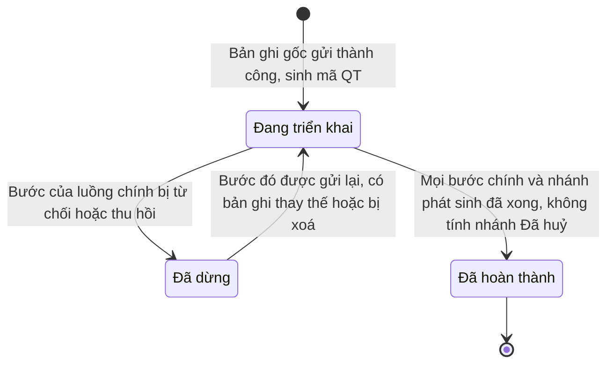
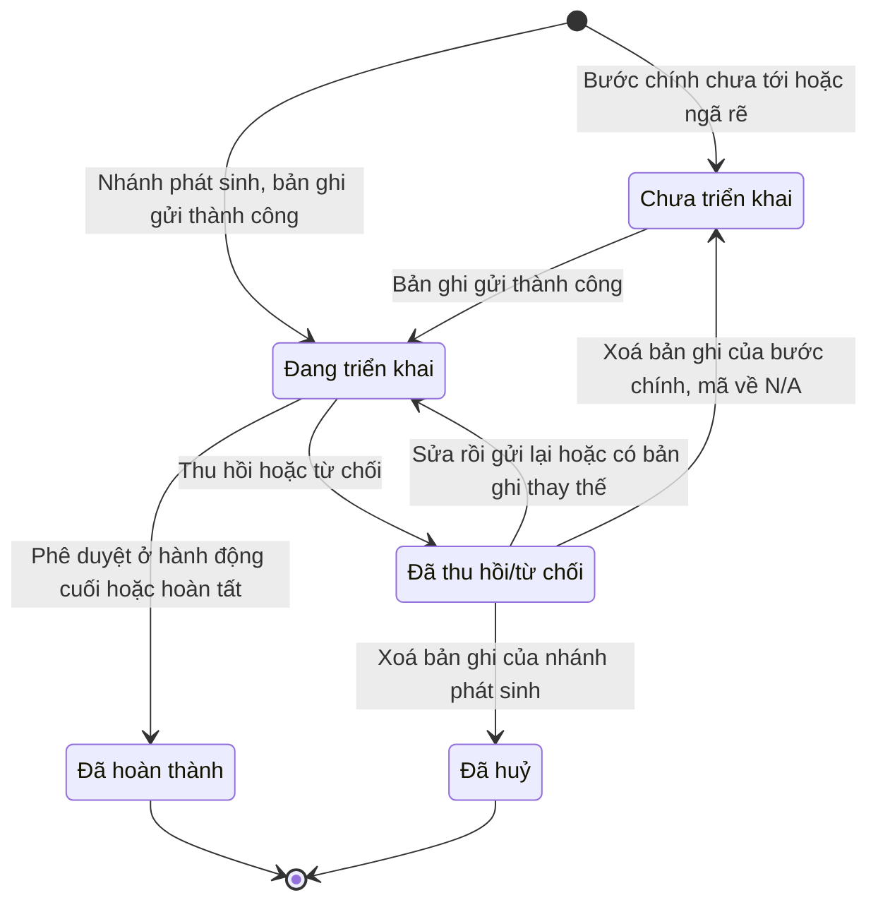

# cross-process-flow — State Diagrams

## State: QuyTrinh

<!-- chip-the-buoc: khong -->

**Related UC**: [[docs/cross-process-flow/usecases/uc-cap-nhat-quy-trinh-theo-ban-ghi.md|uc-cap-nhat-quy-trinh-theo-ban-ghi]]
**Related BR**: BR-cross-process-flow-002, BR-cross-process-flow-003, BR-cross-process-flow-009, BR-cross-process-flow-011

Luồng độc lập: quy trình tạo khi nhánh phát sinh đầu tiên gửi thành công. Nhánh phát sinh bị từ chối không làm quy trình Đã dừng; xoá bản ghi của nhánh đó thì nhánh Đã huỷ, không chặn quy trình Đã hoàn thành (BR-cross-process-flow-003, BR-cross-process-flow-009). Bản ghi của luồng chính bị xoá thì quy trình tính lại như thể bản ghi đó chưa từng có (BR-cross-process-flow-002). Bản ghi Đã thay thế không tính vào trạng thái quy trình (BR-cross-process-flow-011).

### Invalid transitions

| From | To | Why not |
|---|---|---|
| Đã hoàn thành | Đang triển khai | Đã hoàn thành là trạng thái kết thúc; chưa luồng nào phát sinh nhánh sau khi xong (BR-cross-process-flow-003) |
| Đã dừng | Đã hoàn thành | Bước của luồng chính đang bị từ chối/thu hồi thì chưa xong |
| Bất kỳ | Bất kỳ (sửa tay) | Trạng thái do hệ thống tự tính, không ai sửa tay, không đóng thủ công |

## State: BuocQuyTrinh

<!-- chip-the-buoc: khong -->

**Related UC**: [[docs/cross-process-flow/usecases/uc-cap-nhat-quy-trinh-theo-ban-ghi.md|uc-cap-nhat-quy-trinh-theo-ban-ghi]]
**Related BR**: BR-cross-process-flow-006, BR-cross-process-flow-009, BR-cross-process-flow-011

**Bước công nợ trả sau** dùng cùng tập trạng thái nhưng đổi theo bảng công nợ: Chưa triển khai → Đang triển khai khi chốt công nợ lần đầu; Đang triển khai → Đã hoàn thành khi phần công nợ thuộc nghiệp vụ của luồng đó đã thanh toán (không chờ cả bảng công nợ). Không có Đã thu hồi/từ chối. Khối Chứng từ trong panel/sheet công nợ hiện trạng thái của bảng công nợ (vd "Chưa đối soát") — đó là trạng thái của chứng từ bên Thanh toán, không phải trạng thái của bước.

**Ngã rẽ chưa chốt** (bước Chưa triển khai có nhiều hướng, D5): thẻ và panel/sheet hiện chip chờ theo điều kiện của ngã rẽ, khai ở bảng liên quy trình (Delta: điều kiện "Tuỳ nơi sửa" → chip "Chờ chọn gara", nhóm Vàng). Chip chờ là nhãn hiển thị, không phải trạng thái mới; chốt điều kiện thì ngã rẽ thành nhánh thật.

Nhánh phát sinh chỉ xuất hiện trên cây khi điều kiện đã xảy ra, vào thẳng Đang triển khai khi bản ghi gửi thành công. Bản ghi của nhánh bị xoá thì nhánh chuyển Đã huỷ (viền đứt, chữ gạch, nhãn Đã huỷ), không tính vào tiến độ (BR-cross-process-flow-009). Đã huỷ chỉ có ở nhánh phát sinh.

**Bản ghi thay thế (bước khai "1 bản ghi")**: bước đang Đã thu hồi/từ chối nhận bản ghi mới thì về Đang triển khai, trạng thái tính theo bản ghi mới. Bản ghi cũ mang nhãn Đã thay thế — đây là nhãn của bản ghi, không phải trạng thái của bước (BR-cross-process-flow-011).

### Invalid transitions

| From | To | Why not |
|---|---|---|
| Đã hoàn thành | Bất kỳ | Bản ghi đã hoàn tất không quay lại |
| Chưa triển khai | Đang triển khai (lưu nháp) | Nháp không tính, bước chỉ đổi khi gửi thành công |
| Đã thu hồi/từ chối | Chưa triển khai / Đã huỷ (nghiệp vụ không cho xoá) | Bảng liên quy trình khai "không cho xoá" (vd Bồi thường) |
| Đang triển khai / Đã thu hồi/từ chối | (thu hồi/xoá) khi đã có bước con | Chặn bằng E-cross-process-flow-002; hiện chưa nghiệp vụ nào cho phép (Giả định spec Mục 11) |
| Đã thu hồi/từ chối (bản ghi Đã thay thế) | Đang triển khai | Bản ghi cũ đã bị thay; sửa rồi gửi lại bị chặn bằng E-cross-process-flow-001 (BR-cross-process-flow-011) |
