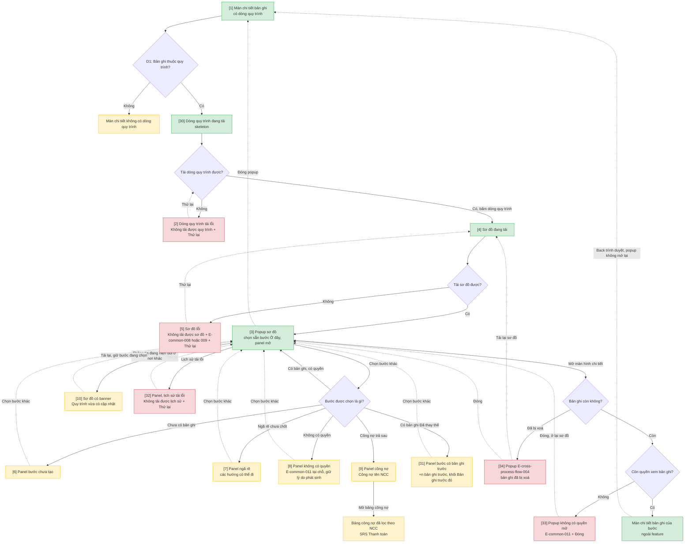
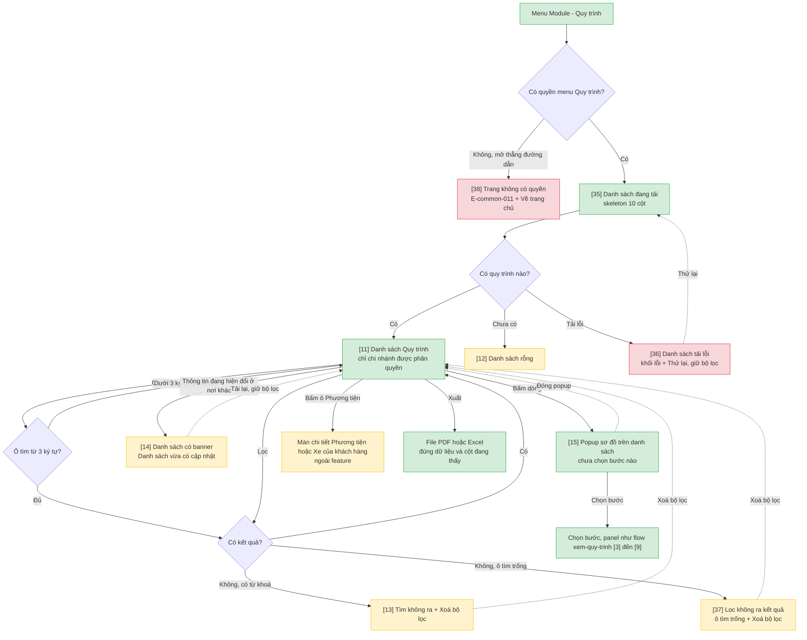
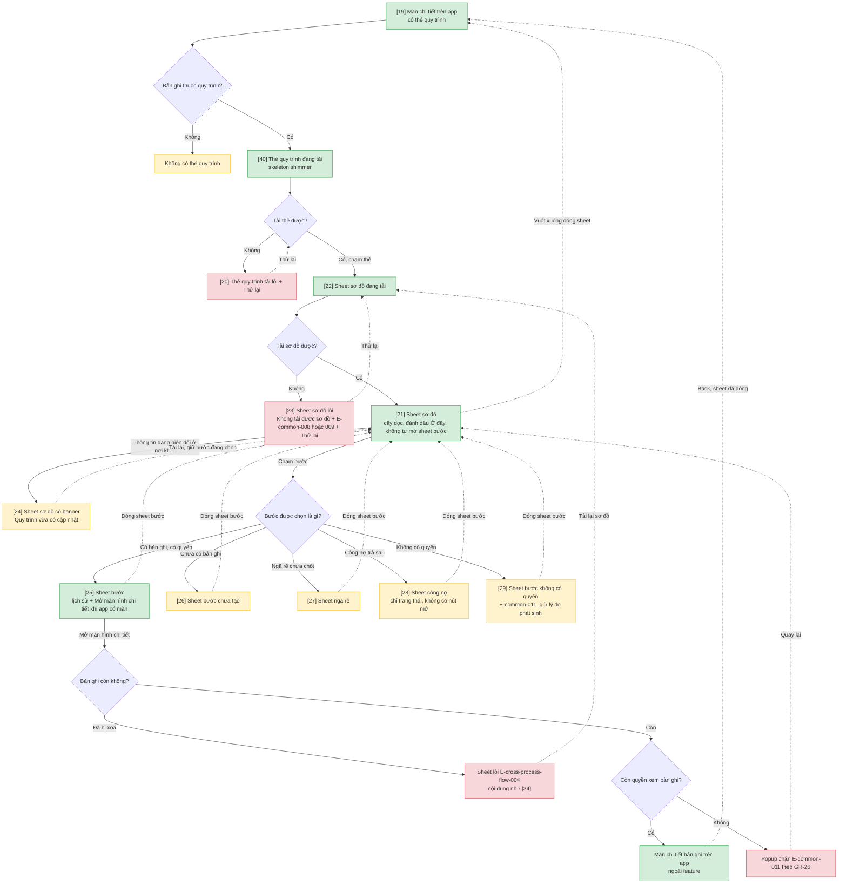

# Liên quy trình — User Flow

> Nguồn chia flow DUY NHẤT cho feature này. `/wireframe-ascii` và `/wireframe-html` đọc file này để biết flow nào gồm những màn nào — KHÔNG tự chia flow riêng.

Thiết bị theo kênh: Người theo dõi quy trình và Người tạo bản ghi dùng web desktop 1920; Lái xe dùng Delta Super App, khung mobile 393. Cột "Thiết bị" ở Mục 3 là nguồn bề rộng khung cho từng flow. Màn chi tiết bản ghi mẫu: Lệnh sửa chữa LSC-0930 (luồng Sửa chữa xe khách hàng). Mọi nghiệp vụ khác hiện dòng quy trình cùng cách.

## 1. User Flow (tổng)

> Phủ happy / error / edge cases. `[n]` = số màn hình đối chiếu Mục 2. Node không đánh số là màn của feature khác hoặc thông báo/popup dùng chung.

### Flow: xem-quy-trinh

### Flow: tra-cuu-quy-trinh

### Flow: tao-nghiep-vu-tiep-theo

### Flow: xem-quy-trinh-mobile

## 2. Danh sách màn hình

| [#] | Slug | Màn hình | Mục đích | Thuộc flow |
|-----|------|----------|----------|------------|
| 1 | ban-ghi-dong-quy-trinh | Màn chi tiết bản ghi có dòng quy trình | Dòng quy trình đầu màn (tên luồng, tiến độ, "Xong x/y bước · n nhánh phát sinh", Bước trước / Phát sinh từ) + nút tạo tiếp theo + Thu hồi/Xoá ở vùng hành động | xem-quy-trinh |
| 2 | ban-ghi-dong-quy-trinh-loi | Dòng quy trình tải lỗi | "Không tải được quy trình." + Thử lại, màn chi tiết vẫn dùng được | xem-quy-trinh |
| 3 | so-do-o-day | Popup sơ đồ — chọn sẵn Ở đây | Cây quy trình vừa khung, panel bước Ở đây mở (lịch sử 5 dòng + Mở màn hình chi tiết) | xem-quy-trinh |
| 4 | so-do-dang-tai | Popup sơ đồ đang tải | "Đang tải sơ đồ…" | xem-quy-trinh |
| 5 | so-do-loi | Popup sơ đồ lỗi | "Không tải được sơ đồ." + câu E-common-008 / E-common-009 + Thử lại, tại chỗ thay toast | xem-quy-trinh |
| 6 | panel-buoc-chua-tao | Panel bước chưa tạo | "Chưa có hoạt động. Bước này chưa được tạo." | xem-quy-trinh |
| 7 | panel-nga-re | Panel ngã rẽ | "Chưa xác định …" + các hướng có thể đi | xem-quy-trinh |
| 8 | panel-khong-quyen | Panel không có quyền | Đầu panel (kể cả lý do phát sinh) + E-common-011 tại chỗ | xem-quy-trinh |
| 9 | panel-cong-no | Panel công nợ | "Công nợ {Tên NCC}" + Mở bảng công nợ | xem-quy-trinh |
| 10 | so-do-du-lieu-cu | Popup sơ đồ có banner cập nhật | "Quy trình vừa có cập nhật." + Tải lại | xem-quy-trinh |
| 11 | danh-sach-quy-trinh | Danh sách Quy trình | 10 cột, chỉ chi nhánh được phân quyền; tìm theo mã quy trình / mã yêu cầu / mã bản ghi, lọc, xuất, tuỳ chỉnh cột | tra-cuu-quy-trinh |
| 12 | danh-sach-rong | Danh sách rỗng | "Chưa có quy trình nào. Quy trình tự tạo khi có bản ghi đầu tiên được gửi." | tra-cuu-quy-trinh |
| 13 | danh-sach-tim-khong-ra | Tìm không ra | "Không tìm thấy quy trình chứa mã "[mã]"." + Xoá bộ lọc | tra-cuu-quy-trinh |
| 14 | danh-sach-du-lieu-cu | Danh sách có banner cập nhật | "Danh sách vừa có cập nhật." + Tải lại, giữ bộ lọc | tra-cuu-quy-trinh |
| 15 | so-do-tu-danh-sach | Popup sơ đồ trên danh sách | Cây quy trình, chưa chọn bước nào, panel đóng | tra-cuu-quy-trinh |
| 16 | ban-ghi-moi-o-day | Màn chi tiết bản ghi mới | Sau khi gửi thành công: dòng quy trình có bước mới, ghim Ở đây | tao-nghiep-vu-tiep-theo |
| 17 | popup-buoc-da-co-yeu-cau | Popup E-cross-process-flow-001 | Chặn gửi trùng bước "1 bản ghi" (đang chờ / đã hoàn thành), giữ bản nháp | tao-nghiep-vu-tiep-theo |
| 18 | popup-da-co-buoc-con | Popup E-cross-process-flow-002 | Chặn thu hồi/xoá bản ghi đã sinh bước con, nêu tối đa 2 bước + "và n bước khác" | tao-nghiep-vu-tiep-theo |
| 19 | m-the-quy-trinh | App — màn chi tiết có thẻ quy trình | Thẻ quy trình: tên luồng là chính, dòng tóm tắt là phụ | xem-quy-trinh-mobile |
| 20 | m-the-quy-trinh-loi | App — thẻ quy trình tải lỗi | "Không tải được quy trình." + Thử lại | xem-quy-trinh-mobile |
| 21 | m-sheet-so-do | App — sheet sơ đồ | Card tóm tắt + cây rẽ nhánh dọc, vuốt ngang khi cây rộng | xem-quy-trinh-mobile |
| 22 | m-sheet-so-do-dang-tai | App — sheet sơ đồ đang tải | "Đang tải sơ đồ…" | xem-quy-trinh-mobile |
| 23 | m-sheet-so-do-loi | App — sheet sơ đồ lỗi | E-common-008 / E-common-009 + Thử lại | xem-quy-trinh-mobile |
| 24 | m-sheet-so-do-du-lieu-cu | App — sheet sơ đồ có banner | "Quy trình vừa có cập nhật." + Tải lại | xem-quy-trinh-mobile |
| 25 | m-sheet-buoc | App — sheet bước | Đầu sheet + lịch sử 5 dòng + Mở màn hình chi tiết | xem-quy-trinh-mobile |
| 26 | m-sheet-buoc-chua-tao | App — sheet bước chưa tạo | "Chưa có hoạt động. Bước này chưa được tạo." | xem-quy-trinh-mobile |
| 27 | m-sheet-nga-re | App — sheet ngã rẽ | "Chưa xác định …" + các hướng có thể đi | xem-quy-trinh-mobile |
| 28 | m-sheet-cong-no | App — sheet công nợ | "Công nợ {Tên NCC}" + trạng thái, không có nút mở (app không có Bảng công nợ) | xem-quy-trinh-mobile |
| 29 | m-sheet-buoc-khong-quyen | App — sheet bước không có quyền | E-common-011 tại chỗ, giữ lý do phát sinh; quyền theo nghiệp vụ của bước | xem-quy-trinh-mobile |
| 30 | ban-ghi-dong-quy-trinh-dang-tai | Dòng quy trình đang tải | Skeleton cao bằng dòng thật, không đẩy bố cục | xem-quy-trinh |
| 31 | panel-ban-ghi-truoc | Panel bước có bản ghi trước | Thẻ "+n bản ghi trước"; panel thêm khối "Bản ghi trước đó" (mã · Đã thay thế · ngày · Mở) | xem-quy-trinh |
| 32 | panel-lich-su-loi | Panel — lịch sử tải lỗi | "Không tải được lịch sử." + Thử lại trong khối; đầu panel, nút mở vẫn dùng được | xem-quy-trinh |
| 33 | popup-khong-quyen-mo | Popup không có quyền mở bản ghi | Web: popup Loại 2 câu E-common-011 + Đóng, ở lại sơ đồ | xem-quy-trinh |
| 34 | popup-ban-ghi-da-xoa | Popup E-cross-process-flow-004 | "Bản ghi [mã] đã bị xoá." + Tải lại sơ đồ / Đóng | xem-quy-trinh |
| 35 | danh-sach-dang-tai | Danh sách đang tải | Skeleton theo 10 cột | tra-cuu-quy-trinh |
| 36 | danh-sach-loi | Danh sách tải lỗi | Khối "Không tải được danh sách." + Thử lại thay vùng bảng, giữ thanh công cụ và bộ lọc | tra-cuu-quy-trinh |
| 37 | danh-sach-loc-khong-ra | Lọc không ra kết quả | Ô tìm trống: "Không có quy trình phù hợp với bộ lọc." + Xoá bộ lọc | tra-cuu-quy-trinh |
| 38 | danh-sach-khong-quyen | Trang không có quyền | Mở thẳng đường dẫn khi không có quyền menu: E-common-011 + Về trang chủ | tra-cuu-quy-trinh |
| 39 | popup-ban-ghi-nguon-thu-hoi | Popup E-cross-process-flow-003 | Bản ghi nguồn vừa bị thu hồi lúc gửi: Giữ bản nháp (chính) / Xoá bản nháp (phụ, CMP-03) | tao-nghiep-vu-tiep-theo |
| 40 | m-the-quy-trinh-dang-tai | App — thẻ quy trình đang tải | Skeleton theo hình thẻ, có shimmer | xem-quy-trinh-mobile |

## 3. Danh sách flow

| Flow-slug | Tên flow | Thiết bị | Màn hình gồm | Cases phủ |
|-----------|----------|----------|--------------|-----------|
| xem-quy-trinh | Xem quy trình từ màn chi tiết | desktop 1920 | ban-ghi-dong-quy-trinh-dang-tai → ban-ghi-dong-quy-trinh → so-do-dang-tai → so-do-o-day → panel-buoc-chua-tao / panel-nga-re / panel-khong-quyen / panel-cong-no / panel-ban-ghi-truoc; ban-ghi-dong-quy-trinh-loi, so-do-loi, so-do-du-lieu-cu, panel-lich-su-loi, popup-khong-quyen-mo, popup-ban-ghi-da-xoa | happy (mở sơ đồ, mở chi tiết), error (dòng / sơ đồ / lịch sử tải lỗi, không còn quyền mở, bản ghi đã xoá), edge (không thuộc quy trình, chưa tạo, ngã rẽ, không quyền, công nợ, bản ghi thay thế, nhánh Đã huỷ, dữ liệu cũ) |
| tra-cuu-quy-trinh | Tra cứu danh sách Quy trình | desktop 1920 | danh-sach-dang-tai → danh-sach-quy-trinh → so-do-tu-danh-sach; danh-sach-rong, danh-sach-tim-khong-ra, danh-sach-loc-khong-ra, danh-sach-du-lieu-cu, danh-sach-loi, danh-sach-khong-quyen | happy (tìm, lọc, mở sơ đồ, xuất), error (tải lỗi, không có quyền), edge (rỗng, dưới 3 ký tự, tìm không ra, lọc không ra, dữ liệu cũ, mở Phương tiện) |
| tao-nghiep-vu-tiep-theo | Tạo nghiệp vụ tiếp theo, chặn thu hồi/xoá | desktop 1920 | (từ ban-ghi-dong-quy-trinh) → ban-ghi-moi-o-day; popup-buoc-da-co-yeu-cau, popup-ban-ghi-nguon-thu-hoi, popup-da-co-buoc-con | happy (gửi thành công, bước anh em, bản ghi thay thế), error (E-001, E-003, lỗi mạng, E-002), edge (không đạt D6, lưu nháp, xoá bản nháp) |
| xem-quy-trinh-mobile | Xem quy trình trên Delta Super App | mobile 393 | m-the-quy-trinh-dang-tai → m-the-quy-trinh → m-sheet-so-do-dang-tai → m-sheet-so-do → m-sheet-buoc / m-sheet-buoc-chua-tao / m-sheet-nga-re / m-sheet-cong-no / m-sheet-buoc-khong-quyen; m-the-quy-trinh-loi, m-sheet-so-do-loi, m-sheet-so-do-du-lieu-cu | như xem-quy-trinh; nút mở chỉ có khi app có màn chi tiết của loại bản ghi; lỗi E-001 / E-003 / E-004 dạng sheet lỗi Loại 2 cùng nội dung [17] / [39] / [34] |

Màn dùng chung: `ban-ghi-dong-quy-trinh` là điểm bắt đầu của cả `xem-quy-trinh` và `tao-nghiep-vu-tiep-theo` (vẽ 1 lần ở flow xem). Panel [6]–[9], [31], [32] và popup [33], [34] dùng cho cả popup mở từ màn chi tiết [3] và mở từ danh sách [15] (vẽ 1 lần ở flow xem).

## 3.5. Chuyển màn (transitions)

| Từ màn [#] | Đến màn [#] | Trigger | Điều kiện |
|-----------|------------|---------|-----------|
| Màn chi tiết [1] | (không dòng quy trình) [1] | Mở màn | Bản ghi không thuộc quy trình, hoặc luồng độc lập chưa có nhánh (D1) |
| Màn chi tiết [1] | Dòng quy trình đang tải [30] | Mở màn | Bản ghi thuộc quy trình |
| Dòng quy trình đang tải [30] | Màn chi tiết [1] | Tải xong | Tải được |
| Dòng quy trình đang tải [30] | Dòng quy trình tải lỗi [2] | Tải xong | Tải dòng quy trình lỗi |
| Dòng quy trình tải lỗi [2] | Màn chi tiết [1] | Bấm Thử lại | Tải được |
| Màn chi tiết [1] | Sơ đồ đang tải [4] | Bấm dòng quy trình | — |
| Sơ đồ đang tải [4] | Popup sơ đồ Ở đây [3] | Tải xong | Tải được |
| Sơ đồ đang tải [4] | Sơ đồ lỗi [5] | Tải xong | Lỗi hệ thống hoặc mất mạng |
| Sơ đồ lỗi [5] | Sơ đồ đang tải [4] | Bấm Thử lại | — |
| Popup sơ đồ Ở đây [3] | Popup sơ đồ Ở đây [3] | Chọn bước | Bước có bản ghi, có quyền (panel đổi theo bước) |
| Popup sơ đồ Ở đây [3] | Panel bước chưa tạo [6] | Chọn bước | Bước chưa có bản ghi (D2) |
| Popup sơ đồ Ở đây [3] | Panel ngã rẽ [7] | Chọn bước | Ngã rẽ chưa chốt (D5) |
| Popup sơ đồ Ở đây [3] | Panel không có quyền [8] | Chọn bước | Không có quyền xem bản ghi (D3) |
| Popup sơ đồ Ở đây [3] | Panel công nợ [9] | Chọn bước | Bước thanh toán trả sau (D4) |
| Popup sơ đồ Ở đây [3] | Panel bước có bản ghi trước [31] | Chọn bước | Bước "1 bản ghi" có bản ghi Đã thay thế |
| Popup sơ đồ Ở đây [3] | Panel, lịch sử tải lỗi [32] | Tải lịch sử | Lỗi khi tải khối lịch sử |
| Panel, lịch sử tải lỗi [32] | Popup sơ đồ Ở đây [3] | Bấm Thử lại | Tải được |
| Panel [6] / [7] / [8] / [31] | Popup sơ đồ Ở đây [3] | Chọn bước khác | — |
| Panel công nợ [9] | (Bảng công nợ — SRS Thanh toán) | Bấm Mở bảng công nợ | Lọc theo NCC + khoảng thời gian bảng công nợ |
| Popup sơ đồ Ở đây [3] | Sơ đồ có banner [10] | Bước đổi ở nơi khác | Popup đang mở |
| Sơ đồ có banner [10] | Popup sơ đồ Ở đây [3] | Bấm Tải lại | Giữ bước đang chọn nếu còn |
| Popup sơ đồ Ở đây [3] | (Màn chi tiết bản ghi của bước — ngoài feature) | Bấm Mở màn hình chi tiết | Còn quyền; mở cùng tab, đóng popup |
| Popup sơ đồ Ở đây [3] | Popup không có quyền mở [33] | Bấm Mở màn hình chi tiết | Bản ghi vừa bị thu quyền |
| Popup không có quyền mở [33] | Popup sơ đồ Ở đây [3] | Bấm Đóng | — |
| Popup sơ đồ Ở đây [3] | Popup E-004 [34] | Bấm Mở màn hình chi tiết | Bản ghi đã bị xoá trong lúc sơ đồ đang mở |
| Popup E-004 [34] | Sơ đồ đang tải [4] | Bấm Tải lại sơ đồ | — |
| Popup E-004 [34] | Popup sơ đồ Ở đây [3] | Bấm Đóng | Sơ đồ giữ nguyên |
| (Màn chi tiết của bước) | Màn chi tiết [1] | Back trình duyệt | Popup không mở lại |
| Popup sơ đồ Ở đây [3] | Màn chi tiết [1] | Đóng popup | — |
| (Đường dẫn danh sách) | Trang không có quyền [38] | Mở thẳng đường dẫn | Không có quyền menu Quy trình |
| (Menu Module › Quy trình) | Danh sách đang tải [35] | Vào menu | Có quyền |
| Danh sách đang tải [35] | Danh sách [11] | Tải xong | Có quy trình |
| Danh sách đang tải [35] | Danh sách rỗng [12] | Tải xong | Chưa có quy trình nào |
| Danh sách đang tải [35] | Danh sách tải lỗi [36] | Tải xong | Tải lỗi |
| Danh sách tải lỗi [36] | Danh sách đang tải [35] | Bấm Thử lại | Giữ ô tìm và bộ lọc |
| Danh sách [11] | Danh sách [11] | Gõ mã | Dưới 3 ký tự: chưa tìm; từ 3 ký tự: có kết quả |
| Danh sách [11] | Tìm không ra [13] | Gõ mã / lọc | Không có kết quả, ô tìm có từ khoá |
| Danh sách [11] | Lọc không ra kết quả [37] | Lọc | Không có kết quả, ô tìm trống |
| Lọc không ra kết quả [37] | Danh sách [11] | Bấm Xoá bộ lọc | — |
| Tìm không ra [13] | Danh sách [11] | Bấm Xoá bộ lọc | — |
| Danh sách [11] | Danh sách có banner [14] | Có thay đổi ở nơi khác | Thông tin đang hiện trên danh sách đổi |
| Danh sách có banner [14] | Danh sách [11] | Bấm Tải lại | Giữ bộ lọc |
| Danh sách [11] | Popup sơ đồ trên danh sách [15] | Bấm dòng | — |
| Popup sơ đồ trên danh sách [15] | Panel [6] / [7] / [8] / [9] / [31] hoặc panel có bản ghi | Chọn bước | Theo D5 / D2 / D3 / D4, bản ghi thay thế |
| Popup sơ đồ trên danh sách [15] | Danh sách [11] | Đóng popup | — |
| Danh sách [11] | (Màn chi tiết Phương tiện / Xe của khách hàng) | Bấm ô Phương tiện / khách hàng | — |
| Danh sách [11] | (File PDF / Excel) | Bấm Xuất | Đúng dữ liệu và cột đang thấy (FR-cross-process-flow-022) |
| Màn chi tiết [1] | (Form tạo mới của nghiệp vụ tiếp theo) | Bấm nút Tạo … | Đạt trigger + có quyền tạo (D6); không đạt thì không có nút |
| (Form tạo mới) | Màn chi tiết bản ghi mới [16] | Gửi | Thành công (bước 1 bản ghi còn trống, bản cũ Đã thu hồi/từ chối → bản mới thay thế, hoặc bước nhiều bản ghi → bước anh em) |
| (Form tạo mới) | Popup E-001 [17] | Gửi | Bước 1 bản ghi đã có yêu cầu đang chờ hoặc đã hoàn thành; hai người cùng gửi thì người sau |
| Popup E-001 [17] | (Form tạo mới) | Đóng | Giữ bản nháp |
| (Form tạo mới) | Popup E-003 [39] | Gửi | Bản ghi nguồn vừa bị thu hồi (thu hồi đến trước) |
| Popup E-003 [39] | (Form tạo mới) | Bấm Giữ bản nháp | — |
| Popup E-003 [39] | (Bản nháp đã xoá) | Bấm Xoá bản nháp | Xác nhận theo CMP-03 |
| (Form tạo mới) | (Toast E-common-008 / 009) | Gửi | Lỗi hệ thống, mất mạng hoặc cây không nhận bước, giữ form |
| (Form tạo mới) | (Màn của nghiệp vụ) | Lưu nháp | Cây không đổi |
| Màn chi tiết [1] | Popup E-002 [18] | Bấm Thu hồi / Xoá | Đã có bước con |
| Popup E-002 [18] | Màn chi tiết [1] | Đóng | Bản ghi giữ nguyên |
| Màn chi tiết app [19] | (không thẻ quy trình) [19] | Mở màn | Không thuộc quy trình |
| Màn chi tiết app [19] | Thẻ đang tải [40] | Mở màn | Bản ghi thuộc quy trình |
| Thẻ đang tải [40] | Màn chi tiết app [19] | Tải xong | Tải được |
| Thẻ đang tải [40] | Thẻ tải lỗi [20] | Tải xong | Tải thẻ lỗi |
| Thẻ tải lỗi [20] | Màn chi tiết app [19] | Chạm Thử lại | Tải được |
| Màn chi tiết app [19] | Sheet đang tải [22] | Chạm thẻ quy trình | — |
| Sheet đang tải [22] | Sheet sơ đồ [21] | Tải xong | Tải được |
| Sheet đang tải [22] | Sheet lỗi [23] | Tải xong | Lỗi hệ thống hoặc mất mạng |
| Sheet lỗi [23] | Sheet đang tải [22] | Chạm Thử lại | — |
| Sheet sơ đồ [21] | Sheet có banner [24] | Có thay đổi ở nơi khác | Thông tin đang hiện trên sheet đổi |
| Sheet có banner [24] | Sheet sơ đồ [21] | Chạm Tải lại | Giữ bước đang chọn |
| Sheet sơ đồ [21] | Sheet bước [25] | Chạm bước | Có bản ghi, có quyền; nút mở chỉ có khi app có màn chi tiết của loại bản ghi |
| Sheet sơ đồ [21] | Sheet bước chưa tạo [26] | Chạm bước | Chưa có bản ghi |
| Sheet sơ đồ [21] | Sheet ngã rẽ [27] | Chạm bước | Ngã rẽ chưa chốt |
| Sheet sơ đồ [21] | Sheet công nợ [28] | Chạm bước | Bước thanh toán trả sau |
| Sheet sơ đồ [21] | Sheet không có quyền [29] | Chạm bước | Không có quyền xem theo nghiệp vụ của bước |
| Sheet bước [25] – [29] | Sheet sơ đồ [21] | Đóng sheet bước | — |
| Sheet bước [25] | (Màn chi tiết bản ghi trên app) | Chạm Mở màn hình chi tiết | Còn quyền; đẩy màn mới |
| Sheet bước [25] | (Popup chặn E-common-011, GR-26) | Chạm Mở màn hình chi tiết | Bản ghi vừa bị thu quyền |
| Sheet bước [25] | (Sheet lỗi E-004) | Chạm Mở màn hình chi tiết | Bản ghi đã bị xoá; Tải lại sơ đồ → [22] |
| (Màn chi tiết bản ghi trên app) | Màn chi tiết app [19] | Back | Sheet đã đóng |
| Sheet sơ đồ [21] | Màn chi tiết app [19] | Vuốt xuống đóng sheet | — |

## 3.6. Tác vụ chính

| Tác vụ | Vai trò | Tần suất | Mức quan trọng | Đường đi | Số bước | Thành công khi |
|--------|---------|----------|----------------|----------|---------|----------------|
| Kiểm các bước trước đã xong trước khi thanh toán | Kế toán thanh toán | cuối tháng | cao | [1] → [4] → [3] → chọn bước | 2 | ≤3 bước, không mở từng phiếu |
| Xem lệnh sửa chữa đã sinh phiếu gì, bước nào kẹt | Quản lý xưởng | hằng ngày | cao | [11] gõ mã → bấm dòng → [15] | 2 | ≤2 bước (SC-cross-process-flow-02) |
| Tìm nhánh nhập kho dư / bồi thường của một lệnh | Thủ kho | khi có vấn đề | trung | [11] gõ mã → bấm dòng → [15] → chọn bước → Mở màn hình chi tiết | 4 | ≤4 bước |
| Xem ngữ cảnh trước khi duyệt | Người duyệt | thỉnh thoảng | trung | [1] → [4] → [3] → chọn bước trước | 2 | ≤3 bước |
| Xem tiến độ sửa xe của mình | Lái xe | thường xuyên | thấp | [19] chạm thẻ → [22] → [21] | 1 | ≤2 bước |
| Tạo nghiệp vụ tiếp theo | Người tạo bản ghi | hằng ngày | cao | [1] bấm nút → form (ngoài feature) gửi → [16] | 2 + phần nhập của nghiệp vụ | không phải gõ lại dữ liệu đã có ở bản ghi trước |

## 4. Open Questions

- [ ] OQ-1: Bảng phát sinh luồng Điều vận (Cung cấp dịch vụ tổng quát → Điều phối → Lệnh vận tải → Thanh toán chi/thu) — chờ chốt với khách; tác vụ của Điều phối chưa đưa vào Mục 3.6. — Nguồn khách: chưa có trong tài liệu khách gửi
- [x] OQ-2: Delta Super App có màn Bảng công nợ không? — Không. Sheet công nợ [28] chỉ hiện trạng thái, không có nút mở. (chốt 2026-10-12)
